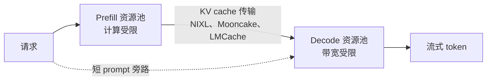

# 推理流水线（Inference Pipeline）

本章介绍 LLM（Large Language Model，大型语言模型）在推理时如何生成文本、涉及哪些计算阶段，以及生产服务中的关键指标。

## 目录（Table of Contents）

- [生成基础（Generation Basics）](#生成基础-generation-basics)
- [Prefill 和 Decode 阶段](#prefill-和-decode-阶段-prefill-and-decode-phases)
- [采样策略（Sampling Strategies）](#采样策略-sampling-strategies)
- [停止条件（Stopping Conditions）](#停止条件-stopping-conditions)
- [推测解码（Speculative Decoding）](#推测解码-speculative-decoding)
- [延迟指标、有效吞吐量与速度档位](#延迟指标-latency-metrics)
- [内存与计算需求](#内存与计算需求-memory-and-compute-requirements)
- [连续批处理与前缀缓存（Continuous Batching & Prefix Caching）](#连续批处理与前缀缓存-continuous-batching-and-prefix-caching)
- [多 LoRA 服务（Multi-LoRA Serving）](#多-lora-服务-multi-lora-serving)
- [流式传输](#流式传输-streaming)
- [生产环境注意事项（Production Considerations）](#生产环境注意事项-production-considerations)
- [面试问题（Interview Questions）](#面试问题-interview-questions)
- [参考资料（References）](#参考资料)

---

## 生成基础（Generation Basics）

LLM 以自回归（autoregressive）方式生成文本：一次生成一个 token，并使用所有先前 token 作为上下文。

```
Input: "The quick brown"
Step 1: Generate "fox" -> "The quick brown fox"
Step 2: Generate "jumps" -> "The quick brown fox jumps"
Step 3: Generate "over" -> "The quick brown fox jumps over"
...
```

### 生成循环（The Generation Loop）

```python
def generate(prompt: str, max_tokens: int, model) -> str:
    tokens = tokenize(prompt)
    
    for _ in range(max_tokens):
        # Forward pass: get logits for next token
        logits = model.forward(tokens)
        
        # Sample next token from probability distribution
        next_token = sample(logits[-1])
        
        # Check for stop condition
        if next_token == EOS_TOKEN:
            break
        
        tokens.append(next_token)
    
    return detokenize(tokens)
```

---

## Prefill 和 Decode 阶段（Prefill and Decode Phases）

推理分为两个特征不同的阶段：

### Prefill 阶段

并行处理整个输入 prompt。

```
Input: "The quick brown fox" (4 tokens)

Prefill:
- Process all 4 tokens simultaneously
- Compute attention across all pairs
- Populate KV cache for all positions
- Output: logits for next token
```

**特征：**
- 计算受限（compute-bound，矩阵运算很多）
- 可在 token 维度并行
- 耗时随 prompt 长度增长
- 每次生成只执行一次

### Decode 阶段

一次生成一个 token。

```
Decode step 1:
- Input: new token position only
- Attend to all KV cache (prompt + previously generated)
- Generate one token

Decode step 2:
- Append new K, V to cache
- Input: newest token position
- Generate next token

...repeat until done
```

**特征：**
- 内存受限（memory-bound，每一步都会从 HBM 重新读取权重和 KV cache）
- 串行执行（必须完成当前步骤才能开始下一步）
- 每 token 耗时大致恒定
- 重复执行直到满足停止条件

### 为什么这很重要

| 阶段 | 瓶颈 | 优化方式 |
|------|------|----------|
| Prefill | 计算（GPU 核心） | Flash Attention，更强的 GPU |
| Decode | 内存带宽 | GQA、批处理、量化、推测解码 |

**对服务的影响：**
- 长 prompt 会增加 prefill 时间（影响 TTFT）
- 长生成会增加 decode 时间（影响总延迟）
- 批处理对 decode 效率的提升大于对 prefill 的提升

### 解耦式 Prefill 与 Decode

由于两个阶段的瓶颈相反，大型部署会将它们运行在独立资源池中：prefill 工作节点构建并交接 KV cache，decode 工作节点则流式输出 token。



- **收益是有效吞吐量（goodput），而非峰值吞吐量**：即同时满足 TTFT 和 token 间延迟 SLO 的请求速率。Prefill 峰值负载不再阻塞进行中的 decode。（vLLM 2026 年 9 月的解耦服务指南即如此定义。）
- **代价是 KV 传输**：BF16 格式的 Llama-3.1-70B 每 token 存储 320 KiB，因此一个 10K-token prompt 要向 decode 交接约 3 GB；在 400 Gb/s 下，会给 TTFT 增加约 65 ms。短 prompt 通常不值得解耦；NVIDIA Dynamo 1.5 增加了条件旁路，会直接将它们发送给 decode。
- **跨芯片方案**会将 prefill 放到 HBM GPU，将 decode 放到 SRAM 或晶圆级硬件上，面向高级低延迟档位：NVIDIA Rubin 加 Groq 3 LPX（已投入生产）、AMD Helios 加 Cerebras（已宣布，通过 Cerebras Cloud），以及 Intel 加 SambaNova 的蓝图。
- **模型现在也围绕这种分离设计**：DeepSeek V4.1-Flash 在 prefill 时每 token 激活 8B 参数，在 decode 时激活 16B 参数。

---

## 采样策略（Sampling Strategies）

在计算出 logits 后，需要选择下一个 token。不同策略会产生不同的输出。

### 贪婪解码（Greedy Decoding）

始终选择概率最高的 token：

```python
def greedy_sample(logits):
    return torch.argmax(logits)
```

**特性：**
- 确定性
- 长文本生成时常出现重复
- 适合事实型/结构化输出

### 温度采样（Temperature Sampling）

在 softmax 之前缩放 logits 以控制随机性：

```python
def temperature_sample(logits, temperature=1.0):
    scaled_logits = logits / temperature
    probs = torch.softmax(scaled_logits, dim=-1)
    return torch.multinomial(probs, num_samples=1)
```

**温度影响：**

| Temperature | 行为 | 使用场景 |
|-------------|------|----------|
| 0 | 贪婪（数学上确定，但在批量 GPU 服务中不保证逐位完全一致） | 事实问答、代码 |
| 0.3-0.7 | 低随机性 | 通用任务 |
| 1.0 | 基线 | 创意写作 |
| 1.5+ | 高随机性 | 头脑风暴 |

### Top-K 采样（Top-K Sampling）

只考虑概率最高的 K 个 token：

```python
def top_k_sample(logits, k=50):
    values, indices = torch.topk(logits, k)
    probs = torch.softmax(values, dim=-1)
    sampled_idx = torch.multinomial(probs, num_samples=1)
    return indices[sampled_idx]
```

**作用：** 过滤掉低概率、可能没有意义的 token。

### Top-P（Nucleus）采样（Top-P / Nucleus Sampling）

包含 token，直到累计概率超过 P：

```python
def top_p_sample(logits, p=0.9):
    sorted_probs, sorted_indices = torch.sort(
        torch.softmax(logits, dim=-1), descending=True
    )
    cumulative_probs = torch.cumsum(sorted_probs, dim=-1)
    
    # Find cutoff
    cutoff_idx = torch.searchsorted(cumulative_probs, p)
    
    # Sample from truncated distribution
    selected_probs = sorted_probs[:cutoff_idx + 1]
    selected_probs = selected_probs / selected_probs.sum()
    sampled_idx = torch.multinomial(selected_probs, num_samples=1)
    
    return sorted_indices[sampled_idx]
```

**相比 Top-K 的优势：** 会根据概率分布动态调整。高置信预测包含更少 token；低置信预测包含更多 token。

### 常见配置

| 使用场景 | Temperature | Top-P | Top-K |
|----------|-------------|-------|-------|
| 代码生成 | 0-0.2 | 0.95 | - |
| 事实问答 | 0.1-0.3 | 1.0 | - |
| 通用聊天 | 0.7 | 0.9 | - |
| 创意写作 | 1.0 | 0.95 | - |
| 头脑风暴 | 1.2 | 1.0 | - |

这些设置适用于自托管引擎，以及仍接受采样参数的托管模型。许多前沿托管模型已不再接受；参见[前沿托管模型的采样控制](#前沿托管模型的采样控制-sampling-controls-on-hosted-frontier-models)。

### 前沿托管模型的采样控制（Sampling Controls on Hosted Frontier Models）

上述内容仍完全适用于自托管引擎：vLLM、SGLang 和 llama.cpp 都暴露完整参数集。托管推理模型正在移除这些调节项：

| 提供商 | 变化内容 |
|--------|----------|
| Anthropic | 对 Claude Opus 4.7 及之后的所有 Claude 模型，Claude API 会对非默认的 `temperature`、`top_p` 或 `top_k` 返回 400。Python SDK 1.0（2026 年 8 月 20 日）从 Messages 方法签名中移除了这些参数，因此传入它们会触发 `TypeError`（旧模型仍可通过 `extra_body` 接收它们）。 |
| Google | Google 于 2026 年 7 月 21 日在 Gemini API 中弃用了 `temperature`、`top_p` 和 `top_k`。Gemini 3.8 Flash 用 `thinking_level`（`low`、默认的 `medium`、`high`）替代 `thinking_budget`。 |
| OpenAI | GPT-6 Astra（2026 年 9 月 3 日）不接受自定义 `temperature` 或 `top_p`，也不返回 logprobs。 |

现在的控制面是**推理强度（reasoning effort）**（或 thinking level），而不是采样器。这带来的变化包括：
- **确定性**：将 `temperature=0` 用于“可复现性”的代码现在会失效或正逐步淘汰（Claude API 返回 400、Anthropic Python SDK 1.0 抛出 `TypeError`、GPT-6 Astra 不支持、Gemini 已弃用），而且它本来也无法保证逐位完全一致的输出。批量 GPU 服务、MoE 路由和浮点归约顺序会使每次运行的输出发生变化，除非引擎以牺牲部分吞吐量为代价运行确定性、批次无关模式。
- **置信度信号**：基于 logprob 的路由、弃答或人工升级评分在 Astra 上不可用。应改用校准后的分类器、验证器轮次或结构化自我评估。
- **多样性**：best-of-n 的多样性现在来自 prompt 变化、不同模型或提供商自身的采样，而非提高 temperature。
- **抽象层**：当切换到这些模型时，硬编码采样参数的封装会失效。应将提供商特定参数置于轻量、按模型区分的配置之后。

### 重复惩罚（Repetition Penalties）

降低最近生成 token 的概率：

```python
def apply_repetition_penalty(logits, generated_tokens, penalty=1.2):
    for token_id in set(generated_tokens):
        logits[token_id] /= penalty
    return logits
```

**变体：**
- 存在惩罚（Presence penalty）：惩罚所有出现过的 token
- 频率惩罚（Frequency penalty）：按出现次数比例惩罚

---

## 停止条件（Stopping Conditions）

生成会持续到满足停止条件为止：

### EOS Token

模型生成序列结束 token：

```python
if next_token == tokenizer.eos_token_id:
    break
```

### 最大 Token 数

生成长度的硬限制：

```python
for i in range(max_tokens):
    # generate...
```

### 停止序列（Stop Sequences）

用于终止生成的自定义字符串：

```python
stop_sequences = ["###", "\n\n", "Human:"]

for seq in stop_sequences:
    if output.endswith(seq):
        output = output[:-len(seq)]
        break
```

---

## 推测解码（Speculative Decoding）

**面向延迟敏感 decode 的每个主流服务引擎的标准能力。**

廉价的草稿器（drafter）先提出接下来的 K 个 token；目标模型在一次前向传播中验证全部 K 个，并保留它同意的最长前缀，再额外采样一个自己的 token。使用标准拒绝采样验证时，输出分布与目标模型完全一致，因此推测只改变速度，不改变质量。

```
Drafter (cheap): proposes "The", "quick", "brown", "fox", "jumps"
Target (large):  verifies all 5 in ONE forward pass
Result: if the target accepts 4, it adds 1 of its own: 5 tokens for one
        large forward pass (plus the drafter's cost)
```

| 方法 | 草稿来源 | 状态（2026 年 10 月） |
|------|----------|----------------------|
| 草稿模型 | 使用同一 tokenizer 的独立小模型 | 仍受支持；需要匹配的小模型 |
| EAGLE-3 | 基于目标模型隐藏状态训练的轻量级头 | 没有内置头的模型的常见选择 |
| MTP heads | 随模型发布的多 token 预测模块 | DeepSeek V3 起；MiMo-V2.6-Pro（5 层 MTP，每次 7 个 token）；Qwen3.8-Flash-Next（4B MTP 模块） |
| DSpark | DeepSeek 的草稿器，随 checkpoint 打包 | DeepSeek-V4-Flash-DSpark 和 V4-Pro-DSpark（2026 年 6 月 27 日）是在相同 checkpoint 上附加草稿模块；vLLM 使用 `method: "dspark"` 并设置 7 个推测 token |
| DFlash 2 | 并行提出整个块的块扩散草稿器 | Inco AI，2026 年 8 月 18 日；在 Qwen3.8-27B 上达到 2.7x 至 3.4x（厂商报告）；于 8 月 19—27 日合入 SGLang、vLLM 和 llama.cpp |
| N-gram、prompt lookup、suffix decoding | prompt 或先前输出的子串 | 无需额外模型；适合 RAG、代码编辑及重复文本的 agent 循环 |

2024 年最受欢迎的 Medusa heads 已不再出现在 vLLM 文档中（仍接受 `medusa` 方法值）；应优先使用 EAGLE-3 或模型自身的 MTP heads。

**批大小的限制。** 推测解码通过额外计算节省受带宽限制的 decode 步骤。低并发时，这些计算近似免费；高并发时 GPU 已处于忙碌状态，每个被拒绝的草稿 token 都是浪费，这也是经典建议“在大 batch 下关闭它”的原因。vLLM 的**自适应验证（adaptive verification）**（2026 年 8 月 14 日；v0.30 扩展到 MTP、EAGLE-3 和 DFlash 草稿器）会为每个草稿位置预测存活概率，并在每一步只接纳全局 top-B 的草稿槽位。对于 DeepSeek-V4-Pro-0813，7 个草稿 token 中第一个的存活率超过 70%，最后一个不足 10%；vLLM 报告称推测解码在并发度达到 256 时仍有收益。

**运行层面的影响：**
- 发布方现在会将草稿器随权重一同发布，因此自托管吞吐量估算应假设已启用推测解码，评测一致性检查也应经过实际服务所用的同一推测路径。
- MLPerf Inference v6.1（2026 年 9 月）允许在 gpt-oss-120b Interactive 场景中使用推测解码，因此该测试结果可能包含它。

完整说明见[推测解码](../04-inference-optimization/03-speculative-decoding.md)。

---

## 延迟指标（Latency Metrics）

### 首 token 时间（Time to First Token，TTFT）

从请求发出到第一个生成 token 的时间。

```
TTFT = network_latency + queue_time + prefill_time
```

**影响 TTFT 的因素：**
- Prompt 长度（prefill 随 prompt 长度线性增长；在长上下文中，二次注意力占主导时增长更快）
- 模型大小
- GPU 速度
- 队列深度

**目标：**
- 交互式聊天：< 500ms
- 实时场景：< 200ms
- 批处理：没那么关键

### 每秒 token 数（Tokens Per Second，TPS）

首 token 之后的生成速率。单请求 TPS 是**token 间延迟**（inter-token latency，ITL，也称每输出 token 耗时）的倒数。

```
TPS = (total_tokens - 1) / (total_time - TTFT)
```

**影响 TPS 的因素：**
- 模型大小（MoE 为激活参数量）
- 批大小
- GPU 内存带宽
- KV cache 大小
- 推测解码接受率

**典型数值：**
- H100 上的 Llama 70B：每请求 30-50 tokens/sec
- 标准档位的前沿托管 API：每请求数十 tokens/sec，随模型、推理强度和负载而变化
- 小模型（7B）：100+ tokens/sec

对于推理模型，隐藏的思考 token 会在第一个可见 token 前流出，因此用户感知的 TTFT 包含部分 decode 阶段。应单独测量第一个*可见* token 的时间。

### 速度是定价档位

提供商现在将速度作为独立于模型的商品出售：
- **OpenAI**：Fast 档位（2026 年 7 月 30 日由 Priority 更名）为 Standard 的 2 倍（GPT-5.5 为 2.5 倍）；Ultrafast 为 6 倍，自 2026 年 9 月 29 日起在 GPT-6 Astra 上正式可用。面向部分客户预览的 GPT-5.6 Sol Ultrafast 运行在 Cerebras 上，输出速度最高可达 750 tok/s。
- **Anthropic**：Claude Opus 5.5 的 fast mode 售价为每 1M token $8/$40（标准档位的 2 倍），仅作为 Claude API 的研究预览提供。
- **扩散语言模型（Diffusion LMs）**以并行细化代替逐 token decode：Inception 报告 Mercury 2.5 在 NVIDIA GPU 上达到 1,107 tok/s，标价为每 1M token $0.20/$0.75。

延迟现在是路由维度：将面向用户的轮次发送到快速档位，将后台 agent 步骤发送到 Standard 或 Batch。

### 总延迟（Total Latency）

```
Total = TTFT + (output_tokens / TPS)
```

**示例：**
- TTFT：200ms
- TPS：50 tokens/sec
- 输出：100 tokens
- 总计：200ms + 2000ms = 2.2s

### 吞吐量（Throughput）

单位时间内完成的请求数：

```
Throughput = concurrent_requests * TPS / average_output_tokens
```

更大的批大小会提高吞吐量，但也可能增加单请求延迟。

### 有效吞吐量与帕累托曲线

峰值吞吐量和 batch=1 速度单独看都会误导。**有效吞吐量（goodput）**是在同一时间满足 TTFT 和 ITL SLO 的请求速率。比较引擎或加速器时，应在你的 SLO 下、以符合自身流量形态的负载比较**吞吐量与交互性帕累托曲线**。

SemiAnalysis 的 AgentX 场景（多轮、长上下文且前缀复用率高的 agent 流量）显示了运行点的重要性。对于 DeepSeek V4 Pro，它报告 Vera Rubin NVL72 在每用户 170 tok/s、按自有成本假设计算时，每单位 TCO 的吞吐量约为 GB300 的 67 倍；但在每用户 80 tok/s 的 P90 SLA、3 年租赁定价下，仅比 GB300 NVL72 多 62% 的 token（分析师报告）。相同硬件、相同模型，根据选取的交互性目标和成本口径不同，既可以得出 67 倍的标题数字，也可以得出 1.6 倍的结果。接受任何加速器宣称前，都应索取两者。

---

## 内存与计算需求（Memory and Compute Requirements）

### 模型权重（Model Weights）

```
Memory = parameters * bytes_per_parameter

70B model in BF16: 70B * 2 bytes   = 140 GB
70B model in FP8:  70B * 1 byte    = 70 GB
70B model in INT4 or FP4: 70B * 0.5 bytes = 35 GB
  (plus block scales: NVFP4 ~4.5 bits/weight, ~39 GB; MXFP4 ~4.25 bits, ~37 GB)
```

另加块级缩放后：NVFP4 约为每权重 4.5 位、约 39 GB；MXFP4 约为每权重 4.25 位、约 37 GB。

**2026 年的精度配置：** FP4 权重（NVIDIA 的 NVFP4，以及 AMD 和其他 OCP 格式硬件上的 MXFP4）配合 FP8 KV 缓存，是当前推理服务的主流配置。SGLang 可在加载时将 NVFP4 检查点重新量化为 MXFP4，以便在 AMD 上运行。低精度只有配合优秀内核才有优势：NVIDIA Dynamo 的 Nemotron 3.5 Lightning 配方测得，BF16 比 Marlin 内核上的 NVFP4 快 80%，比 CuTeDSL 内核上的 NVFP4 快 12%。在认定 FP4 更快前，应基准测试确切的内核路径。

### KV Cache

```
Per token: 2 * layers * kv_heads * head_dim * bytes
Per request: per_token * sequence_length

Llama 3.x 70B (80 layers, 8 KV heads via GQA, head_dim 128, BF16):
= 2 * 80 * 8 * 128 * 2 bytes
= 320 KiB per token

At 4K context:   ~1.3 GB per request
At 8K context:   ~2.7 GB per request
At 128K context: ~43 GB per request
(FP8 KV halves these. Full MHA with 64 KV heads would be 8x larger.)
```

在 4K 上下文下，每个请求约需 1.3 GB。

### 总 GPU 内存（Total GPU Memory）

```
Total = model_weights + kv_cache * batch_size + activations

Example: Llama 3.x 70B, 8K context, batch 16
- Weights (INT4/FP4): ~35-40 GB
- KV cache (BF16, 8K, batch 16): 16 * 2.7 GB = ~43 GB
- Activations and runtime overhead: ~5 GB
- Total: ~83-88 GB, just over one H100 80GB. Fits one H200 141GB,
  or one H100 with FP8 KV (~21 GB of KV instead of ~43 GB)
```

总计约为 83–88 GB，略高于一张 H100 80GB；可装入一张 H200 141GB。

### 每 Token FLOPs（FLOPs per Token）

```
Forward pass FLOPs ≈ 2 * active parameters

70B dense model:
≈ 140 GFLOPs per token

At 40 tokens/sec for one request:
≈ 5.6 TFLOPS sustained, under 1% of an H100's ~989 dense BF16 TFLOPS.
Decode is bound by memory bandwidth, not FLOPs, until batching
raises arithmetic intensity.
```

持续算力约为 5.6 TFLOPS，不到 H100 约 989 dense BF16 TFLOPS 的 1%。

---

## 流式传输（Streaming）

对于交互式应用，应在生成过程中逐 token 发送：

### 服务器发送事件（Server-Side Events，SSE）

```python
# Server
async def generate_stream(prompt: str):
    for token in model.generate_iter(prompt):
        yield f"data: {json.dumps({'token': token})}\n\n"
    yield "data: [DONE]\n\n"

# Client
async for event in sse_client.stream("/generate"):
    token = json.loads(event.data)["token"]
    display(token)
```

### 好处

| 方面 | 流式 | 非流式 |
|------|------|--------|
| 感知延迟 | 仅 TTFT | 整个生成时间 |
| 用户体验 | 逐步呈现 | 先等待，再完整返回 |
| 提前终止 | 用户可停止 | 必须等待完成 |
| 内存 | 更低 | 更高（缓冲响应） |

### 实现细节

- 每个 token 后刷新一次
- 优雅处理连接断开
- 对于生成非常快的情况，考虑做缓冲
- 某些框架默认会缓冲；流式传输时要关闭
- 仅在第一个 token 到达客户端之前进行故障转移；之后重试另一后端会重复或矛盾已展示的输出。网关现在可直接实现此行为（Envoy AI Gateway 1.1 的 `streamIdleTimeout` 会在首 token 未到达时切换到下一后端）。

---

## 生产环境注意事项（Production Considerations）

### 为吞吐量进行批处理（Batching for Throughput）

将多个请求合并以最大化 GPU 利用率：

```python
# Without batching: GPU underutilized
for request in requests:
    response = model.generate(request)

# With batching: parallel processing
batch = collect_requests(timeout_s=0.010, max_batch=32)
responses = model.generate_batch(batch)
```

批处理收集窗口为 0.010 秒，最大批大小为 32。

### 连续批处理与前缀缓存（Continuous Batching and Prefix Caching）

**连续批处理（Continuous Batching，迭代级调度，Iteration-level Scheduling）：**
与静态批处理不同，连续批处理会在批次中的任一请求命中 EOS token 后立即注入新请求。Anyscale 在 2023 年测得，相比朴素静态批处理吞吐量最高可提升 23 倍；现在每个主流引擎默认都会这样做。还应配合准入控制：vLLM 0.29 新增 `--max-num-queued-reqs` 和 `--max-num-queued-tokens`，使过载时快速返回错误，而不是形成无界队列和失控的 TTFT。

**前缀缓存（vLLM 自动前缀缓存、SGLang RadixAttention）：**
缓存公共前缀的 KV 张量（system prompts、工具定义、few-shot 示例、先前 agent 轮次）。
- **TTFT 降低**：跳过共享前缀的 prefill，因此节省量随其占 prompt 的比例增长。具有长而稳定前缀的 agent 循环获益最大。
- **机制**：vLLM 将固定大小的 KV 块哈希为一条由此前所有内容确定的链；SGLang 则将前缀存入基数树。被驱逐的块可沿层级链向下溢出：GPU HBM、主机 DRAM、磁盘、对象存储或对等节点。
- **安全性**：共享前缀缓存是跨租户时序侧信道，因为命中比未命中返回得更快。应按租户为缓存键加盐（vLLM `cache_salt`），并保持引擎更新：已在 0.30.0 修复的 vLLM 公告 GHSA-935w-9g4m-p28p 发现，一个 API 路径上的工具续接轮次会丢失盐值。应将 vLLM 0.30.0 视为最低版本；2026 年 8—9 月的公告潮还包括单请求杀死引擎和模型加载 RCE（均已在 0.28.0 修复）。

### 多 LoRA 服务（Multi-LoRA Serving）

**场景：** 在一个基础模型上服务 1000 个不同的微调模型（adapter）。
**挑战：** 加载 1000 个独立模型会占用 TB 级 VRAM。

**解决方案（由 LoRAX / S-LoRA 开创，现已原生支持于 vLLM 和 SGLang）：**
1. 在 VRAM 中加载一个基础模型。
2. 将 LoRA adapter（MB 级）存放在主机 RAM 或 SSD 中。
3. 根据请求 ID 在前向传播（forward pass）过程中动态切换 adapter。
4. **实现方式**：使用专用 kernel（S-LoRA），在同一批次中对多个不同 adapter 执行矩阵-向量乘法。

### 请求优先级（Request Prioritization）

```python
class RequestQueue:
    def __init__(self):
        self.high_priority = asyncio.Queue()
        self.low_priority = asyncio.Queue()
    
    async def get_next(self):
        if not self.high_priority.empty():
            return await self.high_priority.get()
        return await self.low_priority.get()
```

**优先级标准：**
- 客户等级
- 请求类型
- 等待时长
- 预估计算成本

### 超时处理（Timeout Handling）

```python
async def generate_with_timeout(prompt: str, timeout: float):
    try:
        result = await asyncio.wait_for(
            model.generate(prompt),
            timeout=timeout
        )
        return result
    except asyncio.TimeoutError:
        return {"error": "timeout", "partial": partial_output}
```

### 优雅降级（Graceful Degradation）

```python
async def generate_with_fallback(prompt: str):
    try:
        return await primary_model.generate(prompt)
    except RateLimitError:
        return await fallback_model.generate(prompt)
    except TimeoutError:
        return await small_fast_model.generate(prompt)
```

至少应有一个跨提供商的备用方案。提供商故障通常会同时影响该提供商的每个模型和产品，因此回退到同一家提供商的兄弟模型常会在同一时刻失效。2026 年 8 月 16 日至 9 月 29 日期间，Anthropic 状态页记录了至少 12 起重大或严重事故；OpenAI 在 9 月 29 日发生的故障（约 5 小时 20 分钟）则同时影响 API、ChatGPT 和 Codex。

### 成本追踪（Cost Tracking）

```python
@dataclass
class RequestMetrics:
    input_tokens: int          # uncached input. Anthropic reports cache reads
                               # separately; OpenAI's input count includes
                               # cached tokens, so subtract them first
    cached_input_tokens: int   # cache reads
    output_tokens: int         # includes reasoning tokens
    model: str
    latency_ms: float
    cost_usd: float

def calculate_cost(metrics: RequestMetrics) -> float:
    # USD per 1M tokens, standard tier list prices as of October 2026.
    # Ignores cache-write premiums, batch discounts and long-context surcharges.
    pricing = {
        "gpt-6-sol": {"input": 2.00, "cached": 0.20, "output": 10.00},
        "claude-sonnet-5-5": {"input": 2.00, "cached": 0.20, "output": 10.00},
    }
    rates = pricing[metrics.model]
    return (
        (metrics.input_tokens / 1_000_000) * rates["input"] +
        (metrics.cached_input_tokens / 1_000_000) * rates["cached"] +
        (metrics.output_tokens / 1_000_000) * rates["output"]
    )
```

---

## 面试问题（Interview Questions）

### 问：解释 prefill 和 decode 阶段的区别。

**标准答案：**
LLM 推理有两个截然不同的阶段：

**Prefill：**
- 一次性处理完整输入 prompt
- 所有 token 并行彼此 attention
- 为所有 prompt 位置填充 KV cache
- 计算受限（compute-bound）：更高效利用 GPU 核心
- 耗时随 prompt 长度增长

**Decode：**
- 一次生成一个 token
- 新 token 对所有 KV cache 条目进行 attention
- 向缓存追加新的 K、V
- 内存受限（memory-bound）：每一步都会重新读取权重（小 batch 时占主导）和 KV cache（长上下文及大 batch 时占主导）
- 每 token 耗时大致恒定，但会随 KV cache 增长而缓慢上升

这对系统设计很重要，因为：
- 长 prompt 会增加 TTFT（prefill 密集）
- 批处理对 decode 的帮助大于对 prefill
- 两个阶段需要不同的优化策略

### 问：temperature 和 top-p 如何影响生成？

**标准答案：**
二者都控制 token 选择中的随机性：

**Temperature：**
- 在 softmax 前缩放 logits
- 低值（0-0.3）：更确定，优先选择高概率 token
- 高值（1.0+）：更随机，拉平概率分布
- 0：贪婪解码

**Top-p（nucleus sampling，核采样）：**
- 过滤到累计概率大于 p 的最小 token 集合
- 根据分布动态调整截断阈值
- 高置信：考虑更少 token
- 低置信：考虑更多 token

典型生产配置：
- 事实问答：temperature 0.1，top-p 0.95
- 通用聊天：temperature 0.7，top-p 0.9
- 创意场景：temperature 1.0+，top-p 0.95

关键洞察是二者协同工作。temperature 改变分布形状，top-p 截断分布。

2026 年的注意事项：许多托管推理模型已不再接受这些参数（Claude API 自 Opus 4.7 起拒绝非默认值、Google 于 2026 年 7 月在 Gemini API 中弃用它们、GPT-6 Astra 不支持它们）。在这些模型上，推理强度是主要调节项，采样器设置由提供商决定。上表仍适用于自托管引擎。

### 问：当 API 不再接受 temperature 时，如何获得可复现输出？

**标准答案：**
首先要区分目标。即使 temperature 为 0，批量 GPU 服务也从未保证逐位完全一致的输出，因此“可复现”应指“足够稳定，使系统行为一致”，而不是“字节完全相同”。

我会采用以下方法：
1. **约束输出空间。** 使用带 JSON schema 的结构化输出、用于分类的枚举，以及会拒绝并重试的验证器。大多数“非确定性”抱怨都源于本不需要自由形式文本的场景。
2. **固定所有可能变化的项。** 精确的模型 ID、推理强度、prompt 版本和工具定义。提供商曾在稳定模型 ID 下修复缺陷（OpenAI 于 2026 年 9 月为 GPT-6 Sol 和 Luna 图像理解这样做），因此提供商宣布变更时应重新运行评测。
3. **按输入缓存。** 对于相同请求，以规范化输入为键的响应缓存会返回相同答案，且无需额外成本。
4. **测量方差，而非单次运行。** 评测应对每个样例运行多次并追踪通过率和离散程度；回归表现为分布发生偏移。
5. **若逐位一致是硬性要求，则自托管**（审计回放、部分受监管工作流）：使用开放权重、贪婪解码和引擎的确定性、批次无关模式，并接受吞吐量代价。

### 问：TTFT 和 TPS 由什么决定？

**标准答案：**
**TTFT（Time to First Token）：**
- 到达服务器的网络延迟
- 队列等待时间
- Prefill 计算时间
- 主要受：prompt 长度、GPU 计算速度影响

**TPS（Tokens Per Second）：**
- Decode 阶段效率
- 读取权重和 KV cache 的内存带宽
- 主要受：内存带宽、批大小、模型大小（MoE 为激活参数量）影响

优化策略不同：
- TTFT：尽量缩短 prompt，使用更快的网络，减少排队
- TPS：增大批大小，使用 GQA/MQA 模型，优化内存访问，并在低至中等并发下启用推测解码

权衡在于：批处理会提升 TPS（吞吐量），但如果请求需要等待 batch 形成，也可能增加 TTFT（延迟）。

### 问：你会如何估算服务某个模型所需的 GPU？

**标准答案：**
主要有三类内存消耗：

1. **模型权重（Model weights）：**
   - BF16/FP16：参数数 × 2 字节
   - FP8/INT8：参数数 × 1 字节
   - FP4/INT4：参数数 × 0.5 字节（加上块缩放）
   - MoE：按总参数量计，而非激活参数量

2. **KV cache：**
   - 每 token：2 × layers × kv_heads × head_dim × 2 字节（BF16），且仅适用于标准 GQA/MHA 模型
   - 每请求：per_token × sequence_length
   - 总计：per_request × batch_size

3. **激活值（Activations）：** 通常额外占 5%-10%

Llama 3.x 70B 服务示例（GQA、8 个 KV heads）：
- 权重（INT4/FP4）：约 35-40 GB
- KV cache（8K 上下文、batch 8、BF16）：8 × 2.7 GB = 约 21 GB
- 需求：约 60-65 GB 总内存

硬件选项：
- 1x H100 80GB，使用 4-bit 权重，8K 时 batch 可增长至约 13-14
- 1x H200 141GB，使用 FP8 权重（70 GB），支持更大的 batch
- 2x H100 80GB，使用 FP8 张量并行，或用于长上下文（128K 时每请求需要约 43 GB KV）

应避免按 query heads 而非 KV heads 估算 KV：那会为本例算出 168 GB，高了 8 倍。对于混合注意力模型（滑动窗口、线性或压缩 KV），应使用模型自身的 KV 数值。然后在你的 SLO 下通过基准测试验证吞吐量。

---

## 参考资料

- Holtzman 等. “神经文本退化的奇特案例（The Curious Case of Neural Text Degeneration）”（nucleus sampling（核采样），2020）
- Kwon 等. “针对采用 PagedAttention 的大语言模型服务的高效内存管理（Efficient Memory Management for Large Language Model Serving with PagedAttention）”（vLLM，2023）
- Leviathan 等. “通过推测解码实现 Transformer 快速推理（Fast Inference from Transformers via Speculative Decoding）”（2023）
- [vLLM 文档](https://docs.vllm.ai/)
- [vLLM：解耦服务指南](https://vllm.ai/blog/2026-09-29-disaggregated-serving-guide)（2026）
- [vLLM：推测解码的自适应验证](https://vllm.ai/blog/2026-08-14-dspark-adaptive-verification)（2026）
- [TensorRT-LLM](https://github.com/NVIDIA/TensorRT-LLM)
- [OpenAI API 文档](https://platform.openai.com/docs/api-reference)

---

*上一页: [嵌入与向量空间](05-embeddings-and-vector-spaces.md) | 下一页: [模型谱系](../02-model-landscape/01-model-taxonomy.md)*
