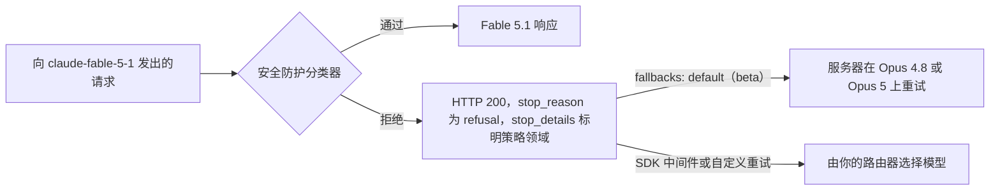

# 模型分类体系

本章提供了截至**2026年10月1日**的模型全景指南，涵盖模型家族、能力与生产系统中的选型标准。

> **最后核验：2026年10月1日。** 模型格局变化很快。请始终与供应商价格页与发布说明交叉核对。
>
> **2026年10月要闻（8月中旬至10月1日）：** Anthropic、OpenAI、Google、SpaceXAI 和 Meta 都在9月发布了新模型，而价格与能力同样成为焦点。**Anthropic** 发布了 **Claude Fable 5.1 和 Mythos 5.1**（9月1日，维持 $10/$50，缓存读取降至 0.025x）、**Claude Opus 5.5**（9月22日，自 Opus 4.5 以来首次下调 Opus 价格至 $4/$20，现为 Anthropic 的“从这里开始”默认选择），以及 **Claude Sonnet 5.5**（9月28日，$2/$10）。**OpenAI** 发布了 **GPT-6 Astra**（9月3日，$10/$50，Daybreak 优先的分阶段推出，也是首个在网络安全方面被评为 Critical 的 OpenAI 模型）、**GPT-6 Sol 和 Luna**（9月22日，分别为 $2/$10 与 $0.10/$0.50，约为其取代的 GPT-5.6 价格的一半，且没有 GPT-6 Terra），以及 **GPT-6.1 Sol**（9月29日，维持 $2/$10，缓存读取为 0.05x）。**Google** 发布 **Gemini 3.8 Flash**（9月2日，六周内第三个 Flash，至2027年1月1日前半价）及受 Fairwind 门控的 **3.8 Flash Cyber**，随后于9月30日**宣布 Gemini 4 Argon**，仅向网络防御人员逐步推出，尚无 API 模型 ID。**SpaceXAI** 发布 **Grok 4.7**（9月21日），采用新的更大基础模型，价格维持 $2/$6；**Meta** 发布 **Muse Spark 1.3**（9月2日）。实际影响包括：中端模型收敛至 **$2/$10**（Sonnet 5.5、GPT-6 Sol、GPT-6.1 Sol）；缓存读取倍率现因模型而异（0.1x、0.05x、0.025x）；输入超过 272K 时 OpenAI 对整个请求按长上下文费率计费；最新 Claude 模型拒绝强制 `tool_choice`，并将思考块绑定到产生它的模型和对话，这会破坏朴素路由器。基准也随之重置：Artificial Analysis 于9月7日以 v4.3 重新设定 Intelligence Index 基线，先前分数不可比较；Terminal-Bench 4.0 取代 3.0；公开 SWE-Bench Pro 分榜趋于饱和；Claude 分数现带有“with fallback”标签。开放权重方面，**Z.ai 按计划发布 GLM-5.3 权重**（8月28日），采用 MIT-plus 许可证；**小米 MiMo-V2.6-Pro**（9月21日，MIT）取得开放权重榜首；**DeepSeek V4.1-Flash**（9月10日，MIT）在8月16日涨价不到一个月后下调 Flash 价格；Qwen 新版 Community License 要求任何 MaaS 或编程/办公助手业务另行取得许可证。退役方面：Assistants API 于8月26日关闭；`gpt-5.4-cyber` 于10月1日提前20天通知后关闭；原始 `gpt-4o-2024-05-13`、`o1`、`o3-mini` 和 `o4-mini` 快照将于10月23日退出 OpenAI API；Claude Sonnet 4.5 将于11月30日退役。下文的厂商自报数字均有标注。
>
> **2026年8月要闻：** 本月多数发布都是后训练刷新或衍生版本，而非新的预训练运行；美国前沿实验室没有发布新的旗舰基础模型。焦点转向价格、许可证和访问控制。明确的例外是阿里的 Qwen3.8-Max：这款全新 2.4T 基础模型于8月12日发布权重。**Claude Sonnet 5 的首发价每 1M $2/$10 于8月10日成为永久价格**，原定9月1日上调至 $3/$15 的计划取消，使 Sonnet 5 永久低于它取代的 Sonnet 4.6。反方向上，**DeepSeek 自8月16日 16:00 UTC 起将 V4 价格提高至原来的 3 至 12 倍**，并改用峰谷计费（谷时恰为峰时一半；峰时仅覆盖工作日且不含中国法定节假日的 UTC 01:00–04:00 与 06:00–10:00），终结了其作为无争议低价选项的时期。**OpenAI 发布 GPT-5.6-Cyber**（8月10日，每 1M $12.50/$75），置于新的 Daybreak Blue 与 Daybreak Red 双层访问计划之后，这是迄今能力分层门控最具体的生产案例。**Google 发布 Gemini 3.7 Flash**（8月13日），年底前半价；**SpaceXAI 发布 Grok 4.6**（8月12日），上下文为 500K。开放权重方面的许可策略出现分化：阿里的 **Qwen3.8-Max**（8月12日，2.4T/95B active）使用定制商业限制许可证，而同系列 **Qwen3.8-27B**（8月14日）采用纯 Apache 2.0；**Meta 以 Muse Glimmer**（8月10日，30B，Apache 2.0）回归开放权重；**Z.ai 暂缓发布 GLM-5.3 权重**，因为其网络安全能力增长快于预期，需等待安全评估（权重后续于8月28日按计划发布）。**Claude Opus 4.1 于8月5日退役**，最后一个 $15/$75 的 Opus 层级由此结束。本节基准数字大多由厂商报告，请在独立榜单上核验。
>
> **2026年7月要闻：** Anthropic 发布 **Claude Sonnet 5**（6月30日，`claude-sonnet-5`，各产品的新默认模型，首发每 1M $2/$10，并于8月10日成为永久价格）及 **Claude Opus 5**（7月24日，`claude-opus-5`，维持 $5/$25，Fast 模式 $10/$50、约快 2.5 倍）。**Claude Fable 5 于7月1日全球恢复**，配备新的越狱网络安全分类器；Mythos 5 仅通过 Project Glasswing 回归约100家美国关键基础设施组织。**GPT-5.6（Sol、Terra、Luna）于7月9日 GA**，7月30日 Luna 下调80%至 $0.20/$1.20、Terra 下调20%至 $2/$12（Sol维持 $5/$30，直至8月21日促销下调至 $4/$20）。**Kimi K3**（7月16日、7月27日开放权重）为 2.8T/104B-active、1M 上下文；**Inkling**（7月15日，975B/41B-active、开放权重）当时是领先的美国开放权重模型。Google 发布 Gemini 3.6 Flash、3.5 Flash-Lite 与政府限制的3.5 Flash Cyber；Meta Muse Spark 1.1 伴随其首个付费自助 API（$1.25/$4.25）推出；FLUX 3 进入受限早期访问。基准主要为厂商自报，请以独立榜单复核。
>
> **2026年6月要闻：** Anthropic 发布了 **Claude Fable 5**（6月9日，`claude-fable-5`，每 1M 输入/输出 10/50 美元，1M 上下文），这是其最强大且公开发布的模型：一款 Mythos 级模型，已为通用可用做了安全化处理，并在敏感主题上有 Opus 4.8 回退保护。**Claude Mythos 5** 同日在 Project Glasswing 合作方中以不受限变体发布，取代 Mythos Preview，价格不到其一半。
>
> **6月10-26日更新：** 一波密集发布接续而至。**Google DeepMind DiffusionGemma**（6月10日，Apache 2.0）是 Google DeepMind 首个开源权重（open-weight）文本扩散模型：一个 26B MoE（约 4B 激活）的模型，在单张 H100 上并行去噪 token 块，生成速度约快 4 倍，牺牲了部分质量以换取速度，相对标准 Gemma 4 有一定取舍。**Gemini 3.5 Live Translate**（据发布报道为6月9日；Google 更新日志中没有其条目，当前 ID 为 `gemini-3.5-live-translate-preview`）通过 Gemini Live API 与 AI Studio 在公开预览中新增覆盖 70+ 语言的实时语音到语音翻译。**Cohere North Mini Code 1.0**（6月9日，Apache 2.0）是 Cohere 的首个开源编码模型，是一个 30B / 3B-active MoE，可在单张 H100 上运行。**Moonshot Kimi K2.7 Code**（6月12日，Modified MIT）基于 K2.6 调优，面向长时程软件任务（1T / 32B-active MoE，约少 30% 思考 token）。**Z.ai GLM-5.2**（6月13日获得 coding-plan 访问，6月16-17日以 MIT 方式开放权重）是 744B / 40B-active MoE，拥有 1M 上下文，在 SWE-bench Pro 报告为 62.1，领先于 GPT-5.5 在该基准上的成绩，价格约为每 1M 输入/输出 1.40 / 4.40 美元。**xAI Grok Imagine Video 1.5** 于6月16日正式发布（图生视频并同步音频，0.080 美元/秒），**Grok 4.3** 于6月15日上架 Amazon Bedrock（1.25 / 2.50 美元每 1M，xAI 首个上架模型）。阿里官方 Qwen Cloud 更新日志显示，6月快照在 **Qwen 3.7-Max** 上新增视觉能力（其5月发布时为仅文本），但有部分独立报道将该视觉更新归于 Qwen 3.7-Plus，需使用前自行核验。另，Anthropic 于6月12日因美国出口管制指令暂停了 Claude Fable 5 与 Claude Mythos 5 的访问；Mythos 5 后续仅对有限美国机构放开。随后于6月26日，OpenAI 以有限方式向少量经美国政府批准的合作方预览 **GPT-5.6**（Sol、Terra、Luna），这是其下一代系列，出于双用途网络安全顾虑而限发；这与 Anthropic 的限制政策形成呼应。Sol 声称创造了新的 Terminal-Bench 2.1 记录，Terra 的目标为约 GPT-5.5 级效果但成本约减半。文中的编码成绩大多为厂商自报；请以独立榜单复核。
>
> **2026年5月回顾：** Anthropic Claude Opus 4.8（5月28日，价格与 Opus 4.7 相同，5/25 美元；Dynamic Workflows 研究预览提供数百个并发子代理；Fast 模式 10/50 美元约为 Opus 4.7 Fast 的 1/3）发布；OpenAI GPT-5.5（4月23日）和 GPT-5.5 Instant（5月5日，ChatGPT 默认版本）；Claude Opus 4.7（4月16日，支持 Bedrock/Vertex/Foundry）；Google Gemma 4（4月2日，Apache 2.0）与 Gemini 3.2 Flash（5月5日静默上线）；DeepSeek V4 Pro 与 V4 Flash（4月24日；V4 Pro 在 75% 折扣后于6月1日价格永久降为每 1M 0.435/0.87 美元）；Moonshot Kimi K2.6（4月20日，1T MoE / 32B active）；阿里 Qwen 3.6 Plus / 3.6-35B-A3B / 3.6 Max-Preview；Mistral Medium 3.5（4月29日，统一 chat/reasoning/coding/vision）；Meta Muse Spark（4月8日，首个闭源权重 Meta 模型）；Llama 4 Behemoth 计划暂停至2026秋季发布，因能力边界与安全性讨论。SWE-bench Verified 在 Fable 5 发布前榜首：Claude Mythos Preview 93.9%，GPT-5.5 88.7%，Claude Opus 4.8 88.6%；ARC-AGI-2 领先榜为 GPT-5.5，得分 85.0。Anthropic 将 Fable 5 描述为几乎所有测试基准上的最优；但发布公告未给出完整数值，需以公开榜单复核。

## 目录

- [模型分类](#模型分类)
- [前沿模型（2026年10月）](#前沿模型-2026年10月)
- [推理模型](#推理与数学-reasoning-math)
- [开源模型](#开源模型)
- [专用模型](#专项模型)
- [嵌入模型](#嵌入模型)
- [模型选型框架与语义路由](#模型选择框架)
- [主权 AI 与数据驻留](#主权-ai-与数据驻留)
- [能力对比](#能力对比)
- [面试题](#面试题)
- [参考资料](#参考资料)

---

## 模型分类

### 按能力等级（2026年10月）

| Tier（层级） | Characteristics（特征） | Examples（示例） | Use Case（使用场景） |
|------|-----------------|----------|----------|
| **Frontier（前沿）** | 最高能力上限；$10/$50 档或受限访问 | Claude Fable 5.1, GPT-6 Astra, Claude Opus 5.5（$4/$20）；Gemini 4 Argon 已公布，尚未正式发布 | 最困难的推理、长周期智能代理、受能力上限约束的编码 |
| **Workhorse（主力，$2/$10 档）** | 中档价格下接近前沿的代理化质量 | Claude Sonnet 5.5, GPT-6 Sol, GPT-6.1 Sol, Grok 4.7（$2/$6）, Muse Spark 1.3（$1.25/$4.25） | 生产级智能代理、规模化编码、默认路由层级 |
| **Fast/Efficient（快速/高效）** | 单 Token 成本最低、高吞吐量 | GPT-6 Luna, Gemini 3.8 Flash, Claude Haiku 4.5, DeepSeek V4.1-Flash | 分类、抽取、路由、高流量流式处理 |
| **Previous Generation（上一代，仍在服务）** | 特征明确，但通常会在数周内被替代 | Claude Opus 5 / Sonnet 5 / Fable 5, GPT-5.6 Sol / Terra / Luna, Claude Opus 4.8, Gemini 3.7 Flash | 重视稳定、已完成评估行为的工作负载 |
| **Small/Edge（小型/边缘）** | 私有化、边缘部署、单 GPU | Gemma 4（12B、E4B）, Qwen3.8-27B, IBM Granite 4.2, Muse Glimmer 30B | 本地隐私、设备端、单 GPU 服务 |
| **Reasoning-Heavy（重推理）** | 高努力级别下的扩展内部推理 | GPT-6 Astra（xhigh/max）, Claude Fable 5.1, Claude Opus 5.5（高努力级别）, DeepSeek V4.1-Flash（effort 1-100） | 数学、代码调试、多步逻辑 |

Anthropic 唯一的 Haiku 仍是 Haiku 4.5。Claude Haiku 5.5 宣布将在“未来数周”推出，但截至 10 月 1 日尚未发布。

### 按推理模式（2026年10月）

| Mode（模式） | Capability（能力） | Models（模型） | Use Case（使用场景） |
|------|------------|--------|----------|
| **Minimal reasoning（最小推理）** | 模型允许的最快路径 | GPT-6.1 Sol（`low`）, GPT-6 Luna（最低 effort）, Gemini 3.8 Flash（`low`）, Claude Sonnet 5.5（`between_tools`）, Claude Haiku 4.5 | 聊天、简单抽取 |
| **Always-on reasoning（始终开启推理）** | 无法关闭思考 | Claude Opus 5.5 和 Fable 5.1（自适应思考始终开启）, GPT-6 Astra（无 `none` effort；`low` 至 `max`） | 数学、代码调试、规划 |
| **Dial-controlled（旋钮控制）** | 每个请求设置 effort 或思考级别 | GPT-6.1 Sol（`low` 至 `max`，默认 `medium`）, Claude Opus 5.5（默认 `medium`）, Gemini 3.8 Flash（`thinking_level`）, DeepSeek V4.1-Flash（1-100） | 复杂度可变任务 |

**关闭开关正在消失。** Sonnet 5.5 对 `thinking: {type: "disabled"}` 返回 400，Opus 5.5 无法关闭思考，Astra 没有 `none` effort。采样旋钮也在消失：Claude API 对 Opus 4.7 及后续版本的非默认 `temperature` 和 `top_p` 返回 400，Astra 不接受 `temperature`、`top_p` 或 logprobs，Google 则于 7 月 21 日在 Gemini API 中弃用了这些参数。effort 现在是控制界面，且默认值会在版本间变化（Opus 5 默认 `high`，Opus 5.5 为 `medium`），因此应在每条路由中显式设置。

---

## 前沿模型（2026年10月）

### Claude Opus 5.5（Anthropic）- 2026年9月新增

| Attribute（属性） | Value（值） |
|-----------|-------|
| Model ID（模型 ID） | `claude-opus-5-5`（Bedrock：`anthropic.claude-opus-5-5`） |
| Context Window（上下文窗口） | 100 万 Token；最大输出 128K（使用 beta header 的 Batch 为 300K） |
| Input / Output Cost（输入/输出成本） | 每 100 万 Token $4.00 / $20.00（Opus 5：$5 / $25） |
| Cache / Batch（缓存/批处理） | 缓存写入 $5.00（5 分钟）或 $8.00（1 小时）；缓存读取 $0.20（输入价格的 0.05 倍）；Batch $2 / $10；最小可缓存提示词为 512 Token |
| Fast mode（快速模式） | 每 100 万 Token $8 / $40（研究预览版，仅 Claude API），低于 Opus 5 和 Opus 4.8 的 $10 / $50 |
| Thinking（思考） | 自适应思考始终开启（无法关闭）；默认 effort 为 `medium`（Opus 5 默认 `high`） |
| Availability（可用性） | Claude API、Amazon Bedrock、Google Cloud、Microsoft Foundry、Claude Platform on AWS；可使用零数据保留 |
| Benchmarks（基准测试） | Anthropic 报告：Terminal-Bench 4.0 在 xhigh 下为 66.4%（SE ±2.6），对比 Fable 5.1 的 55.8%（Anthropic 的运行结果）和 GPT-6 Astra 的 57.9%（OpenAI 数据，高 effort）；OSWorld 2.1 partial 为 81.8%；GDPval-AA v2.1 为 1846 Elo；使用工具的 HLE 为 67.7%。独立数据：Artificial Analysis Intelligence Index v4.3.2 为 58（max，使用回退），总体第一。 |
| Released（发布日期） | 2026 年 9 月 22 日（知识截止日期为 2026 年 6 月；不早于 2027 年 9 月 22 日退役） |

**它是什么：** 第二次 Opus 降价（此前 Opus 4.5 从 $15/$75 降价），也是 Anthropic 文档现在建议大多数工作负载优先使用的模型。Fable 5.1 留给高要求推理、长周期代理化工作，或 Opus 5.5 在更高 effort 下仍未达到评估要求的情形。一款更便宜的模型在 Anthropic 自身大多数代理基准中胜过更昂贵的 Fable 5.1，颠覆了通常“为能力上限付更多钱”的路由逻辑。Anthropic 称，典型工作负载的成本较 Opus 5 低约 40%（厂商报告）。

**从 Opus 5 迁移的陷阱：** 默认 effort 从 `high` 降至 `medium`，因此未固定参数的升级会同时改变延迟和质量；强制 `tool_choice`（`any` 或 `tool`）会返回 400；思考块绑定其生成模型和会话；并且在 Claude API 和 Google Cloud 上，计算机使用仅接受 `computer_toolset_20260801`。Opus 5.5 在网络安全分类器之外新增了生物安全分类器。在 Anthropic 评估期间当防护措施介入时，网络安全任务由 Opus 4.8 完成，生物学和前沿 LLM 开发任务由 Opus 5 完成，因此标题中的分数属于路由系统，而非同一组权重。

### Claude Sonnet 5.5（Anthropic）- 2026年9月新增

| Attribute（属性） | Value（值） |
|-----------|-------|
| Model ID（模型 ID） | `claude-sonnet-5-5` |
| Context Window（上下文窗口） | 100 万 Token；最大输出 128K |
| Input / Output Cost（输入/输出成本） | 每 100 万 Token $2.00 / $10.00（与 Sonnet 5 相同） |
| Cache / Batch（缓存/批处理） | 缓存写入 $2.50（5 分钟）或 $4.00（1 小时）；缓存读取 $0.20；Batch $1 / $5 |
| Thinking（思考） | 默认开启自适应思考；最低设置为 `between_tools`（在 `high` effort 或以下可接受），而 `thinking: {type: "disabled"}` 会返回 400。API 默认 effort 为 `high`，Claude Code 和 Claude 应用中为 medium |
| Availability（可用性） | Claude API、Bedrock、Google Cloud、Foundry、Claude Platform on AWS；可使用零数据保留 |
| Benchmarks（基准测试） | Anthropic 报告，括号内为 Opus 5.5：Terminal-Bench 4.0 为 70.6%（66.4%），CursorBench 4.0 为 55.5%（57.8%），GDPval-AA v2.1 为 1844（1846），OSWorld 2.1 partial 为 80.1%（81.8%），使用工具的 HLE 为 64.5%（67.7%），FrontierCode 1.1 在 max effort 下为 46.2%（54.4%）；Anthropic 指出 Sonnet 5.5 在该测试中 max 下的得分低于 xhigh。独立数据：AA Intelligence Index v4.3.2 为 56（max，使用回退）。 |
| Released（发布日期） | 2026 年 9 月 28 日（知识截止日期为 2026 年 6 月；不早于 2027 年 9 月 28 日退役） |

**它是什么：** 如果这些数据能经独立验证，一款 $2/$10 模型在 Anthropic 自身报告的大多数代理评估中与旗舰模型仅相差几个百分点（在 FrontierCode 1.1 上约落后 8 分），这削弱了将大多数代理流量发送给 Opus 的理由。Anthropic 称，其输出速度较 Sonnet 5 快 30% 以上，单任务成本最多低 30%（厂商报告）。Anthropic 的 Sonnet 5.5 表中，Sonnet 5 在 Terminal-Bench 4.0 上为 10.3%，而 Opus 5.5 表中 Opus 5 为 52.3%；应将 Sonnet 5 的数据视为异常值，勿将其用作基线。

**相较 Sonnet 5 的破坏性变更：** 禁用 thinking 会返回 400（请改用 `between_tools`）；强制工具使用会返回 400；thinking 块绑定模型、对话和生成它的账户（来自未关联账户的块会被丢弃并记录为 `organization_binding_mismatch`）；Claude API 和 Google Cloud 拒绝 `computer_20251124`；非默认的 `temperature`、`top_p` 和 `top_k` 仍会返回 400。Sonnet 5 在发布三个月后成为旧版模型。

### Claude Fable 5.1 和 Mythos 5.1（Anthropic）- 2026年9月新增

| 属性 | 值 |
|-----------|-------|
| 模型 ID | `claude-fable-5-1`（GA；Bedrock 为 `anthropic.claude-fable-5-1`）；`claude-mythos-5-1`（根据文档，仅限 Project Glasswing） |
| 关系 | 权重相同，安全防护不同；Mythos 5.1 是限制更少的变体 |
| 输入 / 输出成本 | 每 1M $10.00 / $50.00（与 Fable 5 相同） |
| 缓存 / 批处理 | 缓存写入 $12.50（5 分钟）或 $20.00（1 小时）；缓存读取 $0.25（输入价格的 0.025 倍，低于 Fable 5 的 $1.00）；批处理 $5 / $25 |
| 上下文窗口 | 标准定价下 1M tokens；最大输出 128K |
| Thinking | 自适应 thinking 始终开启；默认 effort 为 `high` |
| 数据处理 | 必须保留 30 天；除非 Anthropic 明确授权，否则无法在零数据保留下使用（有资格使用 Enterprise Frontier Safeguards 的客户可在 EFS 就绪前通过 ZDR 使用 Fable 5.1 和 Fable 5） |
| 溯源 | 所有平台上的输出均带有 Anthropic 统计文本水印；通过 Files API 获取的生成媒体带有已签名的 C2PA Content Credentials |
| 基准 | Terminal-Bench 4.0：tbench.ai 排行榜最大 effort 下为 57.88%，Anthropic 自行运行中为 55.8%。AA Intelligence Index v4.3.2：53（最大 effort，带回退） |
| 发布 | 2026年9月1日（知识截止日期为 2026年6月；最早不早于 2027年9月1日退役） |

**变化是什么：** 长智能体循环持续使用能力上限模型的成本。Anthropic 表示，缓存读取价格下调 75% 后，典型账单约降低 25%，高度智能体化的工作负载最多降低 45%；其最新网络安全防护的误报率比 Fable 5 早期版本低约 60%（两者均为厂商自报）。Fable 5.1 现在可用于发现漏洞，但不可用于开发漏洞利用。Fable 5 仍然可用。

**Mythos 5.1 访问权限：** 截至 10 月 1 日，仅限 Glasswing 参与者。Anthropic 称，它还将通过生命科学验证计划提供（首批参与者已与美国政府完成登记），并将在“不久的将来”通过现有网络验证计划提供；该计划目前覆盖 Opus 和 Sonnet 级模型。目前 Anthropic 表示，Mythos 5.1 仅向部分美国组织开放。

**安全防护回退现已成为 API 契约。** 在 Fable 5 上，分类器命中会自动将请求交给 Opus 4.8。在 Fable 5.1 上，这一行为明确且可配置：



自 9 月 24 日起，`bio`、`frontier_llm` 和 `reasoning_extraction` 类别中在任何输出前发生的拒绝会在所有平台计费（其他类别仍不计费）；流式输出中途拒绝会计入输入及已经流式输出的部分；回退额度会退还切换模型所产生的提示缓存成本。请为拒绝预留预算，并依据 `stop_reason` 而非 HTTP 状态进行路由。

### Claude 5.5 / 5.1 迁移检查清单

| 变更 | 适用范围 | 会损坏什么 | 改为这样做 |
|---|---|---|---|
| 强制 `tool_choice`（`any` 或 `tool`）返回 400 | Fable 5.1、Mythos 5.1、Opus 5.5、Sonnet 5.5 | 强制调用工具的结构化提取 | 使用 `auto` 加严格工具使用，或使用结构化输出 |
| Thinking 块绑定模型和对话 | Fable 5.1、Opus 5.5、Sonnet 5.5（Mythos 5.1 跳过前缀检查） | 将历史重放到另一模型会静默丢弃推理；对于 2026年8月31日及之后创建的账户，编辑 thinking 块之前的任何内容会返回 400 | 将历史视为只追加；使用 `thinking-binding-controls-2026-08-01` beta 请求头启用 `prefix_mismatch_behavior: "drop_block"` |
| Thinking 无法禁用 | Opus 5.5；Sonnet 5.5 的下限为 `between_tools` | 假定关闭 thinking 的延迟预算 | 显式设置 effort 并重新测量延迟 |
| 默认 effort 已变更 | Opus 5.5 为 `medium`（Opus 5 为 `high`） | 升级时发生静默的质量和延迟变化 | 在每个请求中固定 effort |
| 拒绝 `computer_20251124` | Claude API 和 Google Cloud 上的 Opus 5.5 与 Sonnet 5.5（Bedrock 仍接受） | 使用旧工具版本的计算机使用智能体 | 迁移至 `computer_toolset_20260801` |
| 三个类别的输出前拒绝会计费 | 自 9 月 24 日起的所有平台 | 将拒绝视为免费的成本模型 | 将 `stop_reason: "refusal"` 作为成本项跟踪 |

还有两项较小变更会影响测试框架：工具调用之间的文本现在会出现在 thinking 块中，默认 `display: "omitted"` 时这些块为空（`display: "updates"` beta 会返回文本）；此外还发布了支持每条消息 effort 和轮次范围系统消息（9 月 1 日）、按需压缩（`compact-2026-09-04`，9 月 14 日），以及在对话中途内联定义工具且不损失缓存（`inline-tools-2026-09-15`，9 月 22 日）的 beta 功能。

### Claude Haiku 4.5（Anthropic）- 仍是唯一的 Haiku

Haiku 4.5 仍是 Anthropic 的快速档。其退役下限是“不早于 2026年10月15日”，但截至 10 月 1 日尚未收到弃用通知；按照 Anthropic 至少提前 60 天通知的规定，它在 Claude API 上大约不会早于 12 月退役。Microsoft Foundry 列出 `claude-haiku-4-5` 将于 2026年11月15日退役。Haiku 5.5 已公布但尚未发布，因此基于 Haiku 4.5 构建的快速档设计应保留 GPT-6 Luna 或 Gemini 3.8 Flash 作为回退，并在 Haiku 5.5 上线时安排评测。

### Claude Opus 5（Anthropic）- 2026年7月，已被 Opus 5.5 取代

| 属性 | 值 |
|-----------|-------|
| 模型 ID | `claude-opus-5` |
| 上下文窗口 | 1M tokens（默认及最大值；最大输出 128K） |
| 输入 / 输出成本 | 每 1M $5.00 / $25.00（与 Opus 4.8 相同） |
| Fast 模式 | 每 1M $10.00 / $50.00，约快 2.5 倍 |
| 基准 | Anthropic 的发布文章报告了其称为 Frontier-Bench v0.1 的发布前基准（后更名为 Terminal-Bench 3.0，后者又于 8 月 28 日被 Terminal-Bench 4.0 取代；分数不可横向沿用）：最大 effort 下为 43.3%，对比 GPT-5.6 Sol 34.4%、Fable 5 33.7%、Opus 4.8 18.7%；CursorBench 3.2 与 Fable 5 相差 0.5% 内、每任务成本约一半。均为厂商自报。此后：Terminal-Bench 4.0 排行榜 xhigh 下为 53.94%；SWE-Bench Pro v2（Scale，9 月 22 日）在饱和的公开拆分上为 99.4%，私有集上为 81.6%（222/272），是 Scale 公布的最高私有集分数。 |
| 发布 | 2026年7月24日（Claude API、Claude Code、Claude Cowork；Claude Max 新默认） |

**它是什么：** Opus 系列的代际后继，价格不变，面向长时程智能体式编码与计算机使用。Beta 功能包括对话中途变更工具与自动回退路由；Fast 模式延续“一模型、两延迟档”。

**状态：** 于 9 月 22 日被价格更低的 Opus 5.5（$4/$20 对比 $5/$25）取代。仍可作为旧版模型使用，也是 Fable 5.1 允许的两个安全防护回退目标之一（另一个为 Opus 4.8）。

### Claude Sonnet 5（Anthropic）- 2026年6月，已被 Sonnet 5.5 取代

| 属性 | 值 |
|-----------|-------|
| 模型 ID | `claude-sonnet-5` |
| 上下文窗口 | 第三方报道为 1M tokens（发布公告未说明） |
| 输入 / 输出成本 | 每 1M $2.00 / $10.00（自2026年8月10日起为永久价格） |
| 缓存 / 批处理 | 缓存写入每 1M $2.50（5 分钟）或 $4.00（1 小时）；缓存命中 $0.20；Batch API $1.00 / $5.00 |
| 定位 | 发布时最具智能体能力的 Sonnet：规划、浏览器和终端工具使用，以及以低于 Opus 4.8 的成本接近其自主运行能力 |
| 安全 | 默认启用网络安全防护；相较 Opus 级模型刻意降低网络安全能力 |
| 发布 | 2026年6月30日（同日成为消费者与开发者产品的默认模型） |

**它是什么：** 替代 Sonnet 4.6 并成为默认模型的生产主力。Anthropic 于2026年8月10日将首发价 $2/$10 设为永久价格，并取消9月1日上调至 $3/$15 的计划，因此 Sonnet 5 永久低于它取代的 Sonnet 4.6（后者仍为 $3/$15）。

**状态：** Sonnet 5.5 于9月28日以相同价格取代该模型；该模型仍作为旧版可用。此外，Anthropic 于9月30日弃用 Claude Sonnet 4.5（`claude-sonnet-4-5-20250929`），该模型将于2026年11月30日在 Claude API 和 Foundry 中停止服务，指定替代型号为 `claude-sonnet-5-5`。

### Claude Fable 5（Anthropic）- 2026年6月，已被 Fable 5.1 取代

| Attribute（属性） | Value（数值） |
|-----------|-------|
| Model ID（模型ID） | `claude-fable-5` |
| Context Window（上下文窗口） | 1M tokens（使用 Opus 4.7 分词器；在相同文本下大约多 30% token） |
| Max Output（最大输出） | 128K tokens |
| Input Cost（输入成本） | 10.00 美元 / 1M tokens |
| Output Cost（输出成本） | 50.00 美元 / 1M tokens |
| Thinking（思考机制） | Adaptive thinking（自适应思考），始终开启（无独立扩展思考开关） |
| Multimodal（多模态） | 文本 + 视觉（Anthropic 称其在视觉任务上达到最新最优） |
| Benchmarks（基准） | 按 Anthropic 表述，在几乎所有测试基准上达到最优；在 Cognition 的 FrontierCode 上得分最高，在 Hebbia Finance Benchmark、ViBench 与 CursorBench 上居首。标准数值分数（SWE-bench、GPQA）未在发布公告中公布。 |
| Released（发布日期） | 2026年6月9日（在 Claude API、Claude Platform on AWS、Amazon Bedrock、Vertex AI、Microsoft Foundry 上 GA） |

**它是什么：** 一款 Mythos 级模型，已安全化为通用可用。在此之前，Mythos 系列（Mythos Preview 的 SWE-bench Verified 为 93.9%）受双用途网络安全顾虑约束，仅对约 11 个 Project Glasswing 合作方开放。Fable 5 通过配套保守型安全策略，将该能力层级带给所有用户。

**Opus 4.8 回退保护机制：** 当 Fable 5 的分类器检测到请求属于三类之一（攻击性网络技术、生物武器相关的生物与化学领域内容，或试图蒸馏模型的行为）时，系统会默默将该请求转交给**Claude Opus 4.8** 并告知用户。Anthropic 称该机制在不足 5% 会话中触发，并被刻意调得偏保守，因此部分无害请求也会被拦截。从架构上看，这是**模型分层路由作为安全控制**的生产实践，而不仅是成本控制。

**Opus 4.8 回退保护机制：** 当 Fable 5 的分类器检测到请求属于三类之一（攻击性网络技术、生物武器相关的生物与化学领域内容，或试图蒸馏模型的行为）时，系统会将响应转交给**Claude Opus 4.8**，并告知用户。Anthropic 称该机制在不足 5% 会话中触发，并被刻意调得偏保守，因此部分无害请求也会被拦截。从架构上看，这是**模型分层路由作为安全控制**的生产实践，而不仅是成本控制。Fable 5.1 将其变为上文所述明确、可计费的 API 合约。

**注意项：** 相比 Opus 4.8 的每 token 成本翻倍（10/50 vs 5/25）。Mythos 级流量需要 30 天数据保留要求（不会用于训练；有访问日志；几乎全部场景下 30 天后删除），在合规审核中需关注。订阅计划中于6月9日至22日包含，不额外计费，之后改为按用量积分。Fable 5 的缓存读取价格为每 1M 1.00 美元；Fable 5.1 在标价相同的情况下将其降至 0.25 美元，因此几乎没有理由在 Fable 5 上启动新工作。

### Claude Mythos 5（Anthropic）- 2026年6月，已被 Mythos 5.1 取代

| Attribute（属性） | Value（数值） |
|-----------|-------|
| Model ID（模型ID） | `claude-mythos-5` |
| Status（状态） | 限量可用：Project Glasswing 合作方与部分生物研究者 |
| Relationship（关系） | 与 Fable 5 同一底层模型，在部分场景下取消了防护限制 |
| Pricing（定价） | 10 / 50 美元每 1M（低于 Mythos Preview 的不到一半） |
| Released（发布日期） | 2026年6月9日 |

**为什么重要：** 它以可比或略强的能力和更低的价格取代了 Claude Mythos Preview。Fable/Mythos 分离正式形成双轨发布模式：一条为带安全护栏的通用版，一条为面向经审核防御方的不受限版本。Mythos 5.1 延续了这一模式。

### Claude Opus 4.8（Anthropic）- 2026年5月，旧版

| Attribute（属性） | Value（数值） |
|-----------|-------|
| Context Window（上下文窗口） | 1M tokens（全窗口统一计费标准） |
| Input Cost（输入成本） | 5.00 美元 / 1M tokens（与4.7一致） |
| Output Cost（输出成本） | 25.00 美元 / 1M tokens（与4.7一致） |
| Cache: 5m write（5分钟写入缓存） | 6.25 美元 / 1M tokens |
| Cache: 1h write（1小时写入缓存） | 10.00 美元 / 1M tokens |
| Cache: hit / refresh（命中/刷新） | 0.50 美元 / 1M tokens |
| Batch API（批处理） | 2.50 / 12.50 美元每 1M（5折） |
| Fast mode（research preview）（快速模式，研究预览） | 10 / 50 美元每 1M（快约 2.5 倍；比 Opus 4.7 快速模式 30 / 150 美元便宜 3 倍） |
| Extended Thinking（扩展思考） | Native，adaptive（原生，自适应） |
| Multimodal（多模态） | 文本 + 高分辨率视觉 |
| SWE-bench Verified（SWE-bench Verified） | 88.6% |
| SWE-Bench Pro（SWE-Bench Pro） | 69.2%（较 Opus 4.7 的 64.3% 提升） |
| Terminal-Bench 2.1（终端基准） | 74.6%（发布时 GPT-5.5 以 78.2% 领先） |
| GDPval-AA（GDPval-AA） | 1890 Elo（较 Opus 4.7 的 1753 提升） |
| OSWorld-Verified（OSWorld-Verified） | 82.3% |
| Online-Mind2Web（在线 Mind2Web） | 84% |
| Released（发布日期） | 2026年5月28日（Claude API、AWS Bedrock、Vertex AI 全量上线） |

**最佳适用：** Claude Code 中的长期自治编码、代码库规模迁移、需要并发子代理的代理化工作流，以及对对齐性与诚实性收益有要求的任务。它也是 Fable 5.1 获准的两个安全防护回退目标之一（另一个是 Opus 5）；Anthropic 对 Opus 5.5 的评测在安全防护介入时会将网络任务路由至它，因此即使团队从不直接调用它，它仍处于生产路径中。

**较 Opus 4.7 的关键新增：**
- **Dynamic Workflows（动态工作流，研究预览）：** Claude 会规划工作，在单个 Claude Code 会话中并行运行数百个子代理，验证其输出并回报。适用于数十万行级代码库迁移。
- **Mid-task system messages（任务中系统消息）：** Messages API 现支持会话中途注入 system message，可在不中断会话的情况下引导长任务。
- **可选 fast mode（可选快速模式）**：以约 2.5 倍速度运行，每 1M 10/50 美元，价格约为 Opus 4.7 快速模式的三分之一。
- **Effort-control toggle（推理强度开关）**在 `claude.ai` 与 Cowork 提供，用户可按回合调整思考深度。
- **Claude Code 速率限制扩展。**

**注意项：** 分词器与 Opus 4.7 引入的相同；根据 Anthropic 的 token 计数文档，对于相同文本，相比 4.7 前的分词器 token 数约多 30%，具体增幅取决于内容（Opus 4.7 发布文章给出的范围为 1.0 倍至 1.35 倍）。发布时，GPT-5.5 以 SWE-Bench Verified 88.7% 居首，并在 Terminal-Bench 2.1 中以 78.2% 领先。GPQA Diamond 相对 Opus 4.7 下降 0.6 分。Anthropic 的分词器变更意味着同一文本在旧模型与当前模型的 token 数与计费不可直接对比。Claude 没有发布 Sonnet 4.8；产品线于2026年6月30日直接跃迁至 **Claude Sonnet 5**，并由其取代 Sonnet 4.6 成为生产主力。对于新工作，Opus 5.5 更便宜（$4/$20）且更强。

> [!NOTE]
> **已于2026年8月5日退役：** `claude-opus-4-1-20250805` 已从 Claude API 移除，最后一个每 1M $15/$75 的 Opus 层级由此结束。当时所有第一方 Opus SKU 均为 $5/$25（Fast 模式为 $10/$50）；Opus 5.5 后来将当前 Opus 的价格降至 $4/$20。Amazon Bedrock 和 Google Cloud 采用各自的退役计划：在 Bedrock 上，Opus 4.1 将于2026年10月8日进入价格更高的公开延长访问期，并于2027年1月8日终止服务。固定使用该 ID 的代码在第一方 API 上会失败，但在合作云上仍可运行。

### Claude Opus 4.7（Anthropic）- 2026年4月，旧版

| Attribute（属性） | Value（数值） |
|-----------|-------|
| Context Window（上下文窗口） | 1M tokens |
| Max Output（最大输出） | 128K tokens |
| Input Cost（输入成本） | 5.00 美元 / 1M tokens（与4.6一致） |
| Output Cost（输出成本） | 25.00 美元 / 1M tokens（与4.6一致） |
| Extended Thinking（扩展思考） | Native，自适应模式 |
| Multimodal（多模态） | 文本 + 高分辨率视觉 |
| SWE-bench Verified (Adaptive)（SWE-bench Verified，适应式） | 87.6%（2026年5月13日） |
| Released（发布日期） | 2026年4月16日（API、Bedrock、Vertex、Microsoft Foundry 全量上线） |

**状态：** 仍作为旧版模型可用。它在发布时驱动 Claude Code；自 2.1.280 起，Claude Code 的默认 Opus 一直是 Opus 5.5。新工作建议使用 Opus 5.5：它更便宜且更强。

### Claude Mythos Preview（Anthropic）- 已被 Mythos 5 和 5.1 取代

| Attribute（属性） | Value（数值） |
|-----------|-------|
| Status（状态） | 限制性研究预览，仅限 Project Glasswing 合作方（约11家机构，如 AWS、Apple、Cisco、Google、Microsoft、NVIDIA、Palo Alto 等）；自2026年6月9日起已弃用，退役日期待公布 |
| Restriction reason（限制原因） | 双用途网络安全能力 |
| SWE-bench Verified（SWE-bench Verified） | 93.9%（2026年5月13日；Fable 5 / Mythos 5 发布前发布的 SOTA） |
| Released（发布日期） | 2026年4月7日（受限合作预览）；于2026年6月9日被 Mythos 5 取代，且价格不足其一半 |

**最佳适用：** 历史参考。其能力层级已于2026年6月9日以 Claude Fable 5 的形式全面对外开放；新的 Glasswing 项目应优先使用 Mythos 5.1。

### Claude Opus 4.6（Anthropic）- 2026年2月，旧版

| Attribute（属性） | Value（数值） |
|-----------|-------|
| Context Window（上下文窗口） | 1M tokens |
| Max Output（最大输出） | 128K tokens |
| Input Cost（输入成本） | 5.00 美元 / 1M tokens |
| Output Cost（输出成本） | 25.00 美元 / 1M tokens |
| Extended Thinking（扩展思考） | 原生自适应思考（可配置 budget_tokens） |
| Multimodal（多模态） | 文本 + 视觉 |
| Highlights（亮点） | 发布时为 Anthropic 的旗舰模型；现为旧版 |
| Released（发布日期） | 2026年2月 |

**状态：** 仍可使用。Opus 5.5 更便宜（$4/$20 对比 $5/$25）且更强，因此没有成本理由继续使用它。

### Claude Sonnet 4.6（Anthropic）- 2026年2月，旧版

| Attribute（属性） | Value（数值） |
|-----------|-------|
| Context Window（上下文窗口） | 1M tokens |
| Input Cost（输入成本） | 3.00 美元 / 1M tokens |
| Output Cost（输出成本） | 15.00 美元 / 1M tokens |
| Extended Thinking（扩展思考） | 支持 |
| Multimodal（多模态） | 文本 + 视觉 |
| Highlights（亮点） | 可处理此前需要 Opus 级别的任务；在2026年年中前是成本/质量的默认选择 |
| Released（发布日期） | 2026年2月 |

**状态：** 仍可使用，但其 $3/$15 的价格现已高于 Sonnet 5.5（$2/$10）。除非评估结果另有结论，否则应迁移。

### GPT-6 Astra（OpenAI）- 2026年9月 新增

| Attribute（属性） | Value（数值） |
|-----------|-------|
| Model ID（模型 ID） | `gpt-6-astra` |
| Context Window（上下文窗口） | 1.05M tokens；最大输出 128K；知识截止日期为 2026年4月30日 |
| Input / Output Cost（输入 / 输出成本） | 每 1M 为 10.00 / 50.00 美元；输入超过 272K 时，整次请求按 20 / 75 美元计费 |
| Cache（缓存） | 缓存输入 1.00 美元；缓存写入 12.50 美元；固定 30 分钟 TTL |
| Service tiers（服务层级） | Batch 和 Flex 享 5 折；Fast 为 2 倍（20 / 100 美元）；Ultrafast 为 6 倍（60 / 300 美元，9月29日 GA，Responses API） |
| Reasoning（推理） | 支持 `low`、`medium`、`high`、`xhigh`、`max`；不支持 `none`；不支持自定义 `temperature`、`top_p` 或 logprobs；工具调用需要使用 Responses API |
| Availability（可用性） | 自 9月3日起分阶段推出（Daybreak 组织优先），9月5日前在 API 中可用；Amazon Bedrock 于 9月8日 GA（区域内和地理推理为 11 / 55 美元，比 Global 高 10%）；Microsoft Foundry GA |
| Safety rating（安全评级） | 首个在其 Preparedness Framework 下被评为网络安全 Critical 的 OpenAI 模型；生物和化学能力为 High。OpenAI 表示，隐蔽的能力保留行为很可能无法被可靠发现 |
| Benchmarks（基准测试） | Terminal-Bench 4.0 榜单中 max 为 58.18%（第 1 名，tbench.ai，9月21日）。ARC-AGI-3（ARC Prize）：在供应商中立的 Standard harness 上为 62.7%（max，26,098 美元），而在使用 OpenAI 自身上下文管理功能的 ARC Prize Provider Adapter harness 上为 99.9%（high，18,817 美元）。AA Intelligence Index v4.3.2：53（max） |
| Released（发布日期） | 2026年9月3日 |

**它是什么：** OpenAI 的新旗舰模型，价格与 Claude Fable 5.1 相同，均为 10 / 50 美元。三个因素改变了成本模型。第一，速度成为具有三个档位的计费维度（Standard、2 倍价格的 Fast、6 倍价格的 Ultrafast），因此延迟 SLO 是预算决策。第二，272K 的价格断点适用于整次请求，因此刚超过阈值的提示词成本约为刚低于阈值提示词的两倍：按提示词长度路由是成本控制手段。第三，token 效率：Artificial Analysis 测得 Astra 每个编码任务使用的 token 约为 GPT-5.6 Sol 的三分之一，因此其单任务成本比标价所暗示的更接近中端层级。

**解读测试框架：** 同一模型、同一测试集在 ARC-AGI-3 上相差 37 分，源于脚手架是否会在请求间保留不透明的推理状态。引用 Astra 的结果时，应同时说明测试框架、推理强度及执行方。

### GPT-6 Sol 和 GPT-6 Luna（OpenAI）- 2026年9月 新增

| Attribute（属性） | Value（数值） |
|-----------|-------|
| Model IDs（模型 ID） | `gpt-6-sol`、`gpt-6-luna`（文本和图像输入、文本输出；支持 Responses 和 Chat Completions） |
| Context Window（上下文窗口） | 1.05M tokens；最大输出 128K |
| Sol pricing（Sol 定价） | 每 1M 为 2.00 / 10.00 美元；缓存输入 0.20 美元；缓存写入 2.50 美元；超过 272K 时为 4 / 15 美元 |
| Luna pricing（Luna 定价） | 每 1M 为 0.10 / 0.50 美元；缓存输入 0.01 美元；缓存写入 0.125 美元；超过 272K 时为 0.20 / 0.75 美元 |
| Batch / Flex | Sol 为 1 / 5 美元；Luna 为 0.05 / 0.25 美元 |
| Lineage（血统） | 据 OpenAI 称，与 GPT-6 Astra 使用相同类型的数据和训练方式。它们以约一半价格取代 GPT-5.6 Sol 和 Luna；未发布 GPT-6 Terra |
| Availability（可用性） | API 和 Amazon Bedrock 于 2026年9月22日 GA |
| Known issue（已知问题） | 图像编码 bug 曾降低图像理解和计算机使用能力，直至 9月25日以相同模型 ID 发布修复；OpenAI 建议客户重新运行图像评测 |
| Released（发布日期） | 2026年9月22日 |

**重要性：** 价格为 0.10 / 0.50 美元的 Luna 是 OpenAI 当前一代中最便宜的模型。即将退役的 gpt-5-nano（0.05 / 0.40 美元）在 12月11日关闭前仍更便宜，而 OpenAI 指定 gpt-5.6-luna（0.20 / 1.20 美元）作为其替代品，因此改用 Luna 可避免价格上涨。即使在非高峰时段，Luna 也低于 DeepSeek V4.1-Flash（0.15 / 0.60 美元）。Gemini 2.5 Flash-Lite（0.10 / 0.40 美元，仅限现有用户）和 Meta 的 Muse Spark 贡献者层级（0.10 / 0.20 美元）更便宜，部分托管开源模型的输出价格也更低（MiMo-V2.6-Flash 为 0.14 / 0.28 美元，Qwen3.8-Flash 为 0.15 / 0.47 美元）。由于没有 Terra 后继者，OpenAI 的三层路由设计将收缩为两层，或保留价格为 2 / 12 美元的 GPT-5.6 Terra，而 GPT-6 Sol 现已在输出价格上低于它。图像 bug 说明了运营上的教训：供应商侧的修复会在稳定 ID 下改变行为，因此应在供应商更新日志事件发生时重新运行评测，而不应只在模型 ID 变化时运行。OpenAI 的 Sol 文章称，在其离线 OSWorld 2.0 数据集上，GPT-6 Sol 的 xhigh 为 60.5%，Claude Opus 5 的 medium 为 60.3%（供应商自报）。

### GPT-6.1 Sol（OpenAI）- 2026年9月 新增

| Attribute（属性） | Value（数值） |
|-----------|-------|
| Model ID（模型 ID） | `gpt-6.1-sol` |
| Context Window（上下文窗口） | 1.05M tokens；最大输出 128K；知识截止日期为 2026年4月30日 |
| Input / Output Cost（输入 / 输出成本） | 每 1M 为 2.00 / 10.00 美元；超过 272K 时为 4 / 15 美元 |
| Cache（缓存） | 缓存输入 0.10 美元（0.05 倍，为 GPT-6 Sol 费率的一半）；缓存写入 2.50 美元 |
| Reasoning（推理） | `low`、`medium`（默认）、`high`、`xhigh`、`max` |
| Features（功能） | 托管 shell、计算机使用、MCP、多代理委派（beta，Responses API） |
| Availability（可用性） | API；Amazon Bedrock 上遵循 OpenAI 的生命周期和弃用条款，而非 Bedrock 的最低可用性日期 |
| Benchmarks（基准测试） | AA Intelligence Index v4.3.2：52（max） |
| Released（发布日期） | 2026年9月29日 |

**它是什么：** 面向复杂编码和专业工作的 OpenAI 模型，成本低于 Astra；在 GPT-6 Sol 发布一周后以相同标价推出。Codex CLI 同日在 rust-v0.159.1 中将默认模型切换为 GPT-6.1 Sol，这对没有固定模型的用户而言是一次无提示的默认切换。注意 Bedrock 条款：跨云可用不再意味着云服务会保证支持期限。

### GPT-5.4（OpenAI）- 2026年3月

| Attribute（属性） | Value（数值） |
|-----------|-------|
| Context Window（上下文窗口） | 272K tokens（标准）；可扩展 |
| Input Cost（输入成本） | 2.50 美元 / 1M tokens（缓存输入 0.25 美元） |
| Output Cost（输出成本） | 15.00 美元 / 1M tokens |
| Multimodal（多模态） | 文本、视觉、native computer use（原生计算机使用） |
| Highlights（亮点） | 内建计算机使用能力；较 GPT-5.2 减少 33% 事实性错误；融合编码与代理化优势 |
| Released（发布日期） | 2026年3月 |

**最佳适用：** 已在其上完成验证的既有代理化工作流。
**注意项：** 输入 token 超过 272K 后，整次请求按长上下文费率计费（5 / 22.50 美元）。对于新项目，GPT-6 Sol 更便宜（2 / 10 美元）。

### GPT-5.4-mini（OpenAI）- 2026年3月

| Attribute（属性） | Value（数值） |
|-----------|-------|
| Context Window（上下文窗口） | 272K tokens |
| Input Cost（输入成本） | 0.75 美元 / 1M tokens |
| Output Cost（输出成本） | 4.50 美元 / 1M tokens |
| Highlights（亮点） | 面向高频 GPT-5 级工作负载的性价比选择 |
| Released（发布日期） | 2026年3月 |

**最佳适用：** 已在其上完成调优的高频 API 调用。对于新的高吞吐层级，GPT-6 Luna（0.10 / 0.50 美元）便宜得多。GPT-5.4-nano 为 0.20 / 1.25 美元，并将于 2027年4月1日退役。

### GPT-5.4 Pro（OpenAI）- 2026年3月

| Attribute（属性） | Value（数值） |
|-----------|-------|
| Context Window（上下文窗口） | 272K tokens |
| Input Cost（输入成本） | 30.00 美元 / 1M tokens |
| Output Cost（输出成本） | 180.00 美元 / 1M tokens |
| Highlights（亮点） | 最高推理能力，面向最硬任务的高端层 |
| Released（发布日期） | 2026年3月 |

**最佳适用：** 竞赛级数学、复杂多步推理。
**注意项：** 成本极高。GPT-5.4 Pro 的标价仍为 30 / 180 美元，与较新的专用 Pro ID——GPT-5.5 Pro——相同。在 GPT-5.6 和 GPT-6 系列中，Pro 是一种模式（`reasoning.mode: "pro"`），按所选模型的标准费率计费。

### GPT-5.6 Sol / Terra / Luna（OpenAI）- 2026年7月9日 GA（Sol 和 Luna 已被 GPT-6 取代）

| Attribute（属性） | Value（数值） |
|-----------|-------|
| Variants（变体） | Sol（旗舰）、Terra（平衡）、Luna（快、低成本） |
| Context Window（上下文窗口） | 三者均为 1.05M tokens；最大输出128K；知识截止为2026年2月16日 |
| Sol 定价 | 每 1M 标价 $5.00 / $30.00；自2026年8月21日起促销价为 $4 / $20，仅保证“至少持续至2026年11月21日”，因此应按标价预算 |
| Terra 定价 | 每 1M $2.00 / $12.00（7月30日较 $2.50/$15 下调20%） |
| Luna 定价 | 每 1M $0.20 / $1.20（7月30日较 $1/$6 下调80%） |
| Long context（长上下文） | 输入超过 272K 时，整个请求按 Sol $8 / $30（促销价）、Terra $4 / $18、Luna $0.40 / $1.80 计费 |
| Speed tiers（速度档位） | Fast（7月30日由 Priority 更名）为 2x；Sol 的 Ultrafast 为预览中的 6x |
| Reasoning（推理） | 新增“max”推理 effort（强度）与“ultra”模式，后者使用子代理加速复杂工作 |
| API 功能 | 程序化工具调用、多智能体支持、显式 prompt-cache 断点 |
| Benchmarks（基准） | Sol 在 Agents' Last Exam 为53.6、领先 Claude Fable 5 13.1 分，并创 Terminal-Bench 2.1 纪录；Claude Fable 5 曾以80对Sol 64.6领先 SWE-Bench Pro，OpenAI公开质疑该基准。均为厂商自报。Terminal-Bench 4.0 排行榜上，Sol 在 max 模式下得分为 37.27%。 |
| Released（发布日期） | 2026年6月26日有限预览；2026年7月9日 GA |

**它是什么：** OpenAI 首次以三模型形式推出的旗舰系列。6月26日预览因美国政府的双用途网络安全顾虑受限，13天审查后 GA。三档结构与7月30日的降价重置了分层模型选型的路由计算。

**状态（2026年10月）：** GPT-6 Sol 和 Luna 以约半价取代 Sol 和 Luna。Terra 没有 GPT-6 后继型号，仍为 $2/$12。该系列仍将继续生产一段时间：Foundry 将于11月19日把即将退役的 o 系列部署迁移至 GPT-5.6 Sol 和 Terra，而 OpenAI 将于12月11日退役旧版 GPT-5 和 o3 快照，也表明将转向 GPT-5.6 系列模型。

### GPT-5.6-Cyber（OpenAI）- 2026年8月（受限）

| 属性 | 值 |
|-----------|-------|
| 模型 ID | `gpt-5.6-cyber` |
| 上下文窗口 | 总计 400K（最大输入 272K、最大输出 128K） |
| 输入 / 输出成本 | 每 1M $12.50 / $75.00；缓存输入 $1.25 |
| 访问 | 仅限 Daybreak Red 层级，要求身份验证、法律声明和获批用例。仅支持 Responses API。原计划自2026年9月1日起，个人 Daybreak 账户必须使用硬件安全密钥（尚未独立确认是否已强制执行） |
| 拒绝策略 | 经过训练，在双用途安全工作上降低拒绝率：OpenAI 内部 Advanced Cybersecurity Completion Rate 评测完成率为 95.0%，GPT-5.6 Sol 为 1.5% |
| 发布 | 2026年8月10日（Daybreak Blue 与 Red 分层见8月7日 API 更新日志） |

**它是什么：** 基于 GPT-5.6 Sol 构建的网络安全模型，与 Daybreak 计划的双层拆分同时发布。**Daybreak Blue** 向获批防御者提供通用前沿模型，用于漏洞发现、安全代码审查、检测工程和事件响应；**Daybreak Red** 需另行审批，通过它为漏洞复现、exploit 验证、渗透测试和红队工作开放 `gpt-5.6-cyber`。

**架构意义：** 一款刻意比前沿默认模型*更宽松*、价格为 Sol 标价的 2.5 倍、仅限单一 API 接口，并由身份验证隔离的模型，为实验室如何落地双用途访问提供了参考设计。受限模型的退役也很快：OpenAI 于9月11日弃用早期的 `gpt-5.4-cyber`，并于10月1日关闭它；相对于其宣称的专用变体至少3个月期限，通知期约为20天。

### 能力分层访问计划（2026年10月）

| 实验室 | 计划 | 受限模型 | 准入对象 |
|---|---|---|---|
| Anthropic | Project Glasswing；生命科学验证计划（首批参与者已入组）；网络安全验证计划（现已面向 Opus 和 Sonnet 级模型提供降低网络安全防护的访问；Mythos 级访问宣布将于“近期”推出） | Claude Mythos 5.1（与 Fable 5.1 权重相同，安全防护更宽松） | Glasswing 合作伙伴；与美国政府合作入组的生命科学参与者；Mythos 级访问加入后 CVP 成员可使用（Mythos 5.1 目前仅限一组美国组织） |
| OpenAI | Daybreak Blue / Daybreak Red | Blue：通用前沿模型（Daybreak 组织率先获得 GPT-6 Astra）；Red：`gpt-5.6-cyber` | 获批防御者；Red 需单独获批 |
| OpenAI | 可信访问 | `gpt-rosalind-research`（生命科学；9月8日 GA，每 1M $5 / $25，自10月5日起计费） | 获批生命科学组织 |
| Google | Fairwind 计划 | Gemini 3.8 Flash Cyber；率先访问 Gemini 4 Argon，向其发布时不设网络安全护栏 | 政府机构、关键基础设施运营商、软件维护者 |

**设计启示：** 能力分层访问如今已是行业模式，而非一次性做法。应将受限层级视为独立模型，拥有自己的身份要求、API 接口、保留条款，以及短得多的退役周期。

### GPT-5.5（OpenAI）- 2026年4月

| 属性 | 值 |
|-----------|-------|
| 上下文窗口（Context Window） | 1M tokens |
| 输入成本（Input Cost） | $5.00 / 1M tokens（缓存输入 $0.50） |
| 输出成本（Output Cost） | $30.00 / 1M tokens |
| 长上下文 / Fast | 输入超过 272K：$10 / $45。Fast 为 2.5 倍（$12.50 / $75），并非像较新模型那样为 2 倍 |
| 多模态（Multimodal） | 文本、图像、音频、视频 |
| ARC-AGI-2 | 85.0%（截至2026年5月13日领先） |
| 发布于（Released） | 2026年4月23日 |

**最适合：** 已在其上验证过的多模态工作负载。发布时被定位为“面向真实工作的全新智能类别（new class of intelligence for real work）”，取代 GPT-5.4 用于顶级推理和多模态工作。
**注意事项：** 输入成本约为 GPT-5.4 的 2 倍（$2.50 → $5.00），输出成本也约为 2 倍（$15 → $30）。对于新项目，GPT-6 Sol（$2/$10）更便宜也更新。

### GPT-5.5 Instant（OpenAI）- 2026年5月发布

| 属性 | 值 |
|-----------|-------|
| 状态（Status） | 于2026年5月5日成为 ChatGPT 默认模型及 API 中的 `chat-latest` |
| 幻觉降低（Hallucination Reduction） | 在高风险提示（医学/法律/金融）上，相比 GPT-5.3 Instant 减少 52.5% |
| AIME 2025 | 81.2%（较 GPT-5.3 Instant 的 65.4% 提升） |
| 响应长度（Response Length） | 比前代少约 30% 的单词/行 |
| 发布于（Released） | 2026年5月5日 |

**最适合：** ChatGPT 等价的聊天工作负载，以及幻觉降低很重要的高风险领域。
**注意事项：** 已取代 GPT-5.3 Instant 成为聊天默认模型。GPT-5.2-chat-latest 和 GPT-5.3-chat-latest 已于2026年5月8日弃用。

### OpenAI 语音模型：GPT-Live-1、GPT-Realtime-2.1、转录（2026年10月）

| 模型 | 形态 | 定价 | 状态 |
|---|---|---|---|
| `gpt-live-1` | 在 `v1/live/sessions` 上将推理和工具委派给后端（OpenAI Responses 模型或自有后端）的全双工语音前端 | 每会话分钟 $0.05，按秒计费，另加后端模型 token 费用 | 2026年9月10日 GA |
| `gpt-realtime-2.1` / `gpt-realtime-2.1-mini` | Realtime API 上的单一语音到语音模型；通过 `server_vad` 或 `semantic_vad` 进行轮次交互；推理强度可配置 | 2.1：每 1M 音频 token 输入 $32 / 缓存 $0.40 / 输出 $64；mini：$10 / $0.30 / $20 | 2026年7月6日（接替5月7日发布的 `gpt-realtime-2`） |
| `gpt-realtime-translate` | 流式翻译，每种目标语言一个会话 | 每分钟 $0.034 | 当前可用 |
| `gpt-transcribe` / `gpt-live-transcribe` | 批量 / 流式语音转文本 | 每分钟 $0.0045 / $0.017 | 2026年7月28日 |
| `gpt-realtime`、`gpt-realtime-mini`、`gpt-4o-realtime`、`gpt-audio` | 旧版语音到语音和音频模型 | - | 2027年1月20日关闭（迁移至 `gpt-realtime-2.1`、`-2.1-mini` 或 `gpt-audio-1.5`） |
| `whisper-1`、`gpt-4o-transcribe` 系列 | 旧版语音转文本 | - | 2027年2月26日关闭（迁移至 `gpt-transcribe` 或 `gpt-live-transcribe`） |
| `tts-1`、`tts-1-hd`、`gpt-4o-mini-tts` 快照 | 旧版文本转语音 | - | 2027年1月6日关闭（10月1日宣布；迁移至 `gpt-realtime-2.1-mini`） |

**三种架构，而非两种。** OpenAI 文档现描述了全双工加委派（GPT-Live）、单一语音到语音模型（Realtime API），以及串联的 STT、LLM、TTS 管线。GPT-Live 将语音层与推理层分离，因此业务规则和权威任务状态应位于后端。当其 128K 上下文使用超过 90% 时，它会以指令加最多 8,192 个历史 token（包括对较早轮次的摘要）重启语音引擎，因此应将时段和预订信息保留在应用状态中。Realtime 会话最长 60 分钟，并在每次响应时重新发送对话，因此成本会随通话时长增长。OpenAI 报告 GPT-Live 的轮次切换延迟为 0.798 秒，而 `gpt-realtime-2.1` 为 1.41 秒（厂商报告，且取决于所选后端）。Realtime API beta 接口已于2026年5月12日移除。

**其他厂商：** Google 的 `gemini-3.8-live` 和 `gemini-3.8-live-extended-thinking` 于9月15日 GA（每 1M 音频 token 输入 $3 / 输出 $12；默认异步工具调用，Extended Thinking 变体会在说话时后台推理）。Google 报告 Extended Thinking 的 tau-Voice 为 68.6%，基础模型为 30.1%（厂商报告）；这正是应据以设计的模式：语音任务成功率取决于附着在语音层上的推理，而该推理必须符合轮次延迟预算。`gemini-3.8-flash-tts` 于9月22日 GA，在12月31日前以每 1M token $0.50 / $9 的促销价提供（2027年1月1日起为 $1 / $18）。xAI 的 `grok-voice-think-fast-2.0` 以每分钟 $0.08 提供兼容 OpenAI-Realtime 的事件。Anthropic 没有语音 API：Claude 只能作为语音栈中的文本后端，例如位于 GPT-Live 客户端委派之后。参见[实时语音代理](../18-voice-and-audio-agents/01-realtime-voice-agents.md)。

### Gemini 4 Argon（Google）- 于2026年9月30日宣布，尚未 GA

| 属性 | 值 |
|-----------|-------|
| 状态（Status） | 于2026年9月30日宣布。首先向 Fairwind Program 中受信任的网络防御人员推出（不设网络安全护栏）；随后面向付费 API 客户和 Google AI Ultra 订阅者推出，未给出日期 |
| 模型 ID | 尚未发布；截至10月1日，Gemini API 模型页面和更新日志中均未列出 |
| 公布定价 | 初始价格为每 1M $2 / $10（未给出结束日期），之后为 $4 / $20；缓存输入享 95% 折扣 |
| 输出上限 | 1M tokens，较 Google 的 64K 提升 |
| 基准测试 | Google 报告：DeepSWE v1.1 77.9%、AutomationBench 51.3%、LVBench 91.7%。AA Intelligence Index v4.3.2：53（高，在正式可用前评分） |
| 目标工作负载 | 真实世界软件工程、企业知识工作（法律、金融）、网络防御 |

**应如何看待：** 将其视为规划输入，而非依赖项。Argon 是新的 Gemini 4 产品线，并非长期延迟的 Gemini 3.5 Pro。若 1M-token 输出上限进入 API，整个仓库的重写和长文档生成将不再需要分块生成循环，这会带来真正的架构变化。在模型 ID 发布前，`gemini-3.1-pro-preview` 仍是 Google 唯一的 Pro 级 API 模型。

### Gemini 3.8 Flash（Google）- 2026年9月发布 NEW

| 属性 | 值 |
|-----------|-------|
| 模型 ID（Model ID） | `gemini-3.8-flash`（稳定版，GA） |
| 上下文窗口（Context Window） | 输入 1,048,576 tokens / 输出 65,536 tokens |
| 输入 / 输出成本（Input / Output Cost） | 截至2026年12月31日为 $0.75 / $3.75 每 1M；自2027年1月1日起为 $1.50 / $7.50。Batch 和 Flex 享 5 折；Priority 为 $1.35 / $6.75（自1月1日起为 $2.70 / $13.50）；缓存读取 $0.075 每 1M，另加存储费用 |
| 模态（Modalities） | 输入：文本、图像、视频、音频、PDF；输出：文本 |
| 思考（Thinking） | `thinking_level` 支持 `low`、`medium`（默认）、`high`；无 minimal 级别；取代 `thinking_budget` |
| 工具（Tools） | 函数调用、结构化输出、缓存、代码执行、计算机使用（预览版）、文件搜索、Search 和 Maps grounding；不支持 Live API |
| 基准测试（Benchmarks） | Google 报告：DeepSWE v1.1 为 73.7%，Claude Opus 5 为 74.0%。独立测试：AA Intelligence Index v4.3.2 为 41（high）；SWE-Bench Pro v2 私有集为 211/272（Scale） |
| 发布于（Released） | 2026年9月2日 |

**它是什么：** 在 Gemini 3.7 Flash 基础上进一步训练而成，并非新的基础模型，也是 Google 六周内推出的第三个 Flash。它是 Google 推荐用于计算机使用的 Gemini 模型。其每 token 价格较低，但报道指出它每项任务消耗更多推理 tokens。在 DeepSWE v1.1 上，它与 Astra 和 Opus 5 均接近 74%，high effort 下每项任务成本为 $2.36，而 Astra 在 xhigh 下为 $4.43，Opus 5 在 max 下为 $11.84。在承诺用量前，应将2027年1月的价格纳入建模：3.6、3.7 和 3.8 Flash 都将在同一天价格翻倍。

**Gemini 3.8 Flash Cyber：** 于同日面向新 Fairwind Program 中受信任的防御者发布，提供更宽松的网络安全缓解措施，以及 Google 用于“发现-验证-修复”流水线的 CodeMender harness（Google 报告 CyberGym 为 86.2%）。它在 Google 的分级访问产品线中取代 Gemini 3.5 Flash Cyber。

### Gemini 3.1 Pro Preview（Google）- 2026年2月

| 属性 | 值 |
|-----------|-------|
| 模型 ID（Model ID） | `gemini-3.1-pro-preview`（Preview） |
| 上下文窗口（Context Window） | 1M tokens |
| 输入成本（Input Cost） | $2.00 / 1M tokens（标准）；$4.00（200K+） |
| 输出成本（Output Cost） | $12.00 / 1M tokens（标准）；$18.00（200K+） |
| 多模态（Multimodal） | 原生：文本、视觉、音频、视频 |
| 亮点（Highlights） | Google 最高 Pro 级 API 模型；具备强大的 agentic（代理式）和编码能力 |
| 发布于（Released） | 2026年2月 |

**最适合：** 复杂推理、多模态分析、长上下文工作负载。
**注意事项：** 取代 Gemini 3 Pro Preview。截至10月1日，它是 Gemini API 中唯一的 3 系列 Pro 模型；不存在 Gemini 3.5 Pro。Gemini 2.5 并未如曾计划的那样于6月弃用：9月18日，Google 将 2.5 模型限制为此前已使用过它们的用户，表示它们“未被弃用”，并引导新项目使用 3.5 Flash-Lite 或 3.8 Flash。Google Cloud（Vertex AI）将于2026年10月20日停用 `gemini-2.5-pro`、`gemini-2.5-flash` 和 `gemini-2.5-flash-lite`。

### Gemini Flash 和 Flash-Lite 产品线（Google）

| 模型 | 每 1M 输入 / 输出 | 状态 |
|---|---|---|
| `gemini-3.8-flash` | 首发价 $0.75 / $3.75；自2027年1月1日起 $1.50 / $7.50 | 2026年9月2日 GA；当前默认选择 |
| `gemini-3.7-flash`、`gemini-3.6-flash` | 与 3.8 Flash 相同的首发定价 | 已被 3.8 Flash 取代 |
| Gemini 3.5 Flash | $1.50 / $9.00 | 可用 |
| Gemini 3.5 Flash-Lite | $0.30 / $2.50 | Google 与 3.8 Flash 一同推荐给迁离 2.5 的项目 |
| Gemini 3.1 Flash-Lite | $0.25 / $1.50 | 将于2027年5月7日关闭（迁至 3.5 Flash-Lite） |
| Gemini 3 Flash Preview | $0.50 / $3.00 | 预览版 |
| Gemini 2.5 Flash-Lite | $0.10 / $0.40 | 自9月18日起仅限现有用户使用 |

> **警惕虚构条目：** 价格为 $0.10 / $3.00 的“Gemini 3.1 Flash”仍在旧成本表中流传。Google 定价页面上不存在具有该名称和价格的模型；最接近的是 Gemini 3 Flash Preview 和 Gemini 3.1 Flash-Lite。新项目请按 Gemini 3.8 Flash 定价。

### Gemini 3.2 Flash（Google）- 2026年5月，历史记录

| 属性 | 值 |
|-----------|-------|
| 状态（Status） | 已在 iOS Gemini 应用和 Google AI Studio 静默上线，时间为2026年5月5日（无正式公告） |
| 发布于（Released） | 2026年5月5日 |

**状态：** 已成历史。Google 的 Flash 产品线此后已历经 3.5、3.6、3.7 和 3.8；请基于 `gemini-3.8-flash` 构建。

### Gemini Deep Research / Deep Research Max（Google）- 2026年4月

| 属性 | 值 |
|-----------|-------|
| 基于（Built on） | Gemini 3.1 Pro |
| 能力（Capabilities） | MCP 支持；原生图表/信息图生成；扩展测试时计算；异步后台工作流 |
| 发布于（Released） | 2026年4月21日 |

**最适合：** 研究代理、文档综合、长时间异步工作流。MCP 支持曾使其成为 Google 首个具备一流工具集成的研究代理产品。

### Gemini Robotics-ER 1.6（Google DeepMind）- 2026年4月

| 属性 | 值 |
|-----------|-------|
| 领域（Domain） | 物理机器人、具身推理 |
| 新能力（New capability） | 读取仪表与瞄准镜 |
| 部署（Deployment） | Boston Dynamics Spot |
| 发布于（Released） | 2026年4月14日 |

**最适合：** 需要视觉-语言落地来驱动物理动作的机器人应用。可通过 Gemini API 和 AI Studio 使用。

### Gemini 3.7 Flash（Google）- 2026年8月，已被 3.8 Flash 取代

| 属性 | 值 |
|-----------|-------|
| 模型 ID | `gemini-3.7-flash` |
| 上下文窗口 | 输入 1,048,576 tokens / 输出 65,536 tokens |
| 输入 / 输出成本 | 2026年12月31日前每 1M $0.75 / $3.75，之后 $1.50 / $7.50。上下文缓存每 1M $0.075；Batch 为 $0.375 / $1.875 |
| 多模态 | 文本、图像、音频、视频；智能体式视频理解为可选功能（`"processing": "agentic"`），默认未启用 |
| 知识截止 | 2026年3月 |
| 发布 | 2026年8月13日（GA） |

**它是什么：** Google 的主力层级，基于 Gemini 3.6 Flash 构建；model card 将其描述为对推理基础的算法改进，而不是新的预训练运行。可自定义的 thinking 配置可按请求权衡质量、成本和延迟。Google 报告其相对 3.6 Flash 的提升包括 FrontierCode 1.1 Main 从 34.4% 升至 43.6%，WebDev Arena Elo 从 1538 升至 1588。

**智能体式视频（9月1日）：** 对视频输入使用 `"processing": "agentic"` 时，模型会决定检查哪些片段、以何种速度检查以及通过何种模态检查，而非按固定的 1 FPS（仍为默认值）采样。Google 报告称，按标准 token 定价计算，最多可减少 88% 的 token 和 66% 的成本；该模式现已覆盖 3.8 Flash、3.7 Flash、3.6 Flash 和 3.5 Flash-Lite。基于固定 FPS 采样的视频成本模型，可能会将 token 数高估约 8 倍。

**注意项：** 3.8 Flash 于9月2日以相同的首发价格取代了它。截至10月1日，Gemini 3.5 Pro 仍未发布；Google 的下一代旗舰模型则宣布为 Gemini 4 Argon。

### Grok 4.7（SpaceXAI）- 2026年9月新增

| 属性 | 值 |
|-----------|-------|
| 模型 ID | `grok-4.7` |
| 上下文窗口 | 500K tokens；文本和图像输入，文本输出 |
| 输入 / 输出成本 | prompt 低于 200K 时每 1M $2.00 / $6.00；prompt 达到 200K 后，请求中的所有 token 均按每 1M $4.00 / $12.00 计费。缓存输入为 $0.50（200K+ 时为 $1.00） |
| 快速变体 | 输出速度约为 2 倍，价格也为 2 倍；仅在 Cursor 和 Grok Build 中提供（并非列出的 API 模型） |
| 知识截止 | API 文档称为 2026年5月 |
| 基准测试 | xhigh 下 Terminal-Bench 4.0 排行榜得分为 37.58%。AA Intelligence Index v4.3.2：46，高于 Grok 4.6 的 44 |
| 发布 | 2026年9月21日（Grok API、Grok Build、所有套餐的 Cursor、OpenRouter 及其他网关） |

**它是什么：** 与多数8月发布不同，这是一个全新且更大的基础模型，具有更长的 RL 训练周期，并按 SpaceXAI 所述侧重多小时任务。它也是本季度厂商表格领先于独立指数的最清晰案例：在 SpaceXAI 自有表格中大幅提升，在 AA 上约提升 2 分。其分发如今经由 Cursor 进行；Cursor 于8月中旬成为 SpaceX 的一部分，Grok 的发布信息也出现在 Cursor 博客上。针对整个请求的 200K 定价陷阱沿袭自 4.6。

### Grok 4.6（SpaceXAI）- 2026年8月，已被 Grok 4.7 取代

| 属性 | 值 |
|-----------|-------|
| 模型 ID | `grok-4.6` |
| 上下文窗口 | 500K tokens |
| 输入 / 输出成本 | prompt 低于 200K 时每 1M $2.00 / $6.00；达到或超过 200K 时为 $4.00 / $12.00。缓存输入 $0.50 |
| 推理 | effort 设置：low、medium、high（默认）、xhigh |
| 知识截止 | 2026年2月1日 |
| 发布 | 2026年8月12日 |

**它是什么：** SpaceXAI 在 4.7 之前的前沿模型，聚焦长时间运行的智能体与交互式视觉工作。发布时其 Artificial Analysis Intelligence Index 得分为 61，高于 Grok 4.5 High 的 56；但这是基于 9 月前的指数。在重新基准化的 v4.3.2 上，其得分为 44，两个量表不可比较。

**两个值得了解的陷阱。** prompt 达到 200K 后，较高的长 prompt 费率适用于请求中的*所有* token，而非仅超出阈值的部分。缓存输入价格也高于 Grok 4.5（每 1M $0.50 对 $0.30），因此重缓存智能体循环升级后不会自动变便宜。还要注意厂商名称：xAI 已完成向 SpaceXAI 的品牌变更，当前文档与发布说明使用新名称。

### Grok 4（xAI）- 已从 xAI API 退役

| 属性 | 值 |
|-----------|-------|
| 上下文窗口（Context Window） | 256K tokens |
| 输入成本（Input Cost） | $3.00 / 1M tokens |
| 输出成本（Output Cost） | $15.00 / 1M tokens |
| 亮点（Highlights） | 原生工具使用与实时搜索；推理能力具竞争力 |
| 发布于（Released） | 2025年7月（Grok 4.20 beta：2026年2月） |

**状态：** 已于 2026年5月15日从 xAI API 退役，同时退役的还有 `grok-4-fast`、Grok 4.1 Fast、`grok-code-fast-1` 和 `grok-3`。退役的文本模型 slug 仍可解析，但会重定向至 `grok-4.3`（$1.25 / $2.50）并按其费率计费（`grok-code-fast-1` 会转至 `grok-build-0.1`），因此代码看似仍在“正常运行”，但行为和成本已改变。Azure Foundry 仍将 `grok-4` 和 `grok-4-1-fast` 列为 GA，这提醒我们应按（模型、平台）组合追踪生命周期。

### MAI-Thinking-1（Microsoft）- 2026年8月新增（公开预览）

| 属性 | 值 |
|-----------|-------|
| 状态 | 自 2026年8月12日起在 Microsoft Foundry 公开预览 |
| 架构 | 稀疏 MoE，约 1T 总参数 / 35B 活跃参数；256K 上下文 |
| API | 兼容 Chat Completions，支持函数调用 |
| 定价 | 尚未公布 |
| 基准测试 | Microsoft 报告：AIME 2025 为 97.0%，SWE-Bench Pro 与 Claude Opus 4.6 持平，在 1,276 项任务中盲测人类偏好超过 Claude Sonnet 4.6 |

**为何重要：** Microsoft 现在在 Foundry 中拥有与 OpenAI 和 Anthropic 产品并列的第一方推理模型，这对供应商多元化和主权讨论很重要。Microsoft 表示该模型并非从其他实验室的模型蒸馏而来。在公布价格前，不要据此估算设计成本。

### 模型对比：前沿与主力层级（2026年10月）

| 模型 | 每 1M 输入 / 输出 | 缓存读取 | 上下文 | 访问方式 | 状态 |
|-------|-----------------------|------------|---------|--------|--------|
| Claude Fable 5.1 | $10 / $50 | $0.25（0.025x） | 1M，统一定价 | 5 个平台；仅在获授权时 ZDR | 9月1日 GA |
| GPT-6 Astra | $10 / $50（超过 272K 时 $20 / $75） | $1.00 | 1.05M | API、Bedrock、Foundry | 自 9月3日起分阶段 GA |
| Claude Opus 5.5 | $4 / $20 | $0.20（0.05x） | 1M，统一定价 | 5 个平台；ZDR | 9月22日 GA |
| Gemini 4 Argon | 首发 $2 / $10，之后 $4 / $20 | 降价 95% | 1M 输出上限（已宣布） | 仅 Fairwind | 9月30日宣布，尚未 GA |
| Claude Sonnet 5.5 | $2 / $10 | $0.20 | 1M，统一定价 | 5 个平台；ZDR | 9月28日 GA |
| GPT-6.1 Sol | $2 / $10（超过 272K 时 $4 / $15） | $0.10（0.05x） | 1.05M | API、Bedrock | 9月29日 GA |
| GPT-6 Sol | $2 / $10（超过 272K 时 $4 / $15） | $0.20 | 1.05M | API、Bedrock | 9月22日 GA |
| GPT-5.6 Terra | $2 / $12（超过 272K 时 $4 / $18） | $0.20 | 1.05M | API、Foundry | 7月9日 GA；没有 GPT-6 后继型号 |
| Grok 4.7 | $2 / $6（200K+ 时 $4 / $12） | $0.50 | 500K | xAI API、Cursor、网关 | 9月21日 GA |
| Muse Spark 1.3 | $1.25 / $4.25 | $0.15 | 1M | Meta Model API、Muse Code | 9月2日 GA |
| Gemini 3.8 Flash | 首发 $0.75 / $3.75（自 1月1日起 $1.50 / $7.50） | $0.075 | 1M 输入 / 65,536 输出 | Gemini API、Gemini Enterprise | 9月2日 GA |
| GPT-6 Luna | $0.10 / $0.50（超过 272K 时 $0.20 / $0.75） | $0.01 | 1.05M | API、Bedrock | 9月22日 GA |

“5 个平台”= Claude API、Bedrock、Google Cloud、Microsoft Foundry、AWS 上的 Claude Platform。标准层级，目录价格。这些模型的基准测试见 [能力对比](#能力对比)；完整定价机制（批处理、速度层级、数据驻留溢价）见 [定价与成本](03-pricing-and-costs.md)。

### 生产历程与成熟度

尽管前沿模型在基准测试上领先，许多企业系统仍依赖**经过实战检验**的模型，而其中大多数现已有退役日期：

| 模型家族 | 自生产以来 | 成熟度说明 |
|--------------|------------------|---------------|
| **GPT-4o** | 2024年5月 | 生态最成熟。原始 `gpt-4o-2024-05-13` 快照将于 2026年10月23日在 OpenAI API 上关闭（迁移至 GPT-5.6 Sol）。在 Microsoft Foundry 上，其标准部署会于 12月9日自动升级至 GPT-5.6 Sol：无需改动代码便替换为推理类模型。 |
| **Claude Sonnet 4.5 / 4.6** | 2025年9月 / 2026年2月 | 继承了 Claude 3.5 和 3.7 Sonnet 在工具调用可靠性方面的声誉。Sonnet 4.5 将于 2026年11月30日退役（Claude API 和 Foundry）；Sonnet 4.6 已属旧版，且现在比 Sonnet 5.5 更贵。 |
| **Gemini 2.5 Pro** | 2025年3月 | 久经验证的长上下文模型。自 2026年9月18日起，Gemini API 仅限现有用户使用（“未弃用”，尚无关闭日期）；Google Cloud（Vertex）将于 2026年10月20日将其退役。 |
| **o1 / o3** | 2024年9月 | 推理模型的已知失效模式较清楚。OpenAI API 将于 10月23日关闭 `o1`、`o1-pro`、`o3-mini` 和 `o4-mini`；Foundry 将于 11月19日退役 o1、o3、o3-pro 及同系列模型（迁移至 GPT-5.6 Sol）；OpenAI 将于 12月11日关闭 `o3-2025-04-16` 和带日期的 GPT-5 快照。 |

**为什么仍然使用“旧”一代前沿模型？**
1. **一致性**：新模型可能出现发布窗口期的延迟尖峰和行为变化。GPT-6 Sol 的图像路径在发布三天后修复前一直存在性能退化。
2. **成本不再是理由**：在顶级档位以下（GPT-6 Astra 的价格高于 GPT-5.6 Sol），9 月发布的新一代模型反而更便宜。Opus 5.5 比 Opus 5 低 20%，GPT-6 Sol 和 Luna 的价格约为 GPT-5.6 Sol 和 Luna 的一半，Sonnet 5.5 也低于 Sonnet 4.6。如今维持原状反而要多花钱。
3. **安全护栏调优**：安全和审核层更成熟。
4. **迁移窗口很短**：OpenAI 对正式发布模型提前 6 个月通知，对专用变体提前 3 个月，对预览版最短仅提前 2 周；Anthropic 至少提前 60 天；新的 Bedrock 模型则有 6 个月或 45 天。应固定带日期的 ID，并按（模型、平台）组合跟踪退役情况。

### 退役日历（截至 2026年10月1日）

| 日期 | 退役内容 | 迁移至 |
|------|----------|--------|
| 10月5日 | `antigravity-preview-05-2026` | `antigravity-preview-09-2026` |
| 10月8日 | Bedrock Claude Opus 4.1 进入价格更高的公开延长访问阶段 | Opus 5.5 |
| 10月14日 | Bedrock Claude Sonnet 4；Foundry `gpt-4.1-nano` | Sonnet 5.5；当前的轻量 OpenAI 模型 |
| 10月15日 | Claude API 上 Claude Haiku 4.5 的最早退役日期（尚未通知，因此不会早于约 12 月）；Foundry `gpt-4o-transcribe` 和 `gpt-4o-mini-transcribe`（2025-03-20） | Haiku 5.5（发布后）；`gpt-transcribe` 或 `gpt-live-transcribe` |
| 10月20日 | Google Cloud（Vertex）`gemini-2.5-pro`、`-flash`、`-flash-lite` | Gemini 3.8 Flash 或 3.5 Flash-Lite |
| 10月23日 | OpenAI API 旧快照（4月22日公布）：`gpt-4o-2024-05-13`、`gpt-4-turbo`、`gpt-4-0613`、`gpt-3.5-turbo-0125`、`gpt-4.1-nano`、`o1`、`o1-pro`、`o3-mini`、`o4-mini`、`gpt-image-1`、`gpt-4-1106-preview`、不带后缀的 `gpt-4` 和 `gpt-3.5-turbo` 别名，以及 GPT-3.5 Turbo、GPT-4、GPT-4.1-nano、o4-mini、babbage-002 和 davinci-002 的微调模型 | GPT-5.6 Sol、Terra 或 Luna；图像使用 `gpt-image-2.5-sunburst` 或 `-flare` |
| 10月31日 | Mistral La Plateforme GLM 5.2；OpenAI Evals 变为只读 | GLM 5.3；关闭前导出评估结果 |
| 11月2日 | `grok-imagine-image-quality` | `grok-imagine-image-2.0` |
| 11月15日 | Foundry `claude-haiku-4-5` 和 `codex-mini` | - |
| 11月19日 | Foundry o1、o1-pro、o3、o3-pro、o3-deep-research；o3-mini、o4-mini | GPT-5.6 Sol；GPT-5.6 Terra |
| 11月24日 | Foundry `claude-opus-4-5` | - |
| 11月26日 | Bedrock AI21 Jamba 1.5 | - |
| 11月30日 | `claude-sonnet-4-5-20250929`（Claude API、Foundry）；OpenAI Evals、Agent Builder 和 Reusable Prompts | `claude-sonnet-5-5`；评估使用 Promptfoo（OpenAI 所有，MIT） |
| 12月1日 | `gpt-image-1.5`、`gpt-image-1-mini`、`chatgpt-image-latest` | `gpt-image-2.5-sunburst` 或 `gpt-image-2.5-flare` |
| 12月9日 | Foundry gpt-4o 2024-05-13 自动升级 | GPT-5.6 Sol |
| 12月11日 | `gpt-5-2025-08-07`、`o3-2025-04-16` 及同系列快照 | GPT-5.6 Sol、Terra 或 Luna |
| 12月15日 | Foundry `whisper`、`tts`、`tts-hd` | 当前的 OpenAI 语音模型 |
| 2027年1月6日 | `tts-1`、`tts-1-hd`、`gpt-4o-mini-tts` 快照；OpenAI 停止创建微调任务 | 语音使用 `gpt-realtime-2.1-mini` |
| 2027年1月8日 | Bedrock Claude Opus 4.1 | Opus 5.5 |
| 2027年1月20日 | `gpt-realtime`、`gpt-audio` 及 gpt-4o realtime/audio 系列 | `gpt-realtime-2.1`、`gpt-audio-1.5` |
| 2027年2月26日 | `whisper-1`、`gpt-4o-transcribe` 系列 | `gpt-transcribe`、`gpt-live-transcribe` |
| 2027年4月1日 | `gpt-5.1`、`gpt-5.3-codex`、`gpt-5.4-nano` | GPT-6 Sol 或 GPT-6 Luna |

**已过去（8月15日至10月2日）：**
- **已执行：**Groq 免费和开发者层的 Llama 3.3 70B 与 Llama 3.1 8B（8月16日）、Anthropic Workbench（8月17日）、OpenAI 和 Azure Assistants API（8月26日，迁移至 Responses 加 Conversations）、Mistral Medium 3.1（8月31日，迁移至 Medium 3.5）、OpenAI Sora 2 和 Videos API（9月24日，无替代品），以及 `gpt-5.4-cyber`（10月1日，提前 20 天通知）。
- **供应商生命周期页面已排期、但未独立确认已执行：**Bedrock Claude 3 Haiku（9月10日）；Bedrock Amazon Nova Premier 和 Nova Sonic v1（9月14日）及 Nova Canvas 和 Reel（9月30日）；`gpt-3.5-turbo-instruct`、`babbage-002` 和 `davinci-002`（9月28日）；API 上的 Mistral OCR 4.0 和 Leanstral 1.5（9月30日）；以及 `gemini-2.5-flash-image`（10月2日）。

---

## 开源模型

### 开放权重模型排名（2026年10月）

Artificial Analysis Intelligence Index v4.3.2。该指数于 9 月 7 日重新校准，因此请勿将这些数据与 9 月前的数据比较（Kimi K3 发布时的 57.1 使用的是旧版本）。

| 模型 | AA v4.3.2 | 总参数 / 活跃参数 | 许可证 |
|-------|-----------|----------------|---------|
| Xiaomi MiMo-V2.6-Pro | 46 | 1.02T / 42B | MIT |
| Z.ai GLM-5.3 | 45 | 744B / 40B | GLM-5.3 License（MIT，年收入超过 100 亿美元时需进行 MaaS 安全审查） |
| Moonshot Kimi K3 | 44 | 2.8T / 104B | Kimi K3 License（年收入超过 2000 万美元时需签订 MaaS 协议） |
| Z.ai GLM-5.3-Flash | 42 | 320B / 18B | MIT |
| Alibaba Qwen3.8 2.4T-A95B | 40（v4.3 发布时） | 2.4T / 95B | Qwen3.8-Max License |
| Alibaba Qwen3.8-Flash-Next | 40 | 125B / 6B（另有 51B N-gram 记忆） | Qwen Community License 1.0 |
| DeepSeek V4.1-Flash | 39 | 552B 主干；预填充阶段 8B / 解码阶段 16B 活跃 | MIT |
| Alibaba Qwen3.8-27B | 34 | 27B 稠密模型 | Apache 2.0 |
| MBZUAI K2 Horizon 375B-A23B | 31 | 375B / 23B | Apache 2.0，开放训练数据 |
| MiniMax-M3 | 29 | ~428B / 23B | minimax-community |
| Thinking Machines Inkling-Small | 26 | ~266B / 12B | Apache 2.0 |
| Thinking Machines Inkling | 25 | 975B / 41B | Apache 2.0 |
| NVIDIA Nemotron 3 Ultra | 23 | 550B / 55B | OpenMDW-1.1 |
| Meta Muse Glimmer | 17 | 30B 稠密模型 | Apache 2.0 |
| Mistral Medium 3.5 | 14 | 128B 稠密模型 | 修改版 MIT（每月收入超过 2000 万美元时无权使用） |

作为参照，同一指数中排名最高的闭源模型 Claude Opus 5.5 得分为 58。StepFun 的 Step 5 Preview 也得分 44，但仅提供 API，因此 AA 将其列为专有模型。Inkling-Small 是美国排名最高的开放权重模型。中国以外，韩国的 Motif 3（34）领先，阿联酋的 K2 Horizon 375B（31）紧随其后。

**架构说明：**新的开放权重旗舰模型均采用非标准注意力或 KV 方案：MiMo-V2.6-Pro 采用滑动窗口加全局层，GLM-5.3-Flash 和 Qwen3.8-Flash-Next 采用线性加稀疏注意力，Tencent Hy4 采用稀疏注意力，DeepSeek V4.1-Flash 则采用因果编码器—解码器架构，每个 token 使用 890 字节全局 KV。教科书中的 KV 大小公式已无法在模型间直接迁移，应从各模型卡获取容量规模（参见 [KV Cache 和上下文缓存](../04-inference-optimization/02-kv-cache-and-context-caching.md)）。推测解码头现在也随检查点一同发布：DeepSeek V4-Pro-0813 中的 DSpark，以及 MiMo-V2.6 和 Qwen3.8-Flash-Next 中的 MTP 头。

### Llama 4 家族（Meta）- 2025年4月

| 模型 | 参数量 | 上下文 | 架构 | 说明 |
|-------|------------|---------|--------------|-------|
| Llama 4 Scout | 17B active / 16 experts，109B total（MoE） | 10M | 稀疏 MoE | 行业领先的 10M 上下文；在 Int4 下可装入单张 H100；据 Meta 称优于 Gemma 3 和 Gemini 2.0 Flash-Lite |
| Llama 4 Maverick | 17B active / 128 experts，400B total（MoE） | 1M | 稀疏 MoE | 据 Meta 称优于 GPT-4o 和 Gemini 2.0 Flash；以一半活跃参数量可比 DeepSeek V3 |
| Llama 4 Behemoth | ~288B active，约 2T total | - | 稀疏 MoE | 从未发布；Meta 于 2026 年暂停该模型，其前沿模型现以闭源的 Muse Spark 形式发布 |

**优势：**
- 首个采用 Mixture-of-Experts（MoE，混合专家）架构的 Llama 代际
- 从底层原生多模态（文本、图像、视频输入）
- 以 Llama 4 Community License 在 Hugging Face 上开源权重；可通过 Meta AI 在 WhatsApp、Messenger、Instagram 使用
- Scout 的 10M token 上下文窗口在开源模型中处于行业领先

**注意：**不存在 Llama 4 8B、70B 或 405B。稠密模型的示例应使用 Llama 3.3 70B、Llama 3.1 405B 或当前的开源模型。快速推理托管服务也在下架 Llama：Groq 已在其免费和开发者套餐中停用 Llama 4 Scout（7 月 17 日）以及 Llama 3.3 70B 和 Llama 3.1 8B（8 月 16 日）。

### Llama 3.x 家族（Meta）-- 前一代

| 模型 | 参数量 | 上下文 | 许可证 | 说明 |
|-------|------------|---------|---------|-------|
| Llama 3.3 70B | 70B | 128K | Llama 3.3 | 仍被广泛部署；通用能力强 |
| Llama 3.1 405B | 405B | 128K | Llama 3.1 | Meta 最大的稠密模型；已被 Llama 4 取代 |

**说明：** Llama 3.x 仍在生产环境中使用，但得益于 MoE，Llama 4 Scout/Maverick 以更低活跃参数提供更好的性能。

### DeepSeek 家族

| 模型 | 参数量 | 上下文 | 状态 | 说明 |
|-------|------------|---------|--------|-------|
| **DeepSeek V4.1-Flash** | 552B 骨干网络（763B 检查点）；预填充时 8B 活跃，解码时 16B 活跃（MoE） | 1M（最大输出 384K） | GA，2026年9月10日 | MIT；API 名称为 `deepseek-flash`。新型因果编码器—解码器：解码器的全局 KV 由编码器状态投影而来，并结合 Compressed Sparse Attention 2 和 FP4 KV，实现每 token 890 字节的全局 KV（据 DeepSeek 约为 V4-Flash 的 1/4）。原生图像输入；推理强度 1–100。**API：高峰期每 1M 为 $0.30 / $1.20，缓存命中 $0.006；非高峰期半价。** AA v4.3.2：39。 |
| **DeepSeek V4 Pro** | 1.6T total / 49B active (MoE) | 1M | GA（构建版本 V4-Pro-0813） | 2026年4月24日发布。在 1M tokens 下，约使用 V3.2 的 27% 计算量 / 10% 内存。SWE-bench Verified 80.6%。NIST CAISI 评测（2026年5月）显示其距离美国前沿模型约差 8 个月。V4-Pro-0813（MIT，8 月 13 日）在检查点中集成了 DSpark 推测解码模块。**自 8 月 16 日起，API 高峰期每 1M 为 $1.32 / $3.96（缓存命中 $0.044），非高峰期半价。**DeepSeek 于 9 月 10 日宣布 v4-pro 流量将自 9 月 14 日起路由至 V4.1-Flash，后于 9 月 11 日以“响应用户需求”为由撤回；截至 10 月 1 日，V4.1-Pro 尚未发布。 |
| DeepSeek V4 Flash | 284B total / 13B active (MoE) | 1M | 已被取代 | 已由 V4.1-Flash 取代。旧名称 `deepseek-v4-flash` 和 `deepseek-v4-flash-vision-exp` 现均以 V4.1-Flash 的价格路由至该模型。在 8 月 16 日重新定价前，其价格为 $0.14 / $0.28。 |
| DeepSeek-V3.2 | 671B (MoE) | 128K | 前代 | 通用型；98% 缓存命中折扣（当时基础价每 1M 为 $0.28/$0.42）。新项目中已被 V4 系列取代。 |
| DeepSeek-V3 | 671B (MoE, 37B active) | 128K | 前代 | 以远低于训练成本的代价达到 GPT-4o 水平；开源权重。 |
| DeepSeek-R1 | 671B (MoE) | 128K | Reasoning | 在数学/代码上达到 o1 水平；首个开源推理模型。 |
| DeepSeek-R1-Distill | 7B 到 70B | - | Reasoning | 蒸馏到更小模型；高性价比推理。 |

**2026年10月背景：** DeepSeek 已不再是默认的低价选择，其价格如今取决于使用时段。8 月 16 日的重新定价将 V4 改为高峰与非高峰计费：工作日（中国法定节假日除外）的 01:00–04:00 和 06:00–10:00 UTC 为高峰期，其余时段（包括周末）均为半价。V4.1-Flash 随后于 9 月 10 日下调 Flash 价格，但其高峰期 $1.20 的输出价格仅与 GPT-5.6 Luna 持平，远高于 GPT-6 Luna 的 $0.50。任何仍采用 8 月前固定 $0.14 / $0.28 或 $0.435 / $0.87 价格的成本模型，误差约为 2 至 4 倍。缓存命中折扣仍然很高（V4.1-Flash 约为 98%），因此将对缓存友好的批处理安排在非高峰期，仍是 DeepSeek 的优势所在。V4-Pro 在一天内先改路由、后又撤回的事件说明：应固定带日期的构建版本，并在“Pro”端点开始提供其他模型时发出告警。

### Moonshot Kimi 家族

| 模型 | 参数量 | 上下文 | 说明 |
|-------|------------|---------|-------|
| **Kimi K2.6** | 1T total / 32B active (MoE) | - | 2026年4月20日发布。Modified MIT 许可证。原生视频输入；Agent Swarm 可扩展到 300 个子代理和 4,000 个协同步骤。在 SWE-Bench Pro（58.6%）上与 GPT-5.5 持平；SWE-bench Verified 约 80.2%。 |
| **Kimi K2.7 Code** | 1T total / 32B active (MoE) | 256K | 2026年6月12日发布。基于 K2.6 的编码优化版本（Modified MIT），配备 MoonViT 视觉编码器。Moonshot 自家的 Kimi Code Bench v2 上较 K2.6 提升约 21.8%（厂商基准），思考 tokens 约少 30%。API 约为每 1M $0.95 / $4.00。作为 Moonshot 旗舰已被 K3 取代。 |
| **Kimi K3** | 2.8T total / 104B active (MoE) | 1M | 2026年7月16日发布（7月27日开放权重）。迄今最大开放权重模型，始终开启思考、支持多模态；每 1M $3/$15（缓存输入 $0.30）。**许可证：采用定制的 Kimi K3 License，而非 Modified MIT。**在 12 个月内收入（含关联方）超过 2,000 万美元的 Model-as-a-Service 运营商，商业使用前须另行达成协议；月活超过 1 亿或月收入超过 2,000 万美元的产品必须展示“Kimi K3”；内部使用及 Moonshot 认证的推理合作伙伴可豁免。AA v4.3.2：44（发布时引用的 57.1 来自较早版本的指数）。发布时首个登顶 WebDev Arena 的开放模型。 |
| Kimi K2-Thinking-0905 | - | - | 首个在 AIME 2025 上达到 100% 的模型（推理变体）。 |

**最适合：** 长周期 agentic（代理式）工作负载、视频理解、开源权重代理栈替代闭源前沿。

**K3 作为预训练替代品：** Cognition 的 SWE-2（9月10日，仅限 Devin、无权重）基于 K3 进行后训练，Fireworks 的 Ember-1（9月23日，以 K3 的 $3 / $15 提供研究预览）亦构建于 K3 之上，所用 tokens 约比 K3 少 40%（厂商报告）。西方产品实验室如今购买开放基座，并在 RL 和后训练上竞争，这使基座模型的许可证成为供应链条款：K3 的 MaaS 条款正是为这类托管 API 而设。Moonshot 在 K3 与 10 月 1 日之间未发布新的开放模型。

### Alibaba Qwen 家族

| 模型 | 参数量 | 许可证 | 说明 |
|-------|------------|---------|-------|
| **Qwen3.8-Flash-Next** | 125B total / 6B active MoE，另加 51B N-gram memory 和 4B MTP module | Qwen Community License 1.0 | 2026年8月26日。Qwen4 架构的早期预览：每四层中有三层采用 Gated DeltaNet linear attention，另配合 Qwen Sparse Attention；N-gram lookup table 可驻留在主机 RAM 而非 HBM。原生 262K，配合 YaRN 可达 1M；支持文本、图像和视频输入。AA v4.3.2：40。**许可证：**任何 MaaS 或 AI 编码/办公助手业务在商用前均须向 Qwen 取得单独许可，无收入门槛；内部使用豁免。Qwen Cloud 以 `qwen3.8-flash` 托管，价格为每 1M $0.15 / $0.47。 |
| **Qwen3.8-Max** | 2.4T total / 95B active MoE | Qwen3.8-Max License（受限） | 2026年8月12日；开放 checkpoint 为 Qwen3.8-2.4T-A95B。原生 262K 上下文，可扩展至约 1,010,000。使用定制许可证开放权重，而非 Apache：月活超过 1 亿或月收入超过 2,000 万美元时必须署名；过去 12 个月总收入超过 5,000 万美元的 Model-as-a-Service 或 AI Work Assistant（编码或办公）业务还需向 Qwen 取得单独许可。开放 checkpoint 仅支持文本输入，API 版本支持多模态。AA v4.3：40。 |
| **Qwen3.8-Max-0902** | 同为 2.4T / 95B | 仅 API | 2026年9月2日的后训练更新，无权重发布；在 Alibaba Model Studio（国际版）上的价格为每 1M $2 / $6，与 `qwen3.8-max` 相同。开放 checkpoint 仍停留在 8 月 12 日构建，因此自托管用户会在数周内落后于 API 模型：“开放快照，封闭更新”。 |
| **Qwen3.8-27B** | 27B dense | Apache 2.0 | 2026年8月14日。许可证更宽松，模态也更完整：开放 Max checkpoint 不支持图像与视频输入，而它支持。262K 上下文，可扩展至约 1M。采用 dense 而非 MoE，是更实际的单 GPU 选项。AA v4.3.2：34。Ternary Bonsai 2 的基础模型；Groq 于 9 月 14 日将其 Qwen 层级切换至该模型。 |
| **Qwen 3.6 Max-Preview** | ~1T MoE | 商业预览 | 约在2026年4月20日至27日发布。262K 上下文。按阿里巴巴称，在六项编码基准上领先。 |
| **Qwen 3.6-Plus** | - | - | 2026年4月2日发布。增强编码能力。 |
| **Qwen 3.6-35B-A3B** | 35B / 3B active MoE | Apache 2.0 | 2026年4月16日发布。开源权重主力模型。 |
| Qwen2.5-Coder-32B | 32B | Apache 2.0 | 前一代开源编码领先模型。 |
| Qwen2.5-72B | 72B | Apache 2.0 | 前一代多语言领先模型。 |
| Qwen2.5-7B | 7B | Apache 2.0 | 高效自托管方案。 |

同一家族中，最新发布的 Flash-Next 许可证最严格，而较小的 27B 最宽松。应读取每个 checkpoint 的 LICENSE 文件，而非仅凭家族名称判断。

### Mistral 家族

| 模型 | 参数量 | 上下文 | 说明 |
|-------|------------|---------|-------|
| **Mistral Medium 3.5** | 128B dense | 256K | 2026年4月29日发布。将 Magistral（推理）+ Pixtral（视觉）+ Devstral 2（编码）合并为一个模型。SWE-Bench Verified 77.6%。每 1M $1.50 / $7.50。**许可证：修改版 MIT；撤销全球月收入超过 2,000 万美元的组织的一切权利**，包括衍生作品（此类组织需使用商业许可证或 Mistral 托管 API）。AA v4.3.2：14。取代 Medium 3.1，后者于 8 月 31 日退役。 |
| **Voxtral TTS** | 4B 开源权重 | streaming | 2026年3月23日发布，CC BY-NC 4.0（非商业）。70ms 延迟，9 种语言，3 秒语音克隆。 |
| Mistral Large 3 | 675B (MoE, 41B active) | 256K | 稀疏 MoE；发布时与最佳开源权重模型持平；当时在 LMArena 非推理类中排名第 2。API 价格为每 1M $0.50 / $1.50。 |
| Mistral Small 4 | - | 256K | 混合指令/推理/编码；2026年3月发布。每 1M $0.15 / $0.60。 |
| Mistral 3（14B/8B/3B） | 3B 至 14B | - | 统一家族：多语言、多模态、Apache 2.0。 |
| Mixtral 8x22B | 141B (MoE) | - | 前一代；仍适用于吞吐场景。 |

2026年8月15日至10月1日期间，Mistral 未发布新的开源权重 LLM；最新开放发布为 Leanstral 1.5 和 Shieldstral 1.0。La Plateforme 现也提供 Z.ai 的 GLM 5.3（9月28日正式可用；GLM 5.2 将于10月31日下线），因此欧洲领先的“主权”提供商正在转售中国开源权重模型。来源归属与托管司法辖区是两个不同的问题。

### Google Gemma 家族

| 模型 | 参数量 | 上下文 | 许可证 | 说明 |
|-------|------------|---------|---------|-------|
| **Gemma 4（31B dense）** | 31B | 256K | Apache 2.0 | 2026年4月2日发布。支持 140+ 种语言；原生视觉/音频；函数调用。 |
| **Gemma 4（26B-A4B MoE）** | 26B / 4B active | 256K | Apache 2.0 | 稀疏 MoE 变体。 |
| **Gemma 4 12B（Unified）** | 11.95B dense | 256K | Apache 2.0 | 2026年6月3日发布。无编码器多模态：原始图像块和音频波形通过轻量线性层投影到 LLM 嵌入空间；支持文本、图像、音频和视频（以帧形式）输入。提供官方 QAT int4 构建版本。显而易见的笔记本级多模态默认选择。 |
| **Gemma 4 E4B** | 8B | 256K | Apache 2.0 | 适合边缘设备。 |
| **Gemma 4 E2B** | 5.1B / 2.3B active | 256K | Apache 2.0 | 最小变体；面向移动端/嵌入式。 |
| **DiffusionGemma（26B-A4B MoE）** | 26B / ~4B active | 256K | Apache 2.0 | 2026年6月10日发布。Google DeepMind 的首个开源权重文本扩散模型；通过并行去噪 token 块实现约 4 倍更快生成（单张 H100 上 1000+ tokens/秒）。质量低于标准 Gemma 4；面向低延迟和内联编辑。 |

Google 在8月15日至10月1日期间未发布新的 Gemma 模型，Gemma 5 尚未公布。

### 智谱 / Z.ai GLM 家族

| 模型 | 参数量 | 上下文 | 许可证 | 说明 |
|-------|------------|---------|---------|-------|
| **GLM-5.3** | 744B total / 40B active (MoE)，与 GLM-5.2 使用相同基础模型 | 1M | GLM-5.3 License（MIT 加安全审查条款） | 2026年8月14日上线 Coding Plan；8月18日开放通用 API；**8月28日开放权重，正是 Z.ai 先前设定的目标日期**。全部提升来自扩展后训练，而非新的预训练运行。该许可证除一项例外外均为 MIT：过去12个月累计营收超过100亿美元的模型即服务运营商，在商业使用前须通过 Z.ai 安全审查，因此几乎所有人实际上均适用 MIT 条款。API 每 1M 为 $1.40 / 缓存 $0.26 / $4.40。AA v4.3.2：45。NIST CAISI（9月17日）称其为迄今发布的网络能力最强的开源权重模型，落后美国前沿约四个月。 |
| **GLM-5.3-Flash** | 320B total / 18B active (MoE) | 1M（最大输出 128K） | MIT | 2026年8月26日发布，不含 GLM-5.3 的审查条款。首个原生多模态 GLM-5 模型，为 GUI 观察和交互而构建。采用混合线性与稀疏注意力（Z.ai 称注意力计算量比 GLM-5.3 少 3.01 倍，KV 缓存小 4.44 倍）。每 1M $0.15 / $0.50，约为 GLM-5.3 的 1/9。AA v4.3.2：42。 |
| GLM-5.2 | 744B total / 40B active (MoE) | 1M | MIT | 2026年6月13日开放 coding-plan 接口；6月16日至17日开放权重。面向长周期代理式编码和工具使用。厂商报告称 SWE-Bench Pro 为 62.1（高于 GPT-5.5 在该基准上的 58.6）；这些数据为厂商披露。API 约为每 1M $1.40 / $4.40。已被 GLM-5.3 取代。 |

**最适合：** 需要 1M 上下文和宽松许可证的开源权重代理式编程与长周期工具使用。GLM-5.3-Flash 是 18B-active 级别新的默认自托管候选。请在独立排行榜上验证基准声明。

**安全窗口并不等于安全保证。** GLM-5.3 权重发布后数日内，Hugging Face 上已出现社区“未审查”和消融安全训练的衍生版本，其中包括月下载量约22万的 GLM-5.3-Flash 构建。分阶段发布会延迟开放访问；但无法阻止安全训练随后被移除。

### Thinking Machines Inkling - 2026年7月

| 模型 | 参数量 | 上下文 | 许可证 | 说明 |
|-------|------------|---------|---------|-------|
| **Inkling** | 975B total / 41B active (MoE) | 1M（实验室 Tinker API 提供64K或256K） | Apache 2.0 | 2026年7月15日发布；Thinking Machines Lab 首个公开模型，在45T文本、图像、音频和视频 token 上预训练。SWE-Bench Verified 77.6%；发布时 Artificial Analysis 评为领先美国开放权重模型，实验室称安全分数与前沿模型对齐。NVFP4 检查点针对 NVIDIA Blackwell 优化。AA v4.3.2：25。 |
| **Inkling-Small** | ~266B total / 12B active | - | Apache 2.0 | 完整权重于2026年7月30日发布（在此前预览检查点基础上进一步后训练），另提供 NVFP4 构建版本。支持文本、图像和音频输入。厂商自报 SWE-bench Verified 80.2%，超过其更大的同系模型。AA v4.3.2：26，为美国排名最高的开放权重模型。 |

**为什么重要：** 新美国实验室发布了领先的美国开放权重模型家族，并明确定位为微调基础。Kimi K3 与 Inkling 在同一个7月周推出，使当时的7月成为有记录以来最强的开放权重月份。到10月，两款 Inkling 模型都落后于 MBZUAI 的 K2 Horizon 375B（31），并明显落后于中国领先模型（44至46）；Thinking Machines 在8月15日至10月1日期间未发布新模型。

### Meta Muse Spark（闭源权重）- 2026年4月战略转向

| 属性 | 值 |
|-----------|-------|
| 许可证（License） | **闭源权重（Closed weights）** - Meta Superintelligence Labs 首个专有模型 |
| 能力（Capabilities） | 具备 Instant / Thinking / Contemplating 模式的多模态推理 |
| 发布于（Released） | 2026年4月8日 |

**战略意义：** 这是自最初 Llama 时代以来 Meta 的首个非开源模型。它表明，前沿级能力可能需要闭源开发反馈闭环。Meta 因能力顾虑同时暂停了 Llama 4 Behemoth 的发布，且 Behemoth 从未发布。开源与闭源的平衡形成了双层结构：闭源前沿模型领先，开放权重则通过蒸馏、强化学习和生态迭代逐步追赶。4月时，这一领先通常被认为是6至12个月；到9月，NIST CAISI 估计 GLM-5.3 在网络安全方面约落后美国前沿四个月，而 AA v4.3.2 仍显示12分差距（58对46）。

**2026年7月更新：** **Muse Spark 1.1** 于7月9日与 **Meta Model API** 的公开预览同时发布，这是 Meta 首个面向自助用户的付费 API：兼容 OpenAI，每 1M $1.25/$4.25，约为竞品旗舰价的四分之一。厂商自报基准在大规模工具使用（MCP Atlas 88.1）及专业工具使用（JobBench 54.7）领先。Meta 对 API 收费完成了从开放权重 Llama 的转向：没有 Llama 5，Behemoth 仍被搁置。

**2026年8月更新：** **Muse Glimmer**（8月10日）是 Meta 自 Llama 4 以来首个开放权重版本，并以 Apache 2.0 成为其开放模型中最宽松的许可证。它是一款 30B dense 多模态模型，面向常驻本地智能体工作（本地编码智能体、函数调用、LLM-as-a-judge），上下文为 131,072 tokens；4-bit 量化后占用不足 20GB，可在单张 24GB 消费级 GPU 上运行。**Muse Spark 1.2** 与终端编码智能体 **Muse Code** 同时发布，其中 `muse-spark-1.2-contributor` 层级尤其值得关注：价格为每 1M $0.10/$0.20（标准层为 $1.25/$4.25），交换条件是允许使用你的提示词与补全进行训练。将数据换折扣明确作为公开 API 层级是新事物，任何人启用前都应先做政策判断。

**2026年9月更新：** **Muse Spark 1.3**（`muse-spark-1.3`，9月2日）维持 $1.25/$4.25 的价格（缓存 $0.15），新增 1M tokens 上下文，支持文本、图像、视频和 PDF 输入；贡献者层级（约 $0.10/$0.20，流量可能被 Meta 使用）仍然保留。`max` 层级在安全测试完成前以有限预览形式发布，现已列入 Standard。AA v4.3.2 给出 48 分（max）。它比 1.2 更冗长：尽管每 token 价格持平，The Decoder 测得每任务成本为 $0.55，而 1.2 为 $0.40，这清楚说明选型应看每任务成本，而非每 token 成本。Meta 还发布了消费者个人智能体 **Muse**，可浏览网页和填写表单（9月8日）。Muse Glimmer 仍是 Meta 最新的开放模型。

### Xiaomi MiMo-V2.6 - 2026年9月新增

| 模型 | 参数量 | 上下文 | 许可证 | 说明 |
|-------|------------|---------|---------|-------|
| **MiMo-V2.6-Pro** | 总计 1.02T / 激活 42B（MoE） | 1M | MIT | 2026年9月21日发布，权重无访问门槛。全模态输入（文本、图像、视频、音频）。60 层滑动窗口注意力加 10 层全局注意力，以及一个每次预测 7 个 token 的 5 层 MTP 草稿器。AA v4.3.2：46，开放权重模型中排名第 1。厂商自报 Terminal-Bench 2.1 为 89.9、DeepSWE v1.1 为 71.9。OpenRouter 每 1M $0.435/$0.87。小米的 SGLang 配方通过双节点、16 路张量并行提供服务。 |
| **MiMo-V2.6-Flash** | 总计 309B / 激活 15B（MoE） | 1M | MIT | 同日发布，模态相同；可部署于单个 8-GPU 节点。OpenRouter 每 1M $0.14/$0.28。 |

**重要性：** 一家手机厂商如今领跑开放权重排行榜，其 OpenRouter 定价恰好等同于 DeepSeek 旧版 V4 Pro 和 V4 Flash 的标价，因此填补了 DeepSeek 在 8 月让出的价格档位。

### 值得了解的其他开放权重家族（2026年10月）

| 模型 | 发布 | 规模 | 许可证 | 说明 |
|-------|----------|------|---------|-------|
| **Tencent Hy4 preview** | 2026年8月28日 | 770B / 激活 49B MoE | Apache 2.0（标准文本；无使用政策附录、收入门槛或地域排除） | 1M 上下文；Gated DeepSeek Sparse Attention。厂商自报 SWE-Bench Pro 65.7。TokenHub 每 1M $0.834/$2.501。标注为预览版，存在过度验证等已知问题。值得注意的是，其所属实验室的 4 月 Hy3 预览版许可证曾排除欧盟、英国和韩国。 |
| **MBZUAI K2 Horizon** | 2026年9月3日 | 六个模型，0.9B 至 375B-A23B | Apache 2.0，附带训练数据、代码、中间检查点和日志 | 512K 上下文（0.9B：128K）。375B-A23B 的 AA 得分为 31，高于 Inkling 和 Nemotron 3 Ultra，但低于韩国 Motif 3（34）。这是在溯源和污染审计方面最具完整可复现性的模型家族。 |
| **IBM Granite 4.2** | 2026年8月25日 | 3B、8B、30B dense | Apache 2.0 | 原生 128K，可扩展至 512K；提供完整、非思考和低工作量模式；官方提供 FP8、MXFP4、NVFP4、GGUF 和 MLX 构建。对“美国来源、Apache、单张 GPU”需求的常见答案。 |
| **NVIDIA Nemotron 3 Ultra** | 2026年6月4日 | 550B / 激活 55B | OpenMDW-1.1 | 不是 500B。AA 为 23。一个 A Labs 竞赛编程变体（9月3日）在使用从 Z.ai 的 GLM-5.2 蒸馏的轨迹进行的非官方运行中，达到 IOI 2026 金牌级分数，因此蒸馏谱系现已双向跨越国界。据称 Nemotron 4 仍在训练中；NVIDIA 尚未给出日期。 |
| **MiniMax-M3** | 2026年6月1日 | ~428B / 激活 23B | minimax-community | 采用 MiniMax Sparse Attention，提供 1M 上下文；AA 为 29。M3.1 没有公开权重或按量付费 API，只有订阅计划中的 Flash 预览版。 |
| **Ant Group Ling-3.0-flash-VL / LLaDA2.2-mini** | 2026年9月4日 / 9月5日 | 124B / 激活 5.5B；16B / 激活 1.4B | MIT；Apache 2.0 | 前者是 GUI 智能体视觉语言 MoE，后者是带有 DELETE 和 INSERT 编辑 token、上下文为 128K 的扩散语言模型。 |
| **StepFun Step 5 Preview** | 2026年9月20日 | 未确认 | 未发布权重 | 仅提供 API，每 1M $1/$2.70；AA 为 44。输出冗长：在 AA 测试套件中约输出 160M token，而中位数为 81M，这消耗了其每 token 价格优势的大部分。 |

---

### 开放权重许可证分化（2026年8月至10月）

8 月是开放权重不再只有一种含义的月份，而 9 月让这一模式变得清晰：受限许可证都聚焦于同一个触发条件——你是否销售推理服务或 AI 助手。许可证与基准同样是设计输入：

| 模型 | 发布 | 规模 | 许可证立场 | 许可证的实际作用 |
|-------|----------|------|-----------------|-------------------------------|
| **Qwen3.8-Flash-Next**（阿里） | 8月26日 | 125B / 6B active | Qwen Community License 1.0 | 任何 MaaS 或 AI 编程/办公助手业务在商用前均需单独许可证，无收入门槛；内部使用豁免；月活超过 1 亿或月收入超过 2,000 万美元时须署名。比旗舰模型的许可证更严格 |
| **Qwen3.8-Max**（阿里） | 8月12日 | 2.4T / 95B active | 定制、商业受限 | 可免费使用、修改和转售，但月活超过 1 亿或月收入超过 2,000 万美元时必须署名；与关联方合计收入在任意连续 12 个月内超过 5,000 万美元时，运营 Model-as-a-Service 或 AI Work Assistant（编程或办公生产力）业务需向 Qwen 单独取得许可证 |
| **Kimi K3**（Moonshot） | 7月27日（权重） | 2.8T / 104B active | Kimi K3 License | MaaS 运营商在 12 个月内收入超过 2,000 万美元时需单独协议；月活超过 1 亿或月收入超过 2,000 万美元时须署名；内部使用及认证合作伙伴豁免 |
| **Mistral Medium 3.5** | 4月29日 | 128B dense | 修改版 MIT | 这是统一收入上限，而非 MaaS 触发条件：全球月收入超过 2,000 万美元即完全不享有任何权利 |
| **GLM-5.3**（Z.ai） | 8月28日（权重） | 744B / 40B active | GLM-5.3 License（MIT 加审查） | 仅合计收入超过 100 亿美元的 MaaS 运营商须在商用前接受安全审查；对几乎所有人而言等同于 MIT。权重在两周安全窗口后按公布日期发布 |
| **Qwen3.8-27B**（阿里） | 8月14日 | 27B dense | Apache 2.0 | 无附加条件。较小的同系列模型比旗舰版许可证更宽松、模态更完整 |
| **Muse Glimmer**（Meta） | 8月10日 | 30B dense | Apache 2.0 | 无附加条件；Meta 迄今最宽松的开放许可证 |
| **Tencent Hy3** | 8月5日全球发布（模型7月6日） | 295B / 21B active | Apache 2.0 | 完全宽松，无地域排除，逆转了4月预览版排除欧盟、英国和韩国的限制性许可证 |
| **Tencent Hy4 preview** | 8月28日 | 770B / 49B active | Apache 2.0 | 无附加条件；Apache 原文许可证，未附使用政策附录 |
| **MiMo-V2.6-Pro / Flash**（小米） | 9月21日 | 1.02T / 42B；309B / 15B | MIT | 无附加条件 |
| **DeepSeek V4.1-Flash** | 9月10日 | 552B 主干模型 | MIT | 无附加条件 |
| **GLM-5.3-Flash**（Z.ai） | 8月26日 | 320B / 18B active | MIT | 无附加条件；不含 GLM-5.3 的审查条款 |
| **K2 Horizon**（MBZUAI） | 9月3日 | 0.9B 至 375B | Apache 2.0 | 无附加条件，并开放训练数据和代码 |
| **Ling-3.0-flash / tiny**（蚂蚁集团） | 8月5日 / 8月11日 | 124B / 5.1B active；7.9B / 1.3B active | MIT | 无附加条件 |
| **Nemotron 3.5 Lightning**（NVIDIA） | 8月11日 | 30B / 3B active | OpenMDW-1.1 | Linux Foundation 许可证，可免费商用 |
| **Qwen3.8-Max-0902**、**Step 5 Preview** | 9月2日、9月20日 | - | 未发布权重 | 仅提供 API；在权重发布前不要围绕其制定计划 |

对任何基于开放权重构建系统的人而言，由此可得出三点。第一，**先读许可证，再读 model card**：触发条件几乎总是“你是否在销售推理服务或 AI 助手”，这恰恰是许多团队（以及面试候选人）计划构建的业务；受限许可证可能让“开放”旗舰模型无法用于此类业务，而它的较小同系列模型却没有障碍。第二，**分阶段发布如今已有可行先例，封闭式更新也是如此**：Z.ai 商业发布了 GLM-5.3，将权重保留两周以进行安全评估，并在其指定日期发布；阿里的 Qwen3.8-Max-0902 更新版则仍仅提供 API，因此不要把路线图建立在尚未发布的权重上。第三，**镜像保存你所依赖的内容**：NVIDIA 已同意以 129.3 亿美元收购 Hugging Face（9月3日确认；未披露交割日期），因此交易完成后，主要的开放权重分发中心将由销售这些流水线所用 GPU 的公司拥有。请在内部镜像保存所部署的准确权重和许可证文件。

### 小型与端侧模型（2026年10月）

| 模型 | 规模 | 上下文 | 许可证 | 说明 |
|-------|------|---------|---------|-------|
| **Ling-3.0-tiny**（蚂蚁集团） | 7.9B / 1.3B active | 256K | MIT | 真正的笔记本级智能体模型：8K 上下文下峰值内存约 8.3 GiB，在 M4 Pro MacBook 上使用 FP8 可达 86–90 tok/s |
| **LFM2.5-2.6B**（Liquid AI） | 2.6B | 128K | 开放权重 | 面向端侧工具调用与多步规划，而非聊天；内存占用低于 2.5 GB，最低可在 Raspberry Pi 上运行 |
| **LFM2.5-VL-3B**（Liquid AI） | 3B | - | 开放权重 | 面向屏幕理解与 GUI grounding 的端侧视觉语言模型（8月12日） |
| **Shieldstral 1.0**（Mistral） | 3B | 32K | Apache 2.0 | 策略自适应的**多模态**安全分类器（文本与图像，12 种语言）：审核策略在推理时以自然语言提供，修改策略无需重新训练。可在单张 16GB GPU 上运行 |
| **Muse Glimmer**（Meta） | 30B dense | 131K | Apache 2.0 | 4-bit 下低于 20GB；面向常驻本地智能体 |
| **Gemma 4 12B Unified**（Google） | 11.95B dense | 256K | Apache 2.0 | 无编码器的多模态模型（文本、图像、音频、视频帧）；官方提供 QAT int4 构建 |
| **Granite 4.2 3B / 8B**（IBM） | 3B、8B dense | 128K（扩展至 512K） | Apache 2.0 | 官方提供 FP8、MXFP4、NVFP4、GGUF 和 MLX 构建 |
| **K2 Horizon 0.9B / 3.7B / 7B**（MBZUAI） | 0.9B 至 7B | 128K（0.9B）、512K | Apache 2.0 | MBZUAI 表示 0.9B 小到可用于手表；发布时即提供 GGUF 构建 |
| **Ternary Bonsai 2 27B**（PrismML） | 每权重 1.72 bit、27.36B | 262K | Apache 2.0 | 基于 Qwen3.8-27B。文件仅 5.95 GB，而 FP16 约为 54 GB；PrismML 报告其在 14 项思考模式基准上达到 FP16 质量的 98.2%。需要 PrismML 的 llama.cpp 和 MLX 分支（原生 llama.cpp 无法加载） |
| **Needle 3**（Cactus Compute） | 121M | - | Apache 2.0 | 约每权重 2 bit、文件大小为 8–29 MB，支持端侧工具调用、结构化提取和嵌入 |
| **Apple Foundation Models 3（端侧）** | 3B dense；20B sparse，激活 1–4B | - | 由操作系统提供 | 20B Core Advanced 模型将完整权重保存在 NAND 闪存中，并将选定专家加载到 DRAM；随 iOS 27 周期发布 |

这一转变是：小模型层不再比拼聊天质量，而开始比拼**工具调用、规划与屏幕 grounding**，这些才是本地智能体真正需要的能力。9 月新增了两种与硬件相关的模式：三元原生权重让 27B 推理模型可装入约 6 GB，而闪存驻留的 MoE 让模型大部分权重无需放入 DRAM。两者都会改变[端侧与边缘部署](../04-inference-optimization/09-on-device-and-edge-deployment.md)中的容量规划计算。

---

## 专项模型

### 编码（2026年10月）

SWE-bench Verified 和公开的 SWE-Bench Pro 划分已趋于饱和（Opus 5 在 Pro v2 公开划分中得分 99.4%，私有集则为 81.6%），因此应引用 Terminal-Bench 4.0 和 SWE-Bench Pro v2 私有集，并注明 effort 和运行器。

| 模型 | 角色 | 证据 |
|-------|------|----------|
| **Claude Opus 5.5** | $4/$20 档默认代理式编码之选 | Terminal-Bench 4.0 在 xhigh 下为 66.4%（Anthropic 报告）；自 2.1.280 起为 Claude Code 默认 Opus |
| **Claude Sonnet 5.5** | $2/$10 档主力编码模型 | Terminal-Bench 4.0 为 70.6%（Anthropic 报告）；自 2.1.284 起为 Claude Code 默认 Sonnet |
| **GPT-6 Astra** | 能力上限；Terminal-Bench 4.0 排行榜第一 | max 下为 58.18%（tbench.ai，9 月 21 日）；每项编码任务所用 token 约为 GPT-5.6 Sol 的三分之一（AA） |
| **Claude Fable 5.1** | Claude 阵营的能力上限 | Terminal-Bench 4.0 在 max 下为 57.88%（排行榜）；Anthropic 运行中为 55.8% |
| **GPT-6.1 Sol** | OpenAI 的 $2/$10 默认编码模型 | 自 rust-v0.159.1（9 月 29 日）起为 Codex CLI 默认模型 |
| **Gemini 3.8 Flash** | 最便宜的近前沿编码模型 | DeepSWE v1.1 接近 74% 并列，每任务 $2.36（Astra xhigh 为 $4.43，Opus 5 max 为 $11.84）；SWE-Bench Pro v2 私有集 211/272 |
| **Claude Opus 5** | 前代 Claude 旗舰 | SWE-Bench Pro v2 私有集 222/272（81.6%），为 Scale 已发布的最高私有集分数；Terminal-Bench 4.0 在 xhigh 下为 53.94% |
| **Grok 4.7** | Cursor 原生选项 | Terminal-Bench 4.0 在 xhigh 下为 37.58%（排行榜）；适用于所有 Cursor 套餐 |
| **Kimi K3** | 最大开源模型 | SWE-Bench Pro v2 私有集 214/272；自定义许可证限制 MaaS 使用 |
| **GLM-5.3 / GLM-5.3-Flash** | 开源代理式编码 | GLM-5.3 在 SWE-Bench Pro v2 私有集为 211/272；Flash 采用 MIT 许可证，价格为 $0.15/$0.50 |
| **MiMo-V2.6-Pro** | 整体最强开源模型 | AA v4.3.2 为 46；MIT |

### 推理与数学（Reasoning & Math）

| 模型 | 方法 | 最适合 |
|-------|----------|----------|
| **GPT-6 Astra** | effort 可设为 `low` 至 `max`，不支持 `none` | 在 ARC Prize Standard harness 上为 62.7%（max，$26,098），在 Provider Adapter harness 上为 99.9%（high，$18,817）；无工具 HLE-Diamond 为 59.9%，对比 Opus 5.5 的 54.6% |
| **Claude Opus 5.5 / Fable 5.1** | 常驻自适应思维 | Anthropic 的带工具 HLE：Opus 5.5 为 67.7%，对比 Astra 的 57.2%（厂商报告）。带工具 HLE-Diamond 的排序则相反（Astra 82.9%，Opus 5.5 73.9%），因此应选择与任务匹配的测试集 |
| **Gemini 3.1 Pro Deep Think** | 持续链式思考（sustained chain-of-thought） | 科学推理；在 Argon 进入 API 前，Google Pro 层级的最佳选项 |
| **DeepSeek V4.1-Flash** | 1–100 的 effort 调节档位 | 峰值 $0.30/$1.20 的开源（MIT）推理模型 |
| **DeepSeek-R1** | 基于强化学习的思考（RL-based thinking） | 历史性的开源推理基准 |
| **Grok 4.3 (DeepSearch)** | 基于网络事实的推理（web-grounded reasoning） | 需要实时信息的研究任务 |

GPQA Diamond 已趋于饱和（Astra 约为 96%），不再能够区分前沿模型。

### 长上下文（1M+）

| 模型 | 窗口 | 超过阈值后的定价 |
|-------|--------|----------------------------|
| **Llama 4 Scout** | 10M | 自托管；行业领先的开源权重窗口 |
| **Claude Opus 5.5 / Sonnet 5.5 / Fable 5.1** | 1M | Claude 4.6 及后续版本在 1M 内价格不变，包括快速模式 |
| **GPT-6 Astra / Sol / Luna、GPT-6.1 Sol** | 1.05M | 输入超过 272K 后，整个请求按长上下文费率计费（输入 2 倍、输出 1.5 倍） |
| **Gemini 3.8 Flash / 3.1 Pro Preview** | 约 1M 输入 | 3.1 Pro Preview 在超过 200K 后调整为 $4/$18 |
| **Grok 4.7** | 500K | 提示词达到 200K 后，每个 token 均按双倍计费 |
| **MiMo-V2.6、GLM-5.3、DeepSeek V4.1-Flash、Hy4 preview** | 1M | 开放权重；不同架构的每 token KV 成本可相差数个数量级 |
| **Gemini 4 Argon** | 1M 输出上限（已宣布） | 尚未 GA |

---

## 嵌入模型

### API 嵌入模型（2026 年 10 月）

| 模型 | 最大输入 | 成本/1M | 备注 |
|-------|-----------|---------|-------|
| OpenAI text-embedding-3-large | 8,192 | $0.13 | 未变化；OpenAI 在 2026 年未发布新的嵌入模型，也不存在“text-embedding-4” |
| OpenAI text-embedding-3-small | 8,192 | $0.02 | 主流 API 中最便宜的选项 |
| Voyage voyage-4-large / voyage-4 / voyage-4-lite | 32K | $0.12 / $0.06 / $0.02 | 2026 年 1 月 15 日发布；三种尺寸共用同一嵌入空间 |
| Voyage voyage-context-4, voyage-code-4 | - | $0.12 | voyage-code-4 相比 voyage-code-3 提升 27.54%（供应商报告） |
| Cohere embed-v5.0-pro / embed-v5.0-fast | 128K | $0.12 / $0.08 | 2026 年 9 月 30 日发布；共用同一嵌入空间 |
| Google gemini-embedding-2 | - | 参见 Google 定价页面 | 于 2026 年 4 月稳定发布；支持多模态。替代 text-embedding-004（已于 2026 年 1 月 14 日停止服务） |

该表此前采用的 MTEB 分数为 2024—2025 年的数据，无法与当前模型进行比较。建议优先采用 RTEB（侧重检索，包含私有数据集），并在自己的语料库上进行评估。

### 开源嵌入模型

| 模型 | 维度 | 最大 Token 数 | MTEB（旧版） | 备注 |
|-------|------------|------------|---------------|-------|
| Nemotron 3 Embed 8B / 1B（NVIDIA） | - | - | - | 2026 年 7 月 16 日发布，采用 OpenMDW-1.1；RTEB 多语言排名第 1，得分 78.5（厂商报告） |
| pplx-embed-v2-context-9b-preview（Perplexity） | - | - | - | 2026 年 9 月 25 日预览版；请勿将其向量与后续版本混用 |
| BGE-large-en-v1.5 | 1024 | 512 | 63.9 | 指令微调（instruction-tuned） |
| E5-mistral-7b-instruct | 4096 | 32768 | 66.6 | 指令适配能力强 |
| Nomic-embed-text-v1.5 | 768 | 8192 | 62.3 | 长上下文，开源 |
| GTE-Qwen2-7B | 3584 | 32K | 72.1 | 强劲的 2024 年开源基线 |

### 嵌入选型指南

| 要求 | 推荐 | 原因 |
|-------------|-------------|-----|
| 最佳质量 | voyage-4-large 或 embed-v5.0-pro，须在你的语料上验证 | 当前旗舰 API；应以 RTEB 为基准，而非只看 MTEB |
| 成本效率 | voyage-4-lite 或 text-embedding-3-small | $0.02/1M |
| 自托管 | Nemotron 3 Embed 8B | 开放权重（OpenMDW-1.1）；RTEB 多语言领先者（厂商报告） |
| 长文档 | embed-v5.0（128K）或 voyage-4（32K） | 长输入窗口 |
| 多语言 | Nemotron 3 Embed | RTEB 多语言领先者（厂商报告） |
| 多模态 | gemini-embedding-2 | 单一模型支持多模态输入 |

参见[嵌入与向量空间](../01-foundations/05-embeddings-and-vector-spaces.md)，了解如何评估它们。

---

## 模型选择框架

### 决策树

```
What is your primary constraint?

├── Cost → Use smaller model, consider open source
│   ├── Very cost sensitive → GPT-6 Luna ($0.10/$0.50), Gemini 3.8 Flash (budget on the 2027 price), DeepSeek V4.1-Flash (off-peak), Claude Haiku 4.5
│   └── Moderate budget → Claude Sonnet 5.5, GPT-6 Sol or GPT-6.1 Sol ($2/$10), Muse Spark 1.3
│
├── Quality + Reasoning → Use frontier models
│   ├── Highest reasoning → Claude Fable 5.1, GPT-6 Astra (xhigh/max), Claude Opus 5.5 at high effort
│   └── Coding + reasoning → Claude Opus 5.5 (start here), Claude Sonnet 5.5, GPT-6.1 Sol
│
├── Latency → Use fast models or paid speed tiers
│   ├── Interactive and cheap → GPT-6 Luna, Gemini 3.8 Flash at low thinking, Claude Haiku 4.5
│   └── Frontier quality, faster → Opus 5.5 fast mode ($8/$40), GPT-6 Astra Fast (2x) or Ultrafast (6x)
│
├── Self-hosting → Use open models (read the license first)
│   ├── Maximum capability → MiMo-V2.6-Pro (MIT), GLM-5.3 (MIT plus review above $10B), Kimi K3 (MaaS gate above $20M)
│   ├── Good balance → GLM-5.3-Flash (MIT), Tencent Hy4 preview (Apache 2.0), Qwen3.8-27B (Apache 2.0)
│   └── Edge/mobile → Gemma 4 12B or E4B, Granite 4.2 3B/8B, K2 Horizon 0.9B-7B
│
└── Privacy → Self-host, ZDR, or residency-pinned endpoints
    └── Opus 5.5 and Sonnet 5.5 support ZDR; Fable 5.1 needs authorization; residency costs ~10% more
```

### 语义路由

静态决策树正在被 **语义路由器（Semantic Routers）** 取代：
- **工作原理**：一个小而快的嵌入模型会嵌入查询。如果它匹配“已知简单（known easy）”聚类，就路由到低成本模型（GPT-6 Luna、Gemini 3.8 Flash、DeepSeek V4.1-Flash 非高峰时段）。如果命中“agentic/logic”聚类，就以更高推理强度路由到 Claude Opus 5.5 或 GPT-6.1 Sol；对于这些模型仍无法解决的问题，再保留 Fable 5.1 或 GPT-6 Astra。
- **收益**：在没有硬编码规则的情况下自动完成成本优化。
- **实现**：使用 `semantic-router`（Python）、vLLM Semantic Router 或自定义 Weaviate/Pinecone 分类器。

**2026 年 9 月对路由器的改变：**
- **提示词长度是价格输入。** OpenAI 对超过 272K 输入的完整请求按长上下文费率计费；xAI 的提示词达到 200K 后，每个 Token 的价格翻倍；Anthropic 到 1M 均维持不变。长提示词应按价格路由，而不只是按窗口大小路由。
- **速度是层级，而非模型。** OpenAI Fast（2 倍）和 Ultrafast（Astra 上为 6 倍）、Claude fast mode（Opus 5.5 为 $8/$40）以及 Gemini Priority（约 1.8 倍）意味着，延迟 SLO 会映射为每条路由的一个服务层级。
- **对话状态绑定 Claude 模型。** 将 Claude 5.5 或 Fable 5.1 的对话回放给另一模型的回退链会丢失推理块；在 thinking 块之前重写历史会导致 400 错误。应在轮次边界回退，并使历史记录仅追加。
- **安全拒绝也是路由事件。** Fable 5.1 的拒绝会以 HTTP 200 和 `stop_reason: "refusal"` 返回；请通过 `fallbacks: "default"` 或自行重试来处理，并注意标注“with fallback”的基准分数已包含该路由。
- **ID 不会固定行为。** GPT-6 Sol 和 Luna 于 9 月 25 日在相同 ID 下改变了行为；DeepSeek 在一天内宣布又撤回了从 Pro 到 Flash 的重路由；已退役的 xAI slug 会以 `grok-4.3` 的费率重定向；Codex CLI 和 Claude Code 在补丁版本中更换了默认模型。应验证实际提供的模型、对变更告警，并在厂商更新日志事件发生时重新运行评估。

---

## 主权 AI 与数据驻留

**2026 年监管现实：**
企业必须遵守 GDPR（欧盟）、DPDPA（印度）、沙特阿拉伯 PDPL，以及行业性规则。“主权 AI（Sovereign AI）”现已成为一个产品类别。

| 解决方案 | 提供方 | 用例 |
|----------|----------|----------|
| **Azure Government/Sovereign** | Microsoft | 40+ 区域的专属基础设施；已获美国政府/EU NIS2 批准 |
| **AWS Sovereign Cloud** | Amazon | 物理隔离的 VPC；符合 GDPR 的欧盟区域 |
| **Google Distributed Cloud** | Google | 空气隔离（air-gapped）的本地 Gemini 部署 |
| **按驻留地固定的 API 端点** | Anthropic（`inference_geo: "us"`，Claude 4.6 及后续版本为 1.1 倍）、OpenAI（区域端点；2026 年 3 月 5 日起发布的模型加价 10%）、Bedrock 和 Google Cloud 区域 Claude、Bedrock 区域 GPT-6 Astra、Mistral EU（各约加价 10%） | 无需自托管即可实现数据驻留，价格作为公开计费项列出 |
| **Private Llama 4 / 3.3** | Meta（自托管） | 最大化数据主权；开源权重（Llama 4 MoE 或 3.3 dense） |
| **宽松许可的开放权重（自托管）** | Z.ai GLM-5.3-Flash、Tencent Hy4 preview、Xiaomi MiMo-V2.6、IBM Granite 4.2 | MIT 或 Apache 2.0 权重；数据不离开你的基础设施 |
| **DeepSeek（自托管）** | DeepSeek（MIT 权重） | 开源权重；数据不离开你的基础设施 |
| **Mistral Large 3（自托管）** | Mistral（Apache 2.0） | 675B MoE；开源权重；多语言能力强 |

**权衡**：专用主权云按合同定价，通常比标准区域更贵；而主要 API 的按请求数据驻留现已有公开的约 **10%** 溢价。应按租户为数据驻留定价，并仅将受数据驻留约束的流量路由至固定地理区域。受监管设计中还有两个较新的要点。Mistral 的欧盟平台现已提供 Z.ai 的 GLM 5.3，因此模型来源与托管司法辖区是两个独立问题。前沿模型的零数据保留现在也提供监控选项：Anthropic 的 Enterprise Frontier Safeguards（9 月 1 日宣布，今秋晚些时候分阶段推出）允许客户选择将滥用监控数据保留在由客户管理密钥保护的自有云账户中，并进行全自动审查；OpenAI 则于 8 月 19 日开始向部分客户预览 Private Safety Processing。

### 规模化成本对比（2026 年 10 月）

假设每天 1M 请求，1K 输入 + 500 输出 token，采用 Standard 层级目录价，不使用缓存：

| 模型 | 每日输入成本 | 每日输出成本 | 每月总成本 |
|-------|----------------|-----------------|-------------|
| GPT-6 Astra | $10,000 | $25,000 | $1,050,000 |
| Claude Opus 5.5 | $4,000 | $10,000 | $420,000 |
| GPT-5.6 Terra | $2,000 | $6,000 | $240,000 |
| Gemini 3.1 Pro Preview | $2,000 | $6,000 | $240,000 |
| Claude Sonnet 5.5 | $2,000 | $5,000 | $210,000 |
| GPT-6 Sol / GPT-6.1 Sol | $2,000 | $5,000 | $210,000 |
| Gemini 3.8 Flash（自 2027 年 1 月 1 日起） | $1,500 | $3,750 | $157,500 |
| Grok 4.7 | $2,000 | $3,000 | $150,000 |
| Muse Spark 1.3 | $1,250 | $2,125 | $101,250 |
| Gemini 3.8 Flash（优惠价，截至 12 月 31 日） | $750 | $1,875 | $78,750 |
| DeepSeek V4.1-Flash（全部按峰值计） | $300 | $600 | $27,000 |
| GPT-6 Luna | $100 | $250 | $10,500 |

阅读方式：
- **每项任务成本胜过每 token 成本。** 冗长模型会吃掉自身价格优势（Muse Spark 1.3 每项任务 $0.55，而 1.2 为 $0.40；Step 5 Preview 在 AA 的测试套件中输出 token 约为中位数的两倍），而 token 效率高的模型会缩小自身劣势（Astra 每项编码任务使用的 token 约为 GPT-5.6 Sol 的三分之一）。在信任此表之前，先针对你的工作负载测量每项任务的 token 用量。
- **缓存会改变排序。** 使用缓存的系统提示词时，大多数模型的缓存读取成本为 0.1x，Opus 5.5 和 GPT-6.1 Sol 为 0.05x，Fable 5.1 为 0.025x，因此按模型计算盈亏平衡点比关注标价更重要。
- **优惠会到期。** Gemini 3.8 Flash 将于 2027 年 1 月 1 日涨价一倍；GPT-5.6 Sol 的 $4/$20 优惠价仅保证至少持续到 2026 年 11 月 21 日。
- **自托管按 GPU 小时计价，而非 token。** 按 10 月 1 日目录价，按需使用 H100 每小时为 $2.69 至 $3.99（RunPod community 至 Lambda），B200 为 $5.98 至 $6.79（RunPod community 至 RunPod secure）；盈亏平衡计算请参阅 [定价与成本](03-pricing-and-costs.md)。

---

## 能力对比

### 基准快照（2026 年 10 月）

| 模型 | AA Index v4.3.2 | Terminal-Bench 4.0 | SWE-Bench Pro v2 私有集（共 272 个） | 备注 |
|-------|-----------------|--------------------|-----------------------------------|-------|
| **Claude Opus 5.5** | 58（max，含回退） | 66.4% xhigh（Anthropic） | - | OSWorld 2.1 partial 81.8%（Anthropic） |
| **Claude Sonnet 5.5** | 56（max，含回退） | 70.6%（Anthropic） | - | GDPval-AA v2.1 与 Opus 5.5 相差不足 2 Elo（Anthropic） |
| **Claude Fable 5.1** | 53（max，含回退） | 57.88% max（排行榜）；55.8%（Anthropic） | - | 缓存读取价格为 0.025 倍 |
| **GPT-6 Astra** | 53（max） | 58.18% max（排行榜，第 1 名） | - | ARC-AGI-3：Standard 为 62.7%，Provider Adapter 为 99.9%（ARC Prize） |
| **Gemini 4 Argon**（尚未 GA） | 53（high，GA 前） | - | - | DeepSWE v1.1 77.9%（Google） |
| **GPT-6.1 Sol** | 52（max） | - | - | $2/$10 |
| **Muse Spark 1.3** | 48（max） | - | - | 输出冗长；请核算每任务成本 |
| **MiMo-V2.6-Pro**（开放） | 46 | - | - | 顶级开放权重模型 |
| **Grok 4.7** | 46（xhigh） | 37.58% xhigh（排行榜） | - | AA 上比 Grok 4.6 高 2 分 |
| **GLM-5.3**（开放） | 45 | - | 211（77.6%） | MIT 许可证，另需审查 MaaS |
| **Kimi K3**（开放） | 44 | - | 214（78.7%） | 自定义许可证 |
| **Gemini 3.8 Flash** | 41（high） | - | 211（77.6%） | 引介价格截至 12 月 31 日 |
| **Claude Opus 5** | - | 53.94% xhigh（排行榜） | 222（81.6%） | 在饱和的公开划分上为 99.4% |
| **Inkling**（开放） | 25 | - | 184（67.6%） | Inkling-Small 得分为 26 |

*来源：Artificial Analysis Intelligence Index v4.3.2（10 月初）、tbench.ai Terminal-Bench 4.0 排行榜（9 月 21 日）、Scale 的 SWE-Bench Pro v2（9 月 22 日）、ARC Prize（9 月 3 日）。供应商数据以供应商名称标注。* 阅读此类表格的规则：
- **指数版本不可混用。** AA v4.3（9 月 7 日发布）重新校准了全部数据，因此本章其他位置的 9 月前数据（Kimi K3 57.1、Grok 4.6 61）不能放在同一列中。
- **“含回退”表示路由系统。** 当分类器介入时，Claude 分数包含回退至 Opus 4.8 或 Opus 5 的安全保护；应像固定测试框架和推理强度一样固定回退状态。
- **标明推理强度和运行方。** Astra 在排行榜上以 max 为 58.18%，但 OpenAI 数据中以 high 为 57.9%；Fable 5.1 在排行榜上为 57.88%，但 Anthropic 自己的运行结果为 55.8%。
- **饱和数据集不再具有区分力。** SWE-bench Verified、公开的 SWE-Bench Pro 划分及 GPQA Diamond 已无法区分前沿模型；应使用私有或留出数据集。参见[基准与排行榜](../14-evaluation-and-observability/03-benchmarks-and-leaderboards.md)。

### 任务特定推荐（2026 年 10 月）

| 任务 | 推荐模型 | 原因 |
|------|--------------------|-----|
| **自主编程代理** | Claude Opus 5.5、Claude Sonnet 5.5、GPT-6.1 Sol | 两个 Claude 模型拥有供应商报告中最高的 Terminal-Bench 4.0 分数；输入价格为 $2-$4；分别是 Claude Code 和 Codex 的默认模型 |
| **复杂推理** | Claude Fable 5.1、GPT-6 Astra（xhigh/max）、高推理强度下的 Claude Opus 5.5 | 能力上限模型；优先使用 Opus 5.5，评测不足时再升级 |
| **代理式计算机使用** | 搭配 `computer_toolset_20260801` 的 Claude Opus 5.5 / Sonnet 5.5、GPT-6 Astra、Gemini 3.8 Flash | OSWorld 2.1 partial 为 81.8% / 80.1%（Anthropic），Astra 在 OpenAI 离线集上为 72.6%（OpenAI）；Gemini 是其推荐的 computer-use 模型 |
| **高并发 API** | GPT-6 Luna、Gemini 3.8 Flash、DeepSeek V4.1-Flash（非高峰期） | 同类中每 token 成本最低；按 Gemini 2027 年的价格编制预算 |
| **长上下文 RAG** | Claude Sonnet 5.5 / Opus 5.5（1M 以内价格不变）、Gemini 3.8 Flash | Claude 不收取长上下文附加费；将 OpenAI 提示词控制在 272K 以下，或为价格跃升预留预算 |
| **超长上下文** | Llama 4 Scout（10M） | 行业领先的 10M 上下文；开源权重 |
| **多模态实时** | GPT-Live-1、Gemini 3.8 Live | 具备委托推理的全双工语音，或支持异步工具的原生音频 |
| **私有化生产** | GLM-5.3-Flash、Qwen3.8-27B、MiMo-V2.6-Flash、IBM Granite 4.2 | 宽松许可证；覆盖单节点到单 GPU 的部署规模 |
| **开源编程** | GLM-5.3、MiMo-V2.6-Pro、Kimi K3（请检查许可证） | 在 AA 和 SWE-Bench Pro v2 私有集上拥有顶级开放模型分数 |
| **受限网络安全或生物工作** | Claude Mythos 5.1、GPT-5.6-Cyber、Gemini 3.8 Flash Cyber、GPT-Rosalind | 按能力分级、要求身份验证的访问计划 |
| **创作/聊天** | GPT-6 Sol、Claude Sonnet 5.5 | 以 $2/$10 提供强大的对话质量和指令遵循能力 |

---

## 面试题

### 问：你会如何为生产级 RAG 系统选择模型？

**强答案：**
我会从以下维度评估：

**1. 质量要求：**
- 用真实业务领域的代表性查询做测试
- 衡量答案正确率、幻觉率（hallucination rate）、引用准确率（citation accuracy）

**2. 成本分析：**
```
Monthly cost = requests/day × 30 × (input_tokens × input_rate + output_tokens × output_rate)
```
始终按下季度适用的价格对前 2-3 个候选模型做完整测算（Gemini 3.8 Flash 将于 2027 年 1 月 1 日涨价一倍），并使用实测的缓存命中率和每任务 token 数。

**3. 延迟要求：**
- TTFT 预算紧张时：GPT-6 Luna、低思考强度的 Gemini 3.8 Flash、Claude Haiku 4.5；请自行测量 TTFT
- 如果质量最重要：可接受 Claude Opus 5.5 或 GPT-6.1 Sol 的多秒级延迟，或使用 Opus 5.5 快速模式或 OpenAI Fast 换取速度

**4. 运行要求：**
- 自托管：GLM-5.3-Flash、Qwen3.8-27B 或 Llama 4 Scout/Maverick，须先检查许可证
- 合规 / 数据驻留：符合 ZDR 条件的模型、驻留位置固定的端点（约 10% 溢价）或自托管

**5. 实际选型：**
- 原型阶段从 Claude Sonnet 5.5 或 GPT-6 Sol 开始
- 对 80% 的简单查询进行 GPT-6 Luna 或 Gemini 3.8 Flash 的 A/B 测试（成本）
- 通过语义路由让 Opus 5.5 处理困难查询，并将 OpenAI 模型的提示词控制在 272K 以下

### 问：解释专有模型与开源模型之间的权衡。

**强答案：**
| 因素 | 专有模型（OpenAI、Anthropic、Google） | 开放权重模型（GLM、Qwen、DeepSeek、MiMo） |
|--------|--------------------------------|-----------------------------|
| 质量 | 顶尖水平更高 | 在 AA v4.3.2 上落后 12 分（46 对 58） |
| 成本 | 按 token 定价；低端价格为 $0.10/$0.50 | 计算 + 运维；仅在高利用率下才便宜 |
| 控制权 | 有限 | 完全 |
| 隐私 | 数据会发送给提供方（许多模型提供 ZDR） | 保留在本地（on-prem） |
| 更新 | 自动，有时在相同模型 ID 下更新 | 手动；你固定权重版本 |
| 可定制性 | 有限微调（OpenAI 于 2027 年 1 月 6 日停止接受新的微调任务） | 完整微调（full fine-tuning） |
| 许可证 | 服务条款 | 从 MIT/Apache 到受 MaaS 限制的自定义许可证不等 |
| 运维开销 | 无 | 显著 |

**关键洞察（2026 年 10 月）**：差距确实存在，但有限；许可证如今才是更大的变量。在 AA v4.3.2 上，最佳开放模型 MiMo-V2.6-Pro（46）落后于最佳闭源模型 Claude Opus 5.5（58），而最佳美国开放模型 Inkling-Small（26）又落后最佳中国模型 20 分。同时，GPT-6 Luna 的价格为 $0.10 / $0.50，低于大多数托管开放模型，因此“开放模型更便宜”只在自有 GPU 的高利用率下成立。为了控制权、数据驻留和微调而选择开放权重，并且先阅读许可证：Qwen Community 1.0、Kimi K3、Mistral Medium 3.5 和 GLM-5.3 都会限制部分商业用途。

### 问：GPT-6 与 Claude 5.5 一代的推理控制有何不同？在两者之间路由时又会出现哪些问题？

**强答案：**
两家厂商都将推理作为投入程度旋钮而非开关暴露，但其契约不同：

- **OpenAI GPT-6 系列**：投入程度从 `low` 到 `max`（GPT-6.1 Sol 默认 `medium`；Astra 没有 `none`）。推理 token 会计费，但不会返回。"Pro" 是 GPT-5.6 和 GPT-6 系列上的 `reasoning.mode: "pro"`，而非独立模型（GPT-5.4 Pro 和 GPT-5.5 Pro 仍为 $30/$180）。Astra 移除了 `temperature`、`top_p` 和 logprobs，且其工具调用要求使用 Responses API。
- **Claude Opus 5.5 / Sonnet 5.5 / Fable 5.1**：自适应思考始终开启（Sonnet 5.5 的下限是 `between_tools`；`disabled` 会返回 400）。默认投入程度因模型而异：API 上 Opus 5.5 为 `medium`，Sonnet 5.5 和 Fable 5.1 为 `high`。思考内容（包括工具调用之间的文本）会以 `thinking` 内容块形式到达；在默认 `display: "omitted"` 下这些内容块为空（`display: "updates"` beta 会返回文本）。内容块绑定于产生它的模型和对话。
- **路由器中会损坏什么**：将 Claude 对话重放给另一模型会悄悄丢弃其推理内容块；对于 2026 年 8 月 31 日或之后创建的账号，修改思考块之前的任何内容（系统提示词、工具、更早的轮次，甚至 URL 背后图片的字节）都会返回 400；在最新 Claude 模型上强制 `tool_choice` 会返回 400；未固定版本地从 Opus 5 升级至 5.5，会悄悄将投入程度从 `high` 改为 `medium`。

**生产选择**：按路由固定投入程度，保持对话历史仅追加，使用带严格 schema 的 `auto` 工具选择，并按实际服务时的投入程度重跑评测。每次调用都记录 `stop_reason`、投入程度和实际服务的模型；现在已无法指望任一厂商提供可见推理。

### 问：你想在开放权重模型上推出托管式编程助手。该如何选择？

**强答案：**
我会按以下顺序筛选，因为第一个关口淘汰的候选者比基准测试更多：

1. **许可证触发条件**：托管式编程助手正是受限许可证瞄准的场景。Qwen3.8-Flash-Next（Qwen Community 1.0）从第一天起就需要单独许可证；若公司经营任何 MaaS 业务且其总营收（含关联方）在 12 个月内超过 2,000 万美元，Kimi K3 需要单独协议；Mistral Medium 3.5 在月营收超过 2,000 万美元时撤回全部权利；GLM-5.3 的安全审查仅在超过 100 亿美元时才触发。MiMo-V2.6、GLM-5.3-Flash、DeepSeek V4.1-Flash、Tencent Hy4 preview 和 Qwen3.8-27B 均采用 MIT 或 Apache 许可证。
2. **同口径量表上的质量及我自己任务上的质量**：AA v4.3.2（MiMo-V2.6-Pro 46、GLM-5.3 45、GLM-5.3-Flash 42）和 SWE-Bench Pro v2 private（GLM-5.3 211/272、Kimi K3 214/272），然后在真实仓库上运行我自己的评测。
3. **按架构计算的服务成本**：这些模型每 token 的 KV 字节数相差数个数量级；DeepSeek V4.1-Flash 在预填充阶段激活 8B 参数，在解码阶段则激活 16B；多个 checkpoint 自带推测解码头。模型大小应以 model card 为准，而不是通用公式。
4. **供应链**：镜像精确的权重和 LICENSE 文件，留意 API 专属刷新导致开放 checkpoint 落后的情况（Qwen3.8-Max-0902），并将后训练衍生版本视为继承其基础许可证。
5. **闭源基线**：将总成本与 GPT-6 Luna 或 Gemini 3.8 Flash 对比。如果我的利用率较低，托管的闭源模型往往在成本上胜出。

### 问：某厂商称其新模型比你当前使用的模型高出 10 分。切换前要检查什么？

**强答案：**
六件事。有些因素只会让分数变动一两分；但仅测试框架和索引版本效应，今年就已让头部数字变化数十分：

- **运行方**：厂商运行，还是公开排行榜？Fable 5.1 在 Anthropic 的运行中于 Terminal-Bench 4.0 获得 55.8%，在排行榜上则为 57.88%。
- **投入程度**：Astra 在同一排行榜上 `max` 时为 58.18%，`high` 时为 57.88%；应在你愿意付费的投入程度下比较。
- **测试框架**：Astra 使用 ARC Prize 的 Standard 测试框架在 ARC-AGI-3 上得分 62.7%，使用 ARC Prize 的 Provider Adapter 测试框架则为 99.9%（后者使用 OpenAI 自身的上下文管理功能）；模型和测试集相同。
- **回退状态**：Claude 标注“with fallback”的分数属于一个路由器加多个模型。
- **索引版本与饱和度**：AA v4.3 分数不能与更早版本比较（Kimi K3 仅因重新设定基线就从 57.1 变为 44），而 Opus 5 在公开 SWE-Bench Pro 切分上得分 99.4%，在私有切分上为 81.6%。
- **每任务成本**：质量相近的模型之间，每个任务所用 token 可相差约 3 倍。

随后，我会在服务投入程度下、使用保留任务并固定回退状态运行自己的评测；厂商侧发生变更后也会重新运行（GPT-6 Sol 9 月 25 日的图像修复在相同 ID 下改变了结果）。

---

## 参考资料

- Anthropic 模型概览：https://platform.claude.com/docs/en/about-claude/models/overview
- Anthropic 模型弃用说明：https://platform.claude.com/docs/en/about-claude/model-deprecations
- OpenAI Platform 模型：https://developers.openai.com/api/docs/models
- OpenAI 定价与弃用说明：https://developers.openai.com/api/docs/pricing 和 https://developers.openai.com/api/docs/deprecations
- Google AI 模型与更新日志：https://ai.google.dev/gemini-api/docs/models 和 https://ai.google.dev/gemini-api/docs/changelog
- Meta Llama: https://www.llama.com/
- DeepSeek 定价：https://api-docs.deepseek.com/quick_start/pricing
- xAI Grok: https://docs.x.ai/developers/models
- Mistral AI: https://docs.mistral.ai/models/
- Artificial Analysis 排行榜：https://artificialanalysis.ai/leaderboards/models
- Terminal-Bench 4.0：https://www.tbench.ai/news/terminal-bench-4-0
- Scale SWE-Bench Pro v2：https://labs.scale.com/blog/swe-bench-pro-v2
- ARC Prize 关于 GPT-6 Astra：https://arcprize.org/blog/astra
- Arena（原 LMArena）：https://arena.ai/

---

*下一篇：*[能力评估](02-capability-assessment.md)
