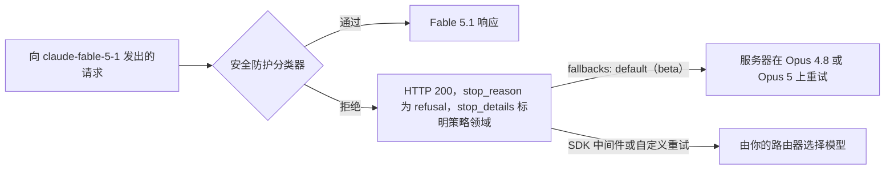

# 模型分类体系

本章提供了截至**2026年11月2日**的模型全景指南，涵盖模型家族、能力与生产系统中的选型标准。

> **最后核验：2026年11月2日。** 模型格局变化很快。请始终与供应商价格页与发布说明交叉核对。
>
> **2026 年 11 月要闻（10 月 1 日至 11 月 2 日）：** 10 月补上了 9 月留下的空档，大部分新风险来自计费规则，而非基准分数。**Anthropic** 发布 **Claude Haiku 5.5**（10 月 7 日，`claude-haiku-5-5`），每 1M token $0.10/$0.50，与 GPT-6 Luna 标价相同；但提示词超过 100,000 token 后，所有 token 都按 5 倍计费，且缓存读取也计入长度。这是“Claude 4.6 及后续模型在 1M 内统一费率”首次出现例外。Anthropic 还将 **Sonnet 5.5 的缓存读取价降至 $0.10**（0.05 倍），让 **Opus 5.5 fast mode** 结束研究预览（10 月 15 日；Opus 4.8 fast mode 将于 11 月 30 日移除），新增第六个平台 **Google Cloud 上由 Anthropic 管理的 Claude Models**，并发布 API 版本 `2026-10-21`：所有模型的 `temperature`、`top_p` 和 `top_k` 无论取何值都会返回 400；新 SDK 主版本默认发送此版本。**OpenAI** 发布 **GPT-6.1 Terra**（10 月 26 日，$1/$5），补齐 Luna/Terra/Sol 三档路由；发布受信任访问版 **GPT-6 Rosalind**（10 月 30 日，$15/$75）、**12 小时提示缓存**（10 月 20 日，写入价格为输入的 2.5 倍）及正式版 **Decisions API**（10 月 22 日）。OpenAI 还通知客户，剩余 GPT-4o、GPT-4o-mini、GPT-4.1 和 GPT-4.1-mini 快照及其微调模型将于 2027 年 1 月 14 日关闭，提前约三个月。**Google** 于 10 月 13 日正式发布 **Gemini 4 Argon**（`gemini-4-argon`），11 月 30 日前价格为 $2/$10，12 月 1 日起为 $4/$20，仅提供隐式缓存；10 月 28 日宣布面向部分 Fairwind 网络防御者的 **Gemini 4 Carbon**，尚无模型 ID；并于 10 月 8 日将 `gemini-3.7-flash` 请求路由至 3.8 Flash、将 `gemini-3.5-flash` 路由至 3.6 Flash（已发布在更新日志），因此固定的模型字符串虽然仍有效，背后的模型却已改变。**Meta** 发布 **Muse Wonder**（10 月 12 日，`muse-wonder-1.0`），在 Meta Model API 上每 1M token $4/$20，与 Opus 5.5 标价相同；更强的 Muse Wonder Full 仅通过 Muse Code 订阅销售，不提供 API。Grok 5 仍未发布。开放权重出现新的许可门槛：**Mistral Large 4**（10 月 29 日开放权重）要求任何 MaaS 业务另行申请商业许可，不设收入下限；**Meta Muse Spark Open**（10 月 15 日）对收入超过 2,000 万美元的 MaaS 设门槛；StepFun 的 Step 5 Preview（约 10 月 15 日）、MiniMax-M3.1-Flash（10 月 23 日）和 DeepSeek V4.1-Flash-1017（10 月 17 日，MIT）也已发布。基准再次重置：**Artificial Analysis Intelligence Index v5.0**（10 月 27 日）与 v4.x 不可比较；Gemini 4 Carbon（59，尚未公开提供）和 Claude Opus 5.5（58）居前，最佳开放权重模型约为 32 分。tbench.ai 的 Terminal-Bench 4.0 排行榜（10 月 6 日加入新结果）中，Opus 5.5（64.85%）和 Sonnet 5.5（61.82%）超过 GPT-6 Astra 与 GPT-6.1 Sol（并列 58.18%）。OpenAI 10 月 23 日的旧模型关闭按计划进行；Claude Sonnet 4.5 仍将于 11 月 30 日在 Claude API 退役（Bedrock 保留至 2027 年 4 月 8 日）。

## 目录

- [模型分类](#模型分类)
- [前沿模型（2026年11月）](#前沿模型-2026年11月)
- [推理模型](#推理与数学-reasoning-math)
- [开源模型](#开源模型)
- [专用模型](#专项模型)
- [嵌入模型](#嵌入模型)
- [模型选型框架与语义路由](#模型选择框架)
- [主权 AI 与数据驻留](#主权-ai-与数据驻留)
- [能力对比](#能力对比)
- [面试题](#面试题)
- [发布历史（2026）](#发布历史-2026)
- [参考资料](#参考资料)

---

## 模型分类

### 按能力等级（2026年11月）

| Tier（层级） | Characteristics（特征） | Examples（示例） | Use Case（使用场景） |
|------|-----------------|----------|----------|
| **Frontier（前沿）** | 最高能力上限；$4/$20 至 $10/$50，或受限访问 | Claude Fable 5.1、GPT-6 Astra、Claude Opus 5.5（$4/$20）、Gemini 4 Argon（12 月 1 日起 $4/$20）、Meta Muse Wonder（$4/$20）；受限：Gemini 4 Carbon、GPT-6 Rosalind、Claude Mythos 5.1；仅订阅可用：Muse Wonder Full | 最困难的推理、长周期智能代理、受能力上限约束的编码 |
| **Workhorse（主力，输入价 $1 至 $2）** | 中档价格下接近前沿的代理化质量 | Claude Sonnet 5.5、GPT-6.1 Sol、GPT-6 Sol（$2/$10）、GPT-6.1 Terra（$1/$5）、Grok 4.7（$2/$6）、Muse Spark 1.3（$1.25/$4.25） | 生产级智能代理、规模化编码、默认路由层级 |
| **Fast/Efficient（快速/高效）** | 单 Token 成本最低、高吞吐量 | GPT-6 Luna、Claude Haiku 5.5（提示词低于 100K）、Gemini 3.8 Flash、DeepSeek V4.1-Flash | 分类、抽取、路由、高流量流式处理 |
| **Previous Generation（上一代，仍在服务）** | 特征明确，但通常会在数周内被替代 | Claude Opus 5 / Sonnet 5 / Fable 5、Claude Haiku 4.5、GPT-5.6 Sol / Terra / Luna、Claude Opus 4.8、Gemini 3.6 Flash | 重视稳定、已完成评估行为的工作负载 |
| **Small/Edge（小型/边缘）** | 私有化、边缘部署、单 GPU | Gemma 4（12B、E4B）, Qwen3.8-27B, IBM Granite 4.2, Muse Glimmer 30B | 本地隐私、设备端、单 GPU 服务 |
| **Reasoning-Heavy（重推理）** | 高努力级别下的扩展内部推理 | GPT-6 Astra（xhigh/max）, Claude Fable 5.1, Claude Opus 5.5（高努力级别）, DeepSeek V4.1-Flash（effort 1-100） | 数学、代码调试、多步逻辑 |

Anthropic 快速档现在有两档价格需要留意：Haiku 5.5 在提示词不超过 100,000 token 时与 GPT-6 Luna 同价，为 $0.10/$0.50；超过后整个请求按 5 倍计价，因此提示长度决定它实际属于哪个价格档。

### 按推理模式（2026年11月）

| Mode（模式） | Capability（能力） | Models（模型） | Use Case（使用场景） |
|------|------------|--------|----------|
| **Minimal reasoning（最小推理）** | 模型允许的最快路径 | GPT-6.1 Terra（`none`）, GPT-6.1 Sol（`low`）, GPT-6 Luna（最低 effort）, Gemini 3.8 Flash（`low`）, Claude Haiku 5.5（`low`）, Claude Sonnet 5.5（`between_tools`） | 聊天、简单抽取 |
| **Always-on reasoning（始终开启推理）** | 无法关闭思考 | Claude Opus 5.5 和 Fable 5.1（自适应思考始终开启）, GPT-6 Astra（无 `none` effort；`low` 至 `max`） | 数学、代码调试、规划 |
| **Dial-controlled（旋钮控制）** | 每个请求设置 effort 或思考级别 | GPT-6.1 Terra（`none` 至 `max`，默认 `medium`）、GPT-6.1 Sol（`low` 至 `max`，默认 `medium`）、Claude Opus 5.5 和 Haiku 5.5（默认 `medium`）、Gemini 3.8 Flash（`thinking_level`）、DeepSeek V4.1-Flash（1-100） | 复杂度可变任务 |

**Anthropic 的关闭开关正在消失。** Sonnet 5.5 对 `thinking: {type: "disabled"}` 返回 400，Opus 5.5 无法关闭思考，Haiku 5.5 拒绝 `budget_tokens`。OpenAI 的情况不同：Astra 没有 `none` effort，但 GPT-6.1 Terra 支持。采样参数也几乎全面消失：Claude API 版本 `2026-10-21`（10 月 21 日）下，所有模型的 `temperature`、`top_p` 和 `top_k` 无论取何值（包括默认值）都会返回 400；旧版本仅对 Claude 4.7 及后续模型的非默认值报错。新版 SDK 主版本（Python 2.0.0、TypeScript 1.0.0、Go 2.0.0）默认发送新版本，因此日常升级 SDK 也会破坏旧模型的采样代码。Astra 不接受 `temperature`、`top_p` 或 logprobs，Google 则于 7 月 21 日在 Gemini API 中弃用了这些参数。effort 现在是控制面，且默认值会在版本间变化（Opus 5 默认 `high`，Opus 5.5 为 `medium`），因此应在每条路由中显式设置。

---

## 前沿模型（2026年11月）

### Claude Opus 5.5（Anthropic）- 2026年9月新增

| Attribute（属性） | Value（值） |
|-----------|-------|
| Model ID（模型 ID） | `claude-opus-5-5`（Bedrock：`anthropic.claude-opus-5-5`） |
| Context Window（上下文窗口） | 100 万 Token；最大输出 128K（使用 beta header 的 Batch 为 300K） |
| Input / Output Cost（输入/输出成本） | 每 100 万 Token $4.00 / $20.00（Opus 5：$5 / $25） |
| Cache / Batch（缓存/批处理） | 缓存写入 $5.00（5 分钟）或 $8.00（1 小时）；缓存读取 $0.20（输入价格的 0.05 倍）；Batch $2 / $10；最小可缓存提示词为 512 Token |
| Fast mode（快速模式） | 每 100 万 Token $8 / $40（2026 年 10 月 15 日结束研究预览），可用于 Claude API、Google Cloud 上由 Anthropic 管理的 Claude Models 和 Azure 托管的 Foundry 部署；不支持 Batch |
| Thinking（思考） | 自适应思考始终开启（无法关闭）；默认 effort 为 `medium`（Opus 5 默认 `high`） |
| Availability（可用性） | Claude API、Amazon Bedrock、Google Cloud（Google 管理或 Anthropic 管理）、Microsoft Foundry、Claude Platform on AWS；可使用零数据保留 |
| Benchmarks（基准测试） | Anthropic 报告：Terminal-Bench 4.0 在 xhigh 下为 66.4%（SE ±2.6），对比 Fable 5.1 的 55.8%（Anthropic 的运行结果）和 GPT-6 Astra 的 57.9%（OpenAI 数据，高 effort）；OSWorld 2.1 partial 为 81.8%；GDPval-AA v2.1 为 1846 Elo；使用工具的 HLE 为 67.7%。独立数据：Terminal-Bench 4.0 排行榜 max 为 64.85%（tbench.ai，10 月 6 日新增结果），排名第一；Artificial Analysis Intelligence Index v5.0 为 58（max，含回退），是开发者可调用模型中的最高分，仅低于 Gemini 4 Carbon（59）。 |
| Released（发布日期） | 2026 年 9 月 22 日（知识截止日期为 2026 年 6 月；不早于 2027 年 9 月 22 日退役） |

**它是什么：** 第二次 Opus 降价（此前 Opus 4.5 从 $15/$75 降价），也是 Anthropic 文档现在建议大多数工作负载优先使用的模型。Fable 5.1 留给高要求推理、长周期代理化工作，或 Opus 5.5 在更高 effort 下仍未达到评估要求的情形。一款更便宜的模型在 Anthropic 自身大多数代理基准中胜过更昂贵的 Fable 5.1，颠覆了通常“为能力上限付更多钱”的路由逻辑。Anthropic 称，典型工作负载的成本较 Opus 5 低约 40%（厂商报告）。

**从 Opus 5 迁移的陷阱：** 默认 effort 从 `high` 降至 `medium`，因此未固定参数的升级会同时改变延迟和质量；强制 `tool_choice`（`any` 或 `tool`）会返回 400；思考块绑定其生成模型和会话；并且在 Claude API 和 Google Cloud 上，计算机使用仅接受 `computer_toolset_20260801`。Opus 5.5 在网络安全分类器之外新增了生物安全分类器。在 Anthropic 评估期间当防护措施介入时，网络安全任务由 Opus 4.8 完成，生物学和前沿 LLM 开发任务由 Opus 5 完成，因此标题中的分数属于路由系统，而非同一组权重。

### Claude Sonnet 5.5（Anthropic）- 2026年9月新增

| Attribute（属性） | Value（值） |
|-----------|-------|
| Model ID（模型 ID） | `claude-sonnet-5-5` |
| Context Window（上下文窗口） | 100 万 Token；最大输出 128K |
| Input / Output Cost（输入/输出成本） | 每 100 万 Token $2.00 / $10.00（与 Sonnet 5 相同） |
| Cache / Batch（缓存/批处理） | 缓存写入 $2.50（5 分钟）或 $4.00（1 小时）；缓存读取 $0.10（输入价格的 0.05 倍）；Batch $1 / $5 |
| Thinking（思考） | 默认开启自适应思考；最低设置为 `between_tools`（在 `high` effort 或以下可接受），而 `thinking: {type: "disabled"}` 会返回 400。API 默认 effort 为 `high`，Claude Code 和 Claude 应用中为 medium |
| Availability（可用性） | Claude API、Bedrock、Google Cloud、Foundry、Claude Platform on AWS；可使用零数据保留 |
| Benchmarks（基准测试） | Anthropic 报告，括号内为 Opus 5.5：Terminal-Bench 4.0 为 70.6%（66.4%），CursorBench 4.0 为 55.5%（57.8%），GDPval-AA v2.1 为 1844（1846），OSWorld 2.1 partial 为 80.1%（81.8%），使用工具的 HLE 为 64.5%（67.7%），FrontierCode 1.1 在 max effort 下为 46.2%（54.4%）；Anthropic 指出 Sonnet 5.5 在该测试中 max 下的得分低于 xhigh。独立数据：Terminal-Bench 4.0 排行榜 max 为 61.82%，排名第二（tbench.ai，10 月 6 日新增结果）；AA v5.0 max 下为 54 分（含回退），xhigh 下为 50 分。 |
| Released（发布日期） | 2026 年 9 月 28 日（知识截止日期为 2026 年 6 月；不早于 2027 年 9 月 28 日退役） |

**它是什么：** 一款 $2/$10 模型在 Anthropic 自身报告的大多数代理评估中与旗舰模型仅相差几个百分点（FrontierCode 1.1 约落后 8 分），削弱了将大多数代理流量发送给 Opus 的理由。独立结果的差距并不总是这么小：AA v5.0 中 max effort 比 Opus 5.5 低 4 分，较低 effort 的差距扩大（high 下为 41 对 52），因此实际服务的 effort 比标价更重要。运行方也会颠倒顺序：Anthropic 的 Terminal-Bench 4.0 结果中 Sonnet 5.5 领先 Opus 5.5（70.6% 对 66.4%），而 tbench.ai 排行榜中它落后（61.82% 对 64.85%）。Anthropic 称其输出速度较 Sonnet 5 快 30% 以上、每任务成本最多低 30%（厂商报告）；10 月 7 日缓存读取降至 0.05x，也使长智能体循环更便宜。Anthropic 的 Sonnet 5.5 表中 Sonnet 5 在 Terminal-Bench 4.0 为 10.3%，而其 Opus 5.5 表中 Opus 5 为 52.3%；应将 Sonnet 5 的数字视为异常值，勿作为基线。

**相较 Sonnet 5 的破坏性变更：** 禁用 thinking 会返回 400（请改用 `between_tools`）；强制工具使用会返回 400；thinking 块绑定模型、对话和生成它的账户（来自未关联账户的块会被丢弃并记录为 `organization_binding_mismatch`）；Claude API 和 Google Cloud 拒绝 `computer_20251124`；`temperature`、`top_p` 和 `top_k` 返回 400（旧 API 版本对非默认值返回，`2026-10-21` 对任何值返回）。Sonnet 5 在发布三个月后成为旧版模型。

### Claude Fable 5.1 和 Mythos 5.1（Anthropic）- 2026年9月新增

| 属性 | 值 |
|-----------|-------|
| 模型 ID | `claude-fable-5-1`（GA；Bedrock 为 `anthropic.claude-fable-5-1`）；`claude-mythos-5-1`（根据文档，仅限 Project Glasswing） |
| 关系 | 权重相同，安全防护不同；Mythos 5.1 是限制更少的变体 |
| 输入 / 输出成本 | 每 1M $10.00 / $50.00（与 Fable 5 相同） |
| 缓存 / 批处理 | 缓存写入 $12.50（5 分钟）或 $20.00（1 小时）；缓存读取 $0.25（输入价格的 0.025 倍，低于 Fable 5 的 $1.00）；批处理 $5 / $25 |
| 上下文窗口 | 标准定价下 1M tokens；最大输出 128K |
| Thinking | 自适应 thinking 始终开启；默认 effort 为 `high` |
| 数据处理 | 必须保留 30 天；除非 Anthropic 明确授权，否则无法在零数据保留下使用（有资格使用 Enterprise Frontier Safeguards 的客户可在 EFS 就绪前通过 ZDR 使用 Fable 5.1 和 Fable 5） |
| 溯源 | 所有平台上的输出均带有 Anthropic 统计文本水印；通过 Files API 获取的生成媒体带有已签名的 C2PA Content Credentials |
| 基准 | Terminal-Bench 4.0：tbench.ai 排行榜最大 effort 下为 57.88%，Anthropic 自行运行中为 55.8%。AA v5.0：xhigh 下为 50 分（含回退），max 下为 49 分 |
| 发布 | 2026年9月1日（知识截止日期为 2026年6月；最早不早于 2027年9月1日退役） |

**变化是什么：** 长智能体循环持续使用能力上限模型的成本。Anthropic 表示，缓存读取价格下调 75% 后，典型账单约降低 25%，高度智能体化的工作负载最多降低 45%；其最新网络安全防护的误报率比 Fable 5 早期版本低约 60%（两者均为厂商自报）。Fable 5.1 现在可用于发现漏洞，但不可用于开发漏洞利用。Fable 5 仍然可用。

**Mythos 5.1 访问权限：** 10 月 6 日扩展的 Cyber Verification Program 分为三个档位（Defense、Red Team、Specialized），Project Glasswing 已并入该计划。Mythos 5.1 向各档开放，但要求接受数据保留。

**安全防护回退现已成为 API 契约。** 在 Fable 5 上，分类器命中会自动将请求交给 Opus 4.8。在 Fable 5.1 上，这一行为明确且可配置：



自 9 月 24 日起，`bio`、`frontier_llm` 和 `reasoning_extraction` 类别中在任何输出前发生的拒绝会在所有平台计费（其他类别仍不计费）；流式输出中途拒绝会计入输入及已经流式输出的部分；回退额度会退还切换模型所产生的提示缓存成本。请为拒绝预留预算，并依据 `stop_reason` 而非 HTTP 状态进行路由。

### Claude 5.5 / 5.1 迁移检查清单

| 变更 | 适用范围 | 会损坏什么 | 改为这样做 |
|---|---|---|---|
| 强制 `tool_choice`（`any` 或 `tool`）返回 400 | Fable 5.1、Mythos 5.1、Opus 5.5、Sonnet 5.5（Haiku 5.5 接受，但响应会直接以工具调用开始且不含 thinking 块） | 强制调用工具的结构化提取 | 使用 `auto` 加严格工具使用，或使用结构化输出 |
| Thinking 块绑定模型和对话 | Fable 5.1、Opus 5.5、Sonnet 5.5、Haiku 5.5（Mythos 5.1 跳过前缀检查）；Sonnet 5.5 与 Haiku 5.5 还绑定生成账户 | 历史重放到其他模型会静默丢失推理（Haiku 5.5 会无错误地丢弃来自 Opus 5、Opus 5.5、Sonnet 5.5、Fable 和 Mythos 的块）；2026 年 8 月 31 日及以后创建的账户若改写 thinking 块前内容会返回 400 | 将历史视为只追加，并通过生成该块的账户重放；使用 `thinking-binding-controls-2026-08-01` beta 请求头启用 `prefix_mismatch_behavior: "drop_block"` |
| Thinking 无法禁用 | Opus 5.5；Sonnet 5.5 的下限为 `between_tools` | 假定关闭 thinking 的延迟预算 | 显式设置 effort 并重新测量延迟 |
| 默认 effort 已变更 | Opus 5.5 为 `medium`（Opus 5 为 `high`） | 升级时发生静默的质量和延迟变化 | 在每个请求中固定 effort |
| 拒绝 `computer_20251124` | Claude API 和 Google Cloud 上的 Opus 5.5 与 Sonnet 5.5（Bedrock 仍接受） | 使用旧工具版本的计算机使用智能体 | 迁移至 `computer_toolset_20260801` |
| 三个类别的输出前拒绝会计费 | 自 9 月 24 日起的所有平台 | 将拒绝视为免费的成本模型 | 将 `stop_reason: "refusal"` 作为成本项跟踪 |
| 新版 API 对采样参数在任何取值下都返回 400；assistant 消息中的 `document` 块及 user 文本块中的 `citations` 也返回 400 | API 版本 `2026-10-21` 下的所有模型；新 SDK 主版本（Python 2.0.0、TypeScript 1.0.0、Go 2.0.0）默认发送此版本；Bedrock 仅在 Claude 4.7 及之后模型上支持 | 任何 Claude 模型上显式设置 `temperature` 或 `top_p`，包括设置成默认值 | 删除这些参数，并固定 SDK 主版本与 API 版本，让升级成为显式变更 |
| Haiku 4.5 迁移至 Haiku 5.5 | 快速层迁移 | `budget_tokens`、采样参数和 assistant prefill 返回 400；相同文本 token 约增加 30%，此前轮次的 thinking 块现作为输入保留在上下文中；高分辨率图像层对 2000x1500 图像收取约 2.5 倍视觉 token；提示词超过 100K 后整个请求按 5 倍计费；thinking 块绑定账户并检查前缀（Haiku 4.5 均不检查）；无 Priority Tier | 用结构化输出替代 prefill，用新模型重新计数文本和图像 token，将长提示词路由至其他模型，历史保持只追加，并独立规划 Haiku 4.5 Priority Tier 承诺之外的容量 |

还有两项较小变更会影响测试框架：工具调用之间的文本现在会出现在 thinking 块中，默认 `display: "omitted"` 时这些块为空（`display: "updates"` beta 会返回文本）；此外还发布了支持每条消息 effort 和轮次范围系统消息（9 月 1 日）、按需压缩（`compact-2026-09-04`，9 月 14 日），以及在对话中途内联定义工具且不损失缓存（`inline-tools-2026-09-15`，9 月 22 日）的 beta 功能。

### Claude Haiku 5.5（Anthropic）- 2026年10月新增

| 属性 | 值 |
|-----------|-------|
| 模型 ID | `claude-haiku-5-5`（Bedrock：`anthropic.claude-haiku-5-5`） |
| 上下文窗口 | 1M token；最大输出 128K |
| 提示词不超过 100,000 token 的价格 | 每 1M 输入/输出 $0.10/$0.50；缓存写入 $0.125（5 分钟）或 $0.20（1 小时）；缓存读取 $0.01；Batch $0.05/$0.25 |
| 提示词超过 100,000 token 的价格 | 每 1M 输入/输出 $0.50/$2.50；缓存写入 $0.625 或 $1.00；缓存读取 $0.05；Batch $0.25/$1.25。**整个请求**按此费率计价，缓存读取和写入也计入提示词长度 |
| 思考 | 自适应思考，effort 从 `low` 至 `max`，默认 `medium`；`budget_tokens` 会返回 400。与 Opus 5.5 和 Sonnet 5.5 不同，它接受强制 `tool_choice`，但响应会直接以工具调用开始，不包含 thinking 块 |
| 相比 Haiku 4.5 的破坏性变更 | `budget_tokens`、`temperature`、`top_p`、`top_k` 和 assistant prefill 均返回 400；新 tokenizer 对相同文本多产生约 30% token；2000x1500 图像的高分辨率层约增加 2.5 倍视觉 token；thinking 块绑定生成账户并检查前缀；不支持 Priority Tier |
| 可用平台 | Claude API、Bedrock、Google Cloud、Microsoft Foundry、Claude Platform on AWS |
| 基准 | Anthropic 报告：Terminal-Bench 4.0 为 39.2%；OSWorld 2.1 离线子集部分得分 72.4%。独立测试：AA Intelligence Index v5.0 max 为 36 |
| 安全 | 系统卡：Gray Swan 提示注入评估中，最多尝试 15 次的攻击成功率总体为 7.1%，仅 GUI 计算机使用时为 24.4% |
| 发布 | 2026 年 10 月 7 日（最早退役日期为 2027 年 10 月 7 日） |

**它是什么：** Anthropic 的快速档，标价与 GPT-6 Luna 相同；独立分数明显高于 Luna（AA v5.0 max：36 对 28）。它也是首个在长上下文区间出现价格断崖的 Claude 4.6 及后续模型，且断崖比 OpenAI 更陡：GPT-6 Luna 输入超过 272K 后输入价格翻倍、输出乘 1.5；Haiku 5.5 超过 100K 后所有 token 类型都乘 5。99K 提示词加 1K 输出约 $0.0104；101K 加相同输出约 $0.053。缓存读取也算入阈值，因此每次请求重用 120K 的缓存前缀仍要按高价计费。

**三项设计影响。**第一，Anthropic 也需要基于提示长度做成本路由：Haiku 5.5 流量保持在 100K 以下；长提示路由至 Sonnet 5.5（1M 内统一 $2/$10）或 GPT-6 Luna（长上下文 $0.20/$0.75）。第二，tokenizer 会移动价格断点：Haiku 4.5 上测得 80K 的提示词，到了 Haiku 5.5 约为 104K；而且新模型会保留先前轮次 thinking 块作为输入（Haiku 4.5 仅保留最近一轮），多轮对话更早达到断点。不要沿用旧提示长度仪表盘，须用新模型重新计数。第三，对可能放入浏览器或桌面的模型来说，提示注入风险不低：在 15 次 GUI 计算机使用攻击尝试中约四分之一成功，因此 Haiku 5.5 智能体也应采用与大模型相同的隔离和人工审批门禁。

### Claude Haiku 4.5（Anthropic）- 2025年10月，已由 Haiku 5.5 取代

截至 11 月 2 日，Haiku 4.5 在 Claude API 上仍为 Active，且尚无弃用通知。其最早退役日期（“不早于 2026 年 10 月 15 日”）已过；Anthropic 最少提前 60 天通知，因此 Claude API 上的退役时间不会早于约 2027 年 1 月。Microsoft Foundry 仍列出 `claude-haiku-4-5` 将于 2026 年 11 月 15 日退役；Anthropic 表示其日期也适用于 Foundry，因此应按较早日期规划并向两家供应商确认。其 200K 上下文、$1/$5 标价是 Haiku 5.5 在 100K 以下价格的十倍。继续使用它的理由是行为或合同因素（支持 assistant prefill、`budget_tokens`、旧 tokenizer，或已有 Priority Tier 合同）；应把这些视为迁移工作，而非支付十倍价格的理由。

### Claude Opus 5（Anthropic）- 2026年7月，已被 Opus 5.5 取代

| 属性 | 值 |
|-----------|-------|
| 模型 ID | `claude-opus-5` |
| 上下文窗口 | 1M tokens（默认及最大值；最大输出 128K） |
| 输入 / 输出成本 | 每 1M $5.00 / $25.00（与 Opus 4.8 相同） |
| Fast 模式 | 每 1M $10.00 / $50.00，约快 2.5 倍 |
| 基准 | Anthropic 的发布文章报告了其称为 Frontier-Bench v0.1 的发布前基准（后更名为 Terminal-Bench 3.0，后者又于 8 月 28 日被 Terminal-Bench 4.0 取代；分数不可横向沿用）：最大 effort 下为 43.3%，对比 GPT-5.6 Sol 34.4%、Fable 5 33.7%、Opus 4.8 18.7%；CursorBench 3.2 与 Fable 5 相差 0.5% 内、每任务成本约一半。均为厂商自报。此后：Terminal-Bench 4.0 排行榜 xhigh 下为 53.94%；SWE-Bench Pro v2（Scale，9 月 22 日）在饱和的公开拆分上为 99.4%，私有集上为 81.6%（222/272），是 Scale 公布的最高私有集分数。 |
| 发布 | 2026年7月24日（Claude API、Claude Code、Claude Cowork；Claude Max 新默认） |

**它是什么：** Opus 系列的代际后继，价格不变，面向长时程智能体式编码与计算机使用。Beta 功能包括对话中途变更工具与自动回退路由；Fast 模式延续“一模型、两延迟档”。

**状态：** 于 9 月 22 日被价格更低的 Opus 5.5（$4/$20 对比 $5/$25）取代。仍可作为旧版模型使用，也是 Fable 5.1 允许的两个安全防护回退目标之一（另一个为 Opus 4.8）。

### Claude Sonnet 5（Anthropic）- 2026年6月，已被 Sonnet 5.5 取代

| 属性 | 值 |
|-----------|-------|
| 模型 ID | `claude-sonnet-5` |
| 上下文窗口 | 第三方报道为 1M tokens（发布公告未说明） |
| 输入 / 输出成本 | 每 1M $2.00 / $10.00（自2026年8月10日起为永久价格） |
| 缓存 / 批处理 | 缓存写入每 1M $2.50（5 分钟）或 $4.00（1 小时）；缓存命中 $0.20；Batch API $1.00 / $5.00 |
| 定位 | 发布时最具智能体能力的 Sonnet：规划、浏览器和终端工具使用，以及以低于 Opus 4.8 的成本接近其自主运行能力 |
| 安全 | 默认启用网络安全防护；相较 Opus 级模型刻意降低网络安全能力 |
| 发布 | 2026年6月30日（同日成为消费者与开发者产品的默认模型） |

**它是什么：** 替代 Sonnet 4.6 并成为默认模型的生产主力。Anthropic 于2026年8月10日将首发价 $2/$10 设为永久价格，并取消9月1日上调至 $3/$15 的计划，因此 Sonnet 5 永久低于它取代的 Sonnet 4.6（后者仍为 $3/$15）。

**状态：** Sonnet 5.5 于9月28日以相同价格取代该模型；该模型仍作为旧版可用。此外，Anthropic 于9月30日弃用 Claude Sonnet 4.5（`claude-sonnet-4-5-20250929`），该模型将于2026年11月30日在 Claude API 和 Foundry 中停止服务，指定替代型号为 `claude-sonnet-5-5`。

### Claude Fable 5（Anthropic）- 2026年6月，已被 Fable 5.1 取代

| Attribute（属性） | Value（数值） |
|-----------|-------|
| Model ID（模型ID） | `claude-fable-5` |
| Context Window（上下文窗口） | 1M tokens（使用 Opus 4.7 分词器；在相同文本下大约多 30% token） |
| Max Output（最大输出） | 128K tokens |
| Input Cost（输入成本） | 10.00 美元 / 1M tokens |
| Output Cost（输出成本） | 50.00 美元 / 1M tokens |
| Thinking（思考机制） | Adaptive thinking（自适应思考），始终开启（无独立扩展思考开关） |
| Multimodal（多模态） | 文本 + 视觉（Anthropic 称其在视觉任务上达到最新最优） |
| Benchmarks（基准） | 按 Anthropic 表述，在几乎所有测试基准上达到最优；在 Cognition 的 FrontierCode 上得分最高，在 Hebbia Finance Benchmark、ViBench 与 CursorBench 上居首。标准数值分数（SWE-bench、GPQA）未在发布公告中公布。 |
| Released（发布日期） | 2026年6月9日（在 Claude API、Claude Platform on AWS、Amazon Bedrock、Vertex AI、Microsoft Foundry 上 GA） |

**它是什么：** 一款 Mythos 级模型，已安全化为通用可用。在此之前，Mythos 系列（Mythos Preview 的 SWE-bench Verified 为 93.9%）受双用途网络安全顾虑约束，仅对约 11 个 Project Glasswing 合作方开放。Fable 5 通过配套保守型安全策略，将该能力层级带给所有用户。

**Opus 4.8 回退保护机制：** 当 Fable 5 的分类器检测到请求属于三类之一（攻击性网络技术、生物武器相关的生物与化学领域内容，或试图蒸馏模型的行为）时，系统会将响应转交给**Claude Opus 4.8**，并告知用户。Anthropic 称该机制在不足 5% 会话中触发，并被刻意调得偏保守，因此部分无害请求也会被拦截。从架构上看，这是**模型分层路由作为安全控制**的生产实践，而不仅是成本控制。Fable 5.1 将其变为上文所述明确、可计费的 API 合约。

**注意项：** 相比 Opus 4.8 的每 token 成本翻倍（10/50 vs 5/25）。Mythos 级流量需要 30 天数据保留要求（不会用于训练；有访问日志；几乎全部场景下 30 天后删除），在合规审核中需关注。订阅计划中于6月9日至22日包含，不额外计费，之后改为按用量积分。Fable 5 的缓存读取价格为每 1M 1.00 美元；Fable 5.1 在标价相同的情况下将其降至 0.25 美元，因此几乎没有理由在 Fable 5 上启动新工作。

### Claude Mythos 5（Anthropic）- 2026年6月，已被 Mythos 5.1 取代

| Attribute（属性） | Value（数值） |
|-----------|-------|
| Model ID（模型ID） | `claude-mythos-5` |
| Status（状态） | 限量可用：Project Glasswing 合作方与部分生物研究者 |
| Relationship（关系） | 与 Fable 5 同一底层模型，在部分场景下取消了防护限制 |
| Pricing（定价） | 10 / 50 美元每 1M（低于 Mythos Preview 的不到一半） |
| Released（发布日期） | 2026年6月9日 |

**为什么重要：** 它以可比或略强的能力和更低的价格取代了 Claude Mythos Preview。Fable/Mythos 分离正式形成双轨发布模式：一条为带安全护栏的通用版，一条为面向经审核防御方的不受限版本。Mythos 5.1 延续了这一模式。

### Claude Opus 4.8（Anthropic）- 2026年5月，旧版

| Attribute（属性） | Value（数值） |
|-----------|-------|
| Context Window（上下文窗口） | 1M tokens（全窗口统一计费标准） |
| Input Cost（输入成本） | 5.00 美元 / 1M tokens（与4.7一致） |
| Output Cost（输出成本） | 25.00 美元 / 1M tokens（与4.7一致） |
| Cache: 5m write（5分钟写入缓存） | 6.25 美元 / 1M tokens |
| Cache: 1h write（1小时写入缓存） | 10.00 美元 / 1M tokens |
| Cache: hit / refresh（命中/刷新） | 0.50 美元 / 1M tokens |
| Batch API（批处理） | 2.50 / 12.50 美元每 1M（5折） |
| Fast mode（research preview）（快速模式，研究预览） | 10 / 50 美元每 1M（快约 2.5 倍；比 Opus 4.7 快速模式 30 / 150 美元便宜 3 倍） |
| Extended Thinking（扩展思考） | Native，adaptive（原生，自适应） |
| Multimodal（多模态） | 文本 + 高分辨率视觉 |
| SWE-bench Verified（SWE-bench Verified） | 88.6% |
| SWE-Bench Pro（SWE-Bench Pro） | 69.2%（较 Opus 4.7 的 64.3% 提升） |
| Terminal-Bench 2.1（终端基准） | 74.6%（发布时 GPT-5.5 以 78.2% 领先） |
| GDPval-AA（GDPval-AA） | 1890 Elo（较 Opus 4.7 的 1753 提升） |
| OSWorld-Verified（OSWorld-Verified） | 82.3% |
| Online-Mind2Web（在线 Mind2Web） | 84% |
| Released（发布日期） | 2026年5月28日（Claude API、AWS Bedrock、Vertex AI 全量上线） |

**最佳适用：** Claude Code 中的长期自治编码、代码库规模迁移、需要并发子代理的代理化工作流，以及对对齐性与诚实性收益有要求的任务。它也是 Fable 5.1 获准的两个安全防护回退目标之一（另一个是 Opus 5）；Anthropic 对 Opus 5.5 的评测在安全防护介入时会将网络任务路由至它，因此即使团队从不直接调用它，它仍处于生产路径中。

**较 Opus 4.7 的关键新增：**
- **Dynamic Workflows（动态工作流，研究预览）：** Claude 会规划工作，在单个 Claude Code 会话中并行运行数百个子代理，验证其输出并回报。适用于数十万行级代码库迁移。
- **Mid-task system messages（任务中系统消息）：** Messages API 现支持会话中途注入 system message，可在不中断会话的情况下引导长任务。
- **可选 fast mode（可选快速模式）**：以约 2.5 倍速度运行，每 1M 10/50 美元，价格约为 Opus 4.7 快速模式的三分之一。
- **Effort-control toggle（推理强度开关）**在 `claude.ai` 与 Cowork 提供，用户可按回合调整思考深度。
- **Claude Code 速率限制扩展。**

**注意项：** 分词器与 Opus 4.7 引入的相同；根据 Anthropic 的 token 计数文档，对于相同文本，相比 4.7 前的分词器 token 数约多 30%，具体增幅取决于内容（Opus 4.7 发布文章给出的范围为 1.0 倍至 1.35 倍）。发布时，GPT-5.5 以 SWE-Bench Verified 88.7% 居首，并在 Terminal-Bench 2.1 中以 78.2% 领先。GPQA Diamond 相对 Opus 4.7 下降 0.6 分。Anthropic 的分词器变更意味着同一文本在旧模型与当前模型的 token 数与计费不可直接对比。Claude 没有发布 Sonnet 4.8；产品线于2026年6月30日直接跃迁至 **Claude Sonnet 5**，并由其取代 Sonnet 4.6 成为生产主力。对于新工作，Opus 5.5 更便宜（$4/$20）且更强。

> [!NOTE]
> **已于2026年8月5日退役：** `claude-opus-4-1-20250805` 已从 Claude API 移除，最后一个每 1M $15/$75 的 Opus 层级由此结束。当时所有第一方 Opus SKU 均为 $5/$25（Fast 模式为 $10/$50）；Opus 5.5 后来将当前 Opus 的价格降至 $4/$20。Amazon Bedrock 和 Google Cloud 采用各自的退役计划：Opus 4.1 已于 2026 年 10 月 8 日在 Bedrock 进入价格更高的公开延长访问期，并将于 2027 年 1 月 8 日终止服务。固定使用该 ID 的代码在第一方 API 上会失败，但在合作云上仍可运行。

### Claude Opus 4.7（Anthropic）- 2026年4月，旧版

| Attribute（属性） | Value（数值） |
|-----------|-------|
| Context Window（上下文窗口） | 1M tokens |
| Max Output（最大输出） | 128K tokens |
| Input Cost（输入成本） | 5.00 美元 / 1M tokens（与4.6一致） |
| Output Cost（输出成本） | 25.00 美元 / 1M tokens（与4.6一致） |
| Extended Thinking（扩展思考） | Native，自适应模式 |
| Multimodal（多模态） | 文本 + 高分辨率视觉 |
| SWE-bench Verified (Adaptive)（SWE-bench Verified，适应式） | 87.6%（2026年5月13日） |
| Released（发布日期） | 2026年4月16日（API、Bedrock、Vertex、Microsoft Foundry 全量上线） |

**状态：** 仍作为旧版模型可用。它在发布时驱动 Claude Code；自 2.1.280 起，Claude Code 的默认 Opus 一直是 Opus 5.5。新工作建议使用 Opus 5.5：它更便宜且更强。

### Claude Mythos Preview（Anthropic）- 已被 Mythos 5 和 5.1 取代

| Attribute（属性） | Value（数值） |
|-----------|-------|
| Status（状态） | 限制性研究预览，仅限 Project Glasswing 合作方（约11家机构，如 AWS、Apple、Cisco、Google、Microsoft、NVIDIA、Palo Alto 等）；自2026年6月9日起已弃用，退役日期待公布 |
| Restriction reason（限制原因） | 双用途网络安全能力 |
| SWE-bench Verified（SWE-bench Verified） | 93.9%（2026年5月13日；Fable 5 / Mythos 5 发布前发布的 SOTA） |
| Released（发布日期） | 2026年4月7日（受限合作预览）；于2026年6月9日被 Mythos 5 取代，且价格不足其一半 |

**最佳适用：** 历史参考。其能力层级已于2026年6月9日以 Claude Fable 5 的形式全面对外开放；新的 Glasswing 项目应优先使用 Mythos 5.1。

### Claude Opus 4.6（Anthropic）- 2026年2月，旧版

| Attribute（属性） | Value（数值） |
|-----------|-------|
| Context Window（上下文窗口） | 1M tokens |
| Max Output（最大输出） | 128K tokens |
| Input Cost（输入成本） | 5.00 美元 / 1M tokens |
| Output Cost（输出成本） | 25.00 美元 / 1M tokens |
| Extended Thinking（扩展思考） | 原生自适应思考（可配置 budget_tokens） |
| Multimodal（多模态） | 文本 + 视觉 |
| Highlights（亮点） | 发布时为 Anthropic 的旗舰模型；现为旧版 |
| Released（发布日期） | 2026年2月 |

**状态：** 仍可使用。Opus 5.5 更便宜（$4/$20 对比 $5/$25）且更强，因此没有成本理由继续使用它。

### Claude Sonnet 4.6（Anthropic）- 2026年2月，旧版

| Attribute（属性） | Value（数值） |
|-----------|-------|
| Context Window（上下文窗口） | 1M tokens |
| Input Cost（输入成本） | 3.00 美元 / 1M tokens |
| Output Cost（输出成本） | 15.00 美元 / 1M tokens |
| Extended Thinking（扩展思考） | 支持 |
| Multimodal（多模态） | 文本 + 视觉 |
| Highlights（亮点） | 可处理此前需要 Opus 级别的任务；在2026年年中前是成本/质量的默认选择 |
| Released（发布日期） | 2026年2月 |

**状态：** 仍可使用，但其 $3/$15 的价格现已高于 Sonnet 5.5（$2/$10）。除非评估结果另有结论，否则应迁移。

### GPT-6 Astra（OpenAI）- 2026年9月 新增

| Attribute（属性） | Value（数值） |
|-----------|-------|
| Model ID（模型 ID） | `gpt-6-astra` |
| Context Window（上下文窗口） | 1.05M tokens；最大输出 128K；知识截止日期为 2026年4月30日 |
| Input / Output Cost（输入 / 输出成本） | 每 1M 为 10.00 / 50.00 美元；输入超过 272K 时，整次请求按 20 / 75 美元计费 |
| Cache（缓存） | 缓存输入 1.00 美元；缓存写入 12.50 美元（30 分钟 TTL）或 25.00 美元（12 小时 TTL，仅 Responses API，自 10 月 20 日起） |
| Service tiers（服务层级） | Batch 和 Flex 享 5 折；Fast 为 2 倍（20 / 100 美元）；Ultrafast 为 6 倍（60 / 300 美元，9月29日 GA，Responses API） |
| Reasoning（推理） | 支持 `low`、`medium`、`high`、`xhigh`、`max`；不支持 `none`；不支持自定义 `temperature`、`top_p` 或 logprobs；工具调用需要使用 Responses API |
| Availability（可用性） | 自 9月3日起分阶段推出（Daybreak 组织优先），9月5日前在 API 中可用；Amazon Bedrock 于 9月8日 GA（区域内和地理推理为 11 / 55 美元，比 Global 高 10%）；Microsoft Foundry GA |
| Safety rating（安全评级） | 首个在其 Preparedness Framework 下被评为网络安全 Critical 的 OpenAI 模型；生物和化学能力为 High。OpenAI 表示，隐蔽的能力保留行为很可能无法被可靠发现 |
| Benchmarks（基准测试） | Terminal-Bench 4.0 榜单 max 为 58.18%，与 GPT-6.1 Sol 并列（tbench.ai，10 月 6 日新增结果）。ARC-AGI-3（ARC Prize）：在供应商中立的 Standard harness 上为 62.7%（max，26,098 美元），而在使用 OpenAI 自身上下文管理功能的 ARC Prize Provider Adapter harness 上为 99.9%（high，18,817 美元）。AA Intelligence Index v5.0：57（max） |
| Released（发布日期） | 2026年9月3日 |

**它是什么：** OpenAI 的旗舰模型，价格与 Claude Fable 5.1 相同，均为 $10/$50。速度成为三个档位的计费维度（Standard、2 倍价格的 Fast、6 倍价格的 Ultrafast），因此延迟 SLO 也是预算决策。272K 断点会让整次请求按更高费率计价，因此刚超过阈值的提示词成本约为刚低于阈值提示词的两倍：按提示词长度路由是成本控制手段。Artificial Analysis 测得 Astra 每个编码任务使用的 token 约为 GPT-5.6 Sol 的三分之一，因此其单任务成本比标价所暗示的更接近中端层级。

**解读测试框架：** 同一模型、同一测试集在 ARC-AGI-3 上相差 37 分，源于脚手架是否会在请求间保留不透明的推理状态。引用 Astra 的结果时，应同时说明测试框架、推理强度及执行方。

### GPT-6 Sol 和 GPT-6 Luna（OpenAI）- 2026年9月 新增

| Attribute（属性） | Value（数值） |
|-----------|-------|
| Model IDs（模型 ID） | `gpt-6-sol`、`gpt-6-luna`（文本和图像输入、文本输出；支持 Responses 和 Chat Completions） |
| Context Window（上下文窗口） | 1.05M tokens；最大输出 128K |
| Sol pricing（Sol 定价） | 每 1M 为 2.00 / 10.00 美元；缓存输入 0.20 美元；缓存写入 2.50 美元（30 分钟）或 5.00 美元（12 小时）；超过 272K 时为 4 / 15 美元 |
| Luna pricing（Luna 定价） | 每 1M 为 0.10 / 0.50 美元；缓存输入 0.01 美元；缓存写入 0.125 美元；超过 272K 时为 0.20 / 0.75 美元 |
| Batch / Flex | Sol 为 1 / 5 美元；Luna 为 0.05 / 0.25 美元 |
| Lineage（血统） | 据 OpenAI 称，与 GPT-6 Astra 使用相同类型的数据和训练方式。它们以约一半价格取代 GPT-5.6 Sol 和 Luna；GPT-6.1 Terra 于 10 月补齐中间档 |
| Availability（可用性） | API 和 Amazon Bedrock 于 2026年9月22日 GA |
| Known issue（已知问题） | 图像编码 bug 曾降低图像理解和计算机使用能力，直至 9月25日以相同模型 ID 发布修复；OpenAI 建议客户重新运行图像评测 |
| Released（发布日期） | 2026年9月22日 |

**重要性：** 价格为 $0.10/$0.50 的 Luna 是 OpenAI 当前一代中最便宜的模型。即将退役的 gpt-5-nano（$0.05/$0.40）在 12 月 11 日关闭前仍更便宜；OpenAI 指定更贵的 gpt-5.6-luna（$0.20/$1.20）为其替代品，因此迁移至 GPT-6 Luna 可以避免涨价。即使在谷时，Luna 也低于 DeepSeek V4.1-Flash（$0.15/$0.60）。Gemini 2.5 Flash-Lite（$0.10/$0.40，仅限现有用户）和 Meta Muse Spark 贡献者层级（$0.10/$0.20）更便宜；部分托管开放模型输出价也更低（MiMo-V2.6-Flash $0.14/$0.28，Qwen3.8-Flash $0.15/$0.47）。GPT-6.1 Terra（10 月 26 日，$1/$5）补回三档路由的中间层。图像 bug 提醒我们：供应商修复可在模型 ID 不变时改变行为，因此供应商更新日志变化也应触发重新评估，而不能只等 ID 更新。OpenAI 报告其离线 OSWorld 2.0 数据集上，GPT-6 Sol xhigh 为 60.5%，Claude Opus 5 medium 为 60.3%（供应商报告）。

### GPT-6.1 Terra（OpenAI）- 2026 年 10 月新增

| 属性 | 值 |
|-----------|-------|
| 模型 ID | `gpt-6.1-terra`（Bedrock 使用推理配置 `us.openai.gpt-6.1-terra` 或 `global.openai.gpt-6.1-terra`） |
| 上下文窗口 | 1.05M token |
| 输入 / 输出成本 | 每 1M $1.00 / $5.00；输入超过 272K 后整个请求按 $2.00 / $7.50 计费 |
| 缓存 | 缓存输入 $0.05（0.05 倍）；缓存写入 $1.25（30 分钟 TTL）或 $2.50（12 小时） |
| 服务层级 | Batch 和 Flex $0.50 / $2.50；Fast $2 / $10；无 Ultrafast |
| 推理 | `none` 至 `max`，默认 `medium`（Astra 不支持 `none`） |
| 可用性 | API；Amazon Bedrock |
| 安全评级 | 系统卡：网络安全 Critical，生物能力 High |
| 基准 | AA Intelligence Index v5.0：max 为 51，默认 `medium` 为 38 |
| 发布 | 2026 年 10 月 26 日 |

**它是什么：** OpenAI 于 9 月略过的中间一档，价格是 GPT-6.1 Sol 和 Claude Sonnet 5.5 的一半，也是其取代的 GPT-5.6 Terra（$2/$12）的一半。AA v5.0 max 得分比 GPT-6.1 Sol 低 4 分、比 Sonnet 5.5 低 3 分；但默认 `medium` 得分为 38，headline 分数使用 max 努力级别，需计入额外推理 token。与 Astra 一样，它在 OpenAI Preparedness Framework 下被评为网络安全 Critical，因此将其用于安全工作前应先核对使用条款。对于路由器，它是“先试 Terra，再升 Sol”的明显步骤；若通过自己的评估，对大多数智能体流量而言，它也是比 Sol 更便宜的默认层。

### GPT-6.1 Sol（OpenAI）- 2026年9月 新增

| Attribute（属性） | Value（数值） |
|-----------|-------|
| Model ID（模型 ID） | `gpt-6.1-sol` |
| Context Window（上下文窗口） | 1.05M tokens；最大输出 128K；知识截止日期为 2026年4月30日 |
| Input / Output Cost（输入 / 输出成本） | 每 1M 为 2.00 / 10.00 美元；超过 272K 时为 4 / 15 美元 |
| Cache（缓存） | 缓存输入 0.10 美元（0.05 倍，为 GPT-6 Sol 费率的一半）；缓存写入 2.50 美元（30 分钟）或 5.00 美元（12 小时） |
| Speed tiers（速度档位） | Fast $4 / $20；Ultrafast $12 / $60（超过 272K 时 $24 / $90），自 10 月 8 日起向所有 API 用户开放 |
| Reasoning（推理） | `low`、`medium`（默认）、`high`、`xhigh`、`max` |
| Features（功能） | 托管 shell、计算机使用、MCP、多代理委派（beta，Responses API） |
| Availability（可用性） | API；Amazon Bedrock 上遵循 OpenAI 的生命周期和弃用条款，而非 Bedrock 的最低可用性日期 |
| Benchmarks（基准测试） | Terminal-Bench 4.0 排行榜 58.18%，与 GPT-6 Astra 并列（tbench.ai，10 月 6 日新增结果）。AA Intelligence Index v5.0：55（max） |
| Released（发布日期） | 2026年9月29日 |

**它是什么：** 面向复杂编码和专业工作的 OpenAI 模型，成本低于 Astra；在 GPT-6 Sol 发布一周后以相同标价推出。AA v5.0 max 仅比 Astra 低 2 分、比 Opus 5.5 低 3 分；在 Terminal-Bench 4.0 榜单上与 Astra 并列，但标价仅为后者的五分之一。Codex CLI 同日在 rust-v0.159.1 中将默认模型切换为 GPT-6.1 Sol，这对没有固定模型的用户而言是一次无提示的默认切换。注意 Bedrock 条款：跨云可用不再意味着云服务会保证支持期限。

### GPT-5.4（OpenAI）- 2026年3月

| Attribute（属性） | Value（数值） |
|-----------|-------|
| Context Window（上下文窗口） | 272K tokens（标准）；可扩展 |
| Input Cost（输入成本） | 2.50 美元 / 1M tokens（缓存输入 0.25 美元） |
| Output Cost（输出成本） | 15.00 美元 / 1M tokens |
| Multimodal（多模态） | 文本、视觉、native computer use（原生计算机使用） |
| Highlights（亮点） | 内建计算机使用能力；较 GPT-5.2 减少 33% 事实性错误；融合编码与代理化优势 |
| Released（发布日期） | 2026年3月 |

**最佳适用：** 已在其上完成验证的既有代理化工作流。
**注意项：** 输入 token 超过 272K 后，整次请求按长上下文费率计费（5 / 22.50 美元）。对于新项目，GPT-6 Sol 更便宜（2 / 10 美元）。

### GPT-5.4-mini（OpenAI）- 2026年3月

| Attribute（属性） | Value（数值） |
|-----------|-------|
| Context Window（上下文窗口） | 272K tokens |
| Input Cost（输入成本） | 0.75 美元 / 1M tokens |
| Output Cost（输出成本） | 4.50 美元 / 1M tokens |
| Highlights（亮点） | 面向高频 GPT-5 级工作负载的性价比选择 |
| Released（发布日期） | 2026年3月 |

**最佳适用：** 已在其上完成调优的高频 API 调用。对于新的高吞吐层级，GPT-6 Luna（0.10 / 0.50 美元）便宜得多。GPT-5.4-nano 为 0.20 / 1.25 美元，并将于 2027年4月1日退役。

### GPT-5.4 Pro（OpenAI）- 2026年3月

| Attribute（属性） | Value（数值） |
|-----------|-------|
| Context Window（上下文窗口） | 272K tokens |
| Input Cost（输入成本） | 30.00 美元 / 1M tokens |
| Output Cost（输出成本） | 180.00 美元 / 1M tokens |
| Highlights（亮点） | 最高推理能力，面向最硬任务的高端层 |
| Released（发布日期） | 2026年3月 |

**最佳适用：** 竞赛级数学、复杂多步推理。
**注意项：** 成本极高。GPT-5.4 Pro 的标价仍为 30 / 180 美元，与较新的专用 Pro ID——GPT-5.5 Pro——相同。在 GPT-5.6 和 GPT-6 系列中，Pro 是一种模式（`reasoning.mode: "pro"`），按所选模型的标准费率计费。

### GPT-5.6 Sol / Terra / Luna（OpenAI）- 2026年7月9日 GA（Sol 和 Luna 已被 GPT-6 取代）

| Attribute（属性） | Value（数值） |
|-----------|-------|
| Variants（变体） | Sol（旗舰）、Terra（平衡）、Luna（快、低成本） |
| Context Window（上下文窗口） | 三者均为 1.05M tokens；最大输出128K；知识截止为2026年2月16日 |
| Sol 定价 | 每 1M 标价 $5.00 / $30.00；自2026年8月21日起促销价为 $4 / $20，仅保证“至少持续至2026年11月21日”，因此应按标价预算 |
| Terra 定价 | 每 1M $2.00 / $12.00（7月30日较 $2.50/$15 下调20%） |
| Luna 定价 | 每 1M $0.20 / $1.20（7月30日较 $1/$6 下调80%） |
| Long context（长上下文） | 输入超过 272K 时，整个请求按 Sol $8 / $30（促销价）、Terra $4 / $18、Luna $0.40 / $1.80 计费 |
| Speed tiers（速度档位） | Fast（7月30日由 Priority 更名）为 2x。Sol 曾预览 Ultrafast；OpenAI 当前 Ultrafast 价目表仅列 GPT-6 Astra 和 GPT-6.1 Sol |
| Reasoning（推理） | 新增“max”推理 effort（强度）与“ultra”模式，后者使用子代理加速复杂工作 |
| API 功能 | 程序化工具调用、多智能体支持、显式 prompt-cache 断点 |
| Benchmarks（基准） | Sol 在 Agents' Last Exam 为53.6、领先 Claude Fable 5 13.1 分，并创 Terminal-Bench 2.1 纪录；Claude Fable 5 曾以80对Sol 64.6领先 SWE-Bench Pro，OpenAI公开质疑该基准。均为厂商自报。Terminal-Bench 4.0 排行榜上，Sol 在 max 模式下得分为 37.27%。 |
| Released（发布日期） | 2026年6月26日有限预览；2026年7月9日 GA |

**它是什么：** OpenAI 首次以三模型形式推出的旗舰系列。6月26日预览因美国政府的双用途网络安全顾虑受限，13天审查后 GA。三档结构与7月30日的降价重置了分层模型选型的路由计算。

**状态（2026年11月）：** GPT-6 Sol 和 Luna 以约半价取代同名 GPT-5.6 模型；GPT-6.1 Terra（10 月 26 日，$1/$5）则以半价取代 Terra。该系列仍将继续生产一段时间：Foundry 将于 11 月 19 日把即将退役的 o 系列部署迁移至 GPT-5.6 Sol 和 Terra，而 OpenAI 将于 12 月 11 日退役旧版 GPT-5 和 o3 快照，也表明将转向 GPT-5.6 系列模型。

### GPT-5.6-Cyber（OpenAI）- 2026年8月（受限）

| 属性 | 值 |
|-----------|-------|
| 模型 ID | `gpt-5.6-cyber` |
| 上下文窗口 | 总计 400K（最大输入 272K、最大输出 128K） |
| 输入 / 输出成本 | 每 1M $12.50 / $75.00；缓存输入 $1.25 |
| 访问 | 仅限 Daybreak Red 层级，要求身份验证、法律声明和获批用例。仅支持 Responses API。原计划自2026年9月1日起，个人 Daybreak 账户必须使用硬件安全密钥（尚未独立确认是否已强制执行） |
| 拒绝策略 | 经过训练，在双用途安全工作上降低拒绝率：OpenAI 内部 Advanced Cybersecurity Completion Rate 评测完成率为 95.0%，GPT-5.6 Sol 为 1.5% |
| 发布 | 2026年8月10日（Daybreak Blue 与 Red 分层见8月7日 API 更新日志） |

**它是什么：** 基于 GPT-5.6 Sol 构建的网络安全模型，与 Daybreak 计划的双层拆分同时发布。**Daybreak Blue** 向获批防御者提供通用前沿模型，用于漏洞发现、安全代码审查、检测工程和事件响应；**Daybreak Red** 需另行审批，通过它为漏洞复现、exploit 验证、渗透测试和红队工作开放 `gpt-5.6-cyber`。

**架构意义：** 一款刻意比前沿默认模型*更宽松*、价格为 Sol 标价的 2.5 倍、仅限单一 API 接口，并由身份验证隔离的模型，为实验室如何落地双用途访问提供了参考设计。受限模型的退役也很快：OpenAI 于9月11日弃用早期的 `gpt-5.4-cyber`，并于10月1日关闭它；相对于其宣称的专用变体至少3个月期限，通知期约为20天。

### 能力分层访问计划（2026年11月）

| 实验室 | 计划 | 受限模型 | 准入对象 |
|---|---|---|---|
| Anthropic | 网络安全验证计划于 10 月 6 日扩展为三档（Defense、Red Team、Specialized），Project Glasswing 已并入；另有生命科学验证计划 | Claude Mythos 5.1（与 Fable 5.1 权重相同，安全防护更宽松），已纳入各档 CVP | 经验证的网络安全组织，须接受数据保留；与美国政府登记的生命科学参与者 |
| OpenAI | Daybreak Blue / Daybreak Red | Blue：通用前沿模型（Daybreak 组织率先获得 GPT-6 Astra）；Red：`gpt-5.6-cyber` | 获批防御者；Red 需单独获批 |
| OpenAI | 可信访问 | `gpt-rosalind-research`（生命科学；9 月 8 日 GA，每 1M $5 / $25）和 `gpt-6-rosalind`（10 月 30 日；$15/$75，缓存 $1.50，超过 272K 为 $30/$112.50） | 获批生命科学组织 |
| Google | Fairwind 计划 | Gemini 3.8 Flash Cyber；Gemini 4 Carbon（10 月 28 日公布，仅向部分网络防御人员开放，尚无模型 ID）。Argon 于 10 月 13 日 GA 前也先对 Fairwind 开放 | 政府机构、关键基础设施运营商、软件维护者 |

**设计启示：** 能力分层访问如今已是行业模式，而非一次性做法；各家实验室最强的模型越来越先出现在受限层：Carbon 在 AA 指数居首但开发者无法调用，GPT-6 Rosalind 的输入价格是 GPT-6.1 Sol 的 7.5 倍。应将受限层级视为独立模型，拥有自己的身份要求、API 接口、保留条款，以及短得多的退役周期。

### GPT-5.5（OpenAI）- 2026年4月

| 属性 | 值 |
|-----------|-------|
| 上下文窗口（Context Window） | 1M tokens |
| 输入成本（Input Cost） | $5.00 / 1M tokens（缓存输入 $0.50） |
| 输出成本（Output Cost） | $30.00 / 1M tokens |
| 长上下文 / Fast | 输入超过 272K：$10 / $45。Fast 为 2.5 倍（$12.50 / $75），并非像较新模型那样为 2 倍 |
| 多模态（Multimodal） | 文本、图像、音频、视频 |
| ARC-AGI-2 | 85.0%（截至2026年5月13日领先） |
| 发布于（Released） | 2026年4月23日 |

**最适合：** 已在其上验证过的多模态工作负载。发布时被定位为“面向真实工作的全新智能类别（new class of intelligence for real work）”，取代 GPT-5.4 用于顶级推理和多模态工作。
**注意事项：** 输入成本约为 GPT-5.4 的 2 倍（$2.50 → $5.00），输出成本也约为 2 倍（$15 → $30）。对于新项目，GPT-6 Sol（$2/$10）更便宜也更新。

### GPT-5.5 Instant（OpenAI）- 2026年5月发布

| 属性 | 值 |
|-----------|-------|
| 状态（Status） | 于2026年5月5日成为 ChatGPT 默认模型及 API 中的 `chat-latest` |
| 幻觉降低（Hallucination Reduction） | 在高风险提示（医学/法律/金融）上，相比 GPT-5.3 Instant 减少 52.5% |
| AIME 2025 | 81.2%（较 GPT-5.3 Instant 的 65.4% 提升） |
| 响应长度（Response Length） | 比前代少约 30% 的单词/行 |
| 发布于（Released） | 2026年5月5日 |

**最适合：** ChatGPT 等价的聊天工作负载，以及幻觉降低很重要的高风险领域。
**注意事项：** 已取代 GPT-5.3 Instant 成为聊天默认模型。GPT-5.2-chat-latest 和 GPT-5.3-chat-latest 已于2026年5月8日弃用。

### OpenAI 语音模型：GPT-Live-1、GPT-Realtime-2.1、转录（2026年11月）

| 模型 | 形态 | 定价 | 状态 |
|---|---|---|---|
| `gpt-live-1` | 在 `v1/live/sessions` 上将推理和工具委派给后端（OpenAI Responses 模型或自有后端）的全双工语音前端 | 每会话分钟 $0.05，按秒计费，另加后端模型 token 费用 | 2026年9月10日 GA |
| `gpt-realtime-2.1` / `gpt-realtime-2.1-mini` | Realtime API 上的单一语音到语音模型；通过 `server_vad` 或 `semantic_vad` 进行轮次交互；推理强度可配置 | 2.1：每 1M 音频 token 输入 $32 / 缓存 $0.40 / 输出 $64；mini：$10 / $0.30 / $20 | 2026年7月6日（接替5月7日发布的 `gpt-realtime-2`） |
| `gpt-realtime-translate` | 流式翻译，每种目标语言一个会话 | 每分钟 $0.034 | 当前可用 |
| `gpt-transcribe` / `gpt-live-transcribe` | 批量 / 流式语音转文本 | 每分钟 $0.0045 / $0.017 | 2026年7月28日 |
| `gpt-realtime`、`gpt-realtime-mini`、`gpt-4o-realtime`、`gpt-audio` | 旧版语音到语音和音频模型 | - | 2027年1月20日关闭（迁移至 `gpt-realtime-2.1`、`-2.1-mini` 或 `gpt-audio-1.5`） |
| `whisper-1`、`gpt-4o-transcribe` 系列 | 旧版语音转文本 | - | 2027年2月26日关闭（迁移至 `gpt-transcribe` 或 `gpt-live-transcribe`） |
| `tts-1`、`tts-1-hd`、`gpt-4o-mini-tts` 快照 | 旧版文本转语音 | - | 2027年1月6日关闭（10月1日宣布；迁移至 `gpt-realtime-2.1-mini`） |

**三种架构，而非两种。** OpenAI 文档现描述了全双工加委派（GPT-Live）、单一语音到语音模型（Realtime API），以及串联的 STT、LLM、TTS 管线。GPT-Live 将语音层与推理层分离，因此业务规则和权威任务状态应位于后端。当其 128K 上下文使用超过 90% 时，它会以指令加最多 8,192 个历史 token（包括对较早轮次的摘要）重启语音引擎，因此应将时段和预订信息保留在应用状态中。Realtime 会话最长 60 分钟，并在每次响应时重新发送对话，因此成本会随通话时长增长。OpenAI 报告 GPT-Live 的轮次切换延迟为 0.798 秒，而 `gpt-realtime-2.1` 为 1.41 秒（厂商报告，且取决于所选后端）。Realtime API beta 接口已于2026年5月12日移除。

**其他厂商：** Google 的 `gemini-3.8-live` 和 `gemini-3.8-live-extended-thinking` 于9月15日 GA（每 1M 音频 token 输入 $3 / 输出 $12；默认异步工具调用，Extended Thinking 变体会在说话时后台推理）。Google 报告 Extended Thinking 的 tau-Voice 为 68.6%，基础模型为 30.1%（厂商报告）；这正是应据以设计的模式：语音任务成功率取决于附着在语音层上的推理，而该推理必须符合轮次延迟预算。`gemini-3.8-flash-tts` 于9月22日 GA，在12月31日前以每 1M token $0.50 / $9 的促销价提供（2027年1月1日起为 $1 / $18）。xAI 语音按每分钟 $0.08 计费；10 月，其 `grok-voice-latest` 别名从 `grok-voice-2.0` 切换到 `grok-voice-3.0`，价格不变：模型在别名后升级，调用代码却不变。Anthropic 没有语音 API：Claude 只能作为语音栈中的文本后端，例如位于 GPT-Live 客户端委派之后。参见[实时语音代理](../18-voice-and-audio-agents/01-realtime-voice-agents.md)。

### Gemini 4 Argon（Google）- 2026年10月13日 GA

| 属性 | 值 |
|-----------|-------|
| 模型 ID | `gemini-4-argon`（稳定版，仅付费层，不在免费层） |
| 上下文窗口 | 输入与输出共享 1,048,576 token；默认输出 65,536，仅通过“长解码”续传协议可达到约 1M |
| 输入 / 输出成本 | 每 1M token $2 / $10 至 2026 年 11 月 30 日；**12 月 1 日起 $4 / $20**。无提示长度分档 |
| 缓存 | 仅隐式缓存（命中 $0.10，12 月 1 日起 $0.20）；不支持显式缓存 |
| 服务层级 | Batch 与 Flex 为 Standard 半价；Priority 为 $3.60 / $18（12 月 1 日起 $7.20 / $36） |
| 模态与工具 | 输入文本、图像、视频、音频和 PDF，输出文本。支持函数调用、结构化输出、计算机使用、Search grounding 和 Batch；无 Live API |
| 安全性 | 模型卡：Google“无法排除”其达到生物和网络安全的关键能力级别 |
| 基准测试 | Google 在 9 月 30 日宣布时自报：DeepSWE v1.1 77.9%、AutomationBench 51.3%、LVBench 91.7%；独立 AA Intelligence Index v5.0：high 为 50 |
| 发布 | 2026 年 9 月 30 日宣布（Fairwind 网络防御人员优先）；10 月 13 日 GA |

**如何看待它：** 七周介绍价结束后为 $4/$20，应按该价格预算。它与 Claude Opus 5.5 同价而 AA v5.0 低 8 分（50 对 58），优势是原生视频和音频输入、Google 工具及长输出，而非单位成本的原始能力。1M 输出只能通过长解码续传协议取得，因此整仓重写仍需续传循环，只是由供应商管理；不支持显式缓存意味着旧 Gemini 缓存控制代码无效，缓存成本取决于无法固定的隐式命中率，需测量。Argon 是 Gemini 4 新系列，不是从未发布的 Gemini 3.5 Pro；`gemini-3.1-pro-preview` 仍列出且无关闭日期。

### Gemini 4 Carbon（Google）- 2026 年 10 月 28 日宣布，开发者不可用

Google 于 10 月 28 日宣布通过 Fairwind Program 面向部分网络防御者提供 Carbon，没有模型 ID，也没有更广泛开放的日期。Artificial Analysis 于 10 月 28 日将其加入榜单，high 得分 59，在 Intelligence Index v5.0 上领先 Claude Opus 5.5（58）。应像 9 月的 Argon 一样，将其视为前沿动向而非依赖；当榜首模型无法调用时，应以可调用的最佳模型作比较。

### Gemini 3.8 Flash（Google）- 2026年9月发布 NEW

| 属性 | 值 |
|-----------|-------|
| 模型 ID（Model ID） | `gemini-3.8-flash`（稳定版，GA） |
| 上下文窗口（Context Window） | 输入 1,048,576 tokens / 输出 65,536 tokens |
| 输入 / 输出成本（Input / Output Cost） | 截至2026年12月31日为 $0.75 / $3.75 每 1M；自2027年1月1日起为 $1.50 / $7.50。Batch 和 Flex 享 5 折；Priority 为 $1.35 / $6.75（自1月1日起为 $2.70 / $13.50）；缓存读取 $0.075 每 1M，另加存储费用 |
| 模态（Modalities） | 输入：文本、图像、视频、音频、PDF；输出：文本 |
| 思考（Thinking） | `thinking_level` 支持 `low`、`medium`（默认）、`high`；无 minimal 级别；取代 `thinking_budget` |
| 工具（Tools） | 函数调用、结构化输出、缓存、代码执行、计算机使用（2026 年 10 月 30 日正式可用）、文件搜索、Search 和 Maps grounding；不支持 Live API |
| 基准测试（Benchmarks） | Google 报告：DeepSWE v1.1 为 73.7%，Claude Opus 5 为 74.0%。独立测试：AA v5.0 high 下为 31；SWE-Bench Pro v2 私有集为 211/272（Scale） |
| 发布于（Released） | 2026年9月2日 |

**它是什么：** 在 Gemini 3.7 Flash 基础上进一步训练而成，并非新的基础模型，也是 Google 六周内推出的第三个 Flash。自 10 月 8 日起，发往 `gemini-3.7-flash` 的请求会自动由 3.8 Flash 提供服务。它是 Google 推荐用于计算机使用的 Gemini 模型。其每 token 价格较低，但报道指出它每项任务消耗更多推理 tokens。在 DeepSWE v1.1 上，它与 Astra 和 Opus 5 均接近 74%，high effort 下每项任务成本为 $2.36，而 Astra 在 xhigh 下为 $4.43，Opus 5 在 max 下为 $11.84。在承诺用量前，应将2027年1月的价格纳入建模：3.6、3.7 和 3.8 Flash 都将在同一天价格翻倍。

**Gemini 3.8 Flash Cyber：** 于同日面向新 Fairwind Program 中受信任的防御者发布，提供更宽松的网络安全缓解措施，以及 Google 用于“发现-验证-修复”流水线的 CodeMender harness（Google 报告 CyberGym 为 86.2%）。它在 Google 的分级访问产品线中取代 Gemini 3.5 Flash Cyber。

### Gemini 3.1 Pro Preview（Google）- 2026年2月

| 属性 | 值 |
|-----------|-------|
| 模型 ID（Model ID） | `gemini-3.1-pro-preview`（Preview） |
| 上下文窗口（Context Window） | 1M tokens |
| 输入成本（Input Cost） | $2.00 / 1M tokens（标准）；$4.00（200K+） |
| 输出成本（Output Cost） | $12.00 / 1M tokens（标准）；$18.00（200K+） |
| 多模态（Multimodal） | 原生：文本、视觉、音频、视频 |
| 亮点（Highlights） | 具备强大的 agentic（代理式）和编码能力；仍为预览版，Gemini 4 Argon 已成为更高一级的 GA 模型 |
| 发布于（Released） | 2026年2月 |

**最适合：** 复杂推理、多模态分析、长上下文工作负载。
**注意事项：** 取代 Gemini 3 Pro Preview。它仍是 Gemini API 中唯一的 3 系列 Pro 模型（不存在 Gemini 3.5 Pro），且没有停服日期；在这个价格档开展新工作时，应与 12 月起涨价的 Gemini 4 Argon 对比。Gemini 2.5 并未如曾计划的那样于6月弃用：9月18日，Google 将 2.5 模型限制为此前已使用过它们的用户，表示它们“未被弃用”，并引导新项目使用 3.5 Flash-Lite 或 3.8 Flash。Google Cloud（Vertex AI）计划于2026年10月20日停用 `gemini-2.5-pro`、`gemini-2.5-flash` 和 `gemini-2.5-flash-lite`；截至 11 月 2 日，尚未确认该计划已执行，假定任何一种情况前都应先测试。

### Gemini Flash 和 Flash-Lite 产品线（Google）

| 模型 | 每 1M 输入 / 输出 | 状态 |
|---|---|---|
| `gemini-3.8-flash` | 首发价 $0.75 / $3.75；自2027年1月1日起 $1.50 / $7.50 | 2026年9月2日 GA；当前默认选择 |
| `gemini-3.7-flash` | 与 3.8 Flash 相同的首发定价 | 自 10 月 8 日起请求自动路由至 `gemini-3.8-flash` |
| `gemini-3.6-flash` | 与 3.8 Flash 相同的首发定价 | 被 3.8 Flash 取代；现也是 `gemini-3.5-flash` 流量的目标 |
| Gemini 3.5 Flash | $1.50 / $9.00 | 自 10 月 8 日起请求自动路由至 `gemini-3.6-flash`；Google 未说明重路由请求如何计费 |
| Gemini 3.5 Flash-Lite | $0.30 / $2.50 | Google 与 3.8 Flash 一同推荐给迁离 2.5 的项目 |
| Gemini 3.1 Flash-Lite | $0.25 / $1.50 | 将于2027年5月7日关闭（迁至 3.5 Flash-Lite） |
| Gemini 3 Flash Preview | $0.50 / $3.00 | 预览版 |
| Gemini 2.5 Flash-Lite | $0.10 / $0.40 | 自9月18日起仅限现有用户使用 |

> **警惕虚构条目：** 价格为 $0.10 / $3.00 的“Gemini 3.1 Flash”仍在旧成本表中流传。Google 定价页面上不存在具有该名称和价格的模型；最接近的是 Gemini 3 Flash Preview 和 Gemini 3.1 Flash-Lite。新项目请按 Gemini 3.8 Flash 定价。

### Gemini 3.2 Flash（Google）- 2026年5月，历史记录

| 属性 | 值 |
|-----------|-------|
| 状态（Status） | 已在 iOS Gemini 应用和 Google AI Studio 静默上线，时间为2026年5月5日（无正式公告） |
| 发布于（Released） | 2026年5月5日 |

**状态：** 已成历史。Google 的 Flash 产品线此后已历经 3.5、3.6、3.7 和 3.8；请基于 `gemini-3.8-flash` 构建。

### Gemini Deep Research / Deep Research Max（Google）- 2026年4月

| 属性 | 值 |
|-----------|-------|
| 基于（Built on） | Gemini 3.1 Pro |
| 能力（Capabilities） | MCP 支持；原生图表/信息图生成；扩展测试时计算；异步后台工作流 |
| 发布于（Released） | 2026年4月21日 |

**最适合：** 研究代理、文档综合、长时间异步工作流。MCP 支持曾使其成为 Google 首个具备一流工具集成的研究代理产品。

### Gemini Robotics-ER 1.6（Google DeepMind）- 2026年4月

| 属性 | 值 |
|-----------|-------|
| 领域（Domain） | 物理机器人、具身推理 |
| 新能力（New capability） | 读取仪表与瞄准镜 |
| 部署（Deployment） | Boston Dynamics Spot |
| 发布于（Released） | 2026年4月14日 |

**最适合：** 需要视觉-语言落地来驱动物理动作的机器人应用。可通过 Gemini API 和 AI Studio 使用。

### Gemini 3.7 Flash（Google）- 2026年8月，已被 3.8 Flash 取代（10 月 8 日起重定向）

| 属性 | 值 |
|-----------|-------|
| 模型 ID | `gemini-3.7-flash` |
| 上下文窗口 | 输入 1,048,576 tokens / 输出 65,536 tokens |
| 输入 / 输出成本 | 2026年12月31日前每 1M $0.75 / $3.75，之后 $1.50 / $7.50。上下文缓存每 1M $0.075；Batch 为 $0.375 / $1.875 |
| 多模态 | 文本、图像、音频、视频；智能体式视频理解为可选功能（`"processing": "agentic"`），默认未启用 |
| 知识截止 | 2026年3月 |
| 发布 | 2026年8月13日（GA） |

**它是什么：** Google 的主力层级，基于 Gemini 3.6 Flash 构建；model card 将其描述为对推理基础的算法改进，而不是新的预训练运行。可自定义的 thinking 配置可按请求权衡质量、成本和延迟。Google 报告其相对 3.6 Flash 的提升包括 FrontierCode 1.1 Main 从 34.4% 升至 43.6%，WebDev Arena Elo 从 1538 升至 1588。

**智能体式视频（9月1日）：** 对视频输入使用 `"processing": "agentic"` 时，模型会决定检查哪些片段、以何种速度检查以及通过何种模态检查，而非按固定的 1 FPS（仍为默认值）采样。Google 报告称，按标准 token 定价计算，最多可减少 88% 的 token 和 66% 的成本；该模式现已覆盖 3.8 Flash、3.7 Flash、3.6 Flash 和 3.5 Flash-Lite。基于固定 FPS 采样的视频成本模型，可能会将 token 数高估约 8 倍。

**注意项：** 3.8 Flash 于9月2日以相同的首发价格取代了它；自 10 月 8 日起，发往 `gemini-3.7-flash` 的请求会自动路由至 `gemini-3.8-flash`。固定模型字符串仍能正常工作，但背后的模型已改变，因此固定到 3.7 Flash 的评测现在测量的是 3.8 Flash。Gemini 3.5 Pro 从未发布；Google 的下一代旗舰模型是 Gemini 4 Argon（10 月 13 日 GA）。

### Grok 4.7（SpaceXAI）- 2026年9月

| 属性 | 值 |
|-----------|-------|
| 模型 ID | `grok-4.7` |
| 上下文窗口 | 500K tokens；文本和图像输入，文本输出 |
| 输入 / 输出成本 | prompt 低于 200K 时每 1M $2.00 / $6.00；prompt 达到 200K 后，请求中的所有 token 均按每 1M $4.00 / $12.00 计费。缓存输入为 $0.50（200K+ 时为 $1.00） |
| 快速变体 | 输出速度约为 2 倍，价格也为 2 倍；仅在 Cursor 和 Grok Build 中提供（并非列出的 API 模型） |
| 知识截止 | API 文档称为 2026年5月 |
| 基准测试 | xhigh 下 Terminal-Bench 4.0 排行榜得分为 37.58%。AA v5.0 high 下为 35 分 |
| 发布 | 2026年9月21日（Grok API、Grok Build、所有套餐的 Cursor、OpenRouter 及其他网关） |

**它是什么：** 与多数8月发布不同，这是一个全新且更大的基础模型，具有更长的 RL 训练周期，并按 SpaceXAI 所述侧重多小时任务。它也是本季度厂商表格领先于独立指数的最清晰案例：SpaceXAI 自有表格显示大幅提升，而 AA v5.0 将其排在同为 $2 输入价格的 GPT-6.1 Sol（55 分）和 Sonnet 5.5（54 分）约低 20 分。截至 11 月 2 日，它仍是 SpaceXAI 最新的文本模型，Grok 5 尚未发布。其分发如今经由 Cursor 进行；Cursor 于8月中旬成为 SpaceX 的一部分，Grok 的发布信息也出现在 Cursor 博客上。针对整个请求的 200K 定价陷阱沿袭自 4.6。

### Grok 4.6（SpaceXAI）- 2026年8月，已被 Grok 4.7 取代

| 属性 | 值 |
|-----------|-------|
| 模型 ID | `grok-4.6` |
| 上下文窗口 | 500K tokens |
| 输入 / 输出成本 | prompt 低于 200K 时每 1M $2.00 / $6.00；达到或超过 200K 时为 $4.00 / $12.00。缓存输入 $0.50 |
| 推理 | effort 设置：low、medium、high（默认）、xhigh |
| 知识截止 | 2026年2月1日 |
| 发布 | 2026年8月12日 |

**它是什么：** SpaceXAI 在 4.7 之前的前沿模型，聚焦长时间运行的智能体与交互式视觉工作。发布时其 Artificial Analysis Intelligence Index 得分为 61，高于 Grok 4.5 High 的 56；这是基于 9 月前的指数。AA 此后两度重新设定基线（9 月 v4.3、10 月 v5.0），因此该数字没有可比较的当前分数。

**两个值得了解的陷阱。** prompt 达到 200K 后，较高的长 prompt 费率适用于请求中的*所有* token，而非仅超出阈值的部分。缓存输入价格也高于 Grok 4.5（每 1M $0.50 对 $0.30），因此重缓存智能体循环升级后不会自动变便宜。还要注意厂商名称：xAI 已完成向 SpaceXAI 的品牌变更，当前文档与发布说明使用新名称。

### Grok 4（xAI）- 已从 xAI API 退役

| 属性 | 值 |
|-----------|-------|
| 上下文窗口（Context Window） | 256K tokens |
| 输入成本（Input Cost） | $3.00 / 1M tokens |
| 输出成本（Output Cost） | $15.00 / 1M tokens |
| 亮点（Highlights） | 原生工具使用与实时搜索；推理能力具竞争力 |
| 发布于（Released） | 2025年7月（Grok 4.20 beta：2026年2月） |

**状态：** 已于 2026年5月15日从 xAI API 退役，同时退役的还有 `grok-4-fast`、Grok 4.1 Fast、`grok-code-fast-1` 和 `grok-3`。退役的文本模型 slug 仍可解析，但会重定向至 `grok-4.3`（$1.25 / $2.50）并按其费率计费（`grok-code-fast-1` 会转至 `grok-build-0.1`），因此代码看似仍在“正常运行”，但行为和成本已改变。Azure Foundry 仍将 `grok-4` 和 `grok-4-1-fast` 列为 GA，这提醒我们应按（模型、平台）组合追踪生命周期。

### MAI-Thinking-1（Microsoft）- 2026年8月新增（公开预览）

| 属性 | 值 |
|-----------|-------|
| 状态 | 自 2026年8月12日起在 Microsoft Foundry 公开预览 |
| 架构 | 稀疏 MoE，约 1T 总参数 / 35B 活跃参数；256K 上下文 |
| API | 兼容 Chat Completions，支持函数调用 |
| 定价 | 尚未公布 |
| 基准测试 | Microsoft 报告：AIME 2025 为 97.0%，SWE-Bench Pro 与 Claude Opus 4.6 持平，在 1,276 项任务中盲测人类偏好超过 Claude Sonnet 4.6 |

**为何重要：** Microsoft 现在在 Foundry 中拥有与 OpenAI 和 Anthropic 产品并列的第一方推理模型，这对供应商多元化和主权讨论很重要。Microsoft 表示该模型并非从其他实验室的模型蒸馏而来。在公布价格前，不要据此估算设计成本。

### 模型对比：前沿与主力层级（2026年11月）

| 模型 | 每 1M 输入 / 输出 | 缓存读取 | 上下文 | 访问方式 | 状态 |
|-------|-----------------------|------------|---------|--------|--------|
| Claude Fable 5.1 | $10 / $50 | $0.25（0.025x） | 1M，统一定价 | 5 个平台；仅在获授权时 ZDR | 9月1日 GA |
| GPT-6 Astra | $10 / $50（超过 272K 时 $20 / $75） | $1.00 | 1.05M | API、Bedrock、Foundry | 自 9月3日起分阶段 GA |
| Claude Opus 5.5 | $4 / $20 | $0.20（0.05x） | 1M，统一定价 | 5 个平台；ZDR | 9月22日 GA |
| Meta Muse Wonder | $4 / $20 | $0.20 | 1M | Meta Model API、Muse Code（Muse Wonder Full 仅 Muse Code 订阅） | 10 月 12 日发布 |
| Gemini 4 Argon | 11 月 30 日前 $2 / $10；12 月 1 日起 $4 / $20 | 仅隐式 $0.10（12 月 1 日起 $0.20） | 输入输出共享 1M；默认输出 65,536 | Gemini API 付费层 | 10 月 13 日 GA |
| Claude Sonnet 5.5 | $2 / $10 | $0.10（0.05x） | 1M，统一定价 | 5 个平台；ZDR | 9月28日 GA |
| GPT-6.1 Sol | $2 / $10（超过 272K 时 $4 / $15） | $0.10（0.05x） | 1.05M | API、Bedrock | 9月29日 GA |
| GPT-6 Sol | $2 / $10（超过 272K 时 $4 / $15） | $0.20 | 1.05M | API、Bedrock | 9月22日 GA |
| Grok 4.7 | $2 / $6（200K+ 时 $4 / $12） | $0.50 | 500K | xAI API、Cursor、网关 | 9月21日 GA |
| Muse Spark 1.3 | $1.25 / $4.25 | $0.15 | 1M | Meta Model API、Muse Code | 9月2日 GA |
| GPT-6.1 Terra | $1 / $5（超过 272K 时 $2 / $7.50） | $0.05（0.05x） | 1.05M | API、Bedrock | 10 月 26 日 GA |
| Gemini 3.8 Flash | 首发 $0.75 / $3.75（自 1月1日起 $1.50 / $7.50） | $0.075 | 1M 输入 / 65,536 输出 | Gemini API、Gemini Enterprise | 9月2日 GA |
| Claude Haiku 5.5 | 提示词不超过 100K 为 $0.10 / $0.50；超过后整个请求为 $0.50 / $2.50 | $0.01（超过 100K 为 $0.05） | 1M | 5 个平台 | 10 月 7 日 GA |
| GPT-6 Luna | $0.10 / $0.50（超过 272K 时 $0.20 / $0.75） | $0.01 | 1.05M | API、Bedrock | 9月22日 GA |

“5 个平台”= Claude API、Bedrock、Google Cloud、Microsoft Foundry、AWS 上的 Claude Platform。自 10 月 22 日起 Google Cloud 提供 Google 管理和 Anthropic 管理（Claude Models on Google Cloud，遵循 Anthropic 生命周期日期）两种 Claude，Anthropic 因此计为六个平台。标准层级，目录价格。这些模型的基准测试见 [能力对比](#能力对比)；完整定价机制（批处理、速度层级、数据驻留溢价）见 [定价与成本](03-pricing-and-costs.md)。

### 生产历程与成熟度

尽管前沿模型在基准测试上领先，许多企业系统仍依赖**经过实战检验**的模型，而其中大多数现已有退役日期：

| 模型家族 | 自生产以来 | 成熟度说明 |
|--------------|------------------|---------------|
| **GPT-4o / GPT-4.1** | 2024 年 5 月 / 2025 年 4 月 | 生态最成熟，但期限紧迫。原始 `gpt-4o-2024-05-13` 于 2026 年 10 月 23 日在 OpenAI API 关闭。OpenAI 于 10 月 14 日通知约三个月后，即 2027 年 1 月 14 日关闭 `gpt-4o-2024-08-06`、`gpt-4o-2024-11-20`、`gpt-4o-mini-2024-07-18`、`gpt-4.1-2025-04-14`、`gpt-4.1-mini-2025-04-14` 及其微调模型，替代品 `gpt-6-luna` 无法微调。Microsoft Foundry 上 gpt-4o 2024-05-13 同日退役，其 Global Standard 和 Data Zone Standard 部署自动升级至 gpt-5.1（2025-11-13），无需改代码就换成推理模型；其他 GPT-4o 和 GPT-4.1 版本在 Foundry 运行至 2027 年 4 月 14 日。 |
| **Claude Sonnet 4.5 / 4.6** | 2025年9月 / 2026年2月 | 继承了 Claude 3.5 和 3.7 Sonnet 在工具调用可靠性方面的声誉。Sonnet 4.5 将于 2026 年 11 月 30 日退出 Claude API 和 Foundry，但 Bedrock 保留至 2027 年 4 月 8 日；Sonnet 4.6 已属旧版，且比 Sonnet 5.5 更贵。 |
| **Gemini 2.5 Pro** | 2025年3月 | 久经验证的长上下文模型。自 2026 年 9 月 18 日起 Gemini API 仅限现有用户（“未弃用”，尚无关闭日期）；Google Cloud（Vertex）原定于 2026 年 10 月 20 日退役，但执行尚未确认。 |
| **o1 / o3** | 2024年9月 | 推理模型的已知失效模式较清楚。OpenAI API 已于 10 月 23 日关闭 `o1`、`o1-pro`、`o3-mini` 和 `o4-mini`；Foundry 将于 11 月 19 日退役 o1、o3、o3-pro 及同系列模型（迁移至 GPT-5.6 Sol）；OpenAI 将于 12 月 11 日关闭 `o3-2025-04-16` 和带日期的 GPT-5 快照。 |

**为什么仍然使用“旧”一代前沿模型？**
1. **一致性**：新模型可能出现发布窗口期的延迟尖峰和行为变化。GPT-6 Sol 的图像路径在发布三天后修复前一直存在性能退化。
2. **成本不再是理由**：在顶级档位以下（GPT-6 Astra 的价格高于 GPT-5.6 Sol），新一代模型更便宜。Opus 5.5 比 Opus 5 低 20%；GPT-6 Sol 和 Luna 约为 GPT-5.6 Sol 和 Luna 的一半，GPT-6.1 Terra 为 GPT-5.6 Terra 的一半，Haiku 5.5 在 100K 以下为 Haiku 4.5 的十分之一，Sonnet 5.5 也低于 Sonnet 4.6。如今维持原状反而要多花钱。
3. **安全护栏调优**：安全和审核层更成熟。
4. **迁移窗口很短，通知政策并非保证**：OpenAI 声明对正式发布模型至少提前 6 个月、专用变体 3 个月、预览版最短 2 周，但 10 月 14 日对 GPT-4o 和 GPT-4.1 的通知仅提前约 3 个月；Anthropic 至少提前 60 天；新 Bedrock 模型有 6 个月或 45 天，但 Bedrock 对部分 Claude 3.x 区域在 11 月 13 日结束服务前只给约一个月 Legacy 期。应固定带日期的 ID，并按（模型、平台）跟踪退役。

### 退役日历（截至 2026 年 11 月 2 日）

生命周期按**（模型，平台）**组合跟踪：同一模型在供应商 API、Bedrock、Google Cloud 和 Foundry 上的日期可能不同。通知期也不同：OpenAI GA 模型通常提前 6 个月，专用变体提前 3 个月，预览最短两周；Anthropic 至少 60 天；Bedrock 上自 2026 年 9 月 7 日起发布的模型有 6 个月或 45 天 Legacy 期；Foundry 对 Fireworks 按 token 计费模型提供 15 天。

| 日期 | 变化 | 迁移至 |
|------|----------|--------|
| 2026 年 11 月 13 日 | Bedrock 剩余区域中的 Claude 3 Haiku、3 Sonnet、3.5 Sonnet、3.5 Sonnet v2、3.7 Sonnet 退役 | 当前 Claude 模型 |
| 2026 年 11 月 15 日 | Foundry `claude-haiku-4-5`、`codex-mini` 退役 | Claude Haiku 5.5 |
| 2026 年 11 月 19 日 | Foundry 的 o1、o1-pro、o3、o3-pro、o3-deep-research、o3-mini、o4-mini 退役 | gpt-5.6-sol；gpt-5.6-terra |
| 2026 年 11 月 24 日 | Foundry `claude-opus-4-5` 退役；Claude API 同日为最早日期，但尚未通知，API 上约 2027 年 1 月前不会退役 | Opus 5.5 |
| 2026 年 11 月 26 日 | Bedrock AI21 Jamba 1.5 退役 | - |
| 2026 年 11 月 30 日 | `claude-sonnet-4-5-20250929`（Claude API、Foundry）；移除 Opus 4.8 fast mode（`speed: "fast"` 报错）；OpenAI Evals、Agent Builder 和 Reusable Prompts | `claude-sonnet-5-5`；Opus 5.5 fast mode；Promptfoo（OpenAI 所有，MIT）用于评估 |
| 2026 年 12 月 1 日 | Gemini 4 Argon 涨至 $4/$20（缓存命中 $0.20）；OpenAI `gpt-image-1.5`、`gpt-image-1-mini`、`chatgpt-image-latest` 退役 | 按 Argon 新价预算；`gpt-image-2.5-sunburst` 或 `gpt-image-2.5-flare` |
| 2026 年 12 月 11 日 | `gpt-5-2025-08-07`、`o3-2025-04-16` 及其同系列快照退役 | GPT-5.6 Sol、Terra 或 Luna |
| 2026 年 12 月 15 日 | Foundry `whisper`、`tts`、`tts-hd` 退役 | 当前 OpenAI 语音模型 |
| 2027 年 1 月 6 日 | `tts-1`、`tts-1-hd`、带日期的 `gpt-4o-mini-tts` 快照退役；OpenAI 停止接受现有客户的新微调任务 | 语音使用 `gpt-realtime-2.1-mini` |
| 2027 年 1 月 8 日 | Bedrock Claude Opus 4.1 终止服务；Claude Sonnet 4.5 进入价格更高的公开延长访问 | Opus 5.5；Sonnet 5.5 |
| 2027 年 1 月 14 日 | OpenAI `gpt-4o-2024-08-06`、`gpt-4o-2024-11-20`、`gpt-4o-mini-2024-07-18`、`gpt-4.1-2025-04-14`、`gpt-4.1-mini-2025-04-14` 及其微调模型停服；Foundry gpt-4o 2024-05-13 退役（Standard 部署自动升级至 gpt-5.1） | `gpt-6-luna`（不能微调；微调工作负载迁至开放权重或仍提供微调的云平台） |
| 2027 年 1 月 20 日 | `gpt-realtime`、`gpt-audio` 和 gpt-4o realtime/audio 系列退役 | `gpt-realtime-2.1`、`gpt-audio-1.5` |
| 2027 年 2 月 26 日 | `whisper-1`、`gpt-4o-transcribe` 系列退役 | `gpt-transcribe`、`gpt-live-transcribe` |
| 2027 年 3 月 15 日 | `gemini-2.5-flash-image` 退役（从 10 月 2 日延期） | 当前 Gemini 图像模型 |
| 2027 年 3 月 30 日 | Bedrock Legacy 批处理模型：Llama 3.x、Llama 4 Scout 和 Maverick、DeepSeek-R1 和 V3.1、Gemma 3、Qwen3-Coder、GLM 4.7、MiniMax M2 和 M2.1、Kimi K2 Thinking、Devstral 2、Voxtral、Nemotron Nano 退役 | 当前 Bedrock 模型或自托管 |
| 2027 年 4 月 1 日 | `gpt-5.1`、`gpt-5.3-codex`、`gpt-5.4-nano` 退役 | GPT-6 Sol 或 GPT-6 Luna |
| 2027 年 4 月 8 日 | Bedrock Claude Sonnet 4.5 终止服务 | Sonnet 5.5 |
| 2027 年 4 月 14 日 | Foundry gpt-4o（2024-08-06、2024-11-20）、gpt-4o-mini 和整个 gpt-4.1 系列（含 `gpt-4.1-nano`）退役（从 10 月 14 日延期） | Foundry 当前 OpenAI 模型 |
| 2027 年 4 月 30 日 | Mistral Medium 3.5 和 Mistral Large 3（10 月 31 日弃用）退役 | Mistral Large 4（Large 3 用户价格上涨 40%） |

**已过期（10 月 2 日至 11 月 2 日）：**
- **已执行：**OpenAI 按计划于 10 月 23 日关闭旧快照（`gpt-4o-2024-05-13`、`gpt-4-turbo`、`o1`、`o3-mini`、`o4-mini`、`gpt-image-1` 等，以及其公告所列微调模型）；`gpt-3.5-turbo-instruct`、`babbage-002` 和 `davinci-002` 于 9 月 28 日关闭。Bedrock 将 Claude 3 Haiku（9 月 10 日，含 GovCloud）、Nova Sonic v1（9 月 14 日）、Nova Canvas 和 Nova Reel（9 月 30 日）、Claude Sonnet 4（10 月 14 日）列为已到 EOL；Opus 4.1 于 10 月 8 日进入公开延长访问，Sonnet 4.5 同日转为 Legacy。
- **行为变化但未退役：**Anthropic API 版本 `2026-10-21`（10 月 21 日）对所有模型的 `temperature`、`top_p` 和 `top_k` 一律返回 400，新版 SDK 主版本默认发送此版本，团队升级 SDK 时就会遇到。Google 于 10 月 8 日将 `gemini-3.7-flash` 请求改路由至 3.8 Flash、将 `gemini-3.5-flash` 改路由至 3.6 Flash；新建的付费 Gemini 项目自 10 月 26 日起默认存储请求（`store=true`）。
- **已延期：**`gemini-2.5-flash-image` 延至 2027 年 3 月 15 日；Foundry `gpt-4.1-nano` 延至 2027 年 4 月 14 日。
- **尚未执行：**Claude Haiku 4.5 最早日期（10 月 15 日）已过，但没有弃用通知；Claude API 上仍为 Active。
- **尚未确认：**Vertex 上 Gemini 2.5 系列（10 月 20 日）；Foundry `gpt-4o-transcribe` 和 `gpt-4o-mini-transcribe` 2025-03-20 版（10 月 15 日，仍列 GA）；OpenAI Evals 转只读（10 月 31 日，关闭日仍为 11 月 30 日）；`antigravity-preview-05-2026`（10 月 5 日）；Mistral GLM 5.2（10 月 31 日）、OCR 4.0 和 Leanstral 1.5（9 月 30 日，计划日期已过且未延期）；Bedrock Nova Premier（9 月 14 日，既不在 EOL 表中，也不在产品目录）；`grok-imagine-image-quality`（计划 11 月 2 日，重定向到 `grok-imagine-image-2.0`）。测试确认前，代码中仍使用这些模型都应视为不可用。
- **更早的日期（8 月 15 日至 10 月 1 日）：**Groq 免费和开发者层移除 Llama 3.3 70B 与 Llama 3.1 8B（8 月 16 日），Anthropic Workbench 关闭（8 月 17 日），OpenAI 和 Azure Assistants API 关闭（8 月 26 日），Mistral Medium 3.1 退役（8 月 31 日），OpenAI Sora 2 与 Videos API 关闭（9 月 24 日），`gpt-5.4-cyber` 提前 20 天通知后于 10 月 1 日关闭。

---

## 开源模型

### 开放权重模型排名（2026年11月）

Artificial Analysis Intelligence Index v5.0（10 月 27 日公布）：四类等权（Knowledge Work、Coding、Science、General），约 60% 数据来自私有或留出集。v4.x 分数不可比较；下列分数为每个模型当前列出的最高 effort。短横线表示 AA 没有给出 v5.0 分数。

| 模型 | AA v5.0 | 总参数 / 活跃参数 | 许可证 |
|-------|---------|----------------|---------|
| DeepSeek V4.1-Flash-1017 | 32 | 552B 主干（763B 检查点）；预填充 8B / 解码 16B 活跃 | MIT |
| Z.ai GLM-5.3 | 32 | 744B / 40B | GLM-5.3 许可证（MIT；收入超过 US$10B 时需进行 MaaS 安全审查） |
| Xiaomi MiMo-V2.6-Pro | 30 | 1.02T / 42B | MIT |
| StepFun Step 5 Preview | 29 | 600B / 27B | StepFun Model License 1.0（MaaS 收入超过 US$20M 时需签约；品牌设备需另行许可） |
| MiniMax-M3.1-Flash | 29 | 约 428B / 23B（模型卡所列） | minimax-community |
| Z.ai GLM-5.3-Flash | 28 | 320B / 18B | MIT |
| Mistral Large 4 | 26 | 约 1T / 49B（含嵌入为 52B） | Mistral Ecosystem Open-Weight License（任何 MaaS 业务均需单独许可） |
| Meta Muse Spark Open | 25 | 816B / 42B | Muse Model License（MaaS 收入超过 US$20M 时需签约） |
| Alibaba Qwen3.8-27B | 20 | 27B 稠密 | Apache 2.0 |
| MBZUAI K2 Horizon 375B-A23B | 18 | 375B / 23B | Apache 2.0，训练数据开放 |
| Thinking Machines Inkling-Small | 13 | 约 266B / 12B | Apache 2.0 |
| Thinking Machines Inkling | 12 | 975B / 41B | Apache 2.0 |
| NVIDIA Nemotron 3 Ultra | 12 | 550B / 55B | OpenMDW-1.1 |
| Moonshot Kimi K3 | - | 2.8T / 104B | Kimi K3 License（MaaS 收入超过 US$20M 时需签约） |
| Alibaba Qwen3.8 2.4T-A95B | - | 2.4T / 95B | Qwen3.8-Max License |

作为参照，同一指数中开发者可调用的最高分模型是 Claude Opus 5.5（58）；尚未公开提供的 Gemini 4 Carbon 得分 59。开放模型中最高分相差约 26 分；但分类方式会改变这个差距：AA 将 Moonshot Kimi K3.1 Pro（46）视为专有模型，因为它没有公开权重；发布日的部分报道将其算作开放模型，差距因此约为 12 分。Muse Spark Open（25）目前是 AA 榜单中美国最高的开放权重模型，领先两款 Inkling 模型很多。

**架构说明：**新的开放权重旗舰模型均采用非标准注意力或 KV 方案：MiMo-V2.6-Pro 采用滑动窗口加全局层，GLM-5.3-Flash 和 Qwen3.8-Flash-Next 采用线性加稀疏注意力，Tencent Hy4 采用稀疏注意力，DeepSeek V4.1-Flash 则采用因果编码器—解码器架构，每个 token 使用 890 字节全局 KV。教科书中的 KV 大小公式已无法在模型间直接迁移，应从各模型卡获取容量规模（参见 [KV Cache 和上下文缓存](../04-inference-optimization/02-kv-cache-and-context-caching.md)）。推测解码头现在也随检查点一同发布：DeepSeek V4-Pro-0813 中的 DSpark，以及 MiMo-V2.6 和 Qwen3.8-Flash-Next 中的 MTP 头。

### Llama 4 家族（Meta）- 2025年4月

| 模型 | 参数量 | 上下文 | 架构 | 说明 |
|-------|------------|---------|--------------|-------|
| Llama 4 Scout | 17B active / 16 experts，109B total（MoE） | 10M | 稀疏 MoE | 行业领先的 10M 上下文；在 Int4 下可装入单张 H100；据 Meta 称优于 Gemma 3 和 Gemini 2.0 Flash-Lite |
| Llama 4 Maverick | 17B active / 128 experts，400B total（MoE） | 1M | 稀疏 MoE | 据 Meta 称优于 GPT-4o 和 Gemini 2.0 Flash；以一半活跃参数量可比 DeepSeek V3 |
| Llama 4 Behemoth | ~288B active，约 2T total | - | 稀疏 MoE | 从未发布；Meta 于 2026 年暂停该模型，其前沿模型现以闭源的 Muse Spark 形式发布 |

**优势：**
- 首个采用 Mixture-of-Experts（MoE，混合专家）架构的 Llama 代际
- 从底层原生多模态（文本、图像、视频输入）
- 以 Llama 4 Community License 在 Hugging Face 上开源权重；可通过 Meta AI 在 WhatsApp、Messenger、Instagram 使用
- Scout 的 10M token 上下文窗口在开源模型中处于行业领先

**注意：**不存在 Llama 4 8B、70B 或 405B。稠密模型的示例应使用 Llama 3.3 70B、Llama 3.1 405B 或当前的开源模型。快速推理托管服务也在下架 Llama：Groq 已在其免费和开发者套餐中停用 Llama 4 Scout（7 月 17 日）以及 Llama 3.3 70B 和 Llama 3.1 8B（8 月 16 日）。

### Llama 3.x 家族（Meta）-- 前一代

| 模型 | 参数量 | 上下文 | 许可证 | 说明 |
|-------|------------|---------|---------|-------|
| Llama 3.3 70B | 70B | 128K | Llama 3.3 | 仍被广泛部署；通用能力强 |
| Llama 3.1 405B | 405B | 128K | Llama 3.1 | Meta 最大的稠密模型；已被 Llama 4 取代 |

**说明：** Llama 3.x 仍在生产环境中使用，但得益于 MoE，Llama 4 Scout/Maverick 以更低活跃参数提供更好的性能。

### DeepSeek 家族

| 模型 | 参数量 | 上下文 | 状态 | 说明 |
|-------|------------|---------|--------|-------|
| **DeepSeek V4.1-Flash** | 552B 主干（763B 检查点）；预填充 8B / 解码 16B 活跃（MoE） | 1M（最大输出 384K） | GA，2026年9月10日 | MIT；API 名称为 `deepseek-flash`。新型因果编码器—解码器：解码器全局 KV 由编码器状态投影而来，结合 Compressed Sparse Attention 2 和 FP4 KV，实现每 token 890 字节全局 KV（DeepSeek 称约为 V4-Flash 的 1/4）。原生图像输入；effort 为 1–100。**API：高峰每 1M $0.30 / $1.20，缓存命中 $0.006；非高峰减半。**自 10 月 17 日构建版本 V4.1-Flash-1017 起，`deepseek-flash` 别名提供 1017 权重，token 价格不变。AA v5.0 max 为 32，与开放权重最高分并列。 |
| **DeepSeek V4 Pro** | 1.6T total / 49B active (MoE) | 1M | GA（构建版本 V4-Pro-0813） | 2026年4月24日发布。在 1M tokens 下，约使用 V3.2 的 27% 计算量 / 10% 内存。SWE-bench Verified 80.6%。NIST CAISI 评测（2026年5月）显示其距离美国前沿模型约差 8 个月。V4-Pro-0813（MIT，8 月 13 日）在检查点中集成 DSpark 推测解码模块。**自 8 月 16 日起，API 高峰期每 1M 为 $1.32 / $3.96（缓存命中 $0.044），非高峰期半价。**DeepSeek 于 9 月 10 日宣布 v4-pro 流量将自 9 月 14 日起路由至 V4.1-Flash，后于 9 月 11 日以“响应用户需求”为由撤回；截至 11 月 2 日 V4.1-Pro 尚未发布。 |
| DeepSeek V4 Flash | 284B total / 13B active (MoE) | 1M | 已被取代 | 已由 V4.1-Flash 取代。旧名称 `deepseek-v4-flash` 和 `deepseek-v4-flash-vision-exp` 现均以 V4.1-Flash 的价格路由至该模型。在 8 月 16 日重新定价前，其价格为 $0.14 / $0.28。 |
| DeepSeek-V3.2 | 671B (MoE) | 128K | 前代 | 通用型；98% 缓存命中折扣（当时基础价每 1M 为 $0.28/$0.42）。新项目中已被 V4 系列取代。 |
| DeepSeek-V3 | 671B (MoE, 37B active) | 128K | 前代 | 以远低于训练成本的代价达到 GPT-4o 水平；开源权重。 |
| DeepSeek-R1 | 671B (MoE) | 128K | Reasoning | 在数学/代码上达到 o1 水平；首个开源推理模型。 |
| DeepSeek-R1-Distill | 7B 到 70B | - | Reasoning | 蒸馏到更小模型；高性价比推理。 |

**2026年11月背景：** DeepSeek 已不再是默认的低价选择，价格取决于时段。8 月 16 日重新定价后，V4 改为峰谷计费：工作日 UTC 01:00–04:00 和 06:00–10:00 为高峰（中国法定节假日除外），其余时间（包括周末）均为半价。V4.1-Flash 于 9 月 10 日下调 Flash 价格，但其峰时输出 $1.20 仅与 GPT-5.6 Luna 持平，远高于 GPT-6 Luna 的 $0.50。仍使用 8 月前固定价 $0.14/$0.28 或 $0.435/$0.87 的成本模型，会偏差约 2 至 4 倍。V4.1-Flash 缓存命中折扣仍很大（约 98%），因此把适合缓存的批量任务排在谷时，仍是 DeepSeek 的优势。V4-Pro 在一天内先改路由又撤回，且 10 月 17 日 `deepseek-flash` 又换到新构建，说明应固定带日期的版本，并在端点开始提供其他模型时告警。

### Moonshot Kimi 家族

| 模型 | 参数量 | 上下文 | 说明 |
|-------|------------|---------|-------|
| **Kimi K2.6** | 1T total / 32B active (MoE) | - | 2026年4月20日发布。Modified MIT 许可证。原生视频输入；Agent Swarm 可扩展到 300 个子代理和 4,000 个协同步骤。在 SWE-Bench Pro（58.6%）上与 GPT-5.5 持平；SWE-bench Verified 约 80.2%。 |
| **Kimi K2.7 Code** | 1T total / 32B active (MoE) | 256K | 2026年6月12日发布。基于 K2.6 的编码优化版本（Modified MIT），配备 MoonViT 视觉编码器。Moonshot 自家的 Kimi Code Bench v2 上较 K2.6 提升约 21.8%（厂商基准），思考 tokens 约少 30%。API 约为每 1M $0.95 / $4.00。作为 Moonshot 旗舰已被 K3 取代。 |
| **Kimi K3** | 2.8T total / 104B active (MoE) | 1M | 2026年7月16日发布（7月27日开放权重）。迄今最大开放权重模型，始终开启思考、支持多模态；每 1M $3/$15（缓存输入 $0.30）。**许可证：采用定制的 Kimi K3 License，而非 Modified MIT。**在 12 个月内收入（含关联方）超过 2,000 万美元的 Model-as-a-Service 运营商，商业使用前须另行达成协议；月活超过 1 亿或月收入超过 2,000 万美元的产品必须展示“Kimi K3”；内部使用及 Moonshot 认证的推理合作伙伴可豁免。AA v5.0 尚未给 K3 评分（发布时引用的 57.1 和之后的 44 来自较早且不可比较的指数版本）。K3 发布时是首个登顶 WebDev Arena 的开放模型。 |
| Kimi K2-Thinking-0905 | - | - | 首个在 AIME 2025 上达到 100% 的模型（推理变体）。 |

**最适合：** 长周期 agentic（代理式）工作负载、视频理解、开源权重代理栈替代闭源前沿。

**K3 作为预训练替代品：** Cognition 的 SWE-2（9月10日，仅限 Devin、无权重）基于 K3 进行后训练，Fireworks 的 Ember-1（9月23日，以 K3 的 $3 / $15 提供研究预览）亦构建于 K3 之上，所用 tokens 约比 K3 少 40%（厂商报告）。西方产品实验室如今购买开放基座，并在 RL 和后训练上竞争，这使基座模型的许可证成为供应链条款：K3 的 MaaS 条款正是为这类托管 API 而设。Moonshot 自 K3 以来未发布新的开放权重；较新的 Kimi K3.1 Pro 仅提供 API，因此 Artificial Analysis 将其列为专有模型（46分）。

### Alibaba Qwen 家族

| 模型 | 参数量 | 许可证 | 说明 |
|-------|------------|---------|-------|
| **Qwen3.8-Flash-Next** | 125B total / 6B active MoE，另加 51B N-gram memory 和 4B MTP module | Qwen Community License 1.0 | 2026年8月26日。Qwen4 架构的早期预览：每四层中有三层采用 Gated DeltaNet linear attention，另配合 Qwen Sparse Attention；N-gram lookup table 可驻留在主机 RAM 而非 HBM。原生 262K，配合 YaRN 可达 1M；支持文本、图像和视频输入。**许可证：**任何 MaaS 或 AI 编码/办公助手业务在商用前均须向 Qwen 取得单独许可，无收入门槛；内部使用豁免。Qwen Cloud 以 `qwen3.8-flash` 托管，价格为每 1M $0.15 / $0.47。 |
| **Qwen3.8-Max** | 2.4T total / 95B active MoE | Qwen3.8-Max License（受限） | 2026年8月12日；开放 checkpoint 为 Qwen3.8-2.4T-A95B。原生 262K 上下文，可扩展至约 1,010,000。使用定制许可证开放权重，而非 Apache：月活超过 1 亿或月收入超过 2,000 万美元时必须署名；过去 12 个月总收入超过 5,000 万美元的 Model-as-a-Service 或 AI Work Assistant（编码或办公）业务还需向 Qwen 取得单独许可。开放 checkpoint 仅支持文本输入，API 版本支持多模态。 |
| **Qwen3.8-Max-0902** | 同为 2.4T / 95B | 仅 API | 2026年9月2日的后训练更新，无权重发布；在 Alibaba Model Studio（国际版）上的价格为每 1M $2 / $6，与 `qwen3.8-max` 相同。AA v5.0 为其打 34 分，高于所有开放权重模型，也体现了仅使用开放 checkpoint 的代价。开放 checkpoint 仍停留在 8 月 12 日构建，因此自托管用户会在数周内落后于 API 模型：“开放快照，封闭更新”。 |
| **Qwen3.8-27B** | 27B dense | Apache 2.0 | 2026年8月14日。许可证更宽松，模态也更完整：开放 Max checkpoint 不支持图像与视频输入，而它支持。262K 上下文，可扩展至约 1M。采用 dense 而非 MoE，是更实际的单 GPU 选项。AA v5.0 为 20 分（xhigh）。Ternary Bonsai 2 的基础模型；Groq 于 9 月 14 日将其 Qwen 层级切换至该模型。 |
| **Qwen 3.6 Max-Preview** | ~1T MoE | 商业预览 | 约在2026年4月20日至27日发布。262K 上下文。按阿里巴巴称，在六项编码基准上领先。 |
| **Qwen 3.6-Plus** | - | - | 2026年4月2日发布。增强编码能力。 |
| **Qwen 3.6-35B-A3B** | 35B / 3B active MoE | Apache 2.0 | 2026年4月16日发布。开源权重主力模型。 |
| Qwen2.5-Coder-32B | 32B | Apache 2.0 | 前一代开源编码领先模型。 |
| Qwen2.5-72B | 72B | Apache 2.0 | 前一代多语言领先模型。 |
| Qwen2.5-7B | 7B | Apache 2.0 | 高效自托管方案。 |

同一家族中，最新发布的 Flash-Next 许可证最严格，而较小的 27B 最宽松。应读取每个 checkpoint 的 LICENSE 文件，而非仅凭家族名称判断。

### Mistral 家族

| 模型 | 参数量 | 上下文 | 说明 |
|-------|------------|---------|-------|
| **Mistral Medium 3.5** | 128B dense | 256K | 2026年4月29日发布。将 Magistral（推理）+ Pixtral（视觉）+ Devstral 2（编码）合并为一个模型。SWE-Bench Verified 77.6%。每 1M $1.50 / $7.50。**许可证：修改版 MIT；撤销全球月收入超过 2,000 万美元的组织的一切权利**，包括衍生作品（此类组织需使用商业许可证或 Mistral 托管 API）。已于 2026 年 10 月 31 日弃用，将于 2027 年 4 月 30 日退役（迁移至 Large 4）。 |
| **Mistral Large 4** | 约 1T 总参数 / 49B 活跃参数（含嵌入和输出层为 52B），MoE | 1M | API 于 2026 年 10 月 6 日预览；**10 月 29 日开放权重**（`mistralai/Mistral-Large-4-1T-A52B`）。每 1M $0.70 / $2.10，缓存 $0.07。**许可证：Mistral Ecosystem Open-Weight License**；任何 MaaS 业务均须另行申请商业许可，没有收入门槛。AA v5.0 为 26 分（high）。定位为 Medium 3.5 和 Large 3 的替代型号。 |
| **Voxtral TTS** | 4B 开源权重 | streaming | 2026年3月23日发布，CC BY-NC 4.0（非商业）。70ms 延迟，9 种语言，3 秒语音克隆。 |
| Mistral Large 3 | 675B (MoE, 41B active) | 256K | 稀疏 MoE；发布时与最佳开放权重模型持平。API 价格为每 1M $0.50 / $1.50。已于 2026 年 10 月 31 日弃用，将于 2027 年 4 月 30 日退役；迁移至 Large 4 后价格上涨 40%。 |
| Mistral Small 4 | - | 256K | 混合指令/推理/编码；2026年3月发布。每 1M $0.15 / $0.60。 |
| Mistral 3（14B/8B/3B） | 3B 至 14B | - | 统一家族：多语言、多模态、Apache 2.0。 |
| Mixtral 8x22B | 141B (MoE) | - | 前一代；仍适用于吞吐场景。 |

2026 年 10 月 1 日至 11 月 2 日期间，Mistral 发布了 Large 4 权重，并对 Large 3 宣布 10 月 31 日弃用、于 2027 年 4 月 30 日退役。La Plateforme 现也提供 Z.ai 的 GLM 5.3（9 月 28 日正式可用；GLM 5.2 原列为 10 月 31 日退役，截至 11 月 2 日尚未确认执行或延期），因此欧洲领先的“主权”提供商正在转售中国开源权重模型。来源归属与托管司法辖区是两个不同的问题。

### Google Gemma 家族

| 模型 | 参数量 | 上下文 | 许可证 | 说明 |
|-------|------------|---------|---------|-------|
| **Gemma 4（31B dense）** | 31B | 256K | Apache 2.0 | 2026年4月2日发布。支持 140+ 种语言；原生视觉/音频；函数调用。 |
| **Gemma 4（26B-A4B MoE）** | 26B / 4B active | 256K | Apache 2.0 | 稀疏 MoE 变体。 |
| **Gemma 4 12B（Unified）** | 11.95B dense | 256K | Apache 2.0 | 2026年6月3日发布。无编码器多模态：原始图像块和音频波形通过轻量线性层投影到 LLM 嵌入空间；支持文本、图像、音频和视频（以帧形式）输入。提供官方 QAT int4 构建版本。显而易见的笔记本级多模态默认选择。 |
| **Gemma 4 E4B** | 8B | 256K | Apache 2.0 | 适合边缘设备。 |
| **Gemma 4 E2B** | 5.1B / 2.3B active | 256K | Apache 2.0 | 最小变体；面向移动端/嵌入式。 |
| **DiffusionGemma（26B-A4B MoE）** | 26B / ~4B active | 256K | Apache 2.0 | 2026年6月10日发布。Google DeepMind 的首个开源权重文本扩散模型；通过并行去噪 token 块实现约 4 倍更快生成（单张 H100 上 1000+ tokens/秒）。质量低于标准 Gemma 4；面向低延迟和内联编辑。 |

Google 在8月15日至10月1日期间未发布新的 Gemma 模型，Gemma 5 尚未公布。

### 智谱 / Z.ai GLM 家族

| 模型 | 参数量 | 上下文 | 许可证 | 说明 |
|-------|------------|---------|---------|-------|
| **GLM-5.3** | 744B total / 40B active (MoE)，与 GLM-5.2 使用相同基础模型 | 1M | GLM-5.3 License（MIT 加安全审查条款） | 2026年8月14日上线 Coding Plan；8月18日开放通用 API；**8月28日开放权重，正是 Z.ai 先前设定的目标日期**。全部提升来自扩展后训练，而非新的预训练运行。该许可证除一项例外外均为 MIT：过去12个月累计营收超过100亿美元的模型即服务运营商，在商业使用前须通过 Z.ai 安全审查，因此几乎所有人实际上均适用 MIT 条款。API 每 1M 为 $1.40 / 缓存 $0.26 / $4.40。AA v5.0 为 32 分（max），与开放权重最高分并列。NIST CAISI（9月17日）称其为迄今发布的网络能力最强的开源权重模型，落后美国前沿约四个月。 |
| **GLM-5.3-Flash** | 320B total / 18B active (MoE) | 1M（最大输出 128K） | MIT | 2026年8月26日发布，不含 GLM-5.3 的审查条款。首个原生多模态 GLM-5 模型，为 GUI 观察和交互而构建。采用混合线性与稀疏注意力（Z.ai 称注意力计算量比 GLM-5.3 少 3.01 倍，KV 缓存小 4.44 倍）。每 1M $0.15 / $0.50，约为 GLM-5.3 的 1/9。AA v5.0 为 28 分。 |
| GLM-5.2 | 744B total / 40B active (MoE) | 1M | MIT | 2026年6月13日开放 coding-plan 接口；6月16日至17日开放权重。面向长周期代理式编码和工具使用。厂商报告称 SWE-Bench Pro 为 62.1（高于 GPT-5.5 在该基准上的 58.6）；这些数据为厂商披露。API 约为每 1M $1.40 / $4.40。已被 GLM-5.3 取代。 |

**最适合：** 需要 1M 上下文和宽松许可证的开源权重代理式编程与长周期工具使用。GLM-5.3-Flash 是 18B-active 级别新的默认自托管候选。请在独立排行榜上验证基准声明。

**安全窗口并不等于安全保证。** GLM-5.3 权重发布后数日内，Hugging Face 上已出现社区“未审查”和消融安全训练的衍生版本，其中包括月下载量约22万的 GLM-5.3-Flash 构建。分阶段发布会延迟开放访问；但无法阻止安全训练随后被移除。

### Thinking Machines Inkling - 2026年7月

| 模型 | 参数量 | 上下文 | 许可证 | 说明 |
|-------|------------|---------|---------|-------|
| **Inkling** | 975B total / 41B active (MoE) | 1M（实验室 Tinker API 提供64K或256K） | Apache 2.0 | 2026年7月15日发布；Thinking Machines Lab 首个公开模型，在45T文本、图像、音频和视频 token 上预训练。SWE-Bench Verified 77.6%；发布时 Artificial Analysis 评为领先美国开放权重模型，实验室称安全分数与前沿模型对齐。NVFP4 检查点针对 NVIDIA Blackwell 优化。AA v5.0 为 12 分。 |
| **Inkling-Small** | ~266B total / 12B active | - | Apache 2.0 | 完整权重于2026年7月30日发布（在此前预览检查点基础上进一步后训练），另提供 NVFP4 构建版本。支持文本、图像和音频输入。厂商自报 SWE-bench Verified 80.2%，超过其更大的同系模型。AA v5.0 为 13 分。 |

**为什么重要：** 新美国实验室发布了领先的美国开放权重模型家族，并明确定位为微调基础。Kimi K3 与 Inkling 在同一个7月周推出，使当时的7月成为有记录以来最强的开放权重月份。到11月，Inkling 两款模型在 AA v5.0 上均落后于 Meta 的 Muse Spark Open（25）和 MBZUAI 的 K2 Horizon 375B（18），与中国领先模型（约30分）差距明显；Thinking Machines 自7月以来未发布新模型。

### Meta Muse Spark（闭源权重）- 2026年4月战略转向

| 属性 | 值 |
|-----------|-------|
| 许可证（License） | **闭源权重（Closed weights）** - Meta Superintelligence Labs 首个专有模型 |
| 能力（Capabilities） | 具备 Instant / Thinking / Contemplating 模式的多模态推理 |
| 发布于（Released） | 2026年4月8日 |

**战略意义：** 这是自最初 Llama 时代以来 Meta 的首个非开源模型。它表明，前沿级能力可能需要闭源开发反馈闭环。Meta 因能力顾虑同时暂停了 Llama 4 Behemoth 的发布，且 Behemoth 从未发布。开源与闭源的平衡形成了双层结构：闭源前沿模型领先，开放权重则通过蒸馏、强化学习和生态迭代逐步追赶。4月时，这一领先通常被认为是6至12个月；到9月，NIST CAISI 估计 GLM-5.3 在网络安全方面约落后美国前沿四个月；AA v5.0 显示，可调用闭源模型中的领先者与开放权重最佳模型相差约26分（58对32）。

**2026年7月更新：** **Muse Spark 1.1** 于7月9日与 **Meta Model API** 的公开预览同时发布，这是 Meta 首个面向自助用户的付费 API：兼容 OpenAI，每 1M $1.25/$4.25，约为竞品旗舰价的四分之一。厂商自报基准在大规模工具使用（MCP Atlas 88.1）及专业工具使用（JobBench 54.7）领先。Meta 对 API 收费完成了从开放权重 Llama 的转向：没有 Llama 5，Behemoth 仍被搁置。

**2026年8月更新：** **Muse Glimmer**（8月10日）是 Meta 自 Llama 4 以来首个开放权重版本，并以 Apache 2.0 成为其开放模型中最宽松的许可证。它是一款 30B dense 多模态模型，面向常驻本地智能体工作（本地编码智能体、函数调用、LLM-as-a-judge），上下文为 131,072 tokens；4-bit 量化后占用不足 20GB，可在单张 24GB 消费级 GPU 上运行。**Muse Spark 1.2** 与终端编码智能体 **Muse Code** 同时发布，其中 `muse-spark-1.2-contributor` 层级尤其值得关注：价格为每 1M $0.10/$0.20（标准层为 $1.25/$4.25），交换条件是允许使用你的提示词与补全进行训练。将数据换折扣明确作为公开 API 层级是新事物，任何人启用前都应先做政策判断。

**2026年9月更新：** **Muse Spark 1.3**（`muse-spark-1.3`，9月2日）维持 $1.25/$4.25 的价格（缓存 $0.15），新增 1M tokens 上下文，支持文本、图像、视频和 PDF 输入；贡献者层级（约 $0.10/$0.20，流量可能被 Meta 使用）仍然保留。`max` 层级在安全测试完成前以有限预览形式发布，现已列入 Standard。AA v5.0 尚未给它评分。它比 1.2 更冗长：尽管每 token 价格持平，The Decoder 测得每任务成本为 $0.55，而 1.2 为 $0.40，这清楚说明选型应看每任务成本，而非每 token 成本。Meta 还发布了消费者个人智能体 **Muse**，可浏览网页和填写表单（9月8日）。Muse Glimmer 仍是 Meta 最新的开放模型。

**2026 年 10 月更新：** **Muse Spark Open**（10 月 15 日，`meta-models/Muse-Spark-Open-816B-A42B`）是 Meta 最大的开放权重发布：总参数 816B、激活 42B、上下文 1M，支持文本、图像、视频和音频输入。它使用 **Muse Model License**，不是 Apache：产品必须显示“Built with Muse Spark Open”；MaaS 运营商过去 12 个月含关联方收入超过 2,000 万美元时，须与 Meta 签署单独协议。AA v5.0 得分 25，是美国最高开放权重模型，约落后中国领先模型 7 分。Meta 的前沿模型仍是闭源，因此开放模型线按设计落后于闭源线。

三天前 Meta 发布了闭源前沿系列：**Muse Wonder**（10 月 12 日，`muse-wonder-1.0`）在 Meta Model API 与 Muse Code 上每 1M 输入 $4、缓存输入 $0.20、输出 $20；上下文 1M，Meta 称其计算机使用能力可操控浏览器、桌面和移动应用。**Muse Wonder Full**（`muse-wonder-full-1.0`）没有 API 标价，仅通过每月 $50 和 $200 的 Muse Code 订阅提供。Meta 宣称它在个人与专业智能体任务上达到最优，但发布时未公布基准数字；Artificial Analysis v5.0 max 分别给 Muse Wonder 43 分、Muse Wonder Full 50 分。设计影响：Muse Wonder 的价目与 Opus 5.5 相同，却低 15 个 AA 分，因此竞争点是 Meta 生态和计算机使用，而非单位能力价格；Meta 最强模型仅限订阅，所以 API 评估中的模型并非 Meta 发布的最强模型。

### Xiaomi MiMo-V2.6 - 2026年9月新增

| 模型 | 参数量 | 上下文 | 许可证 | 说明 |
|-------|------------|---------|---------|-------|
| **MiMo-V2.6-Pro** | 总计 1.02T / 激活 42B（MoE） | 1M | MIT | 2026年9月21日发布，权重无访问门槛。全模态输入（文本、图像、视频、音频）。60 层滑动窗口注意力加 10 层全局注意力，以及一个每次预测 7 个 token 的 5 层 MTP 草稿器。AA v5.0 为 30 分，略低于 DeepSeek V4.1-Flash-1017 与 GLM-5.3（32）。厂商自报 Terminal-Bench 2.1 为 89.9、DeepSWE v1.1 为 71.9。OpenRouter 每 1M $0.435/$0.87。小米的 SGLang 配方通过双节点、16 路张量并行提供服务。 |
| **MiMo-V2.6-Flash** | 总计 309B / 激活 15B（MoE） | 1M | MIT | 同日发布，模态相同；可部署于单个 8-GPU 节点。OpenRouter 每 1M $0.14/$0.28。 |

**重要性：** 一家手机厂商如今领跑开放权重排行榜，其 OpenRouter 定价恰好等同于 DeepSeek 旧版 V4 Pro 和 V4 Flash 的标价，因此填补了 DeepSeek 在 8 月让出的价格档位。

### 值得了解的其他开放权重家族（2026年11月）

| 模型 | 发布 | 规模 | 许可证 | 说明 |
|-------|----------|------|---------|-------|
| **Tencent Hy4 preview** | 2026年8月28日 | 770B / 激活 49B MoE | Apache 2.0（标准文本；无使用政策附录、收入门槛或地域排除） | 1M 上下文；Gated DeepSeek Sparse Attention。厂商自报 SWE-Bench Pro 65.7。TokenHub 每 1M $0.834/$2.501。标注为预览版，存在过度验证等已知问题。值得注意的是，其所属实验室的 4 月 Hy3 预览版许可证曾排除欧盟、英国和韩国。 |
| **MBZUAI K2 Horizon** | 2026年9月3日 | 六个模型，0.9B 至 375B-A23B | Apache 2.0，附带训练数据、代码、中间检查点和日志 | 512K 上下文（0.9B：128K）。375B-A23B 的 AA v5.0 得分为 18，高于 Inkling 和 Nemotron 3 Ultra。这是最适合溯源与污染审计的完整可复现模型家族。 |
| **IBM Granite 4.2** | 2026年8月25日 | 3B、8B、30B dense | Apache 2.0 | 原生 128K，可扩展至 512K；提供完整、非思考和低工作量模式；官方提供 FP8、MXFP4、NVFP4、GGUF 和 MLX 构建。对“美国来源、Apache、单张 GPU”需求的常见答案。 |
| **NVIDIA Nemotron 3 Ultra** | 2026年6月4日 | 550B / 激活 55B | OpenMDW-1.1 | 不是 500B。AA v5.0 为 12 分。A Labs 的竞赛编程变体（9月3日）在使用从 Z.ai GLM-5.2 蒸馏的轨迹进行的非官方运行中，达到 IOI 2026 金牌级分数，说明蒸馏谱系如今也会跨境双向流动。据称 Nemotron 4 仍在训练中；NVIDIA 尚未给出日期。 |
| **MiniMax-M3 / M3.1-Flash** | 2026年6月1日 / 2026年10月23日 | 约 428B / 激活 23B（M3.1-Flash 依其模型卡） | minimax-community | 采用 MiniMax Sparse Attention，提供 1M 上下文。MiniMax-M3.1-Flash 权重于 10 月 23 日发布，AA v5.0 为 29 分；完整 M3.1 仍为闭源。 |
| **Ant Group Ling-3.0-flash-VL / LLaDA2.2-mini** | 2026年9月4日 / 9月5日 | 124B / 激活 5.5B；16B / 激活 1.4B | MIT；Apache 2.0 | 前者是 GUI 智能体视觉语言 MoE，后者是带有 DELETE 和 INSERT 编辑 token、上下文为 128K 的扩散语言模型。 |
| **StepFun Step 5 Preview** | API 于 2026年9月20日推出；权重约于 2026年10月15日发布 | 600B / 激活 27B | StepFun Model License 1.0 | API 每 1M $1/$2.70；AA v5.0 为 29 分。输出冗长：在 AA 较早的测试套件中约输出 160M token，中位数为 81M，这消耗了其每 token 价格优势的大部分。许可证规定 MaaS 收入超过 2,000 万美元时须另行许可，并限制品牌设备（手机、汽车、机器人）；大量使用其输出训练的模型也视为衍生模型。 |

---

### 开放权重许可证分化（2026年8月至11月）

8 月是开放权重不再只有一种含义的月份，9 月让模式变得清晰，10 月又收紧了条件：受限许可证聚焦于是否销售推理服务或 AI 助手，Mistral Large 4 完全取消了收入门槛。许可证与基准同样是设计输入：

| 模型 | 发布 | 规模 | 许可证立场 | 许可证的实际作用 |
|-------|----------|------|-----------------|-------------------------------|
| **Mistral Large 4** | 10 月 29 日（权重） | 约 1T / 49B active | Mistral Ecosystem Open-Weight License | 任何 MaaS 业务均需单独商业许可，没有收入门槛。这是旗舰级开放模型最严格的 MaaS 限制，且适用于 Medium 3.5 与 Large 3 的指定替代品 |
| **Muse Spark Open**（Meta） | 10 月 15 日 | 816B / 42B active | Muse Model License | 产品中须署名“Built with Muse Spark Open”；MaaS 运营商与关联方 12 个月收入超过 US$20M 时须与 Meta 另签协议；内部使用和嵌入自有产品功能除外 |
| **Step 5 Preview**（StepFun） | 约 10 月 15 日开放权重 | 600B / 27B active | StepFun Model License 1.0 | MaaS 业务在任意 12 个月收入超过 US$20M 时须另签协议；任何暴露模型的品牌硬件（手机、车辆、穿戴设备、机器人）无门槛也需协议；超过 100M 月活或 US$20M 月收入须署名；大量用其输出训练的模型视为衍生作品 |
| **MiniMax-M3.1-Flash** | 10 月 23 日 | 约 428B / 23B active | minimax-community | 定制社区许可；商业使用前阅读 LICENSE；完整 M3.1 仍闭源 |
| **Qwen3.8-Flash-Next**（阿里） | 8月26日 | 125B / 6B active | Qwen Community License 1.0 | 任何 MaaS 或 AI 编程/办公助手业务在商用前均需单独许可证，无收入门槛；内部使用豁免；月活超过 1 亿或月收入超过 2,000 万美元时须署名。比旗舰模型的许可证更严格 |
| **Qwen3.8-Max**（阿里） | 8月12日 | 2.4T / 95B active | 定制、商业受限 | 可免费使用、修改和转售，但月活超过 1 亿或月收入超过 2,000 万美元时必须署名；与关联方合计收入在任意连续 12 个月内超过 5,000 万美元时，运营 Model-as-a-Service 或 AI Work Assistant（编程或办公生产力）业务需向 Qwen 单独取得许可证 |
| **Kimi K3**（Moonshot） | 7月27日（权重） | 2.8T / 104B active | Kimi K3 License | MaaS 运营商在 12 个月内收入超过 2,000 万美元时需单独协议；月活超过 1 亿或月收入超过 2,000 万美元时须署名；内部使用及认证合作伙伴豁免 |
| **Mistral Medium 3.5** | 4月29日 | 128B dense | 修改版 MIT | 这是统一收入上限，而非 MaaS 触发条件：全球月收入超过 2,000 万美元即完全不享有任何权利。Mistral API 于 10 月 31 日弃用（2027 年 4 月 30 日退役），权重仍受此许可约束 |
| **GLM-5.3**（Z.ai） | 8月28日（权重） | 744B / 40B active | GLM-5.3 License（MIT 加审查） | 仅合计收入超过 100 亿美元的 MaaS 运营商须在商用前接受安全审查；对几乎所有人而言等同于 MIT。权重在两周安全窗口后按公布日期发布 |
| **Qwen3.8-27B**（阿里） | 8月14日 | 27B dense | Apache 2.0 | 无附加条件。较小的同系列模型比旗舰版许可证更宽松、模态更完整 |
| **Muse Glimmer**（Meta） | 8月10日 | 30B dense | Apache 2.0 | 无附加条件；Meta 迄今最宽松的开放许可证 |
| **Tencent Hy3** | 8月5日全球发布（模型7月6日） | 295B / 21B active | Apache 2.0 | 完全宽松，无地域排除，逆转了4月预览版排除欧盟、英国和韩国的限制性许可证 |
| **Tencent Hy4 preview** | 8月28日 | 770B / 49B active | Apache 2.0 | 无附加条件；Apache 原文许可证，未附使用政策附录 |
| **MiMo-V2.6-Pro / Flash**（小米） | 9月21日 | 1.02T / 42B；309B / 15B | MIT | 无附加条件 |
| **DeepSeek V4.1-Flash / V4.1-Flash-1017** | 9 月 10 日 / 10 月 17 日 | 552B 主干模型 | MIT | 无附加条件；`deepseek-flash` 现由 1017 构建提供服务 |
| **GLM-5.3-Flash**（Z.ai） | 8月26日 | 320B / 18B active | MIT | 无附加条件；不含 GLM-5.3 的审查条款 |
| **K2 Horizon**（MBZUAI） | 9月3日 | 0.9B 至 375B | Apache 2.0 | 无附加条件，并开放训练数据和代码 |
| **Ling-3.0-flash / tiny**（蚂蚁集团） | 8月5日 / 8月11日 | 124B / 5.1B active；7.9B / 1.3B active | MIT | 无附加条件 |
| **Nemotron 3.5 Lightning**（NVIDIA） | 8月11日 | 30B / 3B active | OpenMDW-1.1 | Linux Foundation 许可证，可免费商用 |
| **Qwen3.8-Max-0902**、**Kimi K3.1 Pro** | 9 月 2 日 / - | - | 未发布权重 | 仅提供 API；在权重发布前不要围绕其制定计划 |

对任何基于开放权重构建系统的人而言，由此可得出三点。第一，**先读许可证，再读 model card**：触发条件几乎总是“你是否在销售推理服务或 AI 助手”，这恰恰是许多团队（以及面试候选人）计划构建的业务；受限许可证可能让“开放”旗舰模型无法用于此类业务，而它的较小同系列模型却没有障碍。第二，**分阶段发布如今已有可行先例，封闭式更新也是如此**：Z.ai 商业发布了 GLM-5.3，将权重保留两周以进行安全评估，并在指定日期发布；StepFun 的 Step 5 Preview 权重比 API 约晚四周；阿里的 Qwen3.8-Max-0902 更新版和 Moonshot 的 Kimi K3.1 Pro 仍仅提供 API，不要把路线图建立在尚未发布的权重上。第三，**镜像保存你所依赖的内容**：NVIDIA 已同意以 $12.93B 收购 Hugging Face（9 月 3 日确认；未披露交割日期），因此交易完成后，主要开放权重分发中心将由销售这些流水线所用 GPU 的公司拥有。请在内部镜像保存所部署的准确权重和许可证文件。

### 小型与端侧模型（2026年11月）

| 模型 | 规模 | 上下文 | 许可证 | 说明 |
|-------|------|---------|---------|-------|
| **Ling-3.0-tiny**（蚂蚁集团） | 7.9B / 1.3B active | 256K | MIT | 真正的笔记本级智能体模型：8K 上下文下峰值内存约 8.3 GiB，在 M4 Pro MacBook 上使用 FP8 可达 86–90 tok/s |
| **LFM2.5-2.6B**（Liquid AI） | 2.6B | 128K | 开放权重 | 面向端侧工具调用与多步规划，而非聊天；内存占用低于 2.5 GB，最低可在 Raspberry Pi 上运行 |
| **LFM2.5-VL-3B**（Liquid AI） | 3B | - | 开放权重 | 面向屏幕理解与 GUI grounding 的端侧视觉语言模型（8月12日） |
| **Shieldstral 1.0**（Mistral） | 3B | 32K | Apache 2.0 | 策略自适应的**多模态**安全分类器（文本与图像，12 种语言）：审核策略在推理时以自然语言提供，修改策略无需重新训练。可在单张 16GB GPU 上运行 |
| **Muse Glimmer**（Meta） | 30B dense | 131K | Apache 2.0 | 4-bit 下低于 20GB；面向常驻本地智能体 |
| **Gemma 4 12B Unified**（Google） | 11.95B dense | 256K | Apache 2.0 | 无编码器的多模态模型（文本、图像、音频、视频帧）；官方提供 QAT int4 构建 |
| **Granite 4.2 3B / 8B**（IBM） | 3B、8B dense | 128K（扩展至 512K） | Apache 2.0 | 官方提供 FP8、MXFP4、NVFP4、GGUF 和 MLX 构建 |
| **K2 Horizon 0.9B / 3.7B / 7B**（MBZUAI） | 0.9B 至 7B | 128K（0.9B）、512K | Apache 2.0 | MBZUAI 表示 0.9B 小到可用于手表；发布时即提供 GGUF 构建 |
| **Ternary Bonsai 2 27B**（PrismML） | 每权重 1.72 bit、27.36B | 262K | Apache 2.0 | 基于 Qwen3.8-27B。文件仅 5.95 GB，而 FP16 约为 54 GB；PrismML 报告其在 14 项思考模式基准上达到 FP16 质量的 98.2%。需要 PrismML 的 llama.cpp 和 MLX 分支（原生 llama.cpp 无法加载） |
| **Needle 3**（Cactus Compute） | 121M | - | Apache 2.0 | 约每权重 2 bit、文件大小为 8–29 MB，支持端侧工具调用、结构化提取和嵌入 |
| **Apple Foundation Models 3（端侧）** | 3B dense；20B sparse，激活 1–4B | - | 由操作系统提供 | 20B Core Advanced 模型将完整权重保存在 NAND 闪存中，并将选定专家加载到 DRAM；随 iOS 27 周期发布 |

这一转变是：小模型层不再比拼聊天质量，而开始比拼**工具调用、规划与屏幕 grounding**，这些才是本地智能体真正需要的能力。9 月新增了两种与硬件相关的模式：三元原生权重让 27B 推理模型可装入约 6 GB，而闪存驻留的 MoE 让模型大部分权重无需放入 DRAM。两者都会改变[端侧与边缘部署](../04-inference-optimization/09-on-device-and-edge-deployment.md)中的容量规划计算。

---

## 专项模型

### 编码（2026年11月）

SWE-bench Verified 和公开的 SWE-Bench Pro 划分已趋于饱和（Opus 5 在 Pro v2 公开划分中得分 99.4%，私有集则为 81.6%），因此应引用 Terminal-Bench 4.0 和 SWE-Bench Pro v2 私有集，并注明 effort 和运行器。

| 模型 | 角色 | 证据 |
|-------|------|----------|
| **Claude Opus 5.5** | $4/$20 档默认代理式编码之选 | Terminal-Bench 4.0 排行榜 max 为 64.85%（10 月 6 日新增）；Anthropic 的 xhigh 运行得分 66.4%；自 2.1.280 起为 Claude Code 默认 Opus |
| **Claude Sonnet 5.5** | $2/$10 档主力编码模型 | Terminal-Bench 4.0 排行榜 max 为 61.82%；Anthropic 报告为 70.6%；AA v5.0 max 为 54；自 2.1.284 起为 Claude Code 默认 Sonnet |
| **GPT-6 Astra** | 能力上限；Terminal-Bench 4.0 与 GPT-6.1 Sol 并列 | max 下为 58.18%（tbench.ai，10 月 6 日新增）；每项编码任务所用 token 约为 GPT-5.6 Sol 的三分之一（AA）；AA v5.0 max 为 57 |
| **Claude Fable 5.1** | Claude 阵营的能力上限 | Terminal-Bench 4.0 在 max 下为 57.88%（排行榜）；Anthropic 运行中为 55.8%；AA v5.0 xhigh 为 50 |
| **GPT-6.1 Sol** | OpenAI 的 $2/$10 默认编码模型 | Terminal-Bench 4.0 与 Astra 并列为 58.18%；AA v5.0 max 为 55；自 rust-v0.159.1（9 月 29 日）起为 Codex CLI 默认模型 |
| **GPT-6.1 Terra** | OpenAI 的 $1/$5 中间档 | AA v5.0 max 为 51，默认 medium 为 38；推理强度支持 `none` 至 `max` |
| **Gemini 3.8 Flash** | 最便宜的近前沿编码模型 | DeepSWE v1.1 接近 74% 并列，每任务 $2.36（Astra xhigh 为 $4.43，Opus 5 max 为 $11.84）；SWE-Bench Pro v2 私有集 211/272；AA v5.0 high 为 31 |
| **Claude Opus 5** | 前代 Claude 旗舰 | SWE-Bench Pro v2 私有集 222/272（81.6%），为 Scale 已发布的最高私有集分数；Terminal-Bench 4.0 在 xhigh 下为 53.94% |
| **Grok 4.7** | Cursor 原生选项 | Terminal-Bench 4.0 在 xhigh 下为 37.58%（排行榜）；适用于所有 Cursor 套餐 |
| **Kimi K3** | 最大开源模型 | SWE-Bench Pro v2 私有集 214/272；自定义许可证限制 MaaS 使用 |
| **Claude Haiku 5.5** | 低成本编码子代理 | Terminal-Bench 4.0 为 39.2%（Anthropic 自报），价格 $0.10/$0.50；每次请求保持低于 100K token，否则按 5 倍计费 |
| **GLM-5.3 / GLM-5.3-Flash** | 开源代理式编码 | GLM-5.3 在 SWE-Bench Pro v2 私有集为 211/272；Flash 采用 MIT 许可证，价格为 $0.15/$0.50 |
| **DeepSeek V4.1-Flash-1017 / MiMo-V2.6-Pro** | 整体最强开放模型 | AA v5.0 分别为 32 和 30；均为 MIT |

### 推理与数学（Reasoning & Math）

| 模型 | 方法 | 最适合 |
|-------|----------|----------|
| **GPT-6 Astra** | effort 可设为 `low` 至 `max`，不支持 `none` | 在 ARC Prize Standard harness 上为 62.7%（max，$26,098），在 Provider Adapter harness 上为 99.9%（high，$18,817）；无工具 HLE-Diamond 为 59.9%，对比 Opus 5.5 的 54.6% |
| **Gemini 4 Argon** | thinking 模型（输出价格包含思考 token） | AA v5.0 high 为 50；12 月 1 日起按 $4/$20 预算 |
| **Claude Opus 5.5 / Fable 5.1** | 常驻自适应思维 | Anthropic 的带工具 HLE：Opus 5.5 为 67.7%，对比 Astra 的 57.2%（厂商报告）。带工具 HLE-Diamond 的排序则相反（Astra 82.9%，Opus 5.5 73.9%），因此应选择与任务匹配的测试集 |
| **Gemini 3.1 Pro Deep Think** | 持续链式思考（sustained chain-of-thought） | 科学推理；在 Argon 进入 API 前，Google Pro 层级的最佳选项 |
| **DeepSeek V4.1-Flash** | 1–100 的 effort 调节档位 | 峰值 $0.30/$1.20 的开源（MIT）推理模型 |
| **DeepSeek-R1** | 基于强化学习的思考（RL-based thinking） | 历史性的开源推理基准 |
| **Grok 4.3 (DeepSearch)** | 基于网络事实的推理（web-grounded reasoning） | 需要实时信息的研究任务 |

GPQA Diamond 已趋于饱和（Astra 约为 96%），不再能够区分前沿模型。

### 长上下文（1M+）

| 模型 | 窗口 | 超过阈值后的定价 |
|-------|--------|----------------------------|
| **Llama 4 Scout** | 10M | 自托管；行业领先的开源权重窗口 |
| **Claude Opus 5.5 / Sonnet 5.5 / Fable 5.1** | 1M | Claude 4.6 及后续版本在 1M 内价格不变，包括快速模式 |
| **Claude Haiku 5.5** | 1M | 例外：提示词超过 100K 后整个请求按 5 倍计价（$0.50 / $2.50），缓存 token 也计入阈值 |
| **GPT-6 Astra / Sol / Luna、GPT-6.1 Sol / Terra** | 1.05M | 输入超过 272K 后，整个请求按长上下文费率计费（输入 2 倍、输出 1.5 倍） |
| **Gemini 3.8 Flash / 3.1 Pro Preview** | 约 1M 输入 | 3.1 Pro Preview 在超过 200K 后调整为 $4/$18 |
| **Grok 4.7** | 500K | 提示词达到 200K 后，每个 token 均按双倍计费 |
| **MiMo-V2.6、GLM-5.3、DeepSeek V4.1-Flash、Hy4 preview** | 1M | 开放权重；不同架构的每 token KV 成本可相差数个数量级 |
| **Gemini 4 Argon** | 输入输出共享 1,048,576 token | 无提示词长度分档；默认输出 65,536，只有长解码才可达到约 1M |

---

## 嵌入模型

### API 嵌入模型（2026 年 11 月）

| 模型 | 最大输入 | 成本/1M | 备注 |
|-------|-----------|---------|-------|
| OpenAI text-embedding-3-large | 8,192 | $0.13 | 未变化；OpenAI 在 2026 年未发布新的嵌入模型，也不存在“text-embedding-4” |
| OpenAI text-embedding-3-small | 8,192 | $0.02 | 主流 API 中最便宜的选项 |
| Voyage voyage-4-large / voyage-4 / voyage-4-lite | 32K | $0.12 / $0.06 / $0.02 | 2026 年 1 月 15 日发布；三种尺寸共用同一嵌入空间 |
| Voyage voyage-context-4, voyage-code-4 | - | $0.12 | voyage-code-4 相比 voyage-code-3 提升 27.54%（供应商报告） |
| Cohere embed-v5.0-pro / embed-v5.0-fast | 128K | $0.12 / $0.08 | 2026 年 9 月 30 日发布；共用同一嵌入空间 |
| Google gemini-embedding-2 | - | 参见 Google 定价页面 | 于 2026 年 4 月稳定发布；支持多模态。替代 text-embedding-004（已于 2026 年 1 月 14 日停止服务） |

该表此前采用的 MTEB 分数为 2024—2025 年的数据，无法与当前模型进行比较。建议优先采用 RTEB（侧重检索，包含私有数据集），并在自己的语料库上进行评估。

### 开源嵌入模型

| 模型 | 维度 | 最大 Token 数 | MTEB（旧版） | 备注 |
|-------|------------|------------|---------------|-------|
| Nemotron 3 Embed 8B / 1B（NVIDIA） | - | - | - | 2026 年 7 月 16 日发布，采用 OpenMDW-1.1；RTEB 多语言排名第 1，得分 78.5（厂商报告） |
| pplx-embed-v2-context-9b-preview（Perplexity） | - | - | - | 2026 年 9 月 25 日预览版；请勿将其向量与后续版本混用 |
| EmbeddingGemma 2（Google） | - | - | - | 2026 年 10 月发布，740M 参数，Apache 2.0；文本、图像、视频和音频使用同一嵌入空间 |
| BGE-large-en-v1.5 | 1024 | 512 | 63.9 | 指令微调（instruction-tuned） |
| E5-mistral-7b-instruct | 4096 | 32768 | 66.6 | 指令适配能力强 |
| Nomic-embed-text-v1.5 | 768 | 8192 | 62.3 | 长上下文，开源 |
| GTE-Qwen2-7B | 3584 | 32K | 72.1 | 强劲的 2024 年开源基线 |

### 嵌入选型指南

| 要求 | 推荐 | 原因 |
|-------------|-------------|-----|
| 最佳质量 | voyage-4-large 或 embed-v5.0-pro，须在你的语料上验证 | 当前旗舰 API；应以 RTEB 为基准，而非只看 MTEB |
| 成本效率 | voyage-4-lite 或 text-embedding-3-small | $0.02/1M |
| 自托管 | Nemotron 3 Embed 8B | 开放权重（OpenMDW-1.1）；RTEB 多语言领先者（厂商报告） |
| 长文档 | embed-v5.0（128K）或 voyage-4（32K） | 长输入窗口 |
| 多语言 | Nemotron 3 Embed | RTEB 多语言领先者（厂商报告） |
| 多模态 | gemini-embedding-2 | 单一模型支持多模态输入 |

参见[嵌入与向量空间](../01-foundations/05-embeddings-and-vector-spaces.md)，了解如何评估它们。

---

## 模型选择框架

### 决策树

```
What is your primary constraint?

├── Cost → Use smaller model, consider open source
│   ├── Very cost sensitive → GPT-6 Luna ($0.10/$0.50), Claude Haiku 5.5 (same price under 100K-token prompts), Gemini 3.8 Flash (budget on the 2027 price), DeepSeek V4.1-Flash (off-peak)
│   └── Moderate budget → GPT-6.1 Terra ($1/$5), Claude Sonnet 5.5, GPT-6.1 Sol ($2/$10), Muse Spark 1.3
│
├── Quality + Reasoning → Use frontier models
│   ├── Highest reasoning → Claude Fable 5.1, GPT-6 Astra (xhigh/max), Claude Opus 5.5 at high effort
│   └── Coding + reasoning → Claude Opus 5.5 (start here), Claude Sonnet 5.5, GPT-6.1 Sol
│
├── Latency → Use fast models or paid speed tiers
│   ├── Interactive and cheap → GPT-6 Luna, Claude Haiku 5.5 at low effort, Gemini 3.8 Flash at low thinking, GPT-6.1 Terra at `none`
│   └── Frontier quality, faster → Opus 5.5 fast mode ($8/$40), GPT-6 Astra Fast (2x) or Ultrafast (6x)
│
├── Self-hosting → Use open models (read the license first)
│   ├── Maximum capability → DeepSeek V4.1-Flash-1017 (MIT), GLM-5.3 (MIT plus review above $10B), MiMo-V2.6-Pro (MIT); Mistral Large 4 gates any MaaS use
│   ├── Good balance → GLM-5.3-Flash (MIT), Tencent Hy4 preview (Apache 2.0), Qwen3.8-27B (Apache 2.0)
│   └── Edge/mobile → Gemma 4 12B or E4B, Granite 4.2 3B/8B, K2 Horizon 0.9B-7B
│
└── Privacy → Self-host, ZDR, or residency-pinned endpoints
    └── Opus 5.5 and Sonnet 5.5 support ZDR; Fable 5.1 needs authorization; residency costs ~10% more
```

### 语义路由

静态决策树正在被 **语义路由器（Semantic Routers）** 取代：
- **工作原理**：一个小而快的嵌入模型会嵌入查询。如果它匹配“已知简单（known easy）”聚类，就路由到低成本模型（GPT-6 Luna、Gemini 3.8 Flash、DeepSeek V4.1-Flash 非高峰时段）。如果命中“agentic/logic”聚类，就以更高推理强度路由到 Claude Opus 5.5 或 GPT-6.1 Sol；对于这些模型仍无法解决的问题，再保留 Fable 5.1 或 GPT-6 Astra。
- **收益**：在没有硬编码规则的情况下自动完成成本优化。
- **实现**：使用 `semantic-router`（Python）、vLLM Semantic Router 或自定义 Weaviate/Pinecone 分类器。

**2026 年 9–10 月对路由器的改变：**
- **提示词长度是价格输入，现已覆盖所有主要厂商。** Claude Haiku 5.5 在提示词超过 100K 后会对整个请求按 5 倍计费（缓存读取也计入长度）；OpenAI 对超过 272K 输入的整个请求按长上下文费率计费；xAI 的提示词达到 200K 后，每个 token 的价格翻倍；其他 Claude 4.6 及后续模型在 1M 内维持统一费率。用目标模型的 tokenizer 测量提示长度，并按价格而不只是窗口大小路由长提示。
- **速度是层级，而非模型。** OpenAI Fast（2 倍）和 Ultrafast（Astra、GPT-6.1 Sol 上为 6 倍）、Claude Opus 5.5 fast mode（$8/$40，10 月 15 日结束预览）以及 Gemini Priority（约 1.8 倍）意味着，延迟 SLO 会映射为每条路由的一个服务层级。
- **Claude 对话状态绑定模型。** 将 Claude 5.5 或 Fable 5.1 的对话回放给另一模型的回退链会丢失推理块；在 thinking 块之前重写历史会导致 400 错误。应在轮次边界回退，并使历史记录仅追加。
- **安全拒绝也是路由事件。** Fable 5.1 的拒绝会以 HTTP 200 和 `stop_reason: "refusal"` 返回；请通过 `fallbacks: "default"` 或自行重试来处理，并注意标注“with fallback”的基准分数已包含该路由。
- **ID 不会固定行为。** GPT-6 Sol 和 Luna 于 9 月 25 日在相同 ID 下改变了行为；Google 于 10 月 8 日将 `gemini-3.7-flash` 重路由至 3.8 Flash、将 `gemini-3.5-flash` 重路由至 3.6 Flash；`deepseek-flash` 于 10 月 17 日改用新构建；已退役的 xAI slug 会以 `grok-4.3` 的费率重定向；Codex CLI 和 Claude Code 在补丁版本中更换了默认模型。应验证实际提供的模型、对变更告警，并在厂商更新日志事件发生时重新运行评估。

---

## 主权 AI 与数据驻留

**2026 年监管现实：**
企业必须遵守 GDPR（欧盟）、DPDPA（印度）、沙特阿拉伯 PDPL，以及行业性规则。“主权 AI（Sovereign AI）”现已成为一个产品类别。

| 解决方案 | 提供方 | 用例 |
|----------|----------|----------|
| **Azure Government/Sovereign** | Microsoft | 40+ 区域的专属基础设施；已获美国政府/EU NIS2 批准 |
| **AWS Sovereign Cloud** | Amazon | 物理隔离的 VPC；符合 GDPR 的欧盟区域 |
| **Google Distributed Cloud** | Google | 空气隔离（air-gapped）的本地 Gemini 部署 |
| **按驻留地固定的 API 端点** | Anthropic（`inference_geo: "us"`，Claude 4.6 及后续版本为 1.1 倍）、OpenAI（区域端点；2026 年 3 月 5 日起发布的模型加价 10%）、Bedrock 和 Google Cloud 区域 Claude、Bedrock 区域 GPT-6 Astra、Mistral EU（各约加价 10%） | 无需自托管即可实现数据驻留，价格作为公开计费项列出 |
| **Private Llama 4 / 3.3** | Meta（自托管） | 最大化数据主权；开源权重（Llama 4 MoE 或 3.3 dense） |
| **宽松许可的开放权重（自托管）** | Z.ai GLM-5.3-Flash、Tencent Hy4 preview、Xiaomi MiMo-V2.6、IBM Granite 4.2 | MIT 或 Apache 2.0 权重；数据不离开你的基础设施 |
| **DeepSeek（自托管）** | DeepSeek（MIT 权重） | 开源权重；数据不离开你的基础设施 |
| **Mistral Large 3（自托管）** | Mistral（Apache 2.0） | 675B MoE；开源权重；多语言能力强。其 API 将于 2027 年 4 月 30 日退役，替代它的 Large 4 权重对 MaaS 设有许可门槛 |

**权衡**：专用主权云按合同定价，通常比标准区域更贵；而主要 API 的按请求数据驻留现已有公开的约 **10%** 溢价。应按租户为数据驻留定价，并仅将受数据驻留约束的流量路由至固定地理区域。受监管设计中还有两个较新的要点。Mistral 的欧盟平台现已提供 Z.ai 的 GLM 5.3，因此模型来源与托管司法辖区是两个独立问题。前沿模型的零数据保留现在也提供监控选项：Anthropic 的 Enterprise Frontier Safeguards（9 月 1 日宣布，今秋晚些时候分阶段推出）允许客户选择将滥用监控数据保留在由客户管理密钥保护的自有云账户中，并进行全自动审查；OpenAI 则于 8 月 19 日开始向部分客户预览 Private Safety Processing。

### 规模化成本对比（2026 年 11 月）

假设每天 1M 请求，1K 输入 + 500 输出 token，采用 Standard 层级目录价，不使用缓存：

| 模型 | 每日输入成本 | 每日输出成本 | 每月总成本 |
|-------|----------------|-----------------|-------------|
| GPT-6 Astra | $10,000 | $25,000 | $1,050,000 |
| Claude Opus 5.5 | $4,000 | $10,000 | $420,000 |
| Gemini 4 Argon（自 12 月 1 日起） | $4,000 | $10,000 | $420,000 |
| Meta Muse Wonder | $4,000 | $10,000 | $420,000 |
| Gemini 3.1 Pro Preview | $2,000 | $6,000 | $240,000 |
| Claude Sonnet 5.5 | $2,000 | $5,000 | $210,000 |
| GPT-6 Sol / GPT-6.1 Sol | $2,000 | $5,000 | $210,000 |
| Gemini 3.8 Flash（自 2027 年 1 月 1 日起） | $1,500 | $3,750 | $157,500 |
| Grok 4.7 | $2,000 | $3,000 | $150,000 |
| GPT-6.1 Terra | $1,000 | $2,500 | $105,000 |
| Muse Spark 1.3 | $1,250 | $2,125 | $101,250 |
| Gemini 3.8 Flash（优惠价，截至 12 月 31 日） | $750 | $1,875 | $78,750 |
| DeepSeek V4.1-Flash（全部按峰值计） | $300 | $600 | $27,000 |
| GPT-6 Luna / Claude Haiku 5.5 | $100 | $250 | $10,500 |

阅读方式：
- **每项任务成本胜过每 token 成本。** 冗长模型会吃掉自身价格优势（Muse Spark 1.3 每项任务 $0.55，而 1.2 为 $0.40；Step 5 Preview 在 AA 的测试套件中输出 token 约为中位数的两倍），而 token 效率高的模型会缩小自身劣势（Astra 每项编码任务使用的 token 约为 GPT-5.6 Sol 的三分之一）。在信任此表之前，先针对你的工作负载测量每项任务的 token 用量。
- **缓存会改变排序。** 使用缓存的系统提示词时，大多数模型的缓存读取成本为 0.1x，Opus 5.5、Sonnet 5.5、GPT-6.1 Sol 和 GPT-6.1 Terra 为 0.05x，Fable 5.1 为 0.025x，因此按模型计算盈亏平衡点比关注标价更重要。Gemini 4 Argon 仅有隐式缓存，缓存成本取决于 Google 提供且不可自行控制的命中率。
- **提示长度也会改变排序。** 1K-token 提示下 Haiku 5.5 与 GPT-6 Luna 价格相同；150K-token 提示下，Haiku 每个 token 都按 $0.50 / $2.50 计费，而 Luna 在 272K 以内仍为 $0.10 / $0.50。
- **优惠会到期。** Gemini 4 Argon 将于 12 月 1 日涨价，Gemini 3.8 Flash 将于 2027 年 1 月 1 日涨价；GPT-5.6 Sol 的 $4/$20 优惠价仅保证至少持续到 2026 年 11 月 21 日。
- **自托管按 GPU 小时计价，而非 token。** Silicon Data 11 月 1 日租赁指数显示，H100 每 GPU 小时 $2.93，B200 为 $6.50，均较 10 月初上涨；盈亏平衡计算请参阅 [定价与成本](03-pricing-and-costs.md)。

---

## 能力对比

### 基准快照（2026 年 11 月）

| 模型 | AA Index v5.0 | Terminal-Bench 4.0 | SWE-Bench Pro v2 私有集（272 个样本） | 备注 |
|-------|---------------|--------------------|---------------------------------------|-------|
| **Gemini 4 Carbon**（开发者不可用） | 59（high） | - | - | 仅限 Fairwind 网络防御人员；没有模型 ID |
| **Claude Opus 5.5** | 58（max，含回退） | 64.85% max（排行榜，第 1）；66.4% xhigh（Anthropic） | - | OSWorld 2.1 partial 为 81.8%（Anthropic） |
| **GPT-6 Astra** | 57（max） | 58.18% max（排行榜，并列第 3） | - | ARC-AGI-3：Standard 为 62.7%，Provider Adapter 为 99.9%（ARC Prize） |
| **GPT-6.1 Sol** | 55（max） | 58.18%（排行榜，并列第 3） | - | $2/$10 |
| **Claude Sonnet 5.5** | 54（max，含回退）；high 时为 41 | 61.82% max（排行榜，第 2）；70.6%（Anthropic） | - | GDPval-AA v2.1 与 Opus 5.5 相差不足 2 Elo（Anthropic） |
| **GPT-6.1 Terra** | 51（max）；medium 时为 38 | - | - | $1/$5 |
| **Gemini 4 Argon** | 50（high） | - | - | DeepSWE v1.1 为 77.9%（Google） |
| **Claude Fable 5.1** | 50（xhigh，含回退）；max 时为 49 | 57.88% max（排行榜）；55.8%（Anthropic） | - | 缓存读取为 0.025x |
| **Meta Muse Wonder Full** | 50（max） | - | - | 仅通过 Muse Code 订阅提供；无 API |
| **Kimi K3.1 Pro**（仅 API） | 46 | - | - | AA 将其归类为专有模型 |
| **Meta Muse Wonder** | 43（max） | - | - | $4/$20，与 Opus 5.5 标价相同 |
| **Claude Haiku 5.5** | 36（max） | 39.2%（Anthropic） | - | 提示词超过 100K token 时，整个请求价格变为 5 倍 |
| **Grok 4.7** | 35（high） | 37.58% xhigh（排行榜） | - | $2/$6 |
| **DeepSeek V4.1-Flash-1017**（开放） | 32（max） | - | - | MIT |
| **GLM-5.3**（开放） | 32（max） | - | 211（77.6%） | MIT，MaaS 另需安全审查 |
| **Gemini 3.8 Flash** | 31（high） | - | 211（77.6%） | 优惠价截至 12 月 31 日 |
| **MiMo-V2.6-Pro**（开放） | 30 | - | - | MIT |
| **GPT-6 Luna** | 28（max） | - | - | $0.10/$0.50 |
| **Kimi K3**（开放） | - | - | 214（78.7%） | 定制许可证 |
| **Claude Opus 5** | - | 53.94% xhigh（排行榜） | 222（81.6%） | 饱和的公开划分上为 99.4% |
| **Inkling**（开放） | 12 | - | 184（67.6%） | Inkling-Small 为 13 分 |

*来源：Artificial Analysis Intelligence Index v5.0（10 月 27 日发布；Carbon 于 10 月 28 日加入）、tbench.ai Terminal-Bench 4.0 排行榜（10 月 6 日加入数据）、Scale 的 SWE-Bench Pro v2（9 月 22 日）、ARC Prize（9 月 3 日）。供应商数据以供应商名称标注。* 阅读此类表格的规则：
- **指数版本不可混用。** AA v5.0 包含四个权重相同的类别（Knowledge Work、Coding、Science、General），约 60% 的问题来自私有或留出数据集，分数不可与 v4.x 比较。本章其他位置的 v4.3 或 v4.3.2 分数，以及 9 月前发布时的数字（Kimi K3 为 57.1、Grok 4.6 为 61），都不能放在同一列。
- **推理强度会带来与模型差异相当的分数变化。** Sonnet 5.5 在 max 时为 54、high 时为 41；GPT-6.1 Terra 在 max 时为 51、默认 `medium` 时为 38。应按实际服务的推理强度比较。
- **榜首可能无法调用。** Carbon 在 v5.0 排名第一，但没有模型 ID；Muse Wonder Full 仅在订阅产品内销售。应与实际可调用的最佳模型比较。
- **“含回退”表示路由系统。** Claude 分数包含分类器介入时回退至 Opus 4.8 或 Opus 5 的安全保护；应像固定测试框架和推理强度一样固定回退状态。
- **标明推理强度和运行方。** Astra 在排行榜上 max 为 58.18%，而 OpenAI 数据中 high 为 57.9%；Fable 5.1 在排行榜上为 57.88%，Anthropic 自行运行则为 55.8%。运行方甚至会颠倒模型顺序：Anthropic 自行运行时 Sonnet 5.5 领先 Opus 5.5（70.6% 对 66.4%），排行榜上则落后（61.82% 对 64.85%）。
- **饱和数据集不再具有区分力。** SWE-bench Verified、公开的 SWE-Bench Pro 划分及 GPQA Diamond 已无法区分前沿模型；应使用私有或留出数据集。参见[基准与排行榜](../14-evaluation-and-observability/03-benchmarks-and-leaderboards.md)。

### 任务特定推荐（2026 年 11 月）

| 任务 | 推荐模型 | 原因 |
|------|--------------------|-----|
| **自主编程代理** | Claude Opus 5.5、Claude Sonnet 5.5、GPT-6.1 Sol；追求更低成本的集群可试 GPT-6.1 Terra | 两个 Claude 模型在 Terminal-Bench 4.0 独立排行榜上排名前二（64.85%、61.82%），在 Anthropic 自行运行的评测中也领先；输入价 $2-$4，分别是 Claude Code 和 Codex 的默认模型。Terra 价格减半，但要按实际服务时的推理强度评测是否合格 |
| **复杂推理** | Claude Fable 5.1、GPT-6 Astra（xhigh/max）、高推理强度下的 Claude Opus 5.5 | 能力上限模型；优先使用 Opus 5.5，评测不足时再升级 |
| **代理式计算机使用** | 搭配 `computer_toolset_20260801` 的 Claude Opus 5.5 / Sonnet 5.5、GPT-6 Astra、Gemini 3.8 Flash | Anthropic 的 OSWorld 2.1 partial 为 81.8% / 80.1%，Astra 在 OpenAI 离线集上为 72.6%；Gemini 是 Google 推荐的 computer-use 模型，其 Computer Use 工具于 10 月 30 日 GA。Haiku 5.5 在 Anthropic 离线子集 partial 得分 72.4%，但 GUI 提示词注入成功率为 24.4%，使用时需严格隔离 |
| **高并发 API** | GPT-6 Luna、Claude Haiku 5.5（提示词低于 100K）、Gemini 3.8 Flash、DeepSeek V4.1-Flash（非高峰期） | 同类中每 token 成本最低；按 Gemini 2027 年的价格编制预算，并让 Haiku 提示词低于其价格断崖 |
| **长上下文 RAG** | Claude Sonnet 5.5 / Opus 5.5（1M 以内价格不变）、Gemini 3.8 Flash | Claude 除 Haiku 5.5 外不收取长上下文附加费；Haiku 超过 100K 后整个请求按 5 倍计费。将 OpenAI 提示词控制在 272K 以下，或为价格跃升预留预算 |
| **超长上下文** | Llama 4 Scout（10M） | 行业领先的 10M 上下文；开源权重 |
| **多模态实时** | GPT-Live-1、Gemini 3.8 Live | 具备委托推理的全双工语音，或支持异步工具的原生音频 |
| **私有化生产** | GLM-5.3-Flash、Qwen3.8-27B、MiMo-V2.6-Flash、IBM Granite 4.2 | 宽松许可证；覆盖单节点到单 GPU 的部署规模 |
| **开源编程** | GLM-5.3、MiMo-V2.6-Pro、Kimi K3（请检查许可证） | 在 AA 和 SWE-Bench Pro v2 私有集上拥有顶级开放模型分数 |
| **受限网络安全或生物工作** | Claude Mythos 5.1、GPT-5.6-Cyber、Gemini 3.8 Flash Cyber、Gemini 4 Carbon（开放访问后）、GPT-6 Rosalind、GPT-Rosalind | 按能力分级、要求身份验证的访问计划 |
| **创作/聊天** | GPT-6 Sol、Claude Sonnet 5.5 | 以 $2/$10 提供强大的对话质量和指令遵循能力 |

---

## 面试题

### 问：你会如何为生产级 RAG 系统选择模型？

**强答案：**
我会从以下维度评估：

**1. 质量要求：**
- 用真实业务领域的代表性查询做测试
- 衡量答案正确率、幻觉率（hallucination rate）、引用准确率（citation accuracy）

**2. 成本分析：**
```
Monthly cost = requests/day × 30 × (input_tokens × input_rate + output_tokens × output_rate)
```
始终按下季度适用的价格对前 2-3 个候选模型做完整测算（Gemini 4 Argon 将于 12 月 1 日涨价一倍，Gemini 3.8 Flash 将于 2027 年 1 月 1 日涨价一倍），并使用实测的缓存命中率、提示词长度分布和每任务 token 数。

**3. 延迟要求：**
- TTFT 预算紧张时：GPT-6 Luna、低 effort 的 Claude Haiku 5.5、低 thinking 的 Gemini 3.8 Flash；请自行测量 TTFT
- 如果质量最重要：可接受 Claude Opus 5.5 或 GPT-6.1 Sol 的多秒级延迟，或使用 Opus 5.5 快速模式或 OpenAI Fast 换取速度

**4. 运行要求：**
- 自托管：GLM-5.3-Flash、Qwen3.8-27B 或 Llama 4 Scout/Maverick，须先检查许可证
- 合规 / 数据驻留：符合 ZDR 条件的模型、驻留位置固定的端点（约 10% 溢价）或自托管

**5. 实际选型：**
- 原型阶段从 Claude Sonnet 5.5 或 GPT-6 Sol 开始
- 对 80% 的简单查询进行 GPT-6 Luna、Claude Haiku 5.5 或 Gemini 3.8 Flash 的 A/B 测试（成本）
- 通过语义路由让 Opus 5.5 处理困难查询，并将 OpenAI 模型的提示词控制在 272K 以下、Haiku 5.5 的提示词控制在 100K 以下（检索上下文无论是否命中缓存都计入）

### 问：解释专有模型与开源模型之间的权衡。

**强答案：**
| 因素 | 专有模型（OpenAI、Anthropic、Google） | 开放权重模型（GLM、Qwen、DeepSeek、MiMo） |
|--------|--------------------------------|-----------------------------|
| 质量 | 顶尖水平更高 | AA v5.0 上约落后 26 分（32 对 58） |
| 成本 | 按 token 定价；低端价格为 $0.10/$0.50 | 计算 + 运维；仅在高利用率下才便宜 |
| 控制权 | 有限 | 完全 |
| 隐私 | 数据会发送给提供方（许多模型提供 ZDR） | 保留在本地（on-prem） |
| 更新 | 自动，有时在相同模型 ID 下更新 | 手动；你固定权重版本 |
| 可定制性 | 有限微调（OpenAI 于 2027 年 1 月 6 日停止接受新的微调任务；GPT-4o 与 GPT-4.1 微调模型于 2027 年 1 月 14 日停服） | 完整微调（full fine-tuning） |
| 许可证 | 服务条款 | 从 MIT/Apache 到受 MaaS 限制的自定义许可证不等 |
| 运维开销 | 无 | 显著 |

**关键洞察（2026 年 11 月）**：差距确实存在，在最新指数上比此前看起来更大；许可证也是另一个关键变量。在 AA v5.0 上，开放模型中的领先者 DeepSeek V4.1-Flash-1017 与 GLM-5.3（均为 32 分）比开发者可调用的闭源模型 Claude Opus 5.5（58 分）低约 26 分；发布时所说的较小差距把仅 API 可用的 Kimi K3.1 Pro 也算作开放模型。美国开放模型中最高分的是 Muse Spark Open（25），比中国领先模型低 7 分。GPT-6 Luna 和 Claude Haiku 5.5 的价格均为 $0.10/$0.50，低于多数托管开放模型；因此只有在自有 GPU 利用率较高时，“开放更便宜”才成立。选择开放权重以获得控制权、数据驻留和微调能力，并先阅读许可证：Mistral Large 4 对所有 MaaS 业务设门槛，Muse Spark Open、Step 5 Preview、Kimi K3、Qwen Community 1.0、Mistral Medium 3.5 和 GLM-5.3 也都会限制部分商业用途。

### 问：GPT-6 与 Claude 5.5 一代的推理控制有何不同？在两者之间路由时又会出现哪些问题？

**强答案：**
两家厂商都将推理作为投入程度旋钮而非开关暴露，但其契约不同：

- **OpenAI GPT-6 系列**：投入程度从 `low` 到 `max`（GPT-6.1 Sol 默认 `medium`；Astra 没有 `none`，GPT-6.1 Terra 则支持 `none` 至 `max`）。推理 token 会计费，但不会返回。"Pro" 是 GPT-5.6 和 GPT-6 系列上的 `reasoning.mode: "pro"`，而非独立模型（GPT-5.4 Pro 和 GPT-5.5 Pro 仍为 $30/$180）。Astra 移除了 `temperature`、`top_p` 和 logprobs，且其工具调用要求使用 Responses API。
- **Claude Opus 5.5 / Sonnet 5.5 / Fable 5.1**：自适应思考始终开启（Sonnet 5.5 的下限是 `between_tools`；`disabled` 会返回 400）。默认投入程度因模型而异：API 上 Opus 5.5 为 `medium`，Sonnet 5.5 和 Fable 5.1 为 `high`。思考内容（包括工具调用之间的文本）会以 `thinking` 内容块形式到达；在默认 `display: "omitted"` 下这些内容块为空（`display: "updates"` beta 会返回文本）。内容块绑定于产生它的模型和对话。在 API 版本 `2026-10-21` 下，所有 Claude 模型的 `temperature`、`top_p` 和 `top_k` 无论取何值都会返回 400。
- **路由器中会损坏什么**：将 Claude 对话重放给另一模型会悄悄丢弃其推理内容块；对于 2026 年 8 月 31 日或之后创建的账号，修改思考块之前的任何内容（系统提示词、工具、更早的轮次，甚至 URL 背后图片的字节）都会返回 400；Opus 5.5、Sonnet 5.5、Fable/Mythos 5.1 上强制 `tool_choice` 会返回 400，Haiku 5.5 虽接受强制工具调用，但该轮会跳过思考；Sonnet 5.5 与 Haiku 5.5 的思考块还绑定生成账户。未固定版本地从 Opus 5 升级至 5.5，会悄悄将投入程度从 `high` 改为 `medium`。

**生产选择**：按路由固定投入程度，保持对话历史仅追加，使用带严格 schema 的 `auto` 工具选择，并按实际服务时的投入程度重跑评测。每次调用都记录 `stop_reason`、投入程度和实际服务的模型；现在已无法指望任一厂商提供可见推理。

### 问：你想在开放权重模型上推出托管式编程助手。该如何选择？

**强答案：**
我会按以下顺序筛选，因为第一个关口淘汰的候选者比基准测试更多：

1. **许可证触发条件**：托管式编程助手正是受限许可证瞄准的场景。Mistral Large 4 和 Qwen3.8-Flash-Next（Qwen Community 1.0）从第一天起就需要单独许可证；Muse Spark Open 与 Step 5 Preview 的 MaaS 收入超过 2,000 万美元后须另行达成协议；Step 5 Preview 的任何品牌硬件（手机、车辆、可穿戴设备、机器人）均须另签协议且没有收入门槛；若公司经营任何 MaaS 业务且其总营收（含关联方）在 12 个月内超过 2,000 万美元，Kimi K3 需要单独协议；Mistral Medium 3.5 在月营收超过 2,000 万美元时撤回全部权利；GLM-5.3 的安全审查仅在超过 100 亿美元时才触发。MiMo-V2.6、GLM-5.3-Flash、DeepSeek V4.1-Flash、Tencent Hy4 preview 和 Qwen3.8-27B 均采用 MIT 或 Apache 许可证。
2. **同口径量表上的质量及我自己任务上的质量**：AA v5.0（DeepSeek V4.1-Flash-1017 与 GLM-5.3 均为 32、MiMo-V2.6-Pro 为 30、GLM-5.3-Flash 为 28）和 SWE-Bench Pro v2 私有集（GLM-5.3 为 211/272、Kimi K3 为 214/272），然后在真实仓库上运行自己的评测。
3. **按架构计算的服务成本**：这些模型每 token 的 KV 字节数相差数个数量级；DeepSeek V4.1-Flash 在预填充阶段激活 8B 参数，在解码阶段则激活 16B；多个 checkpoint 自带推测解码头。模型大小应以 model card 为准，而不是通用公式。
4. **供应链**：镜像精确的权重和 LICENSE 文件，留意 API 专属刷新导致开放 checkpoint 落后的情况（Qwen3.8-Max-0902），并将后训练衍生版本视为继承其基础许可证。
5. **闭源基线**：将总成本与 GPT-6 Luna、Haiku 5.5（提示词低于 100K）、GPT-6.1 Terra 或 Gemini 3.8 Flash 对比。如果我的利用率较低，托管的闭源模型往往在成本上胜出。

### 问：某厂商称其新模型比你当前使用的模型高出 10 分。切换前要检查什么？

**强答案：**
六件事。有些因素只会让分数变动一两分；但仅测试框架和索引版本效应，今年就已让头部数字变化数十分：

- **运行方**：厂商运行，还是公开排行榜？Fable 5.1 在 Anthropic 的运行中于 Terminal-Bench 4.0 获得 55.8%，在排行榜上则为 57.88%。Sonnet 5.5 在 Anthropic 自行运行中领先 Opus 5.5（70.6% 对 66.4%），在 tbench.ai 排行榜上却落后（61.82% 对 64.85%）。
- **投入程度**：Sonnet 5.5 在 AA v5.0 上 max 为 54、high 为 41，仅切换一个设置就相差 13 分；GPT-6.1 Terra 在 max 为 51、默认 `medium` 为 38。应按你愿意付费的投入程度比较。
- **测试框架**：Astra 使用 ARC Prize 的 Standard 测试框架在 ARC-AGI-3 上得分 62.7%，使用 ARC Prize 的 Provider Adapter 测试框架则为 99.9%（后者使用 OpenAI 自身的上下文管理功能）；模型和测试集相同。
- **回退状态**：Claude 标注“with fallback”的分数属于一个路由器加多个模型。
- **索引版本与饱和度**：Artificial Analysis 在两个月内重新设定基线两次（9 月 v4.3、10 月 v5.0），每次都会改变所有分数；跨版本的“提高 10 分”没有意义。Opus 5 在公开 SWE-Bench Pro 切分上得分 99.4%，在私有切分上为 81.6%。
- **每任务成本**：质量相近的模型之间，每个任务所用 token 可相差约 3 倍。

随后，我会在服务投入程度下、使用保留任务并固定回退状态运行自己的评测；厂商侧发生变更后也会重新运行（GPT-6 Sol 9 月 25 日的图像修复在相同 ID 下改变了结果）。

---

## 发布历史（2026）

此前每月要闻保留供参考；每段描述当时的格局，上文章节描述截至 2026 年 11 月 2 日的状态。

**2026 年 10 月（8 月中旬至 10 月 1 日）。** Anthropic、OpenAI、Google、SpaceXAI 和 Meta 都在9月发布了新模型，而价格与能力同样成为焦点。**Anthropic** 发布了 **Claude Fable 5.1 和 Mythos 5.1**（9月1日，维持 $10/$50，缓存读取降至 0.025x）、**Claude Opus 5.5**（9月22日，自 Opus 4.5 以来首次下调 Opus 价格至 $4/$20，现为 Anthropic 的“从这里开始”默认选择），以及 **Claude Sonnet 5.5**（9月28日，$2/$10）。**OpenAI** 发布了 **GPT-6 Astra**（9月3日，$10/$50，Daybreak 优先的分阶段推出，也是首个在网络安全方面被评为 Critical 的 OpenAI 模型）、**GPT-6 Sol 和 Luna**（9月22日，分别为 $2/$10 与 $0.10/$0.50，约为其取代的 GPT-5.6 价格的一半，直到 10 月 26 日 GPT-6.1 Terra 发布前没有 Terra 档），以及 **GPT-6.1 Sol**（9月29日，维持 $2/$10，缓存读取为 0.05x）。**Google** 发布 **Gemini 3.8 Flash**（9月2日，六周内第三个 Flash，至2027年1月1日前半价）及受 Fairwind 门控的 **3.8 Flash Cyber**，随后于9月30日**宣布 Gemini 4 Argon**，先向网络防御人员逐步推出（10 月 13 日正式发布）。**SpaceXAI** 发布 **Grok 4.7**（9月21日），采用新的更大基础模型，价格维持 $2/$6；**Meta** 发布 **Muse Spark 1.3**（9月2日）。实际影响包括：中端模型收敛至 **$2/$10**（Sonnet 5.5、GPT-6 Sol、GPT-6.1 Sol）；缓存读取倍率现因模型而异（0.1x、0.05x、0.025x）；输入超过 272K 时 OpenAI 对整个请求按长上下文费率计费；最新 Claude 模型拒绝强制 `tool_choice`，并将思考块绑定到产生它的模型和对话，这会破坏朴素路由器。基准也随之重置：Artificial Analysis 于9月7日以 v4.3 重新设定 Intelligence Index 基线，该版本于10月27日被 v5.0 取代，先前分数不可比较；Terminal-Bench 4.0 取代 3.0；公开 SWE-Bench Pro 分榜趋于饱和；Claude 分数现带有“with fallback”标签。开放权重方面，**Z.ai 按计划发布 GLM-5.3 权重**（8月28日），采用 MIT-plus 许可证；**小米 MiMo-V2.6-Pro**（9月21日，MIT）取得开放权重榜首；**DeepSeek V4.1-Flash**（9月10日，MIT）在8月16日涨价不到一个月后下调 Flash 价格；Qwen 新版 Community License 要求任何 MaaS 或编程/办公助手业务另行取得许可证。退役方面：Assistants API 于8月26日关闭；`gpt-5.4-cyber` 于10月1日提前20天通知后关闭；原始 `gpt-4o-2024-05-13`、`o1`、`o3-mini` 和 `o4-mini` 快照计划于10月23日退出 OpenAI API（已按计划关闭）；Claude Sonnet 4.5 将于11月30日退役。下文的厂商自报数字均有标注。

**2026 年 8 月。** 本月多数发布都是后训练刷新或衍生版本，而非新的预训练运行；美国前沿实验室没有发布新的旗舰基础模型。焦点转向价格、许可证和访问控制。明确的例外是阿里的 Qwen3.8-Max：这款全新 2.4T 基础模型于8月12日发布权重。**Claude Sonnet 5 的首发价每 1M $2/$10 于8月10日成为永久价格**，原定9月1日上调至 $3/$15 的计划取消，使 Sonnet 5 永久低于它取代的 Sonnet 4.6。反方向上，**DeepSeek 自8月16日 16:00 UTC 起将 V4 价格提高至原来的 3 至 12 倍**，并改用峰谷计费（谷时恰为峰时一半；峰时仅覆盖工作日且不含中国法定节假日的 UTC 01:00–04:00 与 06:00–10:00），终结了其作为无争议低价选项的时期。**OpenAI 发布 GPT-5.6-Cyber**（8月10日，每 1M $12.50/$75），置于新的 Daybreak Blue 与 Daybreak Red 双层访问计划之后，这是迄今能力分层门控最具体的生产案例。**Google 发布 Gemini 3.7 Flash**（8月13日），年底前半价；**SpaceXAI 发布 Grok 4.6**（8月12日），上下文为 500K。开放权重方面的许可策略出现分化：阿里的 **Qwen3.8-Max**（8月12日，2.4T/95B active）使用定制商业限制许可证，而同系列 **Qwen3.8-27B**（8月14日）采用纯 Apache 2.0；**Meta 以 Muse Glimmer**（8月10日，30B，Apache 2.0）回归开放权重；**Z.ai 暂缓发布 GLM-5.3 权重**，因为其网络安全能力增长快于预期，需等待安全评估（权重后续于8月28日按计划发布）。**Claude Opus 4.1 于8月5日在 Claude API 退役**，最后一个 $15/$75 的 Opus 层级由此结束。本节基准数字大多由厂商报告，请在独立榜单上核验。

**2026 年 7 月。** Anthropic 发布 **Claude Sonnet 5**（6月30日，`claude-sonnet-5`，各产品的新默认模型，首发每 1M $2/$10，并于8月10日成为永久价格）及 **Claude Opus 5**（7月24日，`claude-opus-5`，维持 $5/$25，Fast 模式 $10/$50、约快 2.5 倍）。**Claude Fable 5 于7月1日全球恢复**，配备新的越狱网络安全分类器；Mythos 5 仅通过 Project Glasswing 回归约100家美国关键基础设施组织。**GPT-5.6（Sol、Terra、Luna）于7月9日 GA**，7月30日 Luna 下调80%至 $0.20/$1.20、Terra 下调20%至 $2/$12（Sol维持 $5/$30，直至8月21日促销下调至 $4/$20）。开放权重前沿当月达到当时最强水平。**Kimi K3**（7月16日、7月27日开放权重）为 2.8T/104B-active、1M 上下文；**Inkling**（7月15日，975B/41B-active、开放权重）当时是领先的美国开放权重模型。Google 发布 Gemini 3.6 Flash、3.5 Flash-Lite 与政府限制的3.5 Flash Cyber，同时推迟 Gemini 3.5 Pro（后来从未发布）；Meta Muse Spark 1.1 伴随其首个付费自助 API（$1.25/$4.25）推出；FLUX 3 进入受限早期访问。基准主要为厂商自报，请以独立榜单复核。

**2026 年 6 月。** Anthropic 发布了 **Claude Fable 5**（6月9日，`claude-fable-5`，每 1M 输入/输出 10/50 美元，1M 上下文），这是其最强大且公开发布的模型：一款 Mythos 级模型，已为通用可用做了安全化处理，并在敏感主题上有 Opus 4.8 回退保护。**Claude Mythos 5** 同日在 Project Glasswing 合作方中以不受限变体发布，取代 Mythos Preview，价格不到其一半。

**2026 年 6 月 10-26 日。** 一波密集发布接续而至。**Google DeepMind DiffusionGemma**（6月10日，Apache 2.0）是 Google DeepMind 首个开源权重（open-weight）文本扩散模型：一个 26B MoE（约 4B 激活）的模型，在单张 H100 上并行去噪 token 块，生成速度约快 4 倍，牺牲了部分质量以换取速度，相对标准 Gemma 4 有一定取舍。**Gemini 3.5 Live Translate**（据发布报道为6月9日；Google 更新日志中没有其条目，当前 ID 为 `gemini-3.5-live-translate-preview`）通过 Gemini Live API 与 AI Studio 在公开预览中新增覆盖 70+ 语言的实时语音到语音翻译。**Cohere North Mini Code 1.0**（6月9日，Apache 2.0）是 Cohere 的首个开源编码模型，是一个 30B / 3B-active MoE，可在单张 H100 上运行。**Moonshot Kimi K2.7 Code**（6月12日，Modified MIT）基于 K2.6 调优，面向长时程软件任务（1T / 32B-active MoE，约少 30% 思考 token）。**Z.ai GLM-5.2**（6月13日获得 coding-plan 访问，6月16-17日以 MIT 方式开放权重）是 744B / 40B-active MoE，拥有 1M 上下文，在 SWE-bench Pro 报告为 62.1，领先于 GPT-5.5 在该基准上的成绩，价格约为每 1M 输入/输出 1.40 / 4.40 美元。**xAI Grok Imagine Video 1.5** 于6月16日正式发布（图生视频并同步音频，0.080 美元/秒），**Grok 4.3** 于6月15日上架 Amazon Bedrock（1.25 / 2.50 美元每 1M，xAI 首个上架模型）。阿里官方 Qwen Cloud 更新日志显示，6月快照在 **Qwen 3.7-Max** 上新增视觉能力（其5月发布时为仅文本），但有部分独立报道将该视觉更新归于 Qwen 3.7-Plus，需使用前自行核验。另，Anthropic 于6月12日因美国出口管制指令暂停了 Claude Fable 5 与 Claude Mythos 5 的访问；Mythos 5 后续仅对有限美国机构放开。随后于6月26日，OpenAI 以有限方式向少量经美国政府批准的合作方预览 **GPT-5.6**（Sol、Terra、Luna），这是其下一代系列，出于双用途网络安全顾虑而限发；这与 Anthropic 的限制政策形成呼应。Sol 声称创造了新的 Terminal-Bench 2.1 记录，Terra 的目标为约 GPT-5.5 级效果但成本约减半。文中的编码成绩大多为厂商自报；请以独立榜单复核。

**2026 年 5 月。** Anthropic Claude Opus 4.8（5月28日，价格与 Opus 4.7 相同，5/25 美元；Dynamic Workflows 研究预览提供数百个并发子代理；Fast 模式 10/50 美元约为 Opus 4.7 Fast 的 1/3）发布；OpenAI GPT-5.5（4月23日）和 GPT-5.5 Instant（5月5日，ChatGPT 默认版本）；Claude Opus 4.7（4月16日，支持 Bedrock/Vertex/Foundry）；Google Gemma 4（4月2日，Apache 2.0）与 Gemini 3.2 Flash（5月5日静默上线）；DeepSeek V4 Pro 与 V4 Flash（4月24日；V4 Pro 在 75% 折扣后于6月1日价格永久降为每 1M 0.435/0.87 美元，该价格维持至8月16日重新定价）；Moonshot Kimi K2.6（4月20日，1T MoE / 32B active）；阿里 Qwen 3.6 Plus / 3.6-35B-A3B / 3.6 Max-Preview；Mistral Medium 3.5（4月29日，统一 chat/reasoning/coding/vision）；Meta Muse Spark（4月8日，首个闭源权重 Meta 模型）；Meta 也因能力问题暂停 Llama 4 Behemoth 发布，该模型从未发布。SWE-bench Verified 在 Fable 5 发布前榜首：Claude Mythos Preview 93.9%，GPT-5.5 88.7%，Claude Opus 4.8 88.6%；ARC-AGI-2 领先榜为 GPT-5.5，得分 85.0。Anthropic 将 Fable 5 描述为几乎所有测试基准上的最优；但发布公告未给出完整数值，需以公开榜单复核。

---

## 参考资料

- Anthropic 模型概览：https://platform.claude.com/docs/en/about-claude/models/overview
- Anthropic 模型弃用说明：https://platform.claude.com/docs/en/about-claude/model-deprecations
- OpenAI Platform 模型：https://developers.openai.com/api/docs/models
- OpenAI 定价与弃用说明：https://developers.openai.com/api/docs/pricing 和 https://developers.openai.com/api/docs/deprecations
- Google AI 模型与更新日志：https://ai.google.dev/gemini-api/docs/models 和 https://ai.google.dev/gemini-api/docs/changelog
- Meta Llama: https://www.llama.com/
- DeepSeek 定价：https://api-docs.deepseek.com/quick_start/pricing
- xAI Grok: https://docs.x.ai/developers/models
- Mistral AI: https://docs.mistral.ai/models/
- Artificial Analysis 排行榜：https://artificialanalysis.ai/leaderboards/models
- Terminal-Bench 4.0：https://www.tbench.ai/news/terminal-bench-4-0
- Scale SWE-Bench Pro v2：https://labs.scale.com/blog/swe-bench-pro-v2
- ARC Prize 关于 GPT-6 Astra：https://arcprize.org/blog/astra
- Arena（原 LMArena）：https://arena.ai/

---

*下一篇：*[能力评估](02-capability-assessment.md)
