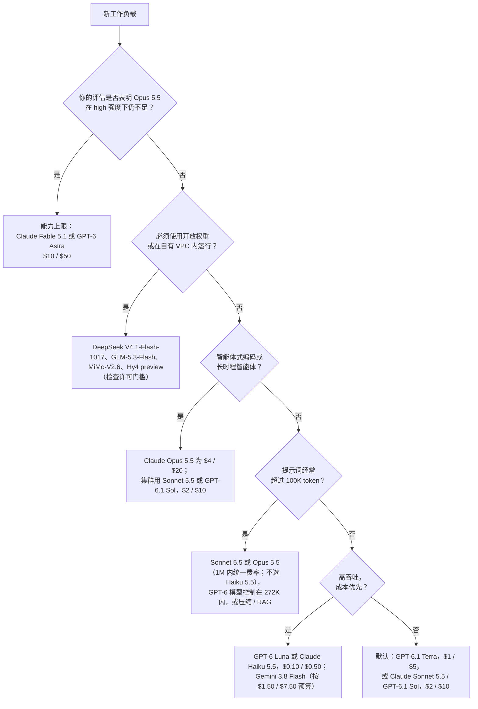

# 模型选型指南

一套实用框架，用于根据能力、成本、延迟和运营因素为你的用例选择合适的 LLM。

## 目录

- [选择框架](#选择框架)
- [能力对比](#能力对比)
- [用例映射](#用例映射)
- [成本分析](#成本分析)
- [运营考量](#运营考量)
- [多模型策略](#多模型策略)
- [面试问题](#面试问题)
- [参考资料](#参考资料)

---

## 选择框架

### 决策树（2026 年 11 月）



2026 年 9 月有两件事改变了这棵树。Anthropic 现在建议客户从 **Opus 5.5** 开始，其价格为 Fable 5.1 的 40%，且在 Anthropic 自己发布表中的智能体与编码基准上胜过后者（供应商报告），因此最高能力层是升级路径，而非起点。$2 / $10 中间层（Sonnet 5.5、GPT-6 Sol、GPT-6.1 Sol）在供应商报告的智能体评估中已足够接近旗舰，多数智能体流量可能无需 Opus 级定价；迁移集群前应先在自己的任务上确认。

10 月再次改变了选型树。GPT-6.1 Terra（$1 / $5）和 Claude Haiku 5.5（$0.10 / $0.50）补齐中档与快速档位，因此两家供应商现在都提供三个价格层级。长提示词分支也从 272K 移到了 100K：Haiku 5.5 的提示词（包括缓存 token）超过 100,000 后，整个请求按 5 倍计费；因此在 Anthropic 其他模型没有附加费的长上下文任务中，最便宜的 Anthropic 模型反而不合适。

### 关键选型因素

| 因素 | 权重 | 考量 |
|--------|--------|----------------|
| **Agentic Reliability（代理式可靠性）** | 高 | 工具调用准确率、多步规划、二元任务完成率 |
| **每任务成本** | 高 | 每任务 token × 价格，而非每 token 价格。智能体循环消耗 5x-10x 更多 token，不同模型每任务 token 相差数倍 |
| **上下文召回与定价** | 高 | 1M 时的召回，以及供应商是否有长上下文价格跃升（Claude Haiku 5.5 超过 100K 后按 5 倍计价、OpenAI 超过 272K、xAI 达到 200K） |
| **Rate Limit Ceiling（速率上限）** | 高 | **（关键细节）**：提供方能否在不触发 429 错误的情况下承载你的 P99 吞吐量，月支出上限是否会硬停流量？ |
| **数据处理** | 高 | ZDR 可用性（Opus 5.5 和 Sonnet 5.5 支持；Fable 5.1 仅明确授权时支持；OpenAI Agents API 不支持），以及约 10% 的驻留溢价 |
| **Ecosystem Maturity（生态成熟度）** | 高 | 生产落地记录、SDK 支持以及 Enterprise SLA（企业级服务等级协议）。SDK 主版本会改变 API 契约：Anthropic 新 SDK 默认发送 API 版本 `2026-10-21`，该版本会对所有模型拒绝采样参数 |
| **生命周期余量** | 中 | 按平台的最早退役日期与通知期（Opus 5.5、Sonnet 5.5、Fable 5.1：不早于 2027 年 9 月；Haiku 5.5：不早于 2027 年 10 月 7 日），以及厂商是否遵守承诺通知期（OpenAI 对 GA 的 GPT-4o 和 GPT-4.1 快照只提前约 3 个月通知） |

---

## 能力对比

### 前沿模型对比（2026 年 11 月）

以下分数标明了来源。“AA”指 Artificial Analysis Intelligence Index v5.0，于 10 月 27 日公布（Claude Opus、Sonnet 和 Fable 条目为“带回退”），注明 v5.0.1 的除外：AA 于 11 月 3 日更新方法论，以 CritPt v2 重评所有模型，使 Opus 5.5 升至 59、Gemini 4 Carbon 升至 60；v4.x 分数使用不同量表，不可比较。除非另行注明，分数均为 max 努力级别。

| 模型 | 优势 | 不足 | 上下文 | 最适用场景 |
|-------|-----------|------|---------|----------|
| **Claude Opus 5.5**（$4 / $20） | Anthropic 推荐默认。AA v5.0.1 为 59（v5.0 为 58），开发者可调用模型最高分（受限 Gemini 4 Carbon 为 60）。在 Anthropic 发布表每项胜过 Fable 5.1、多数项目胜过 GPT-6 Astra（Terminal-Bench 4.0 xhigh 66.4% 对 57.9%）；Astra 在 AutomationBench（41.4% 对 40.0%）和 Terminal-Bench-Science（64.6% 对 58.7%）领先，均为供应商自报。独立 Terminal-Bench 4.0 榜单第一（64.85%，max；10 月 6 日新增）。缓存读取 0.05x；fast mode（$8 / $40）10 月 15 日结束研究预览；可用 ZDR | 默认 effort 降为 `medium`；不能关闭思考；强制 `tool_choice` 返回 400；宣传分数包含护栏回退到 Opus 4.8 或 Opus 5 | 1M / 128K 输出 | 智能体编码、计算机使用、困难生产任务 |
| **Claude Sonnet 5.5**（$2 / $10） | Anthropic 智能体评估接近 Opus（供应商自报 Terminal-Bench 4.0 70.6%、OSWorld 2.1 部分得分 80.1%）。独立 Terminal-Bench 4.0 第二（61.82%，max）；AA 54；10 月 7 日缓存读取降至 0.05x（$0.10）；支持 ZDR | 较低 effort 下与 Opus 的独立测试差距扩大（high 下 AA 41 对 Opus 52）；`thinking: disabled` 返回 400；思考块绑定生成账户 | 1M / 128K | 智能体集群、规模化编码、默认聊天 |
| **Claude Fable 5.1**（$10 / $50） | Anthropic 能力上限；1M 内统一价格，缓存读取 0.025x；Terminal-Bench 4.0 榜单 57.88%（max） | Opus 5.5 在 Anthropic 自报表中以 40% 价格胜出；AA xhigh 50，比 Opus 低 8 分；保留 30 天，ZDR 仅限获授权 | 1M / 128K | Opus 5.5 提高 effort 后仍未通过评估的任务 |
| **GPT-6 Astra**（$10 / $50） | OpenAI 能力上限；Terminal-Bench 4.0 榜单 58.18%（max），与 GPT-6.1 Sol 并列、落后两款 Claude。每编码任务约消耗 GPT-5.6 Sol 三分之一的 token（AA）；AA 57 | 超过 272K 后整次 $20 / $75；无 temperature、top_p、logprobs 或 `none` effort；首个网络安全评级 Critical 的 OpenAI 模型，Daybreak 外漏洞利用工作受限 | 1.05M / 128K | OpenAI 栈的能力上限任务；token 效率抵消价格的长编码任务。超出 Astra 限制的网络安全工作交给受限的 GPT-6-Cyber（$20 / $100） |
| **GPT-6.1 Sol**（$2 / $10） | AA 55，比 Astra 低 2 分、价格为五分之一；Terminal-Bench 4.0 榜单 58.18%，与 Astra 并列；缓存读取 0.05x；Codex CLI 默认；Ultrafast（$12 / $60）自 10 月 8 日面向所有 API 用户 | 272K 价格跃升；默认 effort `medium` | 1.05M / 128K | OpenAI 侧编码和专业工作默认选择 |
| **GPT-6.1 Terra**（$1 / $5） | AA 51，比 Sonnet 低 3 分、价格为一半；缓存读取 0.05x；低延迟路径可用 `none` effort；也在 Bedrock 提供 | 10 月 26 日发布，AA 之外独立评估少；默认 `medium` 下 AA 38，宣传分数需 max effort token；网络安全评级 Critical；272K 价格跃升 | 1.05M | 不需要 Sol 的智能体集群与通用生产任务 |
| **GPT-6 Sol / GPT-6 Luna**（$2 / $10；$0.10 / $0.50） | GPT-5.6 半价；Luna 重设价格下限（AA 28） | 图像理解退化于 9 月 25 日在相同 ID 下修复；GPT-6.1 Sol 同价且缓存读取更便宜 | 1.05M / 128K | Sol：现有集成；Luna：路由、分类、提取 |
| **Gemini 4 Argon**（11 月 30 日前 $2 / $10；12 月 1 日起 $4 / $20） | 10 月 13 日 GA；接受文本、图像、视频、音频和 PDF，支持计算机使用；长解码最多约 1M 输出；AA high 50 | 12 月 1 日涨至 Opus 5.5 标价但 AA 低 8 分；仅隐式缓存；默认输出 65,536；仅付费层 | 输入输出共享 1M | Google 栈多模态与长生成 |
| **Gemini 3.8 Flash**（介绍价 $0.75 / $3.75；2027 年 1 月 1 日起 $1.50 / $7.50） | DeepSWE v1.1 以 74% 与 Astra 和 Opus 5 并列，每任务成本最低 $2.36；Google 推荐用于计算机使用（工具于 10 月 30 日 GA） | 1 月 1 日价格翻倍；每任务推理 token 更多；AA high 31；输出上限 65,536 | 1M / 65K | 编码智能体每任务成本、规模化 RAG |
| **Grok 4.7**（$2 / $6） | $2 输入模型中输出最便宜；更新、更大底座 | 整个请求在 200K 翻倍；AA high 35，较 $2 / $10 模型低约 20 分；快速变体仅在 Cursor 和 Grok Build | 500K | 低于 200K 的输出密集工作 |
| **Muse Wonder**（$4 / $20） | Meta 新闭源旗舰（10 月 12 日）在 Meta Model API 提供；1M 上下文；跨浏览器、桌面及移动应用的计算机使用（Meta 描述）；AA 43 | 与 Opus 5.5 同价但 AA 低 15 分；发布时 Meta 未提供基准数字；更强的 Muse Wonder Full（AA 50）仅在 Muse Code 订阅中销售，因此 API 评估针对较弱模型 | 1M | 已在 Meta 栈的团队，经与 Opus 5.5 对照评估后使用 |
| **Muse Spark 1.3**（$1.25 / $4.25） | 价格远低于 $2 / $10 层（AA v5.0 尚未评分） | 比 1.2 更冗长，每任务成本上升；contributor 层用数据换价格 | 1M | 检查每任务成本后的价格敏感通用工作 |

**已被接替但仍提供服务：** Claude Opus 5、Sonnet 5、Fable 5、Opus 4.8 和 Haiku 4.5；GPT-5.6 Sol、Terra、Luna；GPT-5.5。Claude Sonnet 4.5 于 2026 年 11 月 30 日退出 Claude API（Bedrock 为 2027 年 4 月 8 日）；`gemini-3.7-flash` 请求已由 3.8 Flash 服务。

**受限或已宣布但多数开发者无法调用（截至 2026 年 11 月 6 日）：** Google **Gemini 4 Carbon**（10 月 28 日宣布）仅限 Fairwind Program 中部分网络防御者，无模型 ID，但以 60 分位居 AA v5.0.1 榜首。**GPT-6 Rosalind**（10 月 30 日，$15 / $75）、**GPT-6-Cyber**（11 月 5 日，$20 / $100，需 Daybreak Red、单独模型批准及 IP 允许列表）和 **Claude Mythos 5.1** 仅限可信访问，不应依赖它们规划。上月宣布但未发布的两款现均已 GA：Gemini 4 Argon（10 月 13 日）和 Claude Haiku 5.5（10 月 7 日）。

### Budget Model Comparison（预算模型对比）

| 模型 | 成本（每 1M 输入/输出） | 质量信号 | 上下文 | 最适用场景 |
|-------|----------------------------|----------------|---------|----------|
| **GPT-6 Luna** | $0.10 / $0.50（超过 272K 为 $0.20 / $0.75） | AA 28；以半价接替 GPT-5.6 Luna | 1.05M | 路由、分类、提取；也是 Decisions API 模型 |
| **Claude Haiku 5.5** | 提示词不超过 100K 为 $0.10 / $0.50；超过后整个请求为 $0.50 / $2.50 | AA 36；Terminal-Bench 4.0 39.2%（Anthropic） | 1M | Anthropic 栈的短提示快速层；接近 100K 时路由至其他模型 |
| **GPT-6.1 Terra** | $1.00 / $5.00 | AA max 51、`medium` 38 | 1.05M | 从 Luna 升级、购买 Sol 前的中间层 |
| **Gemini 3.8 Flash** | 介绍价 $0.75 / $3.75；2027 年 1 月 1 日起 $1.50 / $7.50 | DeepSWE v1.1 74%（三方并列）；AA high 31 | 1M | 编码智能体、RAG |
| **DeepSeek V4.1-Flash** | 峰时 $0.30 / $1.20；谷时半价 | AA v5.0.1 在 max 为 33、high 为 29（1017 构建） | 1M | 安排在谷时的批处理（周末全为谷时） |
| **GLM-5.3-Flash** | $0.15 / $0.50 | AA 28 | 1M | MIT 权重：API 或自托管相同模型 |
| **MiMo-V2.6-Flash** | $0.14 / $0.28（OpenRouter） | - | 1M | MIT，309B / 激活 15B；超出 API 需求后可放入一个 8-GPU 节点 |
| **Claude Haiku 4.5** | $1.00 / $5.00 | 已被接替；100K 以下为 Haiku 5.5 的 10 倍价格 | 200K | 仅用于尚不能迁移 prefill 或 `budget_tokens` 代码的情况；Foundry 列出 11 月 15 日退役 |

### 开放权重模型

| 模型 | 参数量 | 许可证 | AA（注明处为 v5.0.1） | 最适用场景 |
|-------|------------|---------|-----------|----------|
| **Moonshot Kimi K3.1 Pro** | 2.8T / 激活 104B | Kimi K3.1-Pro License（类似 MIT 的授权；收入超过 US$20M 的 MaaS 需另签协议；月活超过 100M 须在 UI 署名） | 46（v5.0.1；AA 仍标为专有） | 自 11 月 4 日发布权重以来的开放模型最高分；Moonshot 托管价 $2 / $10；自托管约需 1.56 TB 的 MXFP4 权重 |
| **DeepSeek V4.1-Flash-1017** | 552B（763B 检查点）；激活 8B / 16B | MIT | 33（v5.0.1，max）；high 为 29 | MIT 模型最高分；低成本 1M 上下文服务 |
| **Z.ai GLM-5.3** | 744B / 激活 40B | MIT；收入超过 US$10B 的 MaaS 需安全审查 | 32（v5.0.1，max）；low 为 23 | 智能体编码；Amazon Bedrock 也提供 |
| **Xiaomi MiMo-V2.6-Pro** | 1.02T / 激活 42B | MIT | 30（v5.0.1） | 全模态输入；两个 8-GPU 节点 |
| **Ant Group Ling-3.1-flash-1019** | 560B / 激活约 25B | MIT | 30（v5.0.1） | 输出非常冗长（指数上 240M 输出 token，对比 99.3M 中位数）；应计算每任务价格 |
| **StepFun Step 5 Preview** | 600B / 激活 27B | StepFun Model License 1.0（收入超过 US$20M 的 MaaS 和任何品牌设备需另签协议） | 29 | 输出冗长；检查每任务 token |
| **Z.ai GLM-5.3-Flash** | 320B / 激活 18B | MIT | 28 | 智能体编码默认自托管候选 |
| **Mistral Large 4** | 约 1T / 激活 49B | Mistral Ecosystem Open-Weight License（任何 MaaS 业务需单独许可） | High（默认）26，Medium 23 | 内部自托管；无协议不可转售。推理模式为 Low、Medium 和 High，因此预览代码若要求无推理须发送 low |
| **Meta Muse Spark Open** | 816B / 激活 42B | Muse Model License（署名；收入超过 US$20M 的 MaaS 需另签协议） | 25（v5.0.1） | 美国开放权重最高分；输入文本、图像、视频和音频。Fireworks 也以 $1.25 / $4.25 托管，与 Muse Spark 1.3 同价，应按许可证和数据条款选择；Hugging Face 仓库需要人工批准 |
| **Moonshot Kimi K3** | 2.8T / 激活 104B | 定制：收入超过 US$20M 的 MaaS 需另签协议 | - | 许可适合时的强大通用模型；Amazon Bedrock 提供显式提示缓存 |
| **Qwen3.8-Flash-Next** | 125B / 激活 6B + 51B N-gram 内存 | Qwen Community 1.0（任何 MaaS 或编码/办公助手业务需另获许可） | - | Qwen4 架构预览；主机 RAM 参数内存。Qwen4 本身截至 11 月 6 日尚未发布，不应依赖其权重或许可证规划 |
| **Tencent Hy4 preview** | 770B / 激活 49B | Apache 2.0（仅预览检查点） | - | 接近前沿规模中最清晰的许可证。完整 Hy4（11 月 4 日，AA v5.0.1 得 35）仅提供 API，承诺发布权重但没有日期或许可证，因此不要假定其采用 Apache 2.0 |
| **Qwen3.8-27B** | 27B 稠密 | Apache 2.0 | 20（v5.0.1，xhigh） | 单 GPU 级别 |
| **Nanbeige4.3-33B** | 33B 稠密 | Apache 2.0 | 20（v5.0.1） | Qwen3.8-27B 的单 GPU 同类模型，每任务成本更高（160M 输出 token，对比 77.7M 中位数）；没有公开 API |
| **Reflection AI Beam 1.0** | 501B / 激活 23B | Apache 2.0 | 18（v5.0.1） | 500B 规模、美国来源、无条件 Apache 许可证；因来源而非能力选择 |
| **Ricursive Ripple-65B Preview** | 65B 稠密 | Apache 2.0 | -（尚未评分） | 厂商报告 Terminal-Bench 2.1 为 80.52；等待独立分数 |
| **Inkling-Small** | 约 266B / 激活 12B | Apache 2.0 | 13 | 美国来源、Apache、微调底座 |
| **NVIDIA Nemotron 3.5 Super VL** | 120B / 激活 12B | OpenMDW-1.1 | 14 | NVIDIA 栈开放智能体；取代 Nemotron 3 Ultra（12）成为默认选择，支持图像与视频输入，在四张 H100 上运行 |

先检查许可，再看基准。多个领先开放模型对 MaaS 转售商设置收入门槛；Mistral Large 4 对任何收入规模的 MaaS 业务要求另获许可，Mistral Medium 3.5 权重则对月收入超过 US$20M 的组织撤销所有权利。AA v5.0.1 上，若计入 Kimi K3.1 Pro，最佳开放模型比可调用的最佳闭源模型低 13 分（46 对 59）；按 AA 自己的开放标签则低 26 分（DeepSeek 为 33），因此引用数字时要说明规则。无论哪种定义，开放权重的优势是控制、数据驻留与微调，而非能力上限。Llama 4 仅发布 Scout（总参数 109B）和 Maverick（总参数约 400B）；不存在 Llama 4 8B、70B 或 405B。

---

## 用例映射

### 按应用类型（2026 年 11 月）

| 用例 | 推荐模型 | 理由 |
|----------|-------------------|-----------|
| **能力上限研究 / 最难问题** | Claude Fable 5.1、GPT-6 Astra | 仅在 Opus 5.5 提高强度后仍无法通过自身评估时升级；Fable 在 1M 内统一费率，Astra 超过 272K 翻倍 |
| **自主开发** | Claude Opus 5.5、Claude Sonnet 5.5、GPT-6.1 Sol；重视每任务成本时用 GPT-6.1 Terra 或 Gemini 3.8 Flash | Opus 5.5 在 Anthropic 发布表每项胜过 Fable 5.1、编码项目胜过 Astra（Astra 在 AutomationBench 和 Terminal-Bench-Science 领先），Sonnet 5.5 报告与其相差几分（均为供应商报告）；两款 Claude 也领先 Terminal-Bench 4.0 榜单；Sonnet 5.5 和 GPT-6.1 Sol 以 $2 / $10 服务集群 |
| **企业级 RAG** | Claude Sonnet 5.5、Gemini 3.8 Flash，抽取用 GPT-6 Luna | Sonnet 5.5 统一 1M 费率（Haiku 5.5 超过 100K 按 5 倍计费）；Flash 用于高吞吐；OpenAI 提示词保持低于 272K |
| **客户支持** | GPT-6 Luna、Claude Haiku 5.5、Gemini 3.8 Flash（low 思考） | 低延迟低成本；Haiku 5.5 仅在历史与检索上下文总和低于 100K token 时使用；困难工单升级至 GPT-6.1 Terra 或 Sonnet 5.5 |
| **推理 / 调试** | Claude Opus 5.5（high 或 xhigh 强度）、GPT-6 Astra、Claude Fable 5.1 | effort 是调节旋钮；仅在评估证明有收益时为 max 付费 |
| **计算机使用** | Claude Opus 5.5、Gemini 3.8 Flash、GPT-6 Astra | OSWorld 2.0 榜单（v2.1 全集）：Opus 5 在 max 强度下二元得分 44.33%。供应商报告部分得分：Opus 5.5 81.8%、Astra 72.6%、Haiku 5.5 离线子集 72.4%（彼此或与二元得分均不可比较）。Haiku 5.5 系统卡报告 GUI 计算机使用中提示注入成功率为 24.4%，因此应隔离 |
| **语音智能体** | `gpt-live-1`、Gemini 3.8 Live、`gpt-realtime-2.1` | 按分钟与按 token 计费模型不同；见[实时语音智能体](../18-voice-and-audio-agents/01-realtime-voice-agents.md) |
| **视频 / 多模态** | 视频和音频用 Gemini 3.8 Flash 或 Gemini 4 Argon；图像密集工作用 GPT-6 Sol 或 Claude Opus 5.5 | Gemini 原生接受文本、图像、视频、音频和 PDF 输入；GPT-6 Sol 和当前 Claude 模型接受文本与图像，不接受音频或视频 |
| **私有代理** | DeepSeek V4.1-Flash-1017、GLM-5.3-Flash、MiMo-V2.6、Hy4 preview（开放权重） | 最强的宽松许可智能体模型 |

### 按约束

| 约束 | 方案 |
|------------|----------|
| **延迟关键** | 速度层级（OpenAI Fast 2 倍、Astra 和 GPT-6.1 Sol 的 Ultrafast 6 倍；Anthropic Opus 5.5 快速模式 10 月 15 日结束预览）、小模型或低 effort 模型（GPT-6 Luna、Claude Haiku 5.5 low、GPT-6.1 Terra `none`、Gemini 3.8 Flash low）、扩散模型（Mercury 2.5，供应商报告 1,107 tokens/s）或自托管小模型 |
| **提示词 > 100K token** | Claude Sonnet 5.5、Opus 5.5 或 Fable 5.1（1M 内统一价格），Gemini 3.8 Flash 或 Gemini 4 Argon（无提示长度分档）。避免 Haiku 5.5 超过 100K：整个请求按 5 倍计价，含缓存 token。OpenAI 超过 272K、xAI 达到 200K 时重新定价，但 GPT-6 Luna 在长上下文费率 $0.20 / $0.75 下仍低于 Haiku 5.5 的 $0.50 / $2.50。Llama 4 Scout 的 10M 窗口超过 32K 后快速衰减 |
| **零数据泄露** | 自有 VPC 内自托管 GLM-5.3-Flash、MiMo-V2.6 或 Hy4 preview，或符合 ZDR 资格的 API（Claude Opus 5.5、Sonnet 5.5） |
| **复杂工具使用** | Claude Opus 5.5 或 GPT-6.1 Sol。Opus 5.5、Sonnet 5.5 和 Fable/Mythos 5.1 强制 `tool_choice` 返回 400，应使用 `auto` 加严格工具 Schema；Haiku 5.5 接受强制调用但该轮不思考 |
| **长期受监管工作负载** | 公布最早退役日期的模型（Opus 5.5、Sonnet 5.5、Fable 5.1 不早于 2027 年 9 月；Haiku 5.5 不早于 2027 年 10 月 7 日；Bedrock 上 GPT-6 Astra 不早于 2027 年 9 月 8 日）。这些日期只是下限：OpenAI 对 GA 的 GPT-4o 和 GPT-4.1 快照只提前约三个月通知 |

---

## 成本分析

### 成本建模（2026 年 11 月）

| 模型 | 输入 / 1M | 输出 / 1M | 说明 |
|-------|------------|-------------|-------|
| **Claude Fable 5.1** | $10.00 | $50.00 | 1M 内统一费率；缓存读取 $0.25 |
| **GPT-6 Astra** | $10.00 | $50.00 | 超过 272K 整个请求 $20 / $75 |
| **Claude Opus 5.5** | $4.00 | $20.00 | Anthropic 默认；缓存读取 $0.20 |
| **Meta Muse Wonder** | $4.00 | $20.00 | 缓存读取 $0.20；Muse Wonder Full 无 API 价格 |
| **Gemini 4 Argon** | 11 月 30 日前 $2.00；12 月 1 日起 $4.00 | $10.00；12 月 1 日起 $20.00 | 按 12 月价格预算；仅隐式缓存 |
| **GPT-5.6 Sol** | $4.00 促销（$5.00 标价） | $20.00 促销（$30.00 标价） | OpenAI 称促销持续至 2026 年 11 月 30 日，未说明之后价格；12 月 1 日起预算按标价 |
| **Claude Sonnet 5.5** | $2.00 | $10.00 | 与 Sonnet 5 同价；缓存读取自 10 月 7 日起为 $0.10 |
| **GPT-6.1 Terra** | $1.00 | $5.00 | 超过 272K 为 $2 / $7.50；缓存读取 0.05 倍 |
| **GPT-6.1 Sol / GPT-6 Sol** | $2.00 | $10.00 | 超过 272K 为 $4 / $15；6.1 缓存为 0.05 倍 |
| **Gemini 3.1 Pro Preview** | $2.00 | $12.00 | 超过 200K 为 $4 / $18 |
| **Grok 4.7** | $2.00 | $6.00 | 提示词达到或超过 200K 时，每个 token 均按 $4 / $12 |
| **Muse Spark 1.3** | $1.25 | $4.25 | 注意每任务 token |
| **Gemini 3.8 Flash** | 首发 $0.75，2027 年 1 月 1 日起 $1.50 | 首发 $3.75，2027 年 1 月 1 日起 $7.50 | 任何长期任务都应使用 2027 年数字 |
| **DeepSeek V4.1-Flash** | 峰时 $0.30 | 峰时 $1.20 | 谷时半价 |
| **GPT-6 Luna** | $0.10 | $0.50 | 大规模工作负载层级；超过 272K 为 $0.20 / $0.75 |
| **Claude Haiku 5.5** | $0.10（提示词超过 100K 时为 $0.50） | $0.50（提示词超过 100K 时为 $2.50） | 超过 100K 后按高价计费整个请求，缓存 token 也计入长度 |

完整价目表、缓存条款和退役日历见[定价与成本](03-pricing-and-costs.md)。

### 成本对比例子

假设每次查询 1K 输入 token + 500 输出 token，Standard 层，无缓存：

| 量级 | GPT-6 Astra | Claude Opus 5.5 | Sonnet 5.5 / GPT-6 Sol | GPT-6.1 Terra | Gemini 3.8 Flash（首发 / 标价） | GPT-6 Luna / Claude Haiku 5.5 |
|--------|-------------|-----------------|------------------------|---------------|---------------------------------|-------------------------------|
| 10K 次查询/月 | $350 | $140 | $70 | $35 | $26.25 / $52.50 | $3.50 |
| 1M 次查询/月 | $35,000 | $14,000 | $7,000 | $3,500 | $2,625 / $5,250 | $350 |

*洞察：每 token 表夸大了价差。DeepSWE v1.1 上三者以 74% 并列，每任务成本 Gemini 3.8 Flash 为 $2.36，GPT-6 Astra 为 $4.43，Claude Opus 5 为 $11.84。Flash（首发价）与 Astra 的 13 倍标价差，因每任务 token 不同，变成了每任务 1.9 倍。应给任务定价，而非 token。*

---

## 运营考量

### 速率限制与配额

| 提供方 | 层级 | 限额示例 | 备注 |
|----------|------|----------------|-------|
| Anthropic | Start / Build / Scale | 月支出上限 $500 / $1,000 / $200,000。Scale：Opus 5.5 和 Sonnet 5.5 为 10,000 RPM、10M ITPM、2M OTPM；Fable 5.x 为 4,000 RPM、4M ITPM、800K OTPM | 触顶返回 429 `enforced_spend_limit_reached`，无 `retry-after`，直到下月 1 日 UTC 00:00。缓存读取不计入 ITPM |
| OpenAI | Build / Launch / Grow | 按模型和层级。OpenAI 于 10 月 6 日将使用层级从五档缩减为三档，应重新核对按旧层级数字配置的限额 | 9 月 2 日起，流量增长过快返回 429 `slow_down`；过载返回 503，两者均可带 `Retry-After` |
| Amazon Bedrock | 服务配额 | GPT-6 Astra 输出 token 按 10 倍消耗 TPM 配额 | Legacy 模型禁止新客户，现有客户闲置 15 天后可能失去访问 |

准确数字请查组织限额页面；它们会随层级和模型变化。

### 可靠性模式

```python
class ReliableModelClient:
    def __init__(self):
        self.providers = {
            "primary": AnthropicClient(model="claude-sonnet-5-5"),
            "fallback1": OpenAIClient(model="gpt-6-sol"),
            "fallback2": GoogleClient(model="gemini-3.8-flash"),
        }

    async def generate(self, prompt: str) -> str:
        for name, client in self.providers.items():
            try:
                return await client.generate(prompt)
            except RateLimitError as e:
                if e.code == "enforced_spend_limit_reached":
                    alert_finops(name)      # hard monthly cap: retrying will not help
                elif e.code == "slow_down":
                    await ramp_down(name)   # traffic grew too fast; back off this provider
                continue
            except ServiceError:            # includes 503 overload
                continue

        raise AllProvidersUnavailable()
```

**回退必须跨供应商。** Anthropic 在 2026 年 8 月 16 日至 9 月 29 日间至少发生 12 次重大或严重事故，OpenAI 于 9 月 29 日在 API、ChatGPT 和 Codex 范围发生约 5 小时 20 分钟故障。同供应商回退共享故障。

**对话中途在 Claude 模型间故障转移需谨慎。** Fable 5.1、Opus 5.5、Sonnet 5.5 和 Haiku 5.5 的思考块绑定生成模型和对话前缀；Sonnet 5.5 和 Haiku 5.5 的思考块还绑定生成账户。回退模型会静默丢弃无法读取的块（Haiku 5.5 无错误地丢弃来自 Opus 5、Opus 5.5、Sonnet 5.5、Fable 和 Mythos 的思考块，因此 Sonnet 回退到 Haiku 会丢失推理过程）；2026 年 8 月 31 日及之后创建的账户若改写思考块之前任何内容会返回 400。只追加地重放历史，不要在回退途中编辑。

### 抽象层

```python
class LLMClient:
    """Unified interface for multiple providers."""
    
    def __init__(self, config: dict):
        self.default_model = config["default_model"]
        self.clients = self._init_clients(config)
    
    async def generate(
        self,
        messages: list[dict],
        model: str = None,
        **kwargs
    ) -> str:
        model = model or self.default_model
        client = self._get_client(model)
        
        # Normalize request format
        normalized = self._normalize_request(model, messages, kwargs)
        
        # Call provider
        response = await client.generate(**normalized)
        
        # Normalize response
        return self._normalize_response(response)
    
    def _normalize_request(self, model: str, messages: list[dict], kwargs: dict) -> dict:
        # Handle differences between providers and model generations:
        # - Claude API version 2026-10-21 (the default in the new Anthropic SDK majors)
        #   rejects temperature/top_p/top_k on every model, and GPT-6 Astra rejects them too: drop them
        # - Claude Haiku 5.5 rejects assistant prefill and budget_tokens
        # - Claude Fable 5.1 / Opus 5.5 / Sonnet 5.5 return 400 on forced tool_choice
        #   ("any" or "tool"): send "auto" plus strict tool schemas instead.
        #   Haiku 5.5 accepts a forced tool_choice but returns no thinking block
        # - GPT-6 Astra tool calling requires the Responses API
        # - Set reasoning effort explicitly; defaults change between versions
        # - Count prompt tokens (cached ones included) with the target tokenizer before
        #   choosing a model: Haiku 5.5 reprices above 100K, OpenAI above 272K
        pass
```

---

## 多模型策略

### 模型路由

```python
class ModelRouter:
    def __init__(self):
        self.classifier = QueryClassifier()
        self.models = {
            "simple": "claude-haiku-5-5",     # $0.10 / $0.50, but only under 100K
            "medium": "gpt-6.1-terra",        # $1 / $5
            "complex": "claude-sonnet-5-5",
            "code": "claude-opus-5-5",
            "long_context": "claude-sonnet-5-5",  # flat price to 1M
            "reasoning": "gpt-6.1-sol"
        }
        # Prompt size (cached tokens included) above which each model
        # bills the WHOLE request at a higher rate
        self.cliffs = {"claude-haiku-5-5": 100_000, "gpt-6.1-terra": 272_000,
                       "gpt-6.1-sol": 272_000}
    
    async def route(self, query: str, context_length: int) -> str:
        # Classify query complexity
        query_type = await self.classifier.classify(query)
        model = self.models[query_type]
        
        # Override for long context: avoid whole-request repricing
        # (5x on Haiku 5.5 above 100K; 2x / 1.5x on OpenAI above 272K)
        if context_length > self.cliffs.get(model, float("inf")):
            return self.models["long_context"]
        
        return model
```

### 级联模式

**逻辑**：不要用 70B 模型去做 1B 模型就能完成的任务。使用一个“Router（路由器）”来为置信度打分。

```python
class ModelCascade:
    """The 'Efficiency First' Pattern."""
    
    async def generate_optimized(self, query: str):
        # 1. Draft check (SLM / Classifier)
        if is_simple_intent(query):
            return await gpt_6_luna.generate(query)
            
        # 2. Main Generation (Efficient model)
        response = await claude_sonnet_5_5.generate(query)
        
        # 3. Validation / Escalate
        if needs_verification(response):
            return await claude_opus_5_5.generate(
                f"Verify this: {response}", effort="high"
            )
            
        return response
```

**高阶建议**：实现“Semantic Fallback（语义回退）”，即出错时不要只是重试同一个模型，而是立即切换到更大的模型或不同提供方（OpenAI -> Anthropic），以避免相关性故障。

---

## 面试问题

### 问：在生产应用中，你如何在 OpenAI、Anthropic 和 Google 模型之间做选择？

**强答案：**

“我的选择取决于具体需求：

**对大多数生产工作负载**，我从 Claude Sonnet 5.5 或 GPT-6.1 Sol（$2 / $10）开始，并按实际上线时的努力级别评估 GPT-6.1 Terra（$1 / $5）。智能体式编码会测试 Claude Opus 5.5，$4 / $20，Anthropic 现在推荐它为默认。只有评估证明需要最高能力的任务才路由到 Claude Fable 5.1 或 GPT-6 Astra（$10 / $50）。

**对长上下文应用**，定价与窗口大小同样重要。Claude Sonnet、Opus 和 Fable 在 1M 内统一费率，但 Claude Haiku 5.5 的提示词超过 100K token 后整个请求按 5 倍计费；OpenAI 超过 272K、xAI 达到 200K 时也会重新定价。部分廉价模型不太受跃升影响：GPT-6 Luna 长上下文费率（$0.20 / $0.75）仍比 Haiku 5.5 超过阈值后的价格（$0.50 / $2.50）和 Gemini 3.8 Flash 首发价 $0.75 / $3.75 便宜，而 Flash 于 2027 年 1 月 1 日翻倍。信任任何一个模型前，都应在自己的文档上检查深层召回。

**对成本敏感的高吞吐场景**，选 GPT-6 Luna 或 Claude Haiku 5.5（$0.10 / $0.50，仅限短提示词），或 Gemini 3.8 Flash，按每任务而非每 token 成本比较。

**我的实际做法：**
1. 用中间层模型做原型，验证用例
2. 在自己的具体任务上，以将要上线的推理强度评估
3. 构建带跨供应商回退的抽象层，方便切换
4. 将简单请求路由到更便宜模型，优化成本
5. 按（模型，平台）组合跟踪退役日期

我从不只依赖基准分数。供应商宣传数字反映其最佳测试框架和推理强度；榜单排名较低的模型可能在我的领域更好。”

### 问：什么时候该自托管，什么时候该使用 API 提供方？

**强答案：**

“这是控制权与运维负担的权衡。

**以下情况使用 API：**
- 流量无法让 GPU 节点全天繁忙（8x H100 节点每月 $17K-23K；对比 GPT-6 Luna，每月需数千万请求才盈亏平衡）
- 需要立即使用最新模型
- 团队缺乏 GPU 基础设施经验
- 工作负载可变，难以做容量规划
- 上市时间至关重要

**以下情况自托管：**
- 数据不能离开基础设施（合规），且无适合的 ZDR 或驻留选项
- 持续流量能饱和节点，按路由后 API 账单而非前沿标价比较
- 需要 P99 延迟低于 100ms
- 需要定制模型权重或微调（OpenAI 于 2027 年 1 月 6 日停止现有客户创建新微调任务）
- 需要完全控制模型行为与版本，没有静默替换或强制退役

**先检查许可：** MIT 和 Apache 2.0 选项（GLM-5.3-Flash、MiMo-V2.6、DeepSeek V4.1-Flash、Beam 1.0、Hy4 preview）清晰；Mistral Large 4 的 MaaS 业务需另获许可，Muse Spark Open、Step 5 Preview、Kimi K3 和 K3.1 Pro、MiniMax-M3.1-Flash、GLM-5.3、Qwen 社区许可证和 Mistral Medium 3.5 也有商业门槛。

**混合方案往往最好：**
- 可预测的高吞吐工作负载自托管
- 突发流量与专用模型使用 API
- 自托管失败时以 API 回退

自托管隐性成本包括 GPU 采购、工程时间、模型更新和监控。应计入 1-2 名专职基础设施工程师。”

### 问：模型版本现在每周发布，如何保持选型及时又不破坏生产？

**强答案：**

“Anthropic 在 Sonnet 5 发布三个月后用 Sonnet 5.5 接替它，OpenAI 在 GPT-6 Sol 一周后发布 GPT-6.1 Sol，10 月又在不到三周内新增 Haiku 5.5、GPT-6.1 Terra 和 GA 的 Gemini 4 Argon。我将模型升级视为常设流水线，而非一次项目：

1. **固定精确模型 ID，再验证实际服务内容。** 固定 ID 必要但不足：DeepSeek 把退役的 `deepseek-v4-flash` 名称路由到 V4.1-Flash，xAI 退役的 Grok 标识按 grok-4.3 费率计费，Google 自 10 月 8 日起用 Gemini 3.8 Flash 响应 `gemini-3.7-flash` 请求，并将自 12 月 1 日起把弃用的 `gemini-2.5-pro` 路由到 3.8 Flash；Azure Foundry 于 2027 年 1 月 14 日将带日期的 gpt-4o 2024-05-13 自动升级到 gpt-5.1。我记录每个响应报告的模型，并在变化时告警。
2. **比较 API 契约，而不只是质量。** Opus 5.5 将默认强度从 high 改为 medium；Sonnet 5.5 拒绝 `thinking: disabled`；Opus 5.5、Sonnet 5.5 和 Fable/Mythos 5.1 拒绝强制 `tool_choice`，Haiku 5.5 虽接受但会跳过当轮思考；Haiku 5.5 拒绝 assistant prefill，提示词超过 100K 后按 5 倍计价，且 2000x1500 图像产生的视觉 token 约为 Haiku 4.5 的 2.5 倍；Anthropic 新 SDK 主版本发送的 API 版本 `2026-10-21` 会对所有模型拒绝采样参数；GPT-6 Astra 不接受 temperature 和 logprobs。每一项都可能破坏代码或改变延迟，而基准中不会出现质量回归。
3. **每个变更都必须通过自身评估集，以生产推理强度运行**，包括供应商在 ID 未变时修复的问题。OpenAI 于 9 月 25 日在不更名的情况下修复 GPT-6 Sol 图像理解，并要求客户重跑图像评估。
4. **先影子流量，再金丝雀发布**，比较每任务成本、延迟、拒答率（Anthropic 部分拒答现在收费）与升级率，而不只看质量分。
5. **维护按（模型，平台）的退役日期注册表**，提前 90、60、30 天告警。声明的通知期从 60 天（Anthropic）、6 个月（OpenAI GA）到预览仅 2 周不等；实际通知可能更短：OpenAI 的 GA GPT-4o 和 GPT-4.1 快照约提前 3 个月，`gpt-5.4-cyber` 则提前 20 天。

成本是一小笔长期评估与迁移预算。否则就会从事故中发现变更。”

---

## 参考资料

- OpenAI API: https://developers.openai.com/api/docs
- Anthropic API: https://platform.claude.com/docs
- Anthropic 模型概览： https://platform.claude.com/docs/en/models/overview
- Google AI: https://ai.google.dev/
- Artificial Analysis: https://artificialanalysis.ai/
- Arena（前身为 LMArena）： https://arena.ai/
- Terminal-Bench 4.0 榜单： https://www.tbench.ai/leaderboard/terminal-bench/4.0

---

*上一篇：[定价与成本](03-pricing-and-costs.md) | 下一篇：[Fine-Tuning Guide（微调指南）](../03-training-and-adaptation/02-fine-tuning-strategies.md)*
