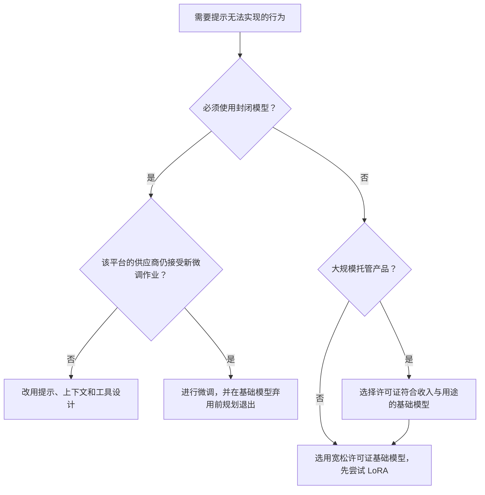

# 微调策略

微调会将预训练模型适配到特定任务、领域或风格。如今，微调更像是在“教授格式和行为”，而不是“教授事实”。

## 目录

- [何时进行微调](#何时进行微调)
- [监督式微调（Supervised Fine-Tuning, SFT）](#监督式微调-supervised-fine-tuning-sft)
- [继续预训练（领域适配）](#继续预训练-领域适配)
- [PEFT（参数高效微调）与全参数微调](#peft-参数高效微调-与全参数微调)
- [超参数调优](#超参数调优)
- [微调的实施平台](#微调的实施平台)
- [面试题](#面试题)
- [参考资料](#参考资料)

---

## 何时进行微调

在微调之前，先问：**这能用提示工程（Prompt Engineering）或 RAG（检索增强生成）解决吗？**

| 需求 | 更优方案 | 原因 |
|-------------|-----------------|-----|
| 新事实 / 知识 | **RAG** | LLM（大语言模型）不擅长通过 FT（微调）记住事实；RAG 更容易更新。 |
| 特定输出格式 | **微调** | 能训练模型可靠地输出 JSON/XML，而不需要复杂提示。 |
| 语气 / 人设 | **微调** | 比系统提示稳定得多。 |
| 降低延迟 | **微调** | 减少对长篇 few-shot（少样本）提示的依赖。 |
| 私有领域语言 | **继续预训练** | 教授专门词汇（医疗、法律、自定义代码）。 |

---

## 监督式微调（Supervised Fine-Tuning, SFT）

预训练后的第一步。模型在 `(Prompt, Response)` 对上进行训练。指令调优属于 SFT，其训练对覆盖多种任务类型的指令及理想回答，让基础模型转变为助手。

### 质量层级
**1,000 个“完美”示例胜过 1,000,000 个噪声示例。**
- **金标集（Golden Sets）：** 由领域专家人工筛选和整理（技术任务通常需要博士级水平）。
- **负向约束训练：** 包含模型**不应该**做什么的示例（例如：“不要道歉”“不要提到你是 AI”）。
- **从运行轨迹提取的数据集：** 经过评估分数或人工审核筛选的生产运行轨迹，如今是获取同分布 SFT 数据成本最低的来源；LLMOps 平台已直接提供这一路径（LangSmith Fine-Tuning 自 2026 年 9 月 24 日起公开测试）。

---

## 继续预训练（领域适配）

也称为“第二阶段预训练”。
- **方法：** 使用来自特定领域的原始文本进行训练（例如，为金融模型使用全部 SEC 文件）。
- **目标：** 学习该领域语言的统计分布。
- **细节：** 需要更低的学习率（约为原始值的 1/10）以防止“灾难性遗忘”。

---

## PEFT（参数高效微调）与全参数微调

| 特性 | 全参数微调 | PEFT（LoRA，QLoRA） |
|---------|-------------------|--------------------|
| GPU 显存 | 非常高（模型大小 * 4-12） | 低（模型大小 * 1.5） |
| 速度 | 基线 | 快 2x-3x |
| 风险 | 高（灾难性遗忘） | 低 |
| 部署 | 每个任务一个模型 | 一个基础模型 + 多个适配器 |
| **结论**| 保留给基础训练 | **生产标准** |

---

## 超参数调优

### 1. 学习率（Learning Rate, LR）
- **全参数 SFT：** `1e-5` 到 `5e-5` 是标准范围。
- **LoRA：** 约高 10 倍（`1e-4` 到 `2e-4`），因为只有小型适配器矩阵在更新。
- **过高：** 模型会“崩溃”，开始重复输出或胡言乱语。

### 2. LoRA 的秩（Rank, r）
- 复杂推理任务使用更高的秩（`r=64` 到 `r=256`）。
- 简单风格 / 语气修改使用更低的秩（`r=8`）。

### 3. 打包训练（Packing）
为了最大化吞吐量，我们会把多个短示例“打包”进单个 4k 或 8k 序列中，并用 EOS token 分隔。
- **挑战：** 自注意力可能会在不同示例之间泄漏。
- **解决方案：** 使用 **带块掩码的 FlashAttention**，防止跨示例注意力。

---

## 微调的实施平台

“以后再微调封闭模型”的计划越来越难执行；开放权重基础模型如今也附带许可证条款，必须像审查供应商合同一样阅读。

**封闭模型的微调渠道正在收缩。** OpenAI 正逐步停止自助微调（于 2026 年 5 月 7 日宣布）：从未进行过微调的组织无法创建作业；自 7 月 2 日起，只有此前 60 天内使用过微调模型进行推理的组织才能创建；从 **2027 年 1 月 6 日**起，活跃客户也不能再创建新作业。现有微调模型会继续提供服务，直到其基础模型被弃用。Azure OpenAI 对微调模型有自己的时间安排，因此要核查具体平台，而不只是模型家族。

**开放权重微调成为默认路径。** 训练可在自有 GPU 上运行，也可由推理合作方承接（LangSmith 将开放权重模型基于运行轨迹的 SFT 作业路由到 Fireworks 和 Baseten）。这一模式也适用于前沿模型：Cognition 的 SWE-2 基于 Kimi K3 进行后训练（总参数 2.8T / 活跃参数 104B）；Fireworks 基于 K3 构建 Ember-1，以缩短推理过程（据供应商报告，token 数比 K3 少约 40%）。产品实验室购买基础模型，再通过后训练竞争。

**基础模型许可证成为供应链条款。** 投入数据集建设之前先检查许可证：

| 基础模型 | 托管产品需要关注的许可证限制 |
|----------|------------------------------|
| Kimi K3 | 定制许可证：若公司或任何关联方经营模型即服务（MaaS）业务，且与关联方合计的 12 个月收入超过 US$20M，需另行签订协议 |
| Qwen3.8-Flash-Next | Qwen Community License 1.0：任何 MaaS 或编程/办公助手业务均需单独授权，无收入门槛 |
| GLM-5.3 | MIT，另附一项条款：12 个月收入超过 US$10B 的 MaaS 提供商须接受安全审查 |
| DeepSeek V4.1-Flash、MiMo-V2.6 | MIT |
| Gemma 4 12B、IBM Granite 4.2、Qwen3.8-27B | Apache 2.0 |

---

## 面试题

### 问：为什么要用继续预训练，而不是把领域数据直接放进 SFT 集合？

**强回答：**
SFT 在数据构建上是“昂贵”的，因为你需要 prompt/answer 对。继续预训练允许你利用海量原始、无标注的领域文本，让模型的内部表征学习该领域的专门词汇和风格。一旦模型“会说这种语言”了，再用少量 SFT 数据教它在这种语言里完成“任务”（例如分类、摘要）。

### 问：如何防止模型在微调过程中“遗忘”通用能力？

**强回答：**
这叫“灾难性遗忘”。主要有两种缓解方式：
1. **复习训练（Rehearsal）：** 将原始预训练数据的 5-10% 混入微调集。
2. **PEFT（LoRA）：** 由于我们只训练一小部分权重，原始“知识”仍然冻结在基础模型权重中，从而显著降低遗忘风险。

### 问：路线图写着“2027 年第一季度用客服对话记录微调 GPT”。你会改动什么？

**强回答：**
首先检查计划是否仍可执行：OpenAI 从 2027 年 1 月 6 日起停止活跃客户创建新的自助微调作业；近期没有使用微调模型进行推理的组织已经无法创建作业。因此，要么赶在截止日期前完成作业，并为基础模型弃用制定退出计划；要么改用其他定制方式。其次，确认是否真的需要微调：大多数“客服语气和格式”目标可通过系统提示、少样本示例及结构化输出来实现，且这些方法可以随着模型升级继续使用。如果行为确实需要改变权重，我会用 LoRA 在经过筛选的运行轨迹数据上微调开放权重基础模型，按许可证选择基础模型（若作为服务托管，优先考虑 Apache 2.0 或 MIT），并保持数据集和评估套件可迁移，以便在下一个基础模型上重新训练适配器。长期有价值的资产是精选数据和评估，而不是检查点。

---

## 参考资料
- Hu 等人. “LoRA：大型语言模型的低秩适配” (2021)
- Ouyang 等人. “训练语言模型遵循指令” (InstructGPT, 2022)
- Dettmers 等人. “QLoRA：量化 LLM 的高效微调” (2023)
- OpenAI. [弃用公告](https://developers.openai.com/api/docs/deprecations)（逐步停止微调）

---

*下一篇：[03-lora-qlora-peft.md]*
