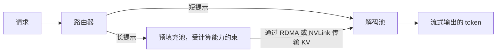

# 批处理策略

批处理是提升 LLM 吞吐量和降低成本的主要杠杆。服务框架已经从简单的请求级批处理，发展到子 token、迭代级编排；在大规模部署中，还会把预填充和解码拆到不同的硬件上。

## 目录

- [静态批处理 vs. 动态批处理](#静态批处理-vs-动态批处理)
- [连续批处理](#连续批处理-迭代级)
- [在飞批处理（预填充-解码融合）](#在飞批处理-预填充-解码融合)
- [分块预填充](#分块预填充)
- [解耦的预填充与解码](#解耦的预填充与解码)
- [面试题](#面试题)
- [参考资料](#参考资料)

---

## 静态批处理 vs. 动态批处理

在传统机器学习（分类）中，我们使用**静态批处理**，此时所有请求必须大小相同，并且同时开始/结束。由于响应长度可变，这对 LLM 来说效率很低。**动态批处理**（如 NVIDIA Triton）会在短暂的超时时间内收集请求组成批次，从而提高利用率，但仍会把每个批次作为整体运行至结束。

---

## 连续批处理（迭代级）

连续批处理（由 Orca 和 vLLM 首创）允许新请求在每个独立的 token 生成步骤结束时加入批次，已完成的请求离开批次。

| 方面 | 静态批处理 | 连续批处理 |
|--------|-----------------|---------------------|
| **加入/离开** | 仅在开始/结束时 | 任意迭代 |
| **GPU 利用率** | 低（等待最长请求） | 高（始终饱和） |
| **吞吐量** | 1x | **4x - 10x** |
| **延迟** | 最短请求最高 | 均衡 |

**准入控制与批处理同样重要。**连续批处理器会不断接收工作，直到排队延迟拖垮所有人的 TTFT。vLLM v0.29.0 增加了 `--max-num-queued-reqs` 和 `--max-num-queued-tokens`，让引擎及早拒绝过量请求，网关便可据此把请求发往其他副本，而不是形成无限增长的队列。

---

## 在飞批处理（预填充-解码融合）

此前，服务引擎会处理一批“预填充”（计算密集）或者一批“解码”（内存密集）。
**在飞批处理**（TensorRT-LLM；vLLM 和 SGLang 也通过分块预填充实现同样效果）允许将它们混合：
- 1 个请求处于预填充阶段。
- 15 个请求处于解码阶段。
- **收益**：预填充请求利用 GPU 空闲的计算核心，而解码请求利用内存带宽。

---

## 分块预填充

超大上下文提示（1M+ 个 token）可能会在预填充阶段让一个批次卡住数秒，造成“停顿”。

**解决方案：分块预填充**
引擎不会一次性预填充 128k 个 token，而是把预填充分解成更小的块，并将这些块与其他用户正在进行的解码步骤交错执行。即使重型请求到达，也能保持稳定的 **TPOT**。每步的 token 预算是调节旋钮：vLLM 在 v0.28.0（2026 年 8 月）将默认 `max_num_batched_tokens` 从 8,192 提升至 16,384，以略高的 token 间延迟换取更好的预填充吞吐量。如果 SLO 主要受 ITL 约束，就应调低它。

---

## 解耦的预填充与解码

分块预填充让瓶颈相反的两个阶段共享同一个 GPU 池。**解耦服务**为每个阶段提供独立的资源池，各池可以按需扩缩，甚至使用不同硬件，并在两池之间传输 KV 缓存。

- **用有效吞吐量衡量收益**：即同时满足 TTFT 和 ITL SLO 的请求速率，而非峰值吞吐量。预填充突发流量不再阻塞解码，两个池也能独立扩缩。
- **计算 KV 传输成本。**Llama-3.1-70B 使用 BF16 时，每个 token 的 KV 占用 320 KiB，因此 10k-token 提示会向解码池移交约 3 GB 数据，在 400 Gb/s 下约需 65 ms，并计入 TTFT。对短提示，传输成本可能超过收益，因此 NVIDIA Dynamo v1.5 会把短请求直接送往解码池（按条件绕过解耦流程）。
- **基础设施已在上游落地。**vLLM 提供十多种 KV 连接器（NIXL、LMCache、Mooncake、FlexKV、AMD MoRI-IO，以及用于串接的 MultiConnector）；分词也可以移到纯 CPU 前端，使 GPU 只接收和输出 token。
- **解耦不止于预填充和解码。**编码器解耦会拆出多模态编码器；一个实验性 vLLM 插件（2026 年 7 月）将 MoE 的注意力层与 FFN/专家层拆成可独立扩缩的服务。硬件厂商也提出跨芯片组合：GPU 负责预填充，SRAM 或晶圆级硬件负责解码（NVIDIA Rubin 加 Groq 3 LPX、AMD Helios 加 Cerebras），详见[服务基础设施](06-serving-infrastructure.md)。

---

## 面试题

### 问：为什么连续批处理对 LLM 来说优于静态批处理？

**强回答：**
静态批处理会迫使批次中的所有请求等待最长的生成完成（“最长尾部”问题）。如果一个用户请求 500 个 token，另一个用户请求 5 个 token，那么 GPU 会因为 5 个 token 的用户而在 495 个周期内处于空闲等待状态。连续批处理允许 5 个 token 的用户请求在生成最后一个 token 后立即退出 GPU，从而为队列中的新请求释放 VRAM 和计算槽位。这会最大化整个硬件集群的“每秒 token 数”。

### 问：在 LLM 服务中，“停顿”是什么，分块预填充如何缓解它？

**强回答：**
当一个巨大的新请求到达时，如果它的预填充阶段（计算消耗高）需要 2-3 秒才能完成，就会出现“停顿”。在这段时间里，GPU 忙于预填充，无法为处于“解码”阶段的现有用户生成 token，导致他们的 TPOT 飙升。分块预填充会把这 3 秒的预填充分成多个 200ms 的“小块”，先处理一个块，再为其他所有人执行一轮解码，然后再返回处理下一个预填充块。这样可以确保所有用户都获得一致、平滑的体验。

### 问：解耦预填充与解码何时优于在一个资源池中使用分块预填充？

**强回答：**
当提示较长，且 SLO 同时对 TTFT 和 token 间延迟有严格要求时。分块预填充仍使解码步骤与预填充块共享计算资源，所以长提示突发时 ITL 会抖动；解耦消除了这种干扰，还能分别扩缩预填充和解码容量，提高有效吞吐量。代价是 KV 传输：对于 BF16 的 70B 稠密模型，每个 token 约 320 KiB，10k-token 提示需传输约 3 GB，在 400 Gb/s 下约需 65 ms，因此需要高速互联，并应让短提示绕过解耦流程。它还增加了运维环节（两个资源池、感知 KV 的路由器、连接器故障）。对于中等规模的短提示聊天，单池配合分块预填充和前缀缓存更简单，通常足够；对于大规模长上下文智能体流量，解耦通常在有效吞吐量上胜出，而采用紧凑 KV（潜在注意力或稀疏注意力）的模型会降低传输成本。

---

## 参考资料
- Yu 等人。"Orca：基于 Transformer 的生成式模型分布式服务系统"（2022）
- NVIDIA. "TensorRT-LLM: In-Flight Batching"（2023）
- vLLM 项目。"迭代级调度"（2023）
- Zhong 等人。"DistServe：面向有效吞吐量优化的大语言模型预填充与解码解耦服务"（2024）
- vLLM 博客。["解耦服务指南"](https://vllm.ai/blog/2026-09-29-disaggregated-serving-guide)（2026）

---

*下一篇：[PagedAttention](05-paged-attention.md)*
