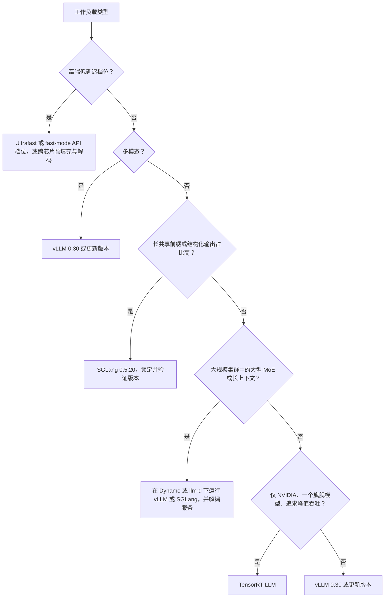

# Serving Infrastructure（Serving Infrastructure，服务基础设施）

大规模部署 LLM（Large Language Model，大语言模型）需要一个基础设施层，用于处理负载均衡（load balancing）、模型并行（model parallelism）和多租户隔离（multi-tenant isolation）。关注点已从“服务一个模型”转向“编排一个推理集群（inference fleet）”：感知 KV 的路由、独立的预填充与解码资源池，以及高端服务层按阶段采用不同芯片。

## 目录（Table of Contents）

- [推理网关（The Inference Gateway）](#推理网关-the-inference-gateway)
- [模型并行（张量、流水线、专家、上下文）](#模型并行-model-parallelism)
- [多 GPU 编排（Multi-GPU Orchestration）](#多-gpu-编排-multi-gpu-orchestration)
- [流式与长连接（Streaming and Long-Lived Connections）](#流式与长连接-streaming-and-long-lived-connections)
- [推理引擎（2026 年 10 月）](#推理引擎-2026-年-10-月)
- [面试题（Interview Questions）](#面试题-interview-questions)
- [参考资料（References）](#参考资料-references)

---

## 推理网关（The Inference Gateway）

该网关是 AI 任务的“流量调度员”。

| 组件 | 职责 |
|-----------|---------------------------|
| **身份认证与限流（Auth & Rate Limiting）** | 基于 Token 的配额管理与租户隔离。 |
| **模型路由（Model Router）** | 将请求路由到特定模型版本（Canary/A-B）。 |
| **KV 感知路由（KV-Aware Router）** | 将请求发往已缓存其前缀的副本，同时考虑负载和预测延迟。它取代了单纯的粘性会话：可采用 Kubernetes Gateway API Inference Extension（GAIE）加 llm-d Endpoint Picker，或 NVIDIA Dynamo 的路由器。Google 报告多集群 GKE Inference Gateway 的路由开销低于 1%。 |
| **准入与故障转移（Admission & Failover）** | 在流打开前拒绝超出上下文或容量的请求；如果迟迟没有首个 token，就切换到另一后端（Envoy AI Gateway v1.1 的 `streamIdleTimeout`）。 |
| **输出过滤（Output Filter）** | 对流式响应进行实时安全过滤与 PII（Personally Identifiable Information，个人可识别信息）清洗。 |

网关还集中了你拥有的所有供应商凭据，因此成为首要攻击目标。仅 LiteLLM 在 2026 年就出现过未认证 RCE（CVE-2026-37004，CVSS 9.8），以及通过已认证的 `api_base` 重定向把运营方存储的供应商密钥发送到攻击者主机的问题（CVE-2026-84377）。应像管理其他面向互联网的服务一样锁定并修补网关版本，对路由参数使用允许列表，而非直接接受客户端传入值。调用托管 API 时，故障转移必须跨供应商，因为供应商故障会同时影响其 API、聊天应用和编程智能体：OpenAI 在 2026 年 9 月 29 日的事故波及三者，持续约 5 小时 20 分钟；Anthropic 状态页在 8 月 16 日至 9 月 29 日间记录了至少 12 次重大或严重事故。网关设计详见[AI 网关章节](../11-infrastructure-and-mlops/03-ai-gateways-and-model-routing.md)。

---

## 模型并行（Model Parallelism）

对于放不下单张 GPU 的模型（例如 Llama 3.1 405B 仅 BF16 权重就需要约 810 GB，尚未计入 KV 缓存），我们必须进行拆分。

### 1. 张量并行（Tensor Parallelism，TP）
将单个层/张量拆分到多张 GPU 上。
- **延迟（Latency）**：低（最快）。
- **通信（Communication）**：高（需要 NVLink）。
- **标准用法**：在单节点（8x GPUs）或单个 NVLink 域（NVL72 机架上最多 72 张 GPU）内用于 90% 的生产级服务。

### 2. 流水线并行（Pipeline Parallelism，PP）
将不同层拆分（例如 GPU 1 上为第 1-40 层，GPU 2 上为第 41-80 层）。
- **延迟（Latency）**：在 GPU 上较高（微批处理开销）。
- **效率（Efficiency）**：利用率较低（气泡时间，Bubble time）。
- **标准用法**：用于跨多个节点的超大规模模型。晶圆级系统是一个例外：它在层边界进行流水线处理，因为晶圆之间只传输激活值；OpenAI 的 GPT-5.6 Sol Ultrafast 预览版通过多个 Cerebras CS-3 系统以这种方式运行，输出速度最高达 750 tok/s。

### 3. 专家并行（Expert Parallelism，EP）
将 MoE 模型的专家分散到多张 GPU 上，并通过全对全交换把每个 token 的隐藏状态路由到承载所选专家的 GPU（DeepEP 是常用的内核库）。EP 加数据并行注意力是 DeepSeek、Kimi 和 Qwen 类 MoE 模型的标准布局。

### 4. 上下文并行（Context Parallelism，CP）
将长序列拆分到多张 GPU。解码上下文并行（DCP）对超长上下文的 KV 缓存分片；SGLang 在其默认的 Blackwell MLA 后端运行 DCP，并验证过在 8x B300、输入长达 256K 时，解耦服务下结合 DCP 的 DSpark 推测解码。

### 5. 注意力与 FFN 解耦（实验性）
把持有 KV 缓存的注意力层和 FFN/专家层作为可分别扩缩的服务运行。vLLM 在 NVIDIA GPU 和昇腾 NPU 上有一个面向 MoE 的实验性插件；NVIDIA 也将其列为 Vera Rubin 加 Groq 3 LPX 的一种服务模式。

---

## 多 GPU 编排（Multi-GPU Orchestration）

Kubernetes 是默认底座，其上叠加面向 LLM 的层：**KubeRay** 用于基于 Ray 的服务，**LeaderWorkerSet** 用于多节点副本，**llm-d** 基于 Gateway API Inference Extension 实现 KV 感知路由和自动扩缩容，**NVIDIA Dynamo** 则作为 vLLM、SGLang 和 TensorRT-LLM 之上的编排层。

- **异构集群（Heterogeneous Clusters）**：在同一集群中混用 H100 处理 frontier models（前沿模型）与 L4 处理小模型。如今也有混用不同厂商硬件的基准测试：Cisco 在 MLPerf Inference v6.1 的提交中将 8 张 H200 和 8 张 MI350X 作为一个推理池运行。
- **自动扩缩容（Autoscaling）**：基于 **KV Cache 利用率**和队列深度，而非 CPU 或标准内存使用率进行扩缩容。Dynamo 的 Kubernetes 规划器还可将扩缩容限制在总 GPU 功率预算内。
- **冷启动（Cold Start）**：模型加载时间主导扩容速度。vLLM v0.30.0 的 **Fast Start**（`--load-format ipc_cache`）由每张 GPU 的守护进程保留已量化、按张量并行分片的权重，并通过 CUDA IPC 将其映射到重新启动的引擎。SGLang 的重叠式检查点暂存（`--startup-weight-load-mode overlap`）让 Qwen3-32B 在一张 H100 上的启动速度提高 2.38x（35.6 s 对比 84.8 s）。
- **先模拟再规划**：SGLang 的纯 CPU Simulator 以延迟模型运行真实调度器和缓存，对 TTFT 的预测误差约为 6%（在 32K 至 128K 的轨迹上最高 10%）；Dynamo 的 AISimulate（原 AIConfigurator）进行配置搜索。购买或租用 GPU 前先做模拟。

---

## 流式与长连接（Streaming and Long-Lived Connections）

LLM 几乎总是通过 **Server-Sent Events（SSE）** 或 **WebSockets** 提供服务。

**基础设施挑战**：标准负载均衡器（第 4 层，Layer 4）难以处理长连接 AI 流量。  
- **解决方案**：使用支持“End of Sequence” token 并可在用户回合间（而非仅连接级）重平衡流量的 **第 7 层负载均衡器（Layer 7 Load Balancers）**（如 Envoy/Istio）。
- **在首个 token 前故障转移，而非之后。**Envoy AI Gateway v1.1 可在 `streamIdleTimeout` 内没有收到 token 时切换至下一后端；一旦已有 token 流出，后端故障会表现为 504，而不会悄悄生成重复答案。Dynamo 前端同样会在流打开前拒绝超出上下文的请求，并在过载时返回 503。首个 token 之后的重试应由客户端或智能体循环处理，且工具调用要具备幂等性。

---

## 推理引擎（2026 年 10 月）

选择推理引擎已不再是“哪个最快”的问题。各主流引擎各有擅长的工作负载，大型集群还会在引擎之上部署编排层（Dynamo 或 llm-d）。应按工作负载选引擎，并锁定已修补的版本。

| 组件 | 当前版本（截至 2026 年 10 月 1 日） | 值得关注的变化 |
|-----------|---------------------------------|---------------------------|
| **vLLM** | v0.30.0（9 月 22 日）；约每两周发布一次 | Model Runner V2 自 v0.29 起为默认配置（旧版计划在 v0.32 移除）；队列准入控制；Fast Start；向磁盘分层卸载 KV；`vllm serve` 取代已弃用的 `python -m vllm.entrypoints.openai.api_server` |
| **SGLang** | v0.5.20（9 月 18 日） | 感知滑动窗口的基数树缓存；纯 CPU 模拟器；通过重新量化为 MXFP4 在 AMD 上使用 NVFP4 检查点；除非设置 `--enable-response-store`，否则 `/v1/responses` 不再存储结果 |
| **TensorRT-LLM** | 稳定版 v1.2.1（4 月 20 日）；v1.3.0rc29（9 月 29 日） | 自 1.0（2025 年 9 月）起默认使用 PyTorch 后端，无需为每个模型构建引擎；v1.3 RC 移除 AutoDeploy 集成，属于破坏性变更 |
| **NVIDIA Dynamo** | v1.5.0（9 月 21 日） | 可插拔的 KV 感知路由策略；按条件绕过解耦流程；KVBM 已弃用（计划在 v1.6.0 移除） |
| **llm-d / GAIE** | llm-d v0.10.0（9 月 29 日）；GAIE v1.6.2（9 月 17 日） | Endpoint Picker 从 GAIE 移入 llm-d；llm-d 现使用上游 vLLM 镜像，并为生产镜像提供 cosign 签名 |

### vLLM：默认开源引擎

[vLLM](https://docs.vllm.ai/) 在“Llama / Mistral / Qwen / DeepSeek 配合连续批处理”的工作负载下仍是默认开源引擎：模型覆盖最广、最易运维，安全补丁通常也能在同周发布。与此同时，它的攻击面也最大。2026 年 8 月 11 日至 9 月 28 日间，它发布了 20 多项安全通告，包括：

- **CVE-2026-90553**（高危，已在 0.28.0 修复）：即使设置 `trust_remote_code=False`，模型处理器加载器仍会执行恶意模型仓库中的代码。
- **CVE-2026-93592**（高危，已在 0.28.0 修复）：一条未经认证、向 `/v1/embeddings` 或 `/pooling` 提交负 token ID 的请求可污染 CUDA 上下文，导致引擎在重启前无法服务任何客户端。
- **GHSA-935w-9g4m-p28p**（低危，已在 0.30.0 修复）：一条代码路径遗漏了每租户的 `cache_salt`，重新打开跨租户前缀缓存时序探测通道。

更早的 2 月多模态 RCE（CVE-2026-22778，视频处理）已在 v0.14.1 修复。**基线：vLLM 0.30.0 或更新版本。**普遍教训是：GPU 引擎属于故障共担域，因此输入应在到达设备前验证，所有路径都应为前缀缓存加入租户盐值，而且只加载可信仓库中的模型。

### SGLang：共享前缀多、结构化输出多的负载

[SGLang](https://github.com/sgl-project/sglang) 擅长前缀复用率高、结构化输出多的负载：它有 **RadixAttention** 前缀缓存、与前向传播重叠执行的约束解码，以及一流的 MoE 服务能力（DeepEP v2、Hopper 上的 W4A8 MXFP4 MoE、Blackwell 上的解码上下文并行）。v0.5.20 的基数树在前缀分叉点缓存滑动窗口状态；在共享系统提示的 DeepSeek-V4-Flash 上，token 命中率从 43.8% 升至 60.8%，平均 TTFT 从 1.57 s 降至 1.07 s。

**安全姿态**：2026 年 3 月发生在多模态 ZMQ 代理和编码器并行解耦路径中的严重 RCE（CVE-2026-3059、CVE-2026-3060）已在 v0.5.10 修复。5 月的一批漏洞（CVE-2026-7301、7302、7304；严重：调度器套接字监听所有接口并使用 `pickle.loads`、路径穿越、通过自定义 logit 处理器调用 `dill.loads`）在安全通告数据库中列出了受影响版本直至 0.5.12，但未记录修补版本。因此应锁定 0.5.13 或更新版本，并逐项核对安全通告；绝不要把内部 ZMQ 或 RPC 套接字暴露到 pod 外，也不要为不可信调用方启用自定义 logit 处理器。满足这些条件后，SGLang 也可处理多模态流量；旧有“多模态流量不要放在 SGLang 上”的规则基于后来已经修复的 CVE。

### TensorRT-LLM：NVIDIA 硬件上的峰值吞吐

[TensorRT-LLM](https://github.com/NVIDIA/TensorRT-LLM) 在纯 NVIDIA 硬件上仍能为手工调优的模型提供领先吞吐，Blackwell 上的自定义 FP4/FP8 内核通常先于开源引擎，并与 Triton 和 NIM 深度集成。过去“每个模型都需花数小时构建引擎”的运维顾虑已经不再成立：自 1.0 起，PyTorch 后端成为默认选项，模型加载方式与其他引擎相同。剩余代价是 **NVIDIA 锁定**和**以 RC 为主的发布节奏**（稳定版 v1.2.1 发布于 4 月；v1.3 数月来仍为候选版，其 RC 包含破坏性移除）。如果长期使用 NVIDIA，且只有一到两个必须榨取每秒 token 数的旗舰模型，它值得投入；否则 vLLM 或 SGLang 更灵活。

### 引擎之上的编排：Dynamo 与 llm-d

在集群规模下，影响成本的决策（请求发往哪个副本、何时解耦、如何扩缩容）位于引擎之上。**NVIDIA Dynamo** v1.5 根据 KV 缓存重叠度路由，提供可插拔的评分和选择策略、硬/软会话亲和性，索引 SGLang HiCache 和 vLLM 磁盘层的缓存事件，将短请求直接送往解码，并支持在传输层选择启用 TLS/mTLS。**llm-d** 在 Kubernetes Gateway API 体系中承担类似角色。两者仍年轻且变化很快，需锁定版本并阅读弃用说明（Dynamo 的 KVBM、GAIE 已移除的 alpha API）。

同一生态中还有一个精度选择的提醒：Dynamo 更新后的 Nemotron 3.5 Lightning 配方测得 BF16 在 Marlin 内核下比 NVFP4 快 80%，在 CuTeDSL 下快 12%。应按模型和内核后端分别测试精度方案；参见[量化深度解析](../03-training-and-adaptation/07-quantization-deep-dive.md)。

### 面向 MoE 的服务策略（Llama 4 Maverick、DeepSeek V4、Kimi K3）

MoE（Mixture of Experts，专家混合模型）打破了“服务成本随 batch size 平滑变化”的假设。影响 MoE 服务引擎的关键特征：

- **专家权重驻留（Expert weight residency）**：一个 400B 参数、每 token 激活 17B 的 MoE（Llama 4 Maverick），会把大量显存留给当前 token 不使用的专家。引擎必须感知 expert-to-token routing（专家到 token 路由），通过专家并行分散专家、固定热点专家，或流式加载冷门专家。
- **专家路由延迟（Expert routing latency）**：路由决策按 **每 token** 进行并带来可度量成本，当前引擎会在 batch 维度上聚合路由决策。
- **非单调批处理特性**：增加请求数反而可能**降低吞吐**，若触发更冷的专家集合被激活。最优 batch 大小取决于 batch 内部路由模式分布，而不仅仅是请求数量。
- **分阶段与分层的参数需求**：DeepSeek V4.1-Flash 每 token 在预填充阶段激活约 8B 参数，在解码阶段激活约 16B；Qwen3.8-Flash-Next 另有拟驻留在主机 DRAM 中的 51B 参数 N-gram 记忆。预填充池、解码池和主机内存应分别定容。
- **按组件选择精度**：DeepSeek-V4 的专家权重采用 FP4，而大多数其他参数采用 FP8，因此混合精度 MoE 的内核支持决定了实际吞吐量。

| 引擎 | MoE 路径（2026 年 10 月） |
|--------|------------------------|
| vLLM 0.30 | 专家并行；内置 DSpark/MTP 推测解码及自适应验证；供稀疏 MLA 解码使用的主机驻留 HiSparse KV 层；实验性注意力与 FFN 解耦插件 |
| SGLang 0.5.20 | DeepEP v2；Hopper 上的 W4A8 MXFP4 MoE（DeepSeek-V4-Flash 输出吞吐提高 12%）；Blackwell MLA 上的 DCP；解耦服务下的 DSpark |
| TensorRT-LLM 1.3 RC | FP4 MLA 和以 MLA 为基础的 DSpark 草拟器；仅提供候选版 |

面试中可直接讲的认知：**MoE serving 不再是“更大参数版本的 vLLM”**。它是不同的调度和内存放置问题，各引擎都已构建专用 MoE 路径。

### 高端低延迟服务层：跨芯片解耦

过去的捷径是“大模型要实现低于 50ms 的 TTFT，就调用 Cerebras 或 Groq”。2026 年的模式是**异构预填充与解码**：计算密集的预填充交给配备 HBM 的 GPU，受带宽约束的解码交给 SRAM 或晶圆级硬件。

| 组合 | 状态 | 说明 |
|---------|--------|-------|
| NVIDIA Vera Rubin NVL72 加 Groq 3 LPX | LPX 自 2026 年 8 月 24 日全面投产；Nebius 是首个云服务商 | 每机架 256 个 LPU 和 128 GB SRAM。模式包括 P/D（Rubin 预填充、LPX 解码）、注意力与 FFN 拆分，或以 LPX 充当推测解码草拟器。The Register 估计，由于 SRAM 容量限制，在 100K-token 输入下一个 LPX 机架的批大小上限约为 12 |
| AMD Helios 加 Cerebras WSE | 已宣布；2026 年 H2 首先通过 Cerebras Cloud 提供 | Helios 负责提示和大上下文处理，Cerebras 负责解码；相较 Cerebras 单独运行，每瓦每秒 token 数最高提升 5x（AMD/Cerebras 的模型估算） |
| GPU 加 SambaNova RDU（SambaNova 和 Intel） | 蓝图（2026 年 4 月 8 日） | GPU 负责预填充，SambaNova RDU 负责解码，Intel Xeon 6 CPU 负责智能体工具执行 |

表格背后有两项商业事实：NVIDIA 于 2025 年 12 月与 Groq 达成非独家技术授权协议并招募人员（条款未披露，报道估值约 $17-20B）；GroqCloud 继续作为独立的 NVIDIA Cloud Partner 部署 LPX 和 Rubin。SambaNova 并未被收购；它于 7 月 8 日宣布以 $11B 估值完成 $1B 首轮融资。

速度也以 API 服务档位出售：OpenAI 的 Ultrafast 档定价为 Standard 的 6x，于 2026 年 9 月 29 日随 GPT-6 Astra 正式上线；Anthropic 的 Claude API 为 Opus 5.5 提供研究预览阶段的 fast mode，价格为每 1M token $8/$40。上文较低的批大小上限解释了这些档位为何要收取溢价。自建跨芯片方案的隐性成本是资源池之间的 KV 传输，需按请求计算预算。

### 决策框架：按工作负载选引擎（Decision Framework: Engine per Workload）

更贴近团队真实部署的显式映射：

| 工作负载 | 引擎选择（2026 年 10 月） | 原因 |
|----------|---------------------------|-----|
| 公共聊天机器人（混合流量，必须快速修补） | **vLLM 0.30+** | 最易运维，安全修复节奏最快 |
| JSON 函数调用后端、具有长共享前缀的智能体循环 | **SGLang 0.5.20**（锁定版本，内部套接字仅在 pod 内） | RadixAttention 前缀复用和重叠执行的约束解码 |
| 单模型低延迟（单一模型、单团队） | **TensorRT-LLM**，运行在 B300 或 Rubin 上 | NVIDIA 峰值吞吐，已无需付出构建引擎的成本 |
| 多模态（图像/音频/视频输入） | **vLLM 0.30+** | 多模态模型覆盖最广；经过版本锁定与验证的 SGLang 也可使用 |
| 推理模型（长 CoT，低并发） | **vLLM** 或 **SGLang**，使用模型发布方提供的 MTP 或 DSpark 草拟器 | 解码受限；结合自适应验证的推测解码是主要优化手段 |
| 集群规模的 MoE（DeepSeek V4、Kimi K3、Llama 4 Maverick） | 在 **Dynamo** 或 **llm-d** 下运行解耦的 **vLLM** 或 **SGLang** | 专家并行、KV 感知路由、独立的预填充与解码池 |
| 高端档位：低于 50ms 的 TTFT 和极高的单用户 tok/s | **API 加速档位**（Ultrafast、fast mode）或**跨芯片 P/D** | 对大模型，在合理批大小下仅靠 GPU 难以达到这些单用户速度 |

### 运维姿态

- **始终使用已修补版本。**推理引擎和网关的 CVE 出现节奏已接近 Web 服务器。目前的最低版本要求如下：

| 组件 | 最低版本 | 原因 |
|-----------|-------|--------|
| vLLM | 0.30.0 | 模型加载 RCE 和单请求导致引擎崩溃的问题（均在 0.28.0 修复）；前缀缓存探测问题（在 0.30.0 修复） |
| SGLang | 0.5.13 或更新版本，并核对通告 | 2026 年 5 月的严重 CVE 列出受影响版本直至 0.5.12，但未记录修补版本 |
| LiteLLM（如使用） | 对应次版本中修复 CVE-2026-84377 的版本（1.88.6、1.89.7、1.90.7、1.91.5、1.92.2、1.93.2、1.94.3、1.95.1 或 1.96.2） | 通过 `api_base` 窃取已存储密钥；升级前设置 `general_settings.allow_client_side_credentials=false`。还应避开遭入侵的 PyPI 版本 1.82.7 和 1.82.8 |

- **假定单个请求可以让副本上的所有租户中断服务。**在网关验证 token ID、媒体和大小；当故障波及范围很重要时，用独立副本承载不可信租户，并监控引擎重启。
- **在第二引擎上保留金丝雀（canary）实例。** 在 vLLM 上线主流量，同时在 SGLang 或 TensorRT-LLM 上以 1-5% 做 canary，监控质量或延迟偏差，这有助于发现引擎特定缺陷并加速迁移。
- **把引擎视作部署清单的一部分。**一个模型不是“Llama 4 Maverick”，而是“在这套硬件上，以这套批处理配置、内核后端和推测解码方法运行于 vLLM v0.30.0 的 Llama 4 Maverick”。所有要素都应锁定，因为默认值（内核后端、批处理预算、模型运行器）会随版本变化。
- **在帕累托曲线上做基准测试。**在智能体流量上使用吞吐量与交互性曲线（SemiAnalysis InferenceX AgentX），并参考 MLPerf Inference v6.1；后者新增了端到端 RAG 和边缘智能体测试，并将推测解码扩展至 gpt-oss-120b Interactive 场景。参见[推理基础](01-inference-fundamentals.md#在帕累托曲线上测量-而非只看批次大小为-1)。
- **关注安全通告（security advisory feeds）**，而不仅仅是发布说明（release notes）：[vLLM advisories](https://github.com/vllm-project/vllm/security/advisories)、[SGLang advisories](https://github.com/sgl-project/sglang/security/advisories)、[TensorRT-LLM CVE list](https://nvd.nist.gov/vuln/search/results?form_type=Basic&search_type=all&query=tensorrt-llm)。

---

## 面试题（Interview Questions）

### 问：为什么低延迟服务中更偏好张量并行（Tensor Parallelism）而非流水线并行（Pipeline Parallelism）？

**强回答：**
Tensor Parallelism（TP）在单层内把矩阵乘法同时分摊到多张 GPU 上执行，因此该层延迟可按 GPU 数量近似降低。相反，Pipeline Parallelism（PP）按不同层顺序处理；当 GPU 2 在处理第 40-80 层时，若没有足够深的请求流水，GPU 1 会处于空闲。对单个用户请求而言，PP 会叠加所有 GPU 的延迟，而 TP 则将延迟分摊到多张 GPU。细微之处在于：TP 的逐层全归约需要极快的互联，因此跨慢速链路时 PP 更有优势；在晶圆级硬件上，每个阶段都极快、晶圆之间只传输激活值，流水线反而能实现最快的单用户速度。

### 问：你如何处理多租户 LLM 集群中的“噪声邻居”（Noisy Neighbors）问题？

**强回答：**
我们通过**分层迭代级调度（Tiered Iteration-Level Scheduling）**处理该问题。每个租户分配一定比例的总 GPU 周期（share）。在持续批处理循环中，调度器确保单一租户不会占满 100% 的 KV cache 插槽（slots）。若租户 A 压力过大，调度器会优先处理租户 B 和 C 的“Prefill”步骤，或每个周期仅处理租户 A 解码（decode）迭代的一部分。此策略在网关通过 token 桶（token-bucket）限流执行，也通过服务引擎内的具体调度策略执行；此外还要在队列层限制排队请求数和 token 数，及早拒绝过量负载，避免推高所有人的 TTFT。

### 问：一个格式错误的请求导致 vLLM 副本崩溃，其上所有租户都中断服务。设计上应吸取什么教训？

**强回答：**
GPU 推理引擎是故障共担域。在 CVE-2026-93592 中，一条未经认证、向 embeddings 端点提交负 token ID 的请求触发了 CUDA 设备端断言，污染 CUDA 上下文；`try/except` 无法捕获该问题，整个引擎直到重启才恢复。升级到 0.28.0 或更新版本能修复这一漏洞，但设计教训更普遍。输入到达设备前就要验证：token ID 在范围内、媒体在独立进程中完成解码和大小检查、网关限制请求大小。限制故障波及范围：为不可信租户设置独立副本或资源池；如果不用 embeddings 或 pooling 路由，就禁用它们。快速检测和恢复：健康检查要覆盖 GPU 路径、自动重启，并用 Fast Start 类权重缓存让重启只需数秒而非数分钟。前缀缓存也有同类风险：若非所有路径都按租户加盐，它就是跨租户侧信道。

### 问：如何为需要极高单用户每秒 token 数的智能体产品设计高端低延迟档位？

**强回答：**
先判断采购是否足够：OpenAI 的 Ultrafast 档位（Standard 的 6x，已随 GPT-6 Astra 正式上线）和 Anthropic 面向 Opus 5.5 的 fast mode 正是售卖此类速度；对多数团队，支付 2-6x 溢价仍比自建便宜。若要自托管，2026 年的模式是跨芯片解耦：配备 HBM 的 GPU（Vera Rubin）负责计算受限的预填充，SRAM 或晶圆级硬件（Groq 3 LPX、Cerebras）负责带宽受限的解码，并由 KV 感知路由器决定何时解耦。必须算准的是资源池间逐请求 KV 传输成本（稠密模型每 token 数百 KiB；潜在或稀疏注意力模型要低得多），以及受 SRAM 限制的解码批大小上限（The Register 估计，一个 LPX 机架在 100K-token 上下文下最高约为 batch 12），后者决定单用户成本。我会加入模型发布方提供的草拟器做推测解码，只把对延迟敏感的流量路由到这一档，单独定价，并保留纯 GPU 回退路径，因为这些新硬件的云端可用性仍有限。

---

## 参考资料（References）
- Narayanan 等。“Efficient Large-Scale Language Model Training on GPU Clusters Using Megatron-LM”（2021）
- Shoeybi 等。“Megatron-LM: Training Multi-Billion Parameter Language Models Using Model Parallelism”（2019）
- vLLM。[发布版本](https://github.com/vllm-project/vllm/releases)及[“解耦服务指南”](https://vllm.ai/blog/2026-09-29-disaggregated-serving-guide)（2026）
- SGLang。[发布版本](https://github.com/sgl-project/sglang/releases)
- NVIDIA。[Dynamo v1.5.0 发布说明](https://github.com/ai-dynamo/dynamo/releases/tag/v1.5.0)及[“Groq 3 LPX 现已全面投产”](https://nvidianews.nvidia.com/news/nvidia-groq-3-lpx-now-in-full-production-with-world-class-speed-for-agentic-ai)（2026）
- Kubernetes SIGs。[Gateway API Inference Extension v1.6.0](https://github.com/kubernetes-sigs/gateway-api-inference-extension/releases/tag/v1.6.0)
- MLCommons。[MLPerf Inference v6.1 结果](https://mlcommons.org/2026/09/mlperf-inference-v6-1-results/)（2026）

---

*Next: [Cost Optimization Playbook（成本优化手册）](07-cost-optimization-playbook.md)*
