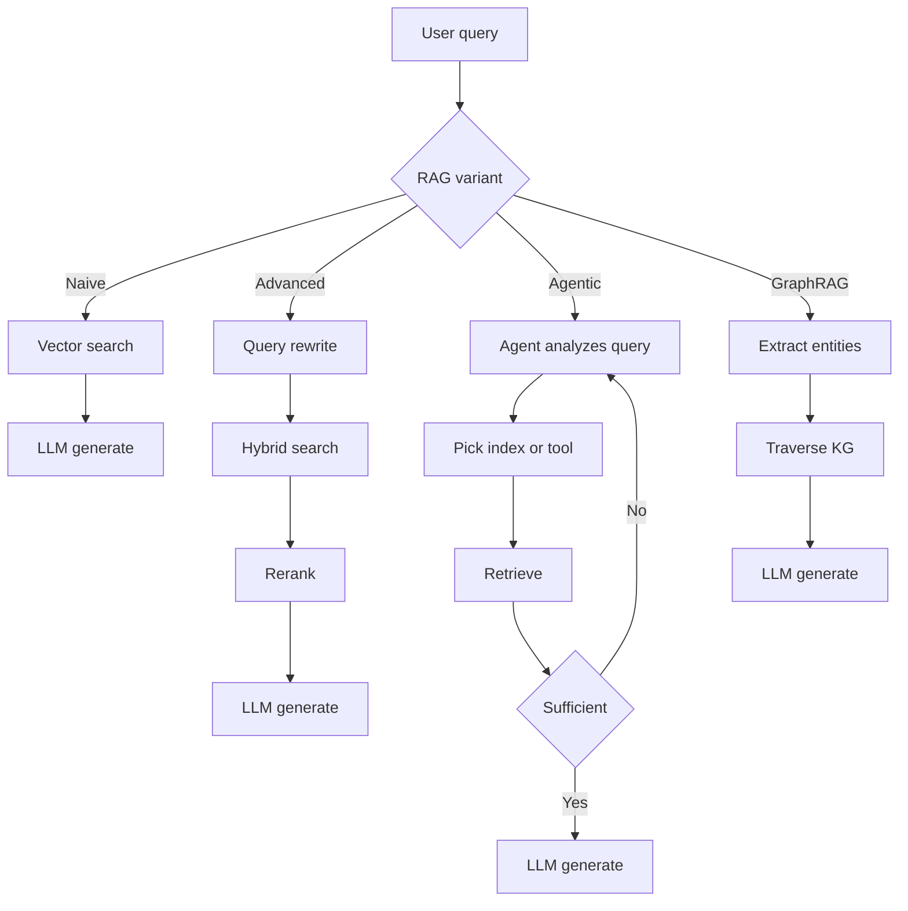
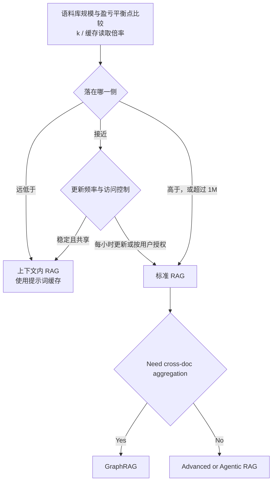

# RAG 基础知识

RAG 如何从朴素向量搜索演进为 agentic（智能体式）和基于图的检索。何时选择 RAG 而不是长上下文，以及导致生产故障的三大检索缺口。

检索增强生成（Retrieval-Augmented Generation，RAG）是为 LLM（大语言模型）提供外部、可验证上下文（verifiable context），以使其回答有事实依据的一种架构模式。它已从“简单向量搜索”演进为多阶段推理流水线：混合检索（hybrid retrieval）、重排序（reranking）、上下文化切块（contextual chunking）和 agentic 循环（agentic loops）如今已是生产系统的标配。更深入的内容见 [Chunking Strategies](02-chunking-strategies.md)、[Vector Databases](04-vector-databases.md)、[Reranking](06-reranking-strategies.md)、[Contextual Retrieval](10-contextual-retrieval.md)、[ColBERT Late Interaction](11-late-interaction-colbert.md) 和 [GraphRAG reframe](07-graph-rag.md)。

## 目录

- [核心理念：Grounding 与 Training](#核心理念-grounding-与-training)
- [RAG 分类体系](#rag-分类体系)
- [RAG vs. 长上下文（混合时代）](#rag-vs-长上下文-混合时代)
- [检索质量缺口](#检索质量缺口)
- [被投毒的来源](#被投毒的来源)
- [面试问题](#面试问题)
- [核心要点](#核心要点)
- [参考资料](#参考资料)

---

## 核心理念：Grounding 与 Training

| 维度 | Fine-Tuning | RAG |
|--------|-------------|-----|
| **知识类型** | 内化（Weights） | 外化（Context） |
| **更新周期** | 高成本（重训） | 低成本（重新嵌入变更文档） |
| **可归因性** | 无（黑盒） | 显式（Citations） |
| **隐私** | 难以“遗忘” | 易于过滤/删除 |

**经验法则**：Fine-Tuning 用于**形式**（风格、语气、语法）；RAG 用于**事实**（知识、数据、grounding）。

---

## RAG 分类体系

生产级 RAG 系统按其“Agentic Depth（智能体深度）”分类：

### 1. Naive RAG（朴素 RAG，Retrieve-then-Generate）
- **流程**：User Query -> Vector Search -> Top-K -> LLM。
- **状态**：由于“检索缺口”（Retrieval Gap）和较低精度，已不适合生产环境。

### 2. Advanced RAG（高级 RAG）
- **流程**：Query Transformation -> Hybrid Search -> Reranking -> LLM。
- **关键细节**：使用 **RRF（Reciprocal Rank Fusion，倒数排名融合）** 将关键词结果与语义结果合并。

### 3. Agentic RAG（循环式 RAG）
- **流程**：Agent analyzes query -> 决定搜索哪些工具/索引 -> 评估结果 -> 如果信息不足则重新检索。
- **技术**：Self-RAG、Corrective RAG（CRAG，纠正式 RAG）。

### 4. GraphRAG（结构化上下文）
- **流程**：抽取实体/关系 -> 构建 Knowledge Graph（知识图谱）-> 遍历图以找到“关联知识”。
- **优势**：解决“聚合类问题”（Aggregative Questions），例如“总结 50 份文档中的所有法律风险”。

按 agentic depth 划分的四种变体：



---

## RAG vs. 长上下文（“混合时代”）

前沿模型的上下文窗口稳定在约 **1M token**：Claude Opus 5.5、Sonnet 5.5 和 Fable 5.1 均为 1M，GPT-6 系列为 1.05M，Gemini 3.8 Flash 的输入上限为 1,048,576 token。Gemini 1.5 时代的 2M 窗口并未成为常态。2026 年的变化不在窗口大小，而在于**重复读取的价格**。

- **上下文内 RAG（ICR）**：对于小型、稳定的语料库，跳过向量数据库，把全部内容放进可缓存的提示词前缀。
- **提示词缓存**可降低重复读取 token 的费用，但折扣因模型而异：多数模型的缓存读取按输入价格的 0.1x 计费，Claude Opus 5.5 和 GPT-6.1 Sol 为 0.05x，Claude Fable 5.1 为 0.025x（每 1M token 为 $0.25，标价为 $10）。缓存写入仍需付费：OpenAI GPT-5.6 及更新模型（固定 30 分钟 TTL）和 Anthropic 的 5 分钟 TTL 为 1.25x，Anthropic 的 1 小时 TTL 为 2x。
- **长上下文价格陡增点**：OpenAI 在输入超过 272K token 后对**整个请求**按长上下文费率计费（输入和缓存 2x，输出 1.5x；GPT-6 Sol 从 $2/$10 变为 $4/$15）；xAI 的 Grok 提示词达到 200K 后，所有 token 价格翻倍；Gemini 3.1 Pro Preview 超过 200K 后，从 $2/$12 升到 $4/$18。Anthropic Claude 4.6 及更新模型直到 1M 都维持不变。因此，GPT-6 Sol 上 273K token 的提示词成本约为 272K 的两倍，应将上下文控制在阈值以内，或改用检索。

### 盈亏平衡点已改变

忽略缓存写入、输出 token 和延迟，将 **N** 个 token 的语料库整体放入缓存，与每次发送 **k** 个新检索 token 的单次查询成本大致相等时：

```
N x cache_read_multiplier = k        =>        N_break_even = k / multiplier
```

假设检索上下文为 5K token（与[生产规模 RAG](14-production-rag-at-scale.md#缓存读取的成本临界点)的假设相同）：

| 缓存读取倍率 | 模型示例（2026 年 10 月标价） | 缓存语料库的盈亏平衡点 |
|---|---|---|
| 0.1x | Sonnet 5.5、GPT-6 Sol 等多数模型 | ~50K token |
| 0.05x | Opus 5.5、GPT-6.1 Sol | ~100K token |
| 0.025x | Fable 5.1 | ~200K token |

如果检索上下文翻倍（10K token 的文本块），各档盈亏平衡点也随之翻倍。

低于盈亏平衡点时，上下文内 RAG 的单次查询成本更低，还能避免检索遗漏；高于它时，检索的成本更低，而且语料库越大差距越大。实际盈亏平衡点通常比公式算出的更低，原因有三：前缀变化或过期都需要再次写入缓存（查询频率低于缓存 TTL 的语料库会反复支付写入费）、即便命中缓存，数十万 token 的预填充仍有延迟、长上下文在“大海捞针”类问题上的召回率仍会下降。应按模型重新计算，不要套用固定 token 阈值；即使标价相同，换模型也会改变结果。

**架构决策**：
- 语料库低于所用模型的盈亏平衡点、内容稳定且所有用户均可访问：使用带缓存的**上下文内 RAG**。
- 语料库高于盈亏平衡点、每小时变化，或按用户设定访问权限：使用**标准 RAG**。只要存在按用户的访问控制，就必须检索，因为共享的缓存前缀不能包含部分用户无权查看的文档。

选择 standard RAG 与 in-context RAG 的决策树：



---

## 检索质量缺口

“检索缺口”（Retrieval Gap）是 RAG 失败的首要原因。
- **缺口 1：语义不匹配（Semantic Mismatch）**：查询说的是“fast cars”，数据库里是“Porsche 911”。可通过更好的嵌入模型加上**交叉编码器重排序**解决。
- **缺口 2：缺少上下文（Missing Context）**：相关信息存在于数据库中，但 Retriever 没有检索到。可通过 **Hybrid Search** 解决。
- **缺口 3：Lost-in-the-Middle**：信息在 prompt 里，但 LLM 没有注意到。可通过**上下文压缩**和优先放置最有力的证据解决。

---

## 被投毒的来源

上述三类缺口假定语料库可信，但对以网页为依据的 RAG 而言并非如此。2026 年 9 月，Vigilance Security 的研究员 Ariel Simon 报告了一场攻击：攻击者在网上大量投放伪造的客服页面、帖子和 PDF，使 ChatGPT、Gemini 和 Google AI Overviews 返回航空公司及银行的钓鱼电话号码和登录入口，涉及 Delta、Lufthansa、Chase、Bank of America 等。攻击无需越狱：检索器正常工作，却将攻击者的页面排在前面。

应在检索层而非提示词中落实的防御措施：
- **将来源信誉纳入排序特征**：针对同一实体，把官方域名和已知出版者排在新出现、权威性低的页面之前。
- **高风险答案采用已验证联系方式允许列表**（客服号码、付款入口、登录 URL）：只从经过整理的登记库回答，否则拒答并链接到官方网站。
- **在答案中注明来源**：联系方式旁标明域名，让用户能发现不匹配之处。

有关检索内容中的间接提示词注入，参见 [LLM 安全](../12-security-and-access/01-llm-security.md)。

---

## 面试问题

### Q: 如果前沿模型已经提供 1M token 的上下文窗口，为什么还要用 RAG？

**优秀回答：**
有四个原因：
1. **成本和延迟**：即使有提示词缓存，每次查询重复读取大型语料库仍需支付 `N x cache-read rate`，数十万 token 的预填充也会增加 TTFT（Time to First Token，首 token 时间）。盈亏平衡的语料库规模约等于检索 token 数除以缓存读取倍率：若检索上下文为 5K token，常见的 0.1x 倍率对应约 50K token，Claude Fable 5.1 的 0.025x 对应约 200K token。超过这一规模，检索文本块更便宜。在 OpenAI 上，输入超过 272K 还会使整个请求按 2x 输入和 1.5x 输出计费。
2. **新鲜度**：RAG 可访问实时 API（股价、新闻）和变更后的文档，无需改写巨大前缀并重新缓存。
3. **规模**：企业数据集（SharePoint、TB 级日志）超过任何上下文窗口。RAG 充当过滤器，找出应该进入窗口的相关 0.01% 数据。
4. **访问控制**：缓存前缀会由所有命中它的用户共享。若文档具有按用户设置的权限，仍须在检索时过滤。

### Q: 什么是 “Agentic RAG”，它与 “Advanced RAG” 有何不同？

**优秀回答：**
Advanced RAG 是一种**确定性流水线**（Linear: Rewrite -> Search -> Rerank）。Agentic RAG 是一种**随机循环**（stochastic loop）。在 Agentic RAG 中，模型被赋予工具，以决定*如何*检索。例如，如果 agent 发现检索到的文档不相关，它可以改为“Search Google”或“Query the SQL database”。它本质上是在检索前后各增加一个“Reasoning step（推理步骤）”，以确保上下文足以回答 prompt。

---

## 核心要点

- Naive RAG（向量搜索 + top-K + LLM）已不适合生产环境；应以 Advanced RAG（混合检索 + RRF + rerank）作为新的基础方案。
- 长上下文窗口不会消灭 RAG：成本、延迟、新鲜度、按用户的访问权限和语料规模都会把你重新推回检索，即使窗口达到 1M token。
- 按盈亏平衡点而非固定阈值选择：低于检索 token 数除以缓存读取倍率的规模时，带缓存的上下文内 RAG 更划算（检索上下文为 5K token 时，0.1x 约对应 50K token，0.025x 约对应 200K token）；高于它则使用标准 RAG；聚合类问题使用 GraphRAG。
- 以网页为依据的 RAG 需要对客服号码等高风险答案检查来源信誉并使用允许列表；投毒攻击针对的是排序，而非模型。
- 大多数 RAG 失败来自检索失败，而不是生成失败；在调 prompt 之前先诊断三类缺口（语义不匹配、缺少上下文、lost-in-the-middle）。
- Agentic RAG 与 Advanced RAG 的区别，是随机循环与确定性流水线的选择；只有在查询模式过于多样、固定流水线难以覆盖时才采用 agentic。

---

## 参考资料
- Gao et al. "Retrieval-Augmented Generation for LLMs: A Survey"（2024 更新）
- [Edge 等人，《From Local to Global: A Graph RAG Approach to Query-Focused Summarization》（Microsoft Research，2024）](https://arxiv.org/abs/2404.16130)
- [Lee 等人，《Can Long-Context Language Models Subsume Retrieval, RAG, SQL, and More?》（Google DeepMind，2024）](https://arxiv.org/abs/2406.13121)
- [Anthropic. "Introducing Contextual Retrieval" (Sep 2024)](https://www.anthropic.com/news/contextual-retrieval)

---

*上一篇：[提示词注入防御](../05-prompting-and-context/08-prompt-injection-defense.md) | 下一篇：[切块策略](02-chunking-strategies.md)*
