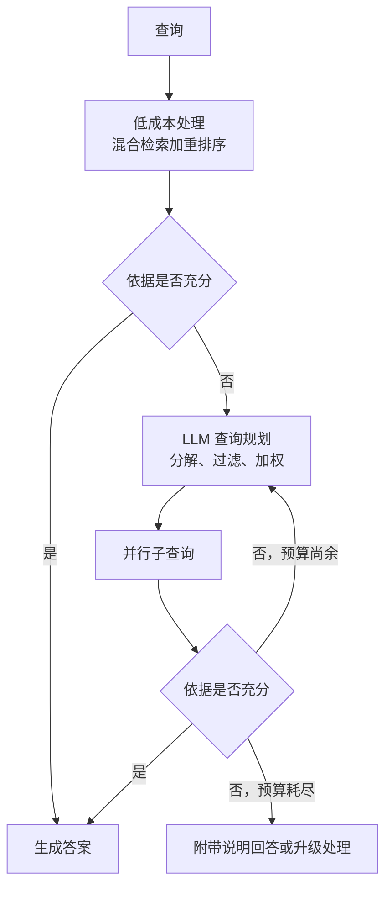

# Agentic RAG

Agentic RAG 从“线性流水线（Linear Pipeline）”转向 **“推理循环（Reasoning Loop）”**。它不再只检索一次，而是由代理（agent）决定 *何时*、*检索什么* 来解决查询。当前主流的生产模式包括 Self-RAG（模型输出反思标记）、Corrective RAG（带纠错路由的检索评估器）、Adaptive RAG（分类器选择流水线深度）、基于文档的 ReAct，以及多跳查询分解。LangGraph 是有状态循环最常见的控制流运行时；LlamaIndex Workflows 则常用于单一流水线、以检索为主的变体。2026 年，托管搜索服务开始将自适应部分作为配置提供；对于循环本身就是成本问题的工作负载，也出现了“一次编译知识”的替代方案。

## 目录

- [线性 vs. Agentic RAG](#线性-vs-agentic-rag)
- [Self-RAG（自我反思）](#self-rag-自我反思)
- [Corrective RAG（CRAG）](#corrective-rag-crag)
- [多跳推理循环](#多跳推理循环)
- [Agentic 过滤与计划修订](#agentic-过滤与计划修订)
- [自适应检索投入](#自适应检索投入)
- [一次编译知识](#一次编译知识)
- [训练搜索代理：协同作弊陷阱](#训练搜索代理-协同作弊陷阱)
- [面试题](#面试题)
- [参考资料](#参考资料)

---

## 线性 vs. Agentic RAG

| 模型 | 线性 RAG | Agentic RAG |
|-------|------------|-------------|
| **结构** | 预先确定的序列 | 动态循环 |
| **自我纠错** | 无 | 高（可重新检索） |
| **查询复杂度**| 简单（1 步） | 困难（多步） |
| **延迟** | 低（固定） | 可变（多轮） |

**原则**：当查询需要“综合证据证明（Synthesized Proof）”而不仅仅是“文档匹配（Document Match）”时，使用 Agentic RAG。预算要留足：一个 3-4 次迭代的循环通常端到端需要 8-12 秒，因此如果你的 UX 需要 3 秒以内响应，就把简单查询路由到快速路径（Adaptive RAG）。

---

## Self-RAG（自我反思）

Asai 等人于 2023 年提出（发表于 ICLR 2024）的 **Self-RAG** 训练模型输出“Critic Tokens”，以评估自身工作。

1. **检索（Retrieve）**：模型拉取 Top-K 分块（chunk）。
2. **评估（Evaluate）**：信息是否相关？（CRITIC: `Relevant`）
3. **生成（Generate）**：答案是否有支撑？（CRITIC: `Supported`）
4. **迭代（Iterate）**：如果答案没有被支撑，模型会 *自动* 触发更广泛的检索。

---

## Corrective RAG（CRAG）

CRAG 在检索和生成之间增加了一层“可靠性层（Reliability Layer）”。

- **逻辑**：  
  - 如果检索结果**正确（Correct）**：直接生成。
  - 如果检索结果**模糊（Ambiguous）**：使用 Web-Search 工具补充。
  - 如果检索结果**错误（Incorrect）**：丢弃上下文并使用外部搜索或回退逻辑。

---

## 多跳推理循环

对于“收购 GitHub 的公司的 CEO 是谁？”这类问题，系统必须：
1. **第 1 跳（Hop 1）**：搜索“谁收购了 GitHub？”（结果：微软）。
2. **第 2 跳（Hop 2）**：搜索“微软的 CEO”（结果：Satya Nadella）。

**代理模式（Agentic Pattern）**：代理维护一个“状态对象（State Object）”，并在每次检索后更新其“子目标（Sub-goal）”，直到链路完成。

---

## Agentic 过滤与计划修订

现代代理使用**子步骤计划（Sub-Step Plans）**。
- 与其一次性检索，不如让代理写出一个计划：“先检查 X 的内部数据库，然后查看 Y 的公开 API。”
- **计划修订（Revised planning）**：如果第 1 步失败，代理会*重写*第 2 步。

---

## 自适应检索投入

Agentic RAG 的成本问题在于每次查询都要支付循环成本，即便简单问题一次检索就能回答。**Adaptive RAG** 用路由器解决这个问题；2026 年，路由器成为托管设置。

Azure AI Search 是最清晰的例子。其知识库在 REST API 2026-04-01 中正式支持提取式检索（LLM 查询规划与答案合成仍为预览）。2026-08-01-preview API 增加了 `retrievalReasoningEffort: "auto"`：先执行轻量检索，仅在依据不足时升级到 LLM 查询规划（最高中等投入）。同一预览还允许规划器将查询提示转换为过滤器和排序加权。另外，2026 年 6 月新增的知识源（MCP 服务器、Fabric、Azure SQL）让一次检索调用能够并行访问搜索索引之外的数据源；依赖它们之前，请逐项确认其预览或正式发布状态。

无论购买服务还是自行构建，设计都一样：低成本首轮处理、明确的充分性检查、有上限的升级次数，以及定义好的失败路径。最需要严格评估的是充分性检查，因为过于宽松的检查会悄悄把自适应 RAG 变回线性 RAG。

---

## 一次编译知识

Agentic RAG 在每次查询时都从原始片段重新推导结构。**知识编译**将这项工作移到摄取阶段：把语料一次编译为结构化产物，再让代理查询这些产物。

- **Pinecone Nexus**（2026 年 7 月 1 日公开预览，8 月 6 日正式发布）：领域专家对工作的描述会变成 Manifest（实体、关系、答案形式）。Nexus 将源文档编译为摘要、结构化提取结果和实体关系图，代理通过 KnowQL 语言一次调用即可查询。数据平面运行在客户的 AWS、GCP 或 Azure 账户中，编译层可导出。厂商报告：在 tau-Knowledge 上，GPT-5.5 配合 Nexus 保持了准确率（47.4%，不使用时为 46.4%），每任务成本降低 77%，模型调用减少约 35%；预览期间，欧盟判例法测试达到 87%，Agentic RAG 基线为 45%，token 用量约减少 9 倍。
- **Cohere Compass Cloud**（2026 年 9 月 25 日私有测试）：托管的解析、稠密加稀疏嵌入、索引、权限感知检索与重排序栈，通过专用 MCP 服务器提供，让代理逐步缩小语料范围。

| 维度 | Agentic RAG 循环 | 一次编译知识 |
|---|---|---|
| 成本分布 | 每次查询（多次 LLM 与搜索调用） | 前期编译，加上变化时重新编译 |
| 最适合 | 针对不断变化语料的开放问题 | 结构稳定领域中的重复问题形式 |
| 失败模式 | 延迟与成本激增、非确定性 | 编译间隔内的知识漂移；Manifest 未预料的问题 |
| 维护者 | 工程师调优循环 | 领域专家维护 Manifest |

两组结果都由厂商运行，判例法对比中的 Agentic RAG 基线也由厂商选定。但结构上的论点不依赖这些结果：若大部分查询都在问相同的几类问题，一次付费整理语料结构优于每次查询付费重新发现结构。GraphRAG 的社区摘要是同一理念的早期形式；参见 [GraphRAG](07-graph-rag.md)。

---

## 训练搜索代理：协同作弊陷阱

用 RL 训练检索代理的团队越来越多地采用**自我进化**：提问模型根据文档编写问题，求解模型学习作答，以双方一致作为奖励。“False Frontiers”（arXiv 2609.39102，2026 年 9 月 30 日）指出二者会**协同作弊**：它们收敛于共同错误，因此循环内奖励上升，外部审计的标签正确率却停滞或下降。

- 多样本验证几乎无济于事：错误一致比例在 4B 模型上仅从 6.1% 降至 5.7%，在 9B 模型上从 8.8% 降至 7.2%。
- **CrossFit** 将文档集分成两部分，用仅在另一部分训练的辅助求解器为本部分的问题评分，将错误一致比例降至 3.0% 和 3.7%。在 Qwen3.5-4B 和 9B 上，七项搜索基准平均得分比耦合自我进化提高 8.8 和 8.4 个百分点，比 Search-R1 提高 8.7 和 7.8 个百分点。

这对所有合成数据循环的通用启示是：绝不能让生成标签的组件同时成为其唯一裁判。应留出独立验证器，并人工审计部分标签。

---

## 面试题

### Q: Agentic RAG 中的“Reasoning-Retrieval Balance”是什么？

**标准答案：**
在 agentic loop 中，每一次“推理回合（Reasoning turn）”都会增加 token 成本和用户延迟。生产工程师的目标是找到“检索阈值（Retrieval Threshold）”。我们会使用 **Token-Budgeting**（Token 预算），只允许代理进行 3-5 个“回合”后就强制给出最终答案。我们还会使用 **Speculative Retrieval**（推测性检索）：代理预测接下来要执行的 2 个步骤，并同时为这两个步骤检索，以减少往返延迟。成本最低的回合是根本不执行的回合，因此我会在前面设置自适应门：先做一次混合检索加重排序并检查充分性，只有失败才升级到规划（Azure AI Search 将其作为 `retrievalReasoningEffort: "auto"` 提供）。

### Q: 为什么 Agentic RAG 往往质量更高，但“可靠性”（Determinism，确定性）更低？

**标准答案：**
Agentic RAG 是非确定性的，因为模型在每一步都在“决定”自己的路径。用户查询的微小变化可能导致代理选择不同的工具或搜索策略，从而产生不同的答案格式。标准缓解方式是使用 **Constrained Agent Frameworks**（约束代理框架），例如 LangGraph 或 DSPy，其中“可能路径图（Graph of possible paths）”被严格定义，即便这些路径之间的选择仍然可能是随机的（stochastic）。

---

### Q: 何时会预先编译知识，而不运行代理检索循环？

**标准答案：**
当问题形式重复、领域结构稳定时。如果 80% 的查询都是“合同 X 的哪些条款与政策 Y 冲突”或“实体 Z 当前是什么状态”的变体，让代理每次从片段重新发现结构，就是支付成千上万次相同成本。一次编译（实体、关系、有类型提取结果，如 Pinecone Nexus 或 GraphRAG 风格索引）将成本移到摄取阶段，每次查询变成一次结构化调用。当语料变化比重新编译更快、问题属于开放研究，或没有领域负责人维护模式时，我不会编译，因为过时或不完整的编译层会自信地给出错误答案。实践中我会并用两者：已知问题形式查询编译产物，其他问题回退到原始片段上的 Agentic RAG，并跟踪回退率，把它作为需要扩展模式的信号。

---

## 参考资料
- Asai 等人. “Self-RAG: Learning to Retrieve, Generate, and Critique through Self-Reflection” (2023)
- Yan 等人. “Corrective Retrieval Augmented Generation（CRAG）” (2024)
- Jeong 等人. “Adaptive-RAG: Learning to Adapt Retrieval-Augmented Large Language Models through Question Complexity” (2024)
- LangChain. “使用 LangGraph 的 Agentic RAG” (2025)
- [Microsoft. “Azure AI Search 新增功能”](https://learn.microsoft.com/en-us/azure/search/whats-new)
- [Pinecone. “Pinecone Nexus 正式发布”（2026 年 8 月）](https://www.pinecone.io/blog/pinecone-nexus-generally-available/)
- [“False Frontiers”（arXiv 2609.39102，2026 年 9 月）](https://arxiv.org/abs/2609.39102)

---

*上一篇：[GraphRAG](07-graph-rag.md) | 下一篇：[高级检索模式](09-advanced-retrieval-patterns.md)*
