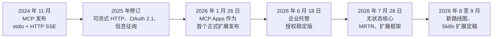
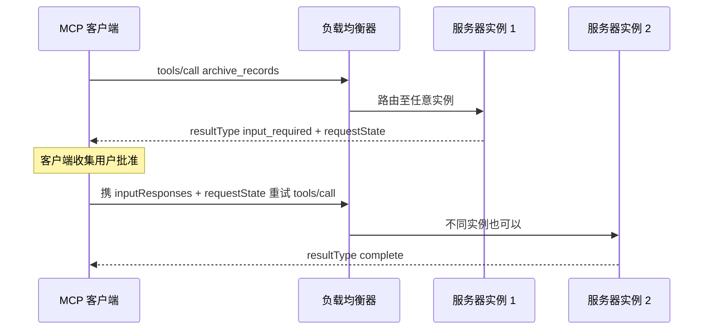
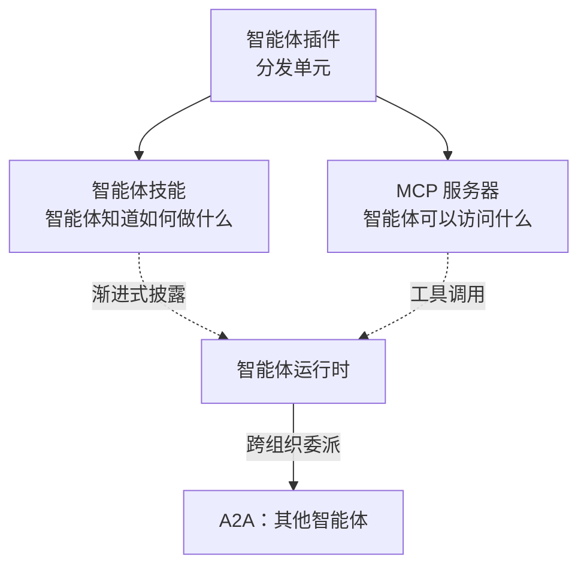
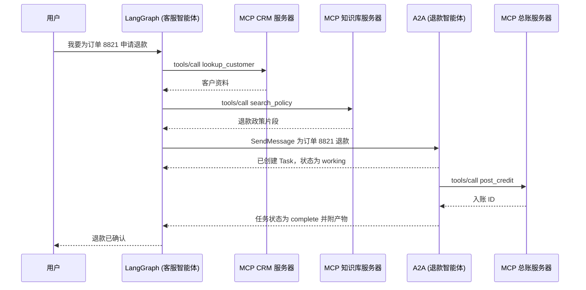
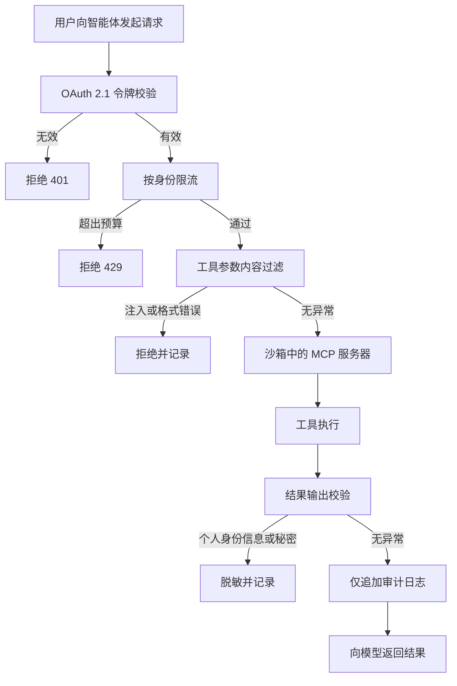

# 工具使用与 MCP

工具是智能体的“手脚”。业界已经标准化采用 **模型上下文协议（Model Context Protocol，MCP）**，它以单一通信层取代碎片化的自定义工具定义：本地通过 stdio、远程通过 Streamable HTTP 运行。Streamable HTTP 和 OAuth 2.1 授权在 2025 年的规范修订中引入（评论文章常称之为“MCP 2.0”，但规范从未以此命名；2026 年 7 月各 SDK 的 2.x 主版本号又是另一套编号）。**2026-07-28 修订**将协议核心重构为无状态，这是 MCP 发布以来最大一次改造（见下文[无状态化改造](#mcp-2026-07-28-无状态化改造)）。与此同时，**Agent-to-Agent（A2A，智能体到智能体）** 在 MCP 工具访问层之外提供智能体协同能力；自 2026 年 8 月起，两项协议都归入 Linux Foundation 旗下的 Agentic AI Foundation。

## 目录

- [工具使用机制](#工具使用机制)
- [模型上下文协议（MCP）](#模型上下文协议-mcp)
- [定义高精度工具](#定义高精度工具)
- [MCP 与 OpenAI 函数调用](#mcp-与-openai-函数调用)
- [流式工具调用](#流式工具调用)
- [2025 年修订：Streamable HTTP 与认证](#_2025-年修订-streamable-http-与认证)
- [MCP 2026-07-28：无状态化改造](#mcp-2026-07-28-无状态化改造)
- [MCP 扩展与生态系统（2026 年 10 月）](#mcp-扩展与生态系统-2026-年-10-月)
- [Agent Plugins（智能体插件）](#agent-plugins-智能体插件)
- [Agent-to-Agent 协议（A2A）](#agent-to-agent-协议-a2a)
- [协议格局：工具、智能体与支付](#协议格局-工具、智能体与支付)
- [A2A v1.0 与 MCP 的生产应用](#a2a-v1-0-与-mcp-的生产应用)
- [计算机使用工具（Anthropic）](#计算机使用工具-anthropic)
- [Context7：实时文档 MCP](#context7-实时文档-mcp)
- [面试题](#面试题)
- [参考资料](#参考资料)

---

## 工具使用机制

工具使用发生在一个 3 步循环中：
1. **Schema 呈现**：向模型提供工具的 JSON schema。
2. **意图与抽取**：模型输出一个“调用”（例如 `{"tool": "get_weather", "args": {"city": "Tokyo"}}`）。
3. **执行与上下文化**：系统运行该函数，并将结果回传到提示词中。

**细微差别**：生产级栈不再把工具定义“硬编码”进系统提示词；它们使用 **动态清单（Dynamic Manifests）**，仅根据用户意图拉取必要的工具。

2026 年，以下三项模型提供商侧的变化会影响运行框架代码：

- **最新的 Claude 模型不再支持强制工具调用。**Fable 5.1、Mythos 5.1、Opus 5.5 和 Sonnet 5.5 在 `tool_choice` 为 `any` 或 `tool` 时返回 HTTP 400；仅支持 `auto` 和 `none`。旧的“强制工具调用以获取 JSON”提取模式需要改用 `auto` 加严格工具模式，或改用结构化输出。
- **工具可在对话中途变化而不丢失缓存。**Anthropic 于 9 月 22 日推出的 `inline-tools-2026-09-15` beta 允许在对话中途的系统消息内定义、替换或移除工具，而不使提示词缓存失效；它还可将拉取到的 MCP 工具列表固定在 `mcp_tool_listing` 块中，防止服务器在会话中途偷换定义。
- **GPT-6 Astra 的工具调用需要 Responses API。**Astra 不再支持 `temperature`、`top_p` 和 logprobs，因此曾靠调整采样参数或读取 logprobs 来路由工具的运行框架需要采用其他机制。

---

## 模型上下文协议（MCP）

由 Anthropic 开发（于 2024 月发布），如今已成为 Anthropic、OpenAI、Google、Microsoft 和 AWS 之间通用的工具集成标准。MCP 允许模型与数据和工具交互，而不受它们部署位置的限制。治理权已于 2025 月移交给 Linux Foundation 的 Agentic AI Foundation。

- **MCP 客户端**：AI 应用（例如你的智能体代码）。
- **MCP 服务器**：一个独立进程，暴露工具（Functions，函数）、资源（Resources，数据）和提示词（Prompts，模板）。
- **通信**：本地通过 stdio、远程通过 Streamable HTTP 使用 JSON-RPC。

### 为什么选择 MCP？
- **安全性**：工具运行在自己的进程中，而不是模型逻辑内部。
- **可移植性**：一次编写 “Postgres 工具”，即可在 Claude、GPT 或 Llama 中使用。
- **可发现性**：标准化的 `tools/list`、`resources/read` 和 `prompts/list` 方法，以及 2026-07-28 修订规定必须实现的 `server/discover` RPC。

---

## 定义高精度工具

生产质量的工具必须包含：

1. **严格类型校验**：使用 Pydantic 或 Zod 在调用执行前强制校验 schema，同时启用提供商的严格工具模式，让生成时的参数也受 schema 约束。
2. **详细文档字符串**：说明 *何时不要* 使用该工具。
3. **置信度阈值**：要求模型为工具调用输出一个 `confidence` 分数。将它视为路由提示，而不是校准过的概率。
4. **刻意设计模型可见的错误**：自 MCP Python SDK 2.1.0 起，处理器中的意外异常会被记录，客户端只看到 `Error executing tool <name>`；应对模型需要采取行动的消息抛出 `ToolError`。这个默认行为合理（堆栈跟踪会泄露内部信息），但意味着可供处理的错误必须经过设计，而不能靠异常泄露。

```python
# MCP Python SDK 2.x: `pip install mcp` now resolves to 2.x, and FastMCP was renamed MCPServer.
# Projects not ready to migrate should pin mcp<2 (v1 receives security and critical fixes only).
from mcp.server import MCPServer

mcp = MCPServer("analytics")

@mcp.tool()
def execute_sql(query: str) -> list[dict]:
    """Run ONE read-only SELECT against the analytics replica.
    Do NOT use for DDL or writes: DROP, DELETE, and UPDATE are rejected
    by the database role, not just by this docstring."""
    ...  # parameterize, enforce a row limit, run under a read-only role
```

---

## MCP 与 OpenAI 函数调用

| 特性 | OpenAI 原生 | MCP |
|---------|---------------|-----|
| **耦合** | 高（OpenAI 特定） | 低（无关框架） |
| **传输** | API 请求体中的 JSON | JSON-RPC（本地/远程） |
| **数据访问**| 无原生数据“资源” | 原生 `Resources` 支持 |
| **最适合** | 原型开发 | 企业编排 |

这个对比并不像表格显示的那样非此即彼。OpenAI 的 Responses API、Agents SDK 和托管 Agents API（2026 年 9 月 10 日公开测试）都支持远程 MCP 服务器。因此函数调用是提供商 API 内部的线缆格式，而 MCP 负责工具的封装、安全和访问方式。

---

## 流式工具调用

前沿模型支持 **部分工具推测（Partial Tool Speculation）**。系统不会等完整 JSON 生成完再行动，而是在工具名称和关键 ID 出现在流中时，就开始“预取”工具结果。这样可将感知延迟降低 **400-800ms**。

---

## 2025 年修订：Streamable HTTP 与认证

MCP 规范修订以日期而非版本号命名：2024-11-05、2025-03-26、2025-06-18、2025-11-25 和当前的 2026-07-28。**2025-03-26** 修订于 2025 年 3 月引入了使远程 MCP 实用化的两项变化，2025-06-18 修订又将认证模型加固成今天使用的形态。所谓“MCP 2.0 于 2026 年 3 月获批”是把同一批变化误记晚了一年。

### 1. 可流式 HTTP 传输
MCP 刚推出时在本地使用 stdio，远程则使用带独立 Server-Sent Events 通道的 HTTP。**Streamable HTTP** 用单一端点取代 HTTP+SSE：客户端向该端点 POST JSON-RPC 消息，服务器以普通 JSON 响应，或在需要发送多条消息时以 SSE 流响应。

```
[MCP Client] ──── POST /mcp (JSON-RPC) ────→ [MCP Server]
             ←─── JSON response, or an SSE stream ───
```

- 支持部署为云微服务的 MCP 服务器（不只是本地进程）
- stdio 仍是本地传输方式；HTTP+SSE 自 2025-03-26 起弃用，并在 2026-07-28 修订中纳入规范的正式弃用流程

### 2. OAuth 2.1 授权
远程 MCP 服务器可要求使用带 PKCE 的 OAuth 2.1。自 2025-06-18 起，MCP 服务器是 OAuth **资源服务器**：它通过受保护资源元数据（RFC 9728）公布授权服务器；客户端必须发送 RFC 8707 `resource` 参数，使每个令牌的受众都绑定到一台服务器。未携带令牌的请求会收到提示客户端从何处开始的质询：

```http
HTTP/1.1 401 Unauthorized
WWW-Authenticate: Bearer resource_metadata="https://mcp.example.com/.well-known/oauth-protected-resource",
                         scope="files:read"
```

这使企业级 MCP 服务器能实施按服务器细分的访问控制。2025-11-25 修订新增 Client ID Metadata Documents 作为推荐的注册机制，并加入增量范围同意：服务器用 HTTP 403 `insufficient_scope` 和所需范围响应，以便逐级授权。随后 2026-07-28 修订弃用动态客户端注册，改用这些元数据文档，并要求客户端在授权服务器发送 RFC 9207 `iss` 参数时进行校验；下文会进一步介绍。

---

## MCP 2026-07-28：无状态化改造

2026年7月28日，MCP 在十周发布候选冻结后定稿规范修订 **2026-07-28**。核心现已**无状态**：移除 `initialize` 握手和 `Mcp-Session-Id`，每个请求在 `_meta` 中携带协议版本与客户端能力，服务器在结果 `_meta` 中标识自己；跨调用状态改为服务器签发、作为普通工具参数传递的显式句柄。因此远程 MCP 可置于普通轮询负载均衡器后水平扩展，无需粘性会话或共享会话存储。

### MCP 的演进历程



### MCP 的三代对比

| 维度 | 初始发布（2024 年11月） | 可流式 HTTP 时代（2025 修订） | 2026-07-28 修订 |
|---|---|---|---|
| 会话 | 有状态 `initialize` | 有状态 `Mcp-Session-Id` | 无状态；每个请求在 `_meta` 携带版本和能力 |
| 传输 | stdio、HTTP+SSE | 新增可流式 HTTP | 可流式 HTTP 强制 `Mcp-Method` / `Mcp-Name` 路由头；HTTP+SSE 正式弃用 |
| 服务端发起请求 | Sampling、Roots | 新增 elicitation | 移除，改为多轮往返请求（MRTR） |
| 中途用户输入 | 无 | `elicitation/create` 推送 | `input_required` 结果，客户端携状态重试 |
| 长时间运行工作 | 无 | 实验性 | Tasks 正式扩展（基于轮询的句柄） |
| 服务器渲染 UI | 无 | MCP Apps 作为扩展发布（2026年1月） | MCP Apps 纳入正式扩展框架 |
| 认证 | 无标准 | OAuth 2.1 + PKCE、动态客户端注册；2025-11-25 新增 CIMD 和逐级范围同意 | OAuth 加固：RFC 9207 `iss` 校验、issuer-bound credentials、CIMD 替代 DCR；EMA 面向企业 IdP |
| 列表缓存 | 无 | 无 | 列表和读取结果必须给出 `ttlMs` + `cacheScope`；确定性工具排序用于 prompt-cache 命中 |
| 流恢复 | 无 | SSE `Last-Event-ID` 可恢复 | 已移除；客户端重新发起请求，持久工作使用 Tasks |
| 水平扩展 | 单进程 | 负载均衡器后的粘性会话 | 任意实例服务任意请求；无需共享状态 |

### 多轮往返请求（MRTR）

`elicitation/create`、`sampling/createMessage` 和 `roots/list` 已移除。服务端需要中途输入时，返回 `resultType: "input_required"`、`inputRequests` 与不透明 `requestState`；客户端收集输入，并以 `inputResponses` 和原状态重试。状态随重试携带，因此任意负载均衡后实例都能恢复调用，且人工审批门仍可水平扩展。结果必须包含 `resultType`（`complete` 或 `input_required`；Tasks 等扩展可增加值），旧服务器缺失该字段时按 `complete` 处理。



### 已弃用或移除的功能

该修订还采用了正式的功能生命周期（Active、Deprecated、Removed），最短弃用窗口为十二个月，并提供公开的已弃用功能登记表。对于本次修订中新弃用的功能（Roots、Sampling、Logging、DCR），最早移除日期为2027年7月28日；HTTP+SSE 自2025年3月起已弃用，适用更早的时钟。

| 功能 | 在 2026-07-28 的状态 | 迁移目标 |
|---------|----------------------|------------|
| `initialize` 握手、`Mcp-Session-Id` | 已移除 | 每个请求在 `_meta` 中携带版本和能力；使用 `server/discover` RPC 探测 |
| `elicitation/create`、`sampling/createMessage`、`roots/list` | 已移除 | 多轮往返请求 |
| SSE 流恢复（`Last-Event-ID`） | 已移除 | 重新发起请求；将持久工作交给 Tasks 扩展 |
| Roots | 已弃用 | 通过工具参数、资源 URI 或服务器配置传递目录 |
| Sampling | 已弃用 | 直接调用 LLM 提供商 API |
| Logging | 已弃用 | stderr（stdio）或 OpenTelemetry |
| HTTP+SSE 传输 | 正式弃用 | 可流式 HTTP |
| 动态客户端注册（RFC 7591） | 已弃用 | Client ID Metadata Documents（client ID 是托管客户端元数据的 URL） |

`elicitation/create`、`sampling/createMessage` 与 `roots/list` 这些 RPC 机制已从核心协议移除，而它们服务的功能本身仍处于带迁移路径的弃用期，因此上表同时包含两类条目。

还有两项虽小但影响设计的传输变更：可流式 HTTP POST 现在强制使用 `Mcp-Method` 和 `Mcp-Name` HTTP 头，使负载均衡器、网关和 WAF 无需解析 JSON-RPC 就能路由与过滤 MCP 流量；列表结果（`tools/list`、`prompts/list`、`resources/list`）必须声明 `ttlMs` 与 `cacheScope`，让客户端能有依据地缓存工具目录。

### 扩展框架

核心现在刻意保持精简；其余功能都是**扩展**，以反向 DNS ID 标识、独立于核心规范进行版本化，并通过 SEP 流程中的 Extensions Track 治理。正式扩展包括：

| 扩展 | 状态 | 功能 |
|-----------|--------|--------------|
| **Tasks**（`io.modelcontextprotocol/tasks`） | 正式；由 AWS 贡献、改为基于轮询的生命周期 | 工具调用可以返回任务句柄；客户端轮询 `tasks/get`，通过 `tasks/update` 推送中途输入，并以 `tasks/cancel` 取消。这是处理超出单次请求生命周期工作的标准方式。 |
| **MCP Apps** | 自2026年1月26日起正式 | 工具声明 `ui://` 模板；宿主在 sandboxed iframe 中渲染（无 DOM 访问、默认拒绝 CSP），UI 到宿主的通信通过 postMessage 承载 JSON-RPC，UI 触发的动作仍经过同一工具调用同意路径。Claude、ChatGPT、VS Code、Goose 和 Microsoft 365 Copilot 等均可渲染。 |
| **企业托管授权（EMA）** | 自2026年6月18日起稳定 | 组织通过 IdP 集中配置 MCP 服务器访问：OIDC 或 SAML 断言经 RFC 8693 交换为 ID-JAG，再由 RFC 7523 JWT bearer grant 换取 MCP access token，无需逐用户同意屏幕。Okta 是首个支持的 IdP；Claude 和 VS Code 在发布时即支持。ID-JAG 授权本身仍是 IETF OAuth 工作组的 Internet-Draft（-04），并非 RFC，因此线缆协议仍可能变化。 |

### 迁移清单

- 移除 `initialize` / session-ID 逻辑；在 `_meta` 中发送版本和能力，并实现 `server/discover` RPC（现为 MUST）。
- 将 elicitation 和 sampling 流程改为 MRTR：返回携带 `requestState` 的 `input_required`，并接受携带 `inputResponses` 的重试。
- 将任何跨调用状态移入作为工具参数传递的显式句柄，或采用 Tasks 扩展。
- 发出 `Mcp-Method` / `Mcp-Name` 头，在列表结果上声明 `ttlMs` / `cacheScope`，并以确定顺序返回工具。
- 规划从 DCR 到 Client ID Metadata Documents 的认证迁移；按 RFC 9207 校验 `iss`，且绝不跨 issuer 重用客户端凭据。
- 为真实工作预留成本：维护者本身警告自定义实现会显著增加工作量。

来源：modelcontextprotocol.io/specification/2026-07-28/changelog、blog.modelcontextprotocol.io

---

## MCP 扩展与生态系统（2026 年 10 月）

本章截至 2026 年 5 月跟踪的路线图条目大多已经交付。截至 2026 年 10 月，状态如下：

| 路线图条目（2026 年 5 月表述） | 状态（2026 年 10 月） |
|---------------------------------|--------------------|
| 传输可扩展性 / 无状态核心 | 已在 2026-07-28 修订中**交付**（见[无状态化改造](#mcp-2026-07-28-无状态化改造)）。8 月 22 日的路线图更进一步：以 Streamable HTTP 为唯一绑定，本地服务器也通过 stdin/stdout 使用它 |
| MCP Apps（服务器渲染 UI） | 2026 年 1 月 26 日作为首个正式扩展**交付**；Claude、ChatGPT、VS Code、Goose 和 Microsoft 365 Copilot 等可渲染。Apps SDK 于 9 月 8 日在 ext-apps 2.0.0 中迁移到 v2 TypeScript 包，但线缆协议未变，因此 2.x View 能在 1.x 宿主运行，2.x 宿主也能渲染 1.x View：SDK 层有破坏性变化，线缆层没有，这正是扩展框架的设计目标 |
| Tasks 扩展（长时间运行工作） | 2026-07-28 修订将其作为 `io.modelcontextprotocol/tasks` **交付**，并改为基于轮询的任务句柄；但扩展仓库仍只有预发布标签（9 月 23 至 30 日的 v0.2.0 至 v0.2.2），因此接口仍在稳定中。8 月 22 日路线图计划在组合审查后最终将 Tasks（SEP-2663）纳入核心协议，使任务、订阅和进度通知共用生命周期、取消模型和错误表面 |
| 企业认证 | 2026 年 6 月 18 日以企业托管授权扩展形式**交付**（Okta 为首个 IdP；Claude 和 VS Code 发布时支持）。下一步是智能体身份：DPoP 发送方约束令牌（SEP-1932）和工作负载身份联合（SEP-1933）仍是开放草案，但 TypeScript 客户端 2.1.0 已支持 DPoP |
| MCP Server Cards（连接前发现） | 仍为实验性（SEP-2127，审查中）。卡片现由 `GET <streamable-http-url>/server-card` 提供；客户端通过域名的 `/.well-known/ai-catalog.json` 中的条目发现它们。这个跨协议索引由 Linux Foundation 旗下的 Agent Card Working Group 维护，也列出 A2A Agent Card 和 Claude Code 插件；它与核心的 `server/discover` RPC 不同 |
| MCP Registry | 仍处于预览（`registry.modelcontextprotocol.io`），API 冻结在 v0.1；GA 时间尚未公布。8 月 6 日发布的 v1.8.1 修复了 GitHub Pages 组织命名空间接管问题 |
| 通过 MCP 提供 Skills（新增） | 2026 年 9 月 13 日作为 `io.modelcontextprotocol/skills` 扩展（SEP-2640）**定稿**；见下文 |

**现在值得区分的两层发现机制：**连接前发现通过域名的 AI Catalog 指向 Server Card（实验性，供 Registry、爬虫和白名单使用）；协议内发现使用 `server/discover` RPC（自 2026-07-28 起为强制核心，用于版本协商）。同一份目录文档可索引 MCP 服务器和 A2A 智能体，企业平台因而可从一个位置将两类远程能力加入白名单，但这仍是发展方向，并非既定标准。

### 8 月 22 日路线图的重点

核心维护者于 2026 年 8 月 22 日发布了为期 6 至 12 个月的路线图，五个领域的 SEP 将加速审查。下次规范修订没有确定日期。

| 优先领域 | 对构建者的意义 |
|---------------|----------------------------|
| **智能体消息原语** | 服务器主动发起的事件与 Webhook（Triggers and Events WG）；Tasks、订阅和进度通知将收敛到统一生命周期 |
| **原生 HTTP 传输** | 各处只保留一种绑定（Streamable HTTP），本地服务器也通过 stdio 使用；缓存从 `ttlMs` / `cacheScope` 扩展到 ETag，包括带版本的工具调用结果 |
| **智能体身份与企业安全** | 正在组建的 Agent Identity WG 将与 IETF OAuth 和 WIMSE 小组协调，最终确定 DPoP 及基于工作负载身份联合、ID-JAG 和 RFC 8693 令牌交换的委派身份模型；是否证明有人类在场（交互客户端与无人值守智能体）仍在讨论 |
| **改进原语** | 重新设计 `tools/call` 结果形态（同时返回 `content` 和 `structuredContent` 导致实现分歧）；为大型工具目录探索服务器侧的渐进式发现机制 |
| **SDK 开发体验** | 正式的扩展契约；探索从规范与一致性测试套件生成 Tier 1 SDK 和快速入门文档 |

由此引出的两个面向未来的面试题是：拥有自身身份的无人值守智能体如何访问 MCP 服务器；如何在不撑爆上下文窗口的情况下提供包含 2,000 个工具的目录。

### 通过 MCP 提供 Skills

Agent Skills（`SKILL.md` 目录）于 2026 年 8 月 19 日在 Claude API 上结束 beta；9 月 13 日定稿的 MCP Skills 扩展允许服务器把 Skill 与其描述的工具一并发布，无需复制到文件系统或插件中。声明该扩展的服务器实现 `skills/list` 和 `skills/get`；Skill 文件通过普通的 `resources/read` 读取。每个 Skill 条目包含 frontmatter 和完整文件清单，以及每个文件的 SHA-256 摘要和大小。

宿主规则尤其值得掌握，它们回答了“如何防止远程服务器悄然改变智能体加载的指令”这一问题，也就是 Skill 版的工具偷换：

- 宿主在使用前**必须**验证大小、摘要和 frontmatter，**必须**把持久化审批绑定到整份清单；文件改变、新增或移除都会撤销审批。
- 宿主**不得**预取 Skill 文件，且**必须**将 Skill 内容视为不可信。
- Skill 的 `allowed-tools` 授权或任何宿主侧代码执行都需要针对该 Skill 的明确审批；跨服务器读取需要逐次审批并列出两台服务器。

采用仍处早期：Hugging Face 的 MCP 服务器已实现它，MCP Inspector 2.6.0 部分支持，官方 SDK 的 PR 到 9 月末仍未合并。其他地方也正把 Skill 作为带版本的生产产物（AWS 于 9 月 30 日为其智能体工具包新增 `update-skill` 命令），因此应像依赖包一样固定版本并审查更新。

**生态规模：**SDK 每月下载量达到数亿。协议自身 7 月 28 日的发布文章称 Tier 1 SDK 月下载量接近 5 亿；Anthropic 另称月下载量为 4 亿、年内增至 4 倍。因此应将总量视为数量级而非精确数字，引用前需核对指标定义。8 月，仅一个连接器目录就列出了**超过 950 个 MCP 服务器**。7 月 28 日正式发布时，AWS、Cloudflare、Google Cloud、Microsoft 和 Netlify 宣布首发支持。Microsoft 推出可由 Microsoft 365 管理中心管理的 MCP 联邦 Copilot Connectors；Apple 让 Xcode 成为外部编程智能体的 MCP 宿主；Bloomberg 也发布了将 MCP 用作内部智能体到工具层的生产案例。

**向无状态修订版的迁移确已发生，但进展缓慢。**2026 年 9 月的 npm 下载量：v1 TypeScript SDK（`@modelcontextprotocol/sdk`）约 2.319 亿次，`@modelcontextprotocol/core` 约 3060 万次、`@modelcontextprotocol/server` 约 2540 万次、`@modelcontextprotocol/client` 约 1910 万次。逐包比较，v2 流量目前约为 v1 的 8% 至 13%，高于 8 月中旬的低个位数百分比，而 v1 仍在增长（截至 8 月 14 日的 30 天约 2.07 亿次）。应为长期双版本期做准备：C# SDK v2.2.0（8 月 13 日）新增 `HttpServerSessionMode`，让同一端点同时服务 2025-11-25 有状态客户端和 2026-07-28 无状态客户端；运营混合客户端服务器群时可借鉴这一模式。

即使线缆协议未变，SDK 主版本升级仍会破坏代码。Python 中，自 7 月 28 日的 2.0.0 起，`pip install mcp` 会安装 2.x：`FastMCP` 改名为 `MCPServer`，单个 `Client` 取代了 v1 的传输加 `ClientSession` 分层；v1 仅接收安全和关键修复，因此新安装环境中的旧版 `FastMCP` 教程会失效。智能体框架数周内也跟进（OpenAI Agents SDK 0.20.0 同时支持两个主版本；LangChain 1.4.0 根据协商出的协议年代决定 MCP 中断路由），显示出共享依赖主版本变化的影响范围。Tier 1 SDK 现包括 TypeScript、Python、C#、Go、Rust（8 月 21 日晋升）和 Ruby（9 月 28 日晋升）；Java 为 Tier 2，Swift、PHP 和 Kotlin 为 Tier 3。一致性测试套件为该修订发布冻结的需求集（截至 10 月 1 日为 0.2.0-alpha.12）。

**治理：**MCP 由 Linux Foundation 旗下的 Agentic AI Foundation（AAIF）治理。该基金会现托管六个项目（MCP、goose、AGENTS.md、agentgateway、A2A 和前身为 Envoy AI Gateway 的 Agent Router），并于 8 月 12 日报告拥有 247 家成员组织。治理工作组运行 Contributor Ladder 和委派模型，让特定领域工作组无需全体核心维护者审查即可接纳 SEP（规范改进提案）；2026-07-28 修订增加了正式 Extensions Track。自 9 月 28 日起，SEP 作者在提出 PR 前须与相关工作组或兴趣组讨论。AAIF 还于 9 月 14 日推出首个厂商中立的 MCP 认证 Model Context Protocol Associate（MCPA）：费用 $250，考试 90 分钟，依据 2026-07-28 修订，安全与治理占考试内容的 24%。

来源：modelcontextprotocol.io（规范、路线图和扩展）、blog.modelcontextprotocol.io、github.com/modelcontextprotocol、aaif.io

---

## Agent Plugins（智能体插件）

MCP 标准化了智能体如何访问工具。**Agent Plugins** 于 2026 年 8 月 6 日达到 1.0.0，标准化了如何向智能体*交付*一组打包能力。它是一种厂商中立的打包格式，由来自 Amazon、Cursor、Microsoft、OpenAI 和 Vercel 的技术指导委员会治理。GitHub 于 8 月 12 日使其在 VS Code、Copilot CLI、Copilot SDK 与 Copilot app 中全面可用。1.0.0 仍是唯一已发布版本；8 月 19 日启动了 1.1.0 工作草案，提议加入带命名空间的 Skill 发现、可移植的显示名称与图标，以及每个服务器的 MCP 扩展数据，均仍在下述 Skill 加 MCP 的边界之内。

插件是一个目录：

```
my-plugin/
├── plugin.json          # required manifest
├── skills/              # optional: Agent Skills (SKILL.md files)
│   └── code-review/
│       └── SKILL.md
├── mcp.json             # optional: MCP server declarations
└── com.example.client/  # optional: client-specific extras, namespaced
```

`mcp.json` schema 支持三种 server 形态：带 command、args 和 env 的 stdio、Streamable HTTP，以及 SSE；还保留两个由客户端加载时注入的环境变量 `PLUGIN_ROOT` 与 `PLUGIN_DATA`。

值得研究的设计决策是规范**拒绝**标准化什么。只有两种组件类型可移植：Skill 和 MCP server。command、hook、subagent、rule 与 LSP server 均保持客户端专属，除非放在命名空间目录中。这使可移植表面足够小，插件才能真正随处运行；同时把快速变化的客户端专属部分推入命名空间，避免破坏互操作性。

### 三层如何协作



| 层 | 标准化内容 | 单元 | 治理方 |
|-------|--------------|------|------------|
| **Agent Skills**（`SKILL.md`） | 智能体应用的流程与领域知识 | 带 frontmatter 及可选脚本与资产的目录；也可通过 MCP Skills 扩展远程提供 | agentskills.io |
| **MCP** | 对工具、数据和资源的访问 | 通过 stdio 或 Streamable HTTP 使用 JSON-RPC 的服务器 | Linux Foundation、Agentic AI Foundation |
| **Agent Plugins** | 对上述两者的分发与安装 | 带 `plugin.json` 的目录 | Agent Plugins TSC |
| **A2A** | 跨厂商或组织的智能体委派 | 由 Agent Card 描述的智能体端点（签名可选） | Linux Foundation、Agentic AI Foundation（自 2026 年 8 月起） |

对平台团队而言，实际结果是企业管理如今拥有一个控制点。GitHub 复用现有 `managed-settings.json`，因此插件安装、marketplace 访问和 MCP server 白名单都通过同一文件管理。如果要建立内部智能体平台，应审查、签名和分发的单元是插件，而非单个 server。

**随之而来的安全警示：**插件将指令（Skill）与能力（MCP 服务器）捆绑，因此安装插件更像安装软件包，而非添加书签。Skill 静态分析存在难以突破的检出上限：公开结果显示，数据外传检出率为 93%，自然语言提示词注入仅 42%，宿主破坏则为 **0%**，因为破坏性 Skill 使用的普通 shell 命令与合法命令外观完全相同。自适应攻击者还能进一步绕过：Pretext 攻击（arXiv 2609.39607）将载荷从代码移入自然语言并拆散到多个文件，使 LLM 辅助的 Skill 扫描器最多有 97% 的机会漏检。应像审查依赖一样审查插件：固定版本、优先使用签名来源，而且绝不能允许插件扩大加载它的智能体的动作面。

**还要验证版本固定是否生效。**Plugin4Shell（AIR Security，2026 年 9 月 17 日）表明，Claude Code、Codex、GitHub Copilot 和 Gemini CLI 在安装固定到 40 位十六进制提交 SHA 的插件时，没有检查检出的工作树是否与该 SHA 一致。Git 会优先匹配与 SHA 同名的分支，因此在接受此类分支名的宿主上，仓库所有者可以替换已批准的代码，后台更新无需点击就会拉取。Claude Code（2.1.179）和 Codex（0.146.0）已修复；披露时 Copilot 尚无修复。控制方法是检出后解析工作树中实际存在的提交，若与固定值不符就终止。随着运行框架扩展获得更多能力，风险还在上升：Claude Code mods（2.1.287，10 月 1 日）是通过插件分发的 TypeScript 函数，可重写工具调用并批准或拒绝权限请求；Anthropic 警告它们不在沙箱中运行，因此插件审查已成为智能体信任边界的一部分。

---

## Agent-to-Agent 协议（A2A）

Google 于 2025 月推出了 **Agent2Agent（A2A）** 协议，用于解决 MCP 不涉及的一个问题：**来自不同厂商的智能体** 如何相互通信（而不仅仅是与工具通信）？

### A2A 解决了什么

MCP 定义的是智能体如何连接到 **工具和数据**。A2A 定义的是一个 **编排智能体如何将任务委派给来自不同厂商或框架的专门智能体**，即便它们不共享内存、工具或上下文。

### 技术基础

- 基于 HTTP，在 v1.0 中提供 **JSON-RPC、gRPC 和 REST** 三种绑定（与 MCP 共享 Web 基础，便于集成）
- 支持企业级认证，并与 OpenAPI 的认证方案保持一致
- **Agent Cards**：描述智能体能力、技能和端点的 JSON 元数据文档，由 `GET /.well-known/agent-card.json` 提供（不是 `agent.json`）；使用 JWS 签名是可选的

### A2A 任务生命周期

v1.0 的方法包括 `SendMessage`、`SendStreamingMessage`、`GetTask`、`ListTasks`、`CancelTask` 和 `SubscribeToTask`，REST 绑定例如 `POST /message:send` 与 `GET /tasks/{id}`。没有 `POST /tasks` 或 `tasks.create`：客户端发送的是一条**消息**，由服务器决定直接回复还是创建**任务**。这正是面试常考察的设计取舍。

```
[Client Agent] ── SendMessage (POST /message:send) ──→ [Remote Agent]
                                                        │ server decides: reply, or create a Task
               ←── Message, or Task {id, state: working} ┘
[Client Agent] ── SubscribeToTask / GetTask ──→
               ←── streamed status updates and artifacts
               ←── Task completed (final artifact)
```

A2A 任务支持带流式状态更新的长时间运行操作，因此适合持续数分钟或数小时的企业工作流。

**尚未发布的 v1.1 将增加什么。**`dev-1.1` 分支的工作包括单调递增的 `Task.generation` 字段（2026 年 8 月 12 日合并）。客户端用它检测错过的事件，通过 `current_generation` 长轮询，并用 `if_generation_match` 实现比较并设置；值不匹配时返回 HTTP 412 或 gRPC `ABORTED`。这是多个客户端安全地操控同一个长期远程任务、避免更新丢失的标准答案。9 月 15 日的路线图还列出了双向流式传输和用于编程运行框架集成的官方 A2A CLI。

### 行业采用

- 发布时获得包括 Atlassian、Salesforce、SAP、LangChain 和 PayPal 在内的 50 多家技术合作伙伴支持
- 2025 年 6 月捐赠给 **Linux Foundation**，并于 2026 年 8 月 17 日作为成长阶段项目纳入 **Agentic AI Foundation**，因此 MCP 和 A2A 现归属同一个中立基金会；AAIF 称有 150 多家支持组织，Google Cloud、Amazon Bedrock AgentCore 和 Microsoft Azure AI Foundry 原生支持 A2A
- **版本 0.3**（2025 年 7 月）新增 gRPC、带签名的 Agent Card 和扩展的 Python SDK 支持。**v1.0.0** 于 2026 年 3 月 12 日发布，**v1.0.1**（2026 年 5 月 28 日）截至 2026 年 10 月仍是最新规范版本；协议没有 v1.2。更高版本号属于 SDK：a2a-python 1.2.1（1.2 系列新增多副本集群模式）、a2a-js 1.3.0、a2a-java 1.4.0.Final 和 a2a-go v2.6.0
- NIST 于 2026 年 2 月启动了 “AI Agent Standards Initiative”，部分原因是对 A2A/MCP 发展势头的回应

来源：github.com/a2aproject/A2A（发布、规范和路线图）、aaif.io/blog/a2a-joins-aaif

---

## 协议格局：工具、智能体与支付

在生产级企业系统中，多个协议会同时在不同层上运行：

| 协议 | 层 | 目的 | 治理方 |
|----------|-------|---------|-------------|
| **MCP** | 智能体到工具 | 通用工具与数据访问 | Linux Foundation（Agentic AI Foundation） |
| **A2A** | 智能体到智能体 | 跨厂商智能体委派 | Linux Foundation（自 2026 年 8 月起归 Agentic AI Foundation） |
| **ACP**（Agent Communication Protocol） | 智能体通信 | 轻量级异步智能体消息传递（REST） | 源于 IBM；2025 年 8 月并入 A2A |

### 它们如何相互补充

```
┌──────────────────────────────────────────┐
│            Enterprise System             │
│                                          │
│  ┌─────────┐  A2A   ┌─────────┐         │
│  │ Agent A  │◄──────►│ Agent B │         │
│  │(Vendor X)│        │(Vendor Y)│        │
│  └────┬─────┘        └────┬─────┘        │
│       │ MCP                │ MCP          │
│  ┌────▼─────┐        ┌────▼─────┐        │
│  │ DB Tool  │        │ API Tool │        │
│  │ Server   │        │ Server   │        │
│  └──────────┘        └──────────┘        │
└──────────────────────────────────────────┘
```

**关键洞见**：MCP 和 A2A 是互补关系，而不是竞争关系。MCP 处理智能体到工具的连接；A2A 处理智能体之间的协同。生产系统会同时使用二者。

**ACP 说明**：源于 IBM 的 Agent Communication Protocol（ACP）团队于 2025 年 8 月将其工作并入 A2A，以推进统一的智能体通信标准。新项目应将 A2A 作为主要的智能体到智能体协议。

### 商业交易层

能够购买商品的智能体还需要第三层：证明用户意图、处理结账中途的逐级认证，以及支付按量计费的工具。以下四项工作覆盖这些需求，但成熟度差异很大：

| 协议 | 覆盖范围 | 状态（2026 年 10 月） |
|----------|--------|-----------------------|
| **UCP**（Universal Commerce Protocol） | 购物、支付和通用垂直领域的发现、购物车与结账 | v2026-08-25 加入 Actions 原语，支持厂商无关的 3DS2 等带外步骤、付款计划与拆分支付，以及委派身份提供商；住宿预订草案于 9 月 24 日合并 |
| **Agentic Commerce Protocol**（OpenAI 与 Stripe） | 购物车、商品 Feed、订单、认证、MCP | 仍标记为 beta；最新带日期的规范为 2026-04-17 |
| **AP2**（Agent Payments Protocol，Google） | 证明用户授权内容的支付委托 | v0.2.0（2026 年 4 月 28 日）；此后没有发布版本 |
| **x402** | 通过 HTTP 402 状态码按调用付费；银行卡与稳定币 | x402 Foundation 于 2026 年 7 月 14 日在 Linux Foundation 旗下成立；到 10 月 1 日拥有 50 多家成员 |

留意 ACP 缩写的碰撞：旧资料中的“ACP”指 IBM 的 Agent Communication Protocol（现为 A2A 的一部分）；商业交易资料中则指 OpenAI 与 Stripe 的 Agentic Commerce Protocol。对系统设计而言，x402 最可能影响非商业智能体：它为 API 和 MCP 工具调用提供标准化的计量与支付方式，使智能体的工具预算变成真实支出，需要像词元支出一样设置上限。

---

## A2A v1.0 与 MCP 的生产应用

A2A v1.0.0 于 2026 年 3 月 12 日发布（并非如常见说法所称的 4 月 Google Cloud Next）；该项目直到 2026 年 8 月才纳入 Agentic AI Foundation，当时 AAIF 统计有 150 多家支持组织。**Agent Card 签名早于 v1.0**：v0.3.0 已定义 JWS（RFC 7515）签名；v1.0 增加了规范性的签名程序（RFC 8785 JSON 规范化，签名内容不包含 signatures 字段），但签名仍是可选的。只要 ACME 签署卡片且客户端验证签名，客户端智能体就能在发起任务前确认位于 `https://refunds.acme.com/.well-known/agent-card.json` 的远程智能体确实属于 ACME。Google ADK、LangGraph、CrewAI、LlamaIndex、Semantic Kernel 和 Microsoft Agent Framework（AutoGen 的继任者）均提供原生 A2A 客户端/服务器支持。

### 组合模式：支持智能体委派退款

一个 LangGraph 客服智能体拥有对话状态以及一组 MCP 工具（CRM、工单搜索、知识库）。当用户申请退款时，这项工作属于另一团队的财务退款智能体，该智能体位于一个 A2A 端点之后，并执行自己的政策、审计日志和 SOX 控制。客服智能体不会直接调用退款数据库；它会发送一条 A2A 消息，让财务智能体自行决定，包括是否创建长期任务。



支持智能体从不看到总账。退款智能体通过自己的 MCP 服务器拥有总账访问权限，并执行不同的策略。A2A 任务是异步的：支持智能体可以先向用户返回一条等待消息，待退款处理完成后再重新接入，并接收产物。

### MCP 2026 路线图要点：均已交付

本节在 2026 年中期跟踪的两个路线图条目——传输可扩展性与企业托管认证——都已落地。传输可扩展性并非以会话恢复实现，而是采用了相反设计：2026-07-28 修订将 session 从协议核心完全移除（见[无状态化改造](#mcp-2026-07-28-无状态化改造)）。企业托管认证于 2026 年 6 月以 Enterprise-Managed Authorization 扩展交付。RFC 8707 的要求仍然成立，并得到进一步加固：MCP 服务器是 OAuth Resource Server，令牌的受众绑定到特定服务器 URI，不能跨服务器重放。下一组优先事项见[8 月 22 日路线图](#_8-月-22-日路线图的重点)。

### MCP 生产加固

STDIO MCP 服务器隐含地把进程边界当作信任边界，而 2026 年不断有案例证明这一假设错误。启动路径本身就是攻击面：Chainlit（CVE-2026-45018，严重，已在 2.12.0 修复）的 MCP stdio 端点只根据可执行文件名检查白名单，因此 `npx -y -c <payload>` 能通过并执行任意 shell 命令；缺少 `allowed_executables` 设置时更是默认全部放行。应将完整命令及其参数加入白名单，而不是只检查程序名。架构上的修复分两步：

1. **尽可能将 STDIO MCP 服务器迁移到带 TLS 的 HTTP 传输。**HTTP 传输引入明确的网络信任边界，并可实施 STDIO 无法提供的 OAuth 2.1 Resource Server 校验。不过 HTTP 并非天然更安全：绑定到 `0.0.0.0` 且未认证的本地 HTTP 服务器，可通过 DNS 重绑定被任意浏览器标签页访问。mysql_mcp_server 0.4.2 之前的 SSE 模式（CVE-2026-59971，CVSS 10.0）正是如此，受害者浏览器可在未认证时调用 `execute_sql`；其默认 stdio 模式不受影响。本地服务器应绑定回环地址、要求认证，并校验 `Origin` 和 `Host`。
2. **对于无法迁移的 STDIO 服务器，**将每个服务器运行在独立容器中，不挂载宿主文件系统，不允许对外发网络，设置严格的 CPU 和内存预算，并使用只读镜像。把容器视为信任边界；被攻破时的影响范围就是该容器。只有隔离、没有出站策略仍不够：ToolHive（CVE-2026-58197）曾允许容器化 MCP 服务器通过 `host.docker.internal` 访问宿主服务。

### 状态 Handle 劫持：无状态核心的新攻击面

2026-07-28 无状态化改造移除了协议级 session，因此需要跨请求状态的服务器现在会签发一个显式 handle（例如 cart ID、workflow ID），并将其作为普通工具参数返回。修订后的安全最佳实践文档将由此产生的攻击命名为**状态 handle 劫持**：未获授权的一方获取或猜中 handle，并用它读取或修改另一用户的状态。

由此可直接推导出以下要求。它们值得牢记，因为该失败模式不会显式报错：

- 实施授权的服务器**必须验证每个入站请求**，而且**不得把持有状态 handle 视为身份认证**。handle 是名称，不是凭证。
- handle **应当是非确定性的**，由安全随机数生成器生成。
- handle **应在服务器端绑定到已认证用户**，例如以 `<user_id>:<handle>` 为键保存状态，其中 user ID 从已验证 token 推导，而不是来自客户端发送的任何内容。

这比表面上更重要：在有状态时代，session 本身携带身份，因此草率实现的服务器也会意外获得一些隔离。无状态之后，没有任何隔离是免费得到的。每个请求都必须重新确认请求者身份，handle 才有意义。

**当前行业现状有多糟？** 首次针对面向互联网 MCP server 的大规模动态审计（arXiv 2608.00150，2026年7月31日）发现了超过21,000个公开可达实例，确认其中640个属于生产环境，并动态测试了414个。结果显示，**91.8% 完全没有 OAuth 身份认证**，另有687个工具实例暴露了不受控的 shell 执行。任何可从公网访问的 MCP server，都应先接受授权审查，再考虑功能开发。

此后的漏洞公告印证了这一点。2026 年 8 月 15 日至 10 月 1 日，GitHub Advisory Database 发布了 73 条标题含 MCP 的已审查公告（其中 9 条为严重级别），主要涉及任意文件读写或路径遍历（约 24 条）、认证或授权绕过（约 20 条），以及 SSRF、DNS 重绑定或缺少 Origin 校验（8 条）。广泛使用的社区 **mcp-atlassian** 服务器（Jira 与 Confluence）在 9 月 22 日一天内发布了 25 条公告（0.22.0 修复）：其中严重漏洞 CVE-2026-77244 是 HTTP 传输令牌验证器接受任意非空字符串；多个 `upload_attachment` 漏洞则会读取服务器本地任意文件，并作为 Jira 或 Confluence 附件外传。IBM 的 ContextForge 沙箱服务器（CVE-2026-53710，CVSS 10.0，已在 1.0.2 修复）表明正则表达式守护的 Python 沙箱并不是真正的沙箱：运行时构造的双下划线名称可通过 `execute_code` 工具沿类层次结构找到 `subprocess.Popen`。由此得出四条规则：以密码学方式验证令牌，不能只检查是否存在；把上传和附件工具视为数据外传通道；将参数而非仅可执行文件加入白名单；容器除隔离外还需出站策略。

### OAuth 混淆：多服务器客户端成为迷惑代理

2026 年 9 月 28 日和 30 日，官方 SDK 发布了授权服务器混淆漏洞公告（TypeScript CVE-2026-104850 / GHSA-6qxp-vccf-f47h 和 Python GHSA-qx49-fqc8-xw99，均为 CVSS 7.5）。SDK OAuth 客户端允许 MCP 服务器决定由哪台授权服务器接收客户端凭据，因此恶意或被攻破的服务器可指定自有授权服务器，在无需用户交互的情况下接收已存储的刷新令牌、客户端密钥，或捆绑提供商的签名断言。TypeScript 1.31.0 / 2.2.0 和 Python 1.30.0 / 2.2.0 已修复，但升级还不够：

- 机器到机器提供商（客户端凭据、私钥 JWT、跨应用访问）必须明确配置预期签发者（`expectedIssuer`；Python 使用 `issuer=`，并将在 3.0 中成为必填项）。
- 升级前保存的凭据没有签发者信息，在补充标记或清除之前仍有暴露风险。
- 新的交互式登录仍会前往 MCP 服务器指定的授权服务器。规范中的 RFC 9207 `iss` 校验可发现授权响应被调包，但单靠它无法阻止客户端向服务器选定的签发者发送已存储凭据。

设计规则是：**每份凭据都要绑定到其签发者，绝不能让资源服务器决定密钥要发往何处。**

### SDK 默认限制与逐工具授权

**SDK 现默认实施的限制。**2026 年 8 月 19 日至 9 月 30 日的一批拒绝服务修复改变了默认值，值得所有 MCP 端点借鉴：TypeScript 2.1.0 和 Python 将请求体限制为 4 MiB（HTTP 413），TypeScript 将 JSON-RPC 批量请求限制为 100 条；CVE-2026-59951 表明未回收的有状态会话会耗尽内存，因此 Python 1.30.0 和 2.2.0 会关闭空闲 30 分钟的旧版有状态会话，并将每台服务器的会话上限设为 10,000（超限返回 503）；Go 1.8.0 限制 JSON 嵌套深度、SSE 事件大小和 stdio 行长度。客户端同样会受到攻击：Python 客户端曾同步获取服务器声明的 `outputSchema` 中任意 `$ref`，且没有超时（GHSA-rwrf-2pqf-9j8j），造成 SSRF 和本地文件读取。逐会话服务器状态是 DoS 攻击面，这也是无状态修订在运维上的理由；工具输出 schema 则是客户端接收的攻击者可控输入。

**走在规范前面的逐工具授权。**TypeScript 服务器 2.1.0（9 月 23 日）新增针对每个工具、资源和提示词的请求时范围质询（`requireScopes`），在处理器运行前返回 HTTP 403 `insufficient_scope`；TypeScript 客户端 2.1.0 加入 DPoP 发送方约束令牌（RFC 9449，遵循草案 SEP-1932），使单独窃取到的持有者令牌不足以完成访问。

### 面向生产 MCP 的纵深防御检查清单

- 所有远程 MCP 服务器都运行在带有 OAuth 2.1、PKCE 和受众绑定令牌（RFC 8707）的后面，并在每次请求中验证签名、签发者和受众。
- 客户端将每份存储的凭据绑定到签发者，并拒绝将其发送给 MCP 服务器指定的授权服务器。
- 可写和敏感工具要求逐级授权范围（403 `insufficient_scope`）；高价值部署使用绑定 DPoP 的令牌。
- 本地 HTTP 服务器绑定回环地址，校验 `Origin` 和 `Host`；限制请求体大小（4 MiB），并限制及回收服务器会话。
- STDIO 服务器运行在容器内，`network: none`、根文件系统只读、无宿主卷挂载，并限制 `nproc` 和 `memory`；启动命令及参数均须加入白名单。
- 每次工具调用都会记录用户身份、绑定的令牌受众、工具名称、参数哈希和结果哈希。日志发送到仅追加存储。
- 在每个 MCP 服务器前放置速率限制器，并按用户身份划分范围。对可写工具，突发预算要很紧。
- 工具参数在到达服务器之前先经过内容过滤：对字符串字段进行基于模式的提示注入检测，对结构化字段进行模式校验，对不需要 shell 元字符的工具直接硬拒绝。
- 工具结果在回传给模型之前先经过输出验证器：PII 检测、密钥检测、大小上限、针对已知外泄标记的内容过滤。
- 高危工具（文件写入、shell 执行、外发 HTTP）需要人工批准步骤或签名能力令牌，而不是依赖模型安全地调用它们。

包含所有防御层的请求流：



该流水线是刻意保守的。每一层都可以拒绝；只有穿过全部五道关口的结果才会到达模型。

**本节来源：**
- [A2A v1.0.1 发布](https://github.com/a2aproject/A2A/releases/tag/v1.0.1)与[A2A 加入 AAIF](https://aaif.io/blog/a2a-joins-aaif)
- [MCP 路线图](https://modelcontextprotocol.io/development/roadmap)与[新 MCP 路线图（2026 年 8 月 22 日）](https://blog.modelcontextprotocol.io/posts/mcp-roadmap/)
- [MCP TypeScript SDK OAuth 混淆漏洞公告（GHSA-6qxp-vccf-f47h）](https://github.com/modelcontextprotocol/typescript-sdk/security/advisories/GHSA-6qxp-vccf-f47h)
- [GitHub Advisory Database：已审查的 MCP 公告](https://github.com/advisories?query=type%3Areviewed+mcp)
- [RFC 8707：OAuth 2.0 的资源标识符](https://www.rfc-editor.org/rfc/rfc8707)
- [Adversa AI：May 2026 的顶级 MCP 安全资源](https://adversa.ai/blog/top-mcp-security-resources-may-2026/)
- [Anthropic 宪法分类器](https://www.anthropic.com/research/constitutional-classifiers)

---

## 计算机使用工具（Anthropic）

Anthropic 于 2024 年 10 月随 Claude 3.5 Sonnet 以 beta 形式推出计算机使用功能。它于 2026 年 8 月 19 日在 Claude API 正式可用（Google Cloud 于 8 月 20 日支持；Bedrock、AWS 上的 Claude Platform 和 Foundry 仍处 beta），形式是客户端**工具集** `computer_toolset_20260801`：一个工具数组条目扩展为 17 个成员工具（截图、缩放、点击、拖拽、输入、按键、滚动、等待），可分别配置成员且无需 beta 请求头。显示尺寸现在由返回的截图决定；旧的 `name`、`display_width_px`、`display_height_px` 和 `display_number` 字段会被拒绝。

| 工具 | 能力 | 说明 |
|------|------|------|
| `bash`（`bash_20250124`） | 运行 shell 命令 | 跨轮次保持会话 |
| `text_editor`（`text_editor_20250728`，名称为 `str_replace_based_edit_tool`） | 读取、创建和编辑文件 | `view`、`create`、`str_replace`、`insert` |
| `computer_toolset_20260801` | 鼠标、键盘、截图、缩放 | 17 个成员；批量动作；Claude API 和 Google Cloud 正式可用 |
| `browser_toolset_20260801` | 操控由应用托管的浏览器 | 31 个成员（4 个需主动启用）；除像素外还可定位无障碍树元素引用；仅 Claude API 和 Google Cloud 支持 |

```python
import anthropic

client = anthropic.Anthropic()

response = client.messages.create(  # GA: no beta namespace or beta header
    model="claude-opus-5-5",
    max_tokens=4096,
    tools=[
        {"type": "computer_toolset_20260801"},  # display size comes from your screenshots
        {"type": "text_editor_20250728", "name": "str_replace_based_edit_tool"},
        {"type": "bash_20250124", "name": "bash"},
    ],
    messages=[{"role": "user", "content": "Open Firefox, go to GitHub, and clone my repo."}],
)
```

**迁移陷阱：**在 Claude API 和 Google Cloud 上，Claude Opus 5.5 与 Sonnet 5.5 对旧版 `computer_20251124` 工具返回 HTTP 400（Bedrock 仍接受）；使用 `claude-3-7-sonnet-20250219` 或 `claude-sonnet-4-20250514` 的示例则指向已退役模型。

**批量动作会前移人工关口。**Claude 现在可以在一轮内返回多个计算机 `tool_use` 块。执行器按顺序运行，在首次失败时停止，并对后续每个块返回 `is_error` 和“Not executed: an earlier computer action in this turn failed.”。因此一次模型往返就能完成多步且有后果的操作，虽降低逐步延迟和成本，但放在模型轮次之间的确认会来得太晚。Anthropic 文档要求在每个块执行前进行人工检查：收到批次时审查每个动作，并在每个有后果的动作执行前暂停，即使它位于批次中间。拒绝应按失败处理：该块返回 `is_error`，余下批次返回停止消息，再让模型重新规划。

**元素引用是 Web 任务可靠性的关键。**在浏览器工具集中，`read_page` 返回带 `[ref_2]` 等引用的无障碍树，点击、表单输入和上传可使用引用而非坐标定位。引用能承受布局变化，但仅在所属标签页有效，导航后会过期。Anthropic 会扫描返回的页面文字与截图中的提示词注入；其安全指南也可作最小权限清单：使用无凭据的新浏览器配置文件、在网络层以域名白名单阻止回环、链路本地和私有地址段、只允许 http/https URL，并在任务不需要时关闭可选成员（`javascript_exec`、`file_upload`、`read_console`、`read_network`）。

**计算机使用的生产安全规则：**
1. 始终在沙箱化 VM 中运行（Docker + VNC，或 E2B 云）
2. 在执行破坏性操作前先用截图验证关键状态
3. 对不可逆操作（文件删除、表单提交）使用 HITL（Human-in-the-Loop，人类在环），每个此类动作执行前都检查，即使它位于批次中间
4. 在运行框架而非模型中限制失控循环：在智能体外实施最大迭代次数和支出上限（Claude Managed Agents 会话可设置硬预算，达到时以 `budget_reached` 暂停）。Anthropic 文档估计每张截图大约消耗 1,000 至 1,800 个输入词元，因此长会话主要由输入成本主导；应将截图每边缩至不超过 2000 像素，或每次请求保留不超过 20 张图像

---

## Context7：实时文档 MCP

2026 中最实用的 MCP 服务器之一是 **Context7** - 它解决了代码代理中的“训练数据过时”问题：

```
# Without Context7:
Agent: "I'll use langchain's `create_openai_tools_agent` function..."
(This API is from the 0.x line; LangChain is on 1.x)

# With Context7 MCP:
Agent -> MCP: resolve-library-id("langchain")
Agent -> MCP: query-docs(library_id, "create an agent with tools")
MCP -> Agent: Returns current 1.x docs
Agent: "I'll use the 1.x `create_agent` API..."
```

**配置为远程服务器（Claude Code `.mcp.json`）：**
```json
{
  "mcpServers": {
    "context7": {
      "type": "http",
      "url": "https://mcp.context7.com/mcp",
      "headers": { "Authorization": "Bearer ${CONTEXT7_API_KEY}" }
    }
  }
}
```

Context7 还提供引导式安装器（`npx ctx7 setup`），用于创建 API 密钥并配置编程智能体。其两个工具是 `resolve-library-id` 和 `query-docs`；智能体在使用模型训练截止日后可能已变更 API 的库编写代码前调用它们。从本地 `npx` stdio 服务器转向带持有者密钥的托管 HTTP 端点，也体现了整个生态从本地走向远程的趋势。

---

## 面试题

### 问：MCP 如何解决“工具过多”问题（模式过载）？

**强回答：**
MCP 本身并不能解决这个问题。协议提供工具目录（`tools/list` 自 2026-07-28 起必须声明 `ttlMs` 和 `cacheScope`，供客户端缓存），由客户端决定模型看见什么。2023 年，一次加载 50 个 schema 会削弱工具选择效果并消耗上下文。当前答案有三个部分。第一，**延迟加载与工具搜索**：大多数工具不进入提示词，模型先搜索目录，只在需要时加载 schema。Cursor 报告（厂商数据），将 MCP 工具移入动态上下文后，使用过 MCP 工具的会话总词元数减少 46.9%，因为大多数工具只在少数对话中需要。第二，**保持缓存的变更**：过去新增工具会使后续提示词缓存失效，使动态加载与缓存相冲突。Anthropic 的 `inline-tools-2026-09-15` beta 能在对话中途的系统消息中增加工具而不破坏缓存，还能固定拉取到的 MCP 工具列表，防止服务器在会话中途偷换定义。第三，**服务器侧渐进式发现**：8 月 22 日 MCP 路线图将其列为面向数千工具目录的实验性优先事项。超过约 30 个工具时，我还会按子智能体或 Skill 拆分能力，使每个上下文只承载必要工具。

### 问：为什么通过 MCP 服务器把“工具逻辑”与“代理应用”分离很重要？

**强回答：**
这是关注点分离。如果工具逻辑（例如 Python 抓取器）放在单独的 MCP 服务器里，我就可以独立扩展抓取基础设施，而不必绑定 LLM 编排器。更重要的是，它提供了一个 **安全沙箱**。如果模型试图通过工具参数进行注入，它只会影响 MCP 服务器进程，而该进程可以容器化，并且对核心智能体状态没有网络访问权限。不过边界是双向的：2026 年的漏洞公告（OAuth 混淆、Python 客户端对 `outputSchema` 中 `$ref` 的 SSRF）表明，客户端也必须把每台服务器视为不可信输入。

### 问：在生产多代理系统中，MCP 和 A2A 如何协同工作？

**强回答：**
它们解决的是**不同的通信层**。MCP 是智能体到工具协议，让任何智能体都能通过 MCP 服务器以标准化方式访问数据库、API 和文件。A2A 是智能体到智能体协议，让来自厂商 X 的编排智能体无需共享记忆或上下文，就能把任务委派给来自厂商 Y 的专门智能体。在生产环境中，我会对每个工具连接使用 MCP，在需要跨厂商协同时使用 A2A。例如，基于 LangGraph 的采购编排器通过 MCP 查询库存数据库，然后向另一团队的合规智能体发送 A2A `SendMessage`，由后者决定是否创建长期任务。关键设计原则是：在智能体自身的工具栈内用 MCP，在组织或厂商边界之间用 A2A。两者现在都归 Agentic AI Foundation 管理，相比单厂商规范，这更能回答“谁控制我们所依赖的协议”这一治理问题。

### 问：你的智能体通过 OAuth 连接十几台第三方 MCP 服务器。如何防止其中一台恶意服务器窃取属于其他服务器的凭据？

**强回答：**
这是以智能体客户端为迷惑代理的 OAuth 混淆攻击。直到 2026 年 9 月末，它仍是官方 SDK 中真实存在的一类漏洞（TypeScript 的 CVE-2026-104850、Python 的 GHSA-qx49-fqc8-xw99）：服务器可指定自己的授权服务器，收集已存储的刷新令牌和客户端密钥。我会实施以下控制：

1. **绑定签发者。**每个已存储的刷新令牌、客户端密钥或签名断言都记录来源签发者；无论服务器元数据如何声明，客户端都拒绝将凭据发送给其他签发者。对机器到机器提供商，我明确配置预期签发者，而非动态发现。
2. **验证授权响应。**重定向前记录预期签发者，返回时检查 RFC 9207 `iss` 参数；2026-07-28 规范要求在授权服务器发送该参数时进行校验。
3. **受众绑定的短期令牌**（RFC 8707），使一台服务器获得的令牌不能向其他服务器重放；支持时再使用 DPoP，使窃取令牌的人没有密钥也无法使用。
4. **为每台 MCP 服务器维护可接受的授权服务器白名单**，存于模型无法访问的凭据库。
5. **修补后清理。**升级 SDK 不会保护升级前保存的凭据，因此需要标记或清除这些凭据，并要求重新同意授权。

原则是：资源服务器绝不能决定密钥发往哪里。

---

## 参考资料
- Model Context Protocol. “规范修订版 2026-07-28：变更日志”（2026 年 7 月）。https://modelcontextprotocol.io/specification/2026-07-28/changelog
- Model Context Protocol. “授权”（2026-07-28 修订）。https://modelcontextprotocol.io/specification/2026-07-28/basic/authorization
- Model Context Protocol 博客。“新 MCP 路线图”（2026 年 8 月 22 日）。https://blog.modelcontextprotocol.io/posts/mcp-roadmap/
- Model Context Protocol. “Skills 扩展概览”（2026 年 9 月）。https://modelcontextprotocol.io/extensions/skills/overview
- Model Context Protocol 博客。“企业托管授权”（2026 年 6 月）。https://blog.modelcontextprotocol.io/posts/enterprise-managed-auth/
- Anthropic. “模型上下文协议规范”（2025）
- A2A Project. “Agent2Agent 协议规范 v1.0.1”（2026 年 5 月）。https://github.com/a2aproject/A2A/releases/tag/v1.0.1
- Agentic AI Foundation. “A2A 加入 AAIF 的开放智能体技术栈”（2026 年 8 月）。https://aaif.io/blog/a2a-joins-aaif
- Linux Foundation. “Agent2Agent 协议项目”（2025）
- AIR Security. “Plugin4Shell”（2026 年 9 月）。https://www.air.security/blog-posts/plugin4shell
- Anthropic. “计算机使用工具”文档。https://platform.claude.com/docs/en/agents-and-tools/tool-use/computer-use-tool
- NIST. “AI 智能体标准倡议”（Feb 2026）
- JSON-RPC 2.0 规范。
- Pydantic 文档。

---

*下一篇：[多智能体编排](04-multi-agent-orchestration.md)*
