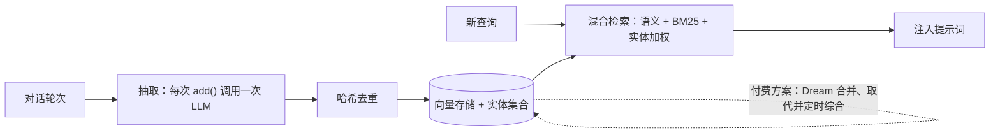

# 具有 Mem0 的 Agentic Memory（代理式记忆）

**Mem0**（及其同类 Zep、Letta、Cognee）代表了从“被动日志（passive logs）”到 **Active Memory（主动记忆）** 的转变。这些系统会自动消化对话，创建可持续演进的用户画像，以增强每次交互中的个性化体验。选择 Mem0 作为覆盖面最广的独立记忆层；选择 Zep 用于具备时间感知的生产流水线；选择 Letta 用于记忆应以人类可审查的文件保存的长时运行 agent（它在 2026 年从 MemGPT 式分页转向由 git 支撑的 MemFS）；选择 Cognee 用于以知识图谱优先的 RAG（检索增强生成）。

## 目录

- [Mem0 哲学](#mem0-哲学)
- [工作原理：摘要循环](#工作原理-摘要循环)
- [自我更新记忆](#自我更新记忆)
- [与 LangGraph 集成](#与-langgraph-集成)
- [规模化个性化](#规模化个性化)
- [选择记忆层](#选择记忆层)
- [面试题](#面试题)
- [参考资料](#参考资料)

---

<a id="philosophy"></a>
## Mem0 哲学

传统的记忆存储会保存*一切*。  
Mem0 只保存**Insights（洞察）**。  
与其存储“用户说他们喜欢蓝色咖啡杯，但仅限于工作时”这类原始内容，Mem0 会存储“工作时偏好蓝色咖啡杯”这样的简短事实，并标记用户及其中提到的实体。

---

<a id="digest-loop"></a>
## 工作原理：摘要循环

Mem0 的 Python SDK 在 v2.0.0（2026 年 4 月 16 日）修改了写入路径；当前版本为 v2.2.1（2026 年 9 月 25 日）。



1. **观察（Observe）**：agent 将对话轮次发送给 `add()`。
2. **提取（Extract）**：单次 LLM 调用识别值得记忆的事实并**添加**它们。v2 只执行 ADD：不再比较、更新或删除，仅按哈希去重。
3. **存储（Store）**：事实进入现有向量存储，实体关联存放在并行的 `{collection}_entities` 集合中。
4. **检索（Retrieve）**：语义相似度、BM25 与实体加权融合成一个分数。

**冲突处理去了哪里？** v1 循环会将每条新事实与既有事实比较，并更新或删除冲突记录。在 v2 中，这项工作转移到平台的 **Dream** 功能（2026 年 8 月 4 日推出，仅限 Pro 和 Enterprise）：它在抽取期间合并、取代事实，并在请求路径之外定时综合。如果运行开源 SDK，相互矛盾的记录（“住在柏林”，后来“搬到里斯本”）会同时存在，必须在读取时解决（优先考虑新近记录、同时展示两条），或自行运行巩固任务。

---

<a id="self-updating"></a>
## 自我更新记忆

现代的 Agentic Memory 是**递归式（Recursive）**的。
- 如果用户提到一个任务：“我需要在周五前完成预算。”
- 在周四，Agent 应回忆起这件事并询问：“预算进展如何？”
- 这通过**Periodic Reflection（周期性反思）**实现：定时任务回顾活跃的 **Goal Nodes（目标节点）**，并生成 **Proactive Reminders（主动提醒）**。休眠时巩固如今已形成一类产品：Mem0 的付费 Dream，以及 Anthropic 针对 Managed Agents 记忆存储推出的 Dreams 研究预览；后者写出一个重新组织、合并重复并替换过时条目的存储，而不直接编辑线上存储。

---

<a id="langgraph"></a>
## 与 LangGraph 集成

在状态机架构中，Mem0 扮演 **External State Provider（外部状态提供者）**。

```python
# Conceptual LangGraph node (Mem0 OSS SDK)
from mem0 import Memory

memory = Memory()

def memory_node(state: AgentState):
    # Pull the facts relevant to this turn, scoped to the user
    hits = memory.search(
        query=state["last_user_message"],
        filters={"user_id": state["user_id"]},
        top_k=5,
    )
    # Inject into the global reasoning state
    return {"user_profile": hits}

def remember_node(state: AgentState):
    memory.add(
        [{"role": "user", "content": state["last_user_message"]}],
        user_id=state["user_id"],
    )
    return {}
```

---

<a id="personalization"></a>
## 规模化个性化

对于企业级应用（数百万用户），Mem0 负责：
- **一致性（Consistency）**：AI 在 Web App、Mobile App 和 Slack Bot 中都“记得”用户的姓名。
- **降低摩擦（Friction Reduction）**：不会重复询问同样的筛选问题。

---

## 选择记忆层

| 层 | 底层载体 | 适用情况 |
|-------|-----------|--------------|
| **Mem0 v2** | 自有向量存储中的事实，另有实体索引 | 跨会话个性化；希望每次写入只需一次 LLM 调用且不新增数据库 |
| **Zep / Graphiti** | 时序知识图谱（每条边含 `valid_at` / `invalid_at`） | 事实随时间变化，需要查询“当时什么是真的？” |
| **Letta（MemFS）** | git 支撑的 Markdown 文件，默认不使用向量索引 | 长时运行 agent，需要人类审查记忆并管理版本 |
| **Claude memory tool / Managed Agents 记忆存储** | 挂载到 agent 工作区的文件 | 已在使用 Claude Managed Agents 或 Claude Code 式执行框架 |
| **Cognee** | 根据文档构建的知识图谱 | 记忆主要来自导入的知识，而非对话 |

**应在自己的任务上评估，而非仅看供应商表格。** Mem0 的 DolphinBench（2026 年 9 月 22 日；基于每个人物约 500K token 的模拟历史，包含 600 项工具使用测试）是有用的执行框架，但其结果为供应商报告：在使用 GPT-5.6 Luna 的 Hermes 框架上，Mem0 得分为 70.67%，内置记忆为 65.67%；在使用 Claude Sonnet 5 的 Claude Code 上，Mem0 为 32.33%，内置记忆为 26.33%，Honcho 则以 35.83% 更高。务必设置不使用记忆的对照组：MemTrapBench 发现其测试过的所有记忆策略都不如无记忆设置。

---

<a id="interview-questions"></a>
## 面试题

### 问：为什么要使用 Mem0 这类专用服务，而不是编写一个写入 Postgres 的自定义 Python 脚本？

**优秀回答：**  
规模化能力、**Deduplication（去重）**，以及检索质量。自定义脚本往往会产生重复记录，或在处理**Conflicting Identity Resolution（身份冲突解析）**时遇到困难（例如用户在 Slack 里叫“Om”，在 Discord 里是“om.bharatiya”）。Mem0 提供经过测试的抽取提示词、实体链接、混合检索（将语义、BM25 和实体加权融合为一个分数），以及按用户限定的范围。我会进一步追问：**冲突解决在哪一层进行？** Mem0 v2 的开源路径只执行 ADD，合并和取代功能移至付费 Dream。因此“使用 Mem0”仍意味着必须在付费巩固、编写夜间任务、或在读取时按新近程度解决矛盾之间做选择。

### 问：当 Agent 回溯了过多无关往事导致“Memory Fatigue（记忆疲劳）”时，你如何处理？

**优秀回答：**  
我们使用**Thresholded Relevance（阈值化相关性）**。Mem0 为每条召回事实返回相关性分数，只有超过根据自有评估集校准的阈值时才注入提示词；不同版本的分数不可比较（v2 的融合分数不是 v1 的余弦相似度），所以升级后要重新校准。此外，我们会使用**Negative Retrieval（负向检索）**：仅当记忆能直接反驳潜在幻觉或回答当前的“Unknown（未知）”时，才允许 agent 使用记忆。我们还会做**Memory Pruning（记忆修剪）**，将“**Low-Value（低价值）**”记忆（例如“用户提到正在下雨”）在 24 小时后自动删除。最后，我会同时测量启用和关闭记忆时的任务成功率，因为 MemTrapBench 表明，即使相关且正确的记忆也可能把模型引向错误答案。

---

<a id="references"></a>
## 参考资料
- [Mem0：以可扩展长期记忆构建生产级 AI Agent（arXiv 2504.19413）](https://arxiv.org/abs/2504.19413)
- [Mem0 v2.0.0 发布说明](https://github.com/mem0ai/mem0/releases/tag/v2.0.0)
- [Mem0 版本（v2.2.1，2026 年 9 月 25 日）](https://github.com/mem0ai/mem0/releases)
- [Letta 仓库（MemFS）](https://github.com/letta-ai/letta)
- [Zep：面向智能体记忆的时序知识图谱架构（arXiv 2501.13956）](https://arxiv.org/abs/2501.13956)
- [MemTrapBench（arXiv 2608.20202）](https://arxiv.org/abs/2608.20202)

---

*下一篇：[Semantic Caching](05-semantic-caching.md)*
