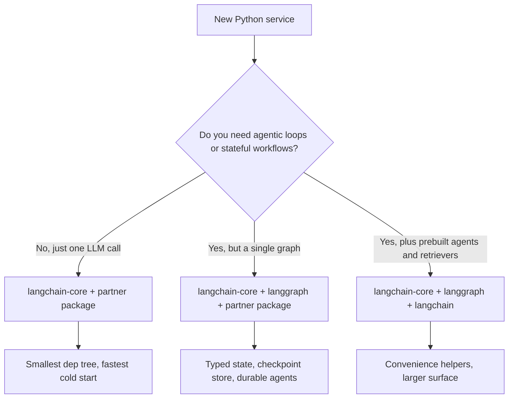

# LangChain 深入解析

LangChain 早已不再只是一个“提示库（prompting library）”。它已经发展为一个用于构建生产级 LLM 应用的**模块化生态系统**。LangGraph（它在 2025 年 10 月升级到 v1.0，并且是所有 LangChain agent 的默认运行时）负责有状态编排。**LCEL（LangChain Expression Language，LangChain 表达式语言）** 仍然是构建可组合链路最快的方式。

版本快照及发布日期（这些数字每月都在变化）：`langchain` 1.4.3（2026 年 9 月 28 日）、`langchain-core` 1.6.6（9 月 29 日）、`langgraph` 1.2.12（9 月 21 日）。JS 端截至 2026 年 10 月 1 日分别是 `langchain` 1.5.15、`@langchain/core` 1.2.14 和 `@langchain/langgraph` 1.4.18。

## 目录

- [LangChain 技术栈](#langchain-技术栈)
- [LCEL：用管道编程](#lcel-用管道编程)
- [标准抽象（核心）](#标准抽象)
- [管理复杂度（社区包与合作伙伴包）](#管理复杂度)
- [LangChain 模块化推进](#langchain-模块化推进)
- [面试题](#面试题)
- [参考资料](#参考资料)

---

## LangChain 技术栈

如今这个生态被拆分为三个不同层次：
1. **LangChain Core**：用于 Prompt、输出解析器和 Runnable 的最小抽象。（依赖占用很低）。
2. **LangChain Community/Partner**：针对 500+ 数据库、模型和工具的集成。
3. **LangGraph**：有状态编排层（下一章会讲）。

---

## LCEL：用管道编程

LangChain Expression Language（LCEL）使用 `|` 运算符创建一个执行的**有向无环图（Directed Acyclic Graph，DAG）**。

```python
# Standard RAG chain
chain = (
    {"context": retriever, "question": RunnablePassthrough()}
    | prompt
    | model.with_structured_output(Schema) 
)
```

**为什么选择 LCEL？**
- **默认异步**：每条链都支持 `.ainvoke()` 和 `.astream()`。
- **并行性**：多个分支会自动并行运行。
- **可观测性**：自动与 **LangSmith** 集成，支持完整调用链可视化。

---

## 标准抽象

### 1. Runnables
LangChain 里所有内容的“基类”。Runnables 提供了统一接口：`.invoke`、`.batch` 和 `.stream`。

### 2. 工具与工具调用
LangChain 对 **MCP（Model Context Protocol，模型上下文协议）** 提供一等支持；自 `langchain` 1.4.0（2026 年 9 月 3 日）起，它位于核心包中，而非单独的适配器中。
- `langchain.mcp` 命名空间和 `MCPAdapter` 将任意 MCP 服务器的工具转换成 LangChain 工具。
- MCP 引导请求会根据服务器协商采用的协议时期路由（2025 年的有状态会话与 2026-07-28 的无状态修订），使一个 agent 可以同时连接新旧服务器。
- MCP Python SDK 2.0（2026 年 7 月 28 日）将 `FastMCP` 更名为 `MCPServer`。新安装环境中的 `from mcp.server.fastmcp import FastMCP` 教程会失效；应固定 `mcp<2` 或迁移。

### 3. 输出解析器与结构化输出
早期系统使用正则表达式，而现代代码使用 `.with_structured_output()`；它越来越多地映射到供应商的**原生 JSON Schema 结构化输出**，而非工具调用。过去强制单个工具调用来获得 JSON 的技巧正在退出：
- Claude Fable 5.1、Opus 5.5 和 Sonnet 5.5 对类型为 `any` 或 `tool` 的 `tool_choice` 返回 HTTP 400。`langchain-anthropic` 1.7.3（2026 年 9 月 22 日）为 Fable 和 Opus 5.5 将 `with_structured_output` 路由到 `method="json_schema"`；1.7.5（9 月 29 日）增加 Sonnet 5.5。
- GPT-6 Astra 拒绝自定义 `temperature`、`top_p` 和 `logprobs`，工具调用要求使用 Responses API。`langchain-openai` 1.6.3（9 月 21 日）处理了这些限制，并暴露推断出的 Responses API 路由。

教训不限于 LangChain：任何写死采样参数或强制工具调用的封装，在最新前沿模型上都会失效。因此升级模型 ID 前应先升级合作伙伴包。

---

## 管理复杂度

> [!TIP]
> **生产最佳实践**：在关键路径中避免使用 `langchain-community`。使用 **合作伙伴包（Partner Packages）**（例如 `langchain-openai`、`langchain-pinecone`）来减少依赖地狱并提升稳定性。

---

## LangChain 模块化推进

整个生态已经完成了从单体 `langchain` 导入到分层结构的长期迁移，并建立了清晰的依赖边界。这样拆分的目的是让团队只选择自己需要的表面能力，而不会被 500+ 集成拖累。

### 已发布的包分层

| 包 | 作用 | 直接依赖 |
|---------|---------|---------------------|
| `langchain-core` | Runnables、prompt、输出解析器、工具抽象 | Pydantic、`tenacity`，几乎没有别的 |
| `langchain` | `create_agent`、中间件、参考检索器、MCP 适配器（自 1.4.0 起位于 `langchain.mcp`） | `langchain-core` |
| `langgraph` | 有状态图编排、检查点、时间回溯 | `langchain-core` |
| `langchain-openai`、`langchain-anthropic`、`langchain-google-vertexai` 等 | 提供方合作伙伴包 | `langchain-core` + 提供方 SDK |
| `langchain-community` | 长尾集成（仍保留可用，但不再推荐用于生产路径） | 很多 |
| `langchain-classic` | 旧版 v0 链，保留用于迁移 | `langchain-core` |

`langchain-core` 是唯一随稳定表面和向后兼容保证一起发布的包，这一点在 v1 发布说明中已有明确表述（[LangChain 博客，使用 LangChain 构建 1.0](https://blog.langchain.com/langchain-1-0/)）。

### 各校验库统一使用的 JSON Schema

对应用代码来说，最大的变化是：`with_structured_output()`、`bind_tools()` 和 `@tool` 现在都接受任何兼容 [JSON Schema](https://json-schema.org/) 的对象。这包括：

- **Pydantic v2**（历史默认选择）
- **[Zod 4](https://zod.dev/v4)** schema 可直接传入 JavaScript / TypeScript 版 LangChain（Zod 4 内置 JSON Schema 导出）
- **[Valibot](https://valibot.dev/)**（函数式、可树摇的 TS 校验库）
- **[ArkType](https://arktype.io/)**（把 TypeScript 类型作为运行时 schema）
- Python 里的普通 dict / TypedDict
- 手写的 JSON Schema 文档

这在 [LangChain v1 结构化输出指南](https://docs.langchain.com/oss/python/langchain/structured-output) 和 [JS 结构化输出指南](https://js.langchain.com/docs/how_to/structured_output) 中都有说明。实际影响是：框架选择不再决定校验器选择，而那些在 HTTP 层已经标准化使用 Valibot 或 ArkType 的团队，可以直接把这些 schema 复用为 LangChain 工具定义。

```python
# Python: TypedDict tool schema, no Pydantic in the path
# Needs langchain-anthropic >= 1.7.5 for Sonnet 5.5 (forced tool_choice returns 400)
from typing import TypedDict, Annotated
from langchain_anthropic import ChatAnthropic

class CreateInvoice(TypedDict):
    """Create an invoice for a customer."""
    customer_id: Annotated[str, ..., "Stripe customer id"]
    amount_cents: Annotated[int, ..., "Amount in cents, > 0"]

llm = ChatAnthropic(model="claude-sonnet-5-5")
structured = llm.with_structured_output(CreateInvoice)
```

```typescript
// TypeScript: Valibot schema reused for both HTTP and tool calling
import * as v from "valibot";
import { ChatAnthropic } from "@langchain/anthropic";
import { toJsonSchema } from "@valibot/to-json-schema";

const CreateInvoice = v.object({
  customer_id: v.pipe(v.string(), v.description("Stripe customer id")),
  amount_cents: v.pipe(v.number(), v.minValue(1)),
});

const llm = new ChatAnthropic({ model: "claude-sonnet-5-5" });
// @langchain/anthropic (1.5.12) still defaults to a forced tool call, which
// Fable 5.1, Opus 5.5 and Sonnet 5.5 reject with a 400: ask for native JSON-schema output.
const structured = llm.withStructuredOutput(toJsonSchema(CreateInvoice), {
  method: "jsonSchema",
});
```

### 何时只用 `langchain-core`，何时使用完整 LangChain



推荐的做法是：

- **库 / SDK 代码**：只依赖 `langchain-core`。可复用基础构件（向量库、分块器、自定义工具）的提供者，绝不应把 `langchain` 或合作伙伴包作为直接依赖拉进来。[LangChain 集成指南](https://docs.langchain.com/oss/python/integrations/providers) 将这视为 `langchain-community` 贡献者的一条硬规则。
- **应用服务**：`langchain-core` + 你实际调用的合作伙伴包 + 如果有多步骤工作流则再加 `langgraph`。除非你明确在使用内置检索器或旧链，否则跳过 `langchain`（这个包，不是品牌）。
- **笔记本和原型**：为了方便，`langchain` 可以用。

版本固定很重要。`langchain-core >= 1.0` 是新代码支持的最低版本。根据 LangChain 的发布策略，LangChain 0.3 与 LangGraph 0.4 处于维护模式（只修复安全问题和严重故障），**持续到 2026 年 12 月**；1.x 则在 2.0 发布前享有 LTS 支持。如果生产环境仍使用 0.3，现在就应安排迁移到 1.x：2026 年 12 月之后，连安全补丁也会停止。

### 现有代码的迁移说明

- `LLMChain`、`RetrievalQA`、`ConversationalRetrievalChain` 和 `AgentExecutor` 位于 `langchain-classic` 中，已经冻结。替代方案是 LCEL 管道，或者更常见的 `langgraph` 图（[LangChain v1 迁移指南](https://docs.langchain.com/oss/python/migrate/langchain-v1)）。
- 工具装饰器应从 `langchain_core.tools` 导入，而不是 `langchain.tools`。
- 依赖 Pydantic v1 的输出解析器必须迁移。`langchain-core` v1.0 已移除了 v1 兼容层（[发布说明](https://github.com/langchain-ai/langchain/releases/tag/langchain-core%3D%3D1.0.0)）。
- `langchain-core` 1.6.4（2026 年 9 月 21 日）将聊天消息历史类标记为弃用。对话状态应存放在 LangGraph 检查点存储中。
- 导入 `langchain-mcp-adapters` 的代码可在 1.4+ 上迁移到 `langchain.mcp`；在完成与自有服务器的引导和认证流程测试前，应继续固定适配器版本。

---

## 面试题

### 问：LCEL 相比传统 Python “Chains”（函数调用序列）的主要优势是什么？

**强答案：**
LCEL 提供了**自动流式输出和并行化**。在传统 Python chain 中，我必须手动处理并行步骤的 `asyncio.gather`，以及流式输出用的自定义生成器。LCEL 的 `Runnable` 架构在底层处理了这些事情。如果我定义一个 `RunnableParallel` 块，LangChain 会同时执行它们。更重要的是，LCEL 通过 `RunnableBranch` 提供了**动态路由**，让复杂逻辑可以轻松构建，而不需要深度嵌套的 if/else 语句。

### 问：LangChain 经常被批评“太臃肿”。你会如何用它设计一个轻量的生产系统？

**强答案：**
关键是**只导入 Core**。我会用 `langchain-core` 提供抽象，再配合具体的**合作伙伴包**（比如 `langchain-anthropic`）来接模型。我会避免使用 `langchain-community` 和遗留的 `Chain` 类（比如 `LLMChain` 或 `RetrievalQA`），因为它们实际上已经弃用。我会用 **Runnable** 原语来构建逻辑，这样能保持依赖树更小、执行路径更透明。

### 问：一个结构化抽取链在 Claude Opus 5 上正常工作，但团队切换模型 ID 到 Opus 5.5 后开始返回 HTTP 400。原因是什么，如何修复？

**强答案：**
这个链几乎肯定是通过**强制工具调用**（类型为 `tool` 或 `any` 的 `tool_choice`）获取结构化输出；过去两年这一直是框架的常用技巧。Fable 5.1、Opus 5.5 和 Sonnet 5.5 对强制工具选择返回 400，而 Opus 5.5 的 thinking 也无法关闭。立即修复方法是升级 `langchain-anthropic`（1.7.3 为 Fable 和 Opus 5.5 将 `with_structured_output` 改路由到原生 JSON Schema 输出，1.7.5 加入 Sonnet 5.5），或显式调用 `with_structured_output(..., method="json_schema")`。显式写法更稳妥，因为并非所有集成都自动改路由：JS 的 `@langchain/anthropic` 仍默认强制工具调用，因此必须自行传入 `method: "jsonSchema"`。流程修复更重要：模型 ID 也是依赖，模型切换应经过与包升级相同的评估门槛，并在修改模型 ID **之前**升级合作伙伴包。我还会搜索代码库里写死的 `temperature` 和 `tool_choice`，因为 GPT-6 Astra 与 Anthropic Python SDK 1.x 也拒绝或移除了采样参数。

---

## 参考资料
- LangChain。`RunnableSequence` 参考文档（使用 `|` 运算符组合 LCEL）：https://reference.langchain.com/python/langchain-core/runnables/base/RunnableSequence
- LangChain。“Release policy”（LangChain 0.3 和 LangGraph 0.4 维护至 2026 年 12 月）：https://docs.langchain.com/oss/python/release-policy
- LangChain。`langchain==1.4.0` 发布说明（MCP 进入核心包，2026 年 9 月 3 日）：https://github.com/langchain-ai/langchain/releases/tag/langchain%3D%3D1.4.0
- Anthropic。“What's new in Claude Sonnet 5.5”（强制 `tool_choice` 返回 400）：https://platform.claude.com/docs/en/models/sonnet-5-5/whats-new-sonnet-5-5
- LangChain。“LangChain and LangGraph Agent Frameworks Reach v1.0 Milestones”（2025 年 10 月 22 日）：https://www.langchain.com/blog/langchain-langgraph-1dot0

---

*下一篇：[LangGraph 编排](02-langgraph-orchestration.md)*
