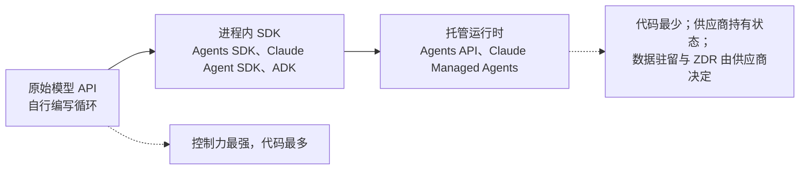

# Microsoft Agent Framework、CrewAI 与 Agent SDK 生态

过去一年里，多智能体框架生态逐渐收敛。Microsoft 将 AutoGen 和 Semantic Kernel 合并为 **Microsoft Agent Framework**，其 1.0 版于 2026 年 4 月 2 日正式可用；AutoGen 现在处于维护模式，由社区管理。CrewAI 于 2026 年 9 月 28 日发布 1.15.23，加入检查点和声明式 Flows；它报告被超过 60% 的 Fortune 500 企业采用（供应商声称）。主要实验室也都推出了自己的智能体 SDK：Anthropic 的 Claude Agent SDK、OpenAI 的 Agents SDK、Google 的 ADK 和 AWS 的 Strands Agents。2026 年，这些实验室还开始提供托管智能体循环：Claude Managed Agents、OpenAI Agents API（2026 年 9 月 10 日公开测试）和 Bedrock Managed Agents（2026 年 9 月 29 日预览）。

本章的版本号附有发布日期，因为这些 SDK 往往每一两周就发布新版本。请固定版本。

## 目录

- [CrewAI：管理者视角](#crewai-管理者视角)
- [Microsoft Agent Framework（AutoGen 的继任者）](#microsoft-agent-framework-autogen-的继任者)
- [Agent SDK 生态](#agent-sdk-生态)
- [托管智能体运行时](#托管智能体运行时)
- [群体与点对点通信](#群体与-p2p)
- [框架比较矩阵](#框架比较矩阵)
- [面试题](#面试题)
- [参考资料](#参考资料)

---

## CrewAI：管理者视角

CrewAI 围绕 **Process（流程）** 这一概念构建。
- **基于角色的智能体**：你定义一个“研究员”、一个“写作者”和一个“经理”。
- **任务**：带有明确输出的显式目标。
- **流程编排**：顺序式或层级式（由管理智能体委派并验证）。CrewAI 文档长期将基于共识的流程列为规划中，因此不要以它为设计基础。

### CrewAI Flows

CrewAI **Flows** 在经典 Crew 模式之上增加了一层 **状态机（state-machine）**：

```python
from crewai.flow.flow import Flow, listen, start

class ContentFlow(Flow):
    @start()
    def research_topic(self):
        # Returns research output
        return research_crew.kickoff({"topic": self.state["topic"]})
    
    @listen(research_topic)
    def write_article(self, research):
        # Triggered after research completes
        return writing_crew.kickoff({"research": research})
    
    @listen(write_article)
    def publish(self, article):
        # Final step
        return publisher.publish(article)
```

### CrewAI 1.14 与 1.15：比拼持久执行能力

| 版本 | 日期 | 变化 |
|---|---|---|
| 1.14.0 | 2026 年 4 月 7 日 | 运行时状态**检查点**（`CheckpointConfig`、`SqliteProvider`）、事件系统和执行器重构，以及 RAG 工具的 SSRF 防护与路径/URL 验证。**破坏性变更**：移除 `CodeInterpreterTool` |
| 1.15.0 | 2026 年 6 月 25 日 | **声明式 Flow 加载**（含 crew action 的 `FlowDefinition`）、DMN 模式，以及跨所有 LLM 调用的 token 用量汇总 |
| 1.15.22 / 1.15.23 | 2026 年 9 月 16 日 / 9 月 28 日 | 追踪中的人工反馈和暂停事件、连接别名、OpenRouter 嵌入、原生支持 Gemini 3.8 Flash |

1.13 系列（2026 年春）加入的企业特性依旧重要：已文档化的 SSO、RBAC 权限矩阵、A2A 任务委派，以及针对移除 `stop` 参数的 OpenAI 模型的修复。

**适用场景**：CrewAI + Flows 适合结构明确的**业务流程自动化**（内容流水线、数据分析工作流）。CrewAI 报告称其支撑了约 20 亿次智能体执行（供应商数字）。加入检查点和声明式 Flows 后，“CrewAI 追求速度、LangGraph 管理状态”的旧经验法则不再那么准确；主要差距仍在调试深度（从检查点分支做时间回溯）和生态广度。

---

## Microsoft Agent Framework（AutoGen 的继任者）

### 合并：AutoGen + Semantic Kernel = Agent Framework

Microsoft 由原班团队将 **Microsoft Agent Framework（MAF）** 打造为 AutoGen 和 Semantic Kernel 的直接继任者。MAF 1.0 于 2026 年 4 月 2 日在 .NET 和 Python 上正式可用（Microsoft 公告日期为 4 月 3 日），号称 API 稳定并提供长期支持。它大约每周发布一次：截至 2026 年 9 月 18 日，Python 为 1.19.0；截至 10 月 1 日，.NET 为 1.23.0。Go SDK 处于公开预览。

**这次合并整合了什么：**
- **来自 AutoGen**：用于单智能体和多智能体对话模式的简单抽象（群聊、轮询、交接）
- **来自 Semantic Kernel**：企业级会话管理、类型安全、过滤器、遥测以及广泛的模型/嵌入支持

### 迁移路径

AutoGen README 标明 **Maintenance Mode**：不再加入新功能，今后由社区管理，并引导新用户使用 MAF。`autogen-agentchat` 最近一次发布是 2025 年 9 月 30 日的 0.7.5。Microsoft 为 AutoGen 和 Semantic Kernel 都提供迁移指南。新项目应直接采用 MAF。

### 关键能力

```python
# Microsoft Agent Framework (Python 1.x): handoff workflow with an approval gate
import os
from typing import Annotated

from agent_framework import FileCheckpointStorage, tool
from agent_framework.foundry import FoundryChatClient
from agent_framework.orchestrations import HandoffBuilder
from azure.identity import AzureCliCredential

client = FoundryChatClient(
    project_endpoint=os.environ["FOUNDRY_PROJECT_ENDPOINT"],
    model=os.environ["FOUNDRY_MODEL"],
    credential=AzureCliCredential(),
)

@tool(approval_mode="always_require")  # the workflow pauses for a human before this runs
def process_refund(order_number: Annotated[str, "Order number"]) -> str:
    """Process a refund for an order."""
    return f"Refund queued for {order_number}"

triage = client.as_agent(name="triage_agent", instructions="Route the customer to a specialist.")
refunds = client.as_agent(name="refund_agent", instructions="Handle refunds.", tools=[process_refund])

workflow = (
    HandoffBuilder(
        name="support",
        participants=[triage, refunds],
        checkpoint_storage=FileCheckpointStorage(storage_path="./checkpoints"),  # resume after restarts
    )
    .with_start_agent(triage)
    .build()
)
```

**框架亮点：**
- **统一的 .NET 与 Python**：两种语言采用相同的编程模型（Go 处于预览）。
- **工作流**：顺序、并发、交接、群聊编排，以及函数式和基于图的工作流，支持检查点和可重新连接的后台响应。
- **Harness Agent**：面向长期、多步骤任务的有主见的智能体，内置规划与待办跟踪、上下文压缩、文件访问与记忆、工具审批和可观测性。
- **2026 年 9 月新增功能**（Microsoft 9 月 24 日更新）：AG-UI 托管（Python 稳定版、.NET 预览版），Foundry 与 Cosmos DB 记忆提供方（Python 预览版），通过在 Hyperlight 微型虚拟机中运行模型编写代码的 `HyperlightCodeActProvider` 支持 CodeAct（Microsoft 报告，在评估工作负载上延迟降低约 50%、token 减少超过 60%），OpenAI Responses、Telegram、A2A 和 MCP 通道，以及 Durable Azure Functions 扩展。
- **协议**：MCP 和 A2A 互操作均已随 1.x 发布。
- **多提供方**：为 Foundry、Azure OpenAI、OpenAI、Anthropic、Bedrock、Gemini 和 Ollama 提供第一方连接器。

---

## Agent SDK 生态

如今，每一家主要 AI 实验室都发布了自己的智能体框架。2026 年第三季度的共同趋势是：以 harness 为核心的 API、持久化状态和沙箱内代码执行成为内置能力。

### Claude Agent SDK（Anthropic）

Claude Agent SDK（由 Claude Code SDK 更名而来）提供了驱动 Claude Code 的同样工具、智能体循环和上下文管理，作为 Python（`claude-agent-sdk` 0.2.163）和 TypeScript（`@anthropic-ai/claude-agent-sdk` 0.3.287）库提供；版本截至 2026 年 10 月 1 日。

- **内置工具**：文件读取、命令执行和代码编辑，智能体无需自定义工具即可工作。
- **子智能体**：有名称的子智能体定义，具有自己的上下文和工具允许列表。
- **控制项**：`max_turns`、`max_budget_usd`、`effort`，以及基于分类器的 `auto`、`dontAsk` 等权限模式。
- **部署**：Claude API、Amazon Bedrock、Google Cloud（Vertex AI）和 Microsoft Foundry。
- **易踩的坑**：SDK 捆绑 Claude Code CLI，CLI 发布可能悄然改变默认模型。Claude Code 在 2.1.280（9 月 22 日）和 2.1.284（9 月 28 日）分别将 Opus 5.5、Sonnet 5.5 设为默认模型时，SDK 自身的 CI 也曾失败，随后不得不固定模型。务必显式传入 `model=`。

### OpenAI Agents SDK

OpenAI 使用原生 Python/TypeScript 构造多智能体工作流的轻量框架。2026 年 9 月最后一个 PyPI 版本是 `openai-agents` 0.22.3（9 月 17 日）；0.23.1 于 10 月 2 日发布到 PyPI。JS 的 `@openai/agents` 为 0.18.0（9 月 10 日）。

- **基于交接**：智能体通过 handoff 互相委派，无需中央监督者。
- **Guardrails（护栏）**：输入和输出护栏；0.22.1（9 月 8 日）新增覆盖整个 MCP 服务器的护栏。
- **MCP 集成**：0.20.0 同时支持 MCP Python SDK v1 和 v2；自定义 MCP HTTP 认证的应用必须使用已安装主版本对应的类型，或固定 `mcp<2`。
- **沙箱智能体**（自 2026 年 4 月的 0.14.0 起）：`SandboxAgent`、清单、快照和托管沙箱客户端。
- **测试工具**（8 月 15 日的 0.21.0）：与提供方无关的 `agents.testing`，以及实时和语音测试模块；要求 OpenAI Python SDK 3.0+。
- **需要应对的变动**：0.20.0（8 月 11 日）将 `gpt-5.6-luna` 设为隐式默认模型；0.22.0（8 月 19 日）使同时传入 `organization` 或 `project` 与显式客户端的应用出现破坏性兼容问题。
- **实时智能体**：自 0.18.0（2026 年 7 月 7 日）起，实时智能体默认使用 `gpt-realtime-2.1`。截至 0.22.3，尚不支持 9 月 10 日正式可用的全双工 `gpt-live-1`。原始的 `gpt-realtime` 和 `gpt-realtime-mini` 将于 2027 年 1 月 20 日停用，应固定 2.1 系列模型。

### OpenAI AgentKit（部分功能正在退出）

AgentKit（2025 年 10 月）围绕 Responses API 和 Agents SDK 打包了可视化 **Agent Builder**、可嵌入且可换主题的聊天 UI **ChatKit**、集中治理 OpenAI 产品中数据源和工具连接的 **Connector Registry**，以及 **Evals**。其中两项即将退出：

- **Agent Builder** 将于 2026 年 11 月 30 日关闭（6 月 3 日宣布弃用）。OpenAI 引导用户改用 Agents SDK 或 ChatGPT Workspace Agents。
- **Evals** 平台将于 10 月 31 日转为只读、11 月 30 日关闭，并提供迁往 Promptfoo 的指南。OpenAI 于 2026 年 3 月同意收购 Promptfoo；后者仍采用 MIT 许可，并支持其他提供方。Reusable Prompts 也将于 11 月 30 日关闭。

**实际影响**：OpenAI 正向两个端点收敛：代码优先的 Agents SDK 和完全托管的 Agents API（见下文）。中间的可视化构建器在推出八个月后就被弃用。应将智能体定义保存在自己掌控的代码中；画布导出不能作为长期可信的事实来源。

### OpenAI Apps SDK

Apps SDK 扩展了 **Model Context Protocol**，使一个 MCP 服务器能够连同其工具一起交付 UI。开发者同时定义逻辑和交互界面，应用在像 ChatGPT 这样的客户端中渲染。MCP 项目已将同一理念标准化为 **MCP Apps** 扩展；其 SDK 于 2026 年 9 月 8 日发布 2.0.0，迁移到 v2 TypeScript SDK 包，但线协议不变，因此 2.x 视图仍可在 1.x 宿主中渲染。参见 [工具使用与 MCP](../07-agentic-systems/03-tool-use-and-mcp.md)。

### Google Agent Development Kit（ADK）

Google 的框架针对 Google 生态做了优化，但与模型无关：

- **版本**：Python 2.0 于 2026 年 5 月 19 日正式可用，9 月 25 日达到 2.10.0（2.11.0 于 10 月 2 日登陆 PyPI）；Go 2.0 于 6 月 30 日发布（`google.golang.org/adk/v2`），9 月 30 日为 v2.5.0；TypeScript 2.0.0 于 8 月 21 日正式可用，9 月 30 日为 2.2.0，其 Workflow API 仍标为实验性；Java 仍在 1.x（9 月 18 日的 1.10.1）。Python 1.x 系列仍有补丁更新。
- **图工作流（2.0）**：静态与动态图、扇出与汇合（`JoinNode`）、逐节点重试和超时、Schema 验证、人工在环暂停与恢复。ADK-TS 2.0 弃用 `SequentialAgent`、`ParallelAgent` 和 `LoopAgent`（目前仍可运行，但会发出警告）。
- **原生 A2A**：内置 Agent-to-Agent 协议支持，便于跨厂商编排
- **Vertex AI 集成**：可部署到 Agent Engine Runtime 以获得托管式主机服务

随着 ADK 2.0 发布，Google 与 Microsoft（MAF 工作流）和 LangGraph 一样，提供了以智能体为节点的图工作流，缩小了旧有的“LangGraph 负责图、实验室 SDK 负责简单循环”的差距。Claude Agent SDK 和 OpenAI Agents SDK 仍以单智能体循环为中心，通过子智能体或交接扩展。

### 其他智能体 SDK

AWS 的 **Strands Agents** 是 PyPI 上月下载量最高的实验室 SDK（截至 2026 年 10 月 1 日的一个月约 3650 万次；和此类计数一样会受到 CI 放大）。其新 harness 包于 9 月 22 日将默认模型改为 Claude Opus 5，又是一次静默变更。**Vercel AI SDK 7**（2026 年 6 月 25 日）新增持久化 `WorkflowAgent` 和实验性的 `HarnessAgent`，可通过统一 API 运行 Claude Code、Codex 等 harness。Pydantic AI 和 Mastra 参见 [Pydantic AI 与 Mastra](11-pydantic-ai-and-mastra.md)；Haystack 3 与 Agno 3 参见 [框架选择指南](08-framework-selection-guide.md)。

---

## 托管智能体运行时

智能体循环的自建到租用现在有三个层次：使用原始模型 API 时，循环由你编写；使用进程内 SDK 时，循环在你的服务中运行；使用托管运行时时，循环、状态，通常还有沙箱，都在供应商侧运行。



| 运行时 | 状态 | 交给供应商的内容 | 计费 | 需要核查的限制 |
|---|---|---|---|---|
| **Claude Managed Agents** | 已上线；功能持续新增至 2026 年 9 月 | 会话；Anthropic 托管或自托管沙箱；记忆存储；定时任务部署（6 月 9 日）；服务端评估的 `auto` 权限策略（9 月 10 日）；通过 `ant apply` 和提交到仓库的 `claude-lock.json` 将智能体定义为代码（ant CLI 1.30.0，9 月 3 日） | token 加每个运行中会话每小时 $0.08（空闲免费）；硬性会话预算达到时以 `budget_reached` 停止（8 月 7 日）；无批处理折扣 | 仅限 Claude 模型 |
| **OpenAI Agents API** | 2026 年 9 月 10 日公开测试 | Codex harness：持久会话、上下文压缩、故障恢复、子智能体（`max_concurrent_subagents` 默认 6）；OpenAI 托管或自托管沙箱；托管浏览器计算机操作（9 月 29 日） | 无 API 费；收取模型、工具和容器费（1、4、16 GB 沙箱每 20 分钟分别为 $0.03、$0.12、$0.48） | 测试期仅支持美国数据驻留，不支持零数据保留 |
| **Bedrock Managed Agents**（由 OpenAI 提供底层能力） | 2026 年 9 月 29 日预览 | 在 AWS 内运行的定制 Agents API，具备每智能体 IAM 角色、CloudTrail 日志，以及重要操作前的审批 | 预览期间不额外收费 | 仅限 us-east-1、us-east-2 和 us-west-2 |
| **Foundry Agent Service** | Routines 于 2026 年 9 月 24 日正式可用 | 支持周期性、定时和事件触发的托管智能体 | Azure 资源消耗计费 | 网络出站控制仍在预览 |

托管运行时在 token 之外引入了**第二种成本计量**（会话或沙箱时长），因此单任务成本模型必须计入运行时和空闲行为。风险也更集中：OpenAI 于 9 月 29 日发生的事故，使 Agents API 连同 Responses、ChatGPT 和 Codex 退化约 5 小时 20 分钟；回退方案必须跨供应商，而不只是切换模型。

自行运行循环与租用运行时之间还有一个中间选项：**为自己的循环购买托管服务**。AWS AgentCore Runtime V2（2026 年 9 月 18 日宣布，通过 `platformVersion V2` 启用）可从已初始化智能体的快照恢复新实例；AWS 报告 P75 冷启动约 2 秒，原运行时则约 5.4 至 30 秒，计费单价更高但 GB 小时显著减少（供应商报告）。框架和循环仍由你掌控，服务器交给供应商。

---

## 群体与 P2P

这两个框架（以及更广义的 SDK 生态）都已采用 **群体模式（Swarm Patterns）**。
- **交接**：不再由中央监督者控制，而是让智能体将对话“交接”给最相关的专家。MAF 通过为每个智能体注入交接工具来实现网状交接；OpenAI Agents SDK 则通过其 handoff 原语实现。
- **示例**：一个“销售智能体”发现用户在问技术问题，于是将线程交接给“支持智能体”。
- **注意**：交接是一次工具调用，接收方继承哪些上下文由框架决定。例如，MAF 会转发用户和智能体消息，却过滤工具调用及其结果，因此不能假设下一个智能体看过上一个智能体的工具输出。

---

## 框架比较矩阵

| 特性 | CrewAI | MS Agent Framework | LangGraph | Claude Agent SDK | OpenAI Agents SDK | Google ADK |
|---------|--------|-------------------|-----------|-----------------|-------------------|------------|
| **当前版本** | 1.15.23（9 月 28 日） | Python 1.19.0（9 月 18 日）、.NET 1.23.0（10 月 1 日） | 1.2.12（9 月 21 日） | Python 0.2.163、TS 0.3.287 | Python 0.22.3（9 月 17 日）、JS 0.18.0 | Python 2.10.0（9 月 25 日）、TS 2.2.0（9 月 30 日）、Go 2.5.0（9 月 30 日）、Java 1.10.1 |
| **核心抽象** | 任务/流程/Flow | 工作流/智能体 | 状态/图 | 智能体循环 + 子智能体 | 交接/智能体 | 智能体 + 图工作流 |
| **架构** | 声明式 + 状态机 | 图工作流 | 循环状态图 | 层级树 | 群体交接 | 有向图 |
| **易用性** | 高 | 中 | 低 | 中 | 高 | 中 |
| **控制力** | 低-中 | 中-高 | 高 | 中 | 低-中 | 中-高 |
| **持久状态** | 检查点（1.14+） | 工作流检查点 | 检查点、时间回溯 | 会话恢复与分叉 | 会话、可序列化运行状态 | 会话、图暂停/恢复（2.0） |
| **最适合** | 业务自动化 | 企业 .NET/Python | 复杂编排 | 编码/工具型智能体 | 快速多智能体 | Google Cloud AI |
| **多语言** | Python | .NET + Python（Go 预览） | Python + TS | Python + TS | Python + TS | Python、TS、Go、Java |
| **MCP 支持** | 是 | 是 | 是（自 `langchain` core 1.4.0 起） | 原生 | 是（MCP SDK v1 和 v2） | 是 |
| **A2A 支持** | 是（1.13+） | 是 | 通过工具 | 否（直接） | 否（直接） | 原生 |

---

## 面试题

### 问：什么时候会选择 CrewAI 而不是 LangGraph？

**强答案：**
**速度与精度的权衡**，但差距比一年前小了。当我需要快速为标准流程（如内容生成或数据分析）搭建智能体团队时，会使用 **CrewAI**；它的角色、任务抽象与 Flows 用少量代码即可实现，而且自 1.14 起支持状态检查点，自 1.15 起支持声明式加载 Flows。当我需要对每次状态迁移进行**细粒度控制**，从任意检查点分支调试，多轮人工在环中断，或处理不适合“角色扮演团队”模式的复杂错误恢复时，则使用 **LangGraph**。讨论采用情况时应选对指标：CrewAI 的 GitHub star 更多（约 5.93 万对 4.26 万），但 LangGraph 的 PyPI 月下载量约为其 18 倍（4370 万对 240 万），因此更多团队实际依赖 LangGraph。

### 问：Microsoft 将 AutoGen 转入维护模式，转而采用 Agent Framework。这会如何影响现有的 AutoGen 部署？

**强答案：**
现有部署仍能运行，但 AutoGen 现在由社区管理，不再有新功能，而 `autogen-agentchat` 最近一次发布是 2025 年 9 月的 0.7.5。这不仅是功能问题，也是安全补丁问题：我不希望一个缺乏维护的框架长期持有凭据和工具权限。MAF 自 2026 年 4 月 2 日起正式可用并提供长期支持，Microsoft 也发布了迁移指南：AutoGen 的 `AssistantAgent` 对应 MAF 的 `Agent`，`GroupChat` 对应工作流编排；Semantic Kernel 的会话、遥测和过滤器等企业能力也被原生整合。我会在迁移时用同一套评估工具对比前后的任务成功率和工具调用追踪，优先处理权限最广的智能体。

### 问：如何防止“无限循环”，即智能体彼此反复对话却始终无法解决任务？

**强答案：**
我们使用 **终止条件** 和 **最大对话轮次**。我们还会实现一个“批判智能体（Critic Agent）”，它唯一的职责是检测对话是否停滞。如果批判智能体检测到循环，就会触发用户代理来中断，或者强制将群聊管理器切换到不同的推理路径。我们还会监控 **Token Velocity（Token 速率）**：如果一对智能体在两分钟内使用了 100K 个 token 却毫无进展，就自动终止会话。如今平台把开支上限作为一等控制项：Claude Managed Agents 的会话预算会以 `budget_reached` 终止会话，Claude Agent SDK 支持 `max_budget_usd`，MAF 的自主交接模式设有逐智能体轮次上限，LangGraph 则提供递归上限和检查点，使终止的循环可以被检查和恢复，而不至于丢失。

### 问：何时会把智能体循环交给 OpenAI Agents API 或 Claude Managed Agents 等托管运行时？

**强答案：**
当我需要自行构建的难点（持久会话、上下文压缩、崩溃恢复、沙箱生命周期、逐次调用权限评估）成本超过供应商绑定的代价，并且运行时的数据条款适合该工作负载时。第二个条件往往起决定作用：OpenAI Agents API 测试版仅支持美国数据驻留，且不支持零数据保留，许多受监管的工作负载因此无法采用。我还会计算 token 之外的第二种成本（会话小时或沙箱分钟），以及故障影响范围：供应商故障如今可能让模型、harness 和沙箱同时不可用。我通常保留自己掌控的、与供应商无关的编排层，将托管运行时作为接口后的叶子智能体，并把智能体定义保存为仓库代码（`ant apply` 配合提交的锁文件正是正确方向），从而保持运行时可替换。

---

## 参考资料
- CrewAI. 更新日志与发布记录（1.14.0、1.15.x）：https://github.com/crewAIInc/crewAI/releases
- Microsoft. "Agent Framework Overview" (2026)：https://learn.microsoft.com/en-us/agent-framework/overview/
- Microsoft. "Microsoft Agent Framework Version 1.0"（2026 年 4 月）：https://devblogs.microsoft.com/agent-framework/microsoft-agent-framework-version-1-0/
- Microsoft Learn. "AutoGen to Microsoft Agent Framework Migration Guide"：https://learn.microsoft.com/en-us/agent-framework/migration-guide/from-autogen/
- Anthropic. "Claude Agent SDK" (2026)：https://code.claude.com/docs/en/agent-sdk/python
- OpenAI. "Agents SDK" 发布记录：https://github.com/openai/openai-agents-python/releases
- OpenAI. "Agents API overview"（2026 年 9 月测试版）：https://developers.openai.com/api/docs/guides/agents-api/overview
- OpenAI. 弃用公告（Agent Builder、Evals、Reusable Prompts）：https://developers.openai.com/api/docs/deprecations
- [OpenAI. "Introducing AgentKit" (2025)](https://openai.com/index/introducing-agentkit/)
- [OpenAI. "Apps SDK" (2025)](https://developers.openai.com/apps-sdk)
- Google. "Agent Development Kit" (2026)：https://google.github.io/adk-docs
- OpenAI. Swarm（教学用途的多智能体仓库，现已由 Agents SDK 替代）：https://github.com/openai/swarm

---

*下一篇：[框架选择指南](08-framework-selection-guide.md)*
