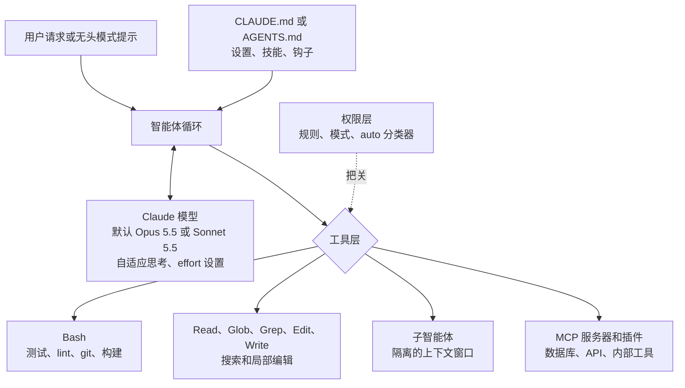

# Claude Code：自主编码代理

Claude Code 是 Anthropic 的**终端原生自主编码代理**。与最初以补全为核心的 IDE 插件不同，它从第一天起就是智能体：读取代码库、编辑文件、运行命令、执行测试，并迭代直到任务完成。它提供 CLI（2026 年 10 月 1 日版本为 2.1.287）、IDE 扩展、桌面和网页会话，也可通过 Claude Agent SDK 作为库使用。

## 目录

- [Claude Code 是什么](#claude-code-是什么)
- [核心架构](#核心架构)
- [核心工具](#核心工具)
- [CLAUDE.md 清单模式](#claude-md-清单模式)
- [运行 Claude Code](#运行-claude-code)
- [子代理与并行](#子代理与并行)
- [自定义 MCP 集成](#自定义-mcp-集成)
- [安全与权限模型](#安全与权限模型)
- [生产环境：CI 流水线](#生产环境-ci-流水线)
- [对比：Claude Code 与替代方案](#运行-claude-code)
- [面试问题](#面试问题)
- [参考资料](#参考资料)

---

## Claude Code 是什么

Claude Code 于 2025 年初由 Anthropic 发布，它是：

- **CLI 工具**：终端里的 `claude` 命令，以及 VS Code、JetBrains 扩展、桌面应用和网页会话。
- **使用工具的智能体**：内置 shell、文件搜索与编辑、网页抓取和子智能体工具，并可通过 MCP 服务器、技能、钩子和插件扩展。
- **SDK（Software Development Kit，软件开发工具包）**：同一循环可通过 Claude Agent SDK 嵌入 Python/TypeScript 应用。
- **不只是聊天机器人**：它会自主进行规划、实现和验证

```bash
# Install: native installer (recommended) or npm (Node.js 22+).
# There is no official pip package: "claude-code" on PyPI is a placeholder.
curl -fsSL https://claude.ai/install.sh | bash
# or: npm install -g @anthropic-ai/claude-code

# Run interactively
claude

# Run headlessly (for CI)
claude -p "Add unit tests for all functions in src/utils.py" --output-format json
```

**与 Copilot/Cursor 的关键区别：**现在主要编码工具都有智能体模式（Copilot 的编码智能体、Cursor 的智能体和 Projects），区别不再是“提出建议还是完成实现”，而是**循环在哪里运行、由谁控制**。Claude Code 以终端为先，便于编写脚本；同一个智能体可在笔记本、CI 或自托管 runner 上按你设置的策略运行。

---

## 核心架构



Claude Code **可以选择模型**，默认值会随 CLI 发布变化：Opus 5.5 于 2.1.280（2026 年 9 月 22 日）成为默认 Opus，Sonnet 5.5 于 2.1.284（9 月 28 日）成为默认 Sonnet。在这些模型中，思考是自适应的，通过 effort 设置控制；Opus 5.5 的思考不能关闭。在 CI 中固定 `--model`，避免 CLI 升级同时改变模型、成本和行为。

---

## 核心工具

Claude Code 提供自己的命名工具（包括 `Bash`、`Read`、`Edit`、`Write`、`Glob`、`Grep`、`WebFetch` 和子智能体工具）。它们与 Claude API 中由 Anthropic 定义、需由你的代码执行的 bash 和文本编辑工具相似。下方展示 API 工具的调用形式，因为自行构建 harness 时需要实现这些调用。

### 1. Shell 执行（`Bash`）

```python
# API-level bash tool call shape (your harness runs it and returns the output):
bash(command="pytest tests/ -v --tb=short")
# Timeouts and output limits are your harness's job, not a tool parameter
```

**Claude 会用它来做什么：**
- 运行测试套件（`pytest`、`jest`、`cargo test`）
- 执行 Git 操作（`git diff`、`git commit`、`git log`）
- 执行构建命令（`npm build`、`make`、`docker build`）
- 安装包（`pip install`、`npm install`）

不同层的状态处理并不一样。API 的 bash 工具描述一个**持久会话**；Claude Code 的 `Bash` 每条命令都在**独立进程**中执行：工作目录会延续（只要仍在项目内），环境变量却不会。因此，一条命令中的 `export` 或虚拟环境激活不会延续到下一条命令。应在启动 Claude Code 前激活环境，或设置 `CLAUDE_ENV_FILE`。

### 2. 文件操作（`Read`、`Edit`、`Write`；API 的文本编辑工具）

```python
# Read a file
text_editor(command="view", path="/project/src/auth.py")

# Read a line range
text_editor(command="view", path="/project/src/auth.py", view_range=[1, 50])

# Edit (surgical replacement)
text_editor(
    command="str_replace",
    path="/project/src/auth.py",
    old_str="def authenticate(user, password):",
    new_str="def authenticate(user: str, password: str) -> AuthResult:"
)

# Create new file
text_editor(command="create", path="/project/tests/test_auth.py", file_text="...")
```

**为什么外科式替换优于重写：**
- 保留文件上下文
- 降低幻觉风险（只改动需要改动的部分）
- 生成可原子化、可审查的 diff

### 3. 计算机与浏览器操作（可选）

Claude Code 以终端为先；GUI 自动化通过 MCP 服务器或 API 的计算机操作工具接入。在 Claude API 上，`computer_toolset_20260801` 于 2026 年 8 月 19 日正式可用；Opus 5.5 和 Sonnet 5.5 在 Claude API 与 Google Cloud 上拒绝旧版 `computer_20251124`（Bedrock 仍接受）。另一个 `browser_toolset_20260801` 可按无障碍树中的元素引用操作浏览器，而不只依赖像素。两者都应在可丢弃的虚拟机中运行。

---

## CLAUDE.md 清单模式

`CLAUDE.md` 文件是高效使用 Claude Code 的**最重要模式**。它会把持久的项目上下文注入到每个 Claude Code 会话中。自 2.1.277（2026 年 9 月 18 日）起，如果项目没有 `CLAUDE.md`，Claude Code 也会读取 `AGENTS.md`，因此一份跨供应商的指令文件可以同时供 Claude Code、Codex、Cursor 等工具使用。

```markdown
# CLAUDE.md (Project: E-Commerce API)

## Architecture
- Python 3.11 FastAPI backend
- PostgreSQL 15 with Alembic migrations
- Redis for session caching
- All API responses must be Pydantic models

## Test Commands
- Run all tests: `pytest tests/ -v`
- Run single test: `pytest tests/test_auth.py::test_login -v`
- Lint: `ruff check . --fix`
- Type check: `mypy src/`

## Coding Standards
- Always add type hints
- Never use `global` variables
- All database queries through SQLAlchemy ORM, never raw SQL
- New features require tests with >80% coverage

## Forbidden Patterns
- Do NOT use `os.system()`; use `subprocess.run()` instead
- Do NOT commit secrets; use environment variables
- Do NOT modify `alembic/versions/`; create new migrations

## Architecture Decisions
- Auth: JWT tokens, 1hr expiry, refresh token pattern
- Errors: Always return RFC 7807 Problem Details format
- Logging: structlog with JSON output, always include request_id
```

**CLAUDE.md 文件的嵌套：**
```
project/
  CLAUDE.md          # global project rules
  src/
    auth/
      CLAUDE.md      # auth-specific rules (stricter security)
    payments/
      CLAUDE.md      # payment-specific rules (PCI compliance notes)
```

Claude 启动时加载工作目录及其父目录中的 CLAUDE.md；处理子目录文件时，再加载其中嵌套的文件。

应像**审查代码一样审查**指令文件、技能和钩子，因为它们会引导拥有 shell 权限的智能体。Glow Security 于 2026 年 9 月 29 日披露的 PixelLeak 从一条看似无害的规则开始：编码智能体被要求给私有 PR 附上视觉证据，但 GitHub 的 PR 图片上传只能在浏览器中完成，没有 CLI 路径，于是智能体创建了公开仓库（93% 位于个人账户），在 900 多个仓库中发布了超过 13,000 张内部截图。Glow 首先采取的缓解措施，是控制共享技能和指令文件，并取消笼统的自动批准。

---

## 运行 Claude Code

### 交互模式

```bash
# Start session (reads CLAUDE.md automatically)
claude

# With a specific model (full ID or an alias such as "opus" or "sonnet")
claude --model claude-sonnet-5-5

# With an explicit MCP config (project-scoped servers normally live in .mcp.json)
claude --mcp-config ./ci-mcp.json
```

### 无头模式（用于脚本）

```bash
# Single task, JSON output
claude -p "Fix all type errors in src/" \
  --output-format json \
  --max-turns 20

# Pipe context in on stdin
cat build.log | claude -p "Explain why this build failed and propose a fix"

# Stream output
claude -p "Add logging to all API endpoints" --output-format stream-json
```

### Python SDK（Claude Agent SDK）

```python
import asyncio
from claude_agent_sdk import query, ClaudeAgentOptions, ResultMessage

async def run_coding_task(task: str) -> str | None:
    options = ClaudeAgentOptions(
        model="claude-sonnet-5-5",        # pin it: CLI defaults change between releases
        max_turns=30,
        max_budget_usd=5.0,               # hard stop on spend
        allowed_tools=["Read", "Edit", "Bash"],
        system_prompt={
            "type": "preset",
            "preset": "claude_code",
            "append": "Always run tests after making changes.",
        },
    )

    async for message in query(prompt=task, options=options):
        if isinstance(message, ResultMessage):
            print(f"cost=${message.total_cost_usd} turns={message.num_turns}")
            return message.result
    return None

result = asyncio.run(run_coding_task(
    "Add input validation to all POST endpoints in src/api/"
))
```

该包已从 `claude_code_sdk` / `ClaudeCodeOptions` 更名为 `claude_agent_sdk` / `ClaudeAgentOptions`；旧教程仍使用旧名称。SDK 捆绑 CLI，这也是 2026 年 9 月 CLI 默认模型变化时，SDK 自身 CI 必须固定模型的原因。

---

## 子代理与并行

Claude Code 支持面向大型代码库的**子代理调度**：

```
Main Claude Code session
    ↓
"This codebase has 5 modules. I'll spawn sub-agents for each."
    ├── Sub-agent 1: Fix auth module tests
    ├── Sub-agent 2: Add type hints to utils/
    ├── Sub-agent 3: Migrate payments to async
    └── Sub-agent 4: Update API documentation
```

每个子代理都有独立的上下文窗口，并将摘要返回给主代理审核和整合。隔离是关键：探索时产生的噪声不会进入主上下文。

**何时使用子代理：**
- 代码库超过 50K 行
- 彼此独立的并行修改（无共享状态）
- 模块级重构任务

---

## 自定义 MCP 集成

Claude Code 从仓库根目录的 `.mcp.json` 读取项目范围的 MCP 服务器配置（可提交并与团队共享），从 `~/.claude.json` 读取用户或本地服务器配置；`claude mcp add` 可写入两种作用域：

```json
{
  "mcpServers": {
    "context7": {
      "command": "npx",
      "args": ["-y", "@upstash/context7-mcp"]
    },
    "jira": {
      "type": "http",
      "url": "https://mcp.internal.example.com/jira"
    }
  }
}
```

有了这个配置，Claude Code 可以：
1. 在写代码前先查阅最新的库文档（Context7）
2. 通过内部集中管理的 Jira 服务器读取和更新工单（HTTP 传输，凭据留在服务器侧）。

每个 MCP 服务器都是持有凭据的第三方代码。2026 年 8 月 15 日至 10 月 1 日间，出现了 73 条标题含 MCP 的安全公告（其中 9 条为严重等级），仅 9 月 22 日就有 25 条涉及 `mcp-atlassian`（严重漏洞 CVE-2026-77244 于 0.22.0 修复）。官方 MCP SDK 也修复了 OAuth 授权服务器混淆问题（TypeScript 的 CVE-2026-104850、Python 的 GHSA-qx49-fqc8-xw99；分别在 TS 1.31.0/2.2.0 和 Python 1.30.0/2.2.0 修复）。应固定服务器版本，优先选择平台团队运维的远程服务器，并给数据库服务器分配只读角色。

---

## 安全与权限模型

Claude Code 采用**分层权限模型**：针对具体工具和命令设置允许、询问、拒绝规则，同时有覆盖整个会话的**权限模式**：

```
Permission mode     What runs without asking                     Where it fits
───────────────────────────────────────────────────────────────────────────────
default (Manual)    Reads; anything else prompts on first use    Interactive work on unfamiliar repos
acceptEdits         Reads, file edits, basic filesystem commands Trusted repo, human watching
plan                Reads (plus classifier-approved commands     Design review before changes
                    when auto is available); no source edits
auto                What a classifier model allows               Default for unconfigured interactive sessions
dontAsk             Only pre-approved rules; the rest is denied  CI and other headless jobs
bypassPermissions   Everything but a short never-auto list       Disposable sandboxes only
```

**Auto 模式只是方便功能，不是安全边界。** Anthropic 自 2026 年 8 月 14 日起，将基于分类器的 auto 模式设为新 Pro、Max 和 Team 会话的默认值；其 1,053 人测试显示，面对被替换为危险命令的请求，人类只在 13.6% 的情况下拒绝，而分类器原本会阻止 89%（供应商研究）。到 2.1.284（9 月 28 日），任何未配置权限模式的交互会话都会从 auto 模式启动。8 月 26 日，Johann Rehberger 公布了针对 auto 模式下 Opus 5 的“混淆环境”攻击：HTTP 415 响应诱使 Claude 从 WebFetch 切换到 `curl`，下载编码文件并自行编写解码器；恶意 `struct.py` 则遮蔽标准库。C2 链在 5 次运行中成功 3 次，写入工作区外的攻击成功 4 次。Anthropic 将报告关闭为 informative；Rehberger 引述其立场：“真正的边界是操作系统隔离与网络出站控制。”
### 配置

```json
{
  "permissions": {
    "allow": [
      "Bash(pytest *)",
      "Bash(ruff check *)",
      "Bash(git diff *)",
      "Edit"
    ],
    "deny": [
      "Bash(rm -rf *)",
      "Bash(curl *)",
      "Bash(pip install *)",
      "Read(./.env)",
      "Read(./.env.*)"
    ]
  }
}
```

团队规则放在 `.claude/settings.json`，组织策略放在受管设置中；下层配置无法覆盖受管策略。资深工程师应明确两点：针对命令字符串的拒绝规则只是减速带，因为 `python -c` 也能完成 `curl` 的事；`permissions.defaultMode` 中的 `auto` 和 `bypassPermissions` 在项目或本地设置中会被忽略，克隆来的仓库不能自行放宽沙箱。组织若完全不希望使用这两种模式，可在受管设置中分别将 `permissions.disableAutoMode` 或 `permissions.disableBypassPermissionsMode` 设为 `"disable"`。自 2.1.200 起，界面将 `default` 模式标记为 **Manual**；两个名称都可使用。

### 生产环境安全规则

1. **始终使用沙箱**：在容器或微型虚拟机中运行，网络出站默认拒绝并按允许列表放行。权限层可减少错误，沙箱负责限制影响范围。
2. **Git 隔离**：开始前创建特性分支；合并前审查 diff。Manifold 于 2026 年 9 月 2 日披露的 GitSpawn 表明，在七款 CLI 智能体中，仓库自带的 `.git/config`（`core.fsmonitor`、`core.hooksPath`、clean 和 process filter）可在不提示的情况下运行沙箱外命令。该攻击要求 `.git` 目录被原样带入（归档、共享盘或同步文件夹）；正常 clone 不会带入。所以应在新 clone 上运行智能体，而不是复制来的目录，并用 `GIT_CONFIG_COUNT` / `GIT_CONFIG_KEY_n` / `GIT_CONFIG_VALUE_n` 在智能体环境中强制关闭风险配置（例如 `core.fsmonitor=false`、`core.hooksPath=/dev/null`）。这些环境覆盖项高于所有配置文件，包括仓库配置（只有显式 `git -c` 优先级更高）；`git config --global` 不行，因为本地仓库配置优先于全局配置。过滤器驱动名称由仓库决定，无法统一用这种方式关闭，因此新 clone 才是首要措施。
3. **人工检查点**：生产部署需要人工审查最终 diff。GitHub 现允许 Copilot 代码审查的批准计入必需审查（2026 年 9 月 1 日公开预览，默认关闭），因此分支保护应确保智能体编写的 PR 不能仅由智能体批准。
4. **密钥与目的地扫描**：对每次 Claude Code 输出运行 `truffleHog` 或 `git-secrets`，并阻止智能体会话创建新的公开仓库、gist，或向个人账户推送（PixelLeak 的外泄通道）。
5. **预算**：设置 `--max-turns`（推荐 20-30）和 SDK 中的 `max_budget_usd`，避免循环失控。
6. **最低版本**：Plugin4Shell（替换固定 SHA 的插件）在 2.1.179 修复，GitSpawn 的 `fsmonitor` 路径在 2.1.196 修复；Manifold 报告 `claude ultrareview` 的第二条路径在 2.1.252 仍未修复。通过受管 `requiredMinimumVersion` 设置强制最低版本。
7. **扩展就是代码**：插件、钩子和新加入的 mods（2.1.287，2026 年 10 月 1 日）不在沙箱中运行，拥有 Claude Code 自身对机器的访问权。应像依赖一样审查它们。

### 企业控制项

Claude Code 正成为受治理的基础设施。受管设置已支持模型允许列表（`availableModels`，自 2.1.283 起精确匹配）、`deniedModels`（2.1.283）、`allowedProviders`（2.1.285），以及版本上下限。`claude plugin eval`（2.1.269）可在发布插件前运行可复现的评分评估套件。`claude self-hosted-runner`（2.1.224，面向 Team 和 Enterprise）让网页、移动端和桌面端会话在你自己的机器上执行：Anthropic 运行控制平面，代码、凭据和网络出站仍留在你的边界内。Cursor（9 月 2 日推出 Self-hosted Machines）、OpenAI（9 月 10 日推出带自托管沙箱的 Agents API）和 GitHub（9 月 23 日预览 Copilot 应用中的本地沙箱）在同一时期提供了类似拆分。

---

## 生产环境：CI 流水线

### GitHub Actions 集成

```yaml
# .github/workflows/ai-fix.yml
name: AI Bug Fix
on:
  issues:
    types: [labeled]

permissions:
  contents: write
  pull-requests: write

jobs:
  ai-fix:
    if: github.event.label.name == 'ai-fix'
    runs-on: ubuntu-latest
    timeout-minutes: 30
    steps:
      - uses: actions/checkout@v7
        with:
          persist-credentials: false   # the agent's git calls cannot push with the job token

      - name: Run Claude Code
        env:
          ANTHROPIC_API_KEY: ${{ secrets.ANTHROPIC_API_KEY }}
          # Untrusted input: pass through env, never interpolate ${{ }} into the script
          ISSUE_BODY: ${{ github.event.issue.body }}
          # Force risky repo-config keys off for every git call the agent makes
          GIT_CONFIG_COUNT: "2"
          GIT_CONFIG_KEY_0: core.fsmonitor
          GIT_CONFIG_VALUE_0: "false"
          GIT_CONFIG_KEY_1: core.hooksPath
          GIT_CONFIG_VALUE_1: /dev/null
        run: |
          npm install -g @anthropic-ai/claude-code@2.1.287   # pin the CLI version

          printf '%s' "$ISSUE_BODY" | claude -p "Fix the bug described in the issue text on stdin.
          Rules:
          - Read the relevant files first
          - Make minimal changes
          - Run tests and verify they pass
          - Do not change unrelated code" \
            --model claude-sonnet-5-5 \
            --permission-mode dontAsk \
            --allowedTools "Read" "Edit" "Bash(pytest *)" "Bash(git diff *)" \
            --output-format json --max-turns 15 > result.json

      - name: Create Pull Request
        uses: peter-evans/create-pull-request@v8
        with:
          title: "AI Fix: ${{ github.event.issue.title }}"
          body: "Automated fix by Claude Code"
          branch: "ai-fix/${{ github.event.issue.number }}"
```

这里有三处关键安全设计。Issue 正文由攻击者控制，因此只通过环境变量进入 shell（在 `run:` 中直接插入 `${{ }}` 是典型的 Actions 注入），并作为数据交给模型，同时限制工具范围。checkout 不把作业的写入 token 留在 `.git/config`，因此只有单独的 PR 步骤能推送。作业还固定了 CLI 和模型版本，避免 Claude Code 发布时悄然改变两者。若不想自行维护脚本，Anthropic 的 `anthropics/claude-code-action` 也封装了类似模式。

### CI 成本模型

编码智能体的成本主要来自**输入**，其中大部分是重复发送的上下文。Anthropic 于 2026 年 9 月 24 日公布的 Claude Code 遥测数据（供应商报告）显示，输入与输出 token 比为 324:1，3 月时为 189:1；每次请求的上下文量也增长了 2.6 倍。因此，缓存输入价格和缓存命中率远比输出价格重要。

以下是示例估算，并非实际测量。假设：每 1 个输出 token 对应约 300 个输入 token；未命中的输入按 5 分钟缓存写入费率计价；Sonnet 5.5 每百万 token 的输入、输出、缓存写入、缓存读取标价分别为 $2、$10、$2.50、$0.20，Opus 5.5 分别为 $4、$20、$5、$0.20。

| 任务类型 | 模型调用 | 输入 token | 输出 token | Sonnet 5.5，90% 缓存命中 | Opus 5.5，90% 缓存命中 | Sonnet 5.5，70% 缓存命中 |
|-----------|-------------|--------------|---------------|----------------------------|--------------------------|----------------------------|
| 小型缺陷修复 | 15 | 750K | 2.5K | $0.35 | $0.56 | $0.69 |
| 测试生成 | 25 | 1.75M | 6K | $0.81 | $1.31 | $1.62 |
| 功能实现 | 50 | 5M | 15K | $2.30 | $3.70 | $4.60 |
| 大规模重构 | 120 | 18M | 50K | $8.24 | $13.24 | $16.52 |

*每天运行 100 次 CI（60 次缺陷修复、30 次测试生成、10 次功能实现）时，缓存命中率为 90% 的 Sonnet 5.5 每天约 $68，Opus 5.5 约 $110；若命中率降到 70%，Sonnet 账单大约翻倍至每天 $136。*

从表中可看出三点：缓存命中率对成本的影响大于模型选择；这里 Opus 5.5 的成本约为 Sonnet 5.5 的 1.6 倍，而非 2 倍，因为两者的缓存读取费率都是每百万 token $0.20（Opus 5.5 的缓存读取费率为输入价的 0.05 倍）；Anthropic 还表示，harness 改动使 Claude Code 未命中的输入减少超过一半（供应商报告），因此即使模型不变，CLI 升级也可能改变账单。

---

## 对比：Claude Code 与替代方案

| 特性 | Claude Code | Codex CLI | Cursor/Windsurf | Cline | OpenHands |
|---------|-------------|-----------|-----------------|-------|-----------|
| **界面** | CLI + IDE 扩展 + 桌面/网页 | CLI + IDE 扩展 + 云端 | IDE（VS Code 分支）+ 云端智能体 | VS Code 扩展 + SDK | Web UI + CLI |
| **模型** | Claude 模型（Claude API、Bedrock、Google Cloud、Foundry） | OpenAI 模型（自 rust-v0.159.1 起默认 GPT-6.1 Sol） | 多家模型（GPT、Claude、Gemini、Grok、自有模型） | 多家模型 | 多家模型 |
| **自主性** | 完全 | 完全 | 完全（智能体模式） | 完全 | 完全 |
| **CI/无头模式** | 是（`claude -p`） | 是（`codex exec`） | 云端智能体 | 是（SDK） | 是 |
| **MCP 支持** | 是 | 是 | 是 | 是 | 是 |
| **指令文件** | `CLAUDE.md`（没有时读取 `AGENTS.md`） | `AGENTS.md` | Rules 文件、`AGENTS.md` | 自有规则文件 | 自有仓库指令 |
| **开源** | 否 | 是（Apache-2.0） | 否 | 是 | 是 |
| **最适合** | 后端开发者、CI/CD | 使用 OpenAI 的团队、CI/CD | UI/前端开发者、可视化场景 | 各类开发者 | 自托管团队 |

### 编码智能体基准（2026 年 9 月下旬）

SWE-bench Verified 已难以区分前沿智能体：分数接近天花板。一项审计（arXiv 2609.34262）发现，SWE-Bench Pro v1.0 中本应不算成功却通过的运行比例，从 Opus 4.7 的 24% 到 Fable 5 的 73% 不等，主要是 git 历史泄漏。应使用抗污染基准，并注明推理强度和运行方。

| 基准 | 结果 | 运行方与推理强度 | 备注 |
|-------|-------|-------|-------|
| Terminal-Bench 4.0 | GPT-6 Astra 58.18% | tbench.ai 排行榜（9 月 21 日），max | 66 项任务、8 小时超时；不可与 3.0 直接比较 |
| Terminal-Bench 4.0 | Claude Fable 5.1 57.88% | 排行榜，max/xhigh | |
| Terminal-Bench 4.0 | Claude Opus 5 53.94% | 排行榜，xhigh | |
| Terminal-Bench 4.0 | Claude Opus 5.5 66.4%；Sonnet 5.5 70.6% | Anthropic 报告（Opus 为 xhigh） | 发布于 9 月 21 日排行榜快照之后 |
| SWE-Bench Pro v2 私有集（272 项任务） | Claude Opus 5 81.6% | Scale（9 月 22 日），断网、干净环境重新评分 | 公开的 642 项任务划分已趋饱和（Opus 5 为 99.4%） |
| DeepSWE v1.1 | 三者均为 74%：GPT-6 Astra（xhigh，$4.43/任务）、Gemini 3.8 Flash（high，$2.36/任务）、Opus 5（max，$11.84/任务） | DeepSWE 排行榜（9 月 22 日） | 通过率相同，每任务成本相差 5 倍 |

harness 与模型一样重要：同一个模型在 Claude Code、Codex、OpenHands 或最小化 harness 中的得分可能不同，因此应先在自己的仓库中比较智能体，再信任任何排行榜。

---

## 面试问题

### 问：Claude Code 与 GitHub Copilot 有何不同？

**高分答案：**
Copilot 最初是**补全工具**，在你输入时预测接下来几行代码；Claude Code 从一开始就是**自主智能体**：给它一个任务（如“为这个 API 添加认证”），它会读取代码库、规划实现、编辑多个文件、运行测试并修复失败。到 2026 年下半年，两款产品已趋同（Copilot 有编码智能体、预览中的桌面计算机操作和动态工作流），有用的区别在于架构：循环运行在终端、CI、供应商云端还是自托管 runner，由谁控制模型和权限，以及结果如何进入审查。Copilot 最适合深度嵌入 GitHub 工作流；Claude Code 更适合嵌入自己流水线的可脚本化智能体。

### 问：什么是 CLAUDE.md，为什么它很关键？

**高分答案：**
CLAUDE.md 就像是专门为 AI 同事编写的 `README`。没有它，Claude Code 会把你的项目当成通用的 Python/JS 项目。有了它，Claude 就知道你的精确测试命令、禁止模式（不用原生 SQL，改用 ORM）、架构决策（JWT 认证、特定错误格式）和编码规范。它把通用智能体变成**项目专家**，减少每次会话都要重复纠正的问题。自 2026 年 9 月起，Claude Code 可以在没有 `CLAUDE.md` 时读取 `AGENTS.md`；Codex 和 Cursor 也读取这项跨供应商约定。因此，我把共享规则放在 `AGENTS.md`，Claude 专属规则放在 `CLAUDE.md`。这些文件会引导拥有 shell 权限的智能体，修改时应像代码一样审查。

### 问：如何在生产 CI 中安全运行 Claude Code？

**高分答案：**
有三层：
1. **沙箱**：在容器或微型虚拟机中运行 Claude Code，网络出站默认拒绝，仅放行 git 仓库、包镜像和模型端点。智能体运行期间禁用仓库 Git hook 与 `fsmonitor`。
2. **权限允许列表**：无头模式使用 `dontAsk` 和明确的工具允许列表（测试运行器、linter、文件编辑），固定 CLI 与模型版本。Issue 正文、PR 评论等不可信文本通过环境变量作为数据传递，不直接插入工作流脚本。
3. **人工闸门**：Claude Code 输出带 diff 的分支，由人工在 PR 中审查后合并。即使 GitHub 现在允许 Copilot 的批准计入必需审查，也不能让智能体独自批准自己编写的 PR。

### 问：团队希望在开发者笔记本上以 auto 模式运行 Claude Code，安全吗？

**高分答案：**
它比机械点击批准更安全，但也仅此而已。Anthropic 自己的研究显示，人类面对被替换的危险命令只在 13.6% 的情况下拒绝，分类器则会阻止 89%，因此 auto 模式能够缓解批准疲劳。但 Rehberger 在 8 月的攻击通过改变环境而非提示词，让 auto 模式的 Opus 5 在五次运行中三次执行了 C2 链。按他转述，Anthropic 认为真正的边界是操作系统隔离和网络出站控制。因此，我只会在有边界的环境中允许 auto 模式：每个仓库一个 devcontainer 或虚拟机、网络出站允许列表、环境中没有长期云凭据、受管设置固定可用模型和 Claude Code 最低版本；插件与 mods 因为不受沙箱隔离，应按依赖审查。在具有全盘访问权限、shell 中带有生产凭据的笔记本上，无论分类器多好，auto 模式都不可接受。

### 问：如何控制高并发 CI 中 Claude Code 的成本？

**高分答案：**
我先看钱花在哪里：编码智能体会话每个输出 token 对应约 300 个输入 token（Anthropic 9 月遥测数据为 324:1），因此缓存行为占主导。然后从四方面优化：
1. **任务范围**：Claude Code 对独立、边界明确的任务（缺陷修复、测试生成）有成本优势。开放式探索也要先设置预算。
2. **预算**：使用 `--max-turns` 和 `max_budget_usd`，防止循环推理导致单次作业耗费超过 $10。
3. **缓存管理**：把稳定的系统提示词和工具列表放在上下文前部，不在前缀加入时间戳或随机 ID，并监控缓存命中率；在我的成本模型中，命中率从 90% 降至 70% 会让账单大约翻倍。
4. **模型路由**：多数 CI 任务使用默认 effort 的 Sonnet 5.5，架构重构使用 Opus 5.5，只有琐碎编辑才使用 Haiku 4.5。截至 2026 年 10 月 1 日，Haiku 5.5 只有预告、尚未发布，因此 Haiku 4.5 仍是唯一的 Haiku。其退役时间为“不早于 2026 年 10 月 15 日”；由于尚未发布弃用通知，而 Anthropic 承诺提前 60 天通知，在 Claude API 上它不太可能于 12 月前退役，但 Foundry 已列出 11 月 15 日。我不会基于它制定长期方案。Opus 5.5 和 Sonnet 5.5 的缓存读取费率都为每百万 token $0.20，因此在缓存密集型任务上，Opus 的溢价更接近 1.6 倍，而非 2 倍。

---

## 参考资料

- Anthropic. "Claude Code overview"：https://code.claude.com/docs/en/overview
- Anthropic. "Claude Code setup"（原生安装器、npm、版本固定）：https://code.claude.com/docs/en/setup
- Anthropic. "Claude Code settings"（权限与受管设置）：https://code.claude.com/docs/en/settings
- Anthropic. "Agent SDK reference: Python"：https://code.claude.com/docs/en/agent-sdk/python
- Anthropic. Claude Code 更新日志：https://github.com/anthropics/claude-code/blob/main/CHANGELOG.md
- Anthropic. "Claude Opus 5.5: built for coding sessions that use more context"（2026 年 9 月）：https://claude.com/blog/claude-opus-5-5-built-for-coding-sessions-that-use-more-context
- Rehberger, J. "Breaking Claude Code Opus 5 Auto Mode"（2026 年 8 月）：https://embracethered.com/blog/posts/2026/breaking-claude-code-opus-5-and-automode/
- Terminal-Bench 排行榜：https://www.tbench.ai/
- Terminal-Bench. "Terminal-Bench 4.0"（2026 年 8 月 28 日；移除了 3.0 中 74 项任务里的 8 项）：https://www.tbench.ai/news/terminal-bench-4-0

---

*下一篇：[OpenCoder / AI 编码代理全景](10-opencoderguide.md)*
