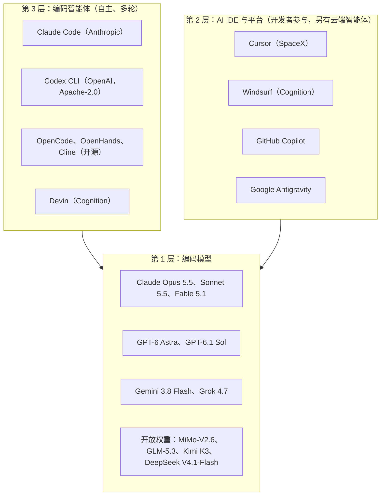

# OpenCoder：AI 编码智能体（Coding Agents）全景图

AI 编码智能体领域先是爆发式增长，随后逐渐整合。到 2026 年 10 月，它呈现出三种清晰形态：由实验室或大型社区支持的终端智能体（Claude Code、Codex CLI、OpenCode、Gemini CLI）；由同时开发模型的公司掌控的 IDE 智能体（Cursor 自 2026 年 8 月起归属 SpaceX，Windsurf 自 2025 年 7 月起归属 Cognition）；以及供应商运行控制平面、用户自己的基础设施执行代码的分离式架构。本指南涵盖开放权重编码模型、AI 原生 IDE、开源编码智能体，以及如何为工程工作流选工具。

## 目录

- [AI 编码全景图 (2026)](#ai-编码全景图-2026)
- [开源权重编码模型](#开源权重编码模型)
- [AI 原生 IDE](#ai-原生-ide)
- [开源编码智能体](#开源编码智能体)
- [基准测试深入解析](#基准测试深入解析)
- [成本对比](#成本对比)
- [选型指南](#选择指南)
- [生产架构](#生产架构)
- [面试题](#面试题)
- [参考资料](#参考资料)

---

## AI 编码全景图 (2026)

编码 AI 领域有三个明显层次：



这些层次正在模糊：IDE 供应商训练自己的模型（Cursor 的 Composer、Cognition 的 SWE-2；Cognition 称后者基于 Kimi K3 后训练），实验室智能体推出 IDE 扩展，Vercel AI SDK 7 的实验性 `HarnessAgent` 甚至把完整的编码 harness 当作可插拔依赖。

---

## 开源权重编码模型

这些模型可以自托管、微调，并在不依赖任何 API 的情况下部署。但在阅读模型卡前应先检查许可证：2026 年多个所谓“开放”的编码模型设有商业使用门槛。

### 当前开放权重前沿（2026 年 10 月）

| 模型 | 发布时间 | 总参数 / 激活参数 | 许可证 | 与编码相关的特点 |
|-------|----------|-----------------------|---------|-----------------------|
| Xiaomi MiMo-V2.6-Pro / -Flash | 2026 年 9 月 21 日 | 1.02T / 42B；309B / 15B | MIT | 1M 上下文；在 Artificial Analysis Intelligence Index v4.3.2 中为排名最高的开放模型（46 分） |
| Z.ai GLM-5.3 | 权重于 2026 年 8 月 28 日发布 | 744B / 40B | MIT；但过去 12 个月收入超过 100 亿美元的 MaaS 提供方还需经过安全审查 | AA 45 分；API 每百万 token $1.40/$4.40；SWE-Bench Pro v2 私有集 272 题答对 211 题 |
| Moonshot Kimi K3 | 2026 年 7 月 | 2.8T / 104B | 定制许可：开展任何 MaaS 业务、且连同关联公司在 12 个月内总收入超过 2000 万美元的企业，需另签协议 | AA 44 分；SWE-Bench Pro v2 私有集 272 题答对 214 题；Cognition SWE-2 和 Fireworks Ember-1 的基础模型 |
| Z.ai GLM-5.3-Flash | 2026 年 8 月 26 日 | 320B / 18B | MIT | AA 42 分；API 每百万 token $0.15/$0.50 |
| DeepSeek V4.1-Flash | 2026 年 9 月 10 日 | 主干 552B；预填充激活 8B、解码激活 16B | MIT | AA 39 分；供应商报告 DeepSWE v1.1 在 max effort 下得分 74.2 |
| Qwen3.8-Flash-Next | 2026 年 8 月 26 日 | 125B / 6B，另有 51B n-gram 表 | Qwen Community License 1.0 | 任何 MaaS 或 AI 编码助手**业务**均需另行取得 Qwen 许可，无收入门槛；纯内部使用豁免 |
| Qwen3.8-27B | 2026 年 | 27B 稠密模型 | Apache 2.0 | 单 GPU 级别；也是 Ternary Bonsai 2 27B 的基础模型（每权重 1.72 bit，总大小 5.95 GB） |
| IBM Granite 4.2 | 2026 年 8 月 25 日 | 3B / 8B / 30B 稠密模型 | Apache 2.0 | 128K 上下文（可扩展至 512K）；供应商报告 30B 在 SWE-bench Verified 上得分 57 |
| MiMo-V2.6-Distill-Qwen-9B | 2026 年 9 月 21 日 | 9B | MIT | 供应商报告 SWE-bench Verified 61.1%、SWE-bench Pro 44.6% |

**许可证陷阱**：Qwen Community License 1.0 要求从第一天起，基于 Qwen3.8-Flash-Next 构建编码智能体的创业公司就取得阿里巴巴许可；这比 Qwen 自家 2.4T 旗舰模型（收入超过 5000 万美元才触发）还严格。Mistral Medium 3.5 的 Modified MIT 许可证不向月收入超过 2000 万美元的企业授予权利。模型选型清单中应像评估一样包含许可证审查。

### 仍用于补全的早期小模型

2024 年前后的 coder 模型仍常用于资源有限设备上的低延迟中间填充（FIM）补全，此时智能体能力并不重要。下表 HumanEval+ 数字除 StarCoder2 来自其 Hugging Face 模型卡外，其余均来自 Qwen2.5-Coder 技术报告（arXiv 2409.12186，表 5 和表 16）。在智能体任务上，它们已远落后于当前前沿模型。

| 模型 | 参数量 | 上下文长度 | HumanEval+ | 许可证 |
|-------|------------|---------|------------|---------|
| Qwen2.5-Coder-32B-Instruct | 32B | 128K | 87.2% | Apache 2.0 |
| Qwen2.5-Coder-7B-Instruct | 7B | 128K | 84.1% | Apache 2.0 |
| Qwen2.5-Coder-1.5B-Instruct | 1.5B | 32K | 66.5% | Apache 2.0 |
| DeepSeek-Coder-V2-Lite-Instruct | 16B MoE（激活 2.4B） | 128K | 75.6% | DeepSeek 模型许可证 |
| StarCoder2-15B / 7B / 3B | 15B / 7B / 3B | 16K | 37.8%（15B 基础模型；StarCoder2-15B-Instruct-v0.1 为 63.4%） | BigCode OpenRAIL-M |

```python
# Self-hosted with vLLM (use vLLM >= 0.30.0: earlier releases have
# published RCE and engine-kill advisories)
from vllm import LLM

model = LLM(
    model="Qwen/Qwen2.5-Coder-32B-Instruct",
    tensor_parallel_size=2,  # 2× A100 80GB
)
response = model.generate("def fibonacci(n: int) -> list[int]:")
```

### 开源模型选型指南

```
Low-latency completions (< 100ms) on a laptop or single GPU?
  → Qwen2.5-Coder-1.5B/7B or StarCoder2-3B (FIM-trained, mature tooling)

Agentic coding, single GPU, permissive license?
  → Qwen3.8-27B (Apache 2.0) or Granite 4.2 30B

Agentic coding on one 8-GPU node?
  → GLM-5.3-Flash or MiMo-V2.6-Flash (MIT); DeepSeek V4.1-Flash needs H200/B200-class memory

Best self-hosted quality, multi-node budget?
  → MiMo-V2.6-Pro, GLM-5.3 or Kimi K3 (check each license gate)

Building a coding-assistant product to sell?
  → Read the license first: Qwen Community License 1.0 requires a separate license
```

---

## AI 原生 IDE

### Cursor

**网站：** cursor.com | **基础：** VS Code 分支 | **价格：** Pro 起价每月 $20，另有 Teams 和 Enterprise 套餐

Cursor 是领先的 AI 原生 IDE，自 2026 年 8 月 14 至 15 日起**归属 SpaceX**（据报道交易价值约为 600 亿美元的 SpaceX 股票）。Grok 4.6 和 4.7 都在 Cursor 自家博客上发布。收购公告没有说明是否继续接入第三方模型，也没有承诺数据使用方式；两周后模型问题有了具体答案：OpenAI 于 2026 年 8 月 28 日告知 SpaceX，将逐步终止向 Cursor 提供 OpenAI 模型的合同，拟于**2026 年 11 月 12 日**停止供应，并且在 Cursor 归属 SpaceX 期间不提供未来模型（包括 GPT-6 Astra）。该通知只涵盖 OpenAI 模型；其他模型的持续供应与数据使用都应以合同为准，不能自行假定。Cursor 于 2026 年 8 月 13 日取得 AIUC-1 智能体认证。

| 功能 | 说明 |
|---------|-------------|
| **Agent** | 多文件智能体编辑；Composer 现在是 Cursor 自有编码模型的名称 |
| **Tab** | 预测式补全 |
| **云端智能体** | 可在 Cursor 基础设施上运行；自 2026 年 9 月 2 日起，也可在 **Self-hosted Machines** 上运行（自己的机器，或 AWS Lambda、Coder、Cloudflare、Daytona、Modal、Namespace、Vercel、E2B 上的团队资源池） |
| **Projects**（2026 年 9 月 10 日测试版） | 协调智能体负责规划并委派给并行子智能体，规模可达数千；Cursor 称新 Projects 用户合并的 PR 增加 30%（供应商报告） |
| **Rollouts 和 Security Review**（2026 年 9 月 23 日） | 每个 PR 上的监控器，随部署追踪不同环境中的改动健康状况，以及扫描可利用漏洞的 PR 扫描器（Teams 和 Enterprise） |
| **Rules** | `.cursor/rules` 中的项目级 AI 指令，以及 `AGENTS.md` |
| **模型选择** | Anthropic、Google、xAI Grok 和 Cursor 自有模型；OpenAI 模型拟于 2026 年 11 月 12 日停供（OpenAI 表示不会提供 GPT-6 Astra 或后续模型） |

**最适合：** 希望在熟悉的 GUI 中进行智能体式编辑的前端/全栈开发者，以及希望使用云端智能体、又不想自己运维编排的团队。

**限制：** 闭源；除非使用隐私模式和自托管机器，代码会进入 Cursor 服务器。由一家前沿模型公司持有，也让部分买方需要重新审视模型中立性与数据治理。

### Windsurf（Cognition）

**网站：** windsurf.com | **基础：** VS Code 分支 | **价格：** 免费层及付费套餐

Windsurf 由 Codeium 打造，自 2025 年 7 月起归属 Devin 的开发商 **Cognition**。Cognition 于 2026 年 9 月 8 日以 480 亿美元估值融资超过 20 亿美元，报告年化收入运行率超过 10 亿美元（供应商报告），并推出只在 Devin 中提供的自有旗舰编码模型 SWE-2。

| 功能 | 说明 |
|---------|-------------|
| **Cascade** | Windsurf 的智能体式编辑模式 |
| **Flows** | 智能体与开发者共享的会话，Cascade 将你的编辑和操作纳入上下文；不要与 CrewAI Flows 混淆 |
| **模型选择** | 多家供应商的前沿模型，以及 Cognition 自有模型 |
| **免费层** | 面向个人的免费额度 |

**最适合：** 想要类似 Cursor 的体验、免费层和模型灵活性的团队，以及已采购 Devin 的组织。

### GitHub Copilot（Microsoft / OpenAI）

| 功能 | 状态（2026 年 10 月） |
|---------|---------------------|
| 补全 | 按安装量仍是市场领导者 |
| 编码智能体 | 分派 issue，获得 PR（Copilot Workspace 的预览已于 2025 年结束） |
| 代码审查批准 | Copilot 的审查可计入必需批准（2026 年 9 月 1 日公开预览，默认关闭）；管理员可指定允许批准的路径；新增提交后其批准会失效 |
| 计算机操作与动态工作流 | 2026 年 10 月 1 日在 Copilot CLI 和应用中公开预览；工作流以代码定义阶段，并在检查点接受人工审查 |
| HydraFusion | 研究预览（2026 年 9 月 30 日）：级联模式（低价模型先起草，质量门决定是否升级）和跨模型家族互评模式 |
| 本地沙箱 | Copilot 应用中按项目限制文件系统、网络和凭据（2026 年 9 月 23 日公开预览，默认关闭） |
| 模型 | 自动模型选择分效率、平衡和智能档；可使用 OpenAI、Anthropic 和 Google 模型 |
| 企业功能 | IP 保护、组织策略、代码引用控制 |

**最适合：** 已经处于 Microsoft / GitHub 生态中的企业团队。

**2026 现实：** 许多开发者在智能体工作中更喜欢 Cursor 或 Claude Code，但 Copilot 的企业控制和 GitHub 集成仍让它在大型组织中占据主导。有两点治理事项：Plugin4Shell 于 2026 年 9 月 17 日披露时，Copilot 尚未打补丁；自 10 月 1 日起，信用卡和 PayPal 客户需预付已分配席位的费用。

### Google Antigravity

Antigravity 是 Google 的智能体式开发平台，更像一个**智能体优先工作区**，而不只是文本编辑器。Antigravity 2.0（2026 年 5 月 19 日）使它成为产品家族：用于协调多个本地智能体的桌面应用、IDE、**Antigravity CLI** 和 SDK。

| 功能 | 细节 |
|---------|--------|
| **Agent Manager** | 专门的视图，用于启动、观察并引导多个异步编码智能体，而不是一次只编辑一个文件 |
| **规划 + 工件** | 智能体在执行前和执行过程中会产出计划和可审阅工件（diff、任务列表、实时浏览器会话） |
| **内置浏览器** | 智能体可以运行并可视化测试其构建的 UI |
| **模型可选性** | 默认使用 Gemini 模型，同时支持 Anthropic Claude 和开放模型 |
| **企业版** | 自 2026 年 8 月 20 日起包含在符合条件的 Gemini Enterprise Standard 和 Plus 订阅中，提供浏览器及 MCP 权限的沙箱与策略限制、预算上限、集中审计日志、Workforce Identity Federation，以及适用于 VS Code、Visual Studio、JetBrains、Zed 和 Xcode 的扩展 |
| **API 智能体** | `antigravity-preview-09-2026` 于 9 月 17 日替换 `antigravity-preview-05-2026`（5 月版于 2026 年 10 月 5 日关闭），并带来破坏性工具变更：PascalCase 参数、按行范围编辑而非整篇重写，以及新的 `find_by_name` 和 `grep_search` 工具 |

Google 将 Antigravity CLI 定位为 Gemini CLI 的继任者；自 2026 年 6 月起，它已取代免费、Google AI Pro 和 Ultra 用户使用的 Gemini CLI。Gemini CLI 仍在维护（2026 年 9 月 29 日为 v0.62.0），面向 Gemini Code Assist Standard、Enterprise 和付费 API 密钥用户。

**最适合：** 希望在“任务”层级操作（委派目标、审阅计划和结果）而非逐项编辑的开发者，以及希望在 IDE、CLI 和 SDK 中统一使用一个获许可 harness 的 Google Cloud 团队。

---

## 开源编码智能体

### OpenCode

**GitHub：** github.com/anomalyco/opencode | **许可证：** MIT

GitHub star 最多的开源编码智能体（截至 2026 年 10 月 1 日为 21.13 万；9 月 30 日版本为 v1.18.34；此前一个月 npm 下载量约 960 万次）。它是带 TUI 的终端智能体，支持包括本地模型在内的任意模型提供方，并支持 MCP。对于“能选模型的开源 Claude Code”，它通常是首选答案。

### Codex CLI（OpenAI）

**GitHub：** github.com/openai/codex | **许可证：** Apache-2.0

OpenAI 的开源终端智能体（12.75 万 GitHub star；2026 年 9 月 30 日版本为 rust-v0.159.3；此前一个月 npm 下载量约 8880 万次）。2026 年的重要信息：

- **默认模型**：自 rust-v0.159.1（9 月 29 日）起为 GPT-6.1 Sol，Amazon Bedrock 模型目录中也如此。没有固定模型的用户升级 CLI 后，模型就会改变。
- **DevDay（9 月 29 日）**：可复用云环境、用于并行任务的 `/agents` 视图、GitHub PR 和 GitLab MR 的代码审查、Codex Security Cloud，以及 **Ultrafast** 档位（GPT-6 Astra 已提供，Sol 即将支持；OpenAI 称在 Codex 中生成速度最高提升 8 倍；仅支持全球处理或美国数据驻留，没有欧盟端点）。
- **安全修复**：GitSpawn 于 0.131.0 修复，Plugin4Shell 于 0.146.0 修复。
- **无头模式**：CI 使用 `codex exec`。

### OpenHands（原 OpenDevin）

**GitHub：** github.com/OpenHands/OpenHands（原 `All-Hands-AI/OpenHands`） | **许可证：** MIT

OpenHands 现在以 **Agent Canvas** 形式提供（2026 年 9 月 25 日版本为 v1.24.0，大致每周发布）：一个自托管控制中心，可在可替换的执行后端上运行开源 OpenHands 智能体，或任何支持 Agent Client Protocol 的智能体（Claude Code、Codex、Gemini）。旧教程中将 Docker socket 挂载到 `docker.all-hands.dev/all-hands-ai/openhands` 的做法属于上一代架构。

```bash
# Docker sandbox option from the upstream README (pin the tag you tested)
export PROJECTS_PATH="$HOME/projects"   # only these folders are visible to the agent
mkdir -p "$PROJECTS_PATH" "$HOME/.openhands"
docker run -it --rm \
  -p 127.0.0.1:8000:8000 \
  -e AGENT_CANVAS_ALLOW_LAN_SESSION_KEY=true \
  -v "$HOME/.openhands:/home/openhands/.openhands" \
  -v "${PROJECTS_PATH}:/projects" \
  ghcr.io/openhands/agent-canvas:1.24.0
# UI at http://localhost:8000/canvas; models are configured as LLM profiles in the UI.
# Publish only on 127.0.0.1: on a LAN or public interface, drop the session-key
# injection flag and follow the upstream self-hosting hardening guide.
```

**架构：**
```
Agent Canvas (web UI, automations: schedules, webhooks, Slack, GitHub, Linear)
    ↓
Agent Server (OpenHands SDK)
    ├── OpenHands agent, or an ACP agent (Claude Code, Codex, Gemini)
    └── Backend: local process, Docker (one container per conversation),
        a VM, or OpenHands Cloud / Enterprise
```

**主要特性：**
- **任意 LLM**：LLM profile 可通过兼容 OpenAI 的端点接入 Claude、GPT、Gemini 和开放权重模型。
- **可替换执行后端**：同一 UI 可驱动在笔记本、按会话创建的 Docker 容器或共享团队服务器中运行的智能体。
- **自动化**：按计划或 webhook 触发智能体运行，也是 CI 集成方式。
- **不绑定 harness**：它可以通过 ACP 驱动 Claude Code 或 Codex，因此竞争的不只是智能体本身，也是编排层。

### Aider（旧版）

**GitHub：** github.com/Aider-AI/aider | **许可证：** Apache 2.0

Aider 开创了终端优先、Git 原生的编码智能体：边工作边提交，维护不在上下文中的仓库文件地图，并将架构模式与编辑模型分开。但它**已趋于沉寂**：最近一次 PyPI 发布是 2026 年 2 月 12 日的 0.86.2，最近一次提交是 5 月 22 日。缺乏维护的 harness 无法及时适配新模型的 API 限制（例如最近的 Claude 和 GPT-6 模型拒绝自定义采样参数），也无法提供安全修复，因此新项目优先选择 OpenCode 或 Codex CLI。

```bash
# 2025-era usage, shown for its git-native workflow; claude-3-7-sonnet-20250219
# was retired Feb 19, 2026, and current Claude models may reject the sampling
# parameters Aider sends
pip install aider-chat
aider --model claude-3-7-sonnet-20250219
/add src/auth.py src/models.py
> Add JWT authentication to the User model
```

### Cline（VS Code 扩展）

**GitHub：** github.com/cline/cline | **许可证：** Apache 2.0

用于自主编码的开源 VS Code 扩展，现已达到 v4.1.22，并提供可嵌入其他应用的 SDK：

```
VS Code
  └── Cline Extension
        ├── Any model (Claude, GPT, Gemini, Ollama)
        ├── File system access (read/write any file)
        ├── Terminal (bash commands)
        ├── Browser (playwright)
        └── MCP servers (any MCP tool)
```

**关键差异点：**
- **MCP 原生**：开箱即用的完整 MCP 支持
- **按动作授权**：shell 命令和文件编辑默认需要批准，可配置自动批准。
- **模型灵活性**：支持任何兼容 OpenAI 的 API 端点（包括本地 Ollama）
- **免费**：开源，无订阅费（模型 API 仍需付费）。

**最适合：** 想要免费获得类似 Cursor 的体验，并且需要完整模型灵活性的开发者。

---

## 基准测试深入解析

### 当前编码基准

SWE-bench Verified 已难以区分前沿智能体：分数接近天花板。2026 年 9 月的一项审计（arXiv 2609.34262）发现，SWE-Bench Pro v1.0 中本应不算成功却通过的运行比例，从 Opus 4.7 的 24% 到 Fable 5 的 73% 不等，主要是通过 git 历史访问到参考解。另一项研究（arXiv 2609.27891）发现，把 SWE-bench 仓库以保持行为不变的方式改写后，模型表现会下降，表明它记住了仓库线索。引用当前数字时，务必注明 effort 和运行方：

| 基准 | 结果 | 运行方 | 意义 |
|-----------|---------|--------|----------------|
| SWE-Bench Pro v2 私有集（272 项任务） | Claude Opus 5 完成 222 题（81.6%）、Kimi K3 214 题（78.7%）、GLM-5.3 211 题、Gemini 3.8 Flash 211 题、Inkling 184 题 | Scale，2026 年 9 月 22 日；断网沙箱、干净环境重新评分 | 干净的测量；开放权重的 Kimi K3 和 GLM-5.3 与 Opus 5 只差约 3 至 4 个百分点。公开的 642 题划分已趋饱和（Opus 5 为 99.4%） |
| Terminal-Bench 4.0 | GPT-6 Astra 58.18%（max）、Claude Fable 5.1 57.88%（max/xhigh）、Claude Opus 5 53.94%（xhigh） | tbench.ai 排行榜，9 月 21 日 | 该快照后发布、仅由供应商报告：Opus 5.5 66.4%（xhigh）、Sonnet 5.5 70.6%（Anthropic） |
| DeepSWE v1.1（113 项委托任务） | 三者均为 74%：GPT-6 Astra（xhigh，$4.43/任务）、Gemini 3.8 Flash（high，$2.36/任务）、Opus 5（max，$11.84/任务） | DeepSWE 排行榜，9 月 22 日 | 通过率相同，每任务成本相差 5 倍 |

> [!NOTE]
> 分数对后端模型、effort 和 harness 都高度敏感。同一模型在 Claude Code、Codex、OpenHands 或简化 harness 中可能相差数个百分点，因此应按 SWE-Bench Pro v2 的纪律在自己的仓库上评估智能体：除模型端点外断网，并在干净镜像上重新评分每个 diff。

### 历史数据：HumanEval+ 与 LiveCodeBench（2025 年快照）

两者都不再适合作为前沿能力信号：HumanEval 已趋饱和，Artificial Analysis 也将 LiveCodeBench 列入历史评估。保留这些表格仅用于记录 2025 年的先进水平。GPT-4o、Qwen 和 DeepSeek 的 HumanEval+ 行来自 Qwen2.5-Coder 技术报告；StarCoder2-15B 来自其模型卡，指的是基础模型。

| 模型 | HumanEval+ 分数 |
|-------|-----------------|
| Claude 3.7 Sonnet | 93.6% |
| GPT-4o（2024-08-06） | 86.0% |
| Qwen2.5-Coder-32B-Instruct | 87.2% |
| DeepSeek-Coder-V2-Instruct | 82.3% |
| StarCoder2-15B | 37.8% |

| 模型 | LiveCodeBench 分数 |
|-------|---------------------|
| o3 (high) | 68.1% |
| Claude 3.7 Sonnet | 54.2% |
| GPT-4.5 | 38.7% |
| Qwen2.5-Coder-32B | 43.2% |
| DeepSeek-R1 | 57.0% |

---

## 成本对比

### 闭源 API vs. 开源自托管

**场景：每天 1,000 项智能体缺陷修复任务。** 每项任务约调用模型 15 次、输入 750K token（多数为重复上下文，其中 90% 命中缓存；未命中的 10% 在适用时按缓存写入费率计算）、输出 2.5K token。这些是按标价计算的示例估算，并非实际测量；质量数据采用 Artificial Analysis Intelligence Index v4.3.2。

| 方案 | 每任务成本 | 月成本（30 天） | AA 指数 | 备注 |
|----------|---------------|-------------------|----------|-------|
| Claude Sonnet 5.5（API） | ~$0.35 | ~$10,500 | 56 | 缓存读取每百万 token $0.20 |
| Claude Opus 5.5（API） | ~$0.56 | ~$16,800 | 58 | 同样按每百万 token $0.20 读取缓存，因此此处成本仅约为 Sonnet 的 1.6 倍 |
| GPT-6.1 Sol（API） | ~$0.28 | ~$8,400 | 52 | 缓存读取每百万 token $0.10（0.05 倍） |
| GPT-6 Astra（API） | ~$1.74 | ~$52,000 | 53 | 缓存读取每百万 token $1；留给最难的任务 |
| DeepSeek V4.1-Flash（API，峰时标价，假设无缓存折扣） | ~$0.23 | ~$6,900 | 39 | 非高峰时段半价；需确认提供方缓存命中率 |
| 自托管 GLM-5.3-Flash（单个 8×H100 节点，24/7 全天运行） | 取决于利用率 | 基础设施约 $16,000 | 42 | 每 GPU 小时 $2.77（Silicon Data H100 指数，2026 年 10 月 1 日），未计入工程与值班成本 |

**关键洞察**：
- 智能体编码任务由**输入主导**（Anthropic 遥测显示 Claude Code 的输入与输出比为 324:1），缓存读取价格和命中率比标称输入价更影响账单。
- 自托管只有在持续高利用率下才划算，现在应与便宜且善用缓存的 API 比，而非 2025 年标价。自托管更充分的理由是数据控制、在内部代码上微调，以及不受供应商默认模型变化影响。
- 构建前先查许可证：未经另行授权，Qwen3.8-Flash-Next 不能支撑商业编码助手。

---

## 选择指南

### 快速决策树

```
What is your primary need?

├─ IDE coding assistance (completions + chat + agent)?
│  ├─ Microsoft ecosystem / enterprise? → GitHub Copilot
│  ├─ Want best quality and cloud agents? → Cursor
│  └─ Want free + model choice? → Windsurf or Cline
│
├─ Autonomous agent for standalone coding tasks?
│  ├─ Best quality, Claude models acceptable? → Claude Code
│  ├─ OpenAI shop, or want an open-source CLI from a lab? → Codex CLI
│  ├─ Need open source with any model? → OpenCode (terminal) or OpenHands (web UI)
│  └─ VS Code embedded, MCP-native? → Cline
│
├─ Self-hosted model for custom deployment?
│  ├─ Best quality? → MiMo-V2.6-Pro, GLM-5.3 or Kimi K3 (check licenses)
│  ├─ One node? → GLM-5.3-Flash or MiMo-V2.6-Flash
│  ├─ Single GPU, Apache 2.0? → Qwen3.8-27B or Granite 4.2 30B
│  └─ Fast completions / edge? → Qwen2.5-Coder-1.5B/7B or StarCoder2-3B
│
└─ CI/CD pipeline integration?
   ├─ Best results? → Claude Agent SDK or `claude -p` (headless), `codex exec`
   ├─ Open-source? → OpenHands automations (webhook-triggered) or OpenCode
   └─ Managed loop? → OpenAI Agents API or Claude Managed Agents (check residency and ZDR)
```

### 对比矩阵

| 维度 | Claude Code | Codex CLI | Cursor | OpenCode | OpenHands | Cline |
|-----------|-------------|-----------|--------|----------|-----------|-------|
| 自主性 | 完全 | 完全 | 完全（智能体模式） | 完全 | 完全 | 完全 |
| 模型锁定 | Claude | 默认 OpenAI | 多家模型 | 多家模型 | 多家模型 | 多家模型 |
| 开源 | 否 | 是 | 否 | 是 | 是 | 是 |
| CI/无头模式 | 是 | 是 | 云端智能体 | 是 | 是 | 是（SDK） |
| 图形界面 | CLI、IDE、桌面 | CLI、IDE、云端 | 完整 IDE | 终端 | Web UI | VS Code |
| MCP | 是 | 是 | 是 | 是 | 是 | 是 |
| 自托管执行 | 是（自托管 runner） | 是 | 是（Self-hosted Machines） | 是 | 是 | 是 |
| 价格 | 订阅或 API | 订阅或 API | 每月 $20 起 | 免费 + API | 免费 + API | 免费 + API |

---

## 生产架构

### 企业级编码智能体平台

以下是构建内部 AI 编码平台的方法。2026 年的典型形态是**分离式平面**：智能体供应商（或自有编排器）负责规划和模型调用，执行、凭据和网络出站留在自己的边界内。Claude Code 自托管 runner、Cursor Self-hosted Machines、OpenAI Agents API 自托管沙箱和 Copilot 本地沙箱都在 2026 年 8 月至 9 月间推出。

```
┌────────────────────────────────────────────────────────────┐
│             ENTERPRISE CODING AGENT PLATFORM               │
├────────────────────────────────────────────────────────────┤
│                                                            │
│  Developer                                                 │
│     ↓ (Jira ticket / PR description)                       │
│  ┌──────────────────────────────────┐                      │
│  │        TASK INTAKE LAYER         │                      │
│  │  • Parse task from Jira/GitHub   │                      │
│  │  • Classify: simple/complex      │                      │
│  │  • Route to model tier + budget  │                      │
│  └──────────────┬───────────────────┘                      │
│                 │                                          │
│    Simple fix   │   Complex feature                        │
│        ↓        │        ↓                                 │
│  ┌──────────┐   │  ┌──────────────────┐                    │
│  │ Mid-tier │   │  │ Frontier model,  │                    │
│  │  model   │   └→ │ same harness     │                    │
│  └────┬─────┘      └────────┬─────────┘                    │
│       │                     │                              │
│       └──────────┬──────────┘                              │
│                  ↓                                         │
│  ┌──────────────────────────────────┐                      │
│  │   EXECUTION PLANE (your infra)   │                      │
│  │  • Container/microVM per task    │                      │
│  │  • Egress allowlist, no prod keys│                      │
│  └──────────────┬───────────────────┘                      │
│                 ↓                                          │
│  ┌──────────────────────────────────┐                      │
│  │         REVIEW LAYER             │                      │
│  │  • Git diff → PR creation        │                      │
│  │  • Auto-run CI tests             │                      │
│  │  • Human review (required)       │                      │
│  └──────────────────────────────────┘                      │
│                 ↓                                          │
│         Merge to main (human approved)                     │
│                                                            │
└────────────────────────────────────────────────────────────┘
```

### 关键生产决策

| 决策 | 选项 | 推荐 |
|----------|---------|----------------|
| 智能体模型 | Claude Opus 5.5 / Sonnet 5.5、GPT-6.1 Sol、GPT-6 Astra、开放权重（GLM-5.3、Kimi K3、MiMo-V2.6） | 按任务类型固定模型（例如默认 Sonnet 5.5 或 GPT-6.1 Sol，难题用前沿模型），每次发布后重跑自己的评估集 |
| 任务接入 | 手动、Jira webhook、GitHub 标签 | GitHub 标签触发 Actions 工作流 |
| 代码执行 | 本地、Docker、微型虚拟机、自托管 runner | 在自己的边界内使用容器或微型虚拟机，并设置网络出站允许列表 |
| 人工审查 | PR、Slack 审批、自动化 | 必须人工审查 PR，绝不自动合并；智能体批准不计入必需审查 |
| 成本控制 | 最大轮次、预算、模型路由、缓存 | 按任务设置轮次和开支预算、缓存命中率告警，简单任务用更便宜的模型 |
| 版本策略 | 浮动、固定、固定并设最低版本 | 固定智能体 CLI 版本，并设安全最低版本（Claude Code >= 2.1.196、Codex >= 0.146.0，以覆盖 GitSpawn 和 Plugin4Shell 修复） |

---

## 面试题

### 问：你如何在 Claude Code、Cursor 和 OpenHands 之间做选择？

**强答案：**
这取决于三个维度：

1. **界面需求**：如果开发者需要图形界面（在上下文中查看变更），使用 Cursor 或 Windsurf。脚本化/无头任务（缺陷修复、CI 测试生成）可用 Claude Code、Codex CLI 或 OpenHands。

2. **模型控制**：若需使用任意模型或自有微调模型，选择 OpenCode 或 OpenHands。若可接受仅使用 Claude 并希望获得一流效果，可用 Claude Code；使用 OpenAI 的团队则可选 Codex CLI。

3. **开源与供应商要求**：企业安全团队通常需要可审计的开源工具。OpenCode（MIT）、OpenHands（MIT）和 Codex CLI（Apache-2.0）符合要求。所有权也应纳入评估：Cursor 属于 SpaceX、Windsurf 属于 Cognition，两家公司都开发自己的模型。风险已不只是猜测：SpaceX 收购后，OpenAI 正逐步终止向 Cursor 供应模型（拟于 2026 年 11 月 12 日停供）。我会要求供应商在合同中承诺第三方模型访问和数据使用方式，并将批处理与 CI 的模型路由放在自己掌控的层中。

对于典型初创公司，我会建议：日常开发用 Cursor，批量任务（来自 GitHub issue 的 PR）用 Claude Code 或 Codex，自托管 CI 流水线用 OpenHands 或 OpenCode。

### 问：为什么开放权重编码模型对企业很重要？

**强答案：**
有三个原因：

1. **数据控制**：企业级 API 提供不用于训练和零数据保留条款，但部分医疗（HIPAA）、金融（SOX）和政府团队仍不能让专有代码离开网络。内部部署开放权重模型可解决这一问题。

2. **定制能力**：开放权重模型可以针对内部 DSL 或代码库进行领域专门化。OpenAI 正逐步结束自助微调（现有客户自 2027 年 1 月 6 日起无法提交新任务），因此这条路径更重要；LangSmith Fine-Tuning 等从追踪到微调的流水线，目标就是在 Fireworks 或 Baseten 上运行开放权重模型。

3. **独立性**：不必受其他供应商发布周期中的默认模型变化或平台退役计划影响。

质量差距已经大幅收窄：在 Scale 干净的 SWE-Bench Pro v2 私有集上，Kimi K3（78.7%）和 GLM-5.3（77.6%）与 Claude Opus 5（81.6%）只差约 3 至 4 个百分点。成本理由却没有过去那么强，因为缓存密集型智能体任务使用 API 也可能很便宜，而且许可证必须仔细阅读：未经另行授权，Qwen3.8-Flash-Next 不能用于商业编码助手。

### 问：如果在 CI 中为 AI 编码智能体设计测试策略，你会怎么做？

**强答案：**
我会使用三层评估：

**1. 功能测试**（自动化，每次运行）：
```
Agent output → Run pytest → Pass rate metric
```

**2. 真实答案对比**（每周）：
```
Known bug → Agent fix → Compare to expert fix
Metric: Semantic similarity of diff (not byte-exact)
```

**3. 人工评估**（抽样 5% 个智能体 PR）：
```
Senior engineer rates: Correctness, Style, Safety, 1-5 scale
```

我还会跟踪**回归率**：如果智能体修复引入新的失败测试，就是硬失败。智能体应运行完整测试套件，只有维持或提高通过率才算成功。同时应像 SWE-Bench Pro v2 一样加固 harness：沙箱只能访问模型端点，移除包含修复答案的 git 历史，并在干净镜像上重新评分每个 diff，因为能找到答案的智能体往往会直接使用它。

### 问：GitHub 现在允许 Copilot 代码审查的批准计入必需审查，你会开启吗？

**强答案：**
只会在有限范围内开启。该功能自 2026 年 9 月 1 日公开预览，默认关闭；管理员可选择 Copilot 可以批准哪些路径，其批准会像人工批准一样在新增提交后失效。我会把它限制在文档、生成客户端或仅测试等低风险路径，以减少实际审查负担；排除基础设施、认证、支付、CI 配置和智能体指令文件。硬规则是职责分离：智能体编写的 PR 不能仅由智能体批准，因为造成错误的同一盲点也可能批准它。我还会记录所有智能体批准以备审计，并抽样进行人工复审；若获批路径上的合并后事故增加，就收窄范围。

---

## 参考资料

- Scale. SWE-Bench Pro v2（2026 年 9 月）：https://scale.com/leaderboard
- Terminal-Bench 排行榜：https://www.tbench.ai/
- arXiv 2609.34262。《Maintaining Benchmarks Against Increasingly Capable Agents: Detection and Remediation of Unearned Passes》（2026 年 9 月）：https://arxiv.org/abs/2609.34262
- OpenCode：https://github.com/anomalyco/opencode
- Codex CLI：https://github.com/openai/codex
- Gemini CLI：https://github.com/google-gemini/gemini-cli
- Google.《Introducing Google Antigravity CLI》：https://antigravity.google/blog/introducing-google-antigravity-cli
- Cursor.《Joining SpaceX》（2026 年 8 月）：https://cursor.com/blog/joining-spacex
- OpenAI.《Our decision on Cursor following its acquisition by SpaceX》（2026 年 8 月 28 日）：https://openai.com/index/our-decision-on-cursor-following-its-acquisition-by-spacex/
- GitHub.《Copilot code review can now approve pull requests》（2026 年 9 月 1 日）：https://github.blog/changelog/2026-09-01-copilot-code-review-can-now-approve-pull-requests/
- Cognition 博客：https://cognition.com/blog
- Qwen2.5-Coder: https://qwenlm.github.io/blog/qwen2.5-coder/
- DeepSeek-Coder-V2: https://github.com/deepseek-ai/DeepSeek-Coder-V2
- StarCoder2: https://huggingface.co/blog/starcoder2
- OpenHands: https://github.com/OpenHands/OpenHands
- Aider: https://aider.chat/
- Cline: https://github.com/cline/cline
- Cursor: https://cursor.com/
- Windsurf: https://windsurf.com/
- Google Antigravity: https://developers.googleblog.com/build-with-google-antigravity-our-new-agentic-development-platform/
- LiveCodeBench: https://livecodebench.github.io/

---

*上一篇：[Claude Code](09-claude-code.md) | 下一篇：[框架选择指南](08-framework-selection-guide.md)*
