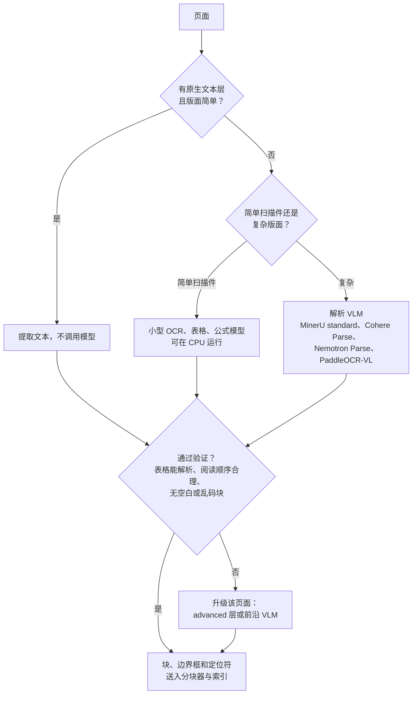

# OCR 与版面分析

文档解析不再只是传统 OCR 引擎与前沿多模态 LLM 的二选一。中间层的**专用文档解析 VLM**（经过将页面转为结构训练的小型视觉语言模型），能以远低于前沿模型的每页成本返回 Markdown、表格、边界框和阅读顺序。设计问题已从“哪个模型读得最好”转向“每页需要哪一层能力，以及在我的处理量下每页花多少钱”。

## 目录

- [三个层级：OCR 引擎、解析 VLM、前沿 VLM](#三个层级-ocr-引擎、解析-vlm、前沿-vlm)
- [Vision-LLM 版面提取](#vision-llm-版面提取)
- [分层解析与块级定位符](#分层解析与块级定位符)
- [阅读顺序与逻辑结构](#阅读顺序与逻辑结构)
- [处理低质量扫描件和手写内容](#处理低质量扫描件和手写内容)
- [成本与延迟权衡](#成本与延迟权衡)
- [面试题](#面试题)
- [参考资料](#参考资料)

---

## 三个层级：OCR 引擎、解析 VLM、前沿 VLM

| 特性 | 传统 OCR 引擎（Tesseract、AWS Textract、Azure AI Document Intelligence、Google Document AI） | 文档解析 VLM（Cohere Parse、MinerU、PaddleOCR-VL、Nemotron Parse 2.0、DeepSeek-OCR 2） | 前沿 VLM（Claude Opus 5.5 / Sonnet 5.5、GPT-6 Sol、Gemini 3.8 Flash） |
|---------|-------------------------------------------|----------------------------------------|--------------------------------------------------------|
| **主要机制** | 字符识别，辅以版面规则或模型 | 经过页面转结构训练的小型 VLM | 通用视觉 token 理解 |
| **阅读顺序** | 简单；复杂版面上容易出错 | 显式预测 | 隐式处理，通常正确但难以审计 |
| **几何信息** | 每词边界框及置信度 | 每块边界框（文本、表格、图形）和阅读顺序 | 不适合逐词审计 |
| **表格** | 单独的表格 API；合并单元格表现较弱 | 内联 HTML 或 Markdown | 按要求输出 Markdown 或 HTML |
| **失败方式** | 误读字符；不会编造文字 | 页面质量受损时可能产生幻觉 | 可能生成流畅、可信但错误的文字 |
| **成本驱动因素** | CPU 或按页收取的 API 费用 | 单 GPU 每秒处理页数，或 API 每千页约 $1.50 | token：按 2026 年 10 月标价，每千页约 $4（Gemini 3.8 Flash 推广价）至 $23（Claude Opus 5.5） |

**质量差距有多大？** 在 Cohere 为自家产品发布所运行的文档解析基准 ParseBench（供应商评测，2026 年 8 月）上，平均分依次为 GPT-5.5 84.4、Claude Opus 4.8 84.3、Gemini 3.5 Flash 81.8、Cohere Parse 79.2、LlamaParse（低成本模式）78.3、Google Document AI 57.3、AWS Textract 53.3。可以理解为：顶级前沿模型领先 Cohere Parse 约 5 分，传统 OCR 服务比两者低 20 多分。后一个差距很可能更多反映解析基准对表格、阅读顺序和结构化输出的侧重，而非纯字符识别准确率；不能据此断言“Textract 不会读文字”。

**解析 VLM 在 2026 年进展很快。** 大多数模型开放权重；Cohere Parse 仅提供 API 或单租户部署。下表分数来自不同基准和运行方，不能跨行比较：

| 模型 | 发布时间 | 备注 |
|-------|----------|-------|
| DeepSeek-OCR 2 | 2026 年 1 月 27 日 | Apache 2.0 |
| PaddleOCR-VL | 1.5 于 2026 年 1 月 29 日发布 | Jina 的对比显示 1.6 版在 OmniDocBench v1.6 得分 96.34；Apache 2.0 |
| Chandra OCR 2 | 2026 年 3 月 18 日 | olmOCR-Bench 85.8；代码为 Apache 2.0，但权重采用 Datalab 修改的 OpenRAIL-M：研究、个人用途及融资额或收入低于 200 万美元的初创企业可免费使用，不得用于与 Datalab API 竞争的用途；否则需付费许可 |
| Surya OCR 2 | 2026 年 5 月 27 日 | 代码 Apache 2.0；权重采用修改的 OpenRAIL-M：研究、个人用途及融资额或收入低于 500 万美元的初创企业可免费使用；否则需付费许可 |
| NVIDIA Nemotron Parse 2.0 | 2026 年 8 月 3 日 | 参数少于 1B；提供版面类别、边界框、阅读顺序和图表转表格；OpenMDW-1.1 |
| Cohere Parse（`parse-v5.0`） | 2026 年 8 月 27 日 | 闭源权重，2.3B 参数 VLM；API 每千页 $1.50；输出带 HTML 表格的 Markdown，或带边界框的有序块 |
| jina-ocr-v1 | 2026 年 9 月 14 日 | 基于 DeepSeek-OCR（总参数 3.4B、MoE 激活约 570M）；OmniDocBench v1.6 91.14、olmOCR-Bench 83.4；**CC BY-NC 4.0，未经许可不能商用** |
| MinerU 4.0 | 2026 年 9 月 16 日 | 提供质量层级和面向智能体的 CLI 的工具包（见下文）；MinerU Open Source License（Apache 2.0 附加条款）：允许商用，但月活用户超过 1 亿或月收入超过 2000 万美元需另行授权，线上服务还必须标注 MinerU |

基准测试前先查许可证。无法交付的解析器不能作为候选；“开放权重”既可能是 Apache 2.0，也可能禁止商用或设有收入门槛，成长中的企业可能超出许可范围。

---

## Vision-LLM 版面提取

基线工作流仍是 **Screenshot-to-Markdown**：
1. **Rasterize**：将 PDF 页面转换为图像（如果页面本身有可用文本层，可能完全不需要这一步）。
2. **Visual Prompting**：要求模型“将以下页面转录为 GitHub-flavored Markdown，并保留表格和标题。”
3. **Structured Recovery**：利用模型的空间感知能力重建逻辑层级。

对于 RAG，应要求输出**块，而不只是 Markdown**。带类型的块列表（标题、段落、表格、图形、说明文字），连同页码、边界框和阅读顺序索引，可以按真实边界分块、保持表格完整，并引用页面局部区域而非整个文档。解析 VLM 可原生返回这些信息（如 Cohere Parse 的 `blocks` 输出、Nemotron Parse 2.0 的版面类别和边界框）；前沿 VLM 则需通过结构化输出来要求并验证。

---

## 分层解析与块级定位符

真实语料中的大多数页面并不难。对文本层干净的原生数字 PDF 支付前沿 VLM 的价格是浪费，因此应将每页路由到能通过验证的最便宜层级。

MinerU 4.0（2026 年 9 月 16 日）把这种策略内置到工具中，用四个质量层级替代后端选择：**flash**（不调用模型，使用 PDF 原生文本处理数字文档）、**basic**（小型 OCR、公式和表格模型，可在 CPU 上运行）、**standard**（小模型加 VLM，默认值）和 **advanced**（对复杂文档增加推理）。它还可原生解析 DOCX、PPTX、XLSX、EPUB、OFD、HTML 和 CSV，无需先转换为 PDF。

**定位符使引用可以核查。** MinerU 4.0 的 `mineru` CLI（parse、read、find、search、watch）返回 `doc:{id}/tier:{tier}/page:{page}/block:{block}` 等稳定定位符，并逐步读取长文档（先取前 10 页，再按续读请求获取后文），让智能体可以引用具体块，审查人员也能打开对应区域。除非传入 `--remote`，解析会在本地运行。Docling 也朝同一方向发展：v2.128.0（9 月 16 日）加入 NVIDIA Nemotron Parse 2.0 可插拔 VLM 后端，v2.130.0（9 月 22 日）加入 MinerU 2.5 Pro。

应在每个块上存储解析器名称、版本和层级。Docling 于 2026 年 10 月 1 日在 v2.132.0 中改变了阅读顺序算法；解析器升级可能重排文本、移动分块边界，从而悄然改变检索结果。生产升级前应抽样重新解析并比较差异。

---

## 阅读顺序与逻辑结构

> [!IMPORTANT]
> 简单 RAG 中一个常见的失败是把段落跨栏拆开。
> 视觉模型能够“看到”栏间留白并正确排列文字，而基于规则的解析器可能直接横跨两栏读取。

解析 VLM 会显式预测阅读顺序，便于检查（例如标记预测顺序在两栏之间来回跳动超过一次的页面）。前沿 VLM 通常能读对，却没有可审计的顺序结果；多栏法律和科研文档更适合能输出顺序索引的解析器。

---

## 处理低质量扫描件和手写内容

现代视觉模型在以下方面比字符级 OCR 鲁棒得多：
- **倾斜与旋转**：通常无需预先校正，但廉价的倾斜校正仍有助于小型解析模型。
- **透印**：语义上下文可帮助模型忽略页面背面的文字。
- **手写注释**：可单独提取到 `annotations` 字段。

鲁棒不等于可靠。页面质量受损时，危险的失败方式是流畅、可信地转录出页面上根本不存在的文字。对于金额、日期、ID 等高风险字段，应再运行一次传统 OCR 交叉检查，标记 VLM 生成而 OCR 在页面上找不到的 token，并将低置信度手写内容交给人工复核，而不是信任单一模型。

---

## 成本与延迟权衡

前沿模型各行假设每页约有 1.7K 输入 token（页面图像加提示词）和 800 输出 token，按 2026 年 10 月 1 日标价计算，未计入推理 token；批处理 API 可将价格减半。

| 方案 | 用例 | 吞吐量 | 成本（千页） |
|--------|----------|------------|-----------------|
| **自托管解析 VLM**（MinerU、PaddleOCR-VL、Nemotron Parse 2.0、DeepSeek-OCR 2） | PII 敏感、本地部署、高吞吐 | 视模型而定；jina-ocr-v1 报告在单张 A100、并发 32 下每秒 2.57 页（供应商报告） | GPU 每小时成本 ÷（每秒处理页数 × 3.6）；按每 GPU 小时 $2、每秒 2.5 页且满载，约 $0.22 |
| **Cohere Parse API** | 托管专用解析器 | 单 GPU 每秒 4.5 页；8×H100 节点每秒 36 页（供应商报告） | $1.50 |
| **Gemini 3.8 Flash** | 高吞吐前沿模型回退 | 每页 1-2 秒 | 推广期约 $4；2027 年 1 月 1 日起约 $9 |
| **Claude Sonnet 5.5 / GPT-6 Sol** | 复杂页面、法律精度 | 每页 3-5 秒 | 约 $11 |
| **Claude Opus 5.5** | 只用于最难的页面 | 每页 3-5 秒 | 约 $23 |

Cohere 还提供单租户部署（Model Vault），并称在 GPU 利用率 50% 时，推理成本比 API 低 23%；满载时最高低 61%（供应商报告）。利用率限制对所有自托管方案都适用：若 GPU 池按摄入高峰扩容，其余时间闲置，实际成本会是满载估算的数倍。

---

## 面试题

### Q: 有了视觉 LLM，为什么还使用 AWS Textract 或 Azure AI Document Intelligence？

**强答：**
仍有三个理由成立，另一个已经不成立。

1. **带置信度的逐词几何信息。** 脱敏工具、表单字段映射和人工复核界面，需要每个词的边界框与置信度。解析 VLM 如今能给出块级边界框和阅读顺序，因此“只有 OCR 能提供边界框”的说法只在逐词场景中成立。
2. **失败方式。** OCR 会误读字符，但不会编造流畅的文字。在合规工作负载中，我会用 OCR 输出核查 VLM，把 VLM 生成而 OCR 在页面上找不到的 token 标记出来。
3. **采购与合规。** 现有云合同中的受管、已认证服务，有时是受监管客户唯一能快速批准的选项。

不再成立的是“OCR 服务更擅长结构化”。在 Cohere 自行运行的 ParseBench 上，Textract 平均 53.3 分、Google Document AI 57.3 分，而专用解析器和前沿模型约为 78 至 84 分。因此应采用混合模式：OCR 提供文字和几何信息，VLM 负责结构，再对两者交叉检查。

### Q: 如何高效地用视觉模型处理 500 页 PDF？

**强答：**
我会采用**分层路由加并行 Map-Reduce**：
1. **路由**：有干净原生文本层的页面完全跳过视觉模型；其他页面交给解析 VLM，只有验证失败的页面才升级到前沿模型。
2. **Map**：启动并行 worker（AWS Lambda、Modal 或 GPU 池），每个处理 10 页。若有 50 个 worker、每页处理 1 至 2 秒，每个 worker 约需 10 至 20 秒，整体耗时可从顺序处理的 8 至 17 分钟降到一分钟以内；前提是服务商限流允许 50 路并发。
3. **合并**：最后一轮将跨页块拼接，修复被分到两页的表格，并检查标题连续性。
4. **索引**：存储带页码、边界框和定位符元数据的块，让每个分块都能引用源区域。

### Q: 每月要为 RAG 摄入解析 500 万页，选前沿 VLM、专用 API，还是自托管？

**强答：**
我会给三种方案都算账，然后按页路由，而不是只选一个。

- **全部使用前沿 VLM**：按标价，Claude Sonnet 5.5 或 GPT-6 Sol 每月约 $57,000（批处理 API 约减半）；Gemini 3.8 Flash 按推广价约 $21,000，推广价在 2027 年 1 月 1 日结束后约 $43,000。
- **专用 API**：Cohere Parse 每千页 $1.50，500 万页每月 $7,500。
- **自托管解析 VLM**：单 GPU 每秒处理 2.5 页，500 万页约需 556 GPU 小时。按 Silicon Data 于 2026 年 10 月 1 日的 H100 指数每小时 $2.77 计算，满载时每月约 $1,500。实际成本会因按高峰配置资源、运维人员投入而更高，且许可证必须允许商用（jina-ocr-v1 的 CC BY-NC 4.0 不允许）。

方案是：主要流量使用自托管或专用 API，逐页验证，再把验证失败的少数页面（图表、手写、密集表格）升级到前沿模型。若升级比例为 5%，就是约 25 万页，前沿模型月成本不到 $3,000。决定前，我会用自有文档中的 500 页分别试跑，因为上述前沿模型与专用解析器的比较（ParseBench）是供应商自行评测，所显示的五分优势未必体现在我们的文档上。

---

## 参考资料
- Cohere。《Introducing Cohere Parse》与更新日志（2026 年 8 月）
- Jina AI。《jina-ocr-v1: Faster Document Parsing on Low-Budget GPUs》与模型卡（2026 年 9 月）
- OpenDataLab。MinerU 4.0 发布说明（2026 年 9 月）
- NVIDIA。Nemotron Parse 2.0 模型卡（2026 年 8 月）
- Docling。v2.128.0 至 v2.132.0 发布说明（2026 年 9 至 10 月）
- OpenDataLab。OmniDocBench（v1.6）
- Allen Institute for AI。olmOCR-Bench

---

*相关：[多模态 RAG](../06-retrieval-systems/12-multimodal-rag.md) | [案例研究：文档智能](../16-case-studies/10-document-intelligence.md)*
