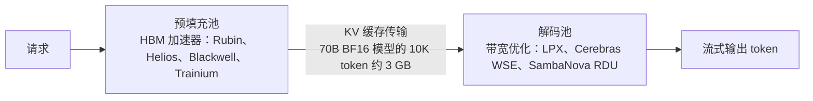
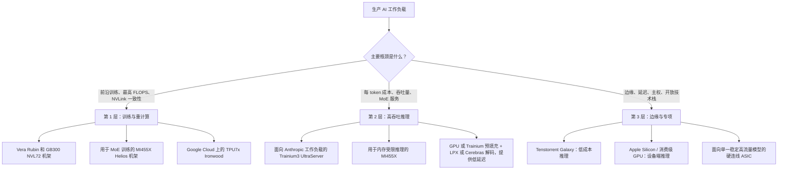

# LLM 基础设施

构建生产级 LLM（大语言模型）系统需要理解部署选项、扩展模式和运维关注点。本章涵盖基础设施层。

## 目录

- [部署选项](#部署选项)
- [服务架构](#服务架构)
- [扩展模式](#扩展模式)
- [成本管理](#成本管理)
- [监控与告警](#监控与告警)
- [灾难恢复](#灾难恢复)
- [2026 年 10 月 AI 加速器格局](#_2026-年-10-月-ai-加速器格局)
- [面试题](#面试题)
- [参考资料](#参考资料)

---

## 部署选项

### API 与自托管（Self-Hosted， 自行部署）

| 因素 | API 提供商 | 自托管 |
|--------|---------------|-------------|
| 设置时间 | 几分钟 | 几天到几周 |
| 运维负担 | 无 | 显著 |
| 低吞吐量下的成本 | 更低 | 更高（固定成本） |
| 高吞吐量下的成本 | 更高 | 更低（规模经济） |
| 延迟控制 | 有限 | 完全可控 |
| 数据隐私 | 数据会离开你的基础设施 | 数据保留在本地 |
| 模型选择 | 提供商的模型 | 任何开源模型 |
| 定制化 | 通过 API 微调 | 完全可控 |

### 何时使用 API 提供商

```python
# Decision framework
def should_use_api(requirements: dict) -> bool:
    # Strong signals for API
    if requirements["time_to_market"] == "urgent":
        return True
    if requirements["query_volume"] < 100_000_per_month:
        return True
    if requirements["team_ml_expertise"] == "low":
        return True
    
    # Strong signals for self-hosted
    if requirements["data_residency"] == "strict":
        return False
    if requirements["latency_p99_ms"] < 100:
        return False
    if requirements["query_volume"] > 10_000_000_per_month:
        return False
    
    # Default to API for simplicity
    return True
```

### 自托管选项

| 选项 | 复杂度 | 性能 | 使用场景 |
|--------|------------|-------------|----------|
| vLLM | 中等 | 极佳 | 生产服务 |
| SGLang | 中等 | 极佳 | 前缀密集和 Agent 流量（radix cache）、结构化输出 |
| TensorRT-LLM | 中高 | 最佳（NVIDIA） | NVIDIA 峰值吞吐量；自 1.0 起 PyTorch 后端为默认，无需按模型构建引擎 |
| NVIDIA Dynamo / llm-d | 高 | 机群级 | 引擎之上的编排层：感知 KV 的路由、分离预填充与解码 |
| TGI（HuggingFace） | 中等 | 很好 | HuggingFace 生态 |
| Ollama | 低 | 良好 | 开发、小规模 |
| llama.cpp | 低 | 良好 | CPU 推理、边缘端 |

**固定并及时修补推理引擎。** 服务引擎已成为 CVE 密集型依赖。vLLM 在 2026 年 8 月 11 日至 9 月 28 日间发布了 20 多条安全公告：包括即使设置 `trust_remote_code=False` 仍会执行恶意仓库处理器代码的模型加载 RCE（CVE-2026-90553），以及一次未认证请求即可令所有租户引擎崩溃的问题（CVE-2026-93592），两者均在 0.28.0 修复；建议至少使用 vLLM 0.30.0。SGLang 的严重漏洞 CVE-2026-7301、7302、7304 影响至 0.5.12，尚无已记录的修复版本，因此应固定在 0.5.13 或更新版本、核对安全公告，并将 ZMQ socket 限制在 Pod 内。

**镜像保存所服务的模型权重。** NVIDIA 于 2026 年 9 月 3 日确认将以 $12.93B 收购 Hugging Face，尚未公布交割日期。无论交易最终如何，使用经过审查的内部镜像仓库都能消除供应链与可用性依赖，也能降低恶意模型仓库攻击风险。

---

## 服务架构

### 单模型服务

```
┌─────────────┐     ┌─────────────┐     ┌─────────────┐
│   Client    │────▶│   Gateway   │────▶│  LLM Server │
└─────────────┘     └─────────────┘     └─────────────┘
                           │
                           ▼
                    ┌─────────────┐
                    │    Cache    │
                    └─────────────┘
```

### 多模型服务

```
                    ┌────────────────────────────────┐
                    │         Load Balancer          │
                    └───────────────┬────────────────┘
                                    │
            ┌───────────────────────┼───────────────────────┐
            │                       │                       │
            ▼                       ▼                       ▼
    ┌───────────────┐       ┌───────────────┐       ┌───────────────┐
    │  OpenAI Pool  │       │  Claude Pool  │       │  Open-weight  │
    │  (API calls)  │       │  (API calls)  │       │ (self-hosted) │
    └───────────────┘       └───────────────┘       └───────────────┘
```

### 模型路由模式

```python
class ModelRouter:
    def __init__(self):
        self.models = {
            "simple": GPT6Luna(),
            "complex": ClaudeOpus55(),
            "code": ClaudeSonnet55(),
            "long_context": Gemini38Flash(),
            "vision": GPT6Sol()
        }
        self.classifier = QueryClassifier()
    
    async def route(self, request: Request) -> Response:
        # Classify request type
        request_type = self.classifier.classify(request)
        
        # Route to appropriate model
        model = self.models[request_type]
        
        # Execute with fallback
        try:
            return await model.generate(request)
        except RateLimitError:
            return await self.fallback(request, request_type)
    
    async def fallback(self, request: Request, original_type: str) -> Response:
        # Define fallback order
        fallbacks = {
            "simple": ["complex", "long_context"],
            "complex": ["simple"],
            "code": ["complex"]
        }
        
        for fallback_type in fallbacks.get(original_type, []):
            try:
                return await self.models[fallback_type].generate(request)
            except Exception:
                continue
        
        raise ServiceUnavailableError("All models unavailable")
```

---

## 扩展模式

### 水平扩展

```python
# Kubernetes HPA config for LLM service
hpa_config = """
apiVersion: autoscaling/v2
kind: HorizontalPodAutoscaler
metadata:
  name: llm-service-hpa
spec:
  scaleTargetRef:
    apiVersion: apps/v1
    kind: Deployment
    name: llm-service
  minReplicas: 2
  maxReplicas: 20
  metrics:
  - type: Resource
    resource:
      name: cpu
      target:
        type: Utilization
        averageUtilization: 70
  - type: Pods
    pods:
      metric:
        name: requests_per_second
      target:
        type: AverageValue
        averageValue: 100
"""
```

CPU 利用率适合衡量无状态 API 代理，却不适合 GPU 服务 Pod：GPU 饱和时 CPU 可能仍很空闲。应根据队列深度、KV cache 利用率或相对于 SLO 的 TTFT 扩缩容，并让引擎主动丢弃过载请求，避免无限排队；vLLM 0.29 为此增加了 `--max-num-queued-reqs` 和 `--max-num-queued-tokens` 准入控制。

**冷启动限制扩容速度。** GPU Pod 加载权重可能需要数分钟。vLLM 0.30 的 Fast Start（`--load-format ipc_cache`）通过每 GPU 守护进程保留量化并完成张量并行切分的权重，再经 CUDA IPC 映射到重启后的引擎。托管 Agent 运行时则使用快照：AWS 于 2026 年 9 月 18 日公布 AgentCore Runtime V2，可从已初始化 Agent 的快照恢复实例，P75 冷启动约 2 秒，而原运行时约需 5.4 至 30 秒（厂商数据）；计费单价更高，但所需 GB-hours 更少。应测量从请求到可服务的时间，而非仅测调度时间，并保留足够热容量。

### 自托管的 GPU 扩展

| 规模 | GPU 数量 | 推荐配置 |
|-------|------|-----------------|
| 开发/测试 | 1 | 单块 A10G 或 L4 |
| 小型生产 | 2-4 | 2x A100，使用张量并行 |
| 中型生产 | 4-8 | 4x H100，使用张量并行 |
| 大型生产 | 8+ | 多节点，使用流水线并行 |

### 基于队列的架构

适用于高吞吐量异步（async，异步）工作负载：

```
┌─────────────┐     ┌─────────────┐     ┌─────────────┐
│  Producers  │────▶│    Queue    │────▶│  Consumers  │
└─────────────┘     │  (Redis/    │     │  (LLM       │
                    │   SQS)      │     │   Workers)  │
                    └─────────────┘     └─────────────┘
                                               │
                                               ▼
                                        ┌─────────────┐
                                        │  Results    │
                                        │  Store      │
                                        └─────────────┘
```

```python
class AsyncLLMProcessor:
    def __init__(self):
        self.queue = RedisQueue("llm_requests")
        self.results = RedisResults("llm_results")
    
    async def submit(self, request: Request) -> str:
        request_id = generate_id()
        await self.queue.enqueue({
            "id": request_id,
            "request": request.to_dict()
        })
        return request_id
    
    async def get_result(self, request_id: str, timeout: int = 300) -> Response:
        return await self.results.wait_for(request_id, timeout)
    
    # Worker process
    async def worker_loop(self):
        while True:
            job = await self.queue.dequeue()
            try:
                result = await self.llm.generate(job["request"])
                await self.results.store(job["id"], result)
            except Exception as e:
                await self.results.store_error(job["id"], str(e))
```

---

## 成本管理

### 成本跟踪

```python
class CostTracker:
    # USD per 1M tokens, standard-tier list prices as of October 2026.
    # Load these from config in production: rates, cache multipliers and tiers change often.
    PRICING = {
        "claude-opus-5-5": {"input": 4.00, "cached_input": 0.20, "output": 20.00},
        "claude-sonnet-5-5": {"input": 2.00, "cached_input": 0.20, "output": 10.00},
        "gpt-6-sol": {"input": 2.00, "cached_input": 0.20, "output": 10.00},
        "gpt-6-luna": {"input": 0.10, "cached_input": 0.01, "output": 0.50},
    }
    
    def calculate_cost(
        self,
        model: str,
        uncached_tokens: int,
        output_tokens: int,
        cached_tokens: int = 0
    ) -> float:
        # Expects disjoint counts from normalize_usage, never a raw provider total.
        # Omitted for brevity: cache-write premiums, service-tier multipliers, and
        # long-context rates (OpenAI bills the whole request higher above 272K input)
        pricing = self.PRICING[model]
        input_cost = (
            uncached_tokens * pricing["input"] + cached_tokens * pricing["cached_input"]
        ) / 1_000_000
        output_cost = (output_tokens / 1_000_000) * pricing["output"]
        return input_cost + output_cost
    
    @staticmethod
    def normalize_usage(provider: str, usage: dict) -> dict:
        # Providers disagree on whether cached tokens sit inside the input count;
        # subtracting them from an Anthropic total undercounts spend, even below zero.
        if provider == "anthropic":
            # input_tokens already excludes cache reads and cache writes.
            # Writes are priced at the base input rate here (premium omitted above).
            return {
                "uncached": usage["input_tokens"]
                + usage.get("cache_creation_input_tokens", 0),
                "cached": usage.get("cache_read_input_tokens", 0),
                "output": usage["output_tokens"],
            }
        if provider == "openai":
            # input_tokens includes cached tokens, so subtract them
            cached = usage.get("input_tokens_details", {}).get("cached_tokens", 0)
            return {
                "uncached": usage["input_tokens"] - cached,
                "cached": cached,
                "output": usage["output_tokens"],
            }
        raise ValueError(f"No usage normalizer for provider {provider!r}")

    def track(self, request_id: str, provider: str, model: str, usage: dict):
        tokens = self.normalize_usage(provider, usage)
        cost = self.calculate_cost(
            model,
            tokens["uncached"],
            tokens["output"],
            tokens["cached"]
        )
        
        self.metrics.record(
            "llm_cost",
            cost,
            tags={"model": model, "request_id": request_id}
        )
        
        return cost
```

### 成本优化策略

| 策略 | 节省 | 实现方式 |
|----------|---------|----------------|
| 模型路由 | 50-80% | 将简单查询路由到廉价模型 |
| 提示词缓存 | 缓存前缀的 75-98%（多数模型约 90%） | 保持前缀稳定；多数模型的缓存读取价格为输入价格的 0.1 倍，DeepSeek V4.1-Flash 约 0.02 倍，xAI Grok 4.7 约 0.25 倍 |
| 响应缓存 | 30-70% | 对精确匹配和语义缓存效果较好的流量启用缓存 |
| 提示词优化 | 10-30% | 更短的提示词，结构化输出 |
| Batch 与 Flex 服务层 | 50% | 异步任务使用批处理端点或 Flex 服务层 |
| 自托管 | 可变 | 达到规模后可能更便宜；GPU 租赁价格在 2026 年上涨 |

### 预算告警

```python
class BudgetManager:
    def __init__(self, daily_budget: float, alert_threshold: float = 0.8):
        self.daily_budget = daily_budget
        self.alert_threshold = alert_threshold
    
    async def check_and_alert(self):
        today_cost = await self.get_today_cost()
        utilization = today_cost / self.daily_budget
        
        if utilization >= 1.0:
            await self.alert("CRITICAL: Daily budget exceeded", today_cost)
            # Consider enabling cost controls
            await self.enable_rate_limiting()
        elif utilization >= self.alert_threshold:
            await self.alert("WARNING: Approaching daily budget", today_cost)
    
    async def enable_rate_limiting(self):
        # Reduce throughput to stay within budget
        self.rate_limiter.set_rate(
            requests_per_minute=self.calculate_safe_rate()
        )
```

应将自设预算上限设在供应商硬上限以下，因为供应商上限可能让整个组织的请求都失败关闭。Anthropic 的用量层级有硬性月度支出上限；触顶后会返回 HTTP 429 和 `enforced_spend_limit_reached`，直到下月 1 日（UTC）前都不会有 `retry-after`。告警应远早于供应商切断服务时触发。

---

## 监控与告警

### 关键指标

```python
LLM_METRICS = {
    # Latency
    "ttft_seconds": "Time to first token",
    "total_latency_seconds": "Total request time",
    
    # Throughput
    "requests_per_second": "Request rate",
    "tokens_per_second": "Token generation rate",
    
    # Resources
    "gpu_utilization": "GPU compute usage",
    "gpu_memory_utilization": "GPU memory usage",
    "kv_cache_utilization": "KV cache usage",
    
    # Quality (sampled)
    "quality_score": "LLM-as-judge score",
    "faithfulness_score": "RAG faithfulness",
    
    # Errors
    "error_rate": "Failed requests percentage",
    "rate_limit_hits": "Rate limit rejections",
    "refusal_rate": "Safety refusals by category (some are billed)",

    # Caching
    "cache_hit_rate": "Share of input tokens read from the prompt cache",
    
    # Cost
    "cost_per_request": "Average cost per request",
    "daily_cost": "Total daily spend"
}
```

### 告警配置

```yaml
alerts:
  - name: high_error_rate
    condition: error_rate > 0.05
    for: 5m
    severity: critical
    
  - name: high_latency
    condition: p99_latency > 10s
    for: 5m
    severity: warning
    
  - name: cost_spike
    condition: hourly_cost > 2 * avg_hourly_cost
    for: 1h
    severity: warning
    
  - name: quality_degradation
    condition: avg_quality_score < 3.5
    for: 30m
    severity: warning
    
  - name: gpu_memory_pressure
    condition: gpu_memory_utilization > 0.95
    for: 5m
    severity: warning
```

---

## 灾难恢复

### 多提供商故障切换

```python
class MultiProviderClient:
    def __init__(self):
        self.providers = [
            OpenAIClient(),
            AnthropicClient(),
            GoogleClient()
        ]
        self.primary = 0
    
    async def generate(self, request: Request) -> Response:
        # Try primary provider first
        try:
            return await self.providers[self.primary].generate(request)
        except (RateLimitError, ServiceError) as e:
            return await self.failover(request, e)
    
    async def failover(self, request: Request, original_error: Exception) -> Response:
        for i, provider in enumerate(self.providers):
            if i == self.primary:
                continue
            try:
                response = await provider.generate(request)
                # Log failover for monitoring
                self.log_failover(self.primary, i, original_error)
                return response
            except Exception:
                continue
        
        raise AllProvidersUnavailable("All LLM providers failed")
```

故障切换目标必须来自另一家供应商，因为一次故障可能影响同一供应商的全部服务面。OpenAI 在 2026 年 9 月 29 日发生故障，API（包括 Agents API）、ChatGPT 和 Codex 约 5 小时 20 分钟受到影响；Anthropic 状态记录显示，8 月 16 日至 9 月 29 日间至少发生 12 起重大或严重事故。错误分类、流式故障切换和对话状态问题见 [AI 网关与模型路由](03-ai-gateways-and-model-routing.md#回退与可靠性)。

### 模型生命周期也是灾难恢复问题

按计划退役的模型是一场可预见的故障，但各平台日历如今密集且不一致：

| 风险 | 2026 年案例 | 控制措施 |
|------|-------------|----------|
| 同一模型在不同平台上的退役时间不同 | Claude Sonnet 4 于 6 月 15 日退出 Claude API，但在 Bedrock 上到 10 月 14 日才结束生命周期；Claude Opus 4.1 于 8 月 5 日退出 Claude API，但在 Bedrock 上可运行至 2027 年 1 月 8 日，且 10 月 8 日起扩展使用价格上调 | 模型注册表按（模型、平台）索引，而不是只按模型 |
| 闲置备用模型失去访问权限 | Bedrock 的 Legacy 模型不再向新客户开放；现有客户闲置 15 天后也可能失去访问权限 | 按计划演练灾备和季节性模型，不要只在事故期间使用 |
| 通知窗口很短 | 2026 年 9 月 7 日起发布的 Bedrock 模型，Legacy 通知期为 6 个月或 45 天；Anthropic 为 60 天；OpenAI 对 GA 模型声明 6 个月、专用变体 3 个月、preview 最短 2 周，但已在 10 月 1 日退役 `gpt-5.4-cyber`，只提前通知 20 天 | 按模型记录通知类别；不要依赖承诺的最短期限，随时准备好经认证的回退模型 |
| 开放权重模型托管方停止提供模型 | Groq 于 8 月 16 日宣布免费和开发者层将停止提供 Llama 3.3 70B 与 Llama 3.1 8B，并提前通知 60 天 | 开放权重模型至少部署在两家托管方 |
| 别名被重新路由 | DeepSeek 于 9 月 10 日宣布 `deepseek-v4-pro` 将从 9 月 14 日起路由到 V4.1-Flash，随后于一天后撤回计划 | 固定带日期的快照；当响应中的模型 ID 变化时告警 |

### 优雅降级

```python
class GracefulDegradation:
    def __init__(self):
        self.cache = ResponseCache()
        self.fallback_responses = FallbackResponses()
    
    async def handle_outage(self, request: Request) -> Response:
        # Level 1: Try cache
        cached = await self.cache.get_similar(request.query)
        if cached and cached.similarity > 0.9:
            return Response(
                content=cached.response,
                metadata={"source": "cache", "degraded": True}
            )
        
        # Level 2: Try fallback responses
        fallback = self.fallback_responses.get(request.intent)
        if fallback:
            return Response(
                content=fallback,
                metadata={"source": "fallback", "degraded": True}
            )
        
        # Level 3: Graceful error
        return Response(
            content="I am currently experiencing issues. Please try again later or contact support.",
            metadata={"source": "error", "degraded": True}
        )
```

---

## 2026 年 10 月 AI 加速器格局

2026 年的硬件格局变化速度超过此前 AI 基础设施建设的任何时期。产能公告合计承诺了**超过一万亿美元的云支出**；供应链不再由单一厂商主导；最大买家开始打造专用于推理的芯片。截至 10 月，限制因素已从芯片设计转向内存和电力。本节是资深架构师规划产能时应掌握的市场快照；日期很重要，因为市场每季度都在重新定价。

### NVIDIA：Vera Rubin NVL72 与 Blackwell Ultra

**Vera Rubin NVL72** 是新的旗舰产品。NVIDIA 于 2026 年 5 月 31 日宣布开始全面量产；根据 8 月 26 日的财报，CoreWeave、Google Cloud、Microsoft Azure、OCI 和 Nebius 已在运行 Rubin 机架（[NVIDIA Vera Rubin NVL72](https://www.nvidia.com/en-us/data-center/vera-rubin-nvl72/)）。**B300**（“Blackwell Ultra”）于 2025 年 3 月公布，合作伙伴系统自 2025 年下半年起推出（[NVIDIA 新闻稿](https://nvidianews.nvidia.com/news/nvidia-blackwell-ultra-ai-factory-platform-paves-way-for-age-of-ai-reasoning)）；NVIDIA 称，在截至 2025 年 10 月 26 日的季度中，它是覆盖所有客户类别的领先架构（[Q3 FY2026 CFO 评论](https://s201.q4cdn.com/141608511/files/doc_financials/2026/Q326/Q3FY26-CFO-Commentary.pdf)）。如今 B300 已成为大规模部署的主力。

| 规格 | Vera Rubin NVL72 | B300 / GB300 NVL72 |
|------|------------------|---------------------|
| 每 GPU HBM | 288 GB HBM4，19.2 TB/s | 288 GB HBM3e，约 8 TB/s |
| 机架 | 72 个 Rubin GPU + 36 个 Vera CPU | 72 个 Blackwell Ultra GPU + 36 个 Grace CPU |
| 每机架 HBM 总量 | 20.7 TB，约 1,400 TB/s | 约 20 TB，最高 576 TB/s |
| 每机架 NVLink 总带宽 | 216 TB/s | 约 130 TB/s |
| 峰值 FP4/机架 | NVFP4 推理 3,600 PFLOPS（每 GPU 50） | 稀疏 1,440 PFLOPS、稠密 1,080 PFLOPS（稠密每 GPU 约 15） |
| 状态 | 自 2026 年 5 月 31 日起全面量产；首批云平台已上线 | 2025 年下半年开始出货；NVIDIA 称其在 2025 年 10 月季度为领先架构 |

每 GPU 的 HBM 容量相同，但带宽大幅提升：Rubin 的优势主要体现在解码密集型和长上下文服务，而不是每 GPU 可容纳的模型规模。

NVIDIA 的战略定位是“AI 工厂”：NVL72 作为 NVLink 域内连贯的推理与训练单元中的最小构建块销售，而非单独的显卡。对于前沿模型训练以及最大型推理模型，NVL72 级机架（当前为 GB300，随着产能爬坡转向 Rubin）是默认选择。

解读成本数据时，必须结合运行点。NVIDIA 声称，Rubin 每百万 token 的成本是 GB200 NVL72 的十分之一（厂商数据）。SemiAnalysis 对 DeepSeek V4 Pro 的 AgentX 基准显示，结果取决于 SLO 和资产持有方式：按自有设备成本、每用户 170 token/s 运行时，吞吐量约为 GB300 的 67 倍；若按三年租赁成本并以 80 token/s 的 P90 目标运行，则只比 GB300 多处理约 62% 的 token（分析方数据）。应根据自己的 SLO 在吞吐量与交互性 Pareto 曲线上比较加速器，不要只看 batch-1 数据。

权衡没有改变：绝对性能最高、绝对价格最高、软件锁定最深。CUDA、NCCL 和 TensorRT-LLM 都以 NVIDIA 为中心；围绕它们构建架构，就意味着作出了供应商承诺。

### 跨芯片预填充与解码

2026 年的高端低延迟模式把同一个请求拆到两类芯片上：由 HBM 容量丰富的 GPU 或加速器负责计算密集的预填充，再由带宽优化的芯片负责解码。

- **NVIDIA Groq 3 LPX** 于 2026 年 8 月 24 日进入全面生产：每机架含 256 个 LPU、128 GB SRAM，Nebius 是首家云供应商。与 Vera Rubin 搭配时，NVIDIA 支持 Rubin 预填充加 LPX 解码、attention 与 FFN 分离，以及由 LPX 充当推测解码草稿模型。瓶颈是容量：《The Register》估计，由于 SRAM 较小，单个 LPX 机架在 100K-token 输入时批大小上限约为 12，这也是高端低延迟层需要单独定价的原因。该技术来自 NVIDIA 与 Groq 于 2025 年 12 月 24 日签署的非独家授权协议（条款未披露，报道金额约为 $17-20B，并有司法部调查的报道）。GroqCloud 继续独立运营，并于 2026 年 8 月 17 日以 $3.5B 估值完成 $350M A 轮融资。
- **AWS Trainium 加 Cerebras**（2026 年 3 月 13 日发布）：Trainium 服务器负责预填充，Cerebras CS-3 系统负责解码，通过 EFA 连接，仅通过 Amazon Bedrock 销售。
- **AMD Helios 加 Cerebras**（2026 年 7 月 23 日发布）：Helios 机架负责预填充，晶圆级引擎负责解码，宣布于 2026 年下半年率先通过 Cerebras Cloud 提供。
- **Intel 加 SambaNova**（2026 年 4 月 8 日蓝图）：GPU 负责预填充，SambaNova RDU 负责解码，Xeon 6 负责 agent 工具执行。SambaNova 并未被收购；它于 2026 年 7 月 8 日以 $11B 估值完成 $1B 首轮交割。



设计问题在于 KV 传输是否会抵消收益。Llama 3.1 70B 的 BF16 KV cache 每个 token 占 320 KiB，因此 10K token 的提示词会向解码池传输约 3 GB；在 400 Gb/s 链路上，这会让首 token 延迟（TTFT）增加约 65 ms。只有在拆分架构提升了**有效吞吐量**（同时满足 TTFT 和 token 间延迟 SLO 的请求率）时，才值得付出这笔成本，而不是只看峰值吞吐量。

### AMD MI455X 与 Helios 机架

[AMD MI400 系列](https://www.amd.com/en/products/accelerators/instinct/mi400.html)是可信的第二来源；其中量产型号 MI455X 将部署在 72-GPU Helios 机架中。

| 规格 | MI455X / Helios |
|------|-------|
| 内存 | HBM4，每 GPU **432 GB** |
| 内存带宽 | 每 GPU 23.3 TB/s |
| 峰值 FP4 | 每 GPU 约 40 PFLOPS MXFP4；每个 Helios 机架 2.9 exaFLOPS |
| 机架方案 | **Helios**：72 个 MI455X GPU、18 个 EPYC Venice CPU、Pensando 网络 |
| 软件 | ROCm 7.x，优先支持 PyTorch / vLLM / SGLang |

每 GPU 432 GB 是核心优势：比 B300 和 Rubin 的 288 GB 高出 50%，而内存带宽和 FP4 算力已接近 Rubin。对于 MoE 服务（瓶颈在于让专家权重常驻）和 KV-cache 密集型长上下文工作负载，这一内存优势很实际。AMD 也已补上大部分软件差距；ROCm 7.x 不再像 2023 年那样构成否决项，量化检查点也能跨供应商移植（SGLang 可在 AMD 上加载时将 NVFP4 检查点重新量化为 MXFP4）。

前沿实验室已经作出部署承诺。AMD 于 2026 年 7 月 23 日称 Helios 已投产；OpenAI 预计从 2026 年第四季度开始部署 Helios；Anthropic 于 7 月 22 日同意部署最高 2 GW 的 MI450 系列 GPU，首个 GW 预计在 2027 年上半年上线。需要关注的是**大规模部署成熟度**：这些部署从 2026 年末延续到 2027 年，因此应把 AMD 视为 2027 年的第二来源产能，而不是当前的主力。超大规模云厂商（Meta、Microsoft、Oracle Cloud）都在运行混合机队。

### Google TPU 与定制推理芯片

Google、OpenAI 和 Meta 现在把训练芯片与推理芯片分开；AMD 则通过收购布局固定模型推理：

| 所有者 | 芯片 | 状态 | 说明 |
|--------|------|------|------|
| Google | TPU7x（Ironwood） | 2026 年 3 月 31 日正式可用 | TPU 8t（训练）和 8i（推理）于 2026 年 4 月公布，尚无可用日期 |
| OpenAI（与 Broadcom 合作） | Jalapeño | 宣布于 2026 年末出货，2027 年量产 | 专用于推理；每芯片 13.4 PFLOPS MXFP4、216 GB HBM4（The Register、Hot Chips） |
| Meta | MTIA 400 | 2026 年 8 月在 Hot Chips 公布 | 以训练为先；12 PFLOPS MXFP4、288 GB HBM3e（The Register）；面向推理的 MTIA 450 预计于 2027 年推出 |
| AMD（Taalas） | 固化模型 ASIC | 2026 年 8 月 6 日宣布收购，预计第四季度完成，待审批 | 将权重刻入硅片；厂商称 Taalas HC1 为 Llama 3.1 8B 提供服务时达到约 17,000 token/s；超过 LoRA 规模的改动都需要重新流片 |

Taalas 代表了灵活性与效率权衡的极端：只有在单一、稳定且流量极大的模型上才有意义。

### AWS Trainium3 与 Anthropic 的 $100B+ 协议

2026 年 4 月 20 日，AWS 与 Anthropic 宣布将通过 Trainium 扩展至**最多 5 GW** 的算力容量；Anthropic 承诺未来十年在 AWS 投入超过 **$100B**，Amazon 投资 **$5B**，并可追加最高 **$20B**。Anthropic 表示，预计到 2026 年底，Trainium2 和 Trainium3 的在线容量将接近 1 GW（[Anthropic 公告](https://www.anthropic.com/news/anthropic-amazon-compute)）。

关键数字：

| 规格 | Trainium3 |
|------|-----------|
| 制程节点 | 3nm |
| 配置 | **Trn3 UltraServer**，每套系统 **144 颗芯片** |
| 相较 T2 的峰值性能 | 在目标工作负载上 **~4.4x** |
| 内存 | HBM3e |
| 网络 | UltraServer 内部使用 NeuronLink；集群内使用 EFA |

其战略含义在于：AWS 现在拥有了一个可信的垂直整合 AI 基础设施（Trainium 硅片 + Annapurna 网络 + EC2 + Bedrock）。对于 Anthropic 模型上的推理密集型工作负载，其性价比可与 H200 级硬件上的 NVIDIA 相竞争，并正朝着 2026 年底与 B300 持平的方向改进。

约束在于：Trainium 运行的是 **AWS Neuron SDK**，不是 CUDA。移植技术栈意味着要重建内核、重新测试数值结果并重新调优批处理。规模大时值得，规模小时则很痛苦。

### Cerebras IPO（五月 2026）

Cerebras 于 2026 年 5 月 13 日将 IPO 定价为 **$185/股**，募资 **$5.5B**。5 月 14 日开盘价为 $350，市值一度超过 $100B，首日收于 $311.07，对应估值约 **$67B**（[SiliconANGLE](https://siliconangle.com/2026/05/13/cerebras-stock-almost-doubles-initial-offering-price-biggest-tech-ipo-years-raised-55b/)）。

它对市场的改变在于：

- **AWS 与 Cerebras 建立了合作**：Trainium 负责预填充、Cerebras CS-3 负责解码，并通过 Bedrock 提供；AWS 表示将在未来数月推出，之后于 2026 年晚些时候支持开放权重模型和 Amazon Nova（[AWS 公告](https://press.aboutamazon.com/aws/2026/3/aws-and-cerebras-collaboration-aims-to-set-a-new-standard-for-ai-inference-speed-and-performance-in-the-cloud)）。部署前应核实 Bedrock 的实际可用性。
- CS-3 晶圆级引擎仍然是**对一个 70B+ 模型进行单芯片、单副本推理**且 TTFT 低于 50ms 的唯一可信选择。
- 对于主力栈基于 GPU、又希望在不移植的情况下获得延迟优势的团队，Cerebras Cloud API 已被用作快速的第二来源。

这次 IPO 在结构上很重要，因为它改变了融资逻辑：现在已经存在非 NVIDIA 推理供应商的公开市场路径，这使下一批进入者更容易融资。

晶圆级芯片也不再是极低延迟推理的唯一选择。OpenAI 向部分客户预览基于 Cerebras 的 GPT-5.6 Sol Ultrafast，最高每秒生成 750 个 token；NVIDIA 称 GPT-6 Astra Ultrafast 运行于 Blackwell。在 Artificial Analysis 的测试中，NVIDIA LPX 以 100K 上下文为 Gemma 4 31B 生成约 3,400 token/s，Cerebras 为 882 token/s。Cerebras 于 2026 年 8 月 18 日发布 CS-4，每套系统含 3 个 WSE-3 Turbo 处理器，计划在 Q3 开始交付；CS-5 已公布于 2027 年推出。规划前应核实实际交付情况；“单用户最快 token 速度”是竞争激烈且单独定价的层级。

### Tenstorrent Galaxy Blackhole

[Tenstorrent Galaxy](https://tenstorrent.com/hardware/galaxy) 于 2026 年 4 月 28 日正式推出（[Tenstorrent 公告](https://tenstorrent.com/newsroom/tenstorrent-enables-ai-at-scale-with-industry-leading-performance)）。

| 规格 | Galaxy Blackhole |
|------|------------------|
| 每服务器 | **32 颗 Blackhole 芯片** |
| 每芯片 | RISC-V 核、Tensix tile、无外部内存层次结构 |
| 峰值 BlockFP8 | 每服务器 **~23 PFLOPS** |
| 内存 | 1 TB GDDR6，带宽 16 TB/s，另有 6.2 GB 片上 SRAM |
| 标价 | 2026 年 10 月产品页显示 32 芯片服务器起价 **$160,000**；4 月发布时相同配置起价为 $110,000 |
| 架构 | 完全开放的 RISC-V 控制平面、开放固件、开放编译器 |

开源 RISC-V 故事对两类受众很重要：

- **超大规模云厂商和主权云**，他们希望拥有非 CUDA 技术栈，并且能够完全看到固件与工具链。
- **构建自定义内核的研究实验室**，他们在 CUDA 的闭源部分上遇到障碍。

按每台服务器 $110K 计，Galaxy 在某些工作负载下大约比可比的 NVIDIA 推理机架便宜一个数量级。它不是前沿训练竞争者。它是推理与小规模微调的竞争者，在这些场景中，按美元计的优势极其压倒性。

### Stargate 与云承诺的规模

产能故事不再只是关于芯片；它还关乎芯片周围的建筑。

- 2025 年 9 月，OpenAI 宣布在阿比林旗舰站点之外新增 5 个美国站点；Stargate 规划容量接近 **7 GW**、计划投资超过 **$400B**，对应最初 **$500B / 10 GW** 的目标（[OpenAI 公告](https://openai.com/index/five-new-stargate-sites/)）。
- Sam Altman 于 2025 年 11 月称，OpenAI 的数据中心承诺总额约为 **$1.4T**，期限为 8 年（[TechCrunch 报道](https://techcrunch.com/2025/11/06/sam-altman-says-openai-has-20b-arr-and-about-1-4-trillion-in-data-center-commitments/)）。
- 根据公开备案和公告，已经有超过 **$400B** 投入或签约用于这一版图。

对资深工程师的架构含义是：前沿模型提供商的推理边际成本下降速度，比公开 API 定价所暗示的更快。现货容量、非高峰推理批处理以及多区域故障切换，在 2026 年都更容易实现，因为底层建筑已经存在。

**公告中的吉瓦数不等于可交付的吉瓦数。** Jefferies 估计美国数据中心 2026 年部署约 16–18 GW，2027 年实际容量上限约为 20 GW 出头，受先进封装与电力约束。Micron 表示 HBM 和 DRAM 需求到 2028 年前都将超过供应，内存而非逻辑芯片限制加速器供货，也推高了主机 DRAM KV offload 的成本。

租赁价格也体现了供需压力。Silicon Data 的 B200 指数在 9 月初年内上涨 27.6%，截至 2026 年 10 月 1 日为每 GPU 小时 $5.86（H100 为 $2.77）。同期每 token API 价格仍在下降：GPT-6 Sol 于 9 月 22 日发布，价格为每百万 token $2/$10；GPT-5.6 Sol 标价为 $5/$30。因此，对租 GPU 的团队而言，2026 年自托管的盈亏平衡点向 API 移动。多供应商和多区域容量合同比过去更重要。

### 三层机队策略



| 层级 | 承载内容 | 默认硬件 | 原因 |
|------|----------|----------|------|
| **第 1 层：训练与重计算** | 前沿模型训练、重推理、多万亿参数 MoE | **Vera Rubin NVL72**、**GB300 NVL72**、**MI455X Helios**、**TPU7x** | 需要 NVLink 级一致性，以及可用的最大 HBM 池 |
| **第 2 层：高吞吐推理** | API 产品、RAG 后端、Agent 平台 | **Trainium3**、**MI455X**、**B300**、跨芯片预填充/解码（**Rubin + LPX**，以及已公布的 **Trainium + Cerebras** 和 **Helios + Cerebras**） | 按 SLO 优化有效吞吐量和可预测的 P99，通常要考虑 MoE |
| **第 3 层：边缘与专项** | 延迟关键、主权、要求开放源固件、总支出较低 | **Tenstorrent Galaxy**、**Apple Silicon**、消费级 GPU、固化模型 ASIC | 性价比、开放技术栈、法规就近性 |

在 2026 年，真正重要的表述是：**没有哪位资深架构师再围绕单一供应商来设计严肃的 AI 产品了**。产能争夺太激烈，价格变动太快，而且单一供应商技术栈内的失效模式相关性太高。多供应商已成为新的默认选择。

### 产能规划要点

- 规划时要把**每个加速器的内存**与 FLOPS 同等对待。MoE 服务的瓶颈在于专家驻留。
- 将 **CUDA 锁定**视为真实成本。ROCm 7.x 对大多数生产级服务来说已经足够好。Neuron 对 Anthropic 以及任何愿意承担移植工作的团队来说已经足够好。开放 RISC-V 对成本敏感型推理来说已经足够好。
- 现在，超大规模云厂商的选择会像反过来那样驱动芯片选择。AWS = Trainium + Cerebras + 一部分 NVIDIA。Microsoft = NVIDIA + Maia。Google = TPU + 一部分 NVIDIA。Oracle = 大规模 NVIDIA。
- **API 每 token 价格持续下降**：a16z 的 [LLMflation 分析](https://a16z.com/llmflation-llm-inference-cost/)估计，2024 年能力不变时价格约每年下降 10 倍；但 2026 年 GPU 小时租价上涨。9 月 7 日，B200 的 12 个月租期为每 GPU 小时 $5.39，3 个月租期为 $5.73（Silicon Data）。长期租期如今更便宜，与过去等待现货降价的经验相反。

---

## 面试题

### 问：如果你要设计每天 1M 次 LLM 查询的基础设施，你会怎么做？

**优秀答案：**

“每天处理 1M 次查询时，平均约为每秒 12 次，峰值可能达到 3–5 倍。我的方法是：

**架构：**
- 负载均衡器在多个 API 端点之间分发流量
- 用于成本优化的模型路由器（把简单查询路由到更便宜的模型）
- 用于高频查询的 Redis 缓存
- 用于异步工作负载的基于队列的处理

**在这个规模下，成本优化至关重要：**
- 把 60-70% 的简单查询路由到 GPT-6 Luna 或 Claude Haiku 4.5
- 实施语义缓存（目标命中率 30%+）
- 对非紧急请求使用批处理 API（50% 折扣）
- 在这个量级下，自托管会变得具有成本竞争力

**可靠性：**
- 多供应商配置，自动故障切换
- 按用户限流以防滥用
- 用队列式架构处理峰值
- 在供应商不可用时优雅降级

**监控：**
- 带预算告警的实时成本跟踪
- 延迟分位数（p50、p95、p99）
- 持续采样的质量指标
- 错误率和限流命中跟踪

在每天 1M 次查询、每次输入和输出各 2K token 的情况下，按中档模型 $2/$10 的价格（GPT-6 Sol 或 Claude Sonnet 5.5），每天约花费 $24K：输入 $4K、输出 $20K。将 65% 流量路由到 GPT-6 Luna（$0.10/$0.50）可降至约 $9K/天；缓存稳定前缀还能进一步减少输入费用。此时输出是主要成本，因此下一步应限制输出长度。”

### 问：你会在什么情况下选择自建服务，而不是使用 API 提供商？

**强有力的回答：**

“我的决策框架会考虑几个因素：

**在以下情况下使用 API 提供商：**
- 规模低于 1M 次查询/月（成本交叉点）
- 上线时间至关重要
- 团队缺乏 GPU 基础设施经验
- 你希望立即使用最新模型
- 工作负载波动大且难以预测

**在以下情况下自建：**
- 数据不能离开你的基础设施（合规、安全）
- 规模超过 10M 次查询/月（可显著节省成本）
- 你需要低于 100ms 的 P99 延迟
- 你需要自定义模型权重或微调
- 你希望完全控制模型行为

**混合方案通常效果最好：**
- 对高吞吐、可预测的工作负载自建
- 对峰值流量和专用模型使用 API
- 将 API 作为自建故障时的兜底方案

自建的隐性成本包括：GPU 采购/租赁、运维工程时间、模型更新、监控基础设施。基础设施至少要投入 1-2 名专职工程师。”

---

### 问：你会如何为机群评估新的加速器或服务平台？

**强有力的回答：**

“我不会从供应商宣传的每秒 token 数开始，因为那通常是生产环境中没人能达到的 batch-1 数字。我会：

1. **重放自己的流量形态。** Agent 工作负载是多轮、长上下文且前缀密集的，因此我会重放 trace，或使用 SemiAnalysis AgentX 这类 agent 基准，而不是合成单轮负载。
2. **绘制 Pareto 曲线**，比较总吞吐量与每用户交互延迟，并在自己的 SLO 上读取结果。同一 Rubin 与 GB300 对比中，按自有设备成本计算，170 token/s/用户时每 TCO 吞吐量约高 67 倍；按三年租赁计算，在 80 token/s 的 P90 目标下只多约 1.6 倍（分析方数据）。运行点决定结论。
3. **先检查内存：**根据并发量计算权重加 KV cache、MoE 专家驻留需求，以及拆分部署时预填充池与解码池间的 KV 传输成本（70B BF16 模型每 10K token 提示词约 3 GB）。
4. **核算软件路径。** 内核成熟度会改变结果：NVIDIA 自己的 Dynamo 配置中，一个模型在 Marlin 内核上运行 BF16 比 NVFP4 快 80%。我会使用实际计划部署的引擎版本测试。
5. **评估供货与锁定：**交付日期、租赁价格曲线、第二来源选择，以及需要投入多少 CUDA 专用代码。

在承诺任何算力容量之前，我会先让一小部分生产流量以 shadow 模式通过新平台。”

## 参考资料

- vLLM: https://docs.vllm.ai/
- SGLang: https://github.com/sgl-project/sglang
- TensorRT-LLM: https://github.com/NVIDIA/TensorRT-LLM
- NVIDIA Dynamo: https://github.com/ai-dynamo/dynamo
- Text Generation Inference（维护模式）: https://github.com/huggingface/text-generation-inference
- NVIDIA Vera Rubin NVL72: https://www.nvidia.com/en-us/data-center/vera-rubin-nvl72/
- NVIDIA Groq 3 LPX: https://nvidianews.nvidia.com/news/nvidia-groq-3-lpx-now-in-full-production-with-world-class-speed-for-agentic-ai
- SemiAnalysis，Vera Rubin NVL72 agent 推理: https://newsletter.semianalysis.com/p/vera-rubin-nvl72-agentic-inference
- Amazon Bedrock 模型生命周期: https://docs.aws.amazon.com/bedrock/latest/userguide/model-lifecycle.html
- Silicon Data B200 租赁指数: https://www.silicondata.com/products/silicon-index/b200
- OpenAI 定价: https://developers.openai.com/api/docs/pricing
- Anthropic 定价: https://platform.claude.com/docs/en/about-claude/pricing

---

*下一篇: [LLM 应用的 CI/CD](02-cicd.md)*
