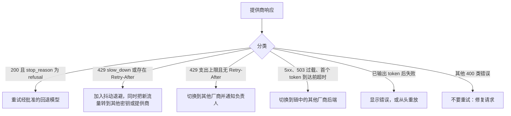

# AI 网关与模型路由

路由层的理由现在是经验性的，而不是愿景性的。根据 Datadog 的 2026《AI 工程现状》（State of AI Engineering），**69% 的公司在生产环境中运行三个或更多模型**，并且**限流 / 容量错误是单一最大的生产故障模式**（大约 5% 的请求失败，其中约 60% 的失败由容量问题引起）。Datadog 自己的表述是：如今阻碍大规模可靠 AI 的主要障碍是运维复杂度，而不是模型智能。

一旦你依赖多个模型，而且流量不再是小规模的，单一提供商就会变成单点故障；在凌晨 2 点把你叫醒的，不是模型质量，而是速率限制。**AI 网关**是标准的缓解手段。本章会讲它做什么、路由和回退如何工作、2026 工具版图，以及你到底什么时候真的需要一个。

## 目录

- [什么是 AI 网关](#什么是-ai-网关)
- [路由策略](#路由策略)
- [回退与可靠性](#回退与可靠性)
- [2026 工具版图](#_2026-工具版图)
- [架构模式](#架构模式)
- [保护网关](#保护网关)
- [你现在需要网关吗？](#你现在需要网关吗)
- [面试题](#面试题)
- [参考资料](#参考资料)

---

## 什么是 AI 网关

AI 网关（也称 LLM 网关、LLM 代理或 LLM 路由器）是**你的应用与模型提供商之间的控制平面**，它暴露一个一致的（几乎总是兼容 OpenAI 的）API，并把原本会散落到每个服务里的横切关注点集中起来。

| 职责 | 它做什么 |
|-----|--------------|
| 统一 API | 在不同提供商之间提供一个 OpenAI 形态的接口；无需为每个提供商分别写胶水代码 |
| 模型路由 | 决定哪个模型 / 部署来处理每个请求 |
| 回退链 | 当发生可重试失败时，按顺序列表尝试下一个提供商 / 模型 |
| 负载均衡 | 在密钥、区域、部署、提供商之间分散流量 |
| 带退避的重试 | 指数退避加抖动，并遵守 `Retry-After` |
| 限流处理 | 识别 429，冷却被限流的部署，并重新路由 |
| 虚拟密钥 + 预算 | 为每个密钥 / 团队提供带美元预算和硬上限的密钥 |
| 支出跟踪 | 按密钥 / 团队 / 模型归因 token 和美元消耗 |
| 可观测性 | 集中化追踪：谁调用了、尝试了什么、为什么失败、哪个成功了 |
| 缓存 | 精确匹配和语义缓存，用于降低成本和延迟 |
| 约束 / PII | 在入口点进行提示词 / 响应过滤与脱敏 |

心智模型是：网关把应用代码里一个 `N providers x M concerns` 的胶水问题，变成一个由策略统一约束的单一控制点。代价是多一次网络跳转，以及一个你必须保持高可用的组件，这正是下面要讨论的核心张力。

---

## 路由策略

路由策略构成了一条复杂度和开销逐步增加的阶梯。粗略来看规模（来自厂商 / 从业者的数字，仅供量级参考）：基于规则的路由增加不到约 ~1ms，嵌入 / 语义路由约 ~5ms，而更重的 ML 分类器或 LLM-as-router（把 LLM 当路由器）约 50-100ms；这些都要叠加在典型的模型延迟 500-2000ms 之上。

| 策略 | 依据什么决策 | 最适合 | 开销 | 失败模式 |
|----------|-----------|----------|----------|---------------|
| 静态 / 手动 | 每条路由写死模型 | 简单、可预测的工作负载 | ~0ms | 僵硬；无法适应故障或价格变化 |
| 基于任务 | 任务类型映射到某个模型 | 已知的任务分类体系 | <1ms | 误分类；分类体系过时 |
| 基于成本 | 满足约束的最便宜模型 | 成本上限、批处理工作 | <1ms | 可能牺牲质量；最便宜的模型也可能被限流 |
| 基于延迟 | 观测到 / 预期的最低延迟 | 实时体验 | ~1-5ms | 流量被挤到单个快速端点；冷启动偏差 |
| 基于能力 | 所需能力（长上下文、视觉、工具） | 异构需求 | 1-5ms | 为“最强”模型过度配置 |
| 语义 | 对请求做嵌入并匹配到某条路由 | 意图分发、难度混合 | ~5-50ms | 嵌入漂移；尾部模糊；阈值调优 |
| LLM-as-router | 由一个小 LLM 进行分类并选择 | 嵌入难以覆盖的模糊尾部 | ~50-100ms | 引入一次额外 LLM 调用及其自身成本和故障面 |
| 级联 | 先用便宜模型，置信度低时升级 | 大规模成本-质量平衡 | 串行 | 升级请求产生双重支出；置信度噪声 |
| KV cache 感知（自托管） | 选择已在 KV cache 中持有提示词前缀的副本 | 共享前缀和多轮 agent 的自托管集群 | 低 | 热门前缀导致热点；缓存索引过期 |

实践中有两点很重要。**语义路由**是通过嵌入相似度来选路由，不调用 LLM；生产里常见的模式是一个两阶段混合方案：用语义方式处理有把握的大多数，把模糊尾部交给 LLM-as-router。**级联**是最有杠杆效应的降本手段：RouteLLM（UC Berkeley / LMSYS，ICLR 2025）报告称，它只把一小部分调用路由到前沿模型，却能达到其约 ~95% 的质量，成本降低处在 45-85% 的范围。这个范围应当理解为特定基准下的上限，而不是保证；升级比例才是实时成本变量，而如果一个级联把大多数流量都升级了，那就省不了多少。

路由和回退是可以组合的：在正常路径上按成本 / 质量 / 延迟做路由，在异常路径上跨提供商回退以获得可靠性。级联本质上就是把质量驱动路由和内建可靠性回退结合在一起。

---

## 回退与可靠性

这一节直接回答 Datadog 的数据：限流是大多数生产故障的原因，而回退机制就是解药。

**回退链**会在主提供商返回*可重试*失败时，把请求重试到下一个提供商 / 模型（429 限流、5xx、超时、找不到模型）。只应重试 429 和 5xx 类错误；绝不要重试 400 类客户端错误，那只会白白浪费配额。

**正确的重试**遵循三条规则：指数退避（每次失败都等得更久）、抖动（随机化等待时间，避免客户端同步重试形成加剧故障的惊群效应），以及遵守 `Retry-After`（OpenAI 和 Anthropic 都会在 429 上返回它；应使用 `max(retry_after, computed_backoff)`）。忽略 `Retry-After` 是最常见的退避 bug。

**熔断器**会全局跟踪端点健康状况，并在失败率超过阈值时打开，这样你就不会在每个请求上都去猛击一个已经死掉或被限流的提供商。再配合冷却机制，把失败的部署在自动恢复前先停放一个固定窗口。

**负载均衡**跨多个密钥、区域和提供商分散流量，会放大你有效的限流余量，这是缓解容量故障最直接的结构性修复。

需要记住的警告是：**盲目重试会放大故障**，因为它会在失败期间增加负载。退避、抖动、熔断器和 `Retry-After`，决定了一个能修复限流问题的网关和一个只会让问题更糟的网关之间的差别。见 [可靠性模式](../13-reliability-and-safety/03-reliability-patterns.md)。

---

## 2026 工具版图

要把版本和精确功能声明都当作某一时点的结论，并注意下面若干对比数据来自厂商营销材料。

- **LiteLLM**（开源、自托管代理加 SDK）是事实标准：在一个 OpenAI 格式 API 之后接入 100+ 个提供商，支持路由策略（延迟、使用量、成本、最不忙）、有序回退、带美元预算的虚拟密钥，以及原生 OpenTelemetry。常见批评是，YAML 配置在企业治理规模下会显得吃力。
- **OpenRouter**（托管聚合器）在 200+ 个模型上提供最快的覆盖面和零运维，按透传提供商定价（文档中适用 BYOK 费用）。取舍是会多一次外部跳转，并且数据会离开你的边界。
- **Portkey**（托管型，带自托管层）把自己定位为完整控制平面：路由、回退、token 级可观测性、语义缓存和约束。
- **Cloudflare AI Gateway**（托管、边缘侧）在可观测性和缓存方面表现强，支持顺序式提供商回退，但路由逻辑和预算强制较轻。
- **Kong AI Gateway**（API 管理平台）把 LLM 路由（包括语义路由）、重试 / 回退、语义缓存和 PII 清理器带入一个成熟网关；如果你本来就在使用 Kong，这通常是最合适的。
- **Envoy AI Gateway**（开源、CNCF 生态）提供基础设施级的基于优先级回退、重试和超时，原生适配 Kubernetes。
- **云原生**路由器（AWS Bedrock 智能提示路由、Google Vertex）与各自云环境紧密集成；但严格的账户级限流仍然让多提供商层变得有用。

上游更新至 `2026` 年 `10` 月：OpenRouter 已覆盖 `400+` 个模型，Stripe 于 `8` 月 `19` 日宣布收购，并在企业计划中增加美国区域路由；其 Batch API 的 `70+` 个模型通常优惠 `50%`，自动路由依据最近 `7` 天的市场支出，其 Batch API 于 `9` 月 `22` 日上线。Envoy AI Gateway 于 `6` 月 `23` 日发布 v`1.0.0`、`8` 月 `21` 日发布 v`1.1.0`，加入 token 计数、逐请求凭据覆盖、首 token 到达前的流空闲回退、默认拒绝的 MCP 路由和 OpenTelemetry GenAI 语义约定，并于 `9` 月加入 Agentic AI Foundation。Anthropic 在 `8` 月 `16` 日至 `9` 月 `29` 日记录了至少 `12` 起重大或严重事故；OpenAI 于 `9` 月 `29` 日发生约 `5` 小时 `20` 分钟的全平台降级。跨云生命周期也不同：Claude Opus `4.1` 于 `8` 月 `5` 日退出 Claude API，但 Bedrock 支持到 `2027` 年 `1` 月 `8` 日，延长访问价格自 `10` 月 `8` 日上调；Grok `4` 于 `5` 月 `15` 日退出 xAI API，`grok-4` 别名现解析为 `grok-4.3`，Azure Foundry 仍列为 GA。固定模型 ID 也可能改变行为：OpenAI 于 `9` 月 `25` 日修复 `gpt-6-sol` 和 `gpt-6-luna` 的图像编码问题。GitHub 于 `9` 月 `30` 日预览 HydraFusion 级联路由。Envoy AI Gateway `1.1` 的 `streamIdleTimeout` 只在首 token 前可将请求切到下一后端；已有 token 输出后只能从头重放或返回错误。路由注册表应以“模型 + 平台”为键，并记录每次响应实际返回的模型 ID，定期对固定 ID 重跑评测。

还有三项会直接影响策略的边界：vLLM Semantic Router v`0.4.0` 于 `9` 月 `27` 日加入语义路由实现；Anthropic Fable `5.1`、Opus `4.8`／`5.5` 和 Sonnet `5.5` 的 thinking block 绑定模型与会话，切换提供商时可能被静默丢弃；新账户在 `8` 月 `31` 日后若修改 thinking block 前缀，会收到 `400`。`9` 月 `2` 日起，OpenAI 对突增流量以 `429 slow_down` 限流、临时模型过载返回 `503`；Anthropic 月度支出上限也会返回 `429`，错误码为 `enforced_spend_limit_reached` 且不附 `Retry-After`，此时必须切换提供商并告警，而非重试。级联价格差也很大：GPT-`6` Luna 每 `1M` token 为 `$0.10/$0.50`，Sol 为 `$2/$10`；回退会导致强模型缓存冷启动，升级请求应按完整未缓存上下文计费。

**自托管 vs 托管**的核心取舍：自托管（LiteLLM、Kong、Envoy）把数据留在你的边界内，给予你完整控制，并且在严格合规场景下是必须的，但*你*必须让代理高可用，否则它就会变成单点故障。托管（OpenRouter、Portkey、Cloudflare）几乎零运维、上手很快，但数据会经过第三方，并且你要把它们的可用性当成硬依赖来接受。

---

## 架构模式

- **放置位置：** 位于应用服务与提供商之间，作为水平扩展的服务或 sidecar。所有 LLM 流量都会经过它，因此它继承了关键路径基础设施的可靠性要求。
- **网络跳转税：** 网关会增加一次跳转。可以通过把它与应用同地部署（同一区域 / VPC / 集群）来缓解，这样跳转会低于毫秒级；同时保持代理足够轻，并积极缓存，让命中直接跳过提供商。相对于 500-2000ms 的模型延迟，这个跳转代价不大，但在高负载下是真实存在的。
- **不要让网关变成单点故障：** 这是核心架构风险。应在负载均衡器后运行多个无状态副本，把共享状态外置（Redis 存放限流与使用计数，数据库存放密钥和支出），并对副本做健康检查。一个把一切都集中起来、但只运行单实例的网关，不过是把单点故障从别处搬到了这里。
- **多区域：** 按区域部署副本，按区域本地路由，并使用跨区域 / 跨提供商回退，这样区域级故障就可以切换到别处。
- **缓存与可观测性：** 对完全相同的提示做精确匹配缓存，对近似重复做语义缓存，并使用 OpenTelemetry span 传递用户 / 密钥、尝试过的模型、失败原因、最终获胜的回退、每一步延迟以及精确成本。这正是让限流故障模式从“神秘莫测”变成“可见可诊断”的关键。见 [可观测性](../14-evaluation-and-observability/02-observability.md)。

---

## 保护网关

网关把每个供应商密钥、提示词和响应集中到同一进程，因此成为 AI 技术栈中价值最高的攻击目标。LiteLLM 2026 年的安全通告展示了这种模式：

| 安全通告 | 经过 | 修复版本 |
|----------|---------------|----------|
| CVE-2026-37004（严重，CVSS 9.8） | `/prompts/test` 端点未经身份认证的模板注入可执行操作系统命令 | 1.83.7 |
| CVE-2026-49468（严重） | Host-header 身份认证绕过 | 1.84.0 |
| CVE-2026-84377（中等，CVSS 6.5） | 任意经过认证的代理用户都可把 `api_base`、`base_url`、`model_list` 或回退目标指向自己的主机，使代理向那里发送运营者保存的供应商密钥（也构成 SSRF） | 各版本分支的补丁为 1.88.6 至 1.96.2；临时措施为 `general_settings.allow_client_side_credentials=false` |
| GHSA-92x9-889m-jgmw | PyPI 上 litellm 1.82.7 和 1.82.8 版本遭入侵 | 不要安装这些版本；按哈希固定依赖 |

由此得出的设计规则：

- **绝不让调用方决定凭据发往哪里。** 以允许列表限定上游主机，并在入口剥离客户端提供的路由参数（`api_base`、fallbacks）。这与[访问控制](../12-security-and-access/02-access-control.md#智能体与工具授权)中 MCP OAuth 混淆修复所要求的签发方绑定是同一原则。
- **尽可能不在代理中保存长期密钥。** 从保险库按请求注入凭据（Envoy 的 `credentialOverride`）；在可用时使用工作负载身份而非静态供应商密钥（OpenAI 于 2026 年 8 月 29 日正式提供 mTLS 和 X.509 工作负载身份联合）；其余密钥设置短有效期（OpenAI 于 9 月 10 日增加密钥到期功能）。
- **把网关当作供应链环节。** 固定版本与哈希、从镜像索引安装、订阅安全通告，并且不要将管理或测试端点暴露到互联网。
- **假设网关会被攻破并限制影响范围：**按信任区分别部署网关，为每个部署分配独立且受限的供应商密钥，并按密钥设置支出上限，让失窃凭据造成的损失有上限。

---

## 你现在需要网关吗？

**大概率不需要**（用一个轻量的应用内抽象层即可），当你只有单一提供商、一个原型，或者一两个提供商且外面再包一层你还能完全装在脑子里时。直接调用 SDK 更简单，移动部件也更少。这个思路与 [应对框架频繁更迭](../09-frameworks-and-tools/12-navigating-framework-churn.md) 中主张的轻薄层是一致的。

**你需要**，当以下情况中有几条成立：3+ 个模型或多个提供商（占 69% 的多数）；多个团队共享模型访问并且需要虚拟密钥、预算和支出归因；限流错误已经真实打到你；代码库里已经散落着重试 / 回退 / 密钥管理逻辑（这意味着采纳已经不再是“过早”）；或者如果没有单独的旁路项目，你根本回答不了“这个请求由哪个提供商服务？”或“每个团队花了多少？”。

**自建还是购买：** 当你有 1-2 个提供商时，轻量应用内抽象最合适；当你需要数据驻留或深度控制，并且有平台团队带宽时，自托管开源网关（先 LiteLLM）最合适；当你想要这些能力但不想自己承担基础设施，而且可以接受外部依赖时，购买托管服务最合适。

**上线顺序**如下：先以影子 / 观察模式启动，再先迁移非关键工作负载；在执行强制之前先加上虚拟密钥和预算以便归因；再加回退链，针对你最严重的限流来源；等可靠性稳定后再引入缓存和路由；并在它开始承载关键流量之前，把网关做成高可用。

---

## 面试题

### 问：限流错误是你最主要的生产故障。网关如何帮助你，又可能怎样让事情变得更糟？

**强回答：**
网关可以通过在多个密钥、区域和提供商之间做负载均衡（从而放大限流余量），并通过有序回退链在 429 时切换到备用提供商，让单个提供商的限流不再演变为硬性故障。它还会让故障变得可见：集中化追踪能显示尝试过哪个提供商以及失败原因。如果重试写得很天真，它会让情况更糟：在提供商已经过载的那一刻盲目、立即重试，会增加负载，形成加剧故障的惊群效应。修复方法是带抖动的指数退避、遵守提供商的 `Retry-After` 响应头，以及用熔断器在全局范围内停止猛击一个已死端点，而不是按请求单独重试。并且网关本身必须高可用且状态外置，否则它只是把单点故障搬了个地方。

### Q: 什么时候全功能网关（full gateway）是过度设计，应该怎么做替代方案？

**强回答：**
对于单一提供商或原型，网关是过度设计；它会为你暂时不需要的能力增加一次网络跳转和高可用（HA，high availability）负担。我会采用一个薄的应用内抽象：在我自己的一个小接口后面依赖提供商 SDK（软件开发工具包，software development kit），并带上基础的回退链和退避（backoff）机制。一旦我进入多提供商、多个团队都需要预算和支出归因，或者反复遇到速率限制（rate-limit）问题，我就会采用真正的网关，这大致也是 retry（重试）和 key-management（密钥管理）逻辑开始在各个服务之间被复制粘贴的时候。即便如此，我也会先以影子模式（shadow mode）上线，并在它成为负载关键路径之前把它做成高可用。

### Q: 你的网关保存着所有供应商密钥。如何保护它？

**强回答：**
我会把它视作皇冠上的明珠，因为一个漏洞就可能一次性暴露所有密钥。LiteLLM 曾出现未认证远程代码执行漏洞（CVE-2026-37004，CVSS 9.8），也出现过允许任意已认证用户将请求连同运营者保存的密钥重定向到其自有主机的漏洞（CVE-2026-84377）。首先，调用方不能选择目的地：我会把上游主机加入允许列表，并在边缘层剥离 `api_base` 一类参数。其次，尽量减少长期有效的密钥：支持时使用工作负载身份或 mTLS；其他情况由保险库按请求注入凭据、缩短密钥有效期；并为每个网关部署使用独立密钥和支出上限，限制泄漏造成的损失。第三，管好供应链：从镜像索引安装固定版本和哈希（PyPI 上曾有两个 LiteLLM 版本遭恶意篡改），跟踪安全通告并设定修补时限，管理端点只放在私有网络。最后，记录每个上游目的地，并对允许列表外的主机告警，以便及时发现重定向攻击。

### Q: 如何把一个长时间运行的 agent 对话故障转移到另一家供应商？

**强回答：**
要谨慎处理，因为 agent 状态不像单次请求那样可移植。我会在轮次边界故障转移，而不是在生成过程中切换：首个 token 到达前发生流空闲超时，可以干净地转到下一个后端；开始输出 token 后失败，则从头重放，或向用户显示错误。最新 Claude 模型中的推理状态与模型绑定：其他模型无法读取的 thinking block 会被丢弃，前缀变化在新账户上也可能触发 400。因此回退模型拿到的是可见对话记录和工具结果，不包括隐藏推理；对话记录保持只追加。请求格式也有差异（最新 Claude 模型会拒绝强制 `tool_choice`），所以网关要按目标模型转换请求，不能原样透传参数。我会把回退路径作为独立配置评测，跨供应商配置以避免单次故障同时影响两条路径，并让模型注册表按模型和平台建立索引，确保故障转移不会落到已退役或已改价的部署上。

---

## 参考资料

- Datadog，[AI 工程现状 2026](https://www.datadoghq.com/state-of-ai-engineering/) 以及[新闻稿](https://www.datadoghq.com/about/latest-news/press-releases/datadog-state-of-ai-engineering-report-2026/)
- [LiteLLM 路由文档](https://docs.litellm.ai/docs/routing) 和[负载均衡](https://docs.litellm.ai/docs/proxy/load_balancing)
- RouteLLM，[LMSYS 博客](https://www.lmsys.org/blog/2024-07-01-routellm/) 和[GitHub](https://github.com/lm-sys/routellm)
- [Envoy AI Gateway v1.1.0 发布说明](https://github.com/envoyproxy/ai-gateway/releases/tag/v1.1.0)
- [Kong AI Gateway 文档](https://developer.konghq.com/ai-gateway/)
- [OpenRouter BYOK 文档](https://openrouter.ai/docs/guides/overview/auth/byok)
- [OpenRouter 加入 Stripe](https://openrouter.ai/blog/announcements/openrouter-is-joining-stripe/)
- LiteLLM 安全通告 [GHSA-6wvf-77m9-58rm](https://github.com/advisories/GHSA-6wvf-77m9-58rm)（CVE-2026-37004）和 [GHSA-3cv6-jpf6-8222](https://github.com/advisories/GHSA-3cv6-jpf6-8222)（CVE-2026-84377）
- [Gateway API Inference Extension v1.6.0](https://github.com/kubernetes-sigs/gateway-api-inference-extension/releases/tag/v1.6.0)
- Anthropic：[拒绝与回退](https://platform.claude.com/docs/en/build-with-claude/refusals-and-fallback) 和[速率限制](https://platform.claude.com/docs/en/api/rate-limits)
- OpenAI：[API 更新日志](https://developers.openai.com/api/docs/changelog)

---

*上一篇：[LLM 应用的 CI/CD](02-cicd.md) · 下一篇：[FinOps 和 Token 经济学](04-finops-and-token-economics.md)*
