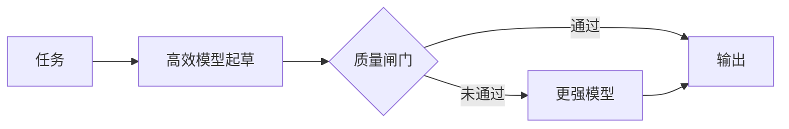

# LLM（大型语言模型）可靠性中的集成方法

集成方法对生产环境的可靠性至关重要。本章介绍可提高准确率并减少幻觉（hallucination）的多模型协同模式。

## 目录

- [Why Ensembles Matter](#为什么集成很重要)
- [Evaluation Ensembles](#评估集成)
- [Generation Ensembles](#生成集成)
- [Multi-Agent Patterns](#多智能体模式)
- [Ensemble vs Arbitration](#集成与仲裁)
- [Cost-Accuracy Tradeoffs](#成本-准确率权衡)
- [Interview Questions](#面试问题)
- [References](#references)

---

## 为什么集成很重要

单模型输出在高风险应用中并不可靠：
- 模型会产生幻觉事实
- 推理可能存在缺陷
- 每次采样的输出都可能不同
- 单一评审者（single-judge）评估存在偏差

集成通过冗余（redundancy）和多样性（diversity）提升可靠性。

### 集成方法分类

| 类别 | 目的 | 方法 |
|----------|---------|---------|
| Evaluation（评估） | 降低评审偏差 | Panel of Judges（评审团）, Pairwise Comparison（成对比较） |
| Generation（生成） | 提升输出质量 | Self-Consistency（自一致性）, Best-of-N（N 选一） |
| Verification（验证） | 减少幻觉 | Multi-Agent Debate（多智能体辩论）, Fact Checking（事实核查） |
| Synthesis（综合） | 融合不同视角 | Mixture of Agents（智能体混合） |
| 升级处理 | 仅在需要时使用强模型计算资源 | 级联、跨模型家族审查 |

---

## 评估集成

### LLM 评审团（PoLL）

多个不同模型对同一输出进行评分：

```python
class PanelOfJudges:
    """
    Production implementation of PoLL pattern.
    Key insight: Diversity of judges matters more than individual judge quality.
    """
    def __init__(self, judges: list, aggregation: str = "mean"):
        # Use diverse model families, not just different sizes
        # Good: [Claude Sonnet 5.5, GPT-6.1 Sol, Gemini 3.8 Flash, GLM-5.3]
        # Bad: [GPT-6 Astra, GPT-6.1 Sol, GPT-6 Luna] - same family bias
        self.judges = judges
        self.aggregation = aggregation
    
    async def evaluate(self, question: str, answer: str, rubric: str) -> dict:
        # Parallel evaluation for latency
        judgments = await asyncio.gather(*[
            judge.score(question, answer, rubric) 
            for judge in self.judges
        ])
        
        scores = [j["score"] for j in judgments]
        
        # Track inter-judge agreement for confidence
        agreement = 1 - (np.std(scores) / max(np.mean(scores), 0.01))
        
        if self.aggregation == "mean":
            final_score = np.mean(scores)
        elif self.aggregation == "median":  # More robust to outliers
            final_score = np.median(scores)
        elif self.aggregation == "trimmed_mean":  # Drop highest and lowest
            final_score = np.mean(sorted(scores)[1:-1])
        
        return {
            "score": final_score,
            "confidence": agreement,
            "individual_scores": scores,
            "needs_review": agreement < 0.7  # Flag for human review
        }
```

**适用场景：** 高风险评估、基准创建、不能接受单一评审者偏差时。

**一致不等于准确。** 评审模型的错误可能相关，因此意见一致的评审团也可能共同自信地判断错误。2026 年 9 月的一项研究（arXiv 2609.29769）比较了返回类型化分数而非文本的决策模型 Jev 与 LLM 评分评审器：LLM 评审器的成本高 16–325 倍、耗时长 28–350 倍，但在 Jev 最有把握的错误中，约 96% 的 LLM 判断重复了同一错误，没有一种级联方案比最佳单评审器高出超过 2.7 分。评审团能降低方差，级联能降低成本；但两者都不能可靠地识别共同盲点。应保留人工标注的黄金集，并据此评估评审团，而非让评审团自评。

### 带位置去偏的成对比较

LLM 评审器存在位置偏差，常偏好排在第一的答案，其程度随评审器和任务而变化（Zheng 等，2023；Wang 等，2023）。应始终运行两种顺序：

```python
async def pairwise_compare_debiased(model, response_a: str, response_b: str, criteria: str) -> dict:
    """
    Critical: Models have significant positional bias.
    Always run both orderings and aggregate.
    """
    # Run both orderings in parallel
    result_ab, result_ba = await asyncio.gather(
        model.compare(first=response_a, second=response_b, criteria=criteria),
        model.compare(first=response_b, second=response_a, criteria=criteria)
    )
    
    # If A wins in both positions -> Strong signal for A
    if result_ab["winner"] == "first" and result_ba["winner"] == "second":
        return {"winner": "A", "confidence": "high"}
    
    # If B wins in both positions -> Strong signal for B
    elif result_ab["winner"] == "second" and result_ba["winner"] == "first":
        return {"winner": "B", "confidence": "high"}
    
    # Winner depends on position -> Positional bias detected
    else:
        return {
            "winner": "tie",
            "confidence": "low",
            "note": "Positional bias detected"
        }
```

---

## 生成集成

### Self-Consistency（多数投票）

生成多条推理路径，对最终答案投票：

```python
class SelfConsistencyDecoder:
    """
    Key parameters:
    - k (sample count): 5-10 for most tasks, 15-20 for hard math
    - temperature: 0.5-0.8 for reasoning tasks, where the API still accepts it
    
    Too low temperature = not enough diversity
    Too high temperature = too much noise
    """
    
    def __init__(self, model, k: int = 7, temperature: float | None = 0.7):
        self.model = model
        self.k = k
        self.temperature = temperature  # None for models with fixed sampling
    
    async def generate_with_consistency(self, prompt: str) -> dict:
        # Pass temperature only if the target model accepts it
        sampling = {} if self.temperature is None else {"temperature": self.temperature}

        # Generate k reasoning paths in parallel
        responses = await asyncio.gather(*[
            self.model.generate(prompt, **sampling)
            for _ in range(self.k)
        ])
        
        # Extract final answers (task-specific)
        answers = [self.extract_answer(r) for r in responses]
        
        # Majority voting
        answer_counts = Counter(answers)
        majority_answer, majority_count = answer_counts.most_common(1)[0]
        
        # Confidence = proportion of votes for winner
        confidence = majority_count / self.k
        
        # Get best reasoning path that led to majority answer
        best_reasoning = self.select_best_reasoning(
            responses, answers, majority_answer
        )
        
        return {
            "answer": majority_answer,
            "confidence": confidence,
            "num_paths": self.k,
            "reasoning": best_reasoning,
            "vote_distribution": dict(answer_counts)
        }
    
    def extract_answer(self, response: str) -> str:
        # Task-specific answer extraction
        # For math: extract the final number
        # For code: extract the function
        # Implement based on your task
        pass
```

**最适合：** 数学、逻辑、答案可验证的编程任务。原论文（Wang 等）的代表性结果显示，相比贪心思维链推理，提升范围从 ARC-challenge 的 +3.9 分到 GSM8K 的 +17.9 分；这些数字来自 2022 年、尚无内置推理能力的模型。不要直接套用于当前推理模型，应先在自己的评估集上测量收益，再决定是否支付 k 倍成本。

### 采样控制正在消失

经典方法通过调整 temperature 获得多样性。前沿 API 正逐渐移除这一旋钮：

| 平台 | 状态（2026 年 10 月） |
|----------|-----------------------|
| Claude API | Opus 4.7 及更新版本、Sonnet 5 及更新版本收到非默认采样值时返回 400；Anthropic Python SDK 1.0（2026 年 8 月 20 日）从 Messages 方法中移除了 `temperature`、`top_p`、`top_k`，传入这些参数会抛出 `TypeError` |
| Gemini API | `temperature`、`top_p`、`top_k` 于 2026 年 7 月 21 日被标记弃用；Gemini 3.8 Flash 用 `thinking_level` 而非 `thinking_budget` 控制推理 |
| OpenAI GPT-6 Astra | 不支持自定义 `temperature`、`top_p` 或 `logprobs` |

对集成方法的影响：

- **多样性要从别处获得。** 这些模型的默认采样已有随机性，因此 k 次采样仍可能出现分歧。若分歧不足，可变化提示词、推理 effort 或模型家族，而不是 temperature。
- **置信度来自投票，而非 logprobs。** Astra 不提供 logprobs，因此样本中的票数占比（或评审分数）就是置信度信号。
- **不要要求最新 Claude 模型写出详细推理。** 要求输出 `<thinking>` 节或 JSON 的 `reasoning` 字段，可能触发 `reasoning_extraction` 类别的拒绝；自 2026 年 9 月 24 日起，这类拒绝也会计费。应对最终答案投票；若需要推理路径，可请求简短解释，或设置 `thinking: {type: "adaptive", display: "summarized"}` 并读取摘要化思考内容（默认 `display: "omitted"` 时，这些模型返回空思考块）。

### 带奖励模型的 Best-of-N

生成 N 个候选项，用 reward model（奖励模型）打分并返回最佳结果：

```python
class BestOfNSampler:
    """
    Key considerations:
    1. N selection: N=4-8 for interactive, N=16-64 for batch
    2. Reward model ensemble reduces (does not prevent) reward hacking
    3. Monitor sample diversity - if too similar, BoN is wasted compute
    """
    
    def __init__(self, generator, reward_models: list, n: int = 8):
        self.generator = generator
        self.reward_models = reward_models  # Ensemble for robustness
        self.n = n
    
    async def generate_best(self, prompt: str) -> dict:
        # Generate N candidates in parallel
        candidates = await asyncio.gather(*[
            self.generator.generate(prompt, temperature=0.8)  # drop on fixed-sampling models
            for _ in range(self.n)
        ])
        
        # Score with reward model ensemble
        scored_candidates = []
        for candidate in candidates:
            rm_scores = await asyncio.gather(*[
                rm.score(prompt, candidate) for rm in self.reward_models
            ])
            
            # Conservative aggregation makes reward hacking harder
            # Use 25th percentile instead of mean
            conservative_score = np.percentile(rm_scores, 25)
            
            scored_candidates.append({
                "response": candidate,
                "score": conservative_score,
                "rm_agreement": 1 - np.std(rm_scores) / np.mean(rm_scores)
            })
        
        # Select best by conservative score
        best = max(scored_candidates, key=lambda x: x["score"])
        
        # Compute diversity metric
        diversity = self.compute_diversity(candidates)
        
        return {
            "response": best["response"],
            "score": best["score"],
            "n_sampled": self.n,
            "diversity_score": diversity,
            "low_diversity_warning": diversity < 0.3
        }
    
    def compute_diversity(self, candidates: list) -> float:
        # Embed candidates and compute average pairwise distance
        embeddings = [embed(c) for c in candidates]
        similarities = []
        for i in range(len(embeddings)):
            for j in range(i + 1, len(embeddings)):
                similarities.append(cosine_similarity(embeddings[i], embeddings[j]))
        return 1 - np.mean(similarities)  # Higher = more diverse
```

**最适合：** 开放式生成、创意任务。收益受评分器限制：当评分器只是代理奖励模型时，best-of-n 起初能提高真实质量，但 n 继续增加后质量反而可能下降（Gao 等，2022）。因此应以人工评分核验选出的结果，并让 N 保持适中。

---

## 多智能体模式

### 多智能体辩论

多个模型迭代式相互批评：

```python
class MultiAgentDebate:
    """
    Pattern: Multiple models debate to reduce hallucinations.
    
    Most effective when:
    1. Models have different biases (diverse model families)
    2. 2-3 rounds is optimal (more = diminishing returns)
    3. Explicit "devil's advocate" prompting improves results
    """
    
    def __init__(self, debaters: list, rounds: int = 2):
        self.debaters = debaters
        self.rounds = rounds
    
    async def debate(self, question: str) -> dict:
        # Round 0: Initial positions
        positions = await asyncio.gather(*[
            debater.generate(f"Answer this question with reasoning: {question}")
            for debater in self.debaters
        ])
        
        debate_history = [{"round": 0, "positions": positions}]
        
        # Debate rounds
        for round_num in range(1, self.rounds + 1):
            new_positions = []
            
            for i, debater in enumerate(self.debaters):
                other_positions = [p for j, p in enumerate(positions) if j != i]
                
                critique_prompt = f"""
Question: {question}

Your previous answer: {positions[i]}

Other perspectives:
{self.format_positions(other_positions)}

Consider the other perspectives. If they raise valid points, update your answer.
If you still disagree, explain why with specific reasoning.
Provide your final answer.
"""
                new_position = await debater.generate(critique_prompt)
                new_positions.append(new_position)
            
            positions = new_positions
            debate_history.append({"round": round_num, "positions": positions})
        
        # Final synthesis
        final_answer = await self.synthesize(question, debate_history)
        
        return {
            "answer": final_answer,
            "rounds": self.rounds,
            "consensus_reached": self.check_consensus(positions),
            "debate_history": debate_history
        }
```

**最适合：** 事实核验，减少复杂答案中的幻觉。

### Mixture of Agents（MoA，智能体混合）

分层架构中，多个模型将输出传入聚合器（aggregators）：

```
┌─────────────────────────────────────────────────────────────────┐
│                    MIXTURE OF AGENTS (MoA)                       │
├─────────────────────────────────────────────────────────────────┤
│                                                                  │
│  Layer 1 (Proposers):                                           │
│  ┌─────────┐  ┌─────────┐  ┌─────────┐  ┌─────────┐            │
│  │ Claude  │  │  GPT-6  │  │ Gemini  │  │ Llama   │            │
│  └────┬────┘  └────┬────┘  └────┬────┘  └────┬────┘            │
│       │            │            │            │                   │
│       └────────────┴─────┬──────┴────────────┘                  │
│                          │                                       │
│  Layer 2 (Aggregator):   ▼                                      │
│  ┌──────────────────────────────────────────────────┐           │
│  │  "Given these perspectives: [R1, R2, R3, R4]    │           │
│  │   Synthesize the best answer..."                │           │
│  └────────────────────────┬─────────────────────────┘           │
│                           │                                      │
│                           ▼                                      │
│                    [Final Output]                                │
└─────────────────────────────────────────────────────────────────┘
```

```python
class MixtureOfAgents:
    def __init__(self, proposers: list, aggregator):
        self.proposers = proposers
        self.aggregator = aggregator
    
    async def generate(self, prompt: str) -> str:
        # Layer 1: Get diverse proposals
        proposals = await asyncio.gather(*[
            proposer.generate(prompt) for proposer in self.proposers
        ])
        
        # Layer 2: Aggregate
        aggregation_prompt = f"""
Given the following question and multiple expert responses, 
synthesize the best possible answer.

Question: {prompt}

Expert responses:
{self.format_proposals(proposals)}

Synthesize the best answer, combining the strongest elements from each response.
"""
        
        final_answer = await self.aggregator.generate(aggregation_prompt)
        return final_answer
```

**最适合：** 复杂综合、报告生成、多领域问题。

### 级联与跨模型家族审查

开发者工具中开始出现两种成本更低的模式。GitHub 的 HydraFusion 于 2026 年 9 月 30 日起在 VS Code 和 Copilot 应用中提供研究预览，按以下三种模式之一编排多个模型：

- **单模型：** 作为基线，仅运行一个模型。
- **级联：** 高效模型先起草，质量闸门作出判断，仅当未通过时才升级到更强模型。成本取决于升级率，而非强模型的单价。
- **审查：** 另一个模型家族的评审者审查草稿，起草模型再修订一次。单轮审查控制成本，跨家族评审也较不容易与起草模型共享盲点。



级联的质量取决于闸门。如果闸门由起草模型同一模型家族的评审器担任，它很可能放过起草模型惯有的错误（见上文相关性错误结果）；因此应优先使用可验证检查：测试通过、schema 有效、引用可解析。

---

## 集成与仲裁

### 概念区分

| 维度 | Ensemble Learning（集成学习） | Model Arbitration（模型仲裁） |
|--------|------------------|-------------------|
| **目标** | 合并所有输出 | 选择单一最佳输出 |
| **机制** | 聚合（voting, averaging） | 选择（scoring, ranking） |
| **关系** | 协作 | 竞争 |
| **最终输出** | 来自所有模型的复合结果 | 单一胜者的输出 |
| **何时使用** | 想要鲁棒性、降低方差 | 想要最佳质量 |

### 决策框架

```
Is there a single "correct" answer format?
├── Yes (classification, math)
│   └── Use Ensemble (voting/averaging)
│
└── No (creative writing, open QA)
    └── Use Arbitration (best-of-N)
        └── Do you have reliable scoring?
            ├── Yes → Reward model selection
            └── No → LLM-as-judge or human
```

---

## 成本-准确率权衡

### 集成成本矩阵

| 方法 | 成本倍数 | 延迟 | 预期效果 | 适用场景 |
|--------|-----------------|---------|---------------|-------------|
| Single Model | 1x | 1x | 基线 | 低风险、高吞吐 |
| Self-Consistency k=3 | 3x | 1x（并行） | 收益有限；三种不同结果无法形成多数 | 推理、对延迟敏感 |
| Self-Consistency k=10 | 10x | 1x（并行） | 在答案可验证的任务上收益更大，但 k 增大后边际收益下降 | 数学、准确率关键 |
| Best-of-N (N=8) | 8x + scoring | 1x（并行） | 受评分器限制；面对可被利用的奖励模型，质量可能下降 | 创意生成 |
| Panel of Judges (3) | 3x eval | 1x（并行） | 降低偏差 | 评估任务 |
| Multi-Agent Debate | 6x | 3x | 幻觉 ↓ | 事实关键 |
| Mixture of Agents | 5-8x | 2x | 更好的综合能力 | 复杂报告 |
| 带质量闸门的级联 | 1x + 闸门 +（升级率 × 强模型成本） | 通常 1x，升级时 2x | 闸门可靠时接近强模型质量 | 有可验证闸门的高流量任务 |
| 跨模型家族审查（单轮） | ~3x | ~3x（串行） | 捕捉模型家族特有的错误 | 代码审查、事实要求高的草稿 |

效果列有意只给方向性描述。效果大小取决于模型和任务，因此在支付额外倍数成本前，应在自己的评估集上将每种方法与单模型基线比较。

### 何时不使用集成

| 情况 | 不使用的原因 | 替代方案 |
|-----------|---------|-------------|
| 简单事实查询 | 多样性没有收益 | 单次 RAG 调用 |
| 需要 < 500ms 延迟 | 集成会增加延迟 | 单模型 + 缓存 |
| 成本是首要约束 | 集成会成倍增加成本 | 模型蒸馏 |
| 模型高度相关 | 没有多样性就没有收益 | 先获取更有差异的模型 |

---

## 面试问题

### Q: 什么时候会使用 Self-Consistency，而不是 Best-of-N？

**标准答案：**

“这两者的用途不同：

**Self-Consistency** 适用于具有可提取、可验证答案的任务：
- 数学题：提取最终数字，进行多数投票
- 分类：对标签投票
- 简短问答：对答案投票

关键在于你可以比较答案是否相等。API 仍暴露 temperature 时，0.5–0.8 能在保持连贯性的同时提供多样性；对固定采样的模型（较新的 Claude 模型、GPT-6 Astra）或采样参数已被弃用的模型（2026 年 7 月后的 Gemini），我会依赖默认采样，并在样本过早趋同时改变提示词或模型。对大多数任务我会使用 k=5–10。

**Best-of-N** 适用于没有单一正确答案的开放式生成任务：
- 创意写作
- 解释说明
- 可以用多种方式编写的代码

在这里，我需要 reward model 或 judge 来给候选项打分，因为不能只靠相等比较。通常 N=8-16。挑战在于避免 reward hacking，所以我会使用 reward model ensembles 并采用保守聚合。

我不会在创意写作中使用 Self-Consistency（没有可提取答案），也不会在数学中使用 Best-of-N（直接投票更简单）。”

### Q：如何在 Best-of-N 中防止 reward hacking（奖励劫持）？

**强力回答：**

“reward hacking（奖励劫持）是指模型利用 reward model（奖励模型）的弱点，而不是真正提升质量。

**我的缓解策略：**

1. **Reward model ensemble（奖励模型集成）**：使用 3 个及以上多样化的 reward models（奖励模型）。能够 hack（利用漏洞）一个 RM 的样本，不太可能同时 hack 所有 RM。

2. **Conservative aggregation（保守聚合）**：不要使用 mean score（平均分），而使用第 25 百分位或最小值。这样会选择在所有 RM 上都得分良好的样本，而不是只在其中一个上得分好。

3. **Diversity monitoring（多样性监控）**：跟踪样本多样性。如果多样性降得太低，模型可能正在利用某种狭窄的 reward hack（奖励漏洞）。我会改变提示词或推理 effort；API 仍允许时，也可调整 temperature。

4. **Human calibration（人工校准）**：定期验证 RM 选出的样本是否 действительно符合 human preferences（人类偏好）。

5. **Multiple dimensions（多个维度）**：在多个 criteria（标准）上评分（quality 质量、safety 安全、relevance 相关性），并要求所有维度都得分良好，而不只是一个 composite（综合）分数。总分式 rubric 会让强项掩盖不及格项：2026 年 9 月的一项 rubric-RL 研究（arXiv 2609.38847）观察到，rubric 覆盖率上升的同时，留出集上医生标准的适切性却降到未训练模型以下；仅当某维度全部标准通过才计入该维度，则让适切性提高 10.8 分，且不损失覆盖率。同样的闸门可用于从 N 个样本中挑选结果。

关键洞察是，任何单一 reward signal（奖励信号）都可能被 gaming（滥用）。Ensembles（集成）会让作弊难得多。”

### Q：三个 LLM 评审器对 95% 的判断意见一致，这是好消息吗？

**强答案：**

“不能只看这一点。高一致率表明评审团判断稳定，不代表判断正确。评审器共享训练数据和盲点，因此错误会相关。2026 年 9 月一项将低成本决策模型评审器与 LLM rubric 评审器比较的研究（arXiv 2609.29769）发现，在低成本评审器最有把握的错误中，约 96% 的 LLM 判断重复了同一错误；级联方案相比最佳单评审器最多仅提高 2.7 分。

**我会检查：**
1. **对人工标注黄金集的准确率**，并按重要标准分层。评审器彼此一致不能替代此项。
2. **评审团一致反对人类判断的案例。** 这些案例暴露共同盲点，应加入黄金集。
3. **真实多样性。** 使用不同模型家族；二元清单标准还可采用不同类型的评审器（返回类型化判断的决策模型，而非再加一个 LLM）。同一家族的三个评审器，可能只是成本三倍的一个评审器。
4. **位置与长度偏差**，通过交换顺序和控制长度来测试。

如果评审团在黄金集上准确，那么 95% 的一致率或许意味着可减至一两个评审器以节约成本。如果不准确，一致率只是掩盖了问题。”

---

## References

- Verga et al. “Replacing Judges with Juries: Evaluating LLM Generations with a Panel of Diverse Models” (2024)
- Wang 等，《Self-Consistency Improves Chain of Thought Reasoning in Language Models》（ICLR 2023）：https://arxiv.org/abs/2203.11171
- Gao、Schulman 和 Hilton，《Scaling Laws for Reward Model Overoptimization》（2022）：https://arxiv.org/abs/2210.10760
- Du et al. “Improving Factuality and Reasoning in Language Models through Multiagent Debate” (2023)
- Wang 等，《Mixture-of-Agents Enhances Large Language Model Capabilities》（2024）
- Zheng 等，《Judging LLM-as-a-Judge with MT-Bench and Chatbot Arena》（2023）
- Wang 等，《Large Language Models are not Fair Evaluators》（2023）
- Rao 与 Callison-Burch，《JEV vs. LLMs as Rubric Judges: Cheaper, Faster, and Wrong in the Same Places》（arXiv 2609.29769，2026）：https://arxiv.org/abs/2609.29769
- GitHub 更新日志，HydraFusion 在 VS Code 和 GitHub Copilot 应用中上线（2026 年 9 月 30 日）：https://github.blog/changelog/2026-09-30-hydrafusion-in-vs-code-and-the-github-copilot-app
- Liu 等，《Scoring Higher, Answering Worse: Mitigating Reward Hacking in Rubric-Based RL via Protocol-Level Rubrics》（arXiv 2609.38847，2026）：https://arxiv.org/abs/2609.38847

---

*上一篇：[护栏与安全](01-guardrails.md) · 下一篇：[可靠性模式](03-reliability-patterns.md)*
