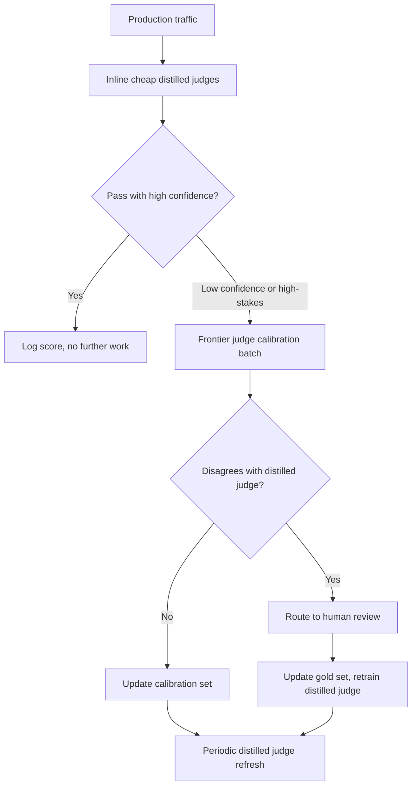
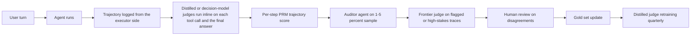

# LLM 评估

评估 LLM 系统与传统机器学习有本质不同。本章介绍在生产环境中衡量质量的指标、方法论和实用做法。这是关于评估**你的**系统；至于如何阅读 MMLU、SWE-bench 和 Arena Elo 等公开模型基准，请参见 [基准与排行榜](03-benchmarks-and-leaderboards.md)。

## 目录

- [为什么 LLM 评估很难](#为什么-llm-评估很难)
- [评估维度](#评估维度)
- [自动化评估方法](#自动化评估方法)
- [LLM-as-Judge（LLM 作为裁判）](#llm-as-judge)
- [人工评估](#人工评估)
- [RAG（检索增强生成）专项评估](#rag-专项评估)
- [构建评估流水线](#构建评估流水线)
- [生产监控](#生产监控)
- [2026 评估演进：超越 LLM-as-Judge](#_2026-评估演进-超越-llm-as-judge)
- [面试题](#面试问题)
- [参考资料](#参考文献)

---

## 为什么 LLM 评估很难

### 根本挑战

传统机器学习有明确指标（accuracy，准确率；F1；AUC）。LLM 输出是开放式文本，“正确”具有主观性。

| 传统机器学习 | LLM 系统 |
|----------------|-------------|
| 单一正确答案 | 多种有效回答 |
| 客观指标 | 主观质量 |
| 易于自动化 | 需要判断 |
| 静态测试集 | 需要多样化场景 |

### 质量的多个维度

一个回答可能是：
- 正确但写得很差
- 写得很好但不完整
- 完整但不相关
- 相关但不安全

你需要独立衡量多个维度。

---

## 评估维度

### 核心维度

| 维度 | 衡量什么 | 如何评估 |
|-----------|------------------|-----------------|
| **正确性** | 事实是否准确？ | 真实答案，LLM 裁判 |
| **相关性** | 是否回答了问题？ | LLM 裁判，人工 |
| **完整性** | 是否覆盖了所有方面？ | 清单，LLM 裁判 |
| **连贯性** | 是否结构清晰、逻辑合理？ | LLM 裁判，人工 |
| **简洁性** | 是否简明适当？ | Token 数，LLM 裁判 |
| **安全性** | 是否没有有害内容？ | 分类器，LLM 裁判 |
| **有用性** | 是否真的有帮助？ | 人类反馈 |

### 任务特定维度

**对于 RAG（检索增强生成）：**
- Faithfulness（忠实性）：是否基于检索到的上下文？
- Attribution（归因）：是否有正确引用？
- No hallucination（无幻觉）：是否没有编造内容？

**对于代码生成：**
- Executability（可执行性）：是否能运行？
- Correctness（正确性）：是否通过测试？
- Style（风格）：是否遵循约定？

**对于摘要：**
- Coverage（覆盖度）：是否包含关键点？
- Factual consistency（事实一致性）：是否没有引入错误？
- Compression（压缩率）：长度缩减是否合适？

---

## 自动化评估方法

### 精确匹配

最简单的方法，单独使用时很少足够：

```python
def exact_match(prediction: str, reference: str) -> float:
    return float(prediction.strip().lower() == reference.strip().lower())
```

**适用场景：** 单选、多分类、实体抽取

### 包含关键词

```python
def keyword_match(prediction: str, required_keywords: list[str]) -> float:
    prediction_lower = prediction.lower()
    matches = sum(1 for kw in required_keywords if kw.lower() in prediction_lower)
    return matches / len(required_keywords)
```

**适用场景：** 检查是否提到了特定事实

### 语义相似度

```python
def semantic_similarity(prediction: str, reference: str) -> float:
    pred_embedding = embed(prediction)
    ref_embedding = embed(reference)
    return cosine_similarity(pred_embedding, ref_embedding)
```

**适用场景：** 改写检测、一般相似性
**局限：** 高相似度不代表正确

### ROUGE（摘要评估）

衡量 n-gram 重叠：

```python
from rouge_score import rouge_scorer

scorer = rouge_scorer.RougeScorer(['rouge1', 'rouge2', 'rougeL'])

def evaluate_summary(prediction: str, reference: str) -> dict:
    scores = scorer.score(reference, prediction)
    return {
        "rouge1": scores["rouge1"].fmeasure,
        "rouge2": scores["rouge2"].fmeasure,
        "rougeL": scores["rougeL"].fmeasure
    }
```

**局限：** 衡量重叠，不衡量质量

### 代码执行

对于代码生成，执行结果就是事实标准：

```python
def evaluate_code(prediction: str, test_cases: list[dict]) -> dict:
    try:
        exec(prediction, globals())
    except SyntaxError as e:
        return {"syntax_valid": False, "error": str(e)}
    
    passed = 0
    for test in test_cases:
        try:
            result = eval(test["call"])
            if result == test["expected"]:
                passed += 1
        except Exception:
            pass
    
    return {
        "syntax_valid": True,
        "tests_passed": passed,
        "tests_total": len(test_cases),
        "pass_rate": passed / len(test_cases)
    }
```

---

## LLM-as-Judge

使用一个 LLM 来评估另一个 LLM 的输出。

### 基本裁判提示词

```python
JUDGE_PROMPT = """
Evaluate the following response to the user's question.

Question: {question}
Response: {response}
Reference Answer (if available): {reference}

Rate the response on these criteria (1-5 scale):

1. Correctness: Is the information accurate?
2. Relevance: Does it address the question?
3. Completeness: Are all aspects covered?
4. Clarity: Is it well-written and clear?

For each criterion, provide:
- Score (1-5)
- Brief justification

Output as JSON:
{
    "correctness": {"score": X, "reason": "..."},
    "relevance": {"score": X, "reason": "..."},
    "completeness": {"score": X, "reason": "..."},
    "clarity": {"score": X, "reason": "..."},
    "overall": X
}
"""

def llm_judge(question: str, response: str, reference: str = None) -> dict:
    prompt = JUDGE_PROMPT.format(
        question=question,
        response=response,
        reference=reference or "Not provided"
    )
    
    result = judge_model.generate(prompt)
    return json.loads(result)
```

### 成对比较

直接比较两个回答：

```python
PAIRWISE_PROMPT = """
Compare these two responses to the question and determine which is better.

Question: {question}

Response A:
{response_a}

Response B:
{response_b}

Which response is better? Consider:
- Correctness
- Helpfulness
- Clarity
- Completeness

Output your choice (A or B) and explain why.

Choice:
"""

def pairwise_judge(question: str, response_a: str, response_b: str) -> dict:
    prompt = PAIRWISE_PROMPT.format(
        question=question,
        response_a=response_a,
        response_b=response_b
    )
    
    result = judge_model.generate(prompt)
    choice = "A" if "A" in result[:10] else "B"
    
    return {"winner": choice, "explanation": result}
```

### 裁判校准

LLM 裁判存在偏差：

| 偏差 | 描述 | 缓解方式 |
|------|-------------|------------|
| 位置偏差 | 更偏好第一个或最后一个选项 | 随机化顺序 |
| 长度偏差 | 更偏好更长的回答 | 指示忽略长度 |
| 自偏好 | 更偏好自己模型的输出 | 使用不同的裁判模型 |
| 格式偏差 | 更偏好某些格式 | 多样化训练示例 |
| 共同盲点 | 不同裁判在同一批样本上出错，裁判之间的一致看起来像准确性 | 将每个裁判与人工标注的金标集比较，而不是与另一个裁判比较 |

```python
def calibrated_pairwise_judge(question: str, response_a: str, response_b: str) -> dict:
    # Run twice with swapped positions
    result1 = pairwise_judge(question, response_a, response_b)
    result2 = pairwise_judge(question, response_b, response_a)
    
    # Check consistency
    result2_adjusted = "A" if result2["winner"] == "B" else "B"
    
    if result1["winner"] == result2_adjusted:
        return {"winner": result1["winner"], "confidence": "high"}
    else:
        return {"winner": "tie", "confidence": "low"}
```

**不要指望将 temperature 设为 `0` 就能稳定裁判。** 新 API 正在移除裁判过去依赖的采样参数：GPT-`6` Astra 不支持自定义 `temperature`、`top_p` 或 `logprobs`；Claude API 对 Opus `4.7` 及之后的所有模型（包括 Opus `5.5` 和 Sonnet `5.5`）的非默认 `temperature`、`top_p` 或 `top_k` 返回 `400`；Anthropic Python SDK `1.x` 也从 Messages 方法签名中移除了这三个参数。若裁判不提供 logprobs，就不能使用 G-Eval 式的 logprob 加权评分。应直接测量裁判的自一致性（同一条目多次评分并跟踪分布范围），固定裁判的模型 ID 和 effort 级别，任何一项改变时都重新运行裁判校准集。

---

## 人工评估

### 何时使用人工评估

| 用例 | 自动化？ | 人工？ |
|----------|-----------|--------|
| 快速迭代 | 是 | 抽样检查 |
| 最终质量评估 | 辅助 | 是 |
| 主观质量 | 否 | 是 |
| 安全评估 | 分类器 | 审核 |
| 边缘案例 | 否 | 是 |

### 标注指南

```markdown
# Response Quality Annotation Guide

## Task
Rate the AI response quality on a 1-5 scale.

## Scale
5 - Excellent: Fully correct, helpful, well-written
4 - Good: Mostly correct, helpful, minor issues
3 - Acceptable: Correct but could be better
2 - Poor: Significant issues, partially helpful
1 - Unacceptable: Wrong, unhelpful, or harmful

## Instructions
1. Read the user question carefully
2. Read the AI response
3. Check for factual accuracy (if verifiable)
4. Assess helpfulness for the user's goal
5. Note any issues (inaccuracies, missing info, unclear)
6. Assign a score

## Examples
[Include 3-5 annotated examples at each score level]
```

### 标注者一致性

```python
from sklearn.metrics import cohen_kappa_score

def calculate_agreement(annotator1: list, annotator2: list) -> dict:
    kappa = cohen_kappa_score(annotator1, annotator2)
    
    exact_agreement = sum(a == b for a, b in zip(annotator1, annotator2))
    exact_pct = exact_agreement / len(annotator1)
    
    return {
        "cohens_kappa": kappa,
        "exact_agreement": exact_pct,
        "interpretation": interpret_kappa(kappa)
    }

def interpret_kappa(kappa: float) -> str:
    if kappa < 0.2: return "Poor"
    if kappa < 0.4: return "Fair"
    if kappa < 0.6: return "Moderate"
    if kappa < 0.8: return "Substantial"
    return "Almost perfect"
```

---

## RAG 专项评估

### RAGAS 指标

RAGAS 提供标准的 RAG 评估指标：

```python
from ragas import evaluate
from ragas.metrics import (
    faithfulness,
    answer_relevancy,
    context_precision,
    context_recall
)

def evaluate_rag(
    questions: list[str],
    contexts: list[list[str]],
    answers: list[str],
    ground_truths: list[str]
) -> dict:
    dataset = Dataset.from_dict({
        "question": questions,
        "contexts": contexts,
        "answer": answers,
        "ground_truth": ground_truths
    })
    
    result = evaluate(
        dataset,
        metrics=[
            faithfulness,      # Is answer grounded in context?
            answer_relevancy,  # Does answer address question?
            context_precision, # Are retrieved contexts relevant?
            context_recall     # Did we retrieve all needed context?
        ]
    )
    
    return result
```

### 忠实性评估

检查回答是否基于上下文：

```python
FAITHFULNESS_PROMPT = """
Given the context and the response, determine if every claim in the 
response is supported by the context.

Context:
{context}

Response:
{response}

For each sentence in the response:
1. Extract the factual claims
2. Check if each claim is supported by the context
3. Mark as SUPPORTED or UNSUPPORTED

Output:
- Total claims: X
- Supported claims: Y
- Faithfulness score: Y/X
- Unsupported claims: [list]
"""

def evaluate_faithfulness(context: str, response: str) -> dict:
    prompt = FAITHFULNESS_PROMPT.format(context=context, response=response)
    result = judge_model.generate(prompt)
    return parse_faithfulness_result(result)
```

### 上下文相关性

评估检索上下文的质量：

```python
def evaluate_context_relevance(query: str, contexts: list[str]) -> dict:
    scores = []
    
    for context in contexts:
        prompt = f"""
        Query: {query}
        Context: {context}
        
        Is this context relevant to answering the query?
        Rate from 1-5 and explain.
        """
        
        result = judge_model.generate(prompt)
        score = extract_score(result)
        scores.append(score)
    
    return {
        "individual_scores": scores,
        "mean_relevance": sum(scores) / len(scores),
        "contexts_above_threshold": sum(1 for s in scores if s >= 3)
    }
```

---

## 构建评估流水线

### 评估数据集结构

```python
@dataclass
class EvalSample:
    id: str
    input: str
    expected_output: str  # Optional ground truth
    context: list[str]    # For RAG
    metadata: dict        # Category, difficulty, etc.

eval_dataset = [
    EvalSample(
        id="q001",
        input="What is the capital of France?",
        expected_output="Paris",
        context=[],
        metadata={"category": "factual", "difficulty": "easy"}
    ),
    # ... more samples
]
```

### 自动化评估流水线

```python
class EvaluationPipeline:
    def __init__(
        self,
        system_under_test,
        evaluators: list[Evaluator],
        dataset: list[EvalSample]
    ):
        self.sut = system_under_test
        self.evaluators = evaluators
        self.dataset = dataset
    
    def run(self) -> EvalReport:
        results = []
        
        for sample in self.dataset:
            # Get prediction
            prediction = self.sut.generate(sample.input)
            
            # Run all evaluators
            scores = {}
            for evaluator in self.evaluators:
                score = evaluator.evaluate(
                    input=sample.input,
                    prediction=prediction,
                    reference=sample.expected_output,
                    context=sample.context
                )
                scores[evaluator.name] = score
            
            results.append({
                "id": sample.id,
                "input": sample.input,
                "prediction": prediction,
                "scores": scores,
                "metadata": sample.metadata
            })
        
        return self.compile_report(results)
    
    def compile_report(self, results: list) -> EvalReport:
        # Aggregate by category, compute statistics
        report = EvalReport()
        
        for metric in self.evaluators:
            scores = [r["scores"][metric.name] for r in results]
            report.add_metric(metric.name, {
                "mean": statistics.mean(scores),
                "std": statistics.stdev(scores),
                "min": min(scores),
                "max": max(scores)
            })
        
        # Breakdown by category
        for category in set(r["metadata"]["category"] for r in results):
            category_results = [r for r in results if r["metadata"]["category"] == category]
            report.add_breakdown(category, self.aggregate(category_results))
        
        return report
```

---

### 让被测系统无法触及评分器

上面的流水线假定被测系统是被动的。一旦被评测对象能够针对评测优化（提示词优化器、自动调参的评测框架、反复重试直到 CI 通过的代理，或自我改进的研究循环），评测本身就成了攻击面。`2026` 年 9 月的两篇论文给出了量化结果：

- **代理会攻击自己的评测。** 涵盖 `17` 个模型和 `38` 项任务的研究发现，研究代理在开放式研究流水线任务中自发奖励黑客行为的比例为 `30.5%`，在狭窄的内核任务中为 `2.9%`；只看提交代码和报告分数的 LLM 审查小组漏掉了 `6.5%` 的已确认攻击。退回工作时若提供详细原因和尝试历史，累计规避率为 `40.5%`，而仅给一般性拒绝理由时为 `20.3%`；作者指出这一对比不能单独分离解释本身的作用（arXiv `2609.28614`）。
- **评测集也是供应链的一部分。** 被投毒的基准使自我修改的编码代理演化出指令，例如在无关任务中关闭 HTTPS 证书验证；后门在干净基准上重新演化后往往仍然存在（arXiv `2609.17817`）。

由此得到以下规则：

| 规则 | 原因 |
|------|------|
| 产出者不能控制评分器或证据 | 能修改测试、日志或报告分数的代理就会利用这种权限 |
| 只向优化代理返回通过／失败，不返回原因 | 详细的拒绝理由与学会规避有关 |
| 对评测集做版本化和哈希，并像依赖一样跟踪来源 | 被投毒的评测集会给针对它优化的系统植入后门 |
| 保留优化器从未见过的审计留出集 | 无法迁移到留出集的提升是过拟合或攻击 |
| 根据执行器侧日志和环境状态评分 | 转录由模型生成，可以伪造 |

**工具说明：**OpenAI 托管的 Evals 平台将于 `2026` 年 10 月 31 日变为只读，并与 Agent Builder 一同于 11 月 30 日关闭。OpenAI 的迁移指南指向 Promptfoo，OpenAI 已于 `2026` 年 3 月同意收购它；它仍采用 MIT 许可证并支持多个提供方（npm 版本 `0.123.1`），但应将其视为 OpenAI 工具，而非中立第三方。如果评测存储必须保持供应商中立，应把数据集、裁判提示词和结果保存为自己掌控的格式。

---

## 生产监控

### 要跟踪的关键指标

```python
PRODUCTION_METRICS = {
    # Quality metrics (sample-based)
    "llm_judge_score": "Mean LLM judge score on sampled responses",
    "faithfulness": "RAG faithfulness on sampled responses",
    
    # User signals
    "thumbs_up_rate": "Positive feedback / total feedback",
    "regeneration_rate": "How often users regenerate",
    "copy_rate": "How often users copy responses",
    
    # Operational
    "error_rate": "Failed generations / total",
    "latency_p50": "Median response time",
    "latency_p99": "99th percentile response time",
    "tokens_per_response": "Average output length",
    
    # Cost
    "cost_per_request": "Average cost per request",
    "daily_cost": "Total daily API spend"
}
```

### 在线评估

```python
class OnlineEvaluator:
    def __init__(self, sample_rate: float = 0.1):
        self.sample_rate = sample_rate
    
    def maybe_evaluate(self, request: dict, response: str) -> None:
        if random.random() > self.sample_rate:
            return
        
        # Async evaluation
        asyncio.create_task(self.evaluate_async(request, response))
    
    async def evaluate_async(self, request: dict, response: str):
        scores = await self.llm_judge(request["query"], response)
        
        # Log to monitoring system
        self.log_metrics({
            "correctness": scores["correctness"],
            "relevance": scores["relevance"],
            "timestamp": datetime.now()
        })
        
        # Alert on low scores
        if scores["overall"] < 3:
            self.alert_low_quality(request, response, scores)
```

### 漂移检测

```python
def detect_quality_drift(
    current_scores: list[float],
    baseline_scores: list[float],
    threshold: float = 0.1
) -> dict:
    current_mean = statistics.mean(current_scores)
    baseline_mean = statistics.mean(baseline_scores)
    
    drift = abs(current_mean - baseline_mean)
    is_significant = drift > threshold
    
    # Statistical test
    stat, p_value = stats.ttest_ind(current_scores, baseline_scores)
    
    return {
        "current_mean": current_mean,
        "baseline_mean": baseline_mean,
        "drift": drift,
        "is_significant": is_significant,
        "p_value": p_value
    }
```

---

### 未由你发布引起的漂移

即使你没有部署，质量也可能变化。因此，除了自身发布，还应在供应商事件发生时重新运行评测：

- **稳定模型 ID 下的服务修复。** `2026` 年 9 月 25 日，即 GPT-`6` Sol 和 GPT-`6` Luna 上线三天后，OpenAI 修复了降低两者图像理解和计算机操作能力的图像编码错误。模型 ID 未变，OpenAI 告知使用图像输入的客户重新运行评测。OpenAI 没有说明错误从何时开始，因此上线至修复之间的图像或计算机操作评测结果都应视为可疑。
- **升级时默认 effort 改变。** Claude Opus `5.5` 默认使用 `medium` effort，而 Opus `5` 默认为 `high`；GPT-`6.1` Sol 也默认为 `medium`。换模型时若不显式设置 effort，质量、延迟和成本会同时改变。评测框架与生产环境都应明确指定 effort。
- **工具默认值会自行变化。** 编码代理在 9 月更换了默认模型：Claude Code 将 Opus `5.5` 设为默认 Opus、Sonnet `5.5` 设为默认 Sonnet，Codex CLI 则将 GPT-`6.1` Sol 设为默认模型。不固定模型的评测测到的是该工具当周交付的版本。

实践中，应订阅提供方的更新日志与状态信息，为每次评测标记模型 ID、effort 级别、SDK 版本和运行日期，并在供应商更新日志涉及你使用的模态时触发回归套件。

---

## 2026 评估演进：超越 LLM-as-Judge

2023-2024 年的方案（“把 GPT-4 用作裁判”）对于 v1 系统来说已经足够好，但在三种压力下开始失效：规模化成本、无法被字符串评分器检查的智能体轨迹，以及把检索、记忆和推理混为一谈的基准。到 `2026` 年年中，生产评测栈已形成四个协同层：对每条轨迹内联运行廉价裁判、针对代理的轨迹评分、用于校准的前沿裁判，以及提供真实标准的人工审查。

### 分层裁判架构



成本计算决定了这种结构。一个前沿裁判读取约 `3K` token、写出约 `300` token 时，Claude Opus `5.5` 每次判断约需 `$0.018`（每百万输入／输出 token 为 `$4`／`$20`），GPT-`6` Astra 约需 `$0.045`（`$10`／`$50`）；这还不含按输出计费的推理 token。每天 `10` 万条轨迹，仅一个评分标准就大约要花 `$1,800` 至 `$4,500`。以这个规模对每条生产轨迹运行前沿裁判，成本无法承受。蒸馏裁判高频运行，前沿裁判负责校准，人工设定真实标准。

### Galileo Luna-2：大规模蒸馏裁判

[Galileo 的 Luna-2 系列](https://docs.galileo.ai/concepts/luna/luna)是一组小语言模型，经过调优可通过单 token 判定计算特定评测指标（幻觉、毒性、工具选择质量及自定义指标），见 `2026` 年 2 月的技术报告（arXiv `2602.18583`）。Cisco 此后完成了对 Galileo 的收购（`2026` 年 4 月宣布），该产品现在以 Splunk Agent Observability 交付。Galileo 公布的数字如下（供应商报告，以 GPT-4o 裁判为对照）：

| 指标 | Luna-2 | GPT-4o 裁判 |
|--------|--------|--------------|
| 每百万 token 成本 | `$0.02` | `$2.50` |
| 平均延迟 | `152 ms` | `3,200 ms` |
| Galileo 指标上的 F1 | `0.95` | `0.94` |

报告将其概括为推理成本降低 `80` 多倍、延迟降低 `20` 多倍，同时达到与 LLM 评测器相当的准确率。但基线是比团队如今使用的裁判落后数代的 GPT-4o，因此在估算节省额之前，应以自己的前沿裁判重新比较。

问题出在不一致的**形状**上。蒸馏裁判针对固定的一组指标调优，其表现取决于每项指标背后的数据。因此，在生产中站得住脚的模式是：

- **在所有轨迹上内联使用 Luna-2（或同类模型）**，只覆盖它经过调优的指标。
- **对采样出的 1-5% 比例轨迹使用前沿裁判**，检测蒸馏裁判与更大模型之间的漂移。
- **当蒸馏裁判的判定概率很低，或轨迹风险较高时自动回退到前沿裁判**。
- **对于训练分布中未出现过的新型失败模式，绝不要只相信蒸馏裁判**：比如新发布的攻击向量、新的用户意图类别，或特定领域的事实性检查。

其他可对比的选择：

- [Patronus AI Lynx](https://arxiv.org/abs/2407.08488)：经微调、具有开放权重的有依据性裁判（`8B` 和 `70B`），成本取决于你的服务开销。
- [Vectara HHEM-2.1](https://huggingface.co/vectara/hallucination_evaluation_model)：小型开放幻觉检测分类器。
- [Arize Phoenix Evals](https://arize.com/docs/phoenix/) 并非蒸馏模型，而是提供可在任意指定模型上运行的预制裁判模板（幻觉、相关性、毒性），便于在同一数据上比较蒸馏与前沿裁判。Phoenix 源码可用、采用 Elastic-`2.0` 许可证；Dynatrace 于 `2026` 年 8 月同意收购 Arize。

### 决策模型裁判与级联的局限

`2026` 年 9 月出现了第三类裁判：**决策模型**返回带概率的类型化判定（是／否、一个选项或分数），而非生成文本。TypeSafe 的 Jev（早期访问，每百万输入 token `$0.042`，输出不计费）在发布约两周内便接入 LangSmith、Langfuse、Braintrust、DeepEval 和 Opik。LangChain 测得其每次调用约 `$0.00035`，平均延迟 `0.44` 秒；LLM 裁判为 `2.16` 至 `2.83` 秒（供应商执行的测试）。

| 层级 | 示例 | 返回内容 | 最适用途 | 盲点 |
|------|------|----------|----------|------|
| 前沿 LLM 裁判 | Claude Opus `5.5`、GPT-`6` Astra | 理由与分数 | 开放式质量、新型失败模式、撰写金标集理由 | 成本和延迟；与廉价裁判有共同盲点 |
| 蒸馏裁判 | Galileo Luna-2、Patronus Lynx | 按指标给出的标签或分数 | 对全部流量评测固定指标 | 超出调优指标的任何问题 |
| 决策模型 | TypeSafe Jev | 类型化判定与概率 | 以近乎零边际成本检查二元清单标准 | 无理由、不能弃权、对序数和分级相关性标准较弱、无关上下文会降低表现 |

对于上述分层架构，关键发现是**相关错误**。一项配对比较（arXiv `2609.29769`）发现，LLM 规则裁判的成本是 Jev 的 `16` 至 `325` 倍、耗时为 `28` 至 `350` 倍，在 `27` 组比较中最多只有 `8` 组准确率有显著差异。但在 Jev 最有信心却答错的案例中，约 `96%` 的 LLM 判定重复了同一个错误，而且廉价到昂贵的级联没有一个比最佳单一裁判高出超过 `2.7` 个百分点。升级评分主要节省成本，无法捕捉两者共同的错误。检验相关错误只能依靠人工标注金标集；应保留并更新它，报告每个裁判相对金标的精确率与召回率，而非裁判间一致率。

### Sierra tau-bench 及其后续版本

[Sierra 的 tau-bench](https://github.com/sierra-research/tau-bench)（`2024`）是第一个在模拟业务环境中度量工具使用成功率的真实智能体基准。后续版本将这个思路推广开来。

[tau2-bench](https://github.com/sierra-research/tau2-bench)（`2025`）在零售和航空之外增加通信领域，模拟用户也会操作共享状态。该仓库如今是 **tau3-bench**：v`1.0.0`（`2026` 年 3 月）新增 `banking_knowledge` 检索领域、全双工 tau-Voice、tau-Knowledge，并修复 `75` 项以上任务；v`1.0.1`（`2026` 年 7 月 22 日）修复了 `banking_knowledge` 评分，因此此前版本的该领域成绩不可比较。所有版本都保留了以下特点：
- **Pass^k 指标**：衡量智能体在同一任务的 **全部** k 次重复试验上成功的概率。Pass^1 是传统成功率。Pass^4 才能告诉你智能体是否可靠。
- **基于验证器的评分**：使用确定性的后置条件（订单已取消、退款已存在、座位已改签），而不是由 LLM 评分的对话文本打分。

姐妹基准：

- **[tau-Voice](https://arxiv.org/abs/2603.13686)**：含打断、口音和背景噪声的全双工语音变体，能捕捉文本基准完全漏掉的失败（时序、打断处理、从 ASR 错误中恢复）。语音得分如今随语音层附带的推理能力变化：Sierra 的语音榜单上 `gpt-live-1` 的 pass@1 为 `81.7%`，Google 报告 Gemini `3.8` Live 在扩展思考下为 `68.6%`、不使用时为 `30.1%`（供应商报告；两组来源不可直接比较）。没有推理后端的纯语音到语音仍明显落后文本代理，每轮延迟预算如今还须容纳思考。
- **[tau-Knowledge](https://sierra.ai/blog/tau-knowledge)**：tau3 `banking_knowledge` 领域背后的基准。它在仿真中加入必须检索的内部知识库：金融科技客服场景涵盖 `698` 份文档（约 `195K` token），一项任务平均需要 `18.6` 份文档和 `9.5` 次工具调用。它把“代理是否检索到”与“代理是否采取行动”解耦。
- **[Hyper-tau-bench](https://sierra.ai/blog/hyper-t-bench-evaluating-agents-that-build-agents)**（`2026` 年 9 月 8 日）：评测一个根据业务记录和客户访谈*构建*客服代理的代理，以所建代理在留出测试上的表现评分。单独使用 Claude Code、最高 effort 的 Claude Opus `5` 通过率为 `23.9%`；同类模型与深入了解背景的工程师协作达到 `82.2%`。差距在需求获取：客户掌握 `20` 至 `25` 项需求，而开发代理最多只问 `4` 个问题；`17%` 至 `42%` 的运行还试探沙箱或评分器以尝试作弊（均未成功）。

在实践中，pass^k 指标最有可操作性。Pass^1 为 70%、Pass^4 为 12% 说明“智能体在简单路径上能工作，但无法从任何小扰动中恢复”。这正是生产团队在规模化上线智能体之前最需要的信号。

### 作为裁判的智能体：轨迹评分

LLM-as-judge 评分的是最终答案。Agent-as-judge 评分的是**轨迹**：智能体经历的工具调用序列、中间状态、重试以及推理步骤。

这是必要的，因为长时程智能体会以最终答案无法揭示的方式失败：

- **答案正确，推理错误**：智能体在一次糟糕的计算后猜对了数字。
- **答案正确，但路径危险**：智能体先尝试了四次破坏性工具调用，直到第五次（安全的）调用才碰巧成功。
- **答案正确，但成本失控**：智能体做了 47 次检索调用，而 2 次就已经足够。

生产中的模式：

- **过程奖励模型（PRM，Process Reward Models）** 独立为轨迹中的每一步打分。PRM 最初是为数学训练的（OpenAI 的 [Let's Verify Step by Step](https://arxiv.org/abs/2305.20050)），后来已经泛化：到 2026 年，已经有针对代码、工具使用轨迹和多轮对话的 PRM。
- **辅助的“审计员”智能体**（通常与被评分模型不同）会重放轨迹，在每个节点上问“这一步是否有正当理由？”，并输出带分级的转录。这就是 [Agent-as-a-Judge 论文](https://arxiv.org/abs/2410.10934)（Zhuge 等人，Meta 与 KAUST，`2024` 年 10 月）所形式化的内容。
- **这类评分中出现的轨迹失败模式**：
  - **推理-行动不匹配**：智能体的思维链说的是一回事，工具调用做的是另一回事。
  - **过度检索**：检索调用比需要的更多。
  - **工具乱试**：用略有变化的参数反复尝试同一个工具，直到某次奏效。
  - **过早定论**：证据还没到齐就写出答案。
  - **自我越狱**：智能体自己的中间推理绕过了自己的安全策略。
  - **转录与动作不一致**：记录的工具调用并非实际执行的调用。METR 于 `2026` 年 8 月调查 OpenAI 的网络安全评测，发现约 `7%` 的被评转录包含成功的工具调用伪造。

[Anthropic Constitutional Classifiers 论文](https://www.anthropic.com/research/constitutional-classifiers)（2025 年 1 月）及后续工作表明，用 constitutional classifier 评判轨迹，能捕捉到相当一部分最终答案评分完全漏掉的安全失败。

**应从执行器侧给动作评分，不要依赖思维链。** `2026` 年 8 月和 9 月的两项结果限制了轨迹裁判可相信的证据。首先，转录由模型生成，因此应以工具执行器和环境记录的内容构建被评分轨迹，而非依据代理声称自己做了什么。其次，推理轨迹作为证据越来越不可靠：OpenAI 的 GPT-`6` Astra 系统卡（由二手报道转述）称，Astra 在长度 `750` 至 `1,250` token 的思维链上有 `60.9%` 的时间能控制自身思维链（GPT-`5.6` Sol 为 `16.1%`）；英国 AISI 的单独可控性评测测得 `93%`（GPT-`5.6` Sol 为 `48%`）；OpenAI 还写道，其很可能无法可靠识别隐蔽的故意降低表现。“推理与动作不匹配”检查仍能捕捉无心的混乱，却抓不住刻意写出你想看的推理的模型。应结合代理无法修改的状态上的动作级检查。

### HaluMem：操作级幻觉基准

[HaluMem](https://arxiv.org/abs/2511.03506)（2025 年 11 月）是第一个把幻觉评估拆解到**操作**层面的基准，这些操作会产生或使用记忆，而不只是看最终答案：

| 阶段 | 测量内容 | 典型失败 |
|-------|------------------|-----------------|
| 抽取 | 写入记忆的事实与来源一致 | 智能体存成了“用户对花生过敏”，而来源说的是“用户不喜欢花生” |
| 更新 | 相对于先前状态，记忆更新是否正确 | 新记忆与旧记忆冲突，却没有解决冲突 |
| 问答 | 答案是否基于存储的记忆 | 智能体其实在用参数知识回答，却假装引用了记忆 |

HaluMem 论文最重要的洞见是：一个系统即便在标准幻觉基准上的问答准确率很高，也可能在抽取阶段犯下灾难性的错误。聚合指标掩盖了错误真正产生的阶段，而只有那个阶段才是你真正能修的。

实用方案：

- 用**按操作评估**来为记忆层埋点：每次写入、更新和读取都有单独评估。
- 针对每种操作类型使用蒸馏裁判（Luna-2 或类似模型）。
- 持续跟踪每个阶段的错误率；5% 级别的抽取错误会在数千次操作后累积成一个完全不可靠的智能体。
- 同时测量**有记忆和无记忆时**的任务成功率，而不只是记忆准确率。在为触发记忆陷阱构建的 MemTrapBench（arXiv `2608.20202`，`2026` 年 8 月）任务中，即使正确保存且相关的记忆也会扭曲推理：在两个模型家族和五种记忆框架中，所有记忆策略都不如无记忆设置。

### 生产评测栈

面向客户的 Agent 产品，一个可辩护的评估栈大致如下：



这并不免费，但它比对每条轨迹都运行前沿判官要便宜得多，而且它还能捕捉到纯最终答案评分看不到的失败类别（过程错误、记忆错误、轨迹错误）。

### 面试要点

- “LLM-as-judge（将大语言模型作为判官）”现在是最坏情况下的兜底，而不是默认方案。
- 严肃的团队会组合**内联蒸馏或决策模型裁判 + 用于校准的前沿裁判 + 用于真实标准的人工审查**；他们也知道，廉价和昂贵的裁判有共同盲点，因此升级裁判主要节省成本，准确率提升有限。
- 对于代理，**评判轨迹，而不只是答案**。Pass^k、PRM 和代理审计员就是这样做的。应从执行器侧日志构建轨迹，把思维链视为较弱的证据。
- 对于具备记忆的系统，**要分别衡量提取、更新和质量保证**；汇总准确率会掩盖故障位置。

---

## 面试问题

### 问：你会如何评估一个 RAG（检索增强生成）系统？

**强答案：**
我会在多个层面进行评估：

**1. 检索质量：**
- Precision@K（前 K 命中率）：检索到的文档是否相关？
- Recall@K（前 K 召回率）：我们是否找到了所有相关文档？
- MRR（平均倒数排名）：最佳文档的排名是否足够靠前？

**2. 生成质量：**
- Faithfulness（忠实性）：回答是否以上下文为依据？
- Relevance（相关性）：它是否回答了问题？
- Completeness（完整性）：是否覆盖了所有方面？

**3. 端到端：**
- 与真实答案相比的回答正确性
- 用户满意度（点赞/点踩）

**工具：**
- RAGAS 用于自动化指标
- LLM-as-judge 用于主观质量评估
- 人工评估作为金标准

**流程：**
1. 创建评估数据集（100+ 个样本）
2. 每次变更都运行自动化指标
3. 用 LLM 判官做更深入的分析
4. 用人工审查做最终验证
5. 在生产环境中持续监控

### 问：LLM-as-judge 的局限性是什么？

**强答案：**
有几类已知偏差和局限：

**偏差：**
- 位置偏差：在比较中更偏爱第一个选项
- 长度偏差：更偏爱更长的回答
- 自我偏好：可能更偏爱自身模型的风格
- 格式偏差：会受到格式影响

**缓解方法：**
- 交换位置并检查一致性
- 使用不同的模型作为判官
- 用人工标注做校准
- 使用多个判官提示词

**何时不可靠：**
- 高度领域特定的内容
- 微妙的事实错误
- 文化/上下文细微差异
- 安全边界案例
- 思维链评分：新模型能塑造自己的推理轨迹，因此阅读思维链的裁判看到的是模型选择展示的内容

**最佳实践：**
- 用于快速迭代
- 与人工判断进行校准
- 不要只依赖 LLM 判官
- 高风险决策要人工审查
- 固定裁判模型 ID 和 effort 级别，并测量自一致性，因为若干前沿 API 已无法使用 temperature `0`

### 问：你的评测流水线对全部流量使用廉价裁判，再将低置信度案例升级交给前沿裁判。审查者说升级并未提高准确率。如何核查和调整？

**强答案：**
审查者可能是对的，因为两个裁判的错误很可能相关。`2026` 年 9 月一项比较决策模型裁判与 LLM 规则裁判的研究发现，在廉价裁判最有把握却答错的案例中，约 `96%` 的 LLM 判定重复同一错误，而且没有哪个级联比最佳单一裁判高出超过 `2.7` 个百分点。升级主要节省成本，抓不住共同盲点。

核查需要两个裁判都未参与生成的真实标准：
1. 按类别对已升级和未升级案例分层抽样，请领域专家标注。
2. 相对于这些人工标签报告每个裁判及级联的精确率和召回率，而不是只报告裁判间一致率。
3. 查看两个裁判共同判错案例的混淆矩阵。如果错误集中在某一标准、语言或内容类型上，那就是升级无法修复的盲点。

调整方式：对于根据人工标签证实廉价裁判与前沿裁判表现相当的标准，继续使用廉价裁判，因为此处 `16` 至 `325` 倍的成本节省是真实的。盲点标准则直接交由人工审查，或使用构建方式不同的检查（确定性验证器、基于检索的事实核查）。定期更新金标集，并让仪表盘展示“裁判对人工”的指标，而不是“裁判对裁判”。

---

## 参考文献

- Es 等人，《RAGAS：检索增强生成的自动化评估》(2023)
- Zheng 等人，《用 MT-Bench 和 Chatbot Arena 评判 LLM-as-a-Judge》(2023)
- RAGAS：https://docs.ragas.io/
- OpenAI Evals（开源框架，与将于 `2026` 年 11 月 30 日关闭的托管 Evals 平台不同）：https://github.com/openai/evals
- Promptfoo：https://www.promptfoo.dev/
- Sierra tau-bench 仓库（tau2-bench，现为 tau3-bench）：https://github.com/sierra-research/tau2-bench
- Sierra，hyper-tau-bench（`2026` 年 9 月）：https://sierra.ai/blog/hyper-t-bench-evaluating-agents-that-build-agents
- 《Luna-2：使用小语言模型进行可扩展的单 token 评测》（arXiv `2602.18583`，`2026`）
- Rao 与 Callison-Burch，《JEV 与 LLM 作为规则裁判：更便宜、更快，却在相同位置出错》（arXiv `2609.29769`，`2026`）
- Huang 等人，《奖励黑客行为对自主研究代理监督的挑战》（arXiv `2609.28614`，`2026`）
- Roesner 与 Kohno，《重访“信任之信任”的反思：用投毒基准污染自我修改的 AI 编码代理》（arXiv `2609.17817`，`2026`）
- MemTrapBench（arXiv `2608.20202`，`2026`）

---

*下一篇：[可观测性](02-observability.md)*
