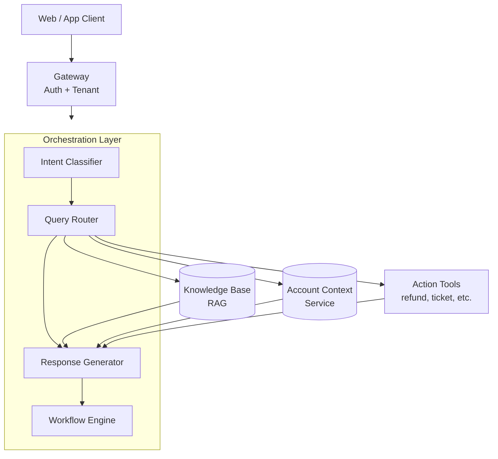
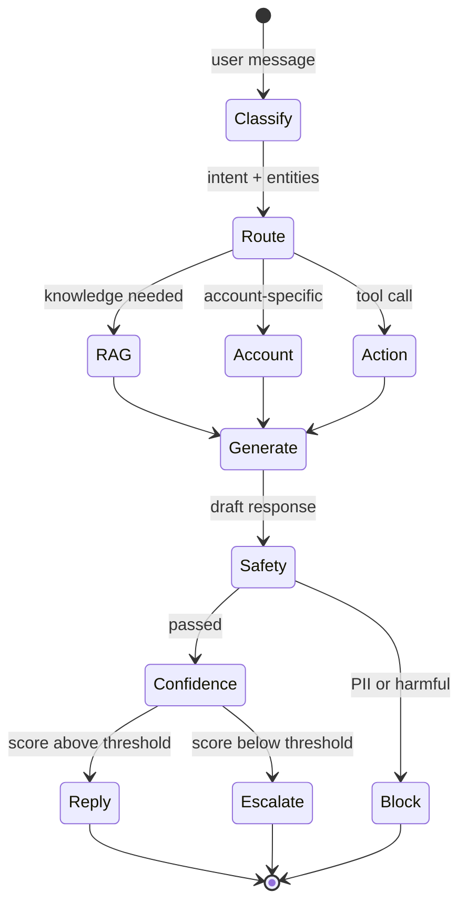
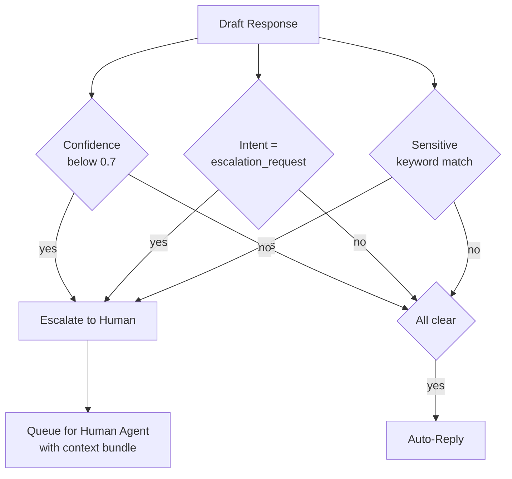

# 案例研究：Customer Support Conversational Agent（客户支持对话代理）

本案例研究介绍了为一家 B2B（企业对企业）SaaS（软件即服务）公司设计生产级客户支持代理的过程。

## 目录

- [问题陈述](#问题陈述)
- [需求分析](#需求分析)
- [架构设计](#架构设计)
- [组件深入解析](#组件深入解析)
- [可靠性模式](#可靠性模式)
- [评估与监控](#评估与监控)
- [成本分析](#成本分析)
- [经验总结](#经验总结)
- [面试讲解流程](#面试讲解流程)

---

## 问题陈述

**公司：** 拥有 50K 企业客户的 B2B（企业对企业）SaaS（软件即服务）平台

**当前状态：**
- 每月 500K 支持工单
- 平均响应时间：4 小时
- 客户满意度（CSAT，Customer Satisfaction）：72%
- 支持团队：100 名坐席

**目标：**
- 将常见查询的响应时间降至 < 5 分钟
- 将 CSAT 提升至 > 85%
- 无需人工介入处理 60% 的工单
- 维护升级工单的处理质量

---

## 需求分析

### 功能性需求

| 需求 | 说明 | 优先级 |
|-------------|-------------|----------|
| 查询理解 | 分类意图、抽取实体 | P0 |
| 知识检索 | 检索产品文档、常见问题、历史工单 | P0 |
| 账户上下文 | 访问用户订阅、历史 | P0 |
| 响应生成 | 自然、准确、有帮助的回复 | P0 |
| 对话记忆 | 多轮上下文 | P0 |
| 动作执行 | 创建工单、触发工作流 | P1 |
| 人工升级 | 必要时带完整上下文交接 | P0 |
| 计费咨询 | 处理敏感财务数据 | P1 |

### 非功能性需求

| 需求 | 目标 | 理由 |
|-------------|--------|-----------|
| 延迟（TTFT） | < 1s | 符合用户对聊天的预期 |
| 延迟（完整） | < 5s | 维持参与度 |
| 可用性 | 99.9% | 业务关键 |
| 准确率 | > 95% | 客户信任 |
| 升级率 | < 40% | 成本效率 |
| CSAT | > 85% | 业务目标 |

### 安全需求

- 日志中不得包含 PII
- 租户隔离（客户只能看到自己的数据）
- 所有动作都要有审计追踪
- SOC 2 合规
- 告知用户正在与 AI 对话：欧盟 AI Act 第 50 条透明度义务自 2026 年 8 月 2 日起适用，委员会指南指出，公众普遍知道 AI 的存在，并不意味着某次具体互动显而易见

---

## 架构设计

### 高层架构

```
┌─────────────────────────────────────────────────────────────────┐
│                      CUSTOMER SUPPORT AGENT                      │
├─────────────────────────────────────────────────────────────────┤
│                                                                  │
│  ┌─────────────┐     ┌─────────────┐     ┌─────────────┐        │
│  │   Web/App   │────▶│   Gateway   │────▶│    Auth     │        │
│  │   Client    │     │             │     │  + Tenant   │        │
│  └─────────────┘     └──────┬──────┘     └─────────────┘        │
│                             │                                    │
│                             ▼                                    │
│  ┌──────────────────────────────────────────────────────────┐   │
│  │                   ORCHESTRATION LAYER                     │   │
│  │  ┌────────────────────────────────────────────────────┐  │   │
│  │  │  Intent        Query          Response    Workflow │  │   │
│  │  │  Classifier → Router →        Generator → Engine   │  │   │
│  │  └────────────────────────────────────────────────────┘  │   │
│  └──────────────────────────────────────────────────────────┘   │
│                             │                                    │
│         ┌───────────────────┼───────────────────┐               │
│         ▼                   ▼                   ▼               │
│  ┌─────────────┐     ┌─────────────┐     ┌─────────────┐        │
│  │  Knowledge  │     │   Account   │     │   Action    │        │
│  │    Base     │     │   Context   │     │   Tools     │        │
│  │   (RAG)     │     │   Service   │     │             │        │
│  └─────────────┘     └─────────────┘     └─────────────┘        │
│                                                                  │
└─────────────────────────────────────────────────────────────────┘
```

以分层流程呈现。编排层会分发到三个并行的上下文来源，然后在响应生成器中将它们组装起来：



### 对话流程

```
User Message
    │
    ▼
┌─────────────────┐
│ Intent Classify │─── billing, technical, account, general, escalation
└────────┬────────┘
         │
         ▼
┌─────────────────┐
│ Query Routing   │─── Which knowledge sources? Which tools?
└────────┬────────┘
         │
    ┌────┴────┬────────────┐
    ▼         ▼            ▼
┌───────┐ ┌───────┐ ┌──────────┐
│  RAG  │ │Account│ │ Actions  │
│ Query │ │Context│ │ (if any) │
└───┬───┘ └───┬───┘ └────┬─────┘
    │         │          │
    └────┬────┴──────────┘
         │
         ▼
┌─────────────────┐
│    Generate     │
│    Response     │
└────────┬────────┘
         │
         ▼
┌─────────────────┐
│  Safety Check   │─── PII, harmful, off-topic
└────────┬────────┘
         │
         ▼
┌─────────────────┐
│  Confidence     │─── Low confidence? Escalate
│    Check        │
└────────┬────────┘
         │
         ▼
    Response / Escalation
```

一次对话轮次是一个状态机。对成本和信任最关键的两个关口是 *安全性*（离开系统前必须通过）和 *置信度*（决定是升级还是自动回复）：



---

## 组件深入解析

### 意图分类

```python
INTENT_SCHEMA = {
    "type": "object",
    "properties": {
        "intent": {"type": "string",
                   "enum": ["billing", "technical", "account", "general", "escalation_request"]},
        "entities": {"type": "array", "items": {
            "type": "object",
            "properties": {"type": {"type": "string"}, "value": {"type": "string"}},
            "required": ["type", "value"],
            "additionalProperties": False,
        }},
        "confidence": {"type": "number"},
    },
    "required": ["intent", "entities", "confidence"],
    "additionalProperties": False,
}

class IntentClassifier:
    async def classify(self, message: str, history: list[dict]) -> dict:
        # Smallest tier: GPT-6 Luna ($0.10 / $0.50 per 1M tokens). Track p95
        # latency and use the lowest reasoning effort that holds accuracy.
        result = await client.responses.create(
            model="gpt-6-luna",
            instructions="Classify the customer's latest message.",
            input=[*history[-4:], {"role": "user", "content": message}],
            text={"format": {"type": "json_schema", "name": "intent",
                             "schema": INTENT_SCHEMA, "strict": True}},
        )
        return json.loads(result.output_text)
```

### 知识库（混合检索与重排序）

```python
class SupportKnowledgeBase:
    async def retrieve(self, query: str, tenant_id: str, top_k: int = 8) -> list[dict]:
        # Long-context models tempt teams to skip reranking and pass 50 chunks.
        # At 500K conversations a month, a reranker (about $0.001 per turn) is
        # far cheaper than paying for 40 extra chunks of input on every turn.
        candidates = await self.sources.search(
            query, filters={"tenant_id": tenant_id}, limit=50
        )
        return await self.reranker.rerank(query, candidates, top_k=top_k)
```

### 响应生成（Claude Haiku 4.5 与 Sonnet 5.5 分层）

这个设计的 2025 版会在单个模型上按请求切换扩展思考。最新模型上，这个开关已经不复存在：Sonnet 5.5 默认运行自适应思考，对 `thinking: {type: "disabled"}` 返回 400，深度通过 `output_config.effort` 设置。Haiku 4.5 则拒绝 effort 参数。如今的按请求调节方式是**模型路由加 effort**。

```python
class ResponseGenerator:
    ROUTINE_MODEL = "claude-haiku-4-5"   # $1 / $5 per 1M; no thinking unless enabled
    COMPLEX_MODEL = "claude-sonnet-5-5"  # $2 / $10 per 1M; adaptive thinking on by default

    async def generate(self, query: str, context: list[dict]) -> dict:
        is_complex = self.detect_complexity(query)  # billing disputes, multi-account issues
        request = {
            "model": self.COMPLEX_MODEL if is_complex else self.ROUTINE_MODEL,
            "max_tokens": 4096,
            "system": SUPPORT_SYSTEM_PROMPT,
            "messages": [{"role": "user", "content": f"Context: {context}\nQuery: {query}"}],
        }
        if is_complex:
            request["output_config"] = {"effort": "medium"}
        response = await self.anthropic.messages.create(**request)
        text = "".join(b.text for b in response.content if b.type == "text")
        return {"response": text, "model": request["model"]}
```

要按路径而非整个系统设置延迟预算。思考 token 会在第一个可见 token 前产生，以常见输出速度生成约 1K 个 token 需要数秒，因此复杂路径无法满足 1 秒 TTFT 目标。应为复杂计费轮次设置独立延迟目标，并在模型工作时流式输出状态信息；对于无需事先推理的路径，也可发送 `thinking: {type: "between_tools"}`，同时实测质量是否保持。

> [!NOTE]
> **生产经验：为强制迁移预留预算。** 支持团队需要数月才能围绕某个模型的语气和拒绝模式调好护栏，这些调校不会免费迁移。Sonnet 4.5 将于 2026 年 11 月 30 日退役。Haiku 4.5 在 Claude API 上的最早退役日期为 2026 年 10 月 15 日（尚未发布通知，Anthropic 至少提前 60 天通知），在 Foundry 上于 11 月 15 日退役；Haiku 5.5 已预告但尚未发布。应保存真实对话的回归集，包含预期语气、升级交接和拒绝行为，并在每次模型变化时运行。

---

## 可靠性模式

### 基于置信度的升级

```python
class EscalationHandler:
    def __init__(self, confidence_threshold: float = 0.7):
        self.threshold = confidence_threshold
    
    async def check_escalation(
        self,
        response: dict,
        intent: str,
        user_request: str
    ) -> dict:
        should_escalate = False
        reason = None
        
        # Low confidence
        if response["confidence"] < self.threshold:
            should_escalate = True
            reason = "low_confidence"
        
        # Explicit escalation request
        if intent == "escalation_request":
            should_escalate = True
            reason = "user_requested"
        
        # Sensitive topics
        if await self.is_sensitive(user_request):
            should_escalate = True
            reason = "sensitive_topic"
        
        if should_escalate:
            return await self.create_escalation(response, reason)
        
        return {"escalate": False, "response": response}
    
    async def is_sensitive(self, message: str) -> bool:
        sensitive_keywords = [
            "legal", "lawsuit", "lawyer",
            "refund", "cancel subscription",
            "competitor", "data breach"
        ]
        return any(kw in message.lower() for kw in sensitive_keywords)
```

升级决策结合了三个独立信号。任一信号触发都会转人工。把它可视化为决策树，可以让 OR 语义一目了然，也便于后续扩展第四个信号：



### 多轮记忆

```python
class ConversationMemory:
    def __init__(self, max_turns: int = 10):
        self.max_turns = max_turns
        self.redis = Redis()
    
    async def get_history(self, session_id: str) -> list[dict]:
        key = f"conversation:{session_id}"
        history = await self.redis.get(key)
        if history:
            return json.loads(history)
        return []
    
    async def add_turn(
        self,
        session_id: str,
        user_message: str,
        assistant_message: str
    ):
        history = await self.get_history(session_id)
        
        history.append({"role": "user", "content": user_message})
        history.append({"role": "assistant", "content": assistant_message})
        
        # Trim to max turns
        if len(history) > self.max_turns * 2:
            history = history[-(self.max_turns * 2):]
        
        await self.redis.setex(
            f"conversation:{session_id}",
            3600,  # 1 hour TTL
            json.dumps(history)
        )
```

---

## 评估与监控

### 质量指标

```python
class QualityMonitor:
    def __init__(self, sample_rate: float = 0.05):
        self.sample_rate = sample_rate
        self.judge = LLMJudge()
    
    async def evaluate(self, conversation: dict):
        if random.random() > self.sample_rate:
            return
        
        scores = await self.judge.evaluate(
            query=conversation["user_message"],
            response=conversation["assistant_message"],
            context=conversation["context"],
            criteria={
                "relevance": "Does the response address the user's question?",
                "accuracy": "Is the information correct based on the context?",
                "helpfulness": "Would this response help the user?",
                "tone": "Is the tone professional and empathetic?"
            }
        )
        
        # Record metrics
        for criterion, score in scores.items():
            metrics.record(f"quality_{criterion}", score)
```

> [!WARNING]
> **确认追踪仍能观测到模型调用。** OpenAI Python SDK 3.0（2026 年 8 月 12 日）和 Anthropic Python SDK 1.0（2026 年 8 月 20 日）都转向 `httpx2`。Anthropic 的迁移指南指出，除非在任何代码导入 httpx 前运行 `httpx2.alias_httpx()`，OpenTelemetry 的 HTTPX 埋点、Sentry 的 httpx 集成、respx、pytest-httpx 和 vcrpy 可能悄然漏掉 SDK 请求。上面这样的抽样监控器会在样本不断缩小时仍报告健康数字。应一起升级 SDK，并在升级前后比较 span 数量与请求数。

### 仪表盘指标

| 指标 | 目标 | 实际 |
|--------|--------|--------|
| 延迟（TTFT） | < 1s | 0.8s |
| 延迟（完整） | < 5s | 3.2s |
| 准确率 | > 95% | 94.3% |
| 升级率 | < 40% | 38% |
| CSAT | > 85% | 87% |
| 解决率 | > 60% | 62% |

---

## 成本分析

### 每次对话成本拆解（2026 年 10 月标价）

假设每次对话 4 轮，每轮约 3K 个输入 token（系统提示、检索片段、账户上下文及历史）。

| 组件 | 成本 | 说明 |
|-----------|------|-------|
| 意图分类 | $0.0003 | GPT-6 Luna（$0.10/$0.50）：每轮一次调用，约 500 输入/50 输出 token |
| 检索与重排序 | $0.0040 | 每轮查询嵌入及 50 个候选 × 每个约 400 token 的重排（Voyage rerank-3，每百万 token $0.05）：每轮约 $0.001 |
| 生成，常规路径 | $0.0136 | Claude Haiku 4.5 处理 80% 的对话：4 ×（3K 输入/250 输出）= $0.017，加权后为 $0.0136 |
| 生成，复杂路径 | $0.0148 | Claude Sonnet 5.5 处理 20%：相同轮次，每轮另有约 1K 思考 token = $0.074，加权后为 $0.0148 |
| 质量抽样 | $0.0013 | 5% 的对话由中档裁决模型评分 |
| **总计** | **约 $0.034** | **每次对话，尚未计入提示缓存** |

复杂路径只占 20% 流量，却占模型支出的 40% 以上，主要来自按输出价格计费的思考 token。缓存静态系统提示和工具定义可以削减输入成本（两种模型的缓存读取价格均为输入价的 0.1 倍）。

### 月度成本预测

| 项目 | 计算 | 成本 |
|------|-------------|------|
| 对话量 | 500K × $0.034 | $17,000 |
| 基础设施 | 固定 | $2,000 |
| 人工升级 | 190K × $5（人工成本） | $950,000 |
| **总计** | | $969,000 |
| **相较全人工的节省** | 500K × $5 - $969K | 每月约 $1.53M |

模型支出不到总额的 2%。真正重要的杠杆是升级率：每有 1 个百分点的升级请求被正确自动解决，每月就能节省约 $25,000（5,000 次对话 × $5），超过整笔模型费用。

---

## 经验总结

### 有效做法

1. **基于意图的路由（Intent-based routing）** 通过聚焦相关来源进行检索，降低了延迟
2. **基于置信度的升级（Confidence-based escalation）** 在降低人工负载的同时保持了质量
3. **账户上下文（Account context）** 让回复更个性化且更准确
4. **结构化输出与固定版本的提示词**比采样设置更能提高一致性。temperature 已不再是可靠旋钮：最新 Claude 模型对非默认值返回 400，GPT-6 Astra 则不接受该参数

### 初期未奏效的做法

1. **单模型处理所有任务** - 针对不同任务路由到不同模型后，质量得到了提升
2. **升级阈值过高** - 最初把置信度设为 0.9，导致升级过多
3. **完整对话历史** - 超出上下文限制，改为摘要化处理

### 建议

1. 从较高的升级率开始，随着置信度提升逐步下调
2. 按升级原因监控 CSAT，以识别薄弱环节
3. 在支持场景专用词汇上重新训练 embeddings（嵌入）
4. 建立反馈闭环：让坐席为升级会话打标签，作为训练数据

---

## 面试讲解流程

**面试官：** "Design an AI customer support system for a SaaS company."

**优质作答模式：**

1. **澄清需求**（2 分钟）
   - "What's the ticket volume? What channels? What's the current CSAT?"（工单量是多少？有哪些渠道？当前 CSAT 是多少？）

2. **明确约束**
   - "关键约束：准确性高于速度、升级交接不丢失上下文、租户隔离"

3. **高层架构**（3 分钟）
   - 画出流程：意图 → 路由 → RAG → 生成 → 安全性 → 回复/升级

4. **深入关键组件**（5 分钟）
   - "让我详细讲一下基于置信度的升级..."

5. **说明可靠性**（3 分钟）
   - "在可靠性方面，我会对计费查询使用 self-consistency（自一致性），并采用跨厂商的多供应商兜底。Anthropic 状态源显示，从 2026 年 8 月中旬至 9 月末至少发生 12 次重大或严重事件；OpenAI 在 9 月 29 日的一次事故使 API 降级超过 5 小时，因此 99.9% 的目标不能只依赖一家供应商"

6. **指标与监控**（2 分钟）
   - "关键指标：CSAT、解决率、升级率、准确率抽样"

7. **成本考虑**（1 分钟）
   - "在每月 500K 次对话的规模下，每次对话成本非常关键。模型路由有助于控制成本。"

---

## 参考资料

- Anthropic 客户支持智能体指南：https://platform.claude.com/docs/en/about-claude/use-case-guides/customer-support-chat
- LangChain Agents：https://docs.langchain.com/oss/python/langchain/agents

---

*下一篇：[金融分析案例研究](03-financial-analysis.md)*
