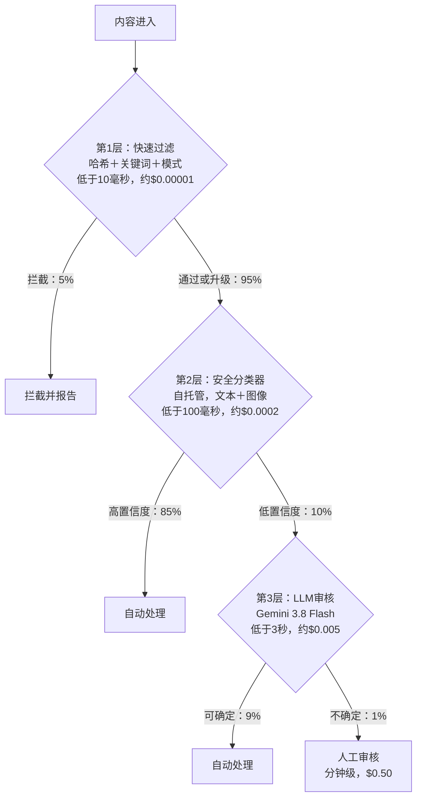
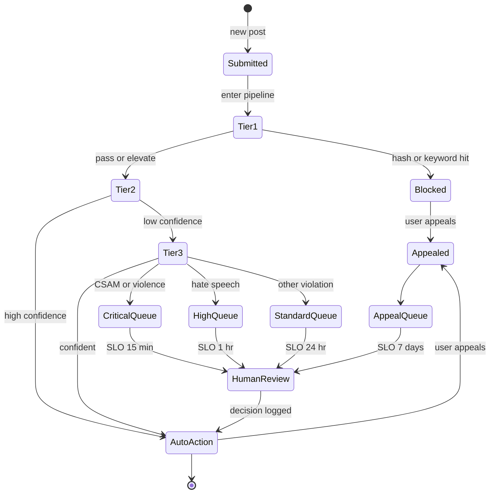

# 案例研究：大规模内容审核

本案例研究介绍为一个每天处理数百万条帖子的社交平台设计一套由 AI 驱动的内容审核系统。

## 目录

- [问题陈述](#问题陈述)
- [需求分析](#需求分析)
- [架构设计](#架构设计)
- [分类流水线](#分类流水线)
- [人类在环](#human-in-the-loop)
- [对抗鲁棒性](#对抗鲁棒性)
- [结果与指标](#结果与指标)
- [面试讲解](#面试演练)

---

## 问题陈述

**公司：** 具有 50M 日活跃用户的社交媒体平台

**当前状态：**
- 每天 10M 条帖子
- 500 名人工审核员
- 平均审核时间：4 小时
- 误报率：15%
- 触达用户的有害内容：2%

**目标：**
- 将有害内容曝光降至 < 0.1%
- 在 < 15 分钟内审核优先级内容
- 将误报率降至 < 5%
- 在不线性增加审核员的情况下扩展规模

---

## 需求分析

### 内容类别

| 类别 | 严重程度 | 处理方式 | 时延 |
|----------|----------|--------|---------|
| CSAM（儿童性虐待材料） | 严重 | 屏蔽 + 上报 | 立即 |
| 暴力/血腥 | 高 | 屏蔽 + 审核 | < 1 分钟 |
| 仇恨言论 | 高 | 屏蔽 + 审核 | < 5 分钟 |
| 骚扰 | 中 | 审核 + 警告 | < 15 分钟 |
| 垃圾信息 | 中 | 降低优先级 | < 1 小时 |
| 错误信息 | 中 | 标记 + 审核 | < 1 小时 |
| 成人内容 | 低 | 年龄门槛 | < 1 小时 |

### 准确率要求

| 指标 | 目标 | 原因 |
|--------|--------|-----------|
| 召回率（有害内容） | > 99% | 将伤害暴露降到最低 |
| 精确率 | > 95% | 将误报降到最低 |
| 时延（关键） | < 1 分钟 | 防止扩散 |
| 时延（标准） | < 15 分钟 | 平衡资源 |

---

## 架构设计

### 高层架构

```
┌─────────────────────────────────────────────────────────────────┐
│                  CONTENT MODERATION PIPELINE                     │
├─────────────────────────────────────────────────────────────────┤
│                                                                  │
│  ┌─────────────┐                                                │
│  │   Content   │                                                │
│  │   Ingestion │                                                │
│  └──────┬──────┘                                                │
│         │                                                        │
│         ▼                                                        │
│  ┌─────────────────────────────────────────────────────────┐    │
│  │                   TIER 1: FAST FILTERS                   │    │
│  │  ┌──────────┐  ┌──────────┐  ┌──────────┐              │    │
│  │  │  Hash    │  │ Keyword  │  │  Known   │              │    │
│  │  │ Matching │  │ Blocklist│  │ Patterns │              │    │
│  │  └──────────┘  └──────────┘  └──────────┘              │    │
│  └──────────────────────────┬──────────────────────────────┘    │
│                             │                                    │
│         ┌───────────────────┼───────────────────┐               │
│         │ Blocked           │ Pass              │ Elevated      │
│         ▼                   ▼                   ▼               │
│  ┌─────────────┐    ┌─────────────────────────────────────┐    │
│  │   Block +   │    │          TIER 2: ML MODELS          │    │
│  │   Report    │    │  ┌────────┐  ┌────────┐  ┌────────┐│    │
│  └─────────────┘    │  │ Vision │  │  Text  │  │ Multi- ││    │
│                     │  │ Model  │  │ Model  │  │ modal  ││    │
│                     │  └────────┘  └────────┘  └────────┘│    │
│                     └──────────────────┬──────────────────┘    │
│                                        │                        │
│         ┌──────────────────────────────┼──────────────────┐    │
│         │ High Confidence              │ Low Confidence   │    │
│         ▼                              ▼                   │    │
│  ┌─────────────┐              ┌─────────────────────────┐ │    │
│  │ Auto Action │              │    TIER 3: LLM REVIEW   │ │    │
│  └─────────────┘              │  (nuanced cases)        │ │    │
│                               └────────────┬────────────┘ │    │
│                                            │               │    │
│                        ┌───────────────────┼──────────────┐│    │
│                        │ Confident         │ Uncertain    ││    │
│                        ▼                   ▼              ││    │
│                 ┌─────────────┐    ┌─────────────┐       ││    │
│                 │ Auto Action │    │   Human     │       ││    │
│                 └─────────────┘    │   Review    │       ││    │
│                                    └─────────────┘       ││    │
│                                                          ││    │
└──────────────────────────────────────────────────────────┘│    │
```

分层流水线可视为一棵决策树。每一层只会升级它无法低成本判断的内容；百分比均表示全部帖子的占比。第 `1` 层至第 `4` 层的单次决策成本跨度约为 `1:50,000`，因此正确路由是单位经济性的主要杠杆：



### 处理层级

| 层级 | 方法 | 时延 | 每次决策成本 | 覆盖范围（全部帖子的占比） |
|------|------|------|--------------|----------------------------|
| `1` | 哈希／关键词／模式 | `< 10ms` | 约 `$0.00001` | `5%` 拦截 |
| `2` | 自托管安全分类器 | `< 100ms` | 约 `$0.0002` | `85%` 自动判定 |
| `3` | LLM 审核（Gemini `3.8` Flash） | `< 3s` | 约 `$0.005` | `10%` 接受审核，`9%` 得出判定 |
| `4` | 人工审核 | 分钟级 | `$0.50` | `1%` 升级 |

---

## 分类流水线

### 第 1 层：快速过滤器

```python
class FastFilters:
    """
    Immediate blocking for known harmful content.
    No false positives for matches.
    """
    
    def __init__(self):
        self.hash_db = PhotoDNADatabase()  # CSAM detection
        self.keyword_filter = KeywordBlocklist()
        self.pattern_matcher = RegexPatterns()
    
    async def filter(self, content: Content) -> FilterResult:
        # CSAM hash matching (highest priority)
        if content.has_media:
            hash_match = await self.hash_db.check(content.media_hashes)
            if hash_match:
                return FilterResult(
                    action="block_report",
                    reason="csam_hash_match",
                    confidence=1.0,
                    tier=1
                )
        
        # Keyword blocklist
        if content.text:
            keyword_match = self.keyword_filter.check(content.text)
            if keyword_match and keyword_match.severity == "critical":
                return FilterResult(
                    action="block_review",
                    reason=f"keyword_{keyword_match.category}",
                    confidence=0.99,
                    tier=1
                )
        
        # Pattern matching (phone numbers in suspicious context, etc)
        pattern_match = self.pattern_matcher.check(content.text)
        if pattern_match:
            return FilterResult(
                action="elevate",
                reason=f"pattern_{pattern_match.type}",
                confidence=pattern_match.confidence,
                tier=1
            )
        
        return FilterResult(action="continue", tier=1)
```

### 第 2 层：自托管安全分类器

```python
class SafetyClassifiers:
    """
    Cheap, fast, high volume: every post that clears Tier 1 lands here.
    An open multimodal safety model (for example Llama Guard 4 12B) plus
    in-house classifiers fine-tuned on your own policy labels, served on
    your GPUs. Escalate to Tier 3 only on low confidence.
    """
    async def classify(self, content: Content) -> dict:
        scores = await asyncio.gather(
            self.policy_model.score(text=content.text, images=content.images),
            self.spam_model.score(content),
            self.nsfw_vision_model.score(content.images),
        )
        verdict = self.combine(scores)  # per-category thresholds tuned on human labels
        return {"verdict": verdict.label, "confidence": verdict.confidence, "tier": 2}
```

### 第 3 层：细致 LLM 审核（Gemini `3.8` Flash）

```python
from google.genai import types

class NuanceReviewer:
    """
    Native multimodal review for the ~10% of posts the classifiers are unsure
    about: sarcasm, regional slang, text on a protest sign, meme context.
    Gemini 3.8 Flash reads text inside images, so no separate OCR call here.
    """
    async def review(self, content: Content, context: dict) -> dict:
        parts = [
            POLICY_PROMPT,
            content.text,
            *[types.Part.from_bytes(data=img, mime_type="image/jpeg") for img in content.images],
        ]
        response = await self.client.aio.models.generate_content(
            model="gemini-3.8-flash",
            contents=parts,
            config=types.GenerateContentConfig(
                response_mime_type="application/json",
                response_schema=ReviewResult,
                thinking_config=types.ThinkingConfig(thinking_level="low"),
            ),
        )
        return json.loads(response.text)
```

---

## Human-in-the-Loop

### Review Queue Management

每条内容都会从提交开始，经历一个生命周期，最终进入终止状态。将生命周期建模为状态机能让 SLO 变得具体：每个优先级队列都有不同的终态时限目标，申诉也可以让内容重新回到待处理状态：



```python
class ReviewQueueManager:
    """
    Prioritize and route content to human moderators.
    """
    
    def __init__(self):
        self.queues = {
            "critical": PriorityQueue(),  # CSAM, violence - human SLO 15 min
            "high": PriorityQueue(),      # Hate speech - human SLO 1 hour
            "standard": PriorityQueue(),  # Other violations - human SLO 24 hours
            "appeals": PriorityQueue()    # User appeals - SLO 7 days
        }
    
    async def enqueue(self, content: Content, result: ReviewResult):
        priority = self.calculate_priority(content, result)
        
        item = ReviewItem(
            content_id=content.id,
            content=content,
            ai_analysis=result,
            priority=priority,
            enqueued_at=datetime.now()
        )
        
        queue_name = self.get_queue(result.severity)
        await self.queues[queue_name].put(item)
        
        # Alert if critical
        if queue_name == "critical":
            await self.alert_moderators(item)
    
    def calculate_priority(self, content: Content, result: ReviewResult) -> float:
        priority = 0.0
        
        # Severity weight
        severity_weights = {"critical": 100, "high": 50, "medium": 20, "low": 5}
        priority += severity_weights.get(result.severity, 0)
        
        # Reach weight (viral content prioritized)
        priority += min(content.reach_score * 10, 50)
        
        # Confidence inverse (less confident = higher priority)
        priority += (1 - result.confidence) * 30
        
        return priority
```

### 审核员界面

```python
class ModeratorDecision:
    async def submit(
        self,
        moderator_id: str,
        content_id: str,
        decision: str,
        reason: str,
        notes: str = None
    ):
        # Record decision
        await self.store_decision({
            "content_id": content_id,
            "moderator_id": moderator_id,
            "decision": decision,
            "reason": reason,
            "notes": notes,
            "ai_recommendation": await self.get_ai_result(content_id),
            "decided_at": datetime.now()
        })
        
        # Execute action
        await self.execute_action(content_id, decision)
        
        # Update ML models with feedback
        await self.feedback_loop.record(
            content_id=content_id,
            ai_prediction=await self.get_ai_result(content_id),
            human_decision=decision
        )
```

---

## 对抗鲁棒性

### 规避技术与防御

| 规避技术 | 防御 |
|-------------------|---------|
| 字符替换（h@te） | 归一化 + 同形异义字符映射（homoglyph mapping） |
| 图片文字（图像中的文本） | OCR 管道（光学字符识别） |
| 不可见字符 | Unicode 归一化 |
| 上下文操纵 | 多轮分析 |
| 编码内容 | 解码管道 |
| 对抗性图像 | 鲁棒视觉模型 |
| 将 AI 生成图像冒充真实图像 | 读取来源元数据并使用水印检测器；按政策加标签 |

### 防御管道

```python
class AdversarialDefense:
    def __init__(self):
        self.normalizer = TextNormalizer()
        self.ocr = OCRPipeline()
        self.decoder = ContentDecoder()
    
    def preprocess(self, content: Content) -> Content:
        processed = content.copy()
        
        # Normalize text
        if processed.text:
            processed.text = self.normalizer.normalize(processed.text)
            processed.text = self.decoder.decode_obfuscation(processed.text)
        
        # Extract text from images
        if processed.has_images:
            for image in processed.images:
                extracted_text = self.ocr.extract(image)
                if extracted_text:
                    processed.text = f"{processed.text}\n[IMAGE TEXT]: {extracted_text}"
        
        return processed
    
    def normalize(self, text: str) -> str:
        # Homoglyph normalization
        text = self.homoglyph_map(text)
        
        # Unicode normalization
        text = unicodedata.normalize("NFKC", text)
        
        # Remove zero-width characters
        text = re.sub(r"[\u200b-\u200f\u2028-\u202f]", "", text)
        
        # Leetspeak normalization
        text = self.leetspeak_decode(text)
        
        return text
```

---

### 来源信息与 AI 生成内容

对于这一规模的平台，`2026` 年的两套规则使内容来源信息成为流水线要求：

| 规则 | 时间 | 对流水线的意义 |
|------|------|----------------|
| 经 AB `2713` 修订的加州《AI 透明度法》（`2026` 年 9 月 30 日签署） | 大型平台义务自 `2027` 年 1 月 1 日适用 | 检测来源数据和数字签名，向用户显示其是否存在、内容由哪个生成式 AI 系统或采集设备制作；让用户查看或下载这些数据；上传、分发或下载时不得故意剥除符合标准的来源信息 |
| 欧盟 AI 法案第 `50` 条与标记行为准则 | 自 `2026` 年 8 月 2 日生效；已上市系统须于 12 月 2 日前标记输出 | 生成器须以机器可读方式标记输出；行为准则要求签署者采用签名元数据加不可感知水印（少于 `200` token 的文本免于水印），并免费提供检测工具；水印检测互操作性须于 `2027` 年 2 月 2 日前实现。越来越多的上传内容会带有流水线可读取的标记 |

工程后果是：内容进入路径中的图像与视频转码器通常会丢弃元数据，现在必须传递来源信息；审核记录也应把检测到的来源信息与分类器判定一同存储。来源信息是信号，不是最终判定：缺少元数据不能证明任何事，因为大多数内容从未被标记。如果平台还交付自己的图像生成器，AI 法案新增的第 `5` 条禁止生成未经同意的私密影像与儿童性虐待材料，自 `2026` 年 12 月 2 日起适用；缺乏充分防护的通用生成器也在涵盖范围内。

---

## 结果与指标

### 性能对比

| 指标 | 之前 | 之后 | 改善 |
|--------|-------|-------|-------------|
| 有害内容暴露 | 2% | 0.08% | 降低 96% |
| 审核延迟（关键） | 4 小时 | 8 分钟 | 快 30 倍 |
| 假阳性率 | 15% | 4.2% | 降低 72% |
| 版主效率 | 50/天 | 200/天 | 提升 4 倍 |

### 成本分析（`2026` 年 10 月，日处理 `1000` 万条帖子）

| 组件 | 计算 | 每日成本 | 备注 |
|------|------|----------|------|
| 第 `1` 层过滤器 | `10M × ~$0.00001` | 约 `$100` | CPU 哈希和模式匹配 |
| 第 `2` 层分类器 | `9.5M × ~$0.0002` | 约 `$1,900` | 按峰值负载配置约 `28` 张全天运行的自托管 H100，每张每小时 `$2.77`（Silicon Data 指数，`2026` 年 10 月 1 日） |
| 第 `3` 层 LLM 审核 | `1M × ~$0.005` | 约 `$5,000` | Gemini `3.8` Flash，约 `2.5K` 输入（政策提示词加图像）／`150` 输出，按 `2027` 年 1 月标价（`$1.50/$7.50`）；优惠价约为一半 |
| 人工审核 | `100K × $0.50` | 约 `$50,000` | `500` 名审核员，每人每天 `200` 次决策 |
| **总计** | | **约 `$57,000/天`** | 人工审核约占 `88%` |

**为什么不把所有内容交给 LLM？** 按每帖约 `$0.005`，审核全部 `1000` 万条帖子每天约需 `$50,000`，与整个人工审核预算相当，而且会给每帖增加数秒延迟。第 `2` 层分类器的单帖成本约低 `25` 倍，并在毫秒级回答。Flash 层级的价格会快速双向变化，因此价格变化时要重新比较；Gemini `3.8` Flash 将于 `2027` 年 1 月 1 日涨价一倍。

> [!TIP]
> **生产经验：** 原生多模态 LLM 可在第 `3` 层直接读取图像中文字，省去单独的 OCR 步骤。但第 `1`、`2` 层之前仍要保留归一化和 OCR：哈希列表、关键词过滤器与小型分类器无法读取图像，而图中文字正是针对这些廉价层的规避手段。

---

## 面试演练

**面试官：** “为一个社交媒体平台设计内容审核系统。”

**有力回答：**

1. **澄清规模与需求**（1 分钟）
   - “流量有多大？内容类型有哪些？可接受的假阳性率是多少？”
   - “是否有合规要求（CSAM 报告、GDPR，以及自 `2027` 年 1 月起加州《AI 透明度法》的来源信息展示要求）？”

2. **多层架构**（3 分钟）
   - “我会使用一个复杂度逐级提升的级联结构：”
   - “第 1 层：哈希匹配、关键词过滤器 - 即时、确定性强”
   - “第 2 层：ML 分类器 - 快速、专用”
   - “第 3 层：LLM 审核 - 细致、感知上下文”
   - “第 4 层：人工审核 - 最终裁决者”
   - “每一层处理上一层无法处理的内容”

3. **优先级是关键**（2 分钟）
   - “并非所有有害内容都同等严重。CSAM 和暴力需要立即处理。仇恨言论优先级高，但不必瞬时处理。垃圾信息可以稍后处理。”
   - “基于严重性、传播范围和置信度的优先队列”

4. **人机协同设计**（2 分钟）
   - “由人工处理低置信度决策和申诉”
   - “AI 自动判定约 `99%`，使人工审核规模可由 `500` 名审核员承担”
   - “反馈闭环：人工决策改进 ML 模型”

5. **对抗鲁棒性**（2 分钟）
   - “用户会规避检测。防御措施包括：”
   - “针对混淆写法的文本归一化”
   - “针对图片中文字的 OCR”
   - “随着规避手段演变而持续更新模型”

6. **指标**（1 分钟）
   - “主要指标：有害内容暴露率（目标 < 0.1%）”
   - “次要指标：假阳性率（用户体验）”
   - “运营指标：审核延迟、版主吞吐量”

---

## 参考资料

- Meta 内容审核：https://transparency.meta.com/
- Google Perspective API（即将停止服务；于 `2026` 年 12 月 31 日终止，不应新增依赖）：https://perspectiveapi.com/
- OpenAI 审核：https://developers.openai.com/api/docs/guides/moderation

---

*下一篇：[实时 AI 搜索案例研究](06-real-time-search.md)。当前模型价格参见 [LLM 定价参考](../02-model-landscape/03-pricing-and-costs.md)。*
