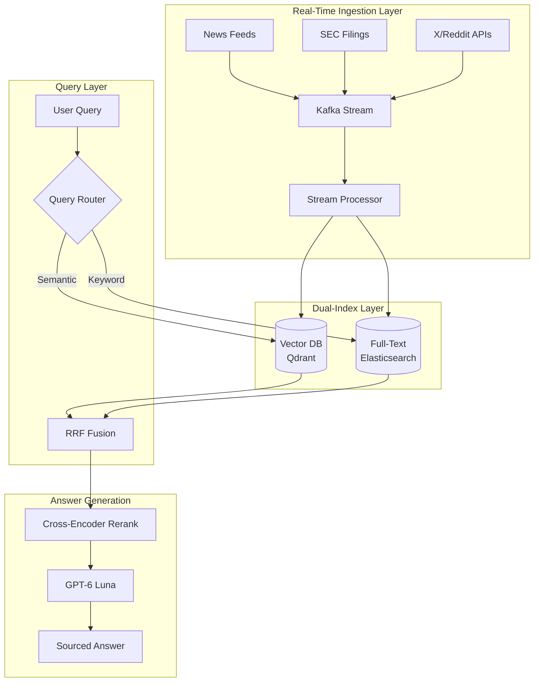

# 案例研究：实时 AI 搜索引擎

## 问题

一家金融科技初创公司需要构建一个**实时市场情报平台**，让分析师能够就实时市场数据、新闻和公司申报文件提出自然语言问题。

**面试中给定的约束：**
- 数据新鲜度：查询必须反映过去 5 分钟内的信息
- 规模：10,000 并发用户，50,000 次查询/小时
- 准确性：金融数据不能产生幻觉
- 延迟：p95 响应时间低于 3 秒

---

## 面试题

> "设计一个系统，让用户可以问‘过去一小时特斯拉周围的情绪如何？’，并在低于 3 秒内得到一个准确、有来源的答案。"

---

## 解决方案架构



---

## 关键设计决策

### 1. 为什么使用 Kafka 做摄取？

面试官想知道你是否理解**流式处理与批处理**的区别。

**回答：** Kafka 提供持久、可重放的数据流，并支持独立的消费者组。我们有一个消费者写入向量数据库，另一个写入 Elasticsearch。如果向量索引落后，全文索引仍可提供查询服务。这是为了提升弹性的**双写模式**。Kafka 的精确一次语义覆盖 Kafka 到 Kafka 的处理，不涵盖写入外部存储。因此，每个写入端消费者都应按至少一次投递处理，并以文档 ID 为键进行幂等 upsert，实现实际效果上的精确一次。

### 2. 为什么采用混合搜索（向量 + 全文）？

**回答：** 金融查询会把语义（“特斯拉周围的情绪”）和关键词（“TSLA 10-K filing”）混在一起。纯向量搜索会漏掉精确的股票代码匹配。我们使用**倒数排名融合（RRF, Reciprocal Rank Fusion）**来合并结果。

### 3. 为什么使用小模型而不是前沿模型？

**回答：** 在 3 秒的 p95 延迟目标和每小时 50K 次查询的规模下，我们需要快速且低成本地综合内容。GPT-6 Luna（每 100 万输入/输出 token 为 $0.10 / $0.50）或低思考档位的 Gemini 3.8 Flash 可以胜任；重排序器负责准确性，LLM 只综合已经验证过的内容。但有两点要注意：两者都可能先消耗 token 思考再回答，因此应检查默认设置，并选择在保证质量的前提下最低的推理 effort 或思考档位，否则思考时间会挤占延迟预算。此外，应在自己的提示词上测量首 token 时间和每秒 token 数，而不是引用厂商数字。如果峰值时 p95 仍超标，可将付费加速档位（OpenAI Fast 在所用模型支持时收取 2 倍价格）与其他方案比较；这通常比把所有查询都转到更大模型便宜。

---

## 如何处理新鲜度要求

这个问题最难的部分，是确保索引反映过去 5 分钟内的数据。

**方案：基于 TTL 的索引**

```python
# Each document gets a timestamp field
doc = {
    "content": "Tesla announces new factory...",
    "timestamp": datetime.now(UTC).isoformat(),
    "source": "Reuters",
    "ttl_hours": 24  # A sweeper job deletes points older than this
}

# Query filters to last N minutes (Qdrant Query API; the legacy search
# endpoint is gone from the REST schema as of Qdrant 1.19)
def search_recent(query: str, minutes: int = 60, limit: int = 50):
    cutoff = datetime.now(UTC) - timedelta(minutes=minutes)
    return qdrant.query_points(
        collection_name="market_docs",
        query=embed(query),
        query_filter=models.Filter(must=[
            models.FieldCondition(key="timestamp", range=models.DatetimeRange(gte=cutoff))
        ]),
        limit=limit,
    ).points
```

应为 `timestamp` 建立日期时间载荷索引；否则 Qdrant 必须读取载荷才能计算范围过滤，随着集合增长，按时间过滤的查询会变慢。

---

## 成本分析

假设在市场交易时间每小时有 50K 次查询（每天约 10 小时、每月 22 个交易日），即每月约 11M 次查询，每次约 4K 输入 token 和 300 输出 token。

| 组件 | 月成本（按 50K 次查询/小时计） |
|-----------|-----------------------------------|
| Kafka（MSK） | $2,500 |
| Qdrant（托管） | $1,800 |
| Elasticsearch | $2,000 |
| GPT-6 Luna（生成）：44B 输入 × $0.10/1M + 3.3B 输出 × $0.50/1M | $6,050 |
| 交叉编码器重排序 | $800 |
| **总计** | **$13,150/月** |

生成成本按标价估算，未计入提示词缓存。如果全天候保持同样的查询速率（每月 36M 次），仅生成费用就约为 $19,800。

---

## 面试追问

**问：你如何防止金融数据被幻觉化？**

答：三层保障：（1）LLM 只总结检索到的内容，从不凭空生成事实。（2）每个结论都必须引用一个源文档。（3）生成后校验器会检查响应中的任何数字是否在某个来源中逐字存在。

**问：如果 Kafka 在新闻高峰期落后了怎么办？**

答：我们会通过消费者滞后监控实现背压。如果滞后超过 2 分钟，就在摄取侧用采样来降载。实时查询走只包含最近一小时数据的“recent”索引；批处理任务再补全完整索引。

**问：有人用虚假帖子淹没 X 和 Reddit，试图操纵情绪分析答案。如何防止？**

答：应将检索视为攻击面，因为答案投毒已经发生。2026 年 9 月，一名安全研究人员报告，有钓鱼活动向网络大量投放帖子、PDF 和虚假支持页面，诱使 ChatGPT、Gemini 和 Google AI Overviews 展示航空公司和银行的诈骗电话号码。防御措施包括：（1）摄取时根据账户年龄、关注者关系图和近似重复帖子的突发情况评估来源声誉，并保存为可过滤字段；（2）限制单个答案中低声誉社交来源的占比，并展示来源构成；（3）社交帖子绝不能作为电话号码、申报日期或联系信息的引用，这些事实只能由 SEC 申报文件、通讯社等一手来源支撑。

---

## 面试要点总结

1. **实时 AI 搜索需要流式基础设施**，而不是批处理 ETL
2. **混合搜索（语义 + 关键词）在结构化领域优于纯向量搜索**
3. **延迟预算决定模型选择**：用快速模型做综合，把昂贵模型留给推理
4. **新鲜度是一个过滤条件，而不是一个特性**：应在索引层实现，而不是在提示词层实现
5. **最新来源最容易被投毒**：按来源声誉加权，并让事实始终关联一手来源

---

*相关章节：[混合搜索](../06-retrieval-systems/05-hybrid-search.md)，[服务基础设施](../04-inference-optimization/06-serving-infrastructure.md)*
