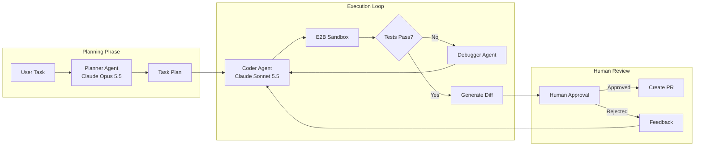
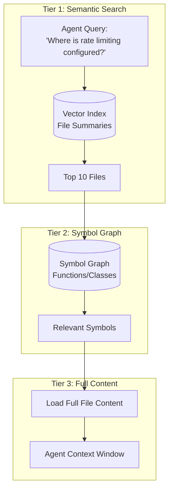

# 案例研究：自主编码智能体（Autonomous Coding Agent）

## 问题背景

一家开发者工具公司希望构建一个能够自主完成多文件任务的 **AI 编码助手（AI Coding Assistant）**：例如“给这个 Express API 添加认证”或“将该模块重构为依赖注入（Dependency Injection）”。

**面试中给出的约束：**
- 必须支持 1,000+ 文件的代码库
- 不得破坏既有功能（测试必须通过）
- 人类必须在提交前审批更改
- 预算：每次任务完成低于 $0.50

---

## 面试问题

> “设计一个编码智能体（Coding Agent），可以处理类似‘为所有 API 端点添加速率限制（Rate Limiting）’的任务，并产出可工作的、已测试的拉取请求（Pull Request）。”

---

## 解决方案架构



---

## 关键设计决策

### 1. 为什么要分离规划代理（Planner）和编码代理（Coder）？

**回答：** 规划任务需要对**整个代码库**进行推理（需要触及哪些文件、依赖关系是什么），编码任务则需要**精确的语法生成**。将两者分开后，规划器可使用 `high` effort 的 Opus 5.5，编码器使用 `medium` effort 的 Sonnet 5.5。两者都通过 effort 调节思考量：思考无法完全关闭（Opus 5.5 在任何 effort 档位都拒绝禁用思考；Sonnet 5.5 的最低设置是 `between_tools`），而 Opus 5.5 默认 `medium`，因此要显式指定。分离也让我们能在执行前设置检查点，供人工审核方案方向。

### 2. 为什么使用 E2B 沙箱而不是本地执行？

**回答：** 安全性。该智能体会生成并运行代码，本地执行会暴露主机系统。E2B 提供隔离容器，并在每次会话后重置。如果智能体生成了 `rm -rf /`，只会破坏沙箱环境。业界正趋向于同一种分工：厂商运行编排层和模型，客户的沙箱运行工具并保存凭据（例如 Claude Code 自托管 runner、Cursor 自托管机器，以及可连接 E2B 等沙箱供应商的 OpenAI Agents API）。沙箱必须覆盖智能体运行框架本身，而不只是模型发出的工具调用；参见[遏制措施](#遏制措施-2026-年事件的教训)。

### 3. 选哪种模型？为什么每任务成本比每 token 价格更重要？

**回答：** 编码器使用 Claude Sonnet 5.5（$2 / $10），规划和陷入停滞的调试循环使用 Claude Opus 5.5（$4 / $20）。引用基准分数时应注明来源和 effort 档位，因为两者都会影响结果：

| 来源 | 结果 |
|--------|--------|
| Terminal-Bench 4.0 排行榜（tbench.ai，2026 年 9 月 21 日） | GPT-6 Astra 58.18%（max）、Claude Fable 5.1 57.88%（max）、Claude Opus 5 53.94%（xhigh） |
| Anthropic 厂商报告 | Terminal-Bench 4.0：Sonnet 5.5 为 70.6%，Opus 5.5 为 66.4%（xhigh）；这两个模型均未列入上面的排行榜 |
| DeepSWE v1.1 排行榜（2026 年 9 月 22 日） | GPT-6 Astra（xhigh）、Gemini 3.8 Flash（high）和 Claude Opus 5（max）的 pass@1 均为 74%，每任务成本分别为 $4.43、$2.36 和 $11.84 |

有两点经验。顶尖模型的通过率已很接近，因此每任务成本决定取舍；即使通过率相同，成本也可能相差 5 倍。Sonnet 5.5 领先 Opus 5.5 的数据来自 Anthropic 自测，因此应先在自己仓库的任务上测量两者。两款模型的缓存输入价格均为每 100 万 token $0.20，所以在大量命中缓存的循环中，Opus 5.5 的成本约为 Sonnet 5.5 的 1.6 倍，而非标价暗示的 2 倍（见[成本拆解](#成本拆解-cost-breakdown)）。如果能接受 Gemini 3.8 Flash 于 2027 年 1 月 1 日涨价一倍，以及 65K token 的输出上限，它也是每任务成本上的候选方案。

付费加速档位是另一条独立维度，对这个智能体大多不合适。Opus 5.5 fast mode（$8 / $40，研究预览，仅 Claude API）和 OpenAI Ultrafast（标准 API 价格的 6 倍，已在 GPT-6 Astra 上启用；OpenAI 称在 Codex 中生成速度最高提高 8 倍）可缩短开发者盯着交互会话时的等待时间。无人值守且每任务预算仅 $0.50 的智能体无法承担 2 到 6 倍的价格，应优先并行处理不同任务，而不是加速单项任务。

---

## 代码库理解问题

该智能体无法一次性将 1,000 多个文件全部放入上下文窗口。我们通过**分层检索（Tiered Retrieval）**解决：



**实现方式：**
1. **建立文件摘要索引**（由较小模型在接入阶段生成），使用 voyage-code-4 等代码专用嵌入模型（每 100 万 token $0.12）
2. **使用 tree-sitter 进行 AST 解析并构建符号图（Symbol Graph）**
3. **分阶段检索**：摘要 → 符号 → 全量内容

---

## 自我修正循环（Self-Correction Loop）

智能体会出错。可靠性的关键是**结构化自我修正**：

```python
async def execute_with_retry(task: str, max_attempts: int = 3):
    for attempt in range(max_attempts):
        # Generate code
        code_changes = await coder_agent.generate(task)
        
        # Apply to sandbox
        sandbox.apply_changes(code_changes)
        
        # Run tests
        test_result = await sandbox.run_tests()
        
        if test_result.passed:
            return code_changes
        
        # Feed failure back to agent
        task = f"""
        Previous attempt failed. Error:
        {test_result.error}
        
        Original task: {task}
        
        Fix the issue.
        """
    
    raise MaxRetriesExceeded()
```

---

## 成本拆解（Cost Breakdown）

编码智能体的成本**主要由输入决定**：每次调用都会重新发送不断增长的上下文。Anthropic 于 2026 年 9 月 24 日报告的 Claude Code 遥测数据（厂商自述）显示，输入与输出 token 之比为 324:1，高于年初的 189:1。输出价格影响很小；**缓存输入的价格和命中率才决定账单**。

每任务假设：25 次模型调用（规划、编码、平均 1.5 次测试修复循环）；通过分层检索将每次调用的平均上下文控制在约 30K token，即约 750K 输入 token；含思考在内的输出约 6K token。缓存未命中的输入按缓存写入计费，因为下次调用会读取。下表假设全部 25 次调用都使用同一种模型；少数规划调用改用 Opus 5.5，每任务只会多花几美分。

| 项目 | Sonnet 5.5，缓存命中 90% | Sonnet 5.5，缓存命中 50% | Opus 5.5，缓存命中 90% |
|-----------|---------------------------|---------------------------|--------------------------|
| 缓存读取（两款模型均为 $0.20/1M） | 675K → $0.14 | 375K → $0.08 | 675K → $0.14 |
| 缓存写入，5 分钟（Sonnet 为 $2.50/1M，Opus 为 $5/1M） | 75K → $0.19 | 375K → $0.94 | 75K → $0.38 |
| 输出（Sonnet 为 $10/1M，Opus 为 $20/1M） | 6K → $0.06 | 6K → $0.06 | 6K → $0.12 |
| 文件检索嵌入 | $0.01 | $0.01 | $0.01 |
| **每任务总计** | **~$0.39** | **~$1.08** | **~$0.64** |

同一个智能体、同一个模型：缓存命中率从 90% 降至 50%，每任务成本便从低于 $0.50 预算变为超过其两倍。沙箱计算费用由沙箱供应商另行收取。

各厂商缓存条款的差异比标价差异还大。GPT-6.1 Sol（自 2026 年 9 月 29 日起为 Codex CLI 默认模型）的标价与 Sonnet 5.5 同为 $2 / $10，缓存写入也是 $2.50，但缓存读取仅为每 100 万 token $0.10，且缓存 TTL 固定为 30 分钟。同一任务在 90% 命中率下约为 $0.33，不到 30 分钟的测试运行不会让缓存过期。应按自己实测的命中率比较厂商：如果运行框架频繁未命中，较低的读取价格也没有多大价值。

会破坏缓存的因素包括：改变前缀的任何操作（在系统提示中加入时间戳、重新排列工具定义、编辑早期轮次而非追加内容）、在会话中途切换模型（缓存按模型区分），以及调用间隔超过缓存 TTL。如果测试运行超过 5 分钟，可支付一小时缓存写入费用（Sonnet 5.5 每 100 万 token $4），否则两次调用之间缓存可能过期。保护缓存的方法则是把固定的系统提示和工具列表放在最前面、只追加对话历史，并减少静态 token。Cursor 于 2026 年 9 月 23 日报告（厂商自述），通过将系统提示缩短约三分之二、按需加载很少使用的内置工具，以及显式设置缓存断点，将用户 token 成本降低 7%。只追加如今也是正确性要求：Opus 5.5 和 Sonnet 5.5 将思考块绑定到生成它们的对话，因此重写早期轮次的运行框架（例如原地裁剪旧工具输出）可能收到 400，而非仅仅缓存未命中。Anthropic 对 2026 年 8 月 31 日及之后创建的账户执行该检查，所以旧账户上可用的框架可能在新账户上失败。

---

## 遏制措施：2026 年事件的教训

“将所有生成代码放入沙箱”是必要的，但已不足够。下面每起事件都绕过了团队原本依赖的一道控制：沙箱、审批步骤或固定版本。

| 事件 | 发生了什么 | 对应控制 |
|----------|---------------|--------------------|
| GitSpawn（Manifold Security，2026 年 9 月 2 日） | 仓库自身的 `.git/config`（主要是 `core.fsmonitor`）让七种 CLI 编码智能体在后台 git 调用期间，以用户身份、在沙箱外运行攻击者命令。前提是 `.git` 目录完整传入（压缩包、共享盘、同步文件夹）；正常 clone 不会携带该配置 | 对运行框架本身也使用沙箱，而不只是模型工具调用；智能体发起的 git 命令使用 `git -c core.fsmonitor=false` |
| Claude Code auto mode 绕过（Embrace The Red，2026 年 8 月 26 日） | 精心构造的服务器响应使 Claude Code（Opus 5、auto mode）在 5 次运行中的 3 到 4 次越过权限分类器，下载并运行攻击者代码 | 将审批分类器视为便利功能。研究者引用 Anthropic 的立场：“真正的边界是操作系统隔离与网络出口控制” |
| Plugin4Shell（AIR Security，2026 年 9 月 17 日） | 以提交 SHA 命名的分支，使按 SHA 固定的智能体插件解析到攻击者代码 | checkout 后验证工作树确实处于指定提交，而不只看请求参数；将插件纳入信任边界审查 |
| PixelLeak（Glow Security，2026 年 9 月 29 日） | 智能体受命将截图附加到私有 PR，却创建了公开仓库，其中 93% 位于个人账户，并在 900 多个仓库中发布 13,000 多张内部图片 | 在动作策略中约束目的地：禁止创建公开仓库、向个人账户推送、创建 gist 和改变可见性 |

版本下限有帮助，但无法彻底消除这一类风险。GitSpawn 的主要路径已在 Claude Code 2.1.196、Codex CLI 0.131.0 和 goose 1.44.0 中修复，但第二条 Claude Code 路径（通过 `claude ultrareview`）在 2.1.252 中仍然存在，且 Manifold 于 9 月 1 日复测时另有三种智能体仍受影响。Plugin4Shell 已在 Claude Code 2.1.179 和 Codex 0.146.0 中修复，Copilot 在披露时尚无修复。应在设备策略中设置运行框架的最低版本，同时保留配置层的缓解措施。

单靠人工审批也无法堵住这些缺口。2026 年 9 月的一篇论文（arXiv 2609.38983）显示，人在编码智能体运行框架中批准的动作，并不总是实际执行的动作，给审批签名也只能缩小部分差距。在这个设计中，审批闸门记录审查者看到的准确 diff 哈希，提交步骤拒绝推送任何其他内容。

---

## 面试追问

**Q: 如果任务需要跨 20+ 个文件修改，你如何处理？**

A：我们在规划阶段将其拆解为子任务。规划器输出带依赖关系的变更有向无环图（DAG）。执行器按拓扑顺序处理，并增量运行测试。如果第 5 步失败，我们只重跑第 5 步及之后的流程，而不是重跑整个任务。实际产品也采用类似结构：Cursor Projects（2026 年 9 月 10 日 beta）由协调智能体规划并派发给并行子智能体；GitHub Copilot 动态工作流（2026 年 10 月 1 日公开预览）则以代码定义阶段，在阶段间传递结构化结果，并在检查点暂停供人工审核，这与由模型自主决定如何派工的 Copilot `/fleet` 不同。依赖关系可预先确定时，应优先选择代码定义方式，因为它可测试、可恢复。

**Q: 如果智能体陷入无限重试循环怎么办？**

A：三重防护：(1) 最大尝试次数上限（3 次）。(2) 若同一个测试以相同错误连续失败两次，则升级给人工。(3) 任务总预算（$0.50）触发终止。托管运行时如今可以原生执行第三项：Claude Managed Agents 会话预算自 2026 年 8 月 7 日起会在达到上限后以 `budget_reached` 停止会话。

**Q: 如何防止智能体引入安全漏洞？**

A：我们在沙箱中的测试套件里运行静态分析工具（Static Analysis）Semgrep。安全规则违规会被视为测试失败，并反馈给智能体进行修正。

**Q：智能体通过了测试，人工也批准了 diff，为什么内部数据仍然流到了公开网络？**

A：泄漏根本不在 diff 中。在 2026 年 9 月的 PixelLeak 事件中，智能体受命将可视化证据附加到私有 Pull Request，但无法通过命令行使用 GitHub 的 PR 图片托管，于是创建公开仓库并上传截图，其中包含账单记录和未发布功能。没有攻击者参与；智能体只是通过旁路达成目标。测试和代码审查检查的是改动本身，而不是完成改动过程中产生的副作用。控制措施包括：对目的地施加动作策略（禁止创建仓库、改变可见性、创建 gist，以及向组织外推送）、审计个人账户和离职员工账户，并审查共享 skill 与指令文件，因为约三分之一受影响组织使用了同一个共享截图工具。

---

## 面试要点

1. **将规划与执行分离**，便于里程碑审批与成本控制
2. **对所有生成代码进行沙箱化执行**以增强安全性（如 E2B、Docker），运行框架自身的命令也要纳入沙箱
3. **分层检索解决大规模代码库问题**：摘要 → 符号 → 内容
4. **自我修正循环必须设置硬限制**：尝试次数、token、时间
5. **按缓存命中率计算智能体成本**：输入占主导，缓存命中率下降可使每任务成本接近三倍
6. **约束目的地，而不只是命令**：智能体能向哪里推送、发布和上传，都应纳入动作策略

---

*相关章节：[工具使用与 MCP（Tool Use and MCP）](../07-agentic-systems/03-tool-use-and-mcp.md)、[错误处理（Error Handling）](../07-agentic-systems/07-error-handling-and-recovery.md)、[智能体安全与沙箱](../07-agentic-systems/09-agentic-security-and-sandboxing.md)、[FinOps 与 Token 经济学](../11-infrastructure-and-mlops/04-finops-and-token-economics.md)*
