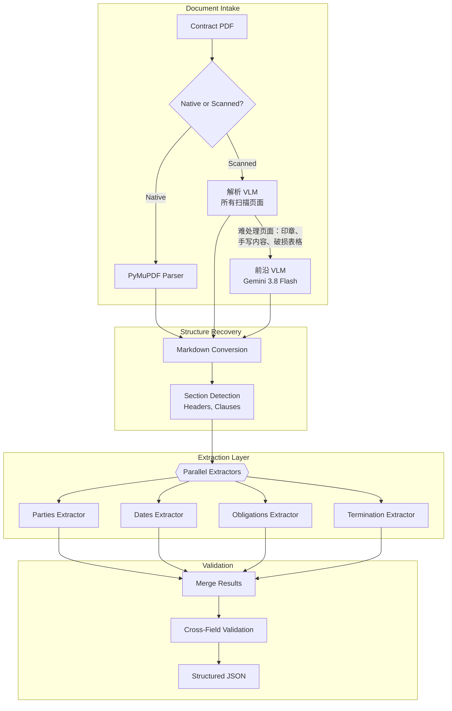
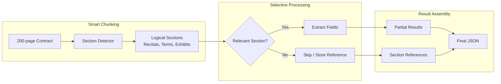

# 案例研究：Document Intelligence Pipeline（文档智能流水线）

## 问题

一家 legal tech 公司每月需要处理 **50,000 份合同**，提取关键条款（当事方、日期、义务、终止条款）并加载到可搜索数据库中。

**面试中给出的约束：**
- 文档长度为 2 到 200 页
- 混合扫描 PDF 与原生数字 PDF
- 多语言（English, German, French, Spanish）
- 提取准确率：关键字段 95%+
- 成本目标：每份文档低于 $0.50

---

## 面试问题

> "设计一条流水线，对一份 100 页合同 PDF 提取结构化数据，例如当事方、生效日期、终止条件和付款条款，输出为 JSON。"

---

## 解决方案架构



---

## 关键设计决策

### 1. 分级解析：每页用解析 VLM，难处理页面再用前沿 VLM

**回答：** 扫描合同通常包含印章、手写批注和复杂布局（表格、多栏）。传统 OCR（Tesseract）会产生乱码。视觉语言模型可以“看懂”布局并生成保留表格结构的干净 Markdown。到 2026 年，选择已不再只是 OCR 和前沿模型二选一：专用解析 VLM 处于两者之间，能返回阅读顺序和边界框，成本仅为前沿模型调用的一小部分。

| 方法 | 100 页扫描合同的输出 | 每 100 页成本 | 基准信号 |
|--------|---------------------------|--------------------|------------------|
| Tesseract | 噪声多、表格被破坏 | ~$0.02（CPU） | 在布局解析上缺乏竞争力 |
| AWS Textract | 文本更好，但在布局上仍吃力 | ~$0.15 | ParseBench 53.3（Cohere 测试） |
| 通过 API 使用解析 VLM（Cohere parse-v5.0） | 带 HTML 表格的 Markdown，或带边界框的块 | $0.15（每 1,000 页 $1.50） | ParseBench 79.2（厂商测试） |
| 自托管解析 VLM（MinerU 4.0、PaddleOCR-VL、NVIDIA Nemotron Parse 2.0） | 阅读顺序、布局类别、边界框 | 仅 GPU 时间 | OmniDocBench v1.6 和 olmOCR-Bench；逐一检查许可证（例如 jina-ocr-v1 为 CC BY-NC） |
| 前沿 VLM（Gemini 3.8 Flash） | 干净的 Markdown；处理印章和手写内容的最强兜底 | 入门价约 $0.43，2027 年 1 月 1 日起约 $0.86 | 前沿 VLM 的 ParseBench：GPT-5.5 为 84.4，Gemini 3.5 Flash 为 81.8（Cohere 测试；未列出 3.8 Flash） |

前沿模型一行采用与 [OCR 与布局章节](../10-document-processing/01-ocr-and-layout.md#成本与延迟权衡)相同的逐页假设：约 1.7K 输入 token（页面图像加提示词）和约 800 输出 token，尚未计入推理 token。即使按入门价，把一份 100 页扫描件的所有页面都送入 Gemini 3.8 Flash，也几乎会在开始抽取前用完 $0.50 预算；按 2027 年 1 月的标价则会超支。因此，流水线让每个扫描页面先经过解析 VLM，仅将返回低置信度或未通过布局检查的约 15% 页面（印章、手写内容、破损表格）升级至前沿 VLM。MinerU 4.0 在解析器中也内置了类似思路，从数字 PDF 的无模型抽取到难处理文档的“高级”档位，共四种质量档位。这里所有 ParseBench 数字均来自 Cohere 发布文章（厂商测试），因此前沿 VLM 与 Cohere Parse 之间 3 到 5 分的差距只能作为参考，仍需在自己的合同数据上重新测量。

### 2. 并行抽取器 vs 单次抽取

**回答：** 一个 prompt 一次性提取所有字段，结果通常比专用抽取器更差。每个抽取器都使用聚焦的 prompt 和 schema：

```python
parties_schema = {
    "type": "object",
    "properties": {
        "party_a": {"type": "object", "properties": {
            "name": {"type": "string"},
            "role": {"type": "string"},
            "address": {"type": "string"}
        }},
        "party_b": {"type": "object", "properties": {...}}
    }
}

# Each extractor runs in parallel
async def extract_all(document: str):
    results = await asyncio.gather(
        extract_parties(document, parties_schema),
        extract_dates(document, dates_schema),
        extract_obligations(document, obligations_schema),
        extract_termination(document, termination_schema)
    )
    return merge_results(results)
```

### 3. 跨字段校验（Cross-Field Validation）

**回答：** 抽取错误常常会通过字段不一致暴露出来：
- 如果 `effective_date` 晚于 `termination_date`，则说明存在问题
- 如果 `party_a` 的名字在 `obligations` 中出现但拼写不同，应标记待复核
- 如果已提取 `payment_amount` 但 `payment_frequency` 为 null，则说明不完整

---

## 处理 200 页文档

上下文窗口挑战：



**关键洞察：** 不是所有 200 页都会包含可抽取字段。附件（Exhibits）作为引用存储，不进行处理。“Terms and Conditions”部分通常占文档的 80%，但包含大多数关键字段。

---

## 多语言处理

德语合同的结构与英语合同不同。我们维护语言特定的抽取器：

```python
EXTRACTORS = {
    "en": {
        "parties": EnglishPartiesExtractor(),
        "dates": StandardDatesExtractor(),
        "termination": EnglishTerminationExtractor()
    },
    "de": {
        "parties": GermanPartiesExtractor(),  # Handles "GmbH", "AG" patterns
        "dates": GermanDatesExtractor(),       # DD.MM.YYYY format
        "termination": GermanTerminationExtractor()  # "Kündigung" patterns
    }
}
```

---

## 成本拆解

采用 2026 年 10 月价格，其中 Gemini 3.8 Flash 按 2027 年 1 月 1 日起的标价计算。

| 阶段 | 每份 100 页文档成本 |
|-------|----------------------|
| 仅扫描件解析：所有页面使用解析 VLM（$0.15），约 15 个难处理页面使用 Gemini 3.8 Flash（约 $0.13） | $0.28 |
| 章节检测（GPT-6 Luna，约 50K 输入 token） | $0.01 |
| 字段抽取（4 个并行 GPT-6 Luna；约 10% 文档将低置信度字段升级至 $2 / $10 档位模型） | $0.03 |
| 校验 | $0.01 |
| **扫描件总计** | **$0.33** |
| **原生 PDF 总计** | **$0.05** |

平均成本（60% 原生 PDF、40% 扫描件）：**每份文档约 $0.16**（低于 $0.50 目标）。扫描路径的成本约为原生路径的 6.5 倍，几乎全部来自解析。因此，最省钱的办法是尽可能从源系统获取原生 PDF。

---

## 面试追问

**Q: 如果抽取置信度（confidence）很低怎么办？**

A: 我们会为每个字段输出置信度分数。低于 0.8 的字段会被标记为人工复核。界面显示一个“review queue”（复核队列），人工只验证不确定字段，而不是整份文档。这样可将人工处理平均降到每份文档 30 秒。每个抽取字段还带有来源位置（页码、解析器的块 ID 和边界框），审查人员可以直接看到高亮条款，不必四处查找。解析器现在会直接给出这些定位信息；例如 MinerU 4.0 返回稳定的页面和块引用，可用于可验证的引文。

**Q: 如何处理非标准布局的合同？**

A: 我们维护一个已知合同模板的“layout library”（布局库）。章节检测器先尝试匹配已知模板；如果没有匹配，再回退到启发式检测（例如查找编号章节、全大写标题等）。未知布局会被标记，并在人工复核后加入库中。

**Q: 如果关键条款定义在附件中，如何处理？**

A: 我们会检测交叉引用（例如 “as defined in Exhibit A”）并进行解析。主文档引用附件时，抽取 prompt 会包含相关附件内容。这可避免当答案位于附件中时返回 “null” 抽取。

---

## 面试要点

1. **按页面难度分流**：解析 VLM 在布局处理上优于传统 OCR，只有难处理页面才需要前沿 VLM
2. **并行专用抽取器（parallel specialized extractors）在结构化抽取上优于 single-pass（单次抽取）**
3. **Cross-Field Validation（跨字段校验）可在入库前捕获抽取错误**
4. **并非所有页面都需要处理**：检测相关章节，跳过 exhibits（附件）

---

*Related chapters: [OCR and Layout](../10-document-processing/01-ocr-and-layout.md), [Structured Generation](../05-prompting-and-context/06-structured-generation.md)*
