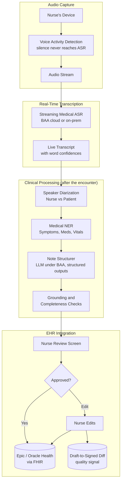
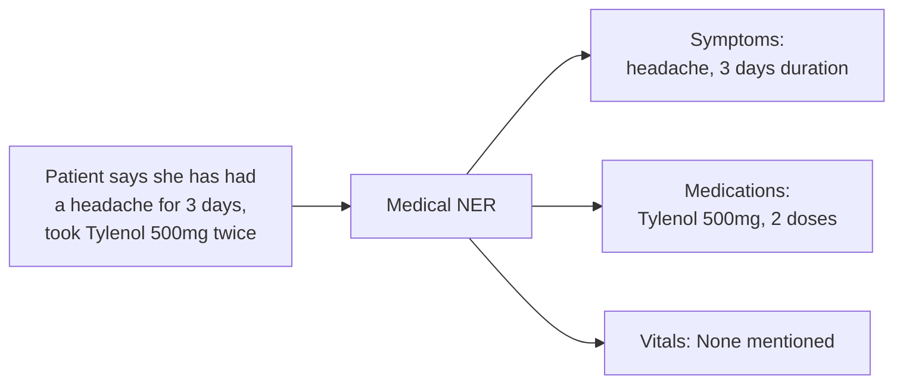

# 案例研究：医疗领域的语音 AI 助手

## 问题

一家医院网络希望构建一个**基于语音的 AI 助手（voice-based AI assistant）**，帮助护士记录患者就诊过程。护士自然口述，AI 展示实时转录，并生成供审核的结构化临床记录（structured clinical note）。

**面试中给出的约束条件：**
- HIPAA 合规（PHI 处理）
- 可在嘈杂的医院环境中工作
- 实时转录（延迟低于 500ms）
- 必须正确使用医学术语（medical terminology）
- 与现有 EHR（Electronic Health Record，电子病历系统）集成（Epic 或原 Cerner，现 Oracle Health）
- 录音须征得患者同意；州法律要求时还须披露 AI 的使用（得克萨斯州自 2026 年 1 月 1 日起要求医疗服务提供方披露 AI 使用）

这属于**环境式病历记录助手（ambient scribe）**模式，已成为主流产品类别：EHR 厂商正将其内置（如 Epic AI Charting），已发表的效果研究也提供了现实的预期（见[成效衡量](#成效衡量)）。

---

## 面试问题

> “设计一个护士在患者就诊时可以直接对话的语音助手，它能在 EHR 中生成结构化临床记录。”

---

## 方案架构



---

## 关键设计决策

### 1. ASR 在哪里运行：签有 BAA 的云端，或本地

**回答：** HIPAA 并不要求本地处理，而是要求采取防护措施，并与每个处理受保护健康信息（PHI）的供应商签订**业务伙伴协议（BAA）**。多数商用环境式病历记录助手通过云交付。因此，选择取决于医院政策、病区网络连接、成本和准确率，而非简单的合法性判断：

| 方案 | 示例 | HIPAA 条件 | 成本 | 需注意 |
|--------|----------|---------------|------|-----------|
| 签有 BAA 的云端流式语音转文字 | OpenAI `gpt-live-transcribe`（$0.017/分钟）；AssemblyAI Universal-3.5 Pro Realtime（$0.45/小时）；ElevenLabs Scribe v2 Realtime（$0.39/小时） | BAA 加零保留。OpenAI 的文件转录端点不保留数据，但流式处理走独立的 Realtime 端点，须确认其保留条款；ElevenLabs 仅在 Enterprise 档签 BAA，且要求零保留 | 按分钟计费，无需 GPU | 确认具体端点在 BAA 范围内；注意流式脱敏缺口（AssemblyAI 仅对最终轮次脱敏，不对音频脱敏） |
| 医疗调优的云端语音转文字 | ElevenLabs Scribe v2 Medical（2026 年 9 月 11 日正式上线）；Deepgram `nova-3-medical`（临床），以及面向大量药名场景的 `nova-3-pharma`（2026 年 9 月 17 日） | 同样需要 BAA | 按分钟计费 | 临床词汇表现更好；仍须在自己的病区录音上验证 |
| 本地流式模型 | NVIDIA `nemotron-3.5-asr-streaming-0.6b`（OpenMDW 许可，允许商业使用；块大小可在 80 至 1,120 ms 间选择） | 音频不离开医院网络 | GPU 集群加运维；只有高利用率时才便宜 | 更新、扩容、故障切换和准确率评估都由自己承担 |

**我们的选择：** 默认使用签有 BAA、且零数据保留的医疗云端语音转文字；安全政策禁止音频外传或病区网络不稳定的站点，则使用本地流式模型。两者位于同一个接口后，站点切换时无需修改其余流水线。本地模型的块大小是延迟调节钮：块越小，延迟越低，但准确率也会下降。

**为什么不用部署在本地 GPU 上的 Whisper Large v3**——几年前它还是此类设计的默认选择：

- 它并非原生流式模型，要满足 500 ms 的转录预算只能采用分块变通方案。
- 它的准确率如今落后于开放模型：Open ASR Leaderboard 2026 年 10 月快照显示，其平均词错率为 5.78%，而 Qwen3-ASR-1.7B 为 4.31%、parakeet-tdt-0.6b-v2 为 4.70%。
- 它**会在静音中产生幻觉**。Careless Whisper 研究（FAccT 2024）发现约 1% 的转录包含完全编造的短语，其中 38% 有害，且长时间没有人声的说话者更容易受影响。护士检查患者时，临床对话中恰好有大量停顿。

OpenAI 托管版 Whisper 也将退役：`whisper-1` 连同 `gpt-4o-*-transcribe` 模型将于 2027 年 2 月 26 日关闭，替代品为 `gpt-transcribe` 和 `gpt-live-transcribe`。

### 2. 说话人分离（Speaker Diarization）：谁说了什么

**回答：** 记录必须区分“患者诉头痛（Patient reports headache）”与“护士观察到患者在皱眉（Nurse observes patient grimacing）”。我们使用：

```python
# Pyannote for speaker diarization
diarization = pipeline("audio.wav")
# Output: [(0.0, 1.5, "SPEAKER_0"), (1.5, 4.2, "SPEAKER_1"), ...]

# Map speakers based on voice profile
roles = identify_roles(diarization, known_nurse_voiceprint)
# Output: {"SPEAKER_0": "nurse", "SPEAKER_1": "patient"}
```

护士设备在初始化时登记其声纹，用于角色识别（role identification）。声纹在伊利诺伊州 BIPA 和得克萨斯州法律下属于**生物识别标识符**，因此登记需要书面同意、保留计划，并在护士离职时删除。绝不登记患者声纹。若改用供应商内置的说话人分离，也要核查其生命周期：OpenAI 的 `gpt-4o-transcribe-diarize` 将于 2027 年 2 月 26 日关闭。

### 3. 用于结构化抽取的医学 NER（Medical NER）

**回答：** 我们需要结构化数据，而不仅仅是自然语言文本。医学命名实体识别提取：



我们使用微调后的 BioBERT 模型来做 NER，而不是 LLM，因为 NER 需要快速且确定性（deterministic）的输出。

---

## 处理嘈杂环境

医院环境很吵，最危险的失败并非某个词听错，而是凭空生成一句说话人从未说过、却看似可信的话。我们采用多种策略：

1. 护士设备上的**定向麦克风（Directional microphones）**，聚焦近距离发言
2. **VAD 门控**：静音和非语音内容不进入 ASR，避免模型接触最容易产生幻觉的长时间停顿
3. **说话人隔离**：抑制背景人声，防止隔壁床的对话进入病历（例如 AssemblyAI 的 Voice Focus 额外收费 $0.10/小时）
4. **置信度阈值**：若 ASR 置信度 < 0.7，则标记该片段供护士复核，而不是猜测
5. **词汇偏置**：将医学术语和病区药品目录作为关键词提供给 ASR（例如 Gemini 3.5 Transcribe 最多接受 1,000 个偏置词）

---

## 结构化记录格式

LLM 生成 SOAP 格式记录：

```python
note_prompt = f"""
Generate a clinical SOAP note from this encounter transcript.

Transcript:
{transcript_with_speakers}

Extracted entities:
- Symptoms: {symptoms}
- Medications: {medications}
- Vitals: {vitals}

Output format:
S (Subjective): Patient's reported symptoms
O (Objective): Nurse's observations and measurements
A (Assessment): Clinical impression
P (Plan): Next steps, orders
"""
```

通过供应商的结构化输出能力按 JSON schema 生成，不要解析散文式文本；审核前运行**溯源校验**：草稿中的每项临床陈述都必须指向一段转录文本，审核界面突出显示缺乏依据的陈述。生成记录的模型与 ASR 同样须遵守 BAA 和零保留条款；模型名称放在配置中，因为托管模型系列一年内可能迭代数次。

---

## EHR 集成（FHIR）

输出必须对 EHR 可机器读取（machine-readable）：

```json
{
  "resourceType": "DocumentReference",
  "status": "current",
  "type": {
    "coding": [{"system": "http://loinc.org", "code": "34746-8", "display": "Nurse note"}]
  },
  "subject": {"reference": "Patient/12345"},
  "author": [{"reference": "Practitioner/nurse789"}],
  "content": [{
    "attachment": {
      "contentType": "text/plain",
      "data": "base64-encoded-soap-note"
    }
  }],
  "context": {
    "encounter": {"reference": "Encounter/visit456"}
  }
}
```

---

## 延迟预算

约束条件说“实时”，但只有一条路径需要实时。将延迟预算拆开才是这里的关键设计判断：

| 路径 | 预算 | 决定因素 |
|------|--------|--------------|
| 护士屏幕上的实时转录 | 部分转录低于 500 ms | 流式语音转文字的部分结果。应测量 p95，而非中位数：AssemblyAI 公布其实时模型的轮次结束延迟为 P50 546 ms、P95 1,024 ms（供应商数据），因此 500 ms 要求只能适用于部分转录，而非最终文本 |
| 就诊结束后的记录草稿 | 低于 60 秒 | 在完整转录上运行一次说话人分离、NER、LLM 结构化与溯源校验 |
| 护士审核并签署 | 人工用时 | 瓶颈是审核界面，而非模型 |

就诊结束后**异步**生成记录，而不是逐句生成，可以让结构化模型获得完整对话（包括更正和后续生命体征），也使 LLM 完全脱离延迟关键路径。

---

## 成效衡量

**质量：草稿到签署版的差异。** 护士的每次编辑都是带标签的修正。按 SOAP 小节、病区和护士跟踪编辑距离；供应商或模型更换后若出现跃升，就是回归警报。同时跟踪溯源校验中无依据陈述的比例。

**价值取决于使用程度，而非许可证数量。** 一项覆盖五家学术医疗系统的 JAMA 研究（2026 年 4 月，依据行业报道摘要）发现，环境式病历记录助手使每个 8 小时班次的文书工作平均减少 16.0 分钟，重度用户（至少半数就诊使用）的减少量为 27.3 分钟；但采用者中仅 32% 是重度用户，下班后的 EHR 使用时间也没有显著下降。另一项较早的 JAMA Network Open 研究（2025 年 10 月，n=263）发现，30 天后职业倦怠比例从 51.9% 降至 38.8%。两项研究对象都是门诊医生和高级执业临床人员，而非住院病区护士，因此必须对自己的护士分别测量每班文书时间、下班后病历记录时间和使用频率。

---

## 面试追问

**Q：你如何处理医学缩写和行话（jargon）？**

A：我们维护一份自定义词汇表，将缩写（PRN、BID、SOB）映射到完整术语。该词汇表会注入 ASR 模型（提升识别率）和 LLM 提示词（LLM prompt，确保笔记中的正确展开）。

**Q：如果护士在句子中途改口怎么办？**

A：我们检测纠正模式（“actually, I mean...”, “no wait, it's...”），并仅使用更正后的版本。LLM 被指示在存在冲突时优先采用后续表述；这也是就诊结束后才结构化记录、而非实时生成的另一原因。

**Q：你如何保证 AI 不会漏掉关键内容？**

A：我们有“完整性校验（completeness check）”，验证记录是否包含所有已抽取实体。如果 NER 识别到“胸痛（chest pain）”但 SOAP 记录未提及，就会提示护士复核。我们还会运行“安全关键”检测（safety critical detector），对“自杀意念（suicidal ideation）”“虐待”或其他强制报告触发项进行升级提示。

**Q：上线六个月后，你如何证明系统安全且物有所值？**

A：安全性看溯源校验中无依据陈述的比例、按小节统计的草稿到签署版编辑距离，并每月由人工抽样对照音频审核已签署记录，特别关注长时间静音的就诊，因为 ASR 幻觉集中出现在此处。价值看每位护士每班文书工作时间和下班后记录时间，并按实际使用频率分组，因为已发表研究中的节省主要集中在重度用户。如果采用率低，应改进工作流程和培训，而不是仅更换模型。

---

## 面试中的关键收获

1. **HIPAA 要求 BAA，而非专门的机房**：签有 BAA、零数据保留的云端 ASR 可以符合 HIPAA；本地部署取决于政策或网络连接
2. **静音是一种风险**：使用 VAD 对 ASR 做门控，因为语音模型会在停顿中产生幻觉
3. **说话人分离至关重要**：临床上“是谁说的”具有决策意义，护士声纹还须取得生物识别信息处理同意
4. **混合抽取**：快速 NER 负责结构化，LLM 负责文本生成，并将内容关联到转录片段
5. **始终保留人工审核**，并记录草稿与签署版的差异作为质量指标

---

*相关章节：[Real-Time Voice Agents](../18-voice-and-audio-agents/01-realtime-voice-agents.md)，[Model Taxonomy](../02-model-landscape/01-model-taxonomy.md)，[Reliability Patterns](../13-reliability-and-safety/03-reliability-patterns.md)*
