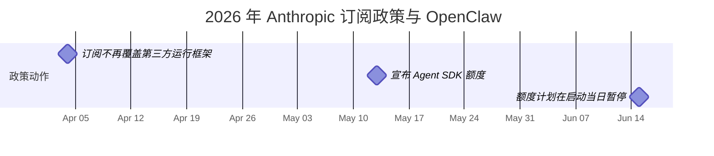

# OpenClaw 深度解析：开源个人 AI 智能体

OpenClaw 是一个**开源、自托管的个人 AI 智能体**，它以消息平台作为主要接口，通过 LLM（大语言模型）执行任务。你可以通过 WhatsApp、Telegram、Slack、Discord 或 Signal 与它对话，它会回复你，并运行 shell 命令、控制浏览器、管理日历、处理电子邮件，以及编排多步骤工作流。

## 目录

- [什么是 OpenClaw](#什么是-openclaw)
- [历史：从 Clawdbot 到 Moltbot 再到 OpenClaw](#历史)
- [架构深度解析](#架构)
- [AgentSkills 系统](#agentskills-系统)
- [LLM 提供商配置](#llm-大语言模型-provider-提供商-配置)
- [消息平台集成](#消息平台集成)
- [安全模型](#安全模型)
- [部署模式](#部署模式)
- [性能优化与扩展](#安全模型)
- [真实世界用例](#部署模式)
- [局限性以及何时不该使用 OpenClaw](#性能优化与扩展)
- [2026 年 Anthropic 订阅政策事件](#_2026-年-anthropic-订阅政策事件)
- [与替代方案对比](#真实世界用例)
- [入门：快速设置指南](#入门)
- [系统设计面试视角](#系统设计面试角度)
- [参考资料](#参考资料)

---

## 什么是 OpenClaw

OpenClaw 是：

- **一个个人 AI 智能体**：不是聊天机器人，而是一个能代表你行动的自主智能体
- **自托管**：运行在你的机器、VPS 或 Raspberry Pi 上，由你控制自己的数据
- **消息原生**：接入你已使用的聊天应用（WhatsApp、Telegram、Slack、Discord、Signal、iMessage、Teams 等 20 多个平台）
- **LLM 无关**：支持 Claude、GPT、Gemini、Muse Spark、DeepSeek 或本地模型（近期版本新增 GPT-6.1 Sol、GPT-6 Astra、Fable 5.1 和 Muse Spark 1.3）
- **可通过技能扩展**：约 50 个内置技能（内置插件还提供更多技能）、公开注册表 ClawHub，以及便于编写自定义技能的格式
- **开源**：采用 MIT 许可；截至 2026 年 10 月 1 日约有 39.1 万 GitHub stars 和 8.2 万 forks
- **基金会治理**：由独立的 501(c)(3) OpenClaw Foundation 管理，该基金会雇用核心团队并签署版本；没有付费档、托管服务或代币。README 称 OpenAI“是捐助者，不是所有者”（Amazon、Red Hat、NVIDIA 和 GitHub 等也提供捐助或基础设施支持）
- **两条发布线**：按日历标版本的构建（2026 年 9 月 30 日发布 2026.9.7）以及仅面向 Gateway、项目视作 LTS 的扩展稳定构建（10 月 2 日发布 2026.8.35）。生产网关应固定到扩展稳定线

```
# The simplest way to start (macOS / Linux / WSL2)
curl -fsSL https://openclaw.ai/install.sh | bash

# Or via npm (Node 24.16+ or 26.1+; Node 26 recommended)
# --allow-scripts needs npm 11.16+; drop it on older npm
npm install -g openclaw@latest --allow-scripts=openclaw
openclaw onboard --install-daemon
openclaw gateway status
```

**与聊天机器人的关键区别：**
- 普通聊天助手：你输入内容，它用文本回复
- OpenClaw：你输入内容，它会**做事**，例如运行命令、编辑文件、发送电子邮件、控制智能家居设备、管理你的日历

聊天助手也正从另一侧缩小差距。OpenAI dots（2026 年 9 月 29 日宣布）和 Meta Muse（9 月 8 日推出）为托管助手提供独立云端计算机；Anthropic 则把 Cowork 并入 Claude 应用，Claude 默认在行动前请求批准。OpenClaw 如今的区分点是自托管、模型选择和消息平台覆盖面，而不再只是行动能力。

---

## 历史

### 命名时间线

| 日期 | 名称 | 事件 |
|------|------|-------|
| 2025 年 11 月 | **Clawdbot** | Peter Steinberger 发布第一个原型，大约用一小时构建完成 |
| 2026 年 1 月 | 2,000 星标 | 早期采用者发现该项目 |
| 2026 年 1 月 27 日 | **Moltbot** | 因 Anthropic 商标投诉而改名（保留龙虾主题） |
| 2026 年 1 月 30 日 | **OpenClaw** | 再次改名，Steinberger 觉得“Moltbot”说起来别扭 |
| 2026 年 2 月 | 145,000+ 星标 | 爆发式增长，超过许多成熟开源项目 |
| 2026 年 2 月 14 日 | （未更名） | Steinberger 加入 OpenAI，称需要获得扩展所需资源 |
| 2026 年 3 月 | 250,000+ 星标 | 在 GitHub 上超过 React；成为有史以来增长最快的开源项目之一 |
| 2026 年 9 月 30 日 | 约 391,000 星标 | 由独立的 OpenClaw Foundation 管理；扩展稳定（相当于 LTS）网关构建与日历版本并行发布 |

### 创建者

Peter Steinberger 是一名奥地利软件工程师，在 13 年间打造了 PSPDFKit，一个被全球开发者使用的 PDF 工具包，随后于 2024 年出售了公司。他将自己描述为“vibe coder（氛围式编码者）”，并有一句著名说法：他会发布自己没有读过的代码。这体现了新的 AI 优先开发哲学：人类提供意图，AI 提供实现。

### 它为何爆红

OpenClaw 击中了痛点，因为它解决了一个真实问题：LLM 很强大，但没有状态。每次对话都从零开始。OpenClaw 赋予 LLM **持久性**（跨会话记忆）、**能动性**（不仅能说，还能行动）和**触达能力**（与你已经使用的应用集成）。它自托管且开源，这意味着任何人都可以运行它，而无需把自己的数据托付给第三方服务。

---

## 架构

### 高层概览

```
                         OPENCLAW ARCHITECTURE
 ============================================================

  Messaging Platforms              OpenClaw Gateway           LLM Providers
 ┌──────────────┐              ┌─────────────────────┐     ┌──────────────┐
 │  WhatsApp    │──┐           │                     │     │  Anthropic   │
 │  (Baileys)   │  │           │   GATEWAY            │     │  (Claude)    │
 ├──────────────┤  │  Channel  │   ┌──────────────┐  │     ├──────────────┤
 │  Telegram    │──┼──Adapters─┼──>│  Router      │  │     │  OpenAI      │
 │  (grammY)    │  │           │   │  (sessions,  │  │     │  (GPT-6)     │
 ├──────────────┤  │           │   │   bindings)  │  │     ├──────────────┤
 │  Slack       │──┤           │   └──────┬───────┘  │     │  Google      │
 │  (Bolt)      │  │           │          │          │     │  (Gemini)    │
 ├──────────────┤  │           │   ┌──────▼───────┐  │     ├──────────────┤
 │  Discord     │──┤           │   │ Agent Runtime│──┼────>│  DeepSeek    │
 │  (discord.js)│  │           │   │ (AI loop,    │  │     ├──────────────┤
 ├──────────────┤  │           │   │  tool calls, │  │     │  Local/      │
 │  Signal      │──┤           │   │  memory)     │  │     │  Ollama      │
 │  (signal-cli)│  │           │   └──────┬───────┘  │     └──────────────┘
 ├──────────────┤  │           │          │          │
 │  iMessage    │──┤           │   ┌──────▼───────┐  │     Tools & Skills
 │  (imsg)      │  │           │   │  Tool Layer  │  │     ┌──────────────┐
 ├──────────────┤  │           │   │  (skills,    │──┼────>│  Shell exec  │
 │  Teams       │──┘           │   │   browser,   │  │     │  Browser     │
 │  IRC, Matrix │              │   │   files,     │  │     │  File I/O    │
 │  20+ more... │              │   │   cron)      │  │     │  Calendar    │
 └──────────────┘              │   └──────────────┘  │     │  Email       │
                               │                     │     │  100+ more   │
                               │   ┌──────────────┐  │     └──────────────┘
                               │   │  Memory &    │  │
                               │   │  State       │  │     Storage
                               │   │  (sessions,  │──┼────>┌──────────────┐
                               │   │   workspace) │  │     │  ~/.openclaw/│
                               │   └──────────────┘  │     │  (state,     │
                               └─────────────────────┘     │   memory,    │
                                                           │   config)    │
                                localhost:18789             └──────────────┘
```

### 核心组件

**1. Gateway（网关）**

Gateway 是一个长期运行的 WebSocket 服务器（默认：`localhost:18789`），作为会话、路由和通道连接的单一事实来源。它负责：

- 通过通道适配器接受来自所有消息平台的连接
- 将消息路由到正确的智能体
- 会话管理和状态持久化
- 身份认证和访问控制
- 热重载配置变更

**2. Channel Adapters（通道适配器）**

当任意平台收到消息时，通道适配器会将其规范化为标准内部格式。每个适配器都封装一个平台特定库：

| 平台 | 适配器库 | 协议 |
|----------|----------------|----------|
| WhatsApp | Baileys | WebSocket（非官方） |
| Telegram | grammY | Bot API |
| Slack | Bolt | Events API |
| Discord | discord.js | Gateway API |
| Signal | signal-cli | signal-cli 守护进程（原生或容器） |
| iMessage | imsg（官方插件；已移除 BlueBubbles 支持） | 通过 stdio 传输的 JSON-RPC |
| IRC | irc-framework | IRC 协议 |
| Matrix | matrix-js-sdk | Matrix 协议 |
| Microsoft Teams | Bot Framework | REST API |

**3. Agent Runtime（智能体运行时）**

Agent Runtime 是 AI 循环。对于每条传入消息，它会：

1. 从会话历史、工作区记忆和相关技能中组装上下文
2. 将组装好的提示发送给配置的 LLM
3. 从模型接收工具调用
4. 针对系统能力执行工具调用
5. 将结果返回给模型以进入下一轮迭代
6. 持久化更新后的状态（记忆、文件、会话历史）

**4. Multi-Agent Routing（多智能体路由）**

OpenClaw 支持在一个 Gateway 进程中运行多个智能体。每个智能体都有自己的工作区、agentDir、会话和工具配置。智能体在 `agents.entries` 下声明；顶层 `bindings` 根据通道、账户或对话对象匹配传入消息：

```json5
{
  agents: {
    entries: {
      work: { workspace: "~/.openclaw/workspace-work" },
      home: { workspace: "~/.openclaw/workspace-home" },
      devops: { workspace: "~/.openclaw/workspace-devops" },
    },
  },
  bindings: [
    { agentId: "work", match: { channel: "slack", accountId: "*" } },
    { agentId: "home", match: { channel: "whatsapp", accountId: "personal" } },
    { agentId: "home", match: { channel: "telegram", accountId: "*" } },
    { agentId: "devops", match: { channel: "discord", accountId: "*" } },
  ],
}
```

运行 `openclaw agents list --bindings` 可以查看每条路由最终对应的智能体。使用 `agents.list` 数组的旧配置可通过 `openclaw doctor --fix` 迁移。

这意味着你可以在 Slack 上拥有一个工作助手，在 WhatsApp 上拥有一个个人助手，在 Discord 上拥有一个 DevOps 机器人，并且它们全部运行在同一个 Gateway 中，同时拥有完全隔离的记忆和权限。

---

## AgentSkills 系统

### Skill（技能）的工作方式

技能是 OpenClaw 获得基础对话之外能力的机制。每个技能都是包含 `SKILL.md` 的目录，文件中有 YAML frontmatter 元数据和 Markdown 行为指令。只有 `name` 和 `description` 是必需字段；可选的 `metadata.openclaw` 块可根据主机实际具备的条件启用技能。

```
~/.openclaw/skills/
  weather/
    SKILL.md           # Required: metadata + instructions
    scripts/
      fetch_weather.py # Optional: executable scripts
    references/
      api_docs.md      # Optional: supplementary docs

  email-manager/
    SKILL.md
    scripts/
      process_inbox.py
```

### SKILL.md 格式

```yaml
---
name: weather-lookup
description: >
  Fetch current weather and forecasts for any location. Use when the user
  asks about temperature, rain, wind, or whether to bring an umbrella.
metadata: {"openclaw": {"requires": {"bins": ["curl"]}, "os": ["darwin", "linux"]}}
---

# Weather Lookup Skill

When the user asks about weather:

1. Use the web_search tool to find current conditions
2. Extract temperature, humidity, wind, and forecast
3. Present in a concise, readable format
4. Include both metric and imperial units

## Example Response Format

"Currently 72F (22C) and partly cloudy in San Francisco.
Forecast: Clear skies through Thursday, rain expected Friday."
```

不存在触发词字段。模型根据 `description` 匹配技能，所以应写清“技能做什么、何时使用”。

### Skill 解析顺序

Skill 可以位于多个位置。当发生名称冲突时，最本地的副本优先：

```
Priority (highest first):
  1. <workspace>/skills/             # Project-specific skills
  2. <workspace>/.agents/skills/     # Project agent skills
  3. ~/.agents/skills/               # Personal agent skills
  4. ~/.openclaw/skills/             # Managed/local skills (state directory)
  5. Per-agent workshop skills       # Under the agent's directory
  6. Bundled skills                  # Ship with OpenClaw
  7. skills.load.extraDirs, plugins  # Extra directories and plugin-provided skills
```

如果某个智能体配置了非空的技能允许列表（`agents.entries.<id>.skills`），它就是该智能体最终使用的集合，会替换而非合并 `agents.defaults.skills`。

### 选择性注入

OpenClaw **不会**把每个技能的完整指令都注入每次提示。首先有两层过滤：加载时校验会排除不满足 `metadata.openclaw` 要求的技能（缺少二进制、环境变量或配置键，或操作系统不符），智能体的技能允许列表再排除其余不允许的技能。合格技能以精简 XML 列表进入系统提示，包含名称、描述和路径；文档估算每个技能约 24 个 token，再加这些字段的长度。完整 `SKILL.md` 按需读取；`skills_search` 可找到未装入提示预算的技能。这与其他 Agent Skills 的渐进披露设计相同：单技能开销虽小，却在每轮重复支付。粗略估计，200 个描述为一两句话的合格技能会增加 1 万到 1.5 万个常驻提示 token，因此允许列表很重要。

### 创建自定义 Skill

```bash
# Create the skill directory
mkdir -p ~/.openclaw/skills/deploy-checker
cd ~/.openclaw/skills/deploy-checker

# Create the SKILL.md
cat > SKILL.md << 'EOF'
---
name: deploy-checker
description: >
  Monitor deployment status across staging and production: health endpoints,
  recent commits, and CI status. Use when asked whether staging or prod is up,
  or what was deployed last.
metadata: {"openclaw": {"requires": {"bins": ["curl", "git"]}}}
---

# Deploy Checker

When asked about deployment status:

1. Run `curl -s https://staging.myapp.com/health` to check staging
2. Run `curl -s https://myapp.com/health` to check production
3. Check recent git log: `git log --oneline -5`
4. Report status in a clear format

## Response Format

Staging: [UP/DOWN] - version X.Y.Z - deployed 2h ago
Production: [UP/DOWN] - version X.Y.Z - deployed 1d ago
Last 3 commits: ...
EOF
```

### 社区 Skill 生态系统

OpenClaw 的技能生态增长迅速，社区集合包含覆盖 DevOps、家庭自动化、内容创作和数据分析等领域的数千个技能。公开注册表是 ClawHub，可用 `openclaw skills install @owner/<slug>` 安装。不过开放性也带来风险：文档要求将第三方技能视为不可信代码，启用前阅读其内容，优先在沙箱内运行；早期目录中曾出现恶意脚本。

---

## LLM（大语言模型）Provider（提供商）配置

### 配置文件

OpenClaw 从 `~/.openclaw/openclaw.json` 读取配置（JSON5 格式——允许注释和尾随逗号）。Gateway（网关）会监视该文件，并通过 hot reload（热重载）自动应用变更。

官方提供商插件（Anthropic、OpenAI、Google、DeepSeek、Ollama 等）只需要凭据，可由 `openclaw onboard` 保存，或从 `ANTHROPIC_API_KEY`、`OPENAI_API_KEY`、`DEEPSEEK_API_KEY` 等环境变量获取；DeepSeek 等少数插件还需先运行一行 `openclaw plugins install`。模型引用采用 `provider/model` 形式。`models.providers` 块用于自定义基础 URL、代理及自托管的 OpenAI 兼容服务器：

```json5
{
  // Default model plus a cross-vendor fallback chain
  agents: {
    defaults: {
      model: {
        primary: "anthropic/claude-sonnet-5-5",
        fallbacks: ["openai/gpt-6-sol", "deepseek/deepseek-flash"],  // deepseek-flash = V4.1-Flash
      },
    },
  },

  // Custom provider: an internal OpenAI-compatible gateway
  models: {
    mode: "merge",
    providers: {
      "corp-gateway": {
        baseUrl: "https://llm-gateway.internal.example.com/v1",
        apiKey: "${CORP_GATEWAY_KEY}",  // env var substitution
        api: "openai-completions",
        models: [{ id: "qwen3.8-27b", name: "Qwen3.8 27B", maxTokens: 4096 }],
      },
    },
  },
}
```

有两个容易踩的坑。Ollama 应使用原生 URL（`http://localhost:11434`），而不是 OpenAI 兼容的 `/v1` 路径；文档警告 `/v1` 会破坏工具调用，让模型把原始工具调用 JSON 当作文字输出。另外，回退模型只附着在已配置的默认模型上；针对单个智能体配置的模型是严格的，除非该智能体条目也列出自己的 `fallbacks`。

### Provider 选择策略

| Provider | 最适合 | 取舍 |
|----------|----------|------------|
| Anthropic (Claude) | 复杂推理、编程和长上下文任务（100 万 token 上下文不加价） | 成本较高，质量最佳：Opus 5.5 每百万 token 标价 $4/$20，Fable 5.1 为 $10/$50；Opus 5.5 无法关闭思考 |
| OpenAI（GPT-6 系列） | 通用任务；GPT-6 Luna（$0.10/$0.50）用于低成本路由，GPT-6 Sol 或 GPT-6.1 Sol（$2/$10）作为主力 | 输入超过 27.2 万 token 的请求整体按长上下文价格计费 |
| Google (Gemini) | 注重预算的测试与较宽松免费档；Gemini 3.8 Flash 到 2026 年 12 月 31 日的入门价为 $0.75/$3.75 | 2027 年 1 月 1 日价格翻倍至 $1.50/$7.50；Flash 档推理落后于顶尖 Claude 与 GPT 模型（AA Intelligence Index v4.3：41 分，Opus 5.5 为 58 分） |
| DeepSeek | 最便宜的托管选择：V4.1-Flash（`deepseek-flash`）高峰时每百万 token $0.30/$1.20，非高峰时减半；V4-Pro 高峰价仍为 $1.32/$3.96；100 万 token 上下文，适合高吞吐且缓存友好的负载 | 工作日 UTC 01:00–04:00 与 06:00–10:00 为高峰时段，价格翻倍；旧模型名可能实际指向新模型，应固定并验证；MIT 权重也可自托管 |
| Local (Ollama) | 对隐私要求极高、离线使用 | 需要强大的硬件，质量较低 |

### OpenClaw 内部的模型路由

你可以为不同的 agent（智能体）配置不同模型，从而优化成本：

```json5
{
  agents: {
    defaults: {
      model: "openai/gpt-6-luna",  // Cheap default
    },
    entries: {
      coding: {
        workspace: "~/.openclaw/workspace-coding",
        // Premium for code, with its own fallback (per-agent models are strict otherwise)
        model: { primary: "anthropic/claude-sonnet-5-5", fallbacks: ["openai/gpt-6.1-sol"] },
      },
      reminders: {
        workspace: "~/.openclaw/workspace-reminders",
        model: "google/gemini-3.8-flash",  // Cheap for simple tasks
      },
    },
  },
  // Route channels or peers to these agents with top-level bindings (see Multi-Agent Routing)
}
```

`agents.defaults.utilityModel` 用于处理另一项成本泄漏：会话标题、进度叙述等短小的内部调用。如果不设置，OpenClaw 会在主提供商声明了小模型时使用该模型。

---

## 消息平台集成

OpenClaw 通过通道适配器支持 20 多个消息平台。Telegram 随核心安装包提供，也是文档推荐的首个通道（只需 bot token，无需插件）。其他大多数通道是按需安装的官方插件（`openclaw plugins install @openclaw/<id>`，或在 `openclaw onboard` 期间安装）；WeChat 等少数插件由仓库外部维护。每个插件都是在 Gateway 进程内运行的代码，审查方式应与技能相同。

### 支持的平台

| 平台 | Library（库） | 状态 | 备注 |
|----------|---------|--------|-------|
| WhatsApp | Baileys | 稳定 | 非官方 API；需要个人账号 |
| Telegram | grammY | 稳定 | 官方 Bot API；最可靠的通道 |
| Slack | Bolt | 稳定 | 需要安装 Workspace（工作区）应用 |
| Discord | discord.js | 稳定 | 需要 Bot token（机器人令牌） |
| Signal | signal-cli | 稳定 | 需要已关联设备；可用原生守护进程或容器 |
| iMessage | imsg | 稳定 | 仅 macOS；官方插件通过 JSON-RPC 通信（已移除 BlueBubbles 支持） |
| Google Chat | Chat API | 稳定 | 需要 Workspace 管理员批准 |
| Microsoft Teams | Bot Framework | 已支持 | 官方插件；2026 年初为测试版，现为 README 重点列出的通道 |
| IRC | irc-framework | 稳定 | 支持经典协议 |
| Matrix | matrix-js-sdk | 稳定 | Federated（联邦式），适合自托管 |
| Mattermost | API | 稳定 | 自托管 Slack 替代方案 |
| LINE | Messaging API | 稳定 | 在日本/东南亚流行 |
| Feishu (Lark) | Open API | 稳定 | 在中国流行 |
| Twitch | TMI.js | 稳定 | 仅聊天 |
| WeChat | openclaw-weixin（外部插件） | 测试版 | 在 OpenClaw 仓库外维护 |
| Nostr | NIP-04 | 测试版 | 去中心化协议上的加密私信 |
| WebChat | Built-in | 稳定 | 基于浏览器的后备方案 |
| A2A | A2A 1.0 JSON-RPC（内置插件） | 已支持 | 不是聊天应用；可让外部代理给 OpenClaw 代理发消息，应采用与人类发送者相同的允许列表 |

### 跨渠道统一上下文

一个关键的架构决策：网关（Gateway）在所有渠道之间维护**一套统一的记忆系统**。如果你在 WhatsApp 上告诉你的代理（agent）某件事，当你从 Slack 发消息时它也会记得。这意味着无论你使用哪个应用联系 AI 代理，它都拥有一致的上下文。

```
          WhatsApp ──┐
          Telegram ──┤     ┌─────────────────────┐
          Slack    ──┼────>│  Shared Memory Pool  │
          Discord  ──┤     │  (per-agent, cross-  │
          Signal   ──┘     │   channel sessions)  │
                           └─────────────────────┘
```

---

## 安全模型

### 安全理念

OpenClaw 的安全模型假设一种“个人助理”威胁模型：一个受信任的操作者，可能有多个代理。优先级如下：

1. **身份优先**：谁可以与机器人对话？
2. **范围其次**：机器人被允许在哪里执行操作？
3. **模型最后**：假设模型可能被操纵，因此限制影响范围

### 权限层级

```
 Layer 1: Channel Authentication
 ─────────────────────────────────
 Who can message the bot?
 Configured per-channel with allowlists.
 Unknown DM senders get a pairing code
 by default, not a response.

 Layer 2: Agent Tool Allow/Deny
 ─────────────────────────────────
 Which tools can this agent use?
 Configured per-agent in agents.entries.<id>.tools.

 Layer 3: Sandbox Tool Policy
 ─────────────────────────────────
 Separate from agent permissions.
 Even if agent allows a tool, sandbox may block it.

 Layer 4: Elevated Access
 ─────────────────────────────────
 Some tools require host-level access.
 Gated globally and per agent with allowFrom
 lists; the agent gate can only narrow the
 global one, and a sender must pass both.
```

### 沙箱隔离

沙箱默认**关闭**：除非自行配置，主会话工具直接在宿主机运行。至少应为非主会话（子代理、定时任务、隔离任务）启用，也可对全部会话启用：

```json5
// ~/.openclaw/openclaw.json
{
  agents: {
    defaults: {
      sandbox: {
        mode: "non-main",          // "off" (default) | "non-main" | "all"
        backend: "docker",
        scope: "session",          // one container per session; "agent" shares one per agent
        workspaceAccess: "none",   // the agent workspace is not visible inside the sandbox
        docker: {
          image: "openclaw-sandbox:bookworm-slim",
          network: "none",         // no egress
          readOnlyRoot: true,
          capDrop: ["ALL"],
        },
      },
    },
  },
}
```

使用 `network: "none"`（Docker 后端的默认值）时，沙箱中的子代理即便运行恶意代码，也无法发起出站请求、外传数据或访问外部服务。代价是选择 `non-main` 时，上下文最多、权限也最多的主会话仍在宿主机运行。

### 关键安全警告

**回环地址是第一道防线**：宿主机安装会把 Gateway 绑定到回环地址，网络可达性承担了很大一部分安全防护。若配置不当的反向代理把全部请求转发到 localhost，所有外部调用者看起来都会来自回环地址，Gateway 对本地连接授予的权限也就暴露到互联网。容器镜像绑定在对外接口上，依赖生成的 Gateway 令牌。远程部署应始终启用 Gateway 认证；项目支持的是每个 Gateway 一个可信操作者，而不是彼此敌对的租户。

**技能供应链**：社区技能目录曾出现恶意软件包。安装第三方技能前务必审查，并按内容而非仅按引用固定版本：Plugin4Shell（AIR Security，2026 年 9 月）表明，代理安装固定到提交 SHA 的插件时仍可能检出攻击者代码——仓库所有者可创建一个以 SHA 命名的分支并将其设为默认分支，而代理没有核验实际检出的提交。MCP 技能扩展（`io.modelcontextprotocol/skills`，2026 年 9 月 13 日定稿）也采用相同思路：用 SHA-256 文件清单审批，任一文件修改、增加或删除都会撤销审批。不可信技能应在沙箱中运行。

### 加固检查清单

```
[x] Run `openclaw security audit` after every config change
[x] Set state directory permissions to 700
[x] Configure channel allowlists (do not leave open)
[x] Keep DM pairing on; approve senders explicitly
[x] Enable sandbox for sub-agents and cron jobs (mode: "non-main" or "all")
[x] Pin the gateway to the extended-stable release train
[x] Use environment variables for API keys, never hardcode
[x] Put Gateway behind authenticated reverse proxy for remote access
[x] Review all third-party skills before installation
[x] Set up monitoring for unusual tool invocations
[x] Restrict elevated tool access to specific users
[x] Run Gateway as non-root user
[x] Enable TLS for WebSocket connections
```

---

## 部署模式

### 选项 1：本地安装（最快开始）

```bash
# Install the CLI, then let onboarding set up keys, channels and the background service
npm install -g openclaw@latest --allow-scripts=openclaw
openclaw onboard --install-daemon
openclaw gateway status
openclaw security audit
```

**要求**：Node.js 24.16+ 或 26.1+（推荐 Node 26）、512MB RAM，macOS、Linux 或 Windows（WSL2 或 PowerShell 安装程序）。

### 选项 2：Docker（生产环境推荐）

仓库的 `./scripts/docker/setup.sh` 会构建或拉取镜像，执行引导配置，并把 Gateway 令牌写入 `.env`。若自行管理 Compose，可使用类似下方的最小服务配置：

```yaml
# docker-compose.yml
services:
  openclaw-gateway:
    image: ghcr.io/openclaw/openclaw:extended-stable  # LTS-style train; :latest tracks stable
                                                      # releases; -browser variants bundle Chromium
    restart: unless-stopped
    ports:
      - "127.0.0.1:18789:18789"               # keep the port off public interfaces
    volumes:
      - ./openclaw-state:/home/node/.openclaw # Config, state and memory
    environment:
      - OPENCLAW_GATEWAY_TOKEN=${OPENCLAW_GATEWAY_TOKEN}  # the image binds to an exposed interface
      - ANTHROPIC_API_KEY=${ANTHROPIC_API_KEY}
      - OPENAI_API_KEY=${OPENAI_API_KEY}
    mem_limit: 2g
    logging:
      driver: json-file
      options:
        max-size: "10m"
        max-file: "3"
```

```bash
docker compose up -d
docker compose logs -f openclaw-gateway  # Watch logs
```

### 选项 3：云 VPS（始终在线）

OpenClaw 很轻量，任何具备 512MB RAM 和 1 个 CPU 核心的机器都足够。每月 $4-6 的 VPS 即可运行。

**快速部署选项：**
- **DigitalOcean**：内置安全加固的 1-Click 应用
- **Railway**：来自 GitHub README 的一键部署按钮（约 5 分钟）
- **Contabo**：面向 VPS 套餐的免费 1-click OpenClaw 附加组件
- **AWS Lightsail**：每月 $3.50 的实例即可流畅运行
- **Raspberry Pi**：在配备 4GB RAM 的 Pi 4 上运行良好

### 生产架构

```
                    PRODUCTION DEPLOYMENT
 ====================================================

  Internet
     │
     ▼
 ┌───────────────┐
 │  Cloudflare   │     SSL termination
 │  (CDN/WAF)    │     DDoS protection
 └───────┬───────┘
         │
         ▼
 ┌───────────────┐
 │  Nginx        │     Reverse proxy
 │  (with auth)  │     Rate limiting
 └───────┬───────┘     WebSocket upgrade
         │
         ▼
 ┌───────────────────────────────────────┐
 │  Docker                              │
 │  ┌─────────────────────────────────┐ │
 │  │  openclaw-gateway               │ │
 │  │  (main process)                 │ │
 │  └────────────┬────────────────────┘ │
 │               │                      │
 │  ┌────────────▼────────────────────┐ │
 │  │  openclaw-sandbox               │ │
 │  │  (isolated sub-agents)          │ │
 │  │  network: none                  │ │
 │  └─────────────────────────────────┘ │
 │                                      │
 │  Volume: ./openclaw-state (700)      │
 └──────────────────────────────────────┘
         │
         ▼
    LLM APIs
    (Anthropic, OpenAI, etc.)
```

### 用于远程访问的 Nginx 配置

```nginx
# /etc/nginx/sites-available/openclaw
server {
    listen 443 ssl http2;
    server_name openclaw.yourdomain.com;

    ssl_certificate /etc/letsencrypt/live/openclaw.yourdomain.com/fullchain.pem;
    ssl_certificate_key /etc/letsencrypt/live/openclaw.yourdomain.com/privkey.pem;

    location / {
        proxy_pass http://127.0.0.1:18789;
        proxy_http_version 1.1;
        proxy_set_header Upgrade $http_upgrade;
        proxy_set_header Connection "upgrade";
        proxy_set_header Host $host;
        proxy_set_header X-Real-IP $remote_addr;

        # Basic auth for web interface
        auth_basic "OpenClaw";
        auth_basic_user_file /etc/nginx/.htpasswd;
    }
}
```

---

## 性能优化与扩展

### 内存指南

| 部署 | 推荐 RAM | 理由 |
|------------|----------------|-----------|
| 个人，轻度使用 | 512MB - 1GB | 少量技能，短对话 |
| 个人，日常使用 | 4GB | 中等数量技能，浏览器自动化 |
| 团队或高频使用 | 8GB | 多个代理，并发会话 |
| 生产标准 | 16GB | 完整技能套件，重度自动化 |

### 上下文窗口管理

历史记录带来两类成本。注意力计算量随上下文长度近似呈二次方增长，长提示会增加延迟。账单也会增长：每一轮都会重新发送整段对话；若稳定前缀未命中提示缓存，每段对话的输入 token 总量大致随轮数平方增长。实用优化包括：

- **限制上下文窗口**：100K 个 token 足以应对大多数任务
- **开启新对话**：长历史会累积数百条消息；定期重启
- **禁用未使用的技能**：每个已加载技能都会占用上下文预算
- **保持前缀可缓存**：把 SOUL.md、AGENTS.md 和技能描述放在前面，并在各轮之间保持稳定。大多数 Claude 模型的缓存读取费用是普通输入的 0.1 倍（Opus 5.5 为 0.05 倍，Fable 5.1 为 0.025 倍）；OpenAI GPT-5.6 和 GPT-6 模型也为 0.1 倍（GPT-6.1 Sol 为 0.05 倍）。热缓存前缀成本很低，冷缓存则按完整输入价计费。

### 技能优化

```
 DO: Enable only skills you actively use
 DO: Write concise SKILL.md descriptions
 DO: Say in the description when to use the skill
 DO: Set a per-agent skill allowlist

 DON'T: Enable everything "just in case"
 DON'T: Write verbose skill instructions
 DON'T: Load 50+ skills simultaneously
```

每个启用的技能都会增加智能体在每一轮中必须评估的上下文。如果你在过去一周没有使用某个技能，请禁用它。

### 延迟降低

1. **降低思考强度**：`thinkingDefault` 控制内部推理。实时交互跳过思维链可显著缩短响应时间。不过最新 Claude 模型已不允许完全关闭思考（Opus 5.5 始终思考；Sonnet 5.5 的最低档是 `between_tools`，`disabled` 会返回 HTTP 400），因此应降低推理强度，或把对延迟敏感的代理路由到允许关闭思考的模型
2. **使用更快的模型**：将简单任务（提醒、查询）路由到更小的模型
3. **就近部署提供商**：使用靠近你的服务器的 LLM 提供商和区域
4. **使用 Docker 监控**：对 Gateway 容器运行 `docker stats`，实时查看资源使用情况

---

## 真实世界用例

### 1. 开发工作流编排器

一个名为“Patch”的监督智能体通过 Telegram 协调 5-20 个并行 Claude Code 实例。开发者从手机发送高层指令，监督智能体会启动编码智能体、分配任务、审查输出、运行测试并合并代码。

```
Developer (phone)
     │
     ▼ Telegram message: "Fix auth bug and add rate limiting"
┌─────────────┐
│  Patch      │ (OpenClaw supervisor agent)
│  Agent      │
└──────┬──────┘
       │ Spawns parallel workers
       ├──> Claude Code instance 1: Fix auth bug
       ├──> Claude Code instance 2: Add rate limiting
       └──> Claude Code instance 3: Update tests
              │
              ▼
       Results merged, tests pass
       PR created automatically
```

### 2. 大规模邮件分诊

一名开发者使用 himalaya CLI 集成，让 OpenClaw 访问一个包含 15,000 封邮件的邮箱账户。该智能体处理积压邮件：取消订阅垃圾邮件、按紧急程度分类，并起草回复供审阅。

### 3. 家庭自动化中枢

一个名为“Claudette”的智能体通过 Home Assistant 控制整栋房屋，使用 ha-mcp 技能访问所有 Home Assistant 实体。它控制 Philips Hue 灯、Elgato 设备，并根据天气预报调整锅炉设置，所有操作都通过 WhatsApp 命令完成。

### 4. 内容生产流水线

使用基于 Discord 的并行工作者实现多智能体内容工作流：
- 智能体 1：调研并拟定大纲
- 智能体 2：撰写草稿
- 智能体 3：生成缩略图和社交媒体素材
- 监督者：审阅、编辑并发布

### 5. CI/CD 监控

一个常驻智能体监视 GitHub Actions、GitLab CI 或 Jenkins，并在构建失败、测试出错或部署完成时通过 Telegram 发出提醒。它还可以自动分诊故障并创建 issue。

### 6. 自动化客户引导

当新客户签约时，智能体会启动完整工作流：创建项目文件夹、发送欢迎邮件、安排启动会议，并将后续提醒添加到任务列表。

---

## 限制以及何时不应使用 OpenClaw

### 已知限制

**过度自主**：OpenClaw 的自主性可能成为负担。你让它做一件事，它可能会陷入推理循环、反复调用工具，或在执行中途重新解释你的目标。结果需要人工审查。

**配置复杂性**：良好运行 OpenClaw 涉及管理环境、权限、工具连接器和执行沙箱。许多用户反馈，配置系统花费的时间比使用系统还多。

**记忆脆弱性**：会话历史现已存入每个智能体独立的 SQLite 存储，Gateway 重启后仍在；但模型跨会话“记住”的内容只来自写入工作区记忆文件的信息。新建 `/new` 会话会加载 `MEMORY.md` 以及当天和前一天的每日日志，其他内容需要通过记忆搜索获取。若 `MEMORY.md` 超出启动上下文预算，磁盘文件不会损坏，但注入上下文的副本会被截断。默认的后台“做梦”整理会把每日日志提炼到 `MEMORY.md`，虽然便利，却也是写入所有未来提示的路径，投毒笔记可能长期留存。

**资源消耗**：加载大量技能时，容器可能使用 2GB 以上内存。长对话历史会进一步加剧这一点。

**非官方 API**：WhatsApp 集成使用 Baileys（非官方）。这可能会因 WhatsApp 更新而失效，也可能违反服务条款。其他非官方适配器也存在类似风险。

### 何时不应使用 OpenClaw

| 场景 | 为什么不适合 | 更好的替代方案 |
|----------|---------|-------------------|
| 多租户 SaaS | 并非为对抗性多用户隔离而设计 | 具备适当租户边界的自定义智能体框架 |
| 高风险自动化 | 执行路径不可预测，难以审计 | 确定性工作流引擎（Temporal、Prefect） |
| 实时系统 | LLM 延迟（每轮 1-5 秒）太慢 | 事件驱动架构 |
| 受监管行业 | 没有合规认证，审计追踪也很基础 | 具备 SOC2/HIPAA 的企业 AI 平台 |
| 超过 10 人的团队 | 单操作者信任模型无法扩展 | 具备适当 RBAC 的共享智能体平台 |
| 模糊的真实世界任务 | 最适合错误成本较低且范围严格限定的环境 | 人类操作员 |

---

## 2026 年 Anthropic 订阅政策事件

到 2026 年 4 月之前，利用 Claude Pro 和 Max 订阅驱动 OpenClaw 曾被视为控制成本的办法：用户可接入已有个人套餐，而不按 API 价格付费。从 2026 年 4 月 4 日起，Anthropic 不再允许第三方运行框架（如 OpenClaw）使用订阅用量额度；它们只能继续通过按 API 费率计费的按量额外用量运行。Anthropic 将此举归因于容量压力，指出一些第三方工具绕过了提示缓存。对重度代理工作负载，有效价格增长数倍；媒体估算这类用量原先的订阅折扣相对 API 价格达到五倍或更多。

承诺的回调方案至今未定。5 月 13 日，Anthropic 宣布将于 6 月 15 日推出每月 Agent SDK 额度：Pro 为 20 美元、Max 5x 为 100 美元、Max 20x 为 200 美元，覆盖 Agent SDK、`claude -p`、Claude Code GitHub Actions 以及通过 Agent SDK 认证的第三方应用；只有开启额外用量时，超出额度的部分才按 API 费率计费。然而 6 月 15 日当天，Anthropic 暂停了计划。其帮助中心（最后更新于 6 月 16 日）表示，Agent SDK、`claude -p` 和第三方应用的用量仍计入订阅额度。OpenClaw 自己的 Anthropic 提供商文档也称额度在 Anthropic 修订期间不可用。实际使用中，OpenClaw 通过 Claude Code 自身凭据访问 Pro 或 Max 套餐，方式是 Claude CLI 后端或 `claude setup-token` 令牌，其用量计入套餐限额；针对共享的生产自动化，OpenClaw 文档建议使用按量计费的 Anthropic API 密钥。

### 事件时间线



### 从架构上看意味着什么

这起事件不是安全事件。它是一次产品政策事件，并带来了安全性和可靠性后果。由此得出三点教训：

**提供商政策是架构的一部分。** 在十周内，Anthropic 变更了第三方运行框架可使用的订阅额度范围，宣布替代方案，又在预定启动日暂停它。如果代理平台的经济性依赖某个套餐，套餐覆盖范围变化可在一夜之间带来价格冲击；没有备用计费方式时，请求还可能直接停止。提供商的政策团队就在关键路径上，应将其服务条款视为运行时依赖，而非纯法律文书。

**多提供商抽象是运维基础。** 为每个智能体配置第二提供商的 OpenClaw 用户，可在 Claude 价格机制变化时重新路由；把单一提供商硬编码到每个智能体定义中的用户只能支付新价格或停用。抽象层成本不高，却覆盖真实故障。普通服务中断也说明同样的问题：2026 年 8 月 16 日至 9 月 29 日间 Anthropic 至少记录了 12 起重大或严重事件；9 月 29 日 OpenAI API、ChatGPT 和 Codex 也发生了约 5 小时 20 分钟的中断。只在同一供应商内部设置回退，无法覆盖这些情况。

**处理个人数据的代理需要自托管后备。** 至少保留一条不会被任何供应商套餐条款关停的回退路径，例如通过 Ollama 或 vLLM 提供的本地模型；为可用性接受该路径上较低的质量。教训并非本地模型可以与前沿模型竞争，而是认真部署需要一条即便降级也能工作的备用路径。

### 供应商风险检查清单

- 每个 Agent 定义都通过提供商抽象层路由；没有 Agent 硬编码单一提供商模型名称。
- 配置中为每个 Agent 包含有文档说明的备用提供商，并配有经过测试的切换脚本。
- 对于个人数据或营收关键型 Agent，至少有一条备用路径使用可自托管模型（Ollama、vLLM，或租户隔离的云提供商）。
- 部署运行手册将提供商服务条款和可接受使用政策视为受监控文档，并订阅提供商安全公告和政策更新邮件列表。
- Agent 配置中的成本预算基于现实的最坏情况（直接 API 费率），而不是乐观情况。
- 每周一次的金丝雀测试通过抽象层调用每个提供商，并对 4xx 变化发出告警，以便在政策变化影响生产流量之前暴露出来。

**来源：**
- [Axios：Anthropic 封锁 OpenClaw 第三方 Agent](https://www.axios.com/2026/04/06/anthropic-openclaw-subscription-openai)
- [VentureBeat：Agent SDK 额度公告（2026 年 5 月 13 日）](https://venturebeat.com/technology/anthropic-reinstates-openclaw-and-third-party-agent-usage-on-claude-subscriptions-with-a-catch)
- [Claude 帮助中心：在 Claude 套餐中使用 Claude Agent SDK（2026 年 6 月 15 日暂停通知）](https://support.claude.com/en/articles/15036540-use-the-claude-agent-sdk-with-your-claude-plan)
- [OpenClaw 文档：Anthropic 提供商](https://docs.openclaw.ai/providers/anthropic)

---

## 与替代方案对比

| 功能 | OpenClaw | Hermes Agent | Claude Code | Open Interpreter |
|---------|----------|-------------|-------------|-----------------|
| **主要界面** | 消息应用 | 消息应用 | 终端/CLI | 终端/CLI |
| **架构** | 网关 + 渠道适配器 | 学习循环 + 技能记忆 | 智能体 CLI | 从 Codex 衍生的运行框架（2026 年 7 月 Rust 重写）；原 Python REPL 作为社区分支继续存在 |
| **LLM（大语言模型）支持** | 任意（Claude、GPT、Gemini、本地） | 任意 | 仅 Claude | 任意；针对低成本开放模型优化 |
| **消息平台** | 20+（WhatsApp、Telegram、Slack 等） | 6 个平台（Telegram、Discord、Slack、WhatsApp、Signal、电子邮件）加 CLI，由同一个 Gateway 进程提供 | 以终端为主；研究预览的渠道支持 Telegram、Discord、iMessage，并通过 Claude in Slack 接入 Slack | 无（仅终端） |
| **记忆** | 每个助手跨会话 | 多级（会话、持久化、技能） | 用户编写的 CLAUDE.md 加 Claude 按仓库自动写入的记忆（本地会话默认启用） | 仅会话 |
| **技能/插件** | 约 50 个内置技能及插件技能；ClawHub 注册表 | 自学习技能系统 | MCP 工具、技能、插件 | 技能（例如浏览器和应用测试的 QA 技能） |
| **自托管** | 是（必需） | 是（必需） | 本地运行；模型由 Anthropic 或云提供商托管；Team 和 Enterprise 支持自托管运行器 | 是 |
| **GitHub 星标（2026 年 10 月）** | 约 391K | 约 251K | 约 149K（issues 与插件仓库；核心不开源） | 约 68K |
| **最适合** | 多渠道个人 AI 助手 | 随使用不断学习的个人代理 | 软件开发 | 使用低成本模型编程 |
| **最薄弱** | 可预测性、企业使用 | 平台覆盖范围 | 非编程任务 | 成熟度（重写版推出仅数月） |

### 选择合适的工具

```
Need multi-channel messaging?          --> OpenClaw
Need an agent that learns from usage?  --> Hermes Agent
Need autonomous coding specifically?   --> Claude Code
Need a coding agent on cheap models?   --> Open Interpreter (Rust rewrite)
Need always-on without running infra?  --> Managed persistent agents (OpenAI dots, Meta Muse)
Need enterprise-grade reliability?     --> Custom solution or managed harness (Claude Managed Agents,
                                           OpenAI Agents API, Bedrock Managed Agents)
```

---

## 入门

### 最小设置（5 分钟）

```bash
# 1. Clone the repository
git clone https://github.com/openclaw/openclaw.git
cd openclaw

# 2. Use the prebuilt image (skip to build locally as openclaw:local)
export OPENCLAW_IMAGE="ghcr.io/openclaw/openclaw:latest"

# 3. Run setup: onboarding prompts for your LLM API key,
#    and a gateway token is generated and written to .env
./scripts/docker/setup.sh

# 4. Check logs
docker compose logs -f openclaw-gateway
```

### 连接你的第一个渠道（Telegram）

Telegram 是最容易设置的渠道：

```bash
# Fastest path: the CLI writes the token into your config
# (with the Docker setup, run CLI commands as: docker compose run --rm openclaw-cli <command>)
openclaw channels add --channel telegram --token <bot-token-from-BotFather>
```

也可以手动配置：

```json5
// ~/.openclaw/openclaw.json
{
  channels: {
    telegram: {
      enabled: true,
      botToken: "${TELEGRAM_BOT_TOKEN}",  // From @BotFather
      dmPolicy: "pairing",                // unknown senders get a pairing code, not a reply
    },
  },
  agents: {
    defaults: {
      model: "anthropic/claude-sonnet-5-5",  // key comes from ANTHROPIC_API_KEY or onboarding
    },
  },
}
```

然后给机器人发一条消息，并批准自己：先运行 `openclaw pairing list telegram`，再运行 `openclaw pairing approve telegram <CODE>`（配对码一小时后过期）。如果需要更严格的机器人，可改用 `dmPolicy: "allowlist"` 和 `allowFrom: ["tg:<your-user-id>"]`。

### 安装你的第一个技能

```bash
# Install a community skill from ClawHub (read its SKILL.md and scripts first)
openclaw skills install @owner/weather
openclaw skills update --all

# Or create your own (see AgentSkills section above)
cd ~/.openclaw/skills
mkdir my-skill && cat > my-skill/SKILL.md << 'EOF'
---
name: my-first-skill
description: A simple greeting skill
---
When the user says hello, respond warmly and offer to help.
EOF
```

### 验证一切正常工作

```bash
# Open the Control UI at http://127.0.0.1:18789/ and sign in with the token from .env
# (npm installs: `openclaw gateway status` and `openclaw dashboard`)

# Check logs for errors
docker compose logs openclaw-gateway --tail 50

# Confirm the channel is live
openclaw channels status --probe

# After pairing, send a test message via Telegram to your bot
# It should respond within 2-5 seconds
```

---

## 系统设计面试角度

### 题目：“设计一个像 OpenClaw 这样的个人 AI 助手平台”

这是一个很好的系统设计问题，因为它涵盖消息系统、Agent 编排、安全性、多租户和实时通信。

### 需求收集

**功能性：**
- 用户通过消息平台交互（WhatsApp、Slack、Telegram）
- Agent 可以执行任务：运行命令、管理文件、发送电子邮件、控制设备
- 记忆可跨会话和渠道持久保存
- 支持每个用户拥有多个相互隔离的 Agent
- 可扩展的技能/插件系统

**非功能性：**
- 低延迟（包括 LLM 推理在内，响应时间 < 5s）
- 可自托管（用户控制自己的数据）
- 安全（沙箱化执行、权限控制）
- 可靠（为常驻助手提供 24/7 正常运行时间）

### 高层设计

```
                     SYSTEM DESIGN

 ┌──────────────────────────────────────────────────────┐
 │                   API Gateway                         │
 │  ┌────────────┐  ┌────────────┐  ┌────────────┐     │
 │  │ WhatsApp   │  │ Telegram   │  │ Slack      │     │
 │  │ Webhook    │  │ Webhook    │  │ Events API │     │
 │  └─────┬──────┘  └─────┬──────┘  └─────┬──────┘     │
 │        └───────────────┼───────────────┘             │
 │                        ▼                              │
 │              ┌─────────────────┐                     │
 │              │ Message Router  │                     │
 │              │ (user lookup,   │                     │
 │              │  agent binding) │                     │
 │              └────────┬────────┘                     │
 └───────────────────────┼──────────────────────────────┘
                         │
          ┌──────────────▼──────────────┐
          │       Agent Orchestrator     │
          │  ┌───────────────────────┐  │
          │  │ Context Assembler     │  │
          │  │ (memory + skills +    │  │
          │  │  session history)     │  │
          │  └───────────┬───────────┘  │
          │              ▼              │
          │  ┌───────────────────────┐  │
          │  │ LLM Router           │  │
          │  │ (model selection,    │  │
          │  │  fallback, caching)  │  │
          │  └───────────┬───────────┘  │
          │              ▼              │
          │  ┌───────────────────────┐  │
          │  │ Tool Executor        │  │
          │  │ (sandboxed, gated,   │  │
          │  │  audited)            │  │
          │  └───────────────────────┘  │
          └─────────────────────────────┘
                         │
          ┌──────────────▼──────────────┐
          │       Storage Layer          │
          │  ┌──────┐ ┌──────┐ ┌─────┐ │
          │  │Memory│ │State │ │Audit│ │
          │  │Store │ │Store │ │ Log │ │
          │  └──────┘ └──────┘ └─────┘ │
          └─────────────────────────────┘
```

### 关键设计决策

**1. 为什么采用单一 Gateway（网关）进程，而不是微服务？**

OpenClaw 作为单一进程运行，因为个人助理这一使用场景不需要水平扩展。一个用户意味着一个 Gateway（网关）。这消除了分布式系统复杂性（服务发现、服务间认证、最终一致性），并让部署保持足够简单，可以运行在 Raspberry Pi 上。

**2. 为什么采用频道适配器，而不是统一消息 API？**

每个消息平台都有独特约束（消息大小限制、媒体支持、输入状态提示、已读回执）。为每个平台提供一个轻量适配器，可以在规范化核心消息格式的同时保留平台特定功能。这是四人帮（Gang of Four）的适配器模式（Adapter Pattern）。

**3. 如何处理工具执行安全？**

采用纵深防御方法：（a）Agent（智能体）级工具白名单定义一个 Agent 理论上可以使用哪些工具。（b）Sandbox（沙箱）级策略单独限制哪些工具实际可以执行。（c）提升权限需要按用户、按频道授权。（d）对子 Agent 使用 Docker 隔离，确保即使恶意提示诱导模型，影响范围也被限制住。

**4. 如何在没有独立向量数据库服务的情况下管理记忆？**

OpenClaw 将记忆保存为代理工作区里的纯 Markdown 文件：`MEMORY.md` 存放整理后的事实，`memory/YYYY-MM-DD.md` 存放每日日志；这些文件是事实来源。默认记忆引擎用嵌入式 SQLite 建立关键词、向量和混合搜索索引，因此无需运行独立向量数据库；LanceDB 和 Honcho 后端为可选插件。对单用户代理，数百个文件很适合嵌入式索引。面试中的设计要点是：人类可以阅读、比较并修正记忆，索引则可由文件重建。

**5. 如何处理多频道会话连续性？**

所有频道都通过同一个 Router（路由器）转发，Router 会将平台特定的用户 ID 映射到统一的内部用户身份。记忆存储以 Agent（而不是频道）为键，因此在对话中途从 WhatsApp 切换到 Slack 仍然可以保持上下文。这在概念上类似于 CRM（客户关系管理）如何把电子邮件、电话和聊天关联到同一条客户记录。

### 扩展性讨论

| 规模 | 架构 | 备注 |
|-------|-------------|-------|
| 1 位用户 | VPS 上的单一进程 | OpenClaw 的默认设计 |
| 10 位用户 | 多个 Gateway 实例，每位用户一个 | 每位用户自行托管自己的实例 |
| 1,000 位用户 | 托管式多租户平台 | 需要完整重新设计：适当隔离、共享基础设施、计费 |
| 100K+ 位用户 | 带 Agent 池的分布式系统 | 需要水平扩展、基于队列的分发、共享技能注册表 |

从“个人助理”到“多租户平台”的架构跨越非常大。OpenClaw 有意不跨越这条边界，这既是优势（简单），也是限制（如果不进行重大架构重构，就无法扩展成 SaaS 产品）。

2026 年 9 月推出的托管产品展示了这个表格另一端的设计：OpenAI dots、Meta Muse 和 Microsoft Copilot Autopilot 为每个代理提供自己的 VM（或客户租户内的计算机）及身份，并用声明式规则替代逐消息审批。例如 dots 可按动作允许、阻断或要求审批，对涉及账户或信息分享的动作自动审查，空闲时降为只读研究。凭据位于模型无法读取的保险库。面试时应将它们与 OpenClaw 的单进程、单操作者设计对照：扩展到十万用户并非只扩大 Gateway 规模，而是要改变信任模型。

### 面试官可能追问的问题

**问：你会如何为长期记忆添加向量数据库？**
对单用户通常无需另加服务：嵌入式索引（OpenClaw 的 SQLite 引擎已经做混合搜索）即可。到了平台规模，可添加 RAG 流水线：代理保存记忆时生成嵌入，按租户分区存入 Qdrant、Weaviate 等向量数据库；每一轮检索 top-K 条相关记忆并注入上下文。要注意两点：第一，保留人类可读文件作为事实来源，以便更换嵌入模型后重建索引；第二，先衡量检索是否真的有帮助。MemTrapBench（arXiv 2608.20202，2026 年 8 月，仍在完善的预印本）构造了准确存储且相关、却会扭曲推理的记忆任务；在这些任务上，它测试的所有记忆策略（两个模型家族、五个框架）都不如不用记忆。应控制记忆写入，并以无记忆基线评估回忆效果。

**问：你会如何让它支持多租户？**
在容器层面隔离：每个租户都有自己的 Gateway 容器，并配备独立的存储卷、网络命名空间和 API 密钥配置。使用 Kubernetes，并为每个租户配置独立命名空间。在前面添加一个路由层，将租户域名映射到容器。

**问：你会如何处理速率限制以控制 LLM（大语言模型）成本？**
三个层级：（a）在 Gateway 按用户限制消息速率；（b）在编排器跟踪每个代理的 token 预算；（c）把简单查询路由到低价模型。用户接近预算时提醒，并允许设置每日/月度上限。达到上限时应暂停代理而不只是提醒（Claude Managed Agents 的会话预算会以 `budget_reached` 停止）；预算还应按缓存未命中的标价计算，因为长历史代理遇到冷提示缓存时账单可能成倍增长。

---

## 参考资料

- OpenClaw 官方文档 -- https://docs.openclaw.ai
- OpenClaw GitHub 仓库 -- https://github.com/openclaw/openclaw
- OpenClaw 维基百科 -- https://en.wikipedia.org/wiki/OpenClaw
- OpenClaw 技能文档 -- https://docs.openclaw.ai/tools/skills
- OpenClaw 安全架构 -- https://docs.openclaw.ai/gateway/security
- OpenClaw 配置参考 -- https://docs.openclaw.ai/gateway/configuration
- OpenClaw 多 Agent 路由 -- https://docs.openclaw.ai/concepts/multi-agent
- OpenClaw 沙箱 -- https://docs.openclaw.ai/gateway/sandboxing
- OpenClaw Docker 安装 -- https://docs.openclaw.ai/install/docker
- Milvus 博客：OpenClaw 完整指南 -- https://milvus.io/blog/openclaw-formerly-clawdbot-moltbot-explained-a-complete-guide-to-the-autonomous-ai-agent.md
- DigitalOcean：什么是 OpenClaw -- https://www.digitalocean.com/resources/articles/what-is-openclaw
- awesome-openclaw-agents（社区技能）-- https://github.com/mergisi/awesome-openclaw-agents

---

*下一篇：[计算机操作代理](04-computer-use-agents.md)。也可参见 [Claude Code 深入解析](../09-frameworks-and-tools/09-claude-code.md)，对比 Anthropic 面向编程的代理方法。*
