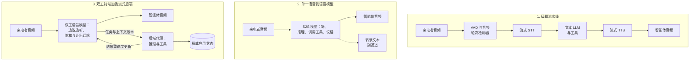

# 实时语音智能体（Real-Time Voice Agents）

语音智能体是围绕 LLM 构建的软实时媒体系统。推理相对容易，难的是**时序**：接入音频、判断人究竟何时说完、思考，并足够快地发出语音，让对话保持自然。时序失衡时，用户会和智能体同时说话、重复问题，最后挂断。本章讨论三种架构、轮次交接与插话、延迟和每分钟成本、电话接入、会话限制、评估与监管。

适用范围：如果在构建电话、客服或语音优先产品，应阅读本章；其他场景可先看[智能体基础](../07-agentic-systems/01-agent-fundamentals.md)和[工具调用](../17-tool-use-and-computer-agents/01-tool-use-landscape.md)中的通用部分。下文模型名、价格和延迟为 2026 年 10 月快照，按月变化。标为**供应商自报**的数字来自供应商；标为**推算**的每分钟数字由标价计算。

## 目录（Table of Contents）

- [三种架构](#三种架构)
- [如何选择架构](#如何选择架构)
- [技术栈](#技术栈)
- [轮次检测与插话](#轮次检测与插话)
- [延迟预算（Latency Budgets）](#延迟预算-latency-budgets)
- [每分钟成本](#每分钟成本)
- [电话接入](#电话接入)
- [会话限制与状态](#会话限制与状态)
- [对话中的工具调用](#对话中的工具调用)
- [生产关注点（Production Concerns）](#生产关注点-production-concerns)
- [评估](#评估)
- [监管与披露](#监管与披露)
- [真实成熟度（Honest Maturity）](#真实成熟度-honest-maturity)
- [面试题（Interview Questions）](#面试题-interview-questions)
- [参考资料（References）](#参考资料-references)

---

## 三种架构

直到 2026 年中，常见分类仍只有级联流水线和单一语音到语音模型。OpenAI 的语音智能体指南如今列出第三种，Google、LiveKit 和多篇 2026 年 9 月的论文也收敛于此。

**1. 级联流水线：** `mic -> VAD -> streaming STT -> turn detection -> LLM -> streaming TTS -> speaker`。音频在边界转为**文本**，每个阶段都可替换，供应商通常不同。

**2. 单一语音到语音模型（S2S）：** 一个模型听音频、推理、调用工具并输出音频，文本仅为转录副通道。现有例子包括 OpenAI Realtime API 的 `gpt-realtime-2.1` 和 `-2.1-mini`（2026 年 7 月 6 日）、Google `gemini-3.8-live`（9 月 15 日正式发布）、Amazon Nova 2 Sonic（Bedrock 将 Nova Sonic v1 的生命周期结束日期定为 9 月 14 日），以及使用 Realtime 兼容事件的 xAI `grok-voice-think-fast-2.0`。它们是**按轮次**工作，而非完全双工：Realtime API 通过 `server_vad` 或 `semantic_vad` 检测轮次，再作答。

**3. 全双工语音前端加委派式后端（说话者与思考者）：** 双工语音模型边说边听，负责何时回答、附和、停顿或让出话轮，把推理与工具调用交给独立文本模型。OpenAI 的 `gpt-live-1`（API 于 2026 年 9 月 10 日正式发布）是代表：**Responses 委派**以 OpenAI 模型为后端（官方指南建议从 `gpt-6-luna` 开始，较难任务用 `gpt-6-sol`）；**客户端委派**可把任务交给客户运行的任意代理。Gemini 3.8 Live Extended Thinking 处在第二、三类之间：虽是单模型，却能边说边在后台推理。LiveKit Agents 1.8.1（9 月 10 日）加入 `DuplexModel` 接口，arXiv 2609.19334 等预印本也把能向文本后端发出委派令牌的双工前端形式化。

| 维度 | 级联流水线 | 单一 S2S 模型 | 双工前端 + 后端 |
|------|------------|--------------|----------------|
| **轮次交接** | 运行时控制：VAD、音频轮次模型、打断分类器 | 按轮次（Realtime 使用 `server_vad` / `semantic_vad`） | 语音模型决定何时说话、附和或让出话轮 |
| **参考延迟** | Pipecat 示例拆解为 1.044 秒 | 带推理能力的模型首音频 0.70–1.21 秒（Artificial Analysis） | OpenAI 自报轮次交接为 0.798 秒，`gpt-realtime-2.1` 为 1.41 秒；Artificial Analysis 测得搭配 Astra 后端时为 1.34 秒 |
| **推理与工具** | 任意文本模型和工具栈 | 语音模型自身推理；推理强度影响延迟 | 可接任意后端，包括已有文本代理；语音持续输出时工具仍可运行 |
| **可控性** | 每一跳都有文本，可替换任何组件；可用 TTS 逐字朗读脚本 | 供应商模型一体化，语音与逻辑共用提示 | 说话风格与业务规则使用独立提示；按 LiveKit `DuplexModel` 文档，双工模型无法逐字朗读脚本 |
| **成本模型** | 各组件每分钟费用之和（打包平台约 $0.05–0.14/分钟） | 音频 token；Realtime API 每次响应都会重新发送整段对话 | GPT-Live 每会话分钟 $0.05，含静音按秒计费，另加后端 token |
| **韵律与语码转换** | 情感在 STT 边界丢失，再由文本合成；切换语言受各组件限制 | 原生听见并生成语气、笑声和重音，更自然地在句中切换语言 | 语音层原生处理韵律与附和，后端只看到文本 |
| **可观测性** | 每个边界都有文本制品 | 需要转录流用于日志 | 后端调用为可记录的文本；语音层仍需转录 |
| **必须设计的失败路径** | 端点检测税、串行的首块延迟 | 会话限制、不透明的推理失败 | 来电者改口后返回过期后端结果；语音上下文有损压缩 |

**Anthropic 没有语音 API。** Claude 接收文本和图片并返回文本，所以在语音栈中，它只能作为级联流水线的 LLM，或作为双工语音前端之后的后端（GPT-Live 客户端委派，或 ElevenLabs Agents、Retell 等平台上的 LLM 选项）。

---

## 如何选择架构

需要逐字宣读的语言（同意书、法律披露、付款条款）、逐组件审计和脱敏、领域专用 STT 模型，或极高用量的自托管栈时，选择**级联流水线**。自有 GPU 上运行开放 STT 和 TTS 或可低于托管每分钟费用，但应先与下文五分钟示例通话里 Gemini 3.8 Live 约 $0.06 的成本比较。审计人员会阅读转录的场景，级联仍是默认选择。

任务较浅、自然度最重要时，选择**单一 S2S 模型**：陪伴、教练、翻译、简单查询。价格已不再是以往的主要障碍：Gemini 3.8 Live 的音频标价为每百万 token 输入 $3、输出 $12，折合来电者音频约 $0.005/分钟、智能体输出约 $0.018/分钟。Realtime API 会重新发送对话，长通话每分钟成本随之增加。任何按 token 计费的 S2S 都应先读取长通话的用量元数据，再相信每分钟换算。

已有具备工具、安全约束和业务规则的文本代理，或任务需要真正推理时，选择**双工前端加后端**。在 tau-Voice 类基准上，任务成功率取决于语音层后面的推理能力：Google 自报 Gemini 3.8 Live Extended Thinking 为 68.6%，基础模型为 30.1%。这种拆分也划清权限：后端拥有状态与工具权限，语音层负责时序。

**混合方案很常见。** 双工前端可另接一条 TTS 路径用于必须逐字朗读的披露，因为双工模型会意译，框架能停止其音频播放，却无法停止生成；S2S 核心也可并行接 STT 流用于日志与评估。

**三种方案都不默认更快。** 传输、端点检测配置、编解码器、采样率以及如今的推理强度是主导因素；调优良好的级联在许多部署中可与 S2S 持平。

---

## 技术栈

| 层 | 当前选择（2026 年 10 月） | 说明 |
|----|--------------------------|------|
| **编排** | 开源的 LiveKit Agents 1.8.4、Pipecat 1.12.0；托管的 Vapi、Retell、Bland、ElevenLabs Agents、Deepgram Voice Agent | LiveKit 已用统一接口接入九家 S2S 提供商，“S2S 供应商很少”已不准确 |
| **S2S 与双工模型** | `gpt-live-1`、`gpt-realtime-2.1` / `-2.1-mini`、`gemini-3.8-live` / `-extended-thinking`、Nova 2 Sonic、`grok-voice-think-fast-2.0`；Azure Voice Live（兼容 Realtime，提供 `gpt-realtime-2.1`，未列出 `gpt-live-1`） | 开源全双工模型有 NVIDIA PersonaPlex（7B，基于 Moshi；供应商自报轮次交接 0.170 秒） |
| **流式 STT** | Deepgram Flux、AssemblyAI Universal-3.5 Pro Realtime、ElevenLabs Scribe v2 Realtime、OpenAI `gpt-live-transcribe`、Gemini 3.5 Transcribe Live、Cartesia Ink-2；自托管 NVIDIA `nemotron-3.5-asr-streaming-0.6b` | `whisper-1` 和 `gpt-4o-*-transcribe` 模型将于 2027 年 2 月 26 日停用 |
| **轮次检测** | LiveKit 音频 `TurnDetector`、Pipecat Smart Turn v3、STT 内置轮次结束（Deepgram Flux、Cartesia Ink-2） | LiveKit 基于转录文本的检测器已弃用 |
| **TTS** | ElevenLabs Eleven v4 Turbo（推理中位数约 100 毫秒）与 Flash v2.5（约 75 毫秒）、Deepgram Flux TTS（首音频“最快 80 毫秒”）、Cartesia Sonic 3.6、Gemini 3.8 Flash 与 Flash-Lite TTS、`gpt-4o-mini-tts`；延迟均为供应商自报 | `tts-1`、`tts-1-hd` 和 `gpt-4o-mini-tts` 快照将于 2027 年 1 月 6 日停用；OpenAI 指定 `gpt-realtime-2.1-mini` 为替代，因此仅用 OpenAI 的级联方案，TTS 阶段最后也会落到 S2S 模型。开放模型有 Chatterbox Flash（MIT）、Kokoro-82M（Apache 2.0）、Voxtral-4B-TTS（CC BY-NC，不能商用自托管） |
| **传输** | 客户端 WebRTC（UDP、Opus）；服务端到模型 WebSocket；电话网络 SIP | UDP 避免队头阻塞，WebRTC 更能处理丢包 |

**STT 准确率有了新基线。** Open ASR Leaderboard 10 月 1 日的快照使用新的八数据集平均值，不能与 2025 年数字直接比较。专有模型领先者平均 WER 为 3.59%–4.34%（Zoom、Azure、ElevenLabs Scribe v2、AssemblyAI Universal-3.5 Pro）；开放模型 Qwen3-ASR-1.7B 以 4.31% 领先（Apache 2.0），parakeet-tdt-0.6b-v2 为 4.70%、处理速度约实时的 6000 倍，whisper-large-v3 为 5.78%。两个低成本改进是偏置关键术语（姓名、SKU），并把智能体上一个问题作为上下文传给 STT（AssemblyAI 自报 WER 降低 8.9%）。

**流式转录。** 流式 STT 在用户说话时约每 50 毫秒输出部分结果，让转录与语音重叠。应区分部分转录、最终转录和端点检测三种延迟；语音智能体着重优化最后一种。

---

## 轮次检测与插话

**语音活动检测（VAD）**把每帧归为语音或静音，额外耗时约 10–50 毫秒。Silero VAD 仍是开放模型的常用默认选择（v6.2.3，2026 年 9 月 23 日）。单靠 VAD 无法区分句中停顿和轮次结束。

**端点检测从文本转向音频。** 固定静音超时对每轮都收税：要求静音 800 毫秒，就会在流水线开始前增加将近一秒。2025 年的方案是让小型 transformer 读取部分转录；2026 年的方案直接听音频，从中获得转录文本会丢失的语调与话尾变化：

| 检测器 | 工作方式 | 数据与状态 |
|--------|----------|------------|
| LiveKit `TurnDetector`（LiveKit Inference 上为 `v1`，CPU 上为 `v1-mini`） | 音频轮次结束模型，支持 14 种语言 | 启用后默认 `min_delay` 降至 0.3 秒、`max_delay` 降至 2.5 秒（原为 0.5 和 3.0）；文本检测器已弃用，计划在 Agents 2.0 移除 |
| Pipecat Smart Turn v3 | 基于 Whisper Tiny 编码器的 800 万参数模型 | CPU 上约 12 毫秒（供应商自报）；BSD-2 许可 |
| Deepgram Flux | 内置轮次结束检测的 STT | `eot_threshold` 默认 0.7；`eager_eot_threshold` 可设 0.3–0.9，默认关闭；检测约 260 毫秒（供应商自报） |
| Cartesia Ink-2 | 提供轮次事件的 STT | 发出 `turn.eager_end` 与 `turn.resume` |

**将提出建议与最终决定分开。** VAD、音频轮次模型和 STT 都可能宣布轮次结束时，必须有一个仲裁器决定。Pipecat 1.8.0（8 月 26 日）引入了这一机制，同时修复了每轮隐藏的约 0.5 秒固定延迟。这提醒我们也要测量框架本身，而不只是模型。

**推测生成用 LLM 开销换延迟。** 提前收到轮次结束信号就启动 LLM；若来电者继续说话，再丢弃结果。Deepgram 自报提前结束会让 LLM 调用增加 50%–70%。LiveKit 默认进行预生成，Pipecat 1.9.0 则把推测响应保持到轮次确认。规则是：可以推测生成 token，不能推测执行副作用。任何改变状态的工具调用必须等轮次确认（Deepgram 代理 API 的 `defer_until_eot` 就这么做）。

**插话是一套协议，而非一个 VAD 事件。** 来电者在智能体说话时开口，应完成四步：

1. **识别重叠语音。** “嗯哼”是附和，不是打断。LiveKit 自适应打断模型（自 1.5.0 起默认启用）自报在 500 毫秒重叠时精确率 86%、召回率 100%，拒绝了 51% 由 VAD 触发的插话，并会在误判后恢复播放。单纯 VAD 插话如今只是比较基线。
2. **停止所有播放。** 取消 TTS 流，也清空运营商缓冲区；Twilio Media Streams 要发送 `clear`，否则本地停止后，来电者仍会听到已缓冲的语音。
3. **将历史裁剪到来电者实际听到的部分。** 如果智能体说到半句被打断，LLM 上下文只应包含已播出的词。Deepgram Flux TTS 中断时返回的 `text_spoken` 正是为此设计。
4. **处理执行中的工作。** GPT-Live 在打断后后端仍会继续运行，应用需决定完成还是取消。Gemini Live 若收到 `turn_complete=true` 的客户端内容，会无条件中断生成。

对于双工模型，插话由模型自行处理。LiveKit 可以停止播放，但无法让模型提前停止生成。

---

## 延迟预算（Latency Budgets）

人类自然对话的轮次间隔平均约 **200 毫秒**。生产代理远未达到这一水平，2026 年的真实数字应分开看：

| 测量 | 数值 | 来源 |
|------|------|------|
| 级联单轮示例 | 1.044 秒：端点检测 0.200 + STT 0.125 + LLM 0.336 + 轮次完成 0.024 + TTS 0.359 | Pipecat 1.9.0 更新说明（示例，非基准） |
| 带推理的 S2S 首音频时间 | Grok Voice Think Fast 2.0 为 0.70 秒；Gemini 3.8 Live 为 1.18 秒；高强度 `gpt-realtime-2.1` 为 1.21 秒；搭配 Astra 后端且中等强度的 GPT-Live-1 为 1.34 秒 | Artificial Analysis（独立测量） |
| GPT-Live 轮次交接 | 0.798 秒；`gpt-realtime-2.1` 为 1.41 秒 | OpenAI（供应商自报） |
| 针对语音优化的 LLM 首个回答 token | Mercury Voice（扩散推理模型，2026 年 9 月 29 日企业正式发布）：生产语音提示中位数 320 毫秒，p95 为 750 毫秒 | Inception（供应商自报） |

调优后的全流式级联可参考以下每轮预算：

| 阶段 | 典型预算 | 说明 |
|------|----------|------|
| 网络传输（单向） | 30–80 毫秒 | WebRTC/UDP；每次 SIP 或运营商转接还会增加延迟 |
| VAD 帧判断 | 10–50 毫秒 | 持续运行 |
| 端点／轮次判断 | 200–300 毫秒 | 由轮次检测器和延迟参数决定 |
| STT 最终转录 | 语音结束后 50–150 毫秒 | 用户说话时已流式输出部分结果 |
| **LLM 首 token** | **150–400 毫秒；有推理时更长** | 通常是主要瓶颈；推理强度如今是调节旋钮 |
| TTS 首音频 | 75–360 毫秒 | 只计首块；供应商数字通常是单流测量 |
| **端到端首音频** | **约 0.8–1.1 秒** | 低于 700 毫秒需要不带推理的快速路径 |

**流式处理消除的是完整内容等待，不是首块等待。** 非流式方案要等待全部转录、全部 LLM 回答和全部音频；流式处理可去掉这些等待，但来电者说完后，端点检测、最终转录、LLM 首 token 和 TTS 首音频仍要串行进行。这也是 Pipecat 示例各项相加的原因。

按影响排序的措施：
- **让所有阶段流式处理。** 部分转录、token 流，以及在首个分句就开始合成的分块 TTS。
- **调优端点检测。** 用音频轮次模型替代长静音超时；若能承担额外 LLM 调用，再以提前结束信号推测生成。Pipecat 示例中端点检测约占 19%，TTS 约占 34%。
- **把推理移出说话路径。** 先立即回应，再委派工作。`gpt-realtime-2.1` 暴露推理强度参数，Pipecat 默认把 GPT-5.x 语音调用设为 `none`；但要确认后端确实可降低：GPT-6 Astra 没有 `none`，Claude Opus 5.5 不能关闭思考，Sonnet 5.5 最低为 `between_tools`。
- **按实际并发下的首音频时间选择 TTS。** Voxtral-4B-TTS 在 H200 上并发 1 时测得 70 毫秒，并发 32 时为 552 毫秒（供应商自报）；单流数字不能作为容量规划。
- **计算连接建立时间。** 它落在第一轮。LiveKit 1.8.2 将代理启动时间最多缩短 800 毫秒；OpenAI Realtime API 支持 IETF 草案 WARP 打包，减少 WebRTC 往返（目前主要是原生客户端，浏览器支持不完整）。

应测量来电者真正体验到的时间。OpenAI 语音指南建议分别追踪**有用的口头回答**与“我查一下”式应答的中位数和 p95。

---

## 每分钟成本

语音涉及三类不同的计费表，混淆它们是最常见的成本估算错误：

| 选项 | 标价 | 每分钟 | 主要成本驱动 |
|------|------|--------|--------------|
| **`gpt-live-1`** | 每会话分钟 $0.05，按秒计费 | $0.05 加后端 token | 会话时长，包括静音和等待后端；应关闭空闲会话 |
| **`gpt-realtime-2.1`** | 每百万音频 token 输入 $32／缓存 $0.40／输出 $64 | 来电音频约 $0.019/分钟、代理语音约 $0.077/分钟（推算） | 每次回答重新发送整段对话；若未命中缓存，通话越长，每分钟越贵 |
| **`gpt-realtime-2.1-mini`** | 每百万音频 token $10／$0.30／$20 | 输入约 $0.006、输出约 $0.024（推算） | 同样会重新发送历史 |
| **Gemini 3.8 Live**（含 Extended Thinking） | 每百万音频 token 输入 $3／输出 $12；文本 $0.75／$4.50 | 输入约 $0.005、输出约 $0.018 | 思考 token 按输出计费 |
| **xAI Grok voice** | $0.08/分钟 | $0.08 | 固定每分钟价格；文本输入另计 |
| **流式 STT** | `gpt-live-transcribe` $0.017/分钟；Deepgram Flux $0.0077/分钟（促销 $0.0065）；AssemblyAI Universal-3.5 Pro Realtime $0.45/小时；ElevenLabs Scribe v2 Realtime $0.39/小时；Gemini 3.5 Transcribe Live 约 $0.009/分钟 | $0.0065–0.017 | AssemblyAI 对空闲连接时间计费 |
| **TTS** | Gemini 3.8 Flash TTS 每百万 token 输入 $0.50／输出 $9（促销至 12 月 31 日，此后 $1／$18）；Flash-Lite TTS 每百万音频输出 token $6（此后 $12）；`gpt-4o-mini-tts` 每百万音频 token $12（快照于 2027 年 1 月 6 日停用） | 浮动 | 预算要考虑 2027 年 1 月 1 日 Gemini 价格翻倍 |
| **打包平台** | Vapi $0.05/分钟另加按成本转付的供应商费用（电话费前约 $0.08–0.13）；Retell 示例约 $0.13；Bland $0.12–0.14；ElevenLabs Agents $0.08（峰值 $0.16）；Deepgram Voice Agent $0.075（自带 LLM 与 TTS 为 $0.050）；Cartesia $0.06 | $0.05–0.14 | 平台费加模型选择 |
| **流式翻译** | `gpt-realtime-translate` $0.034/分钟；Gemini 3.5 Live Translate（预览）约 $0.037/分钟 | 每会话分钟 $0.034–0.037 | 每个目标语言需独立会话，因此会话数随说话者与语言数增长 |
| **托管与电话** | LiveKit Cloud、Pipecat Cloud 约 $0.01/分钟；Twilio Media Streams $0.0044/分钟，ConversationRelay $0.07/分钟 | | |

Realtime 的换算依据是：来电音频每 100 毫秒 1 token（每分钟 600 个），代理语音每 50 毫秒 1 token（每分钟 1200 个）。音频输入价为文本输入的 8 倍（$32 对 $4），音频输出约为文本输出的 2.7 倍（$64 对 $24）。缓存音频输入价 $0.40，比新输入低 98.75%；前缀缓存决定长通话能否保持低价。

**五分钟通话**：来电者说话 2.5 分钟，代理说话 2 分钟（推算，仅模型费用）。GPT-Live 为 $0.25 加后端 token；`gpt-realtime-2.1` 新音频约 $0.20，另加重复发送历史的费用；若整段通话持续输入来电音频，Gemini 3.8 Live 的新音频约 $0.06，另加其用量元数据表明的逐轮历史费用；Grok 为 $0.40。打包平台在电话费前约为 $0.40–0.65。原始模型音频不再总是主要开销，平台费、后端推理 token 和空闲会话时长更重要。另见[FinOps 与 token 经济学](../11-infrastructure-and-mlops/04-finops-and-token-economics.md)。

---

## 电话接入

**电话网络是窄带的。** Twilio Media Streams 固定使用 8 kHz mu-law 音频。按 16 kHz 音频训练的模型可能因此失效：Pipecat Smart Turn v3 在 Twilio 8 kHz 音频上给出错误预测，直到流水线先重采样到 16 kHz。应检查每一跳的采样率。Vonage WebSocket 接口支持 8、16 或 24 kHz 的 L16。

**现在可以直接在模型供应商处终止 SIP。** OpenAI 直接接收 SIP 中继（`sip.api.openai.com`，另有欧盟端点），信令用 TLS，媒体用 SRTP；GPT-Live 中继要求 Opus 与 SDES-SRTP。可通过 API 接听、拒绝、转接（`refer`）和挂断，DTMF 按键通过独立服务端连接到达。外呼最多振铃 3 分钟，接通后最多持续 2 小时。GPT-Live 也能通过 WebSocket 接收 8 kHz 原始 G.711 mu-law 或 A-law，xAI 语音 API 也支持 SIP。移除自有媒体中继可减少一跳，却也移除了录音、脱敏和执行同意要求的位置；先决定这些职责的归属。

**答录机检测是独立音频路径。** GPT-Live 委派不会把音频传给后端，因此语音信箱检测需要与通话并行运行具备音频能力的检测器（OpenAI 建议并行 Realtime 会话）。框架已将其组件化：Pipecat 1.12.0 将语音信箱检测器改为决策超时 1 秒的分类器，ElevenLabs Agents 增加了 Twilio 答录机检测。

**电话中的插话**还需清空运营商缓冲区；Twilio ConversationRelay 的 `interruptSensitivity` 默认 `high`，噪声线路值得调节。**DTMF 是数字输入的可靠后备**：让来电者按键输入账户号码与日期，而非口述。

---

## 会话限制与状态

每个供应商都有上限，长通话终会碰到：

| 平台 | 限制 | 应构建的机制 |
|------|------|--------------|
| **OpenAI Realtime API** | 会话最长 60 分钟；每次响应重新发送整段对话 | 裁剪并总结；更长通话需带状态重连 |
| **OpenAI GPT-Live** | 128K 上下文。超过 90% 时启动替换语音引擎，以指令加最多 8,192 token 历史作为种子，其中包括旧轮次摘要；指令最多 16,384 token。未公布最长持续时间，但存在 `expired` 关闭原因。SIP 外呼最多 2 小时 | 把槽位、预约及已验证身份存于应用状态；给上下文标版本 |
| **Gemini Live（3.8）** | 不做上下文压缩时，纯音频 15 分钟、音视频 2 分钟；单连接约 10 分钟，会有 GoAway 警告；恢复令牌有效期 2 小时 | 长通话开启滑动窗口压缩；实现重连与恢复 |
| **Amazon Nova 2 Sonic** | 连接最长 8 分钟（AWS 记录了续接模式） | 续接连接并交接状态 |

**把语音模型上下文视为缓存，而非事实来源。** GPT-Live 文档明确指出，压缩后的对话历史不是预约记录。业务依赖的信息——来电者确认了什么、预订了什么、证明了什么身份——都应存入能跨压缩、重连和模型切换的应用状态。还有两个 9 月出现的客户端陷阱：Gemini 3.8 Live Extended Thinking 中，`turnComplete` 不再表示模型空闲（应检查 `interaction_status`）；GPT-Live 没有“口头响应已结束”事件。针对旧 API 编写的状态机会在两处失效。

跨通话的持久记忆应位于文本层，参见[智能体记忆与状态](../07-agentic-systems/05-agent-memory-and-state.md)。

---

## 对话中的工具调用

**异步工具已成为平台默认能力。** Gemini 3.8 Live 默认以非阻塞方式调用工具（调度模式为 `SILENT`、`WHEN_IDLE`、`INTERRUPTED`；Extended Thinking 仅允许异步）。`gpt-realtime-2` 工作时可先说引导语。LiveKit 1.6.0 加入了带填充语与可取消标记的异步工具，Pipecat 支持异步函数调用，ElevenLabs Agents 自 9 月 21 日起默认并行调用工具。“工具运行时说点什么”已能实现，难题转向以下四项：

- **取消。** 查询或预约执行中，来电者改变主意。每个工具都需取消路径，语音层也需知道取消了什么。
- **重复。** 推测轮次与确认轮次都触发同一工具；应对每个逻辑动作使用幂等键（LiveKit 提供 `on_duplicate="confirm"`）。
- **过期结果。** 后端按旧日期查询时，来电者更正了日期。每次委派都附上下文版本，丢弃版本已过期的结果；GPT-Live 迁移指南正是这样建议。
- **口头承诺与已完成动作。** OpenAI 建议迁移 GPT-Live 时关闭并行工具调用，并验证口头确认与实际完成的动作一致。“您的预约已完成”必须根据预约结果生成，而不能只根据模型意图生成。

从单一 S2S 提示迁移到 GPT-Live 时，应拆分提示：说话风格放在语音会话指令里，业务规则、工具和权限放在后端。

---

## 生产关注点（Production Concerns）

**关键实体捕获是主要故障。** 智能体一旦听错姓名、邮箱或验证码，后续步骤就会失败。2026 年 9 月的 tau-Elicitation 预印本（arXiv 2609.13602）测试了四种语音配置：在文本代理能完全成功的任务上，准确捕获姓名、ID 和日期的稳健成功率仅为 0.14–0.41；已确认的捕获错误中，只有 24%–37% 被修复。加入拼读、回读、纠正、确认流程后，稳健 Pass^3 提高 14–31 个百分点，但每通电话多花 21–28 秒。关键槽位应有确认流程；数字可用 DTMF；姓名和 SKU 做关键词偏置；低置信度片段转为澄清问题；错误代价高时接受额外耗时。

**隐私与保留规则因端点、供应商而异：**

| 供应商 | 需要核对的事项 |
|--------|----------------|
| OpenAI | `/v1/realtime` 为滥用监测保留数据 30 天，符合零数据保留申请条件；`/v1/live/sessions` 在有限制条件下符合要求；文件转录 `/v1/audio/transcriptions` 不保留数据，但流式转录使用单独的 Realtime 端点，应核对实际调用端点 |
| Vapi | HIPAA 模式不能同时启用零数据保留；HIPAA 每月收费 $2,000 |
| ElevenLabs | BAA 只面向 Enterprise，且要求零保留 |
| Deepgram | Flux 拒绝实体脱敏请求；Nova 流式转录支持 |
| AssemblyAI | 流式转录仅对最终轮次脱敏，不处理部分结果，也不对音频脱敏 |
| LiveKit | 1.7.0 将 PII 脱敏扩展到音频录制 |

STT 与平台选择会约束合规方案，因此不仅要检查最终文本，也要检查部分转录和录音的脱敏情况。

**安全。** 音频也是提示注入渠道。预印本报告，难以察觉的音频注入在 13 种音频语言模型上成功率为 79%–96%，包括让商业语音代理执行未经授权动作（AudioHijack，arXiv 2604.14604）；叠加在并发语音上的注入针对 Gemini 3 Pro 成功率 69.1%（arXiv 2607.28165）；通过口头打断实施的越狱成功率 48.7%（DuplexJail）。工具授权必须由确定性的后端策略执行，不能放在语音模型的提示里。声音也不能用作身份认证：克隆声音成本很低（ElevenLabs Eleven v4 用 10 秒音频即可克隆），FBI 于 2025 年 5 月警告有人用 AI 语音消息冒充美国高级官员，Pindrop 自报 2024 年联络中心诈骗损失达 125 亿美元。应通过带外方式核验身份。

**可观测性。** LiveKit 1.8.0 转向 OpenTelemetry GenAI 语义约定（属性名出现破坏性变更），新增 `realtime_inference` span，并在导出前于进程内移除 PII。Pipecat 1.9.0 提供逐阶段延迟拆解。GPT-Live 用量事件是累计快照，求和会重复计算；后端用量另行报告。框架升级会改变属性名，仪表盘查询应固定到版本。

---

## 评估

**按 OpenAI 建议由易到难推进：**先使用合成语音，再回放真人录音，最后使用独立模拟来电者。任务结果须与后端状态核对（预约是否真的完成、日期是否正确），不能只看转录。加入噪声、口音、8 kHz 音频等声学压力，以及各语言专项数据包。

**能捕捉真实失败的指标：**有用的口头回答的中位数与 p95 时间、误判插话率、端点检测 p95 延迟、关键实体准确捕获率、经后端验证的任务成功率，以及人工接管率。Sierra 的上线准备清单覆盖延迟、轮次交接、听辨、上下文、行动、安全约束与接管。

| 基准 | 衡量内容 | 当前数字 |
|------|----------|----------|
| **tau-Voice**（Sierra，arXiv 2603.13686，2026 年 3 月） | 含噪声、口音和打断的全双工语音工具任务 | 文本代理 85%；语音在干净音频下 31%–51%，真实条件下 26%–38%；79%–90% 的失败来自代理行为 |
| **tau-bench 语音排行榜**（Sierra） | 零售、航空、电信、银行 | `gpt-live-1` pass@1 为 81.7%（据发布报道搭配中等强度 GPT-6 Astra）；Pine Voice Preview 75.4%；`grok-voice-think-fast-1.0` 67.3% |
| **供应商自报** | 同类任务 | Google：Gemini 3.8 Live Extended Thinking 68.6%，基础版 30.1%；其表格中搭配 Astra 的 GPT-Live-1 为 67.9%。OpenAI：搭配 Astra 后端时，GPT-Live 首次成功率 83.6%，`gpt-realtime-2.1` 为 45.7%。这些数字不可与排行榜或彼此直接比较 |
| **tau-Elicitation**（arXiv 2609.13602，预印本） | 准确捕获姓名、ID、日期 | 稳健准确成功率 0.14–0.41 |
| **tau-Multilingual**（arXiv 2609.35820，预印本） | 非英语任务 | 西班牙语、葡萄牙语和印地语与英语差距不超过 3.2 分；韩语低 14.7 分、普通话低 8.4 分 |
| **APEX-Voice**（arXiv 2609.34973，预印本） | 专业多步骤流程 | 没有前沿语音系统的 Pass@1 高于 25%；最佳 Reliable@3 为 10.8%；有状态协调是主要故障 |
| **Artificial Analysis 语音到语音** | 推理、对话动态、延迟 | Big Bench Audio 已饱和（领先分数 97.6%–99.7%）；Conversational Dynamics：StepAudio 3 为 98.9%，GPT-Live-1 为 97.3%，Gemini 3.8 Live 为 96.1% |

双工分数必须注明后端模型：同一语音层接入不同后端，得分可能相差很大。工具支持部分跟上了：OpenAI Agents SDK v0.21.0 增加语音测试模块（截至 v0.22.3 尚不支持 GPT-Live），Pipecat 提供带 LLM 评审的脚本化评估 CLI。另见[评估智能体系统](../07-agentic-systems/10-evaluating-agentic-systems.md)。

---

## 监管与披露

| 规则 | 状态 | 对语音智能体的要求 |
|------|------|--------------------|
| **欧盟 AI 法案第 50 条** | 自 2026 年 8 月 2 日适用；只有在此前上市的系统，其合成音频机器可读标记才有至 12 月 2 日的宽限期 | 首次交互时告知来电者正在与 AI 对话。欧盟委员会 7 月 20 日指南还要求代理披露代表谁行动；公众普遍知道 AI 的存在，不代表具体交互就显而易见 |
| **欧盟合成内容标记实践守则**（2026 年 6 月 10 日定稿） | 自愿选择的合规路径 | 至少两层标记（签名元数据加不可察觉水印）；纯音频内容允许口头声明 |
| **美国 FCC 24-17**（2024 年 2 月） | 已生效 | TCPA 将 AI 生成语音视为“人工或预录语音”，因此 AI 外呼需事先明确同意（电话营销需书面同意）；逐通话保留同意记录 |
| **FCC 24-84**（2024 年 8 月） | 拟议规则，未查到最终规则 | 拟要求征求同意和每次通话开始时披露 AI；即使如此仍建议披露 |
| **FCC 撤销同意规则**（2026 年 9 月 30 日通过） | 已通过；联邦公报发布后 30 天生效（截至 2026 年 10 月初尚未发布） | 取代 2024 年“一次撤销全部”规则：来电者可把退出限制在所针对的信息类来电，但退出电话营销仍适用于全部电话营销。只有明确、显著披露时才可将一种方式设为唯一退出方式（语音代理可用自动语音或按键退出）；否则任何合理请求都有效，代理须识别口头退出并记录其范围 |
| **加州 AB 2905** | 2025 年 1 月 1 日起实施 | 实时自然语音必须在自动拨号消息播放前披露 AI 生成语音 |
| **得克萨斯州 TRAIGA** | 2026 年 1 月 1 日生效 | 政府机构和医疗服务提供者承担披露义务；声纹属于生物识别标识符 |
| **陪伴聊天机器人法规** | 加州（SB 243）、纽约、新罕布什尔和夏威夷已立法；另八州法规于 2027 年生效（康涅狄格、俄勒冈、华盛顿于 1 月 1 日） | 若语音产品属于陪伴代理，须遵守 AI 披露和未成年人保护要求 |

**设计后果：**开场白用固定脚本口头说明这是 AI 以及它代表哪家机构；若双工模型无法逐字朗读，则通过 TTS 播放。所有合成音频加水印。Gemini Live 已在音频中嵌入 SynthID。水印是合规信号，不是防欺诈控制：已有研究能去除 AudioSeal、WavMark、SilentCipher、Perth 等常见音频水印，检测器也只覆盖自家供应商输出。

**声音克隆与虚拟形象。** 克隆任何声音都应保存同意记录（Gemini Flash-Lite TTS 声音复制要求验证同意；田纳西州 ELVIS 法保护声音形象）。语音代理也开始有“脸”：据报 Google Live Avatar 于 9 月 25 日在 Gemini Enterprise 正式发布；Tavus 自报其研究中 48% 的参与者在一分钟通话后把 Griffin 虚拟形象当成真人。上述披露义务同样适用于带形象的代理。另见[多模态生成](../19-multimodal-generation/01-multimodal-generation.md#来源与安全)与[AI 治理与合规](../13-reliability-and-safety/04-ai-governance-and-compliance.md)。

---

## 真实成熟度（Honest Maturity）

2026 年 10 月已经做得较好的是：处理附和与打断的双工轮次交接、优于静音阈值的音频轮次检测、带口头进度的异步工具、直连模型供应商的 SIP，以及低到让平台费在许多账单中超过模型费的原始音频价格。

仍然困难的是准确捕获姓名、ID 和日期；有状态多步骤任务（APEX-Voice 上没有系统的 Pass@1 超过 25%）；主要欧洲语言之外的非英语质量；长通话的会话与连接限制；双工模型逐字朗读合规文本；以及音频提示注入。

部署也反映出这些限制。2026 年 7 月，Taco Bell 在约 890 家餐厅使用 Omilia 语音点餐，现会选择性挑选门店；此前 2025 年一次病毒式传播的“18,000 杯水”订单曾拖慢上线。7 月报道援引的一项 Metrigy 调查称，80% 消费者更喜欢真人点餐。生产方案是对订单设置合理性上限、按门店和时段切换回人工，以及以人工干预率作为上线关口。

**能力差距缩小了，但需要接上推理。** 2026 年 3 月的 tau-Voice 论文发现，真实条件下语音代理只保留等价文本代理约 30%–45% 的任务能力。到 5 月，Sierra 报告前沿分数为 67%（`grok-voice-think-fast-1.0`），约为文本能力的 79%，而 2025 年 8 月 `gpt-realtime-1.0` 仅为 30%。9 月领先者将语音层接上推理后端，或使用思考模式；不带推理的纯 S2S 仍接近旧区间（Gemini 3.8 Live 基础版：Google 自报 30.1%）。**语音仍不是“文本代理加个麦克风”。** 余下差距主要在准确听清关键实体与长通话状态保持，因此应明确确认关键槽位、在后端保留权威状态、设置人工接管，并在噪声、打断和 8 kHz 音频条件下评估。

---

## 面试题（Interview Questions）

### Q: 讲讲语音智能体的延迟预算。毫秒都花在哪，最重要的杠杆是什么？

**Strong answer:**
人类轮次间隔约 200 毫秒，生产代理约为 0.8–1.3 秒。Pipecat 的级联示例为 1.044 秒：端点检测 200 毫秒、最终转录 125 毫秒、LLM 首 token 336 毫秒、轮次完成 24 毫秒、TTS 首音频 359 毫秒。独立测量的带推理 S2S 首音频为 0.70–1.34 秒，因此 S2S 不自动更快。流式处理必不可少，但它去掉的是整段内容等待，而非首块等待；来电者停下后，端点检测、最终转录、首 token 和首音频仍串行发生。因此流式处理之后最大的杠杆是端点检测：用音频轮次检测器代替静音超时；若能接受多 50%–70% 的 LLM 调用，再用提前轮次结束信号推测生成，但有副作用的工具必须等轮次确认。随后把推理移出说话路径（先回应再委派，并选择真正能降低推理强度的后端），按实际并发下的首音频延迟选 TTS。衡量有用回答的中位数与 p95，并与应答语分开统计。

### Q: 级联流水线、单一 S2S 模型、双工前端加后端，如何选择？

**Strong answer:**
我先看通话必须保证什么。需要逐字披露、逐阶段审计与脱敏，或领域专用 STT 时，使用级联流水线；边界上的文本提供日志、可替换组件与策略钩子。任务浅、自然度优先时，单一 S2S 最简单；Gemini 3.8 Live 来电音频约 $0.005/分钟、代理音频约 $0.018/分钟，价格也低。使用 Realtime API 时要注意长通话成本增长与 60 分钟会话上限。若已有带工具和规则的文本代理，或任务确需推理，我会在前面放 GPT-Live 等双工语音前端：每会话分钟 $0.05 加后端 token，轮次交接自然，而且后端负责状态和工具权限。代价是工程复杂度：有损压缩的语音上下文、来电者改口后的过期结果，以及无法逐字朗读脚本。因此权威状态留在应用中，每次委派标版本，必须逐字披露的内容走 TTS。无论选哪种方案，工具授权都应置于语音模型之外，因为音频提示注入有效。

---

## 参考资料（References）

- Sierra, "tau-Voice: advancing agent benchmarking to knowledge and voice" arXiv:2603.13686
- OpenAI，[语音代理指南](https://developers.openai.com/api/docs/guides/voice-agents)、[GPT-Live 对话](https://developers.openai.com/api/docs/guides/live-conversations)、[GPT-Live 迁移](https://developers.openai.com/api/docs/guides/live-migration)、[语音延迟与成本](https://developers.openai.com/api/docs/guides/voice-latency-cost)及 [SIP](https://developers.openai.com/api/docs/guides/voice-sip)
- Google，[Gemini 3.8 Live 模型页](https://ai.google.dev/gemini-api/docs/models/gemini-3.8-live)和 [Live API 会话管理](https://ai.google.dev/gemini-api/docs/live-api/session-management)
- Sierra，《tau-Voice: Benchmarking Full-Duplex Voice Agents on Real-World Domains》（arXiv:2603.13686）、[tau-Voice 基准文章](https://sierra.ai/blog/tau-voice-benchmarking-real-time-voice-agents-on-real-world-tasks)与 [tau-bench 排行榜](https://taubench.com/)
- LiveKit，[轮次检测文档](https://docs.livekit.io/agents/build/turns/turn-detector/)、[自适应打断](https://livekit.com/blog/adaptive-interruption-handling)和 [Agents 版本](https://github.com/livekit/agents/releases)
- Pipecat，[版本](https://github.com/pipecat-ai/pipecat/releases)及 [Smart Turn v3](https://huggingface.co/pipecat-ai/smart-turn-v3)
- Deepgram，[Flux TTS 概览](https://developers.deepgram.com/docs/flux-tts/overview)及[更新日志](https://developers.deepgram.com/changelog)
- Hugging Face，[Open ASR 排行榜](https://huggingface.co/spaces/hf-audio/open_asr_leaderboard)
- Artificial Analysis，[语音到语音排行榜](https://artificialanalysis.ai/speech-to-speech)
- Twilio，[Media Streams WebSocket 消息](https://www.twilio.com/docs/voice/media-streams/websocket-messages)
- FCC，[关于 AI 生成语音的 FCC 24-17 解释性裁决](https://docs.fcc.gov/public/attachments/FCC-24-17A1.pdf)
- 欧盟委员会，[第 50 条透明度指南](https://digital-strategy.ec.europa.eu/en/library/guidelines-transparency-obligations-providers-and-deployers-ai-systems)及[AI 生成内容实践守则](https://digital-strategy.ec.europa.eu/en/policies/code-practice-ai-generated-content)
- Cekura, [voice AI evaluation metrics](https://www.cekura.ai/blogs/voice-ai-evaluation-metrics)

---

*Previous: [Safety and Governance](../17-tool-use-and-computer-agents/07-safety-and-governance.md) · Next: [Multimodal Generation](../19-multimodal-generation/01-multimodal-generation.md)*
